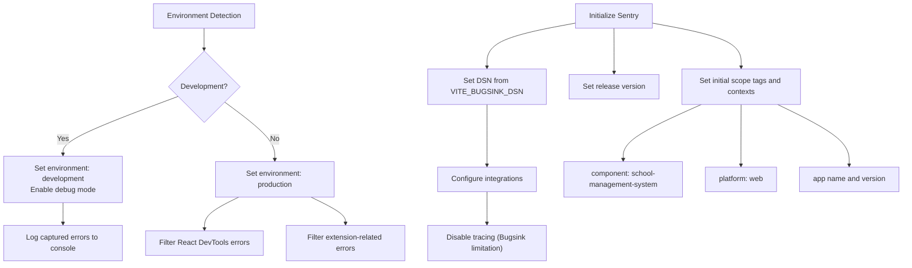
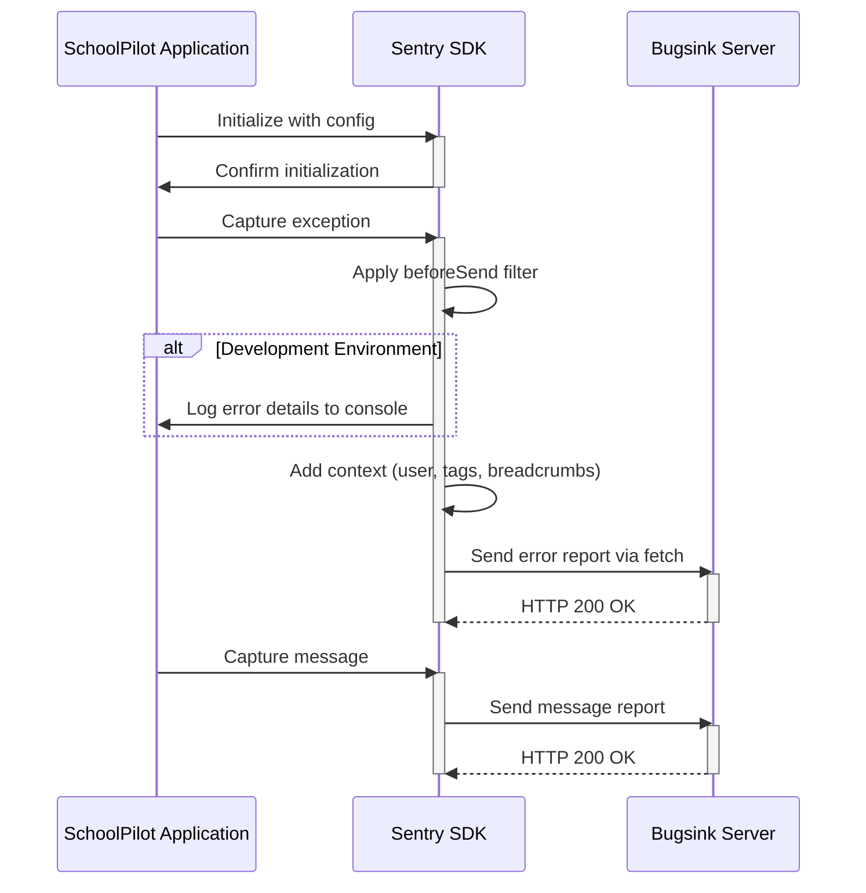
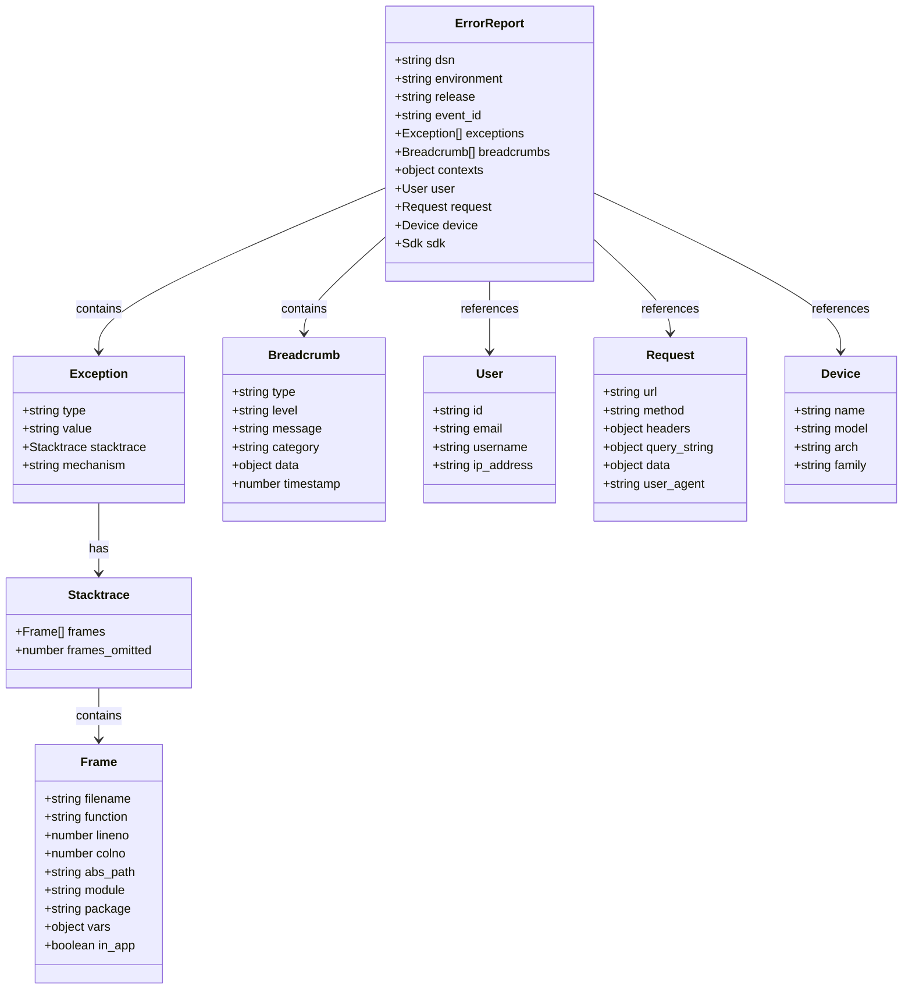
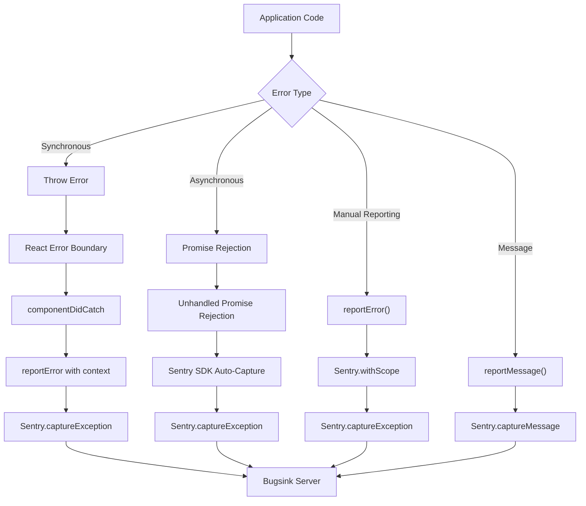
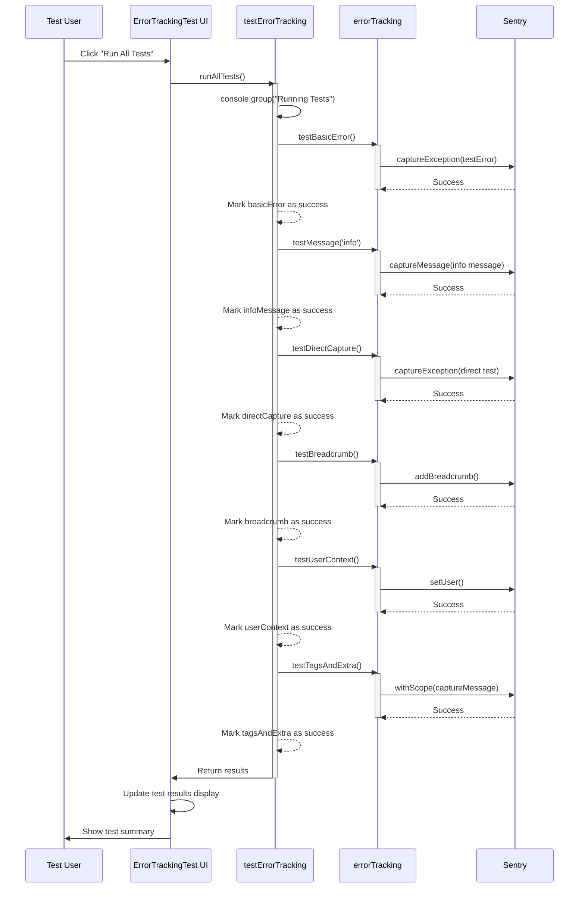
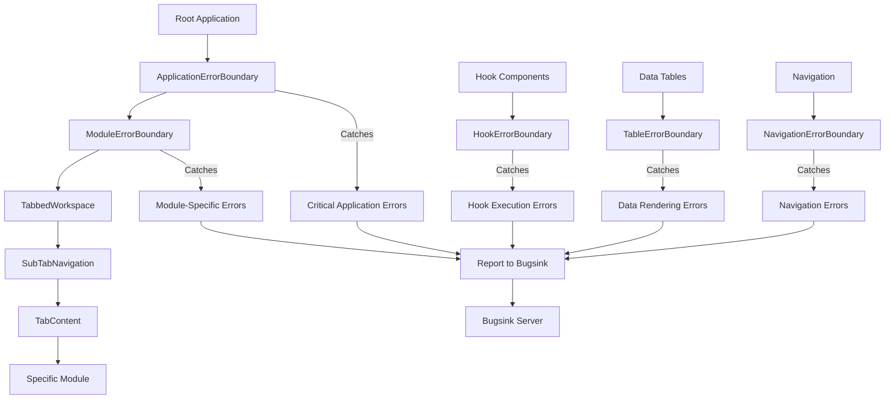

# Error Tracking Integration

<cite>
**Referenced Files in This Document**   
- [errorTracking.ts](file://src/config/errorTracking.ts)
- [testErrorTracking.ts](file://src/utils/testErrorTracking.ts)
- [ApplicationErrorBoundary.tsx](file://src/components/ApplicationErrorBoundary.tsx)
- [ErrorTrackingTest.tsx](file://src/components/ErrorTrackingTest.tsx)
</cite>

## Table of Contents
1. [Error Tracking Configuration](#error-tracking-configuration)
2. [External Monitoring Integration](#external-monitoring-integration)
3. [Diagnostic Data Collection](#diagnostic-data-collection)
4. [Error Instrumentation and APIs](#error-instrumentation-and-apis)
5. [Testing and Validation](#testing-and-validation)
6. [Error Handling and Boundaries](#error-handling-and-boundaries)
7. [Common Issues and Optimization](#common-issues-and-optimization)

## Error Tracking Configuration

The error tracking system in schoolpilot3 is configured through the `errorTracking.ts` file, which sets up integration with a self-hosted Bugsink instance (compatible with Sentry SDK). The configuration includes several key parameters that control error reporting behavior.

**Configuration Options:**
- **Error Reporting Endpoint**: The DSN (Data Source Name) is defined by `BUGSINK_DSN`, which defaults to a self-hosted Bugsink instance if not provided via environment variables.
- **Sampling Rates**: The system uses a 100% sampling rate (`sampleRate: 1.0`) for error tracking, ensuring all errors are reported. This is feasible due to the self-hosted nature of Bugsink.
- **Severity Thresholds**: The configuration does not implement severity-based filtering at the client level, but allows custom severity levels when reporting messages.
- **Privacy Filters**: The system enables sending PII (Personally Identifiable Information) with `sendDefaultPii: true`, which is safe due to the self-hosted deployment.



**Diagram sources**
- [errorTracking.ts](file://src/config/errorTracking.ts#L1-L151)

**Section sources**
- [errorTracking.ts](file://src/config/errorTracking.ts#L1-L151)

## External Monitoring Integration

The system integrates with Bugsink, a self-hosted error monitoring service compatible with the Sentry protocol. This integration allows the schoolpilot3 application to report errors, messages, and diagnostic information to a centralized dashboard for monitoring and analysis.

**Integration Details:**
- **SDK**: Uses `@sentry/react` SDK configured to work with Bugsink
- **Transport**: Utilizes `Sentry.makeFetchTransport` for sending error reports
- **Compatibility**: Bugsink does not support performance tracing, so all tracing features are disabled
- **Initialization**: The `initializeErrorTracking()` function handles the setup process, including DSN validation and user context initialization

The payload structure for error reports includes comprehensive diagnostic information:

**Error Report Payload Structure:**
- **Event Metadata**: 
  - `dsn`: Data Source Name for authentication
  - `environment`: Development or production
  - `release`: Application version
  - `tags`: Component and platform identifiers
- **Exception Data**:
  - `values`: Array of exception objects with message, type, and stack trace
  - `mechanism`: Error capture mechanism
- **Context Information**:
  - `contexts.app`: Application name and version
  - `user`: User ID, email, and username (when available)
  - `request`: URL and user agent
- **Additional Data**:
  - Breadcrumbs for event sequencing
  - Custom contexts and tags
  - Device and browser information



**Diagram sources**
- [errorTracking.ts](file://src/config/errorTracking.ts#L88-L132)

**Section sources**
- [errorTracking.ts](file://src/config/errorTracking.ts#L1-L151)

## Diagnostic Data Collection

The error tracking system captures comprehensive diagnostic data to facilitate effective debugging and issue resolution. This data collection occurs at multiple levels, from automatic error capture to manual instrumentation.

**Component Stack Capture:**
The system automatically captures the React component stack when errors occur, providing context about the UI hierarchy where the error originated. This is particularly useful for identifying which components are involved in error scenarios.

**User Context:**
User information is automatically attached to error reports when available:
- User ID, email, and username are extracted from localStorage
- IP address can be automatically included (using `{{auto}}` placeholder)
- Custom user attributes can be added as needed

**Application State Capture:**
While the core error tracking doesn't automatically capture application state, developers can manually include relevant state information in error reports:

```typescript
reportError(error, {
  testType: 'async-error',
  timestamp: new Date().toISOString(),
  userAction: 'manual-test',
  component: 'ErrorTrackingTest',
  applicationState: {
    currentTab: 'academics',
    activeModule: 'exam-scheduling',
    userRole: 'administrator'
  }
});
```

**Additional Diagnostic Data:**
- **Breadcrumbs**: Automatic recording of user actions and application events
- **Session Information**: Browser type, version, and operating system
- **Network Conditions**: Online/offline status and connection type
- **Performance Metrics**: Page load times and resource loading



**Diagram sources**
- [errorTracking.ts](file://src/config/errorTracking.ts#L39-L91)
- [ApplicationErrorBoundary.tsx](file://src/components/ApplicationErrorBoundary.tsx#L50-L85)

**Section sources**
- [errorTracking.ts](file://src/config/errorTracking.ts#L1-L151)
- [ApplicationErrorBoundary.tsx](file://src/components/ApplicationErrorBoundary.tsx#L1-L161)

## Error Instrumentation and APIs

The system provides several APIs for manual error reporting and instrumentation, allowing developers to capture specific errors and events beyond automatic error capture.

**Custom Error Reporting APIs:**

```typescript
// Report an error with additional context
export const reportError = (error: Error, context?: Record<string, any>): void => {
  Sentry.withScope((scope) => {
    if (context) {
      scope.setContext('additional', context);
    }
    Sentry.captureException(error);
  });
};

// Report a message with specified severity level
export const reportMessage = (message: string, level: Sentry.SeverityLevel = 'info'): void => {
  Sentry.captureMessage(message, level);
};

// Performance monitoring (disabled for Bugsink)
export const startTransaction = (name: string): null => {
  return null;
};
```

**Error Instrumentation Examples:**

1. **Basic Error Reporting:**
```typescript
try {
  // Risky operation
  performCriticalOperation();
} catch (error) {
  reportError(error, {
    operation: 'critical-data-processing',
    userId: currentUser.id,
    timestamp: new Date().toISOString()
  });
}
```

2. **Async Error Handling:**
```typescript
const handleAsyncOperation = async () => {
  try {
    await asyncDataFetch();
  } catch (error) {
    reportError(error as Error, {
      testType: 'async-error',
      timestamp: new Date().toISOString(),
      userAction: 'data-fetch',
      component: 'DashboardComponent'
    });
  }
};
```

3. **Custom Message Reporting:**
```typescript
// Informational message
reportMessage('User completed profile setup', 'info');

// Warning message
reportMessage('Low disk space warning', 'warning');

// Error message
reportMessage('Failed to connect to database', 'error');
```

4. **Breadcrumb Recording:**
```typescript
// Record user actions
Sentry.addBreadcrumb({
  message: 'User clicked submit button',
  category: 'user-action',
  level: 'info',
  data: {
    buttonId: 'submit-form',
    formName: 'student-registration'
  }
});
```

**Unhandled Promise Rejections:**
While not explicitly configured in the code, the Sentry SDK automatically captures unhandled promise rejections. This ensures that asynchronous errors are reported even if they're not caught with try-catch blocks.



**Diagram sources**
- [errorTracking.ts](file://src/config/errorTracking.ts#L130-L150)
- [ApplicationErrorBoundary.tsx](file://src/components/ApplicationErrorBoundary.tsx#L50-L85)

**Section sources**
- [errorTracking.ts](file://src/config/errorTracking.ts#L1-L151)

## Testing and Validation

The system includes comprehensive testing utilities to validate error reporting workflows during development and testing. These tools ensure that the error tracking integration is functioning correctly before deployment.

**testErrorTracking.ts Utility:**
This utility provides methods to test various aspects of the error tracking system:

```typescript
export const testErrorTracking = {
  // Test basic error reporting
  testBasicError: () => { /* ... */ },
  
  // Test message reporting at different levels
  testMessage: (level: 'info' | 'warning' | 'error') => { /* ... */ },
  
  // Test direct Sentry capture
  testDirectCapture: () => { /* ... */ },
  
  // Test breadcrumb functionality
  testBreadcrumb: () => { /* ... */ },
  
  // Test user context
  testUserContext: () => { /* ... */ },
  
  // Test tags and extra data
  testTagsAndExtra: () => { /* ... */ },
  
  // Run all tests
  runAllTests: async () => { /* ... */ }
};
```

**ErrorTrackingTest Component:**
A UI component that provides a test panel for verifying error tracking integration:

- **Individual Test Buttons**: Allow testing of specific error tracking features
- **Run All Tests**: Executes all test methods and reports results
- **Visual Feedback**: Shows success/failure status for each test
- **Connection Status**: Displays current Bugsink DSN configuration and environment



**Diagram sources**
- [testErrorTracking.ts](file://src/utils/testErrorTracking.ts#L0-L152)
- [ErrorTrackingTest.tsx](file://src/components/ErrorTrackingTest.tsx#L0-L226)

**Section sources**
- [testErrorTracking.ts](file://src/utils/testErrorTracking.ts#L0-L152)
- [ErrorTrackingTest.tsx](file://src/components/ErrorTrackingTest.tsx#L0-L226)

## Error Handling and Boundaries

The application implements a hierarchical error boundary system to handle errors at different levels of the component tree, preventing complete application crashes while maintaining usability.

**ApplicationErrorBoundary:**
The top-level error boundary that catches critical application errors:

- **Error Isolation**: Prevents a single error from crashing the entire application
- **Retry Mechanism**: Allows users to retry after an error occurs
- **Error ID Generation**: Creates unique identifiers for each error instance
- **Comprehensive Reporting**: Captures error details, component stack, and user context

```typescript
class ApplicationErrorBoundary extends Component<Props, State> {
  static getDerivedStateFromError(error: Error): Partial<State> {
    const errorId = `app-error-${Date.now()}-${Math.random().toString(36).substr(2, 9)}`;
    return {
      hasError: true,
      error,
      errorId
    };
  }

  componentDidCatch(error: Error, errorInfo: ErrorInfo) {
    // Report error to Bugsink
    reportError(error, {
      errorId,
      componentStack: errorInfo.componentStack,
      errorBoundary: 'ApplicationErrorBoundary',
      retryCount: this.state.retryCount,
      timestamp: new Date().toISOString(),
      userAgent: navigator.userAgent,
      url: window.location.href
    });
  }
}
```

**ModuleErrorBoundary:**
A specialized error boundary for isolating module-level failures:

- **Module Isolation**: Allows other modules to continue functioning when one module fails
- **Custom Fallbacks**: Supports custom fallback components for specific modules
- **Retry Functionality**: Provides a retry button for transient errors

**HookErrorBoundary:**
Handles errors that occur within React hooks, which cannot be caught by regular component error boundaries:

- **Hook Error Specific**: Designed to catch errors in custom hooks
- **Automatic Retry**: Implements exponential backoff for automatic retry attempts
- **Manual Retry Option**: Provides a manual retry button for users



**Diagram sources**
- [ApplicationErrorBoundary.tsx](file://src/components/ApplicationErrorBoundary.tsx#L1-L161)
- [ModuleErrorBoundary.tsx](file://src/components/ModuleErrorBoundary.tsx#L1-L54)
- [HookErrorBoundary.tsx](file://src/components/HookErrorBoundary.tsx#L1-L102)

**Section sources**
- [ApplicationErrorBoundary.tsx](file://src/components/ApplicationErrorBoundary.tsx#L1-L161)
- [ModuleErrorBoundary.tsx](file://src/components/ModuleErrorBoundary.tsx#L1-L54)
- [HookErrorBoundary.tsx](file://src/components/HookErrorBoundary.tsx#L1-L102)

## Common Issues and Optimization

The error tracking implementation addresses several common issues that can affect the effectiveness of error monitoring systems.

**Excessive Error Noise:**
The system implements filtering to reduce noise from non-actionable errors:

```typescript
beforeSend(event, hint) {
  // Filter out development-only errors in production
  if (isProduction) {
    // Skip React DevTools errors
    if (event.exception?.values?.[0]?.value?.includes('React DevTools')) {
      return null;
    }
    
    // Skip extension-related errors
    if (event.exception?.values?.[0]?.value?.includes('extension')) {
      return null;
    }
  }
}
```

**Incomplete Stack Traces:**
While the system relies on the Sentry SDK for stack trace collection, developers should ensure source maps are properly configured in production builds to maintain readable stack traces.

**Network-Related Reporting Failures:**
The system handles transport errors gracefully:

- Uses `Sentry.makeFetchTransport` for reliable error reporting
- Implements no special retry logic (relies on Sentry SDK defaults)
- Logs initialization failures to the console for debugging

**Performance Impact Optimization:**
The implementation minimizes performance impact through several strategies:

- **Selective Tracing**: Disables performance tracing (`tracesSampleRate: 0`) since Bugsink doesn't support it
- **Development Logging**: Only logs detailed error information in development mode
- **Efficient Filtering**: Implements lightweight error filtering in `beforeSend`
- **Asynchronous Reporting**: Error reports are sent asynchronously to avoid blocking the main thread

**Configuration Recommendations:**
- **Error Grouping**: Configure grouping in Bugsink dashboard based on error type, component, and stack trace
- **Alerting Rules**: Set up alerts for high-frequency errors, critical error types, and errors affecting multiple users
- **Sampling Adjustments**: Consider reducing sample rate in production if volume is too high (currently 100%)
- **Data Retention**: Configure appropriate retention policies in Bugsink based on organizational requirements

**Troubleshooting Guide:**
1. **Errors not appearing in Bugsink**:
   - Verify `VITE_BUGSINK_DSN` is correctly configured
   - Check browser console for initialization errors
   - Test with `ErrorTrackingTest` component

2. **Missing user context**:
   - Ensure user data is stored in localStorage with key 'user'
   - Verify user object structure matches expected format (id, email, username)

3. **High error volume**:
   - Review `beforeSend` filtering rules
   - Consider implementing additional client-side filtering
   - Adjust sampling rate if appropriate

4. **Incomplete diagnostic data**:
   - Verify source maps are properly generated and uploaded
   - Check network connectivity and CORS configuration
   - Ensure sufficient permissions for Bugsink access

**Section sources**
- [errorTracking.ts](file://src/config/errorTracking.ts#L1-L151)
- [ApplicationErrorBoundary.tsx](file://src/components/ApplicationErrorBoundary.tsx#L1-L161)