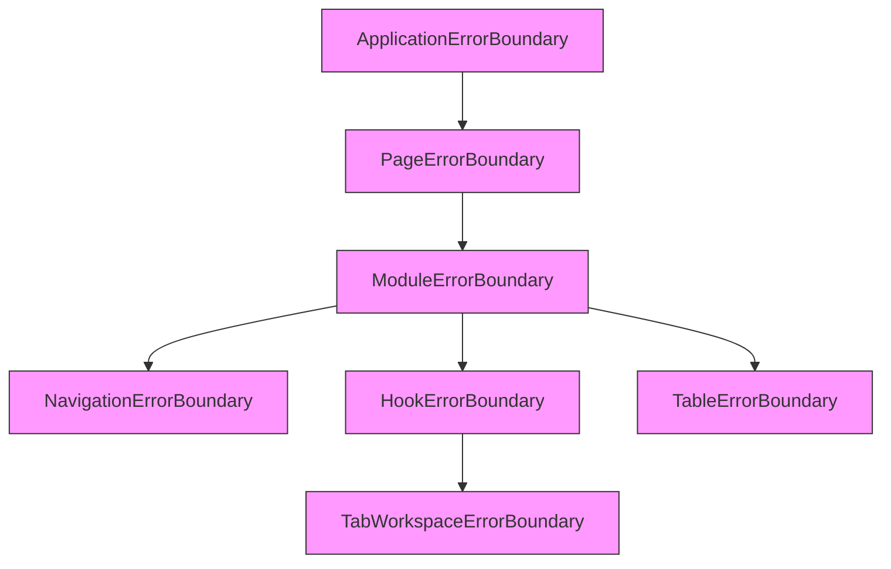
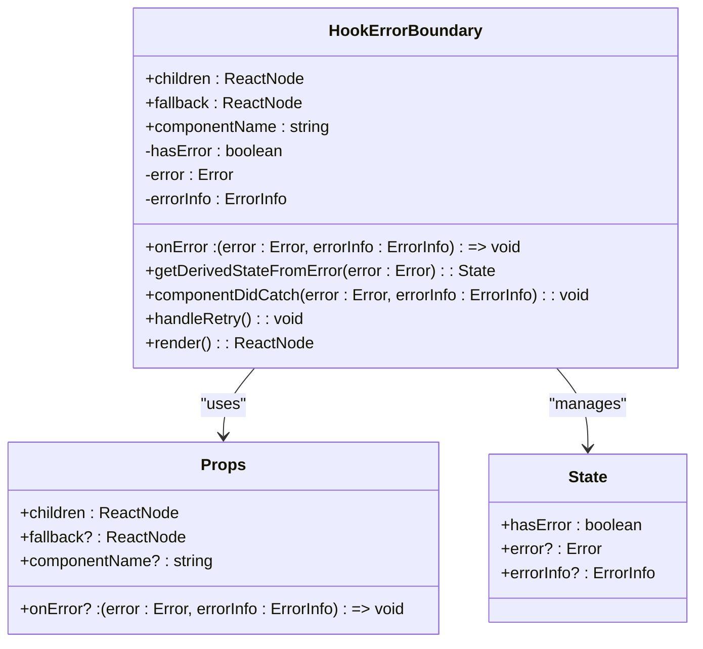
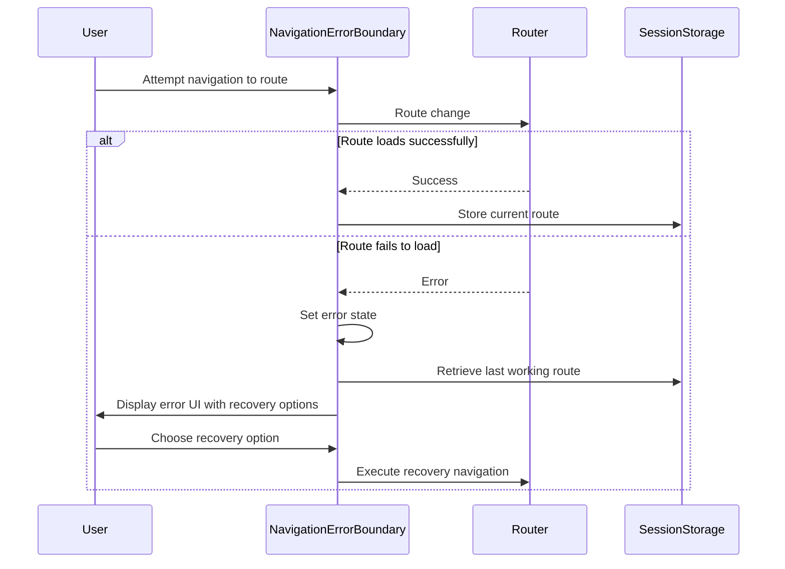
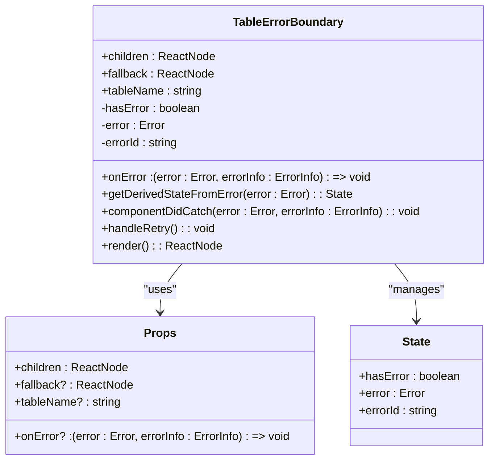
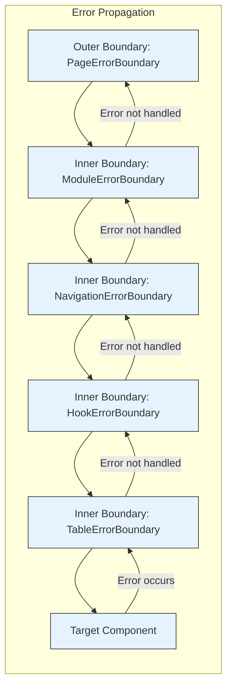
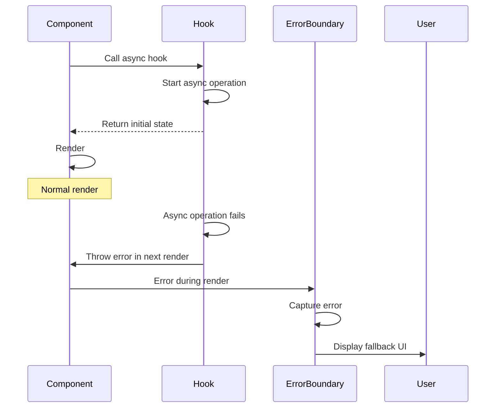
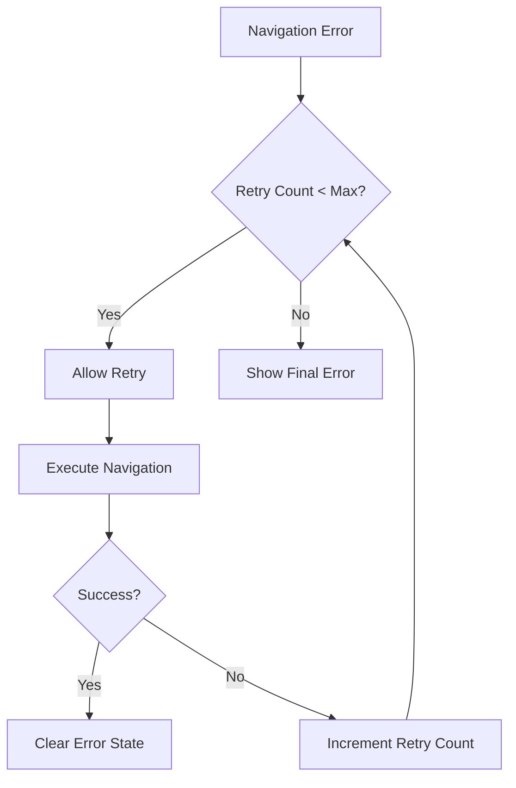
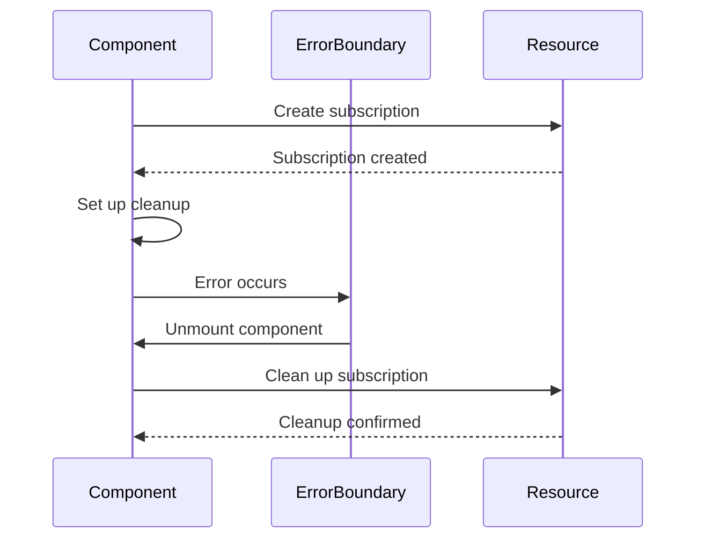
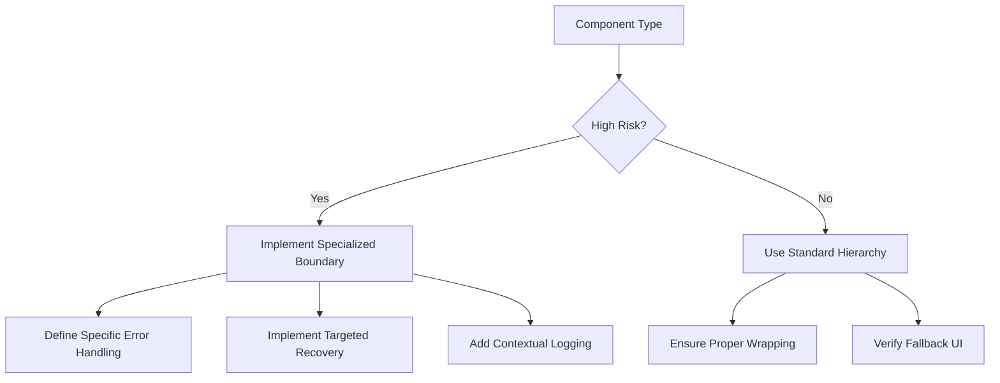

# Specialized Error Handlers

<cite>
**Referenced Files in This Document**   
- [HookErrorBoundary.tsx](file://src/components/ErrorBoundary/HookErrorBoundary.tsx)
- [NavigationErrorBoundary.tsx](file://src/components/NavigationErrorBoundary.tsx)
- [TableErrorBoundary.tsx](file://src/components/ui/data/TableErrorBoundary.tsx)
- [PageErrorBoundary.tsx](file://src/components/PageErrorBoundary.tsx)
- [PageComponentLoader.tsx](file://src/components/PageComponentLoader.tsx)
</cite>

## Table of Contents
1. [Introduction](#introduction)
2. [Core Error Boundary Components](#core-error-boundary-components)
3. [HookErrorBoundary Implementation](#hookerrorboundary-implementation)
4. [NavigationErrorBoundary Role](#navigationerrorboundary-role)
5. [Isolated Error Boundaries for High-Risk Components](#isolated-error-boundaries-for-high-risk-components)
6. [Error Boundary Composition Patterns](#error-boundary-composition-patterns)
7. [Common Issues and Solutions](#common-issues-and-solutions)
8. [Best Practices](#best-practices)

## Introduction
The schoolpilot3 application implements a comprehensive error handling strategy using specialized React error boundaries. These components provide targeted protection for different types of failures, from hook-related issues to navigation problems and data rendering errors. This documentation details the implementation, usage patterns, and best practices for these specialized error handlers, focusing on their role in maintaining application stability and user experience.

## Core Error Boundary Components

The error handling architecture in schoolpilot3 consists of several specialized error boundaries designed for specific use cases:



**Diagram sources**
- [HookErrorBoundary.tsx](file://src/components/ErrorBoundary/HookErrorBoundary.tsx)
- [NavigationErrorBoundary.tsx](file://src/components/NavigationErrorBoundary.tsx)
- [TableErrorBoundary.tsx](file://src/components/ui/data/TableErrorBoundary.tsx)
- [PageErrorBoundary.tsx](file://src/components/PageErrorBoundary.tsx)

**Section sources**
- [HookErrorBoundary.tsx](file://src/components/ErrorBoundary/HookErrorBoundary.tsx)
- [NavigationErrorBoundary.tsx](file://src/components/NavigationErrorBoundary.tsx)
- [TableErrorBoundary.tsx](file://src/components/ui/data/TableErrorBoundary.tsx)
- [PageErrorBoundary.tsx](file://src/components/PageErrorBoundary.tsx)

## HookErrorBoundary Implementation

The HookErrorBoundary component is specifically designed to catch errors that occur within React hooks, preventing render-blocking failures and providing recovery options.

### Key Features
- **Targeted Error Capture**: Specifically handles hook-related errors such as hook order violations and dependency array issues
- **Fallback UI**: Provides a user-friendly error message with retry options
- **Error Reporting**: Logs detailed error information including stack traces and component stacks
- **Retry Mechanism**: Allows users to retry the operation that failed

### Implementation Details


**Diagram sources**
- [HookErrorBoundary.tsx](file://src/components/ErrorBoundary/HookErrorBoundary.tsx#L1-L140)

**Section sources**
- [HookErrorBoundary.tsx](file://src/components/ErrorBoundary/HookErrorBoundary.tsx#L1-L140)

### Usage Patterns
The HookErrorBoundary can be used in several ways:

1. **Direct Component Wrapping**:
```tsx
<HookErrorBoundary componentName="StudentDataComponent">
  <StudentDataComponent />
</HookErrorBoundary>
```

2. **Higher-Order Component**:
```tsx
const ComponentWithBoundary = withHookErrorBoundary(
  StudentDataComponent,
  'StudentDataComponent',
  <ErrorFallback />
);
```

3. **Hook Integration**:
```tsx
const { handleError } = useErrorHandler();
// Use handleError(error, 'context') in functional components
```

## NavigationErrorBoundary Role

The NavigationErrorBoundary handles routing-related exceptions and maintains navigation state integrity, providing users with recovery options when navigation fails.

### Key Features
- **Navigation-Specific Error Handling**: Catches errors that occur during route changes and component loading
- **State Preservation**: Maintains the last working route for recovery purposes
- **Multiple Recovery Options**: Provides various ways to recover from navigation errors
- **Contextual Error Messages**: Displays error suggestions based on error type

### Implementation Details


**Diagram sources**
- [NavigationErrorBoundary.tsx](file://src/components/NavigationErrorBoundary.tsx#L1-L346)

**Section sources**
- [NavigationErrorBoundary.tsx](file://src/components/NavigationErrorBoundary.tsx#L1-L346)

### Recovery Strategies
The NavigationErrorBoundary provides several recovery options:

1. **Retry**: Attempts to reload the current route
2. **Go Home**: Navigates to the dashboard
3. **Go Back**: Returns to the previous working route
4. **Fallback Routes**: Provides alternative routes to try
5. **Page Reload**: Forces a full page refresh

## Isolated Error Boundaries for High-Risk Components

The application uses isolated error boundaries for high-risk components like data tables and form controls to prevent cascading failures.

### TableErrorBoundary Implementation

The TableErrorBoundary specifically handles errors in data table components:



**Diagram sources**
- [TableErrorBoundary.tsx](file://src/components/ui/data/TableErrorBoundary.tsx#L1-L137)

**Section sources**
- [TableErrorBoundary.tsx](file://src/components/ui/data/TableErrorBoundary.tsx#L1-L137)

### Use Cases for Isolated Boundaries
Isolated error boundaries are particularly useful for:

1. **Data Tables**: Handling errors in data fetching, rendering, and manipulation
2. **Form Controls**: Preventing form-related errors from affecting the entire page
3. **Async Components**: Isolating failures in dynamically loaded components
4. **Third-Party Integrations**: Containing errors from external libraries

## Error Boundary Composition Patterns

The application implements sophisticated composition patterns, allowing specialized boundaries to work within broader protection hierarchies.

### Composition Example
```tsx
<PageErrorBoundary pageName="AcademicsDashboard">
  <ModuleErrorBoundary moduleName="academics">
    <NavigationErrorBoundary>
      <HookErrorBoundary componentName="StudentDataTable">
        <TableErrorBoundary tableName="student-data">
          <StudentDataTable />
        </TableErrorBoundary>
      </HookErrorBoundary>
    </NavigationErrorBoundary>
  </ModuleErrorBoundary>
</PageErrorBoundary>
```

### Composition Benefits
- **Layered Protection**: Multiple levels of error handling
- **Targeted Recovery**: Specific recovery options for different error types
- **Error Containment**: Prevents errors from propagating up the component tree
- **Context Preservation**: Maintains relevant context for error reporting



**Diagram sources**
- [PageErrorBoundary.tsx](file://src/components/PageErrorBoundary.tsx#L1-L147)
- [NavigationErrorBoundary.tsx](file://src/components/NavigationErrorBoundary.tsx#L1-L346)
- [HookErrorBoundary.tsx](file://src/components/ErrorBoundary/HookErrorBoundary.tsx#L1-L140)
- [TableErrorBoundary.tsx](file://src/components/ui/data/TableErrorBoundary.tsx#L1-L137)

**Section sources**
- [PageErrorBoundary.tsx](file://src/components/PageErrorBoundary.tsx#L1-L147)
- [NavigationErrorBoundary.tsx](file://src/components/NavigationErrorBoundary.tsx#L1-L346)
- [HookErrorBoundary.tsx](file://src/components/ErrorBoundary/HookErrorBoundary.tsx#L1-L140)
- [TableErrorBoundary.tsx](file://src/components/ui/data/TableErrorBoundary.tsx#L1-L137)

## Common Issues and Solutions

### Timing of Error Capture in Asynchronous Hooks
**Issue**: Errors in async hooks may not be captured immediately due to the asynchronous nature of the operations.

**Solution**: The HookErrorBoundary captures errors when they affect the render phase, ensuring that any hook-related error that would cause a render failure is caught.



**Section sources**
- [HookErrorBoundary.tsx](file://src/components/ErrorBoundary/HookErrorBoundary.tsx#L1-L140)

### Race Conditions During Navigation Errors
**Issue**: Multiple navigation attempts during error recovery can create race conditions.

**Solution**: The NavigationErrorBoundary implements retry counting and state management to prevent excessive retry attempts.



**Section sources**
- [NavigationErrorBoundary.tsx](file://src/components/NavigationErrorBoundary.tsx#L1-L346)

### Proper Cleanup of Subscriptions in Error States
**Issue**: Subscriptions and event listeners may not be properly cleaned up when an error occurs.

**Solution**: Implement cleanup in componentWillUnmount or useEffect cleanup functions, ensuring resources are released even in error states.



**Section sources**
- [HookErrorBoundary.tsx](file://src/components/ErrorBoundary/HookErrorBoundary.tsx#L1-L140)
- [NavigationErrorBoundary.tsx](file://src/components/NavigationErrorBoundary.tsx#L1-L346)

## Best Practices

### When to Implement Specialized Boundaries
Implement specialized error boundaries when:

1. **High-Risk Components**: The component performs complex operations that are likely to fail
2. **Critical User Flows**: The component is part of a critical user journey
3. **External Dependencies**: The component relies on external services or data sources
4. **Performance Impact**: A failure in the component would significantly impact performance

### When to Rely on Standard Hierarchy
Rely on the standard error boundary hierarchy when:

1. **Simple Components**: The component has minimal logic and low failure risk
2. **Consistent Error Handling**: The standard boundaries provide adequate protection
3. **Performance Considerations**: Additional boundaries would add unnecessary overhead
4. **Maintenance Simplicity**: Keeping the error handling strategy simple improves maintainability

### Implementation Guidelines
1. **Specificity**: Create boundaries that are specific to the type of error they handle
2. **Recovery Options**: Provide meaningful recovery options tailored to the error context
3. **Error Reporting**: Log detailed error information for debugging purposes
4. **User Experience**: Design fallback UIs that maintain usability and provide clear guidance
5. **Testing**: Thoroughly test error boundaries with various error scenarios



**Section sources**
- [HookErrorBoundary.tsx](file://src/components/ErrorBoundary/HookErrorBoundary.tsx#L1-L140)
- [NavigationErrorBoundary.tsx](file://src/components/NavigationErrorBoundary.tsx#L1-L346)
- [TableErrorBoundary.tsx](file://src/components/ui/data/TableErrorBoundary.tsx#L1-L137)
- [PageErrorBoundary.tsx](file://src/components/PageErrorBoundary.tsx#L1-L147)