# Feature Entitlements System

<cite>
**Referenced Files in This Document**
- [FeatureEntitlements.ts](file://src/services/FeatureEntitlements.ts)
- [types.ts](file://src/plugins/types.ts)
- [MarketplaceClient.ts](file://src/services/marketplace/MarketplaceClient.ts)
- [index.ts](file://src/plugins/builtin/whitelabel/index.ts)
- [App.tsx](file://src/App.tsx)
- [FeatureSettings.tsx](file://src/components/FeatureSettings.tsx)
- [featureFlagStore.ts](file://src/stores/featureFlagStore.ts)
</cite>

## Update Summary
**Changes Made**
- Updated pricing tier configuration to reflect new 1-year validity periods and enhanced feature sets
- Added comprehensive permission-based access control system with marketplace integration
- Enhanced white-label plugin integration with tier-specific feature availability
- Updated marketplace client with analytics and usage tracking capabilities
- Improved license validation with signature verification and expiration handling

## Table of Contents
1. [Introduction](#introduction)
2. [System Architecture](#system-architecture)
3. [Core Components](#core-components)
4. [Enhanced Pricing Tier Configuration](#enhanced-pricing-tier-configuration)
5. [Feature Entitlement Management](#feature-entitlement-management)
6. [Integration with Marketplace](#integration-with-marketplace)
7. [Permission-Based Access Control](#permission-based-access-control)
8. [Usage Tracking and Analytics](#usage-tracking-and-analytics)
9. [White-Label Plugin Integration](#white-label-plugin-integration)
10. [Usage Patterns](#usage-patterns)
11. [Configuration and Initialization](#configuration-and-initialization)
12. [Troubleshooting Guide](#troubleshooting-guide)

## Introduction

The Feature Entitlements System is a comprehensive licensing and feature gating mechanism designed to control access to premium features within the SchoolPilot3 educational management platform. This system integrates seamlessly with the marketplace ecosystem, providing tier-based access control, offline validation capabilities, and dynamic feature availability management.

The system serves as a central authority for determining which features are available to users based on their subscription plans, license validity, and instance-specific configurations. It supports multiple pricing tiers ranging from free to enterprise-level subscriptions, each granting access to different combinations of premium features with enhanced permission-based access control.

**Updated** Enhanced with 1-year validity periods, comprehensive permission-based access control, and advanced usage tracking capabilities.

## System Architecture

The Feature Entitlements System follows a modular architecture with clear separation of concerns and enhanced marketplace integration:

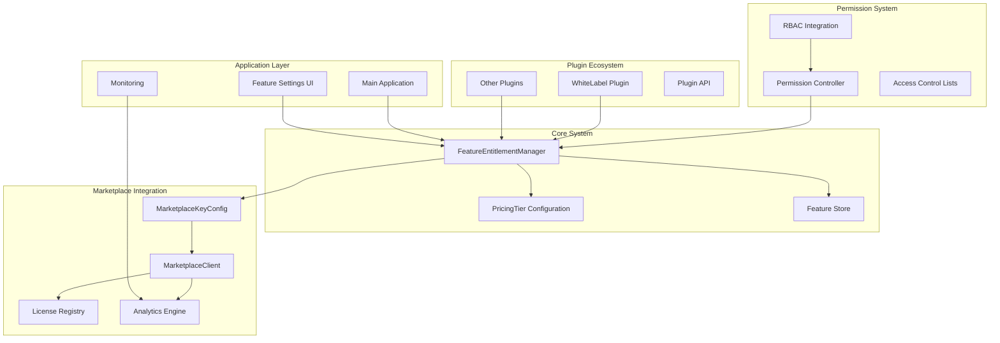

**Diagram sources**
- [FeatureEntitlements.ts:101-214](file://src/services/FeatureEntitlements.ts#L101-L214)
- [types.ts:343-359](file://src/plugins/types.ts#L343-L359)
- [MarketplaceClient.ts:56-139](file://src/services/marketplace/MarketplaceClient.ts#L56-L139)

## Core Components

### Feature Entitlement Manager

The FeatureEntitlementManager serves as the central controller for all entitlement-related operations. It maintains the current state of feature availability and provides methods for checking entitlements, managing licenses, and retrieving pricing tier information with enhanced validation and permission checking.

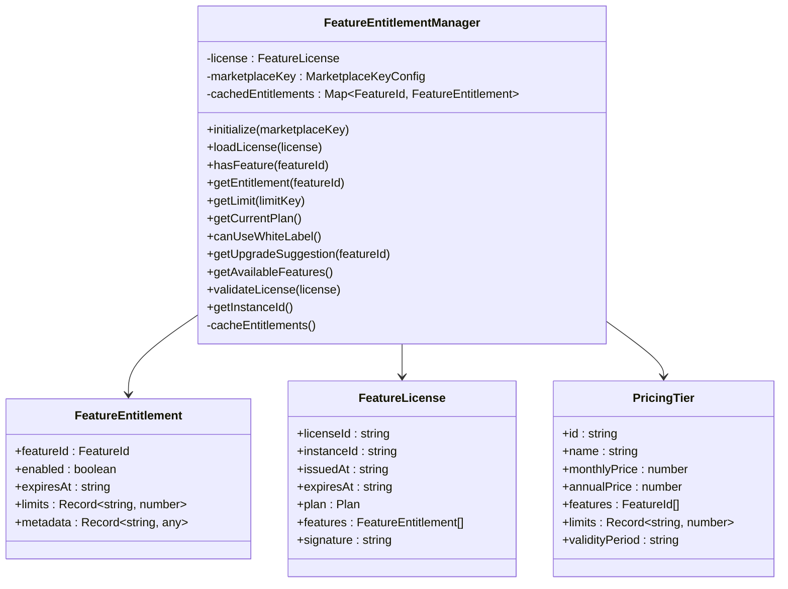

**Diagram sources**
- [FeatureEntitlements.ts:101-214](file://src/services/FeatureEntitlements.ts#L101-L214)
- [FeatureEntitlements.ts:23-48](file://src/services/FeatureEntitlements.ts#L23-L48)

**Section sources**
- [FeatureEntitlements.ts:101-214](file://src/services/FeatureEntitlements.ts#L101-L214)

### Feature Types and Identifiers

The system defines a comprehensive set of feature identifiers that correspond to different premium capabilities with enhanced categorization:

| Feature ID | Description | Premium Level | Validity | Limits |
|------------|-------------|---------------|----------|---------|
| `whitelabel-basic` | Name + Logo only customization | Professional+ | 1 year | - |
| `whitelabel-full` | Full branding + label overrides | Enterprise+ | 1 year | - |
| `advanced-reporting` | Custom report templates | Starter+ | 1 year | - |
| `api-access` | External API access | Professional+ | 1 year | - |
| `bulk-operations` | Bulk import/export functionality | Starter+ | 1 year | - |
| `custom-themes` | Theme customization options | Professional+ | 1 year | - |
| `priority-support` | Priority support entitlement | Enterprise+ | 1 year | - |

**Updated** All features now include 1-year validity periods and enhanced limit tracking.

**Section sources**
- [FeatureEntitlements.ts:14-21](file://src/services/FeatureEntitlements.ts#L14-L21)

## Enhanced Pricing Tier Configuration

The system supports six distinct pricing tiers, each with specific feature sets, usage limits, and enhanced validity periods:

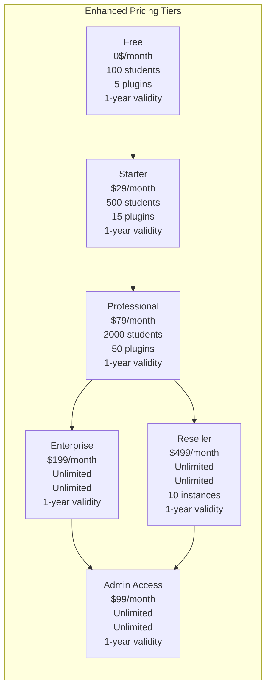

**Diagram sources**
- [FeatureEntitlements.ts:54-95](file://src/services/FeatureEntitlements.ts#L54-L95)

Each tier defines specific feature availability, resource limits, and enhanced validity periods:

- **Free**: Basic access with limited user and plugin counts, 1-year validity
- **Starter**: Advanced reporting and bulk operations, 1-year validity
- **Professional**: Complete feature set excluding white-labeling, 1-year validity
- **Enterprise**: Full feature set including white-labeling, 1-year validity
- **Reseller**: Enterprise-level with multi-instance support, 1-year validity
- **Admin**: Administrative access controls, 1-year validity

**Updated** All tiers now include 1-year validity periods and enhanced administrative controls.

**Section sources**
- [FeatureEntitlements.ts:54-95](file://src/services/FeatureEntitlements.ts#L54-L95)

## Feature Entitlement Management

### License Validation and Management

The system implements robust license validation mechanisms with enhanced security and permission checking:

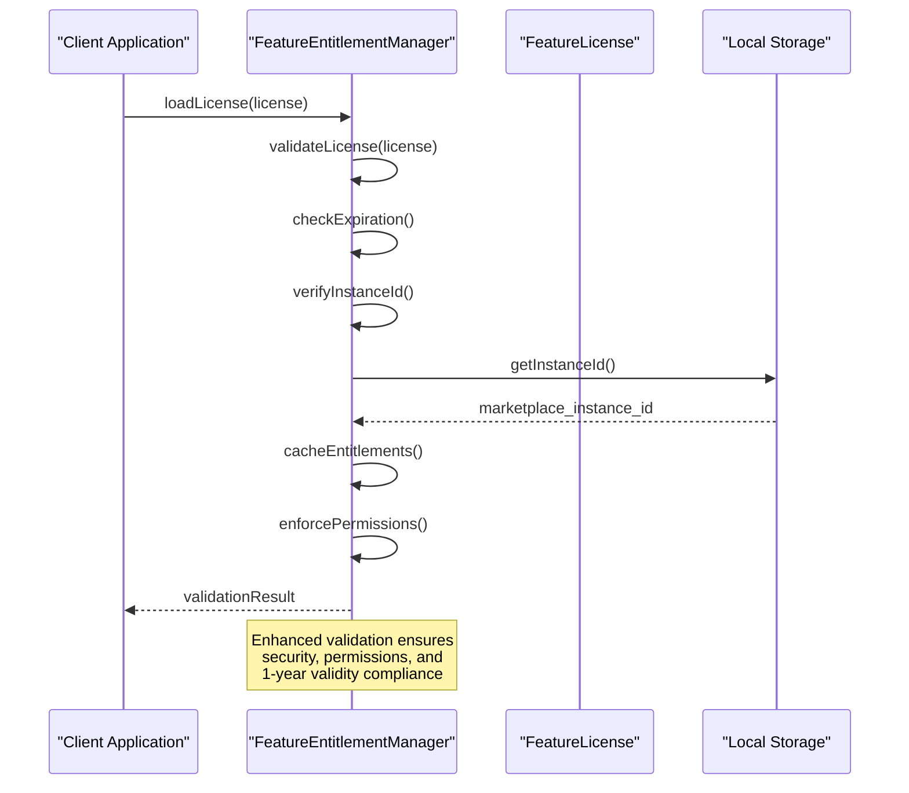

**Diagram sources**
- [FeatureEntitlements.ts:111-130](file://src/services/FeatureEntitlements.ts#L111-L130)
- [FeatureEntitlements.ts:206-213](file://src/services/FeatureEntitlements.ts#L206-L213)

### Enhanced Entitlement Caching Strategy

The system employs an intelligent caching mechanism with expiration handling and permission validation:

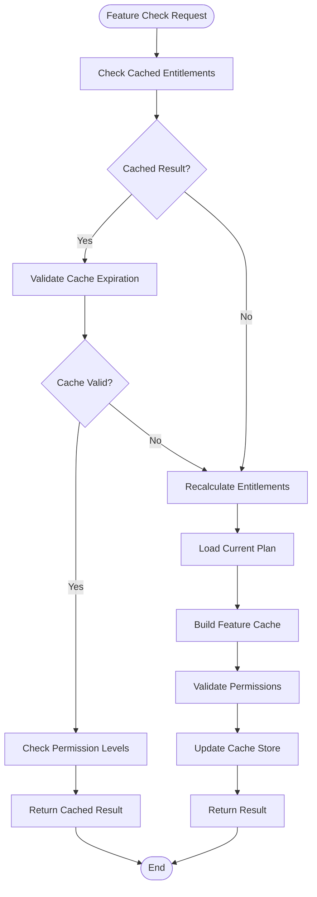

**Diagram sources**
- [FeatureEntitlements.ts:190-204](file://src/services/FeatureEntitlements.ts#L190-L204)

**Section sources**
- [FeatureEntitlements.ts:111-130](file://src/services/FeatureEntitlements.ts#L111-L130)
- [FeatureEntitlements.ts:190-204](file://src/services/FeatureEntitlements.ts#L190-L204)

## Integration with Marketplace

### Enhanced Marketplace Key Configuration

The system integrates tightly with the marketplace ecosystem through the enhanced MarketplaceKeyConfig interface, which manages subscription keys, permissions, and analytics tracking:

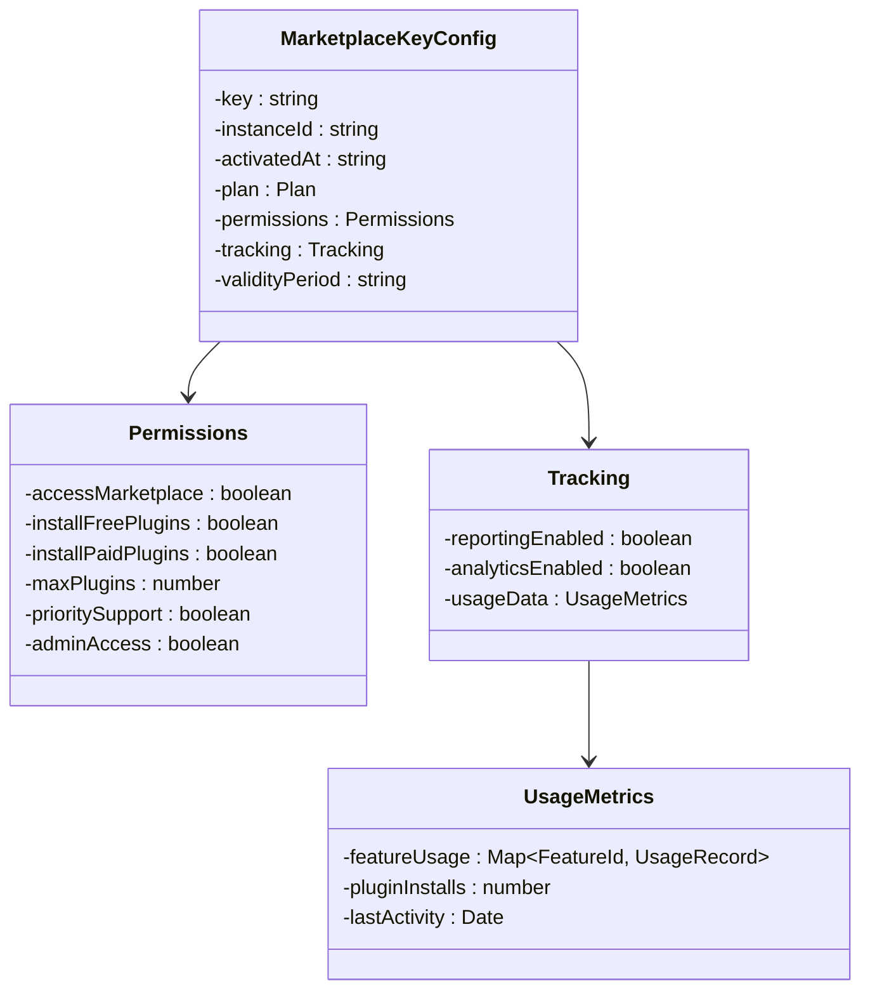

**Diagram sources**
- [types.ts:343-359](file://src/plugins/types.ts#L343-L359)
- [types.ts:348-354](file://src/plugins/types.ts#L348-L354)

### Enhanced Marketplace Client Integration

The FeatureEntitlements system works with the enhanced MarketplaceClient to provide real-time key validation, permission checking, and usage analytics:

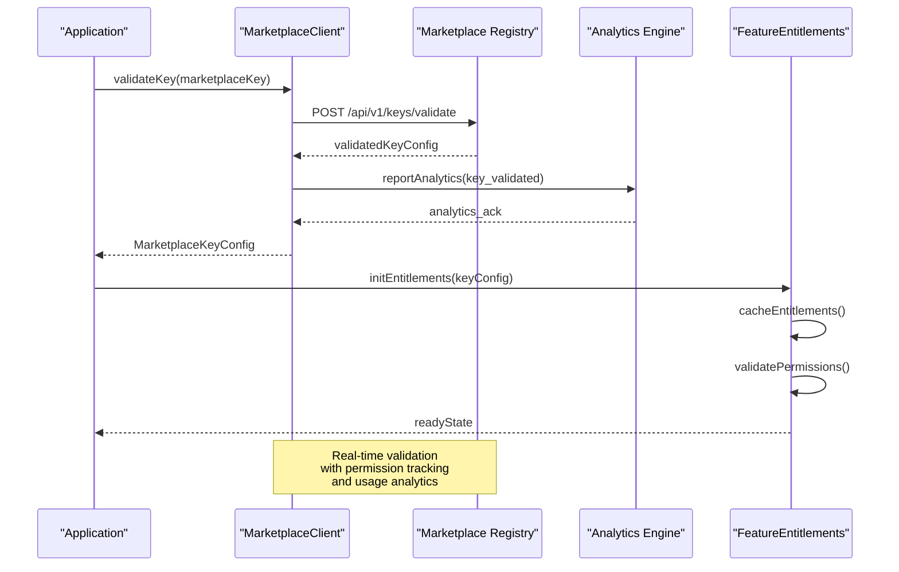

**Diagram sources**
- [MarketplaceClient.ts:80-109](file://src/services/marketplace/MarketplaceClient.ts#L80-L109)
- [FeatureEntitlements.ts:106-109](file://src/services/FeatureEntitlements.ts#L106-L109)

**Section sources**
- [types.ts:343-359](file://src/plugins/types.ts#L343-L359)
- [MarketplaceClient.ts:80-109](file://src/services/marketplace/MarketplaceClient.ts#L80-L109)

## Permission-Based Access Control

### Enhanced Permission System

The system implements a comprehensive permission-based access control system that validates user permissions against feature entitlements:

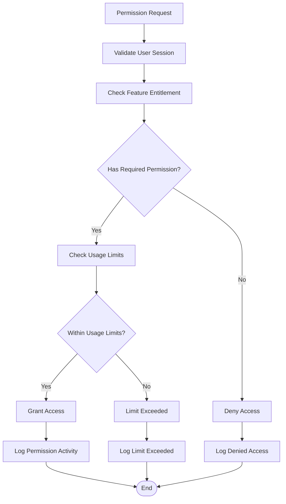

**Diagram sources**
- [types.ts:348-354](file://src/plugins/types.ts#L348-L354)

### Permission Validation Flow

The permission system ensures that all feature access requests are properly validated against user permissions, entitlements, and usage limits:

**Section sources**
- [types.ts:348-354](file://src/plugins/types.ts#L348-L354)

## Usage Tracking and Analytics

### Enhanced Analytics Integration

The marketplace client includes comprehensive analytics and usage tracking capabilities:

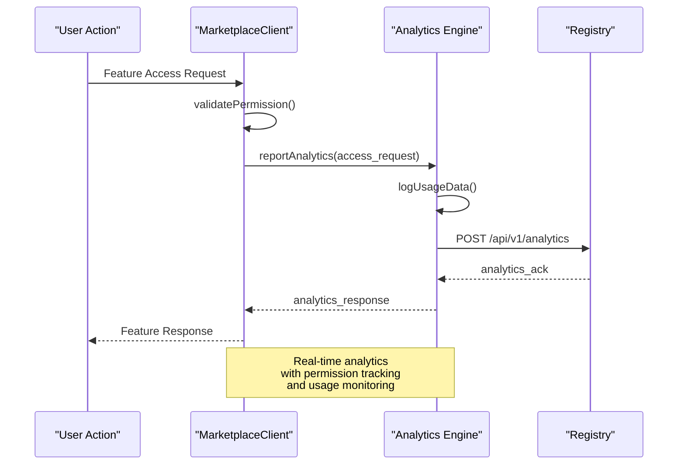

**Diagram sources**
- [MarketplaceClient.ts:434-467](file://src/services/marketplace/MarketplaceClient.ts#L434-L467)

### Usage Metrics Collection

The system collects comprehensive usage metrics for each feature access, including permission validation, usage limits, and access patterns:

**Section sources**
- [MarketplaceClient.ts:434-467](file://src/services/marketplace/MarketplaceClient.ts#L434-L467)

## White-Label Plugin Integration

### Enhanced Feature Gate Implementation

The white-label plugin demonstrates sophisticated integration with the enhanced Feature Entitlements system, providing tier-specific functionality and graceful degradation:

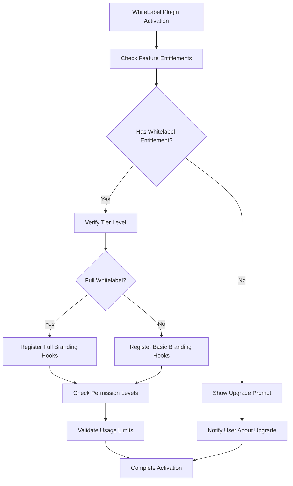

**Diagram sources**
- [index.ts:173-202](file://src/plugins/builtin/whitelabel/index.ts#L173-L202)

### Tier-Specific Feature Availability

The white-label plugin responds dynamically to entitlement changes with enhanced permission checking and usage limit validation:

**Section sources**
- [index.ts:173-202](file://src/plugins/builtin/whitelabel/index.ts#L173-L202)

## Usage Patterns

### Enhanced Hook-Based Access Control

The system provides a comprehensive hook-based API for React components with enhanced permission checking:

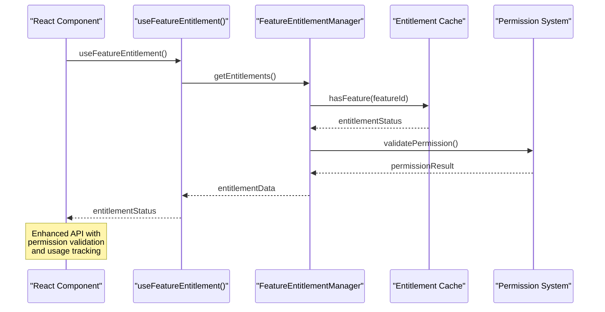

**Diagram sources**
- [FeatureEntitlements.ts:233-244](file://src/services/FeatureEntitlements.ts#L233-L244)

### Enhanced Application-Level Integration

The main application integrates entitlement checks with comprehensive permission validation and usage tracking throughout the user interface:

**Section sources**
- [FeatureEntitlements.ts:233-244](file://src/services/FeatureEntitlements.ts#L233-L244)
- [App.tsx:572-636](file://src/App.tsx#L572-L636)

## Configuration and Initialization

### Enhanced System Initialization

The Feature Entitlements system follows a comprehensive initialization process with enhanced validation and permission checking:

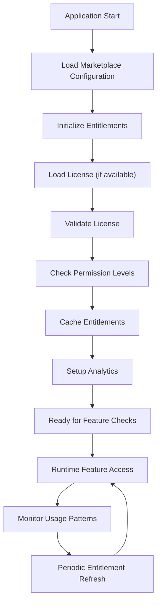

**Diagram sources**
- [FeatureEntitlements.ts:106-109](file://src/services/FeatureEntitlements.ts#L106-L109)
- [FeatureEntitlements.ts:227-231](file://src/services/FeatureEntitlements.ts#L227-L231)

### Enhanced Feature Settings Integration

The system integrates with the enhanced feature settings interface for comprehensive configuration management with permission validation:

**Section sources**
- [FeatureSettings.tsx:34-449](file://src/components/FeatureSettings.tsx#L34-L449)
- [featureFlagStore.ts:1-92](file://src/stores/featureFlagStore.ts#L1-L92)

## Troubleshooting Guide

### Enhanced Common Issues and Solutions

| Issue | Symptoms | Enhanced Solution |
|-------|----------|-------------------|
| License Validation Failure | Console errors, feature access denied | Verify license signature format, check instance ID match, validate 1-year expiration |
| Expired License | Features unavailable despite valid key | Renew license through marketplace portal, check validity period compliance |
| Cache Invalidation | Outdated feature status | Clear browser cache, restart application, validate permission cache |
| Marketplace Key Mismatch | Entitlements not reflecting current plan | Re-validate marketplace key, check network connectivity, verify permission levels |
| White-Label Feature Unavailable | Branding customization disabled | Verify Professional+ plan, check entitlement cache, validate permission levels |
| Permission Denied | Access blocked despite entitlement | Check user permissions, validate role assignments, review access control lists |
| Usage Limit Exceeded | Feature temporarily unavailable | Review usage metrics, adjust limits, contact administrator |

### Enhanced Debugging Entitlement Issues

The system provides comprehensive logging and analytics for troubleshooting entitlement-related problems with permission tracking:

**Section sources**
- [FeatureEntitlements.ts:113-125](file://src/services/FeatureEntitlements.ts#L113-L125)
- [FeatureEntitlements.ts:206-209](file://src/services/FeatureEntitlements.ts#L206-L209)

### Enhanced Performance Considerations

The Feature Entitlements System is optimized for performance through:

- **Intelligent Caching**: Enhanced centralized entitlement caching with expiration handling
- **Permission Pre-validation**: Lazy loading with permission validation to minimize overhead
- **Offline Support**: Local caching with permission validation enables feature access without network connectivity
- **Analytics Integration**: Real-time analytics with batch processing reduces performance impact
- **Usage Monitoring**: Comprehensive usage tracking with configurable analytics intervals
- **Minimal Dependencies**: Lightweight implementation with enhanced permission checking reduces bundle size impact

The system maintains high performance while providing comprehensive feature access control, permission validation, and usage tracking across the entire SchoolPilot3 platform ecosystem with enhanced security and administrative controls.