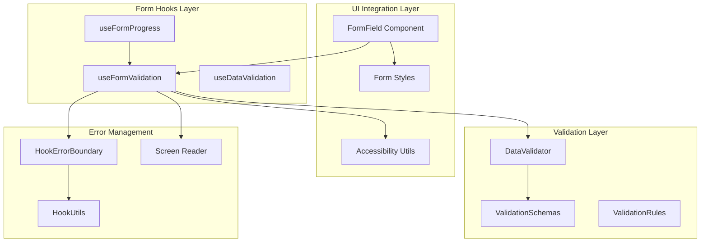
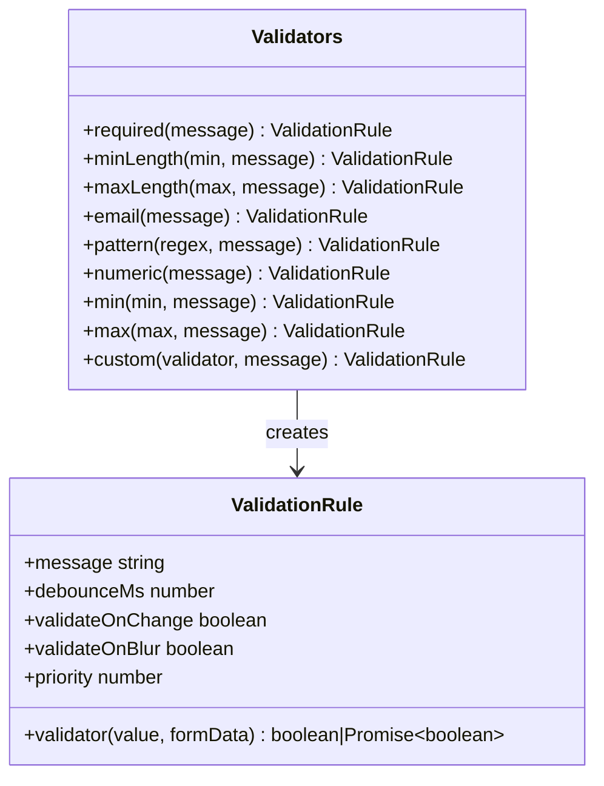
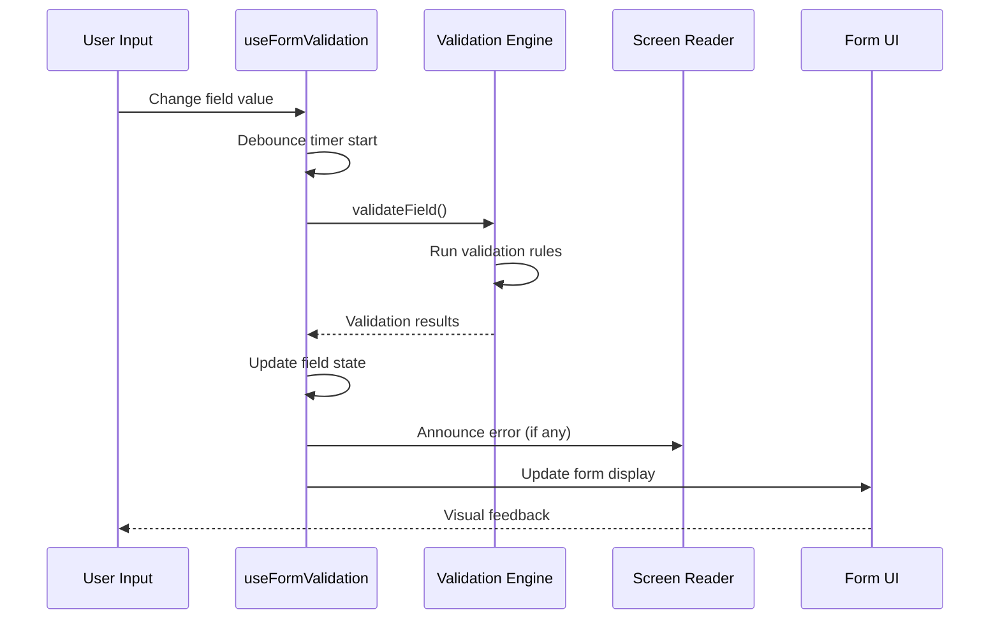
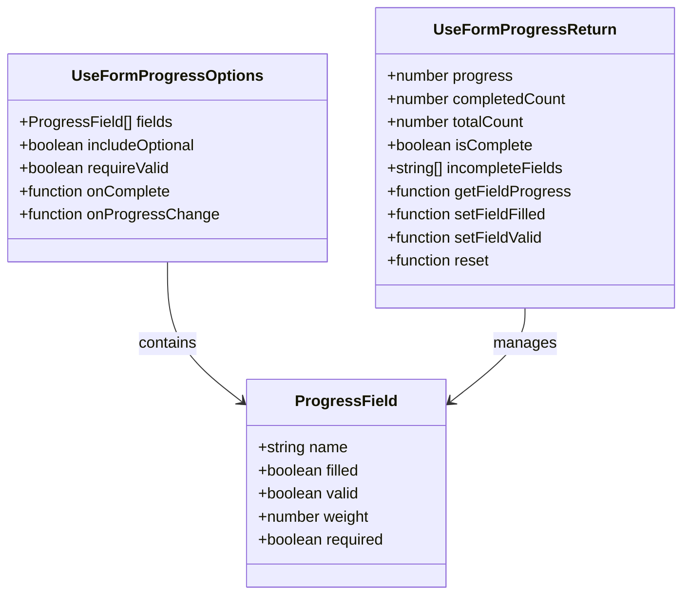
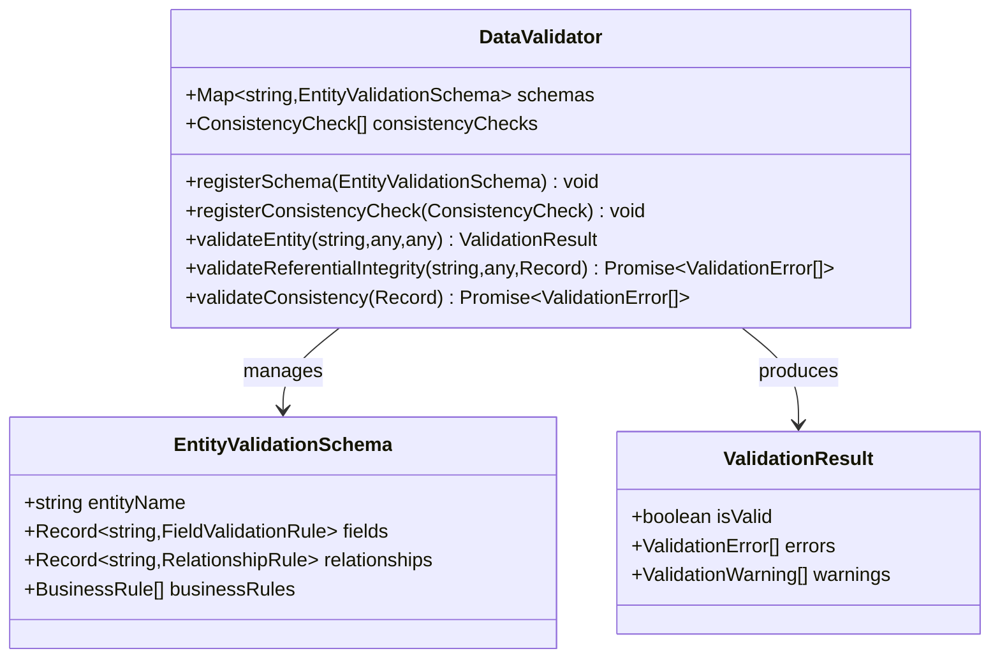
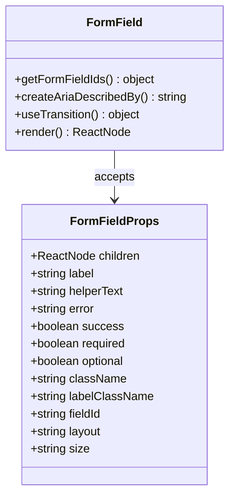
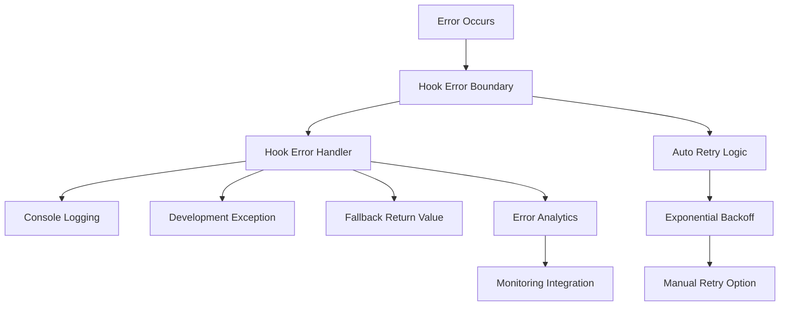

# Form Hooks System

<cite>
**Referenced Files in This Document**
- [useFormValidation.tsx](file://src/hooks/useFormValidation.tsx)
- [useFormProgress.ts](file://src/hooks/useFormProgress.ts)
- [dataValidation.ts](file://src/utils/dataValidation.ts)
- [validationSchemas.ts](file://src/utils/validationSchemas.ts)
- [FormField.tsx](file://src/components/ui/forms/FormField.tsx)
- [formStyles.ts](file://src/utils/formStyles.ts)
- [HookErrorBoundary.tsx](file://src/components/ErrorBoundary/HookErrorBoundary.tsx)
- [HookErrorBoundary.tsx](file://src/components/HookErrorBoundary.tsx)
- [hookUtils.ts](file://src/utils/hookUtils.ts)
</cite>

## Table of Contents
1. [Introduction](#introduction)
2. [System Architecture](#system-architecture)
3. [Core Components](#core-components)
4. [Form Validation System](#form-validation-system)
5. [Form Progress Tracking](#form-progress-tracking)
6. [Data Validation Framework](#data-validation-framework)
7. [UI Integration Layer](#ui-integration-layer)
8. [Error Handling and Debugging](#error-handling-and-debugging)
9. [Performance Considerations](#performance-considerations)
10. [Best Practices](#best-practices)
11. [Troubleshooting Guide](#troubleshooting-guide)
12. [Conclusion](#conclusion)

## Introduction

The Form Hooks System is a comprehensive React-based solution designed to provide robust form handling capabilities within the SchoolPilot3 educational management system. This system encompasses real-time validation, progress tracking, accessibility compliance, and error management, making it an essential component for building reliable and user-friendly forms across various modules including academics, administration, admissions, and finance.

The system is built around three primary hooks: `useFormValidation` for comprehensive form validation, `useFormProgress` for tracking form completion, and supporting utilities for data validation and UI integration. These components work together to provide a seamless form experience with built-in accessibility features, performance optimizations, and comprehensive error handling.

## System Architecture

The Form Hooks System follows a modular architecture with clear separation of concerns:

**Diagram sources**
- [useFormValidation.tsx:130-529](file://src/hooks/useFormValidation.tsx#L130-L529)
- [useFormProgress.ts:75-185](file://src/hooks/useFormProgress.ts#L75-L185)
- [dataValidation.ts:68-396](file://src/utils/dataValidation.ts#L68-L396)

The architecture ensures loose coupling between validation logic and UI presentation, allowing for flexible integration across different form types and validation scenarios.

## Core Components

### useFormValidation Hook

The `useFormValidation` hook serves as the central component for form validation, providing comprehensive validation capabilities with real-time feedback and accessibility support.

#### Key Features

- **Real-time Validation**: Automatic validation during user interaction with configurable debounce timing
- **Multi-field Support**: Handles complex forms with multiple validation rules per field
- **Async Validation**: Supports asynchronous validation operations
- **Accessibility Compliance**: Integrated screen reader announcements and ARIA attributes
- **Flexible Configuration**: Extensive customization options for validation modes and behavior

#### Validation Modes

The hook supports four validation modes:

| Mode | Trigger | Use Case |
|------|---------|----------|
| `onChange` | Field value changes | Immediate feedback for critical fields |
| `onBlur` | Field loses focus | Background validation for less critical fields |
| `onSubmit` | Form submission | Final validation before submission |
| `all` | All events | Comprehensive validation experience |

#### Built-in Validators

The system provides a comprehensive set of built-in validators:

**Diagram sources**
- [useFormValidation.tsx:58-128](file://src/hooks/useFormValidation.tsx#L58-L128)

**Section sources**
- [useFormValidation.tsx:130-529](file://src/hooks/useFormValidation.tsx#L130-L529)

### useFormProgress Hook

The `useFormProgress` hook provides sophisticated form completion tracking with customizable weighting and validation requirements.

#### Progress Calculation Logic

**Diagram sources**
- [useFormProgress.ts:84-122](file://src/hooks/useFormProgress.ts#L84-L122)

**Section sources**
- [useFormProgress.ts:75-185](file://src/hooks/useFormProgress.ts#L75-L185)

## Form Validation System

### Real-time Validation Engine

The validation system operates through a sophisticated engine that manages field states, validation timing, and error reporting:

**Diagram sources**
- [useFormValidation.tsx:174-264](file://src/hooks/useFormValidation.tsx#L174-L264)

### Validation State Management

The system maintains comprehensive validation state for each field:

| State Property | Description | Impact on UI |
|----------------|-------------|--------------|
| `isValid` | Overall field validity status | Controls visual feedback |
| `isValidating` | Active validation status | Shows loading state |
| `errors` | Array of validation errors | Displays error messages |
| `touched` | User interaction status | Enables error display |
| `dirty` | Value modification status | Triggers validation |

**Section sources**
- [useFormValidation.tsx:37-47](file://src/hooks/useFormValidation.tsx#L37-L47)

## Form Progress Tracking

### Advanced Progress Calculation

The progress tracking system provides flexible calculation methods based on form requirements:

**Diagram sources**
- [useFormProgress.ts:6-51](file://src/hooks/useFormProgress.ts#L6-L51)

### Weighted Progress System

The system supports weighted progress calculation where different form fields can contribute differently to the overall completion percentage. This allows for more meaningful progress tracking in complex forms where some fields are more critical than others.

**Section sources**
- [useFormProgress.ts:97-103](file://src/hooks/useFormProgress.ts#L97-L103)

## Data Validation Framework

### Comprehensive Data Validation

The data validation framework provides robust validation for CRUD operations and data consistency checks:

**Diagram sources**
- [dataValidation.ts:68-396](file://src/utils/dataValidation.ts#L68-L396)

### Entity Validation Schemas

The system includes comprehensive validation schemas for core entities:

| Entity | Fields Validated | Business Rules |
|--------|------------------|----------------|
| Students | Personal info, contact details, demographics | Unique admission numbers, age validation |
| Staff | Employment details, contact information | Unique staff numbers |
| Financial Years | Date ranges, status | Date range validation, non-overlapping periods |
| Student Invoices | Amounts, dates, status | Due date validation, payment limits |
| Academic Periods | Naming, scheduling | Unique period names |

**Section sources**
- [validationSchemas.ts:21-118](file://src/utils/validationSchemas.ts#L21-L118)
- [validationSchemas.ts:120-176](file://src/utils/validationSchemas.ts#L120-L176)

## UI Integration Layer

### FormField Component

The `FormField` component provides a standardized wrapper for form inputs with comprehensive accessibility and styling support:

**Diagram sources**
- [FormField.tsx:8-21](file://src/components/ui/forms/FormField.tsx#L8-L21)

### Styling System

The form styling system provides consistent visual patterns across the application:

| Style Category | Variants | Use Cases |
|----------------|----------|-----------|
| Input Styles | Outlined, Filled, Standard | Different form contexts |
| Input States | Error, Success, Disabled, Loading | Visual feedback states |
| Form Grid | 1-4 Columns | Responsive layout management |
| Progress Indicators | Default, Success, Warning, Error | Completion status visualization |

**Section sources**
- [formStyles.ts:6-116](file://src/utils/formStyles.ts#L6-L116)

## Error Handling and Debugging

### Comprehensive Error Management

The system implements multiple layers of error handling to ensure robust operation:

**Diagram sources**
- [HookErrorBoundary.tsx:40-99](file://src/components/HookErrorBoundary.tsx#L40-L99)
- [hookUtils.ts:60-82](file://src/utils/hookUtils.ts#L60-L82)

### Accessibility Features

The system includes comprehensive accessibility features:

- **Screen Reader Support**: Automatic announcements for validation errors and form states
- **ARIA Attributes**: Proper labeling and error messaging for assistive technologies
- **Keyboard Navigation**: Full keyboard accessibility for form interactions
- **Focus Management**: Intelligent focus handling during validation and error states

**Section sources**
- [useFormValidation.tsx:288-292](file://src/hooks/useFormValidation.tsx#L288-L292)
- [FormField.tsx:92-109](file://src/components/ui/forms/FormField.tsx#L92-L109)

## Performance Considerations

### Optimization Strategies

The Form Hooks System implements several performance optimization strategies:

- **Memoization**: Extensive use of `useMemo` and `useCallback` to prevent unnecessary re-renders
- **Debouncing**: Configurable debouncing for validation operations to reduce computational load
- **Lazy Evaluation**: Deferred validation until appropriate triggers to minimize processing overhead
- **Efficient State Updates**: Optimized state updates to reduce React reconciliation costs

### Memory Management

The system includes automatic cleanup mechanisms:

- **Timer Cleanup**: Automatic clearing of debounce timers on component unmount
- **Reference Management**: Proper cleanup of field references and event listeners
- **Resource Pooling**: Efficient management of validation promises and async operations

## Best Practices

### Implementation Guidelines

1. **Field Configuration**: Define clear validation rules for each form field with appropriate error messages
2. **Performance Tuning**: Configure debounce timing based on field importance and validation complexity
3. **Accessibility**: Always include proper labeling and error messaging for screen reader compatibility
4. **State Management**: Use the provided hooks consistently to maintain predictable form behavior
5. **Error Handling**: Implement appropriate error boundaries and fallback strategies

### Common Patterns

- **Progress Tracking**: Use `useFormProgress` for multi-step forms and complex validation scenarios
- **Real-time Validation**: Leverage `useFormValidation` for immediate user feedback
- **Data Integrity**: Utilize the data validation framework for backend and migration operations
- **UI Consistency**: Apply the form styling system for uniform visual presentation

## Troubleshooting Guide

### Common Issues and Solutions

| Issue | Symptoms | Solution |
|-------|----------|----------|
| Validation Not Triggering | No error messages appear | Check validation mode configuration and field rules |
| Performance Issues | Slow form interactions | Adjust debounce timing and validation complexity |
| Accessibility Problems | Screen reader issues | Verify ARIA attributes and error announcements |
| State Inconsistencies | Unexpected form behavior | Review state updates and hook dependencies |

### Debugging Tools

The system provides built-in debugging capabilities:

- **Development Exceptions**: Errors thrown in development mode for immediate identification
- **Console Logging**: Comprehensive error and state information in development builds
- **Error Boundaries**: Automatic error catching and recovery mechanisms
- **Hook Utilities**: Validation helpers for dependency arrays and error handling

**Section sources**
- [hookUtils.ts:42-55](file://src/utils/hookUtils.ts#L42-L55)
- [HookErrorBoundary.tsx:81-104](file://src/components/ErrorBoundary/HookErrorBoundary.tsx#L81-L104)

## Conclusion

The Form Hooks System represents a comprehensive solution for form handling in the SchoolPilot3 educational management system. By combining real-time validation, progress tracking, data integrity checking, and accessibility compliance, it provides developers with a robust foundation for building reliable and user-friendly forms across all modules.

The system's modular architecture ensures flexibility and maintainability, while its performance optimizations guarantee smooth user experiences even with complex validation scenarios. The comprehensive error handling and debugging capabilities make it easier to develop and maintain form functionality over time.

Key benefits include:

- **Comprehensive Validation**: Multi-layered validation system with real-time feedback
- **Accessibility Compliance**: Built-in support for assistive technologies and inclusive design
- **Performance Optimization**: Efficient state management and computation reduction
- **Extensibility**: Modular design allowing for easy customization and extension
- **Developer Experience**: Rich debugging tools and comprehensive documentation

This system serves as a cornerstone for form-based functionality throughout the SchoolPilot3 platform, ensuring consistent quality and reliability across all user interactions.