# Form Hooks System

<cite>
**Referenced Files in This Document**
- [useFormValidation.tsx](file://src/hooks/useFormValidation.tsx)
- [useAutoSave.ts](file://src/hooks/useAutoSave.ts)
- [useFormProgress.ts](file://src/hooks/useFormProgress.ts)
- [dataValidation.ts](file://src/utils/dataValidation.ts)
- [validationSchemas.ts](file://src/utils/validationSchemas.ts)
- [FormField.tsx](file://src/components/ui/forms/FormField.tsx)
- [formStyles.ts](file://src/utils/formStyles.ts)
- [HookErrorBoundary.tsx](file://src/components/ErrorBoundary/HookErrorBoundary.tsx)
- [HookErrorBoundary.tsx](file://src/components/HookErrorBoundary.tsx)
- [hookUtils.ts](file://src/utils/hookUtils.ts)
- [useFormValidation.test.tsx](file://src/tests/useFormValidation.test.tsx)
</cite>

## Update Summary
**Changes Made**
- Enhanced useFormValidation documentation with improved validation modes and error handling
- Added comprehensive useAutoSave integration patterns and auto-save state management
- Updated form state management patterns with new hook combinations and best practices
- Expanded validation system documentation with priority-based validation rules
- Enhanced accessibility features and screen reader integration documentation

## Table of Contents
1. [Introduction](#introduction)
2. [System Architecture](#system-architecture)
3. [Core Components](#core-components)
4. [Enhanced Form Validation System](#enhanced-form-validation-system)
5. [Auto-Save Integration](#auto-save-integration)
6. [Form Progress Tracking](#form-progress-tracking)
7. [Data Validation Framework](#data-validation-framework)
8. [UI Integration Layer](#ui-integration-layer)
9. [Error Handling and Debugging](#error-handling-and-debugging)
10. [Performance Considerations](#performance-considerations)
11. [Best Practices](#best-practices)
12. [Troubleshooting Guide](#troubleshooting-guide)
13. [Conclusion](#conclusion)

## Introduction

The Form Hooks System is a comprehensive React-based solution designed to provide robust form handling capabilities within the SchoolPilot3 educational management system. This system encompasses real-time validation, progress tracking, auto-saving functionality, accessibility compliance, and error management, making it an essential component for building reliable and user-friendly forms across various modules including academics, administration, admissions, and finance.

The system is built around four primary hooks: `useFormValidation` for comprehensive form validation, `useAutoSave` for automatic data persistence, `useFormProgress` for tracking form completion, and supporting utilities for data validation and UI integration. These components work together to provide a seamless form experience with built-in accessibility features, performance optimizations, and comprehensive error handling.

## System Architecture

The Form Hooks System follows a modular architecture with clear separation of concerns and enhanced integration patterns:

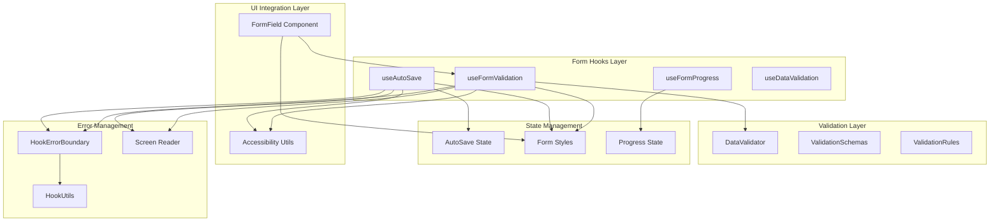

**Diagram sources**
- [useFormValidation.tsx:130-529](file://src/hooks/useFormValidation.tsx#L130-L529)
- [useAutoSave.ts:76-214](file://src/hooks/useAutoSave.ts#L76-L214)
- [useFormProgress.ts:75-185](file://src/hooks/useFormProgress.ts#L75-L185)
- [dataValidation.ts:68-396](file://src/utils/dataValidation.ts#L68-L396)

The architecture ensures loose coupling between validation logic, auto-save functionality, and UI presentation, allowing for flexible integration across different form types and validation scenarios.

## Core Components

### useFormValidation Hook

The `useFormValidation` hook serves as the central component for form validation, providing comprehensive validation capabilities with real-time feedback, accessibility support, and enhanced error management.

#### Key Features

- **Enhanced Validation Modes**: Four validation modes (onChange, onBlur, onSubmit, all) with configurable debounce timing
- **Priority-Based Validation**: Priority system for validation rule ordering and error reporting
- **Async Validation Support**: Comprehensive async validation operations with proper error handling
- **Accessibility Compliance**: Integrated screen reader announcements and ARIA attributes
- **Flexible Configuration**: Extensive customization options for validation modes and behavior
- **Field Registration**: Automatic field reference management for focus and accessibility

#### Enhanced Validation Modes

The hook supports four validation modes with improved configuration:

| Mode | Trigger | Use Case | Debounce Control |
|------|---------|----------|------------------|
| `onChange` | Field value changes | Immediate feedback for critical fields | Configurable per field |
| `onBlur` | Field loses focus | Background validation for less critical fields | Configurable per field |
| `onSubmit` | Form submission | Final validation before submission | Disabled by default |
| `all` | All events | Comprehensive validation experience | Configurable per field |

#### Priority-Based Validation System

The system now includes a sophisticated priority-based validation rule system:

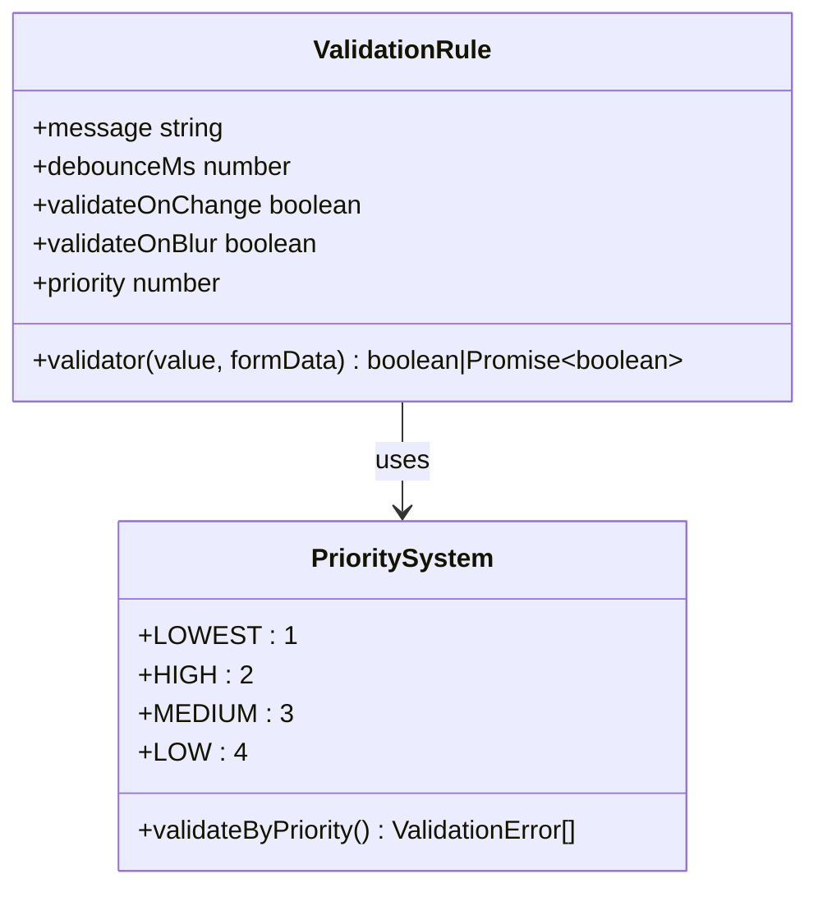

**Diagram sources**
- [useFormValidation.tsx:58-128](file://src/hooks/useFormValidation.tsx#L58-L128)

**Section sources**
- [useFormValidation.tsx:130-529](file://src/hooks/useFormValidation.tsx#L130-L529)

### useAutoSave Hook

The `useAutoSave` hook provides automatic form data saving with intelligent debouncing, status tracking, and manual override capabilities.

#### Auto-Save State Management

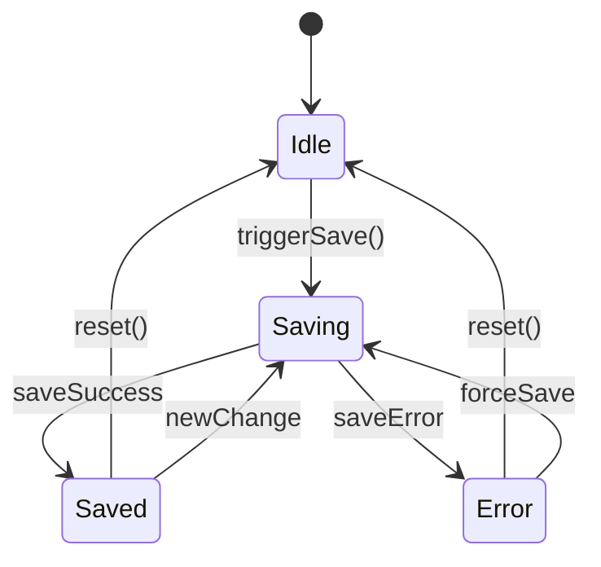

**Diagram sources**
- [useAutoSave.ts:76-214](file://src/hooks/useAutoSave.ts#L76-L214)

#### Auto-Save Configuration Options

| Option | Type | Default | Description |
|--------|------|---------|-------------|
| `data` | T | Required | Data to auto-save |
| `onSave` | Function | Required | Save function returning Promise |
| `delay` | number | 2000 | Debounce delay in milliseconds |
| `enabled` | boolean | true | Enable/disable auto-save |
| `minInterval` | number | 1000 | Minimum time between saves |
| `onSuccess` | Function | undefined | Callback on successful save |
| `onError` | Function | undefined | Callback on save error |

**Section sources**
- [useAutoSave.ts:76-214](file://src/hooks/useAutoSave.ts#L76-L214)

### useFormProgress Hook

The `useFormProgress` hook provides sophisticated form completion tracking with customizable weighting, validation requirements, and progress state management.

#### Advanced Progress Calculation Logic

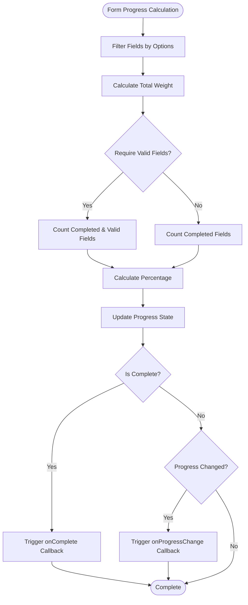

**Diagram sources**
- [useFormProgress.ts:84-122](file://src/hooks/useFormProgress.ts#L84-L122)

**Section sources**
- [useFormProgress.ts:75-185](file://src/hooks/useFormProgress.ts#L75-L185)

## Enhanced Form Validation System

### Real-time Validation Engine

The validation system operates through a sophisticated engine that manages field states, validation timing, priority-based error reporting, and accessibility support:

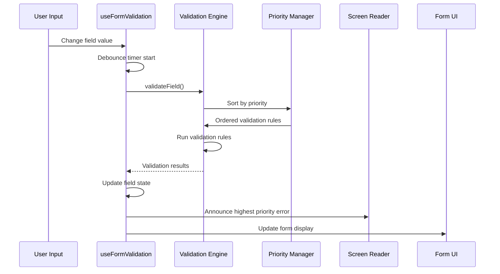

**Diagram sources**
- [useFormValidation.tsx:174-264](file://src/hooks/useFormValidation.tsx#L174-L264)

### Enhanced Validation State Management

The system maintains comprehensive validation state for each field with priority-based error handling:

| State Property | Description | Impact on UI |
|----------------|-------------|--------------|
| `isValid` | Overall field validity status | Controls visual feedback |
| `isValidating` | Active validation status | Shows loading state |
| `errors` | Array of validation errors sorted by priority | Displays highest priority error |
| `touched` | User interaction status | Enables error display |
| `dirty` | Value modification status | Triggers validation |

### Priority-Based Error Resolution

The system now implements a priority-based error resolution system:

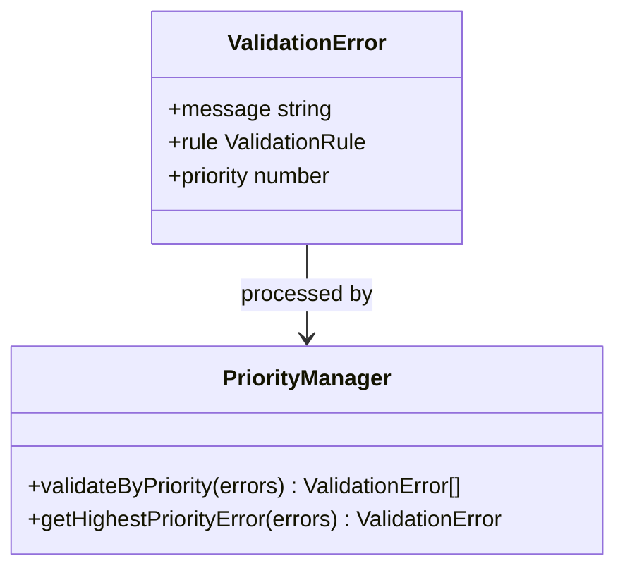

**Diagram sources**
- [useFormValidation.tsx:31-47](file://src/hooks/useFormValidation.tsx#L31-L47)

**Section sources**
- [useFormValidation.tsx:37-47](file://src/hooks/useFormValidation.tsx#L37-L47)

## Auto-Save Integration

### Auto-Save State Management

The auto-save system provides comprehensive state management with intelligent debouncing and conflict resolution:

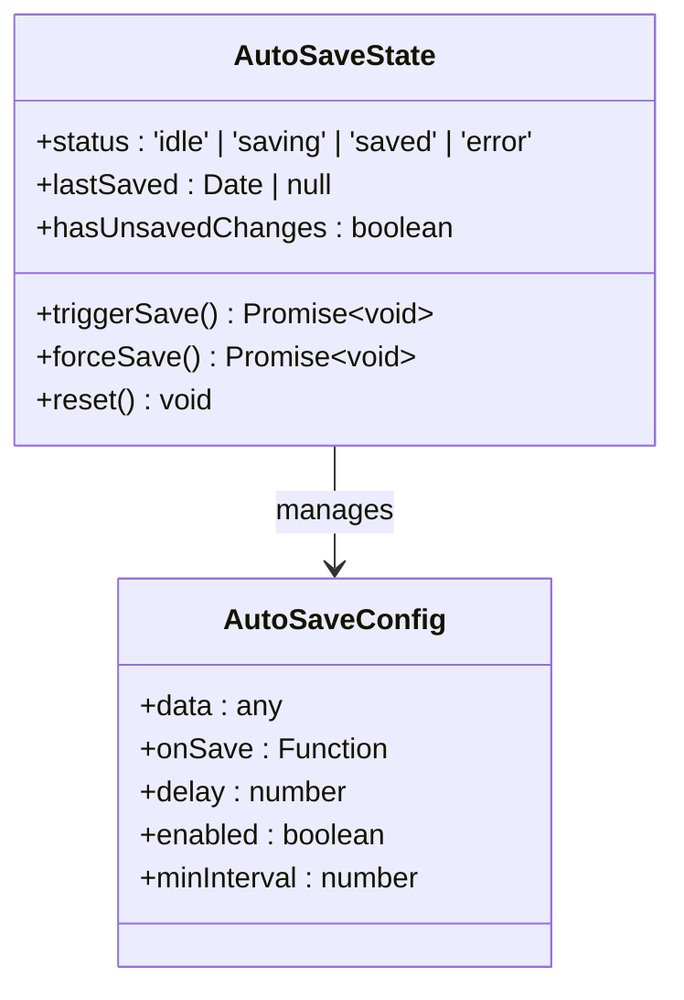

**Diagram sources**
- [useAutoSave.ts:25-38](file://src/hooks/useAutoSave.ts#L25-L38)

### Auto-Save Integration Patterns

The auto-save hook integrates seamlessly with form validation and progress tracking:

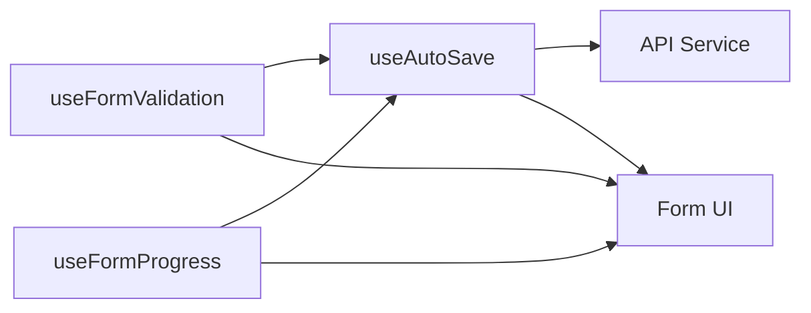

**Diagram sources**
- [useFormValidation.tsx:500-526](file://src/hooks/useFormValidation.tsx#L500-L526)
- [useAutoSave.ts:203-210](file://src/hooks/useAutoSave.ts#L203-L210)

### Auto-Save Status Indicators

The system provides comprehensive status indicators for user feedback:

| Status | Visual Indicator | Use Case |
|--------|------------------|----------|
| `idle` | Default state | No recent changes |
| `saving` | Loading spinner | Currently saving data |
| `saved` | Success checkmark | Last save successful |
| `error` | Error icon | Save operation failed |

**Section sources**
- [useAutoSave.ts:6-23](file://src/hooks/useAutoSave.ts#L6-L23)

## Form Progress Tracking

### Advanced Progress Calculation

The progress tracking system provides flexible calculation methods based on form requirements with enhanced field state management:

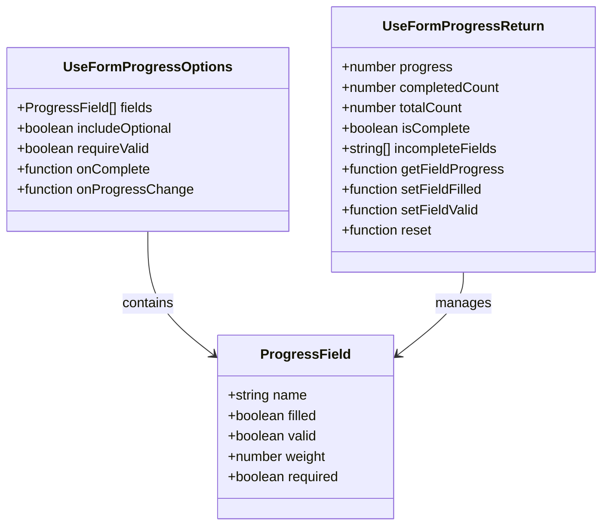

**Diagram sources**
- [useFormProgress.ts:6-51](file://src/hooks/useFormProgress.ts#L6-L51)

### Weighted Progress System

The system supports weighted progress calculation where different form fields can contribute differently to the overall completion percentage, enabling more meaningful progress tracking in complex forms.

**Section sources**
- [useFormProgress.ts:97-103](file://src/hooks/useFormProgress.ts#L97-L103)

## Data Validation Framework

### Comprehensive Data Validation

The data validation framework provides robust validation for CRUD operations and data consistency checks with enhanced error reporting:

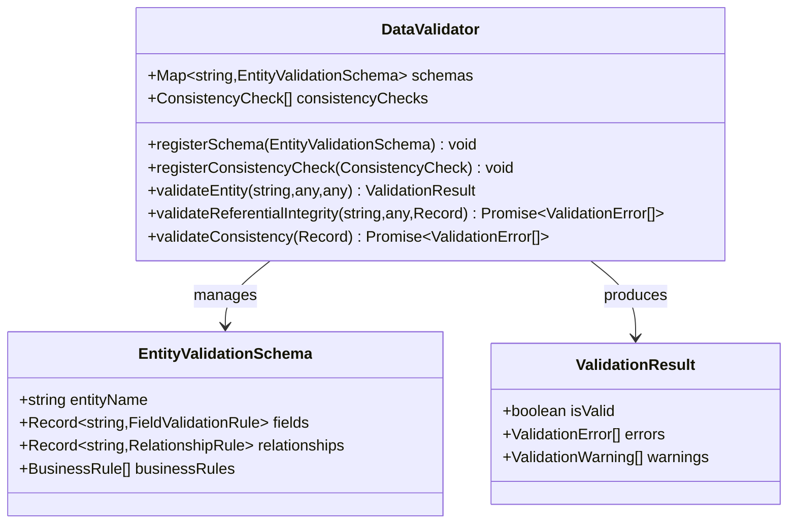

**Diagram sources**
- [dataValidation.ts:68-396](file://src/utils/dataValidation.ts#L68-L396)

### Enhanced Entity Validation Schemas

The system includes comprehensive validation schemas for core entities with business rule enforcement:

| Entity | Fields Validated | Business Rules | Relationship Checks |
|--------|------------------|----------------|-------------------|
| Students | Personal info, contact details, demographics | Unique admission numbers, age validation | Class streams, categories |
| Staff | Employment details, contact information | Unique staff numbers | Departments, designations |
| Financial Years | Date ranges, status | Date range validation, non-overlapping periods | None |
| Student Invoices | Amounts, dates, status | Due date validation, payment limits | Students, school periods |
| Academic Periods | Naming, scheduling | Unique period names | Academic years |

**Section sources**
- [validationSchemas.ts:21-118](file://src/utils/validationSchemas.ts#L21-L118)
- [validationSchemas.ts:120-176](file://src/utils/validationSchemas.ts#L120-L176)

## UI Integration Layer

### FormField Component

The `FormField` component provides a standardized wrapper for form inputs with comprehensive accessibility, styling, and state management support:

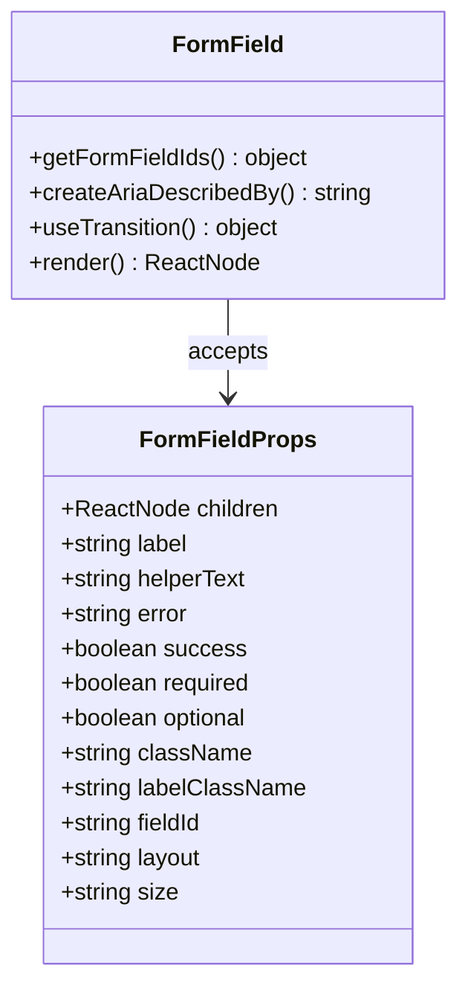

**Diagram sources**
- [FormField.tsx:8-21](file://src/components/ui/forms/FormField.tsx#L8-L21)

### Enhanced Styling System

The form styling system provides consistent visual patterns with enhanced state management:

| Style Category | Variants | Use Cases |
|----------------|----------|-----------|
| Input Styles | Outlined, Filled, Standard | Different form contexts |
| Input States | Error, Success, Disabled, Loading | Visual feedback states |
| Form Grid | 1-4 Columns | Responsive layout management |
| Progress Indicators | Default, Success, Warning, Error | Completion status visualization |
| Field States | Valid, Invalid, Loading, Disabled | Dynamic form feedback |

**Section sources**
- [formStyles.ts:6-116](file://src/utils/formStyles.ts#L6-L116)

## Error Handling and Debugging

### Comprehensive Error Management

The system implements multiple layers of error handling with enhanced debugging capabilities:

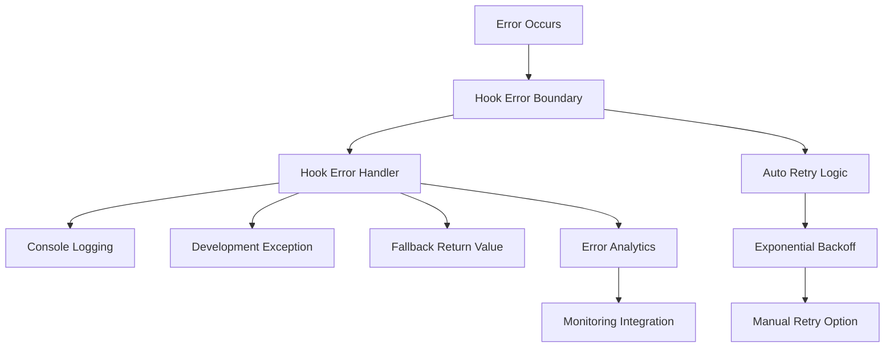

**Diagram sources**
- [HookErrorBoundary.tsx:40-99](file://src/components/HookErrorBoundary.tsx#L40-L99)
- [hookUtils.ts:60-82](file://src/utils/hookUtils.ts#L60-L82)

### Enhanced Accessibility Features

The system includes comprehensive accessibility features with priority-based error announcements:

- **Priority-Based Screen Reader**: Automatic announcement of highest priority validation errors
- **ARIA Attribute Management**: Proper labeling and error messaging for assistive technologies
- **Keyboard Navigation**: Full keyboard accessibility for form interactions
- **Focus Management**: Intelligent focus handling during validation and error states
- **Error State Communication**: Clear error state communication through multiple channels

**Section sources**
- [useFormValidation.tsx:288-292](file://src/hooks/useFormValidation.tsx#L288-L292)
- [FormField.tsx:92-109](file://src/components/ui/forms/FormField.tsx#L92-L109)

## Performance Considerations

### Optimization Strategies

The Form Hooks System implements several performance optimization strategies with enhanced state management:

- **Memoization**: Extensive use of `useMemo` and `useCallback` to prevent unnecessary re-renders
- **Enhanced Debouncing**: Configurable debouncing for validation operations with priority-based execution
- **Lazy Evaluation**: Deferred validation until appropriate triggers with priority queue management
- **Efficient State Updates**: Optimized state updates with batch processing for multiple field changes
- **Auto-Save Optimization**: Intelligent debouncing and conflict resolution for auto-save operations

### Memory Management

The system includes automatic cleanup mechanisms:

- **Timer Cleanup**: Automatic clearing of debounce timers on component unmount
- **Reference Management**: Proper cleanup of field references and event listeners
- **Resource Pooling**: Efficient management of validation promises and async operations
- **Auto-Save Cleanup**: Proper cleanup of save timers and state references

## Best Practices

### Implementation Guidelines

1. **Field Configuration**: Define clear validation rules with appropriate priority levels and error messages
2. **Performance Tuning**: Configure debounce timing based on field importance and validation complexity
3. **Accessibility**: Always include proper labeling, error messaging, and priority-based announcements
4. **State Management**: Use the provided hooks consistently to maintain predictable form behavior
5. **Error Handling**: Implement appropriate error boundaries and fallback strategies
6. **Auto-Save Integration**: Integrate auto-save functionality with form validation and progress tracking
7. **Priority Management**: Use priority-based validation for logical error resolution order

### Common Patterns

- **Progress Tracking**: Use `useFormProgress` for multi-step forms and complex validation scenarios
- **Real-time Validation**: Leverage `useFormValidation` for immediate user feedback with priority-based error handling
- **Auto-Save Integration**: Combine `useAutoSave` with form validation for seamless data persistence
- **Data Integrity**: Utilize the data validation framework for backend and migration operations
- **UI Consistency**: Apply the form styling system for uniform visual presentation

## Troubleshooting Guide

### Common Issues and Solutions

| Issue | Symptoms | Solution |
|-------|----------|----------|
| Validation Not Triggering | No error messages appear | Check validation mode configuration and field rules |
| Priority Errors Not Displayed | Wrong error appears first | Verify validation rule priorities and error sorting |
| Auto-Save Conflicts | Data overwritten unexpectedly | Check minInterval configuration and save timing |
| Performance Issues | Slow form interactions | Adjust debounce timing and validation complexity |
| Accessibility Problems | Screen reader issues | Verify ARIA attributes and priority-based error announcements |
| State Inconsistencies | Unexpected form behavior | Review state updates and hook dependencies |

### Debugging Tools

The system provides built-in debugging capabilities:

- **Development Exceptions**: Errors thrown in development mode for immediate identification
- **Console Logging**: Comprehensive error and state information in development builds
- **Error Boundaries**: Automatic error catching and recovery mechanisms
- **Hook Utilities**: Validation helpers for dependency arrays and error handling
- **Priority Debugging**: Tools for debugging validation rule priority ordering

**Section sources**
- [hookUtils.ts:42-55](file://src/utils/hookUtils.ts#L42-L55)
- [HookErrorBoundary.tsx:81-104](file://src/components/ErrorBoundary/HookErrorBoundary.tsx#L81-L104)

## Conclusion

The Form Hooks System represents a comprehensive solution for form handling in the SchoolPilot3 educational management system. By combining enhanced real-time validation with priority-based error handling, automatic data persistence, progress tracking, data integrity checking, and accessibility compliance, it provides developers with a robust foundation for building reliable and user-friendly forms across all modules.

The system's enhanced modular architecture ensures flexibility and maintainability, while its performance optimizations guarantee smooth user experiences even with complex validation scenarios and auto-save operations. The comprehensive error handling and debugging capabilities make it easier to develop and maintain form functionality over time.

Key benefits include:

- **Enhanced Validation**: Multi-layered validation system with priority-based error resolution and real-time feedback
- **Automatic Persistence**: Intelligent auto-save functionality with conflict resolution and status tracking
- **Accessibility Compliance**: Built-in support for assistive technologies with priority-based error announcements
- **Performance Optimization**: Efficient state management, computation reduction, and optimized auto-save operations
- **Extensibility**: Modular design allowing for easy customization and extension
- **Developer Experience**: Rich debugging tools, comprehensive documentation, and testing support

This system serves as a cornerstone for form-based functionality throughout the SchoolPilot3 platform, ensuring consistent quality and reliability across all user interactions while providing the flexibility needed for complex educational management scenarios.