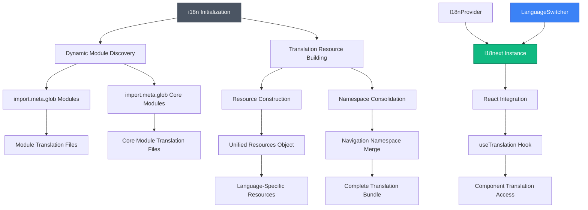
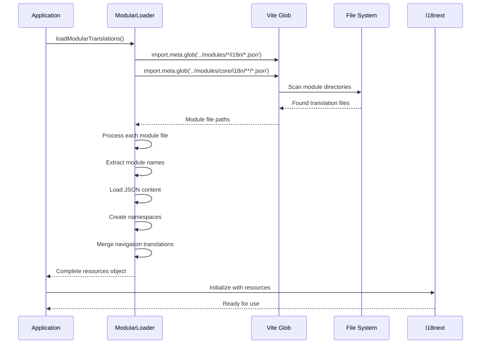

# Internationalization (i18n)

<cite>
**Referenced Files in This Document**
- [i18n.ts](file://src/i18n/i18n.ts)
- [modularLoader.ts](file://src/i18n/modularLoader.ts)
- [index.ts](file://src/i18n/index.ts)
- [LanguageSwitcher.tsx](file://src/components/ui/LanguageSwitcher.tsx)
- [PickupDashboardPage.tsx](file://src/modules/administration/pages/pickup/PickupDashboardPage.tsx)
- [MISSING_FEATURES_IMPLEMENTATION_PLAN.md](file://docs/planning/MISSING_FEATURES_IMPLEMENTATION_PLAN.md)
</cite>

## Update Summary
**Changes Made**
- Updated documentation to reflect the new modular i18n architecture with dynamic translation loading
- Added comprehensive coverage of the six new modules: analytics, assignments, pickup, houses, portal, and lessonplans
- Enhanced translation management documentation for multi-language support across all modules
- Updated modularLoader implementation details for dynamic module discovery and translation loading
- Added practical examples of translation key organization and namespace management
- Expanded documentation on build-time and runtime translation processing

## Table of Contents
1. [Internationalization (i18n)](#internationalization-i18n)
2. [Architecture Overview](#architecture-overview)
3. [Core Components](#core-components)
4. [Detailed Component Analysis](#detailed-component-analysis)
5. [Translation File Structure and Conventions](#translation-file-structure-and-conventions)
6. [New Module Integration](#new-module-integration)
7. [Runtime and Build-Time Processes](#runtime-and-build-time-processes)
8. [Common Issues and Troubleshooting](#common-issues-and-troubleshooting)
9. [Best Practices](#best-practices)

## Architecture Overview

The internationalization system in schoolpilot3 has evolved into a sophisticated modular architecture that supports comprehensive multi-language functionality across six major modules. The system now uses dynamic translation loading through Vite's import.meta.glob, enabling automatic discovery and integration of translation files from module-specific i18n directories.

The architecture centers around three core components: the i18n initialization system, the modular translation loader, and the unified namespace management that consolidates translations from individual modules into cohesive translation resources.



**Diagram sources**
- [i18n.ts](file://src/i18n/i18n.ts)
- [modularLoader.ts](file://src/i18n/modularLoader.ts)
- [LanguageSwitcher.tsx](file://src/components/ui/LanguageSwitcher.tsx)

## Core Components

### i18n Initialization System

The i18n initialization system creates and configures the i18next instance with comprehensive internationalization support. The system implements robust error handling with fallback mechanisms to ensure reliable operation even when translation files are unavailable.

**Key Features:**
- **Singleton Pattern**: Prevents multiple initialization attempts
- **Error Resilience**: Implements fallback initialization with minimal translation set
- **Dynamic Configuration**: Supports runtime modification of supported languages
- **Debug Mode**: Enables development logging for translation debugging
- **Suspense Integration**: Provides seamless React Suspense compatibility

**Configuration Options:**
- `fallbackLng`: English as default fallback language
- `defaultNS`: Common namespace as default translation scope
- `ns`: Comprehensive namespace array covering all application domains
- `detection`: Multi-source language detection (localStorage, navigator, htmlTag)
- `returnNull`: Returns empty strings instead of null values

**Section sources**
- [i18n.ts](file://src/i18n/i18n.ts)

### Modular Translation Loader

The modular translation loader implements dynamic discovery and loading of translation resources from module-specific directories. This system automatically detects and processes translation files from both regular modules and core modules.

**Key Features:**
- **Dynamic Import**: Uses Vite's import.meta.glob for efficient module discovery
- **Multi-Language Support**: Processes translation files for English, French, Swahili, and Kinyarwanda
- **Namespace Management**: Automatically creates module-specific namespaces
- **Navigation Consolidation**: Merges navigation translations into unified navigation namespace
- **Error Handling**: Gracefully handles missing or malformed translation files

**Supported Languages:**
- English (en)
- French (fr) 
- Swahili (sw)
- Kinyarwanda (rw)

**Section sources**
- [modularLoader.ts](file://src/i18n/modularLoader.ts)

### I18nProvider and React Integration

The I18nProvider component manages the internationalization context and provides seamless integration with React applications. The provider handles initialization, locale persistence, and context distribution to child components.

**Key Responsibilities:**
- **Context Management**: Creates and manages i18n context for component tree
- **Initialization Control**: Coordinates i18n initialization with application startup
- **Locale Persistence**: Maintains user language preferences across sessions
- **Error Boundary Integration**: Works with error boundaries for graceful degradation
- **Performance Optimization**: Minimizes re-renders through efficient context updates

**Section sources**
- [index.ts](file://src/i18n/index.ts)

### LanguageSwitcher Component

The LanguageSwitcher component provides an intuitive interface for users to change application language. The component integrates seamlessly with the i18n system and provides real-time language switching capabilities.

**Enhanced Features:**
- **Dropdown Interface**: Clean dropdown menu with language options
- **Real-time Switching**: Instant language change without page reload
- **Visual Feedback**: Clear indication of current language selection
- **Accessibility Support**: Proper ARIA labels and keyboard navigation
- **Integration Ready**: Works with all supported languages and locales

**Section sources**
- [LanguageSwitcher.tsx](file://src/components/ui/LanguageSwitcher.tsx)

## Detailed Component Analysis

### Dynamic Module Discovery Process



**Diagram sources**
- [modularLoader.ts](file://src/i18n/modularLoader.ts)
- [i18n.ts](file://src/i18n/i18n.ts)

### Translation Resource Construction

The modular loader constructs translation resources through a systematic process that ensures proper namespace organization and navigation consolidation.

**Processing Pipeline:**
1. **Language Initialization**: Creates resource objects for each supported language
2. **Namespace Setup**: Initializes navigation namespace for unified navigation
3. **Module Processing**: Iterates through discovered module translation files
4. **Content Loading**: Dynamically imports and processes translation content
5. **Namespace Creation**: Creates module-specific namespaces in resources
6. **Navigation Consolidation**: Merges navigation translations into unified namespace
7. **Resource Assembly**: Combines all processed content into final resources object

**Section sources**
- [modularLoader.ts](file://src/i18n/modularLoader.ts)

## Translation File Structure and Conventions

### Modular Directory Structure

The internationalization system follows a modular directory structure that organizes translation files by language and module. Each module maintains its own i18n directory containing language-specific translation files.

```
src/
├── modules/
│   ├── analytics/
│   │   └── i18n/
│   │       ├── en.json
│   │       ├── fr.json
│   │       ├── sw.json
│   │       └── rw.json
│   ├── assignments/
│   │   └── i18n/
│   │       ├── en.json
│   │       ├── fr.json
│   │       ├── sw.json
│   │       └── rw.json
│   ├── pickup/
│   │   └── i18n/
│   │       ├── en.json
│   │       ├── fr.json
│   │       ├── sw.json
│   │       └── rw.json
│   ├── houses/
│   │   └── i18n/
│   │       ├── en.json
│   │       ├── fr.json
│   │       ├── sw.json
│   │       └── rw.json
│   ├── portal/
│   │   └── i18n/
│   │       ├── en.json
│   │       ├── fr.json
│   │       ├── sw.json
│   │       └── rw.json
│   └── lessonplans/
│       └── i18n/
│           ├── en.json
│           ├── fr.json
│           ├── sw.json
│           └── rw.json
```

### Core Module Translation Structure

Core modules maintain translation files in a nested directory structure that allows for more granular organization of translation content.

```
src/
├── modules/core/
│   └── i18n/
│       ├── analytics/
│       │   ├── en.json
│       │   ├── fr.json
│       │   ├── sw.json
│       │   └── rw.json
│       ├── assignments/
│       │   ├── en.json
│       │   ├── fr.json
│       │   ├── sw.json
│       │   └── rw.json
│       └── ... (other core modules)
```

### Translation Key Organization

Each translation file follows a structured format that organizes content by functional domains and maintains consistency across languages.

**Example Translation Structure:**
```json
{
  "common": {
    "title": "SchoolPilot3",
    "welcome": "Welcome",
    "actions": {
      "save": "Save",
      "cancel": "Cancel",
      "delete": "Delete"
    }
  },
  "navigation": {
    "dashboard": "Dashboard",
    "analytics": "Analytics",
    "assignments": "Assignments",
    "pickup": "Pickup",
    "houses": "Houses",
    "portal": "Portal",
    "lessonplans": "Lesson Plans"
  },
  "analytics": {
    "dashboard": {
      "title": "Teacher Dashboard",
      "metrics": {
        "studentCount": "Student Count",
        "averageGrade": "Average Grade"
      }
    }
  },
  "assignments": {
    "list": {
      "title": "Assignment List",
      "dueDate": "Due Date",
      "status": "Status"
    }
  }
}
```

**Section sources**
- [modularLoader.ts](file://src/i18n/modularLoader.ts)

## New Module Integration

### Analytics Module Translation Support

The analytics module provides comprehensive translation support for teacher dashboards, reporting interfaces, and data visualization components. The module includes specialized vocabulary for academic analytics and performance metrics.

**Analytics Translation Keys:**
- Dashboard navigation and interface elements
- Student performance metrics and statistics
- Academic reporting and chart labels
- Data filtering and sorting controls

### Assignments Module Translation Support

The assignments module supports translation for assignment creation, submission, grading, and tracking workflows. The module includes academic terminology and assignment-specific vocabulary.

**Assignments Translation Keys:**
- Assignment creation and management interfaces
- Submission tracking and status indicators
- Grading rubrics and evaluation criteria
- Academic calendar and deadline communications

### Pickup Module Translation Support

The pickup module provides translation support for student pickup verification, authorization management, and incident reporting systems. The module includes security-related terminology and operational procedures.

**Pickup Translation Keys:**
- Verification scanner interfaces and instructions
- Authorized person management screens
- Incident reporting and flagging systems
- Daily log and report generation interfaces

### Houses Module Translation Support

The houses module supports translation for house management, point awarding systems, leaderboard displays, and class standings tracking. The module includes sports and competition terminology.

**Houses Translation Keys:**
- House management and configuration interfaces
- Point transaction and awarding systems
- Leaderboard display and ranking algorithms
- Class standing and academic competition metrics

### Portal Module Translation Support

The portal module provides translation support for parent and student portals, including fee payment interfaces, announcement systems, and communication tools. The module includes customer service and administrative terminology.

**Portal Translation Keys:**
- Portal navigation and dashboard interfaces
- Fee payment and financial transaction screens
- Announcement and communication systems
- User profile and account management interfaces

### Lesson Plans Module Translation Support

The lesson plans module supports translation for weekly planning interfaces, curriculum management, and instructional planning tools. The module includes educational terminology and planning vocabulary.

**Lesson Plans Translation Keys:**
- Weekly planning and scheduling interfaces
- Curriculum mapping and standards alignment
- Instructional resource management
- Academic planning and goal setting tools

**Section sources**
- [MISSING_FEATURES_IMPLEMENTATION_PLAN.md](file://docs/planning/MISSING_FEATURES_IMPLEMENTATION_PLAN.md)
- [PickupDashboardPage.tsx](file://src/modules/administration/pages/pickup/PickupDashboardPage.tsx)

## Runtime and Build-Time Processes

### Build-Time Translation Processing

The build-time process leverages Vite's import.meta.glob functionality to statically discover and process translation files during compilation. This approach provides several advantages:

**Build-Time Benefits:**
- **Static Analysis**: Vite can analyze and optimize translation file imports
- **Tree Shaking**: Unused translation keys can be eliminated from final bundle
- **Type Safety**: TypeScript can validate translation key references
- **Performance**: Pre-processed translation resources reduce runtime overhead

**Processing Workflow:**
1. **File Discovery**: import.meta.glob scans module directories for translation files
2. **Static Import Generation**: Vite generates static import statements for discovered files
3. **Resource Compilation**: Translation resources are compiled into optimized JavaScript
4. **Bundle Integration**: Processed resources become part of the application bundle

### Runtime Translation Loading

The runtime loading process occurs when the application initializes and begins processing translation resources. The system implements several optimization strategies:

**Runtime Optimization Strategies:**
- **Lazy Loading**: Translation files are loaded on-demand when needed
- **Caching**: Loaded translation resources are cached for subsequent use
- **Error Recovery**: Fallback mechanisms ensure application continues with minimal functionality
- **Progressive Enhancement**: Application becomes fully localized as translation files load

### Translation Resource Construction

The modular loader constructs translation resources through a multi-stage process that ensures proper organization and namespace management.

**Construction Process:**
1. **Language Foundation**: Initialize resource objects for each supported language
2. **Namespace Initialization**: Create navigation namespace for unified navigation
3. **Module Processing**: Iterate through discovered module translation files
4. **Content Integration**: Load and integrate translation content into resources
5. **Navigation Consolidation**: Merge navigation translations into unified namespace
6. **Resource Finalization**: Assemble complete translation resources for i18next

**Section sources**
- [modularLoader.ts](file://src/i18n/modularLoader.ts)
- [i18n.ts](file://src/i18n/i18n.ts)

## Common Issues and Troubleshooting

### Translation File Loading Failures

**Symptoms**: Missing translations or console errors related to translation loading
**Causes**:
- Incorrect file paths in import.meta.glob patterns
- Missing translation files in module directories
- Malformed JSON syntax in translation files
- Incorrect language code in file names
- Permission issues accessing translation files

**Solutions**:
1. Verify translation file paths match expected patterns
2. Check file names use correct language codes (en.json, fr.json, etc.)
3. Validate JSON syntax using online validators
4. Ensure all required translation files exist for each module
5. Check file permissions and access rights

### Namespace Conflicts

**Symptoms**: Translation keys overriding each other or unexpected behavior
**Causes**:
- Duplicate translation keys across modules
- Conflicting navigation translations
- Inconsistent key naming conventions
- Missing namespace declarations

**Solutions**:
1. Implement unique key naming conventions per module
2. Use module-specific prefixes for translation keys
3. Regularly audit translation files for duplicates
4. Maintain consistent namespace organization
5. Document translation key hierarchies and relationships

### Performance Optimization Issues

**Symptoms**: Slow application startup or delayed translation loading
**Causes**:
- Large translation files blocking initialization
- Excessive concurrent translation file loading
- Missing translation file optimizations
- Inefficient namespace organization

**Solutions**:
1. Split large translation files into smaller, module-specific files
2. Implement lazy loading for non-critical translation content
3. Use code splitting to load translation files on-demand
4. Optimize translation file sizes through compression
5. Implement translation file caching strategies

### Language Detection Problems

**Symptoms**: Incorrect language selection or detection failures
**Causes**:
- Browser language detection issues
- localStorage corruption or conflicts
- HTML tag language attribute problems
- Custom language detection configuration errors

**Solutions**:
1. Verify browser language detection settings
2. Clear corrupted localStorage entries
3. Check HTML lang attribute configuration
4. Test custom detection configurations
5. Implement fallback language detection logic

**Section sources**
- [modularLoader.ts](file://src/i18n/modularLoader.ts)
- [i18n.ts](file://src/i18n/i18n.ts)

## Best Practices

### Translation Key Organization

**Key Naming Conventions:**
- Use dot notation for hierarchical organization (e.g., "navigation.dashboard")
- Implement module-specific prefixes (e.g., "analytics.dashboard.metrics")
- Maintain consistent naming across all supported languages
- Use descriptive names that clearly indicate context and purpose
- Avoid generic terms that may have multiple meanings

**Namespace Management:**
- Create dedicated namespaces for each major functional area
- Use common namespace for shared UI elements and actions
- Implement navigation namespace for unified navigation translations
- Group related translations into logical categories
- Maintain consistent namespace structure across modules

### Multi-Language Support Strategy

**Language Coverage Planning:**
- Support four languages: English, French, Swahili, Kinyarwanda
- Ensure all translation files exist for each supported language
- Implement fallback mechanisms for missing translations
- Regularly audit translation completeness and accuracy
- Coordinate translation updates across all modules

**Translation Quality Assurance:**
- Establish translation review processes
- Implement automated translation validation
- Maintain translation glossaries and style guides
- Conduct regular translation audits
- Provide translation contribution guidelines

### Performance Optimization

**Bundle Size Management:**
- Split translation files by module and language
- Implement lazy loading for non-critical translations
- Use code splitting to optimize initial bundle size
- Compress translation files for reduced bandwidth
- Implement translation file caching strategies

**Runtime Performance:**
- Cache loaded translation resources in memory
- Implement translation key indexing for faster lookup
- Use efficient data structures for translation storage
- Minimize translation file loading during critical operations
- Monitor translation loading performance metrics

### Error Handling and Fallbacks

**Graceful Degradation:**
- Always provide fallback translations in English
- Implement error boundaries for translation loading failures
- Handle missing translation keys gracefully
- Provide user feedback for incomplete translations
- Maintain application functionality with minimal localization

**Debugging and Monitoring:**
- Implement comprehensive translation debugging tools
- Monitor translation loading performance and errors
- Track translation usage patterns and effectiveness
- Provide translation quality metrics and reporting
- Establish translation maintenance workflows

### Maintenance and Coordination

**Translation Management Workflows:**
- Establish version control processes for translation changes
- Implement peer review for translation modifications
- Coordinate translation updates across multiple modules
- Maintain translation change logs and documentation
- Provide translation contribution guidelines and training

**Quality Assurance Processes:**
- Regular translation audits and reviews
- Automated validation of translation completeness
- User acceptance testing for translated interfaces
- Performance monitoring for translation loading
- Continuous improvement of translation quality

**Section sources**
- [modularLoader.ts](file://src/i18n/modularLoader.ts)
- [i18n.ts](file://src/i18n/i18n.ts)
- [MISSING_FEATURES_IMPLEMENTATION_PLAN.md](file://docs/planning/MISSING_FEATURES_IMPLEMENTATION_PLAN.md)