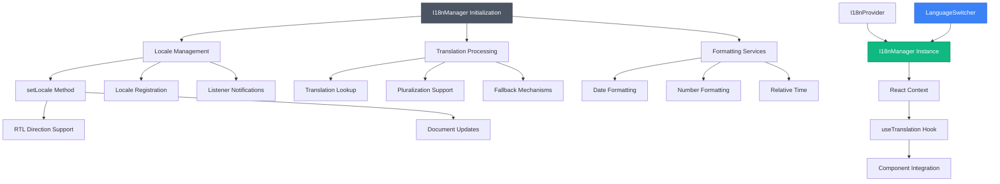
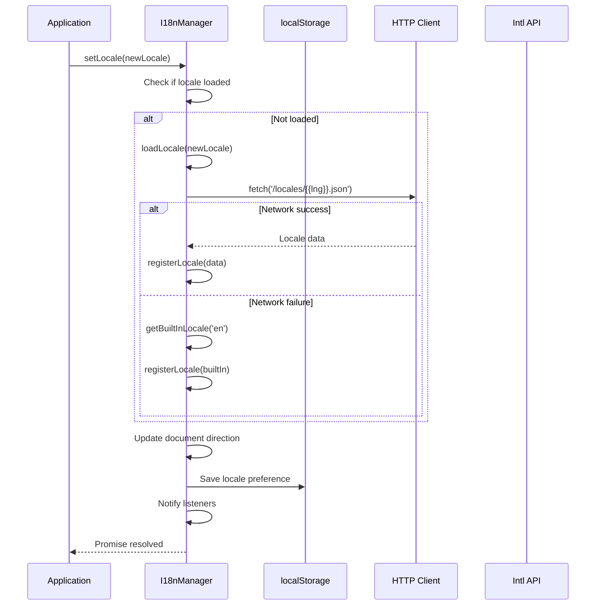
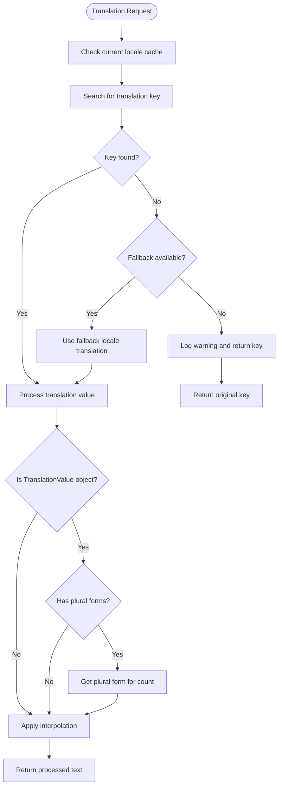
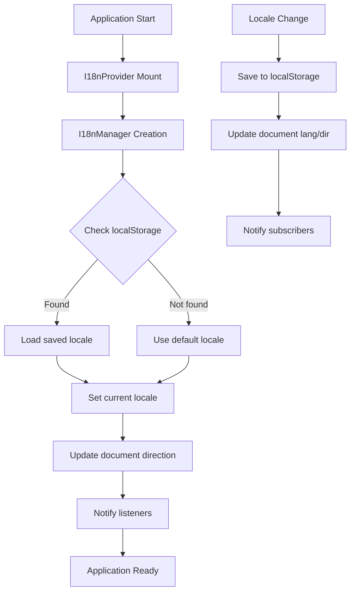

# Internationalization (i18n)

<cite>
**Referenced Files in This Document**
- [I18nManager.ts](file://src/i18n/I18nManager.ts)
- [I18nProvider.tsx](file://src/i18n/I18nProvider.tsx)
- [useTranslation.ts](file://src/i18n/useTranslation.ts)
- [index.ts](file://src/i18n/index.ts)
- [types.ts](file://src/i18n/types.ts)
- [i18n.ts](file://src/i18n/i18n.ts)
- [loader.ts](file://src/i18n/loader.ts)
- [modularLoader.ts](file://src/i18n/modularLoader.ts)
- [LanguageSwitcher.tsx](file://src/components/ui/LanguageSwitcher.tsx)
- [common.json](file://src/locales/en/common.json)
- [settings.json](file://src/locales/en/settings.json)
</cite>

## Update Summary
**Changes Made**
- Added documentation for the new I18nManager class architecture
- Updated core components section to reflect the new manager-based approach
- Enhanced language switching implementation details
- Expanded locale support documentation including RTL language handling
- Updated translation file structure to reflect the new modular system
- Added comprehensive examples for the new internationalization API

## Table of Contents
1. [Internationalization (i18n)](#internationalization-i18n)
2. [Architecture Overview](#architecture-overview)
3. [Core Components](#core-components)
4. [Detailed Component Analysis](#detailed-component-analysis)
5. [Translation File Structure and Conventions](#translation-file-structure-and-conventions)
6. [Runtime and Build-Time Processes](#runtime-and-build-time-processes)
7. [Common Issues and Troubleshooting](#common-issues-and-troubleshooting)
8. [Best Practices](#best-practices)

## Architecture Overview

The internationalization system in schoolpilot3 has been enhanced with a new I18nManager-based architecture that provides a more robust, scalable, and feature-rich internationalization solution. The system now supports seven locales: English (en), Spanish (es), French (fr), German (de), Arabic (ar), and expanded support for Kinyarwanda (rw) and Swahili (sw).

The new architecture centers around the I18nManager class, which provides centralized locale management, translation handling, and formatting capabilities. The system maintains backward compatibility while introducing modern React patterns and enhanced functionality.



**Diagram sources**
- [I18nManager.ts](file://src/i18n/I18nManager.ts)
- [I18nProvider.tsx](file://src/i18n/I18nProvider.tsx)
- [useTranslation.ts](file://src/i18n/useTranslation.ts)
- [LanguageSwitcher.tsx](file://src/components/ui/LanguageSwitcher.tsx)

## Core Components

### I18nManager - Centralized Internationalization Manager

The I18nManager class serves as the core component of the new internationalization architecture, providing comprehensive locale management and translation services.

**Key Features:**
- **Singleton Pattern**: Ensures single instance management across the application
- **Locale Management**: Handles locale registration, loading, and switching
- **Translation Processing**: Supports nested keys, interpolation, and pluralization
- **Formatting Services**: Provides date, number, and relative time formatting
- **RTL Support**: Automatic right-to-left language direction handling
- **Built-in Fallbacks**: Includes English locale data as fallback

**Core Methods:**
- `setLocale(locale)`: Asynchronously loads and switches to specified locale
- `t(key, options)`: Translates keys with interpolation and pluralization
- `formatDate()`, `formatNumber()`, `formatTime()`: Comprehensive formatting functions
- `onLocaleChange()`: Event subscription for locale change notifications
- `preloadLocales()`: Preloads multiple locales for better performance

**Section sources**
- [I18nManager.ts](file://src/i18n/I18nManager.ts)

### I18nProvider - React Context Provider

The I18nProvider component wraps the application with internationalization context, managing locale persistence and initialization.

**Key Responsibilities:**
- Initializes I18nManager with configuration
- Manages locale persistence in localStorage
- Handles asynchronous initialization
- Provides context to child components

**Configuration Options:**
- `defaultLocale`: Application's default locale
- `supportedLocales`: Array of available locales
- `fallbackLocale`: Locale used for missing translations
- `loadPath`: Custom path for loading locale data

**Section sources**
- [I18nProvider.tsx](file://src/i18n/I18nProvider.tsx)

### useTranslation - React Hook

The useTranslation hook provides convenient access to internationalization functionality within React components.

**Available Functions:**
- `t(key, options)`: Translation function with interpolation
- `locale`: Current active locale
- `setLocale(locale)`: Async locale switching with loading state
- `formatDate()`, `formatNumber()`, `formatTime()`: Formatting utilities
- `isLoading`: Loading state during locale switching

**Usage Pattern:**
```typescript
const { t, locale, setLocale, formatDate } = useTranslation();
// Use translations in component JSX
<h1>{t('welcome.message', { name: user.name })}</h1>
```

**Section sources**
- [useTranslation.ts](file://src/i18n/useTranslation.ts)

### LanguageSwitcher - Enhanced UI Component

The LanguageSwitcher component provides an improved user interface for language selection with better accessibility and user experience.

**Enhanced Features:**
- Dropdown menu with language names and flag emojis
- Real-time language detection and display
- Error handling via HookErrorBoundary
- Accessibility improvements with proper semantics
- Visual feedback for current selection
- Integration with I18nManager for seamless switching

**Section sources**
- [LanguageSwitcher.tsx](file://src/components/ui/LanguageSwitcher.tsx)

## Detailed Component Analysis

### I18nManager Implementation Details



**Diagram sources**
- [I18nManager.ts](file://src/i18n/I18nManager.ts)

### Translation Processing Flow



**Diagram sources**
- [I18nManager.ts](file://src/i18n/I18nManager.ts)

## Translation File Structure and Conventions

### Updated Directory Structure
The internationalization system now uses a simplified directory structure focused on core locale files:

```
src/
├── locales/
│   ├── en/
│   │   ├── common.json
│   │   └── settings.json
│   ├── fr/
│   │   ├── common.json
│   │   └── settings.json
│   ├── es/
│   │   ├── common.json
│   │   └── settings.json
│   ├── de/
│   │   ├── common.json
│   │   └── settings.json
│   ├── ar/
│   │   ├── common.json
│   │   └── settings.json
│   ├── rw/
│   │   └── common.json
│   └── sw/
│       └── common.json
```

### Enhanced Locale Data Format
The new system supports rich locale metadata through the LocaleData interface:

```json
{
  "code": "en",
  "name": "English",
  "nativeName": "English",
  "direction": "ltr",
  "dateFormat": "MM/DD/YYYY",
  "timeFormat": "hh:mm A",
  "numberFormat": {
    "decimal": ".",
    "thousand": ",",
    "currency": "$"
  },
  "translations": {
    "app": {
      "name": "SchoolPilot3"
    },
    "nav": {
      "dashboard": "Dashboard"
    }
  }
}
```

### Translation Key Examples
```json
{
  "common": {
    "welcome": "Welcome to SchoolPilot3",
    "userGreeting": "Hello {{name}}",
    "studentCount_one": "{{count}} student",
    "studentCount_other": "{{count}} students",
    "time": {
      "just_now": "Just now",
      "minutes_ago": "{{count}} minute ago",
      "hours_ago": "{{count}} hour ago",
      "days_ago": "{{count}} day ago"
    }
  }
}
```

**Section sources**
- [common.json](file://src/locales/en/common.json)
- [settings.json](file://src/locales/en/settings.json)
- [types.ts](file://src/i18n/types.ts)

## Runtime and Build-Time Processes

### Enhanced Build-Time Processing
The new architecture maintains compatibility with existing build processes while adding new capabilities:

1. **Static Imports**: Core locale files are statically imported for immediate availability
2. **Dynamic Loading**: Additional locales are loaded asynchronously via HTTP requests
3. **Bundle Splitting**: Each locale file is split into separate chunks for optimal loading
4. **Fallback Generation**: Built-in English locale serves as fallback for missing translations

### Improved Runtime Loading Sequence
1. Application initializes I18nProvider with configuration
2. I18nManager instance is created and stored as singleton
3. Saved locale preference is loaded from localStorage
4. Initial locale is set and document direction is configured
5. Application becomes ready for rendering
6. Components access translations through useTranslation hook

### Advanced Cache Management
The system implements multiple caching layers:

- **In-Memory Cache**: Active locale data cached in I18nManager
- **Loading Cache**: Prevents duplicate concurrent loading of locales
- **LocalStorage Cache**: Persists user's language preference
- **Network Cache**: Leverages browser caching for locale files



**Diagram sources**
- [I18nProvider.tsx](file://src/i18n/I18nProvider.tsx)
- [I18nManager.ts](file://src/i18n/I18nManager.ts)

## Common Issues and Troubleshooting

### Locale Loading Failures
**Symptoms**: Blank translations or console errors during language switching
**Causes**:
- Network issues preventing locale file loading
- Incorrect locale code in configuration
- Missing locale files in build output
- CORS restrictions on locale file access

**Solutions**:
1. Verify locale files exist in build output
2. Check network connectivity and CORS settings
3. Ensure locale codes match supported locales array
4. Use preloadLocales() for critical languages

### Translation Key Issues
**Symptoms**: Missing translations or fallback key display
**Causes**:
- Typo in translation key
- Missing translation in current locale
- Incorrect namespace usage
- Nested key path errors

**Solutions**:
1. Use I18nManager.has() method to check key existence
2. Verify translation file contains the key
3. Check namespace alignment between component and file
4. Use dot notation for nested keys (e.g., "section.key")

### Performance Optimization
**Symptoms**: Slow language switching or initial load delays
**Causes**:
- Large locale files blocking rendering
- Network latency for locale loading
- Missing locale preloading
- Excessive concurrent locale requests

**Solutions**:
1. Implement preloadLocales(['en', 'fr', 'es'])
2. Use code splitting for large translation files
3. Leverage browser caching headers
4. Consider lazy loading for less common locales

### RTL Language Issues
**Symptoms**: Text alignment problems or layout issues with Arabic
**Causes**:
- Missing direction metadata in locale data
- CSS conflicts with RTL properties
- Incorrect document direction setting

**Solutions**:
1. Ensure locale data includes correct direction property
2. Verify CSS supports RTL variants
3. Check that document.dir is properly updated
4. Test with actual RTL content

**Section sources**
- [I18nManager.ts](file://src/i18n/I18nManager.ts)
- [I18nProvider.tsx](file://src/i18n/I18nProvider.tsx)
- [useTranslation.ts](file://src/i18n/useTranslation.ts)

## Best Practices

### Adding New Locales
1. **Create locale directory**: Add new folder under src/locales/{code}/
2. **Copy existing structure**: Use existing locale as template
3. **Update configuration**: Add locale to supportedLocales array
4. **Test thoroughly**: Verify all translations render correctly
5. **Consider RTL**: Set direction property appropriately

```typescript
// Example configuration for new locale
const i18nConfig = {
  defaultLocale: 'en',
  supportedLocales: ['en', 'fr', 'es', 'ar', 'sw', 'rw'],
  fallbackLocale: 'en'
};
```

### Translation Key Organization
1. **Logical grouping**: Organize keys by feature or domain
2. **Consistent naming**: Use dot notation for hierarchy (e.g., "navigation.dashboard")
3. **Parameterized strings**: Always use placeholders for dynamic content
4. **Pluralization support**: Include both singular and plural forms
5. **Context awareness**: Use context parameter for ambiguous terms

```json
{
  "users": {
    "profile": {
      "title": "User Profile",
      "fullName": "Full Name",
      "email": "Email Address"
    },
    "studentCount_one": "{{count}} student",
    "studentCount_other": "{{count}} students"
  }
}
```

### Performance Optimization
1. **Preload critical locales**: Use preloadLocales() for commonly used languages
2. **Lazy load rare locales**: Load infrequently used locales on demand
3. **Monitor bundle size**: Regularly check locale file sizes
4. **Implement caching**: Leverage browser and application caching
5. **Optimize network requests**: Use compression and CDN for locale files

### Error Handling and Fallbacks
1. **Graceful degradation**: Always provide fallback translations
2. **Console warnings**: Log missing translations for debugging
3. **User feedback**: Show indicators for incomplete translations
4. **Automatic fallback**: Use fallbackLocale for missing content
5. **Testing coverage**: Include locale switching in QA testing

### Maintenance and Coordination
1. **Translation management**: Use external tools for large-scale translations
2. **Version control**: Track translation changes with commit messages
3. **Review process**: Establish workflow for translation approval
4. **Quality assurance**: Regular audits for translation consistency
5. **Documentation**: Maintain translation key reference documentation

**Section sources**
- [I18nManager.ts](file://src/i18n/I18nManager.ts)
- [I18nProvider.tsx](file://src/i18n/I18nProvider.tsx)
- [useTranslation.ts](file://src/i18n/useTranslation.ts)
- [types.ts](file://src/i18n/types.ts)