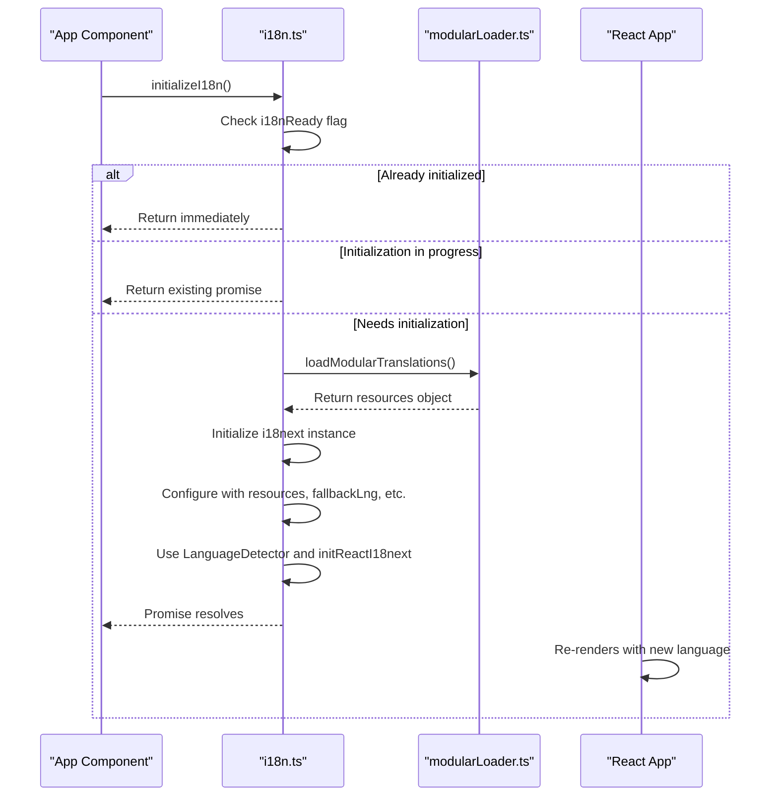
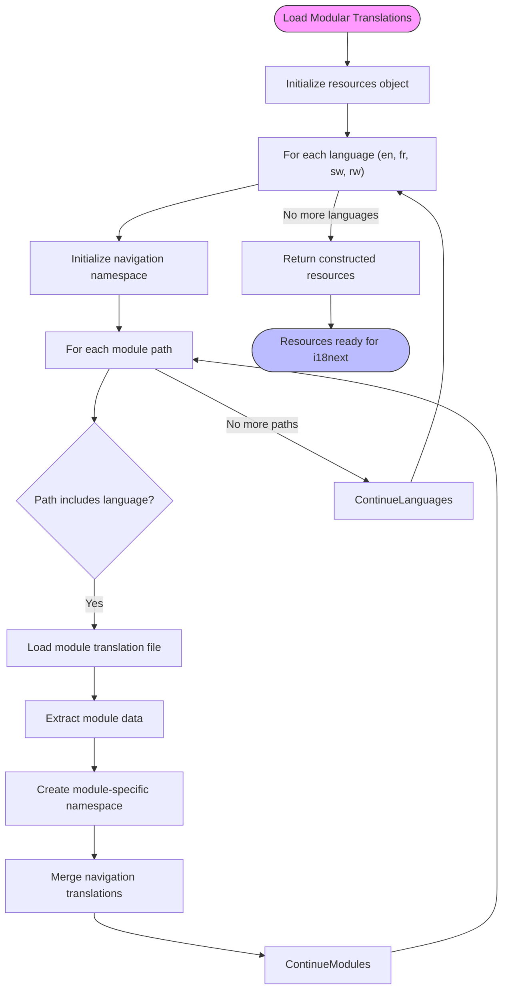
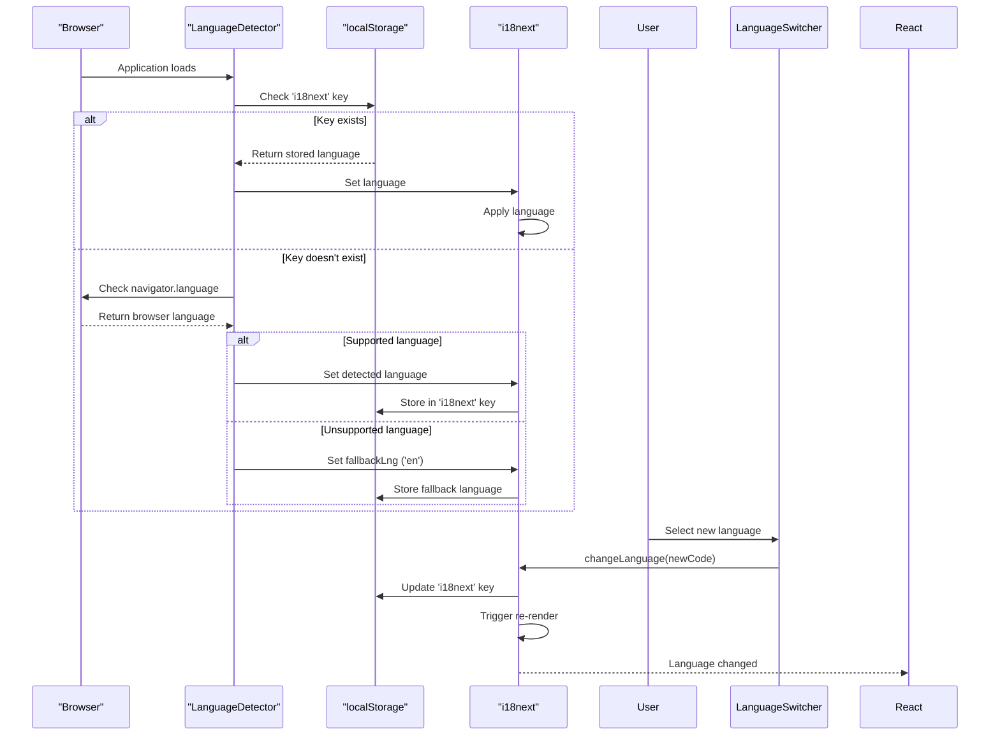
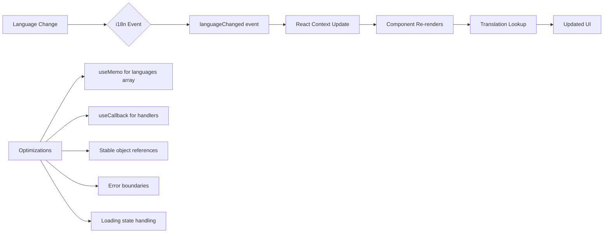
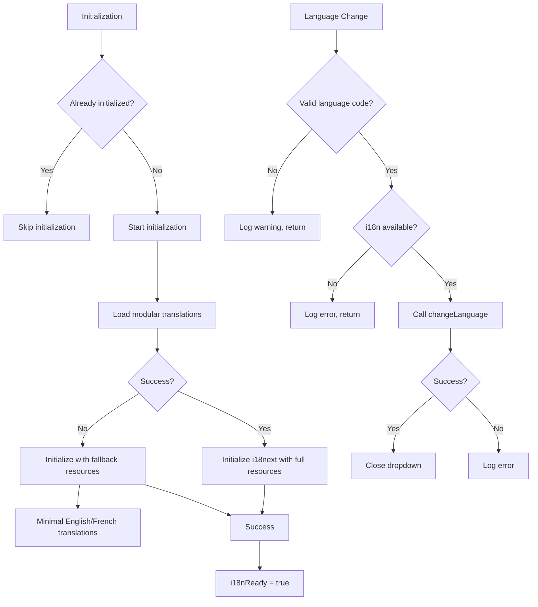
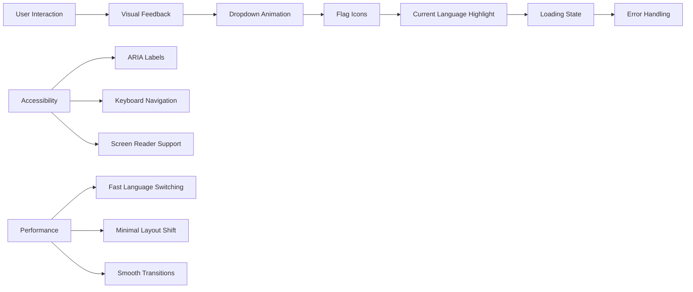

# Language Switching Implementation

<cite>
**Referenced Files in This Document**   
- [LanguageSwitcher.tsx](file://src/components/ui/LanguageSwitcher.tsx)
- [i18n.ts](file://src/i18n/i18n.ts)
- [modularLoader.ts](file://src/i18n/modularLoader.ts)
- [loader.ts](file://src/i18n/loader.ts)
- [app.tsx](file://src/app.tsx)
- [UserContext.tsx](file://src/contexts/UserContext.tsx)
</cite>

## Table of Contents
1. [Language Switching Implementation](#language-switching-implementation)
2. [LanguageSwitcher Component Architecture](#languageswitcher-component-architecture)
3. [i18next Initialization and Configuration](#i18next-initialization-and-configuration)
4. [Modular Translation Loading](#modular-translation-loading)
5. [Language Persistence Mechanism](#language-persistence-mechanism)
6. [UI Re-rendering and Performance](#ui-re-rendering-and-performance)
7. [Fallback and Error Handling](#fallback-and-error-handling)
8. [User Experience Considerations](#user-experience-considerations)
9. [Troubleshooting Common Issues](#troubleshooting-common-issues)

## LanguageSwitcher Component Architecture

The LanguageSwitcher component provides a user interface for changing the application's language at runtime. It is implemented as a React functional component with proper error boundary protection.

```mermaid
classDiagram
class LanguageSwitcher {
+render() JSX.Element
}
class LanguageSwitcherContent {
-isOpen : boolean
-languages : Array
-currentLanguage : Object
+handleLanguageChange(code : string) : void
+toggleDropdown() : void
}
class HookErrorBoundary {
+componentName : string
+render() : JSX.Element
}
LanguageSwitcher --> LanguageSwitcherContent : "renders"
LanguageSwitcher --> HookErrorBoundary : "wraps"
LanguageSwitcherContent --> "useTranslation" : "uses hook"
LanguageSwitcherContent --> "useCallback" : "uses hook"
LanguageSwitcherContent --> "useMemo" : "uses hook"
```

**Diagram sources**
- [LanguageSwitcher.tsx](file://src/components/ui/LanguageSwitcher.tsx#L0-L119)

**Section sources**
- [LanguageSwitcher.tsx](file://src/components/ui/LanguageSwitcher.tsx#L0-L119)

The component structure consists of two main parts:
1. **LanguageSwitcher**: The outer component that wraps the functionality with an error boundary
2. **LanguageSwitcherContent**: The inner component that handles the core logic and UI rendering

The component uses several React hooks to manage state and optimize performance:
- `useState` for managing the dropdown open/closed state
- `useCallback` for memoizing event handler functions
- `useMemo` for memoizing the languages array and current language calculation
- `useTranslation` from react-i18next for accessing the i18next instance

The available languages include English, French, Spanish, German, Italian, Portuguese, Dutch, Swahili, and Kinyarwanda, each with corresponding country flags for visual identification.

## i18next Initialization and Configuration

The i18next instance is initialized and configured in the `i18n.ts` file, which creates a dedicated i18next instance with React integration.



**Diagram sources**
- [i18n.ts](file://src/i18n/i18n.ts#L0-L117)
- [modularLoader.ts](file://src/i18n/modularLoader.ts#L0-L67)

**Section sources**
- [i18n.ts](file://src/i18n/i18n.ts#L0-L117)

The initialization process includes several key features:
- **Singleton pattern**: Prevents multiple initializations using the `i18nReady` flag and `initializationPromise`
- **Asynchronous loading**: The `initializeI18n` function returns a promise that resolves when initialization is complete
- **Error handling**: Comprehensive try-catch blocks with fallback initialization if the primary initialization fails
- **Language detection**: Configured to detect language from localStorage, browser navigator, and HTML tag in that order
- **Persistence**: Detected language is cached in localStorage via the `caches: ['localStorage']` configuration

Key configuration options:
- `fallbackLng: 'en'`: English is the fallback language when translations are missing
- `defaultNS: 'common'`: Default namespace for translations
- `returnNull: false`: Ensures empty strings are returned instead of null for missing keys
- `useSuspense: true`: Enables React Suspense for loading translations
- `bindI18n: 'languageChanged loaded'`: Triggers re-renders when language changes or new translations are loaded

## Modular Translation Loading

The application uses a modular approach to load translation resources, allowing for efficient code splitting and on-demand loading of language files.



**Diagram sources**
- [modularLoader.ts](file://src/i18n/modularLoader.ts#L0-L67)

**Section sources**
- [modularLoader.ts](file://src/i18n/modularLoader.ts#L0-L67)

The modular loading system works as follows:
1. Uses Vite's `import.meta.glob` to dynamically import translation files from module directories
2. Constructs a resources object with language codes as top-level keys
3. For each language, processes all module translation files that match the language code
4. Creates module-specific namespaces within each language
5. Extracts navigation translations from each module and merges them into a unified navigation namespace

The loader handles both regular modules (`../modules/*/i18n/*.json`) and core modules (`../modules/core/i18n/**/*.json`). This modular approach allows each module to maintain its own translation files while contributing to shared namespaces like navigation.

## Language Persistence Mechanism

Language preferences are persisted using the i18next-browser-languagedetector plugin, which automatically detects and stores the user's language preference.



**Diagram sources**
- [i18n.ts](file://src/i18n/i18n.ts#L39-L45)
- [LanguageSwitcher.tsx](file://src/components/ui/LanguageSwitcher.tsx#L29-L38)

**Section sources**
- [i18n.ts](file://src/i18n/i18n.ts#L39-L45)
- [LanguageSwitcher.tsx](file://src/components/ui/LanguageSwitcher.tsx#L29-L38)

The persistence mechanism works as follows:
- **Detection order**: The system checks localStorage first, then browser navigator settings, then HTML tag
- **Automatic storage**: When a language is detected or changed, it's automatically stored in localStorage with the key `i18next`
- **Cross-session persistence**: The stored preference persists across browser sessions
- **Cross-tab synchronization**: The preference is available to all tabs/windows of the application

When a user selects a new language through the LanguageSwitcher component, the `i18n.changeLanguage()` method is called, which automatically updates the localStorage entry through the LanguageDetector plugin.

## UI Re-rendering and Performance

The language switching functionality triggers UI re-renders through the react-i18next integration, with several performance optimizations in place.



**Diagram sources**
- [LanguageSwitcher.tsx](file://src/components/ui/LanguageSwitcher.tsx#L0-L119)
- [i18n.ts](file://src/i18n/i18n.ts#L0-L117)

**Section sources**
- [LanguageSwitcher.tsx](file://src/components/ui/LanguageSwitcher.tsx#L0-L119)

The re-rendering behavior is managed through several mechanisms:
- **Event-driven updates**: The `bindI18n: 'languageChanged loaded'` configuration ensures components re-render when the language changes
- **React Context**: react-i18next uses React Context internally to propagate language changes
- **Suspense integration**: With `useSuspense: true`, components can suspend while translations are loading

Performance optimizations include:
- **Memoization**: The languages array and current language calculation are memoized using `useMemo`
- **Callback optimization**: Event handlers are memoized using `useCallback` to prevent unnecessary re-renders
- **Error boundaries**: The LanguageSwitcher is wrapped in a HookErrorBoundary to prevent UI crashes
- **Loading states**: The component displays a loading state when i18n is not ready

The system minimizes performance impact by:
1. Loading all translation resources during initialization
2. Using efficient data structures for translation lookups
3. Avoiding unnecessary re-renders through proper hook usage
4. Implementing error handling to prevent cascading failures

## Fallback and Error Handling

The language system implements comprehensive fallback and error handling mechanisms to ensure reliability.



**Diagram sources**
- [i18n.ts](file://src/i18n/i18n.ts#L0-L117)
- [LanguageSwitcher.tsx](file://src/components/ui/LanguageSwitcher.tsx#L29-L38)

**Section sources**
- [i18n.ts](file://src/i18n/i18n.ts#L0-L117)
- [LanguageSwitcher.tsx](file://src/components/ui/LanguageSwitcher.tsx#L29-L38)

The fallback mechanism operates at multiple levels:
1. **Initialization fallback**: If the primary initialization fails, a simplified initialization with minimal resources is attempted
2. **Language fallback**: The `fallbackLng: 'en'` configuration ensures English is used when translations are missing
3. **Key fallback**: With `returnNull: false`, missing translation keys return empty strings instead of null
4. **Component fallback**: The HookErrorBoundary prevents language switcher errors from crashing the UI

Error handling includes:
- Try-catch blocks around critical operations
- Console logging with descriptive error messages
- Graceful degradation when features are unavailable
- Prevention of infinite loops in error conditions

## User Experience Considerations

The language switching implementation includes several user experience enhancements.



**Diagram sources**
- [LanguageSwitcher.tsx](file://src/components/ui/LanguageSwitcher.tsx#L0-L119)

**Section sources**
- [LanguageSwitcher.tsx](file://src/components/ui/LanguageSwitcher.tsx#L0-L119)

User experience features include:
- **Visual feedback**: The dropdown shows the currently selected language with a blue background highlight
- **Smooth transitions**: CSS transitions for the dropdown toggle animation (ChevronDown rotation)
- **Loading states**: A clear "Loading..." state is shown when translations are not yet ready
- **Error resilience**: The UI remains functional even if language switching encounters errors
- **Intuitive design**: Country flags provide immediate visual recognition of language options
- **Accessibility**: Semantic HTML and proper button elements ensure keyboard navigation works correctly

The component provides immediate visual feedback when a language is selected, with the dropdown closing automatically after selection. The use of country flags alongside language names makes it easy for users to identify their preferred language.

## Troubleshooting Common Issues

This section addresses common issues that may occur with the language switching functionality and provides troubleshooting guidance.

**Partial Translations**
- **Issue**: Some text remains in the default language after switching
- **Cause**: Missing translation keys in the target language file
- **Solution**: 
  1. Check the modularLoader.ts to ensure the module's translation file is being loaded
  2. Verify the translation file contains all required keys
  3. Use the translation-completeness-check.js script to identify missing keys
  4. Ensure the namespace is correctly specified in the translation file

**Caching Problems**
- **Issue**: Language changes don't persist or revert unexpectedly
- **Cause**: localStorage issues or browser cache interference
- **Solution**:
  1. Check if localStorage is available and not blocked
  2. Verify the 'i18next' key exists in localStorage
  3. Clear localStorage and test again
  4. Check browser settings for storage restrictions
  5. Test in incognito mode to rule out extension interference

**Layout Shifts After Language Change**
- **Issue**: UI elements move or resize when language changes
- **Cause**: Text length differences between languages
- **Solution**:
  1. Use flexible layouts that accommodate varying text lengths
  2. Implement CSS constraints on text containers
  3. Test with longest expected translations (often German)
  4. Use ellipsis or wrapping for long text
  5. Consider using translation length ratios in design

**Missing Translation Files**
- **Issue**: Language switching fails or falls back unexpectedly
- **Cause**: Translation files not found or incorrectly named
- **Solution**:
  1. Verify file paths match the pattern expected by import.meta.glob
  2. Check file naming convention (e.g., en.json, fr.json)
  3. Ensure files are included in the build process
  4. Verify the modularLoader.ts is correctly configured

**Initialization Failures**
- **Issue**: Application fails to initialize with language support
- **Cause**: Errors in translation loading or i18next configuration
- **Solution**:
  1. Check browser console for error messages
  2. Verify network requests for translation files
  3. Test with simplified configuration
  4. Ensure all required dependencies are installed
  5. Check for syntax errors in JSON translation files

**Performance Issues**
- **Issue**: Slow language switching or application lag
- **Cause**: Large translation files or inefficient loading
- **Solution**:
  1. Optimize translation files by removing unused keys
  2. Implement code splitting for large modules
  3. Cache translation resources
  4. Monitor bundle size with bundleAnalyzer
  5. Consider lazy loading less frequently used translations

**Section sources**
- [i18n.ts](file://src/i18n/i18n.ts#L0-L117)
- [modularLoader.ts](file://src/i18n/modularLoader.ts#L0-L67)
- [LanguageSwitcher.tsx](file://src/components/ui/LanguageSwitcher.tsx#L0-L119)