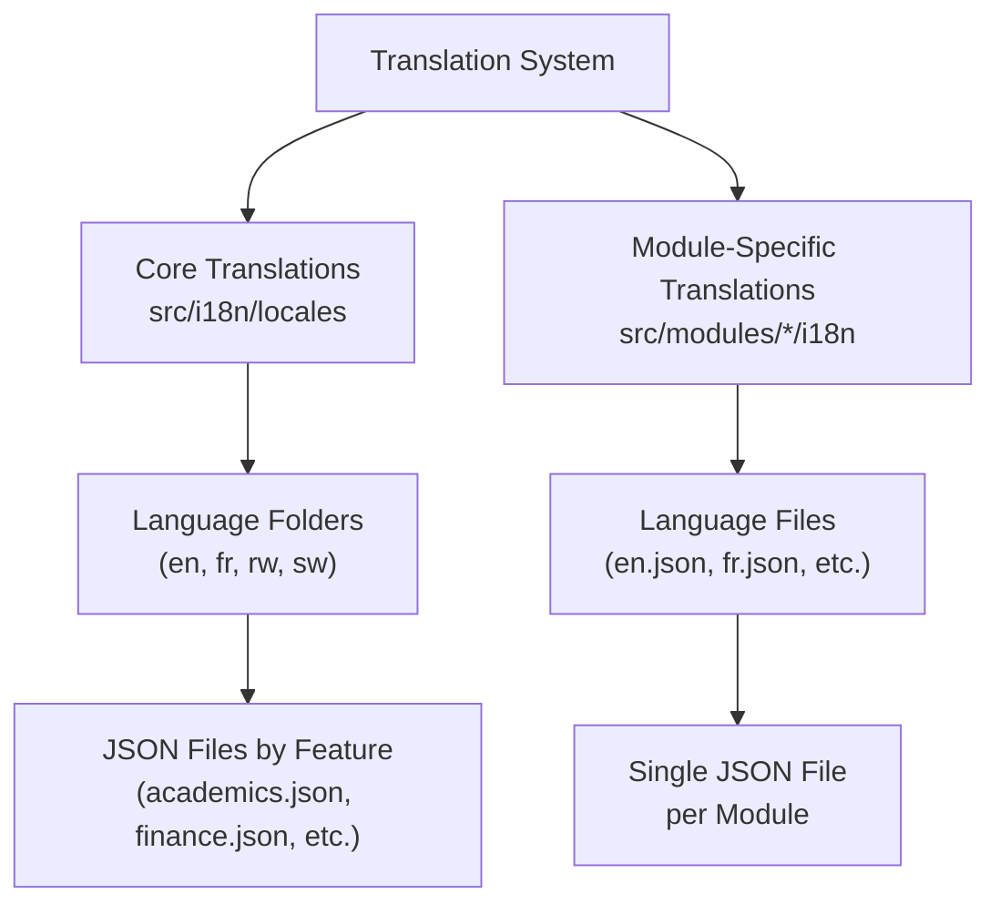
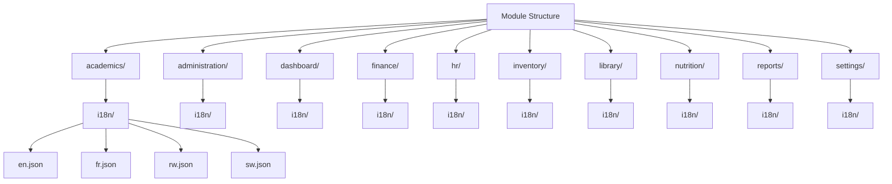

# Translation File Management

<cite>
**Referenced Files in This Document**   
- [i18n.ts](file://src/i18n/i18n.ts)
- [loader.ts](file://src/i18n/loader.ts)
- [modularLoader.ts](file://src/i18n/modularLoader.ts)
- [academics.json](file://src/i18n/locales/en/academics.json)
- [administration.json](file://src/i18n/locales/en/administration.json)
- [dashboard.json](file://src/i18n/locales/en/dashboard.json)
- [finance.json](file://src/i18n/locales/en/finance.json)
- [hr.json](file://src/i18n/locales/en/hr.json)
- [inventory.json](file://src/i18n/locales/en/inventory.json)
- [library.json](file://src/i18n/locales/en/library.json)
- [navigation.json](file://src/i18n/locales/en/navigation.json)
- [nutrition.json](file://src/i18n/locales/en/nutrition.json)
- [reports.json](file://src/i18n/locales/en/reports.json)
- [en.json](file://src/modules/academics/i18n/en.json)
- [fr.json](file://src/modules/academics/i18n/fr.json)
- [rw.json](file://src/modules/academics/i18n/rw.json)
- [sw.json](file://src/modules/academics/i18n/sw.json)
- [en.json](file://src/modules/administration/i18n/en.json)
- [fr.json](file://src/modules/administration/i18n/fr.json)
- [rw.json](file://src/modules/administration/i18n/rw.json)
- [sw.json](file://src/modules/administration/i18n/sw.json)
- [en.json](file://src/modules/dashboard/i18n/en.json)
- [fr.json](file://src/modules/dashboard/i18n/fr.json)
- [rw.json](file://src/modules/dashboard/i18n/rw.json)
- [sw.json](file://src/modules/dashboard/i18n/sw.json)
- [en.json](file://src/modules/finance/i18n/en.json)
- [fr.json](file://src/modules/finance/i18n/fr.json)
- [rw.json](file://src/modules/finance/i18n/rw.json)
- [sw.json](file://src/modules/finance/i18n/sw.json)
- [en.json](file://src/modules/hr/i18n/en.json)
- [fr.json](file://src/modules/hr/i18n/fr.json)
- [rw.json](file://src/modules/hr/i18n/rw.json)
- [sw.json](file://src/modules/hr/i18n/sw.json)
- [en.json](file://src/modules/inventory/i18n/en.json)
- [fr.json](file://src/modules/inventory/i18n/fr.json)
- [rw.json](file://src/modules/inventory/i18n/rw.json)
- [sw.json](file://src/modules/inventory/i18n/sw.json)
- [en.json](file://src/modules/library/i18n/en.json)
- [fr.json](file://src/modules/library/i18n/fr.json)
- [rw.json](file://src/modules/library/i18n/rw.json)
- [sw.json](file://src/modules/library/i18n/sw.json)
- [en.json](file://src/modules/nutrition/i18n/en.json)
- [fr.json](file://src/modules/nutrition/i18n/fr.json)
- [rw.json](file://src/modules/nutrition/i18n/rw.json)
- [sw.json](file://src/modules/nutrition/i18n/sw.json)
- [en.json](file://src/modules/reports/i18n/en.json)
- [fr.json](file://src/modules/reports/i18n/fr.json)
- [rw.json](file://src/modules/reports/i18n/rw.json)
- [sw.json](file://src/modules/reports/i18n/sw.json)
- [en.json](file://src/modules/settings/i18n/en.json)
- [fr.json](file://src/modules/settings/i18n/fr.json)
- [rw.json](file://src/modules/settings/i18n/rw.json)
- [sw.json](file://src/modules/settings/i18n/sw.json)
</cite>

## Table of Contents
1. [Introduction](#introduction)
2. [Translation File Structure](#translation-file-structure)
3. [Core Application Translations](#core-application-translations)
4. [Module-Specific Translations](#module-specific-translations)
5. [Language Code Standards](#language-code-standards)
6. [Translation Key Management](#translation-key-management)
7. [Advanced Translation Patterns](#advanced-translation-patterns)
8. [Consistency and Coordination](#consistency-and-coordination)
9. [Version Control Strategies](#version-control-strategies)
10. [Practical Examples](#practical-examples)

## Introduction
This document provides comprehensive guidance on the translation file organization and management system in schoolpilot3. The application implements a dual-structure approach to internationalization, separating core application translations from module-specific content. This architecture enables efficient localization while maintaining consistency across the platform. The system supports multiple languages including English (en), French (fr), Kinyarwanda (rw), and Swahili (sw), with a structured approach to key naming, namespace organization, and content management.

## Translation File Structure

The schoolpilot3 application employs a dual-structure approach for translation file organization, designed to separate concerns between core application functionality and module-specific features. This architecture consists of two primary locations for translation files:

1. **Core translations**: Located at `src/i18n/locales`, containing application-wide strings
2. **Module-specific translations**: Located at `src/modules/*/i18n`, containing feature-specific strings

This separation allows for independent development and maintenance of translation content while ensuring that shared UI elements and common terminology remain consistent across the application. The structure promotes scalability, as new modules can be added with their own translation files without affecting the core translation system.



**Diagram sources**
- [i18n.ts](file://src/i18n/i18n.ts)
- [loader.ts](file://src/i18n/loader.ts)
- [modularLoader.ts](file://src/i18n/modularLoader.ts)

**Section sources**
- [i18n.ts](file://src/i18n/i18n.ts)
- [loader.ts](file://src/i18n/loader.ts)

## Core Application Translations

Core application translations are stored in the `src/i18n/locales` directory, organized by language code. Each language has its own subdirectory containing JSON files grouped by functional area. The current structure includes the following feature-specific JSON files:

- academics.json
- administration.json
- dashboard.json
- finance.json
- hr.json
- inventory.json
- library.json
- navigation.json
- nutrition.json
- reports.json

Each JSON file follows a consistent naming convention using lowercase letters and underscores for multi-word keys. The structure is hierarchical, with top-level keys representing major sections or components, and nested keys providing specificity. For example, navigation-related strings are organized under descriptive namespaces that reflect the application's information architecture.

```json
{
  "navigation": {
    "dashboard": "Dashboard",
    "academics": "Academics",
    "administration": "Administration",
    "finance": "Finance",
    "hr": "Human Resources",
    "inventory": "Inventory",
    "library": "Library",
    "reports": "Reports"
  }
}
```

The core translation system is initialized through the `i18n.ts` configuration file, which sets up the internationalization framework and registers the available languages. The `loader.ts` utility handles the dynamic loading of translation files based on the user's selected language, ensuring optimal performance by loading only the required language resources.

**Section sources**
- [academics.json](file://src/i18n/locales/en/academics.json)
- [administration.json](file://src/i18n/locales/en/administration.json)
- [dashboard.json](file://src/i18n/locales/en/dashboard.json)
- [finance.json](file://src/i18n/locales/en/finance.json)
- [hr.json](file://src/i18n/locales/en/hr.json)
- [inventory.json](file://src/i18n/locales/en/inventory.json)
- [library.json](file://src/i18n/locales/en/library.json)
- [navigation.json](file://src/i18n/locales/en/navigation.json)
- [nutrition.json](file://src/i18n/locales/en/nutrition.json)
- [reports.json](file://src/i18n/locales/en/reports.json)
- [i18n.ts](file://src/i18n/i18n.ts)
- [loader.ts](file://src/i18n/loader.ts)

## Module-Specific Translations

Module-specific translations are implemented within individual modules under the `src/modules/*/i18n` directory. Each module contains its own set of translation files in JSON format, with separate files for each supported language (en.json, fr.json, rw.json, sw.json). This approach allows modules to be developed and localized independently, promoting team autonomy and reducing merge conflicts.

The module translation structure differs from the core system by using a single JSON file per language rather than splitting content by feature. This consolidation simplifies the management of module-specific terminology and ensures that all strings related to a particular feature are co-located. For example, the academics module contains all its translations in `src/modules/academics/i18n/en.json`, covering everything from exam scheduling to grade calculation.



**Diagram sources**
- [en.json](file://src/modules/academics/i18n/en.json)
- [fr.json](file://src/modules/academics/i18n/fr.json)
- [rw.json](file://src/modules/academics/i18n/rw.json)
- [sw.json](file://src/modules/academics/i18n/sw.json)

**Section sources**
- [en.json](file://src/modules/academics/i18n/en.json)
- [fr.json](file://src/modules/academics/i18n/fr.json)
- [rw.json](file://src/modules/academics/i18n/rw.json)
- [sw.json](file://src/modules/academics/i18n/sw.json)
- [en.json](file://src/modules/administration/i18n/en.json)
- [fr.json](file://src/modules/administration/i18n/fr.json)
- [rw.json](file://src/modules/administration/i18n/rw.json)
- [sw.json](file://src/modules/administration/i18n/sw.json)

## Language Code Standards

The schoolpilot3 application adheres to standard ISO 639-1 language codes for all translation files, supporting the following languages:

- **en**: English
- **fr**: French
- **rw**: Kinyarwanda
- **sw**: Swahili

These language codes are used consistently throughout the application in both directory and file naming conventions. The core translation system uses directory names (e.g., `src/i18n/locales/en`) while module-specific translations use filename suffixes (e.g., `src/modules/academics/i18n/en.json`).

The language selection mechanism is implemented in the `LanguageSwitcher` component, which provides a UI for users to change their preferred language. When a language is selected, the application loads the corresponding translation files from both the core and module-specific locations, merging them into a unified translation context.

The modularLoader.ts utility is responsible for coordinating the loading of module-specific translations, ensuring that they are properly integrated with the core translation system. This approach allows for dynamic loading of translations as modules are accessed, optimizing initial load time and memory usage.

**Section sources**
- [modularLoader.ts](file://src/i18n/modularLoader.ts)
- [LanguageSwitcher.tsx](file://src/components/ui/LanguageSwitcher.tsx)

## Translation Key Management

Adding new translation keys follows a structured process to ensure consistency and maintainability. For core application translations, developers should:

1. Identify the appropriate feature-specific JSON file in `src/i18n/locales/en/`
2. Use a hierarchical key naming pattern: `feature.section.element.purpose`
3. Maintain consistent casing (lowercase with underscores)
4. Avoid duplication by checking existing keys

For example, a button in the academics module would use a key like:
```json
"academics.exam_scheduling.submit_button": "Schedule Exams"
```

When adding module-specific translations, developers should:

1. Open the appropriate module's i18n JSON file (e.g., `src/modules/academics/i18n/en.json`)
2. Organize keys hierarchically by component or feature area
3. Use descriptive but concise key names
4. Ensure parallel structure across language files

The key naming convention emphasizes clarity and context, making it easier to understand the purpose and location of each string without viewing the UI. This approach also facilitates automated checking for unused or missing translations.

**Section sources**
- [academics.json](file://src/i18n/locales/en/academics.json)
- [en.json](file://src/modules/academics/i18n/en.json)

## Advanced Translation Patterns

The translation system supports several advanced patterns for handling complex localization requirements:

### Pluralization
Plural forms are handled through explicit keys that account for different grammatical cases:
```json
"students.count_one": "1 student",
"students.count_other": "{{count}} students"
```

### Variable Interpolation
Dynamic values are inserted using double curly brace syntax:
```json
"welcome.message": "Welcome, {{name}}!",
"exam.results_summary": "Student {{studentName}} scored {{score}}% on {{examName}}"
```

### Nested Translations
Complex structures are supported through nested objects:
```json
"form.validation": {
  "required": "This field is required",
  "email": "Please enter a valid email address",
  "min_length": "Must be at least {{min}} characters"
}
```

### Contextual Variants
Different meanings of the same word are distinguished by context:
```json
"status.active": "Active",
"button.activate": "Activate"
```

These patterns are processed by the i18n framework's interpolation engine, which safely replaces variables while preventing injection vulnerabilities. The system also supports rich text formatting through designated keys that include HTML markup where appropriate.

**Section sources**
- [i18n.ts](file://src/i18n/i18n.ts)
- [academics.json](file://src/i18n/locales/en/academics.json)
- [en.json](file://src/modules/academics/i18n/en.json)

## Consistency and Coordination

Maintaining consistency across translation files requires coordinated practices between core and module-specific content:

1. **Terminology Alignment**: Common terms (e.g., "Student", "Teacher", "Class") should use identical translations in both core and module files
2. **Style Guide Adherence**: All translations should follow the same tone, formality level, and formatting conventions
3. **Key Synchronization**: When core terminology changes, corresponding module keys should be updated
4. **Namespace Coordination**: Module-specific keys should avoid conflicts with core namespaces

The system includes validation scripts in the `scripts/` directory, such as `fix-translation-keys.js` and `translation-completeness-check.js`, which help identify inconsistencies and missing translations. These tools can be run as part of the development workflow to ensure translation quality.

Cross-module coordination is particularly important for shared concepts like academic periods, grading systems, and user roles, which may be referenced in multiple modules but should maintain consistent terminology throughout the application.

**Section sources**
- [fix-translation-keys.js](file://scripts/fix/fix-translation-keys.js)
- [translation-completeness-check.js](file://scripts/debug/translation-completeness-check.js)

## Version Control Strategies

The translation system employs several version control practices to manage updates and prevent conflicts:

1. **Atomic Commits**: Translation changes are committed separately from code changes when possible
2. **Synchronized Updates**: When a new key is added, all language files should be updated simultaneously
3. **Conflict Prevention**: Module-specific translations are isolated to reduce merge conflicts
4. **Automated Checks**: Pre-commit hooks verify JSON syntax and key consistency

The dual-structure design inherently reduces key collision risks by separating core and module namespaces. However, care should be taken when modules reference core concepts to ensure alignment.

For major translation updates, the process should include:
1. Creating a feature branch for translation changes
2. Updating all language files for new keys
3. Running validation scripts to check completeness
4. Coordinating with team members to avoid overlapping changes
5. Merging through pull request with appropriate review

This approach ensures that translation updates are tracked effectively and can be rolled back if necessary.

**Section sources**
- [fix-translation-keys.js](file://scripts/fix/fix-translation-keys.js)
- [translation-completeness-check.js](file://scripts/debug/translation-completeness-check.js)

## Practical Examples

### Form Translations
```json
"academics.forms.subject_name_label": "Subject Name",
"academics.forms.code_placeholder": "Enter subject code",
"academics.forms.required_error": "Subject name is required",
"academics.forms.submit_button": "Save Subject"
```

### Navigation Translations
```json
"navigation.main_menu": "Main Menu",
"navigation.academics": "Academics",
"navigation.exam_scheduling": "Exam Scheduling",
"navigation.results_management": "Results Management"
```

### Error Messages
```json
"errors.network_offline": "You are currently offline. Some features may be limited.",
"errors.save_failed": "Failed to save changes. Please try again.",
"errors.validation.subject_code_exists": "A subject with this code already exists."
```

### Module-Specific Example (Academics)
```json
{
  "exam_scheduling": {
    "title": "Exam Scheduling",
    "date_picker_label": "Select Exam Date",
    "room_selection": "Choose Examination Room",
    "conflict_warning": "{{count}} scheduling conflicts detected",
    "success_message": "Exams scheduled successfully"
  },
  "grade_calculation": {
    "method_select": "Grading Method",
    "weighting_total_error": "Weighting percentages must total 100%"
  }
}
```

These examples demonstrate the consistent application of naming conventions, hierarchical organization, and contextual clarity that characterize the schoolpilot3 translation system.

**Section sources**
- [academics.json](file://src/i18n/locales/en/academics.json)
- [en.json](file://src/modules/academics/i18n/en.json)
- [administration.json](file://src/i18n/locales/en/administration.json)
- [en.json](file://src/modules/administration/i18n/en.json)