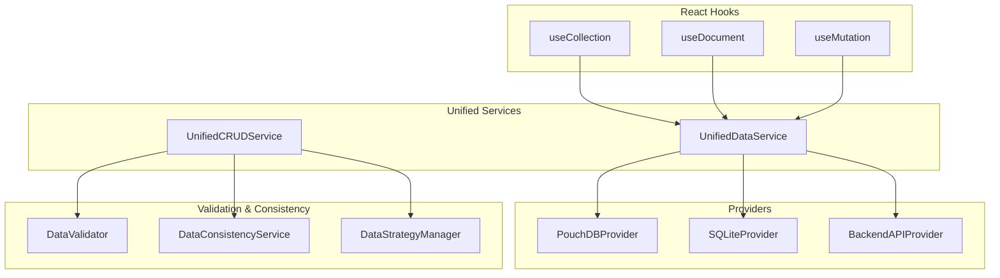
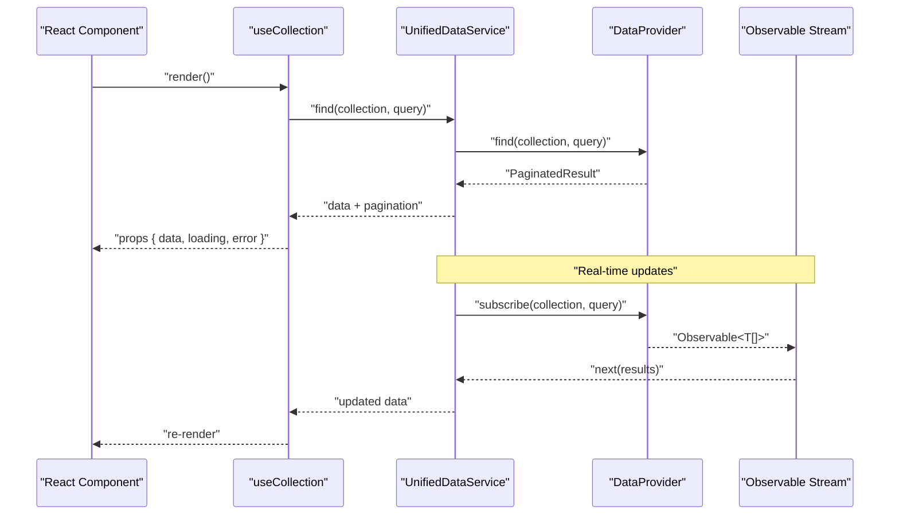
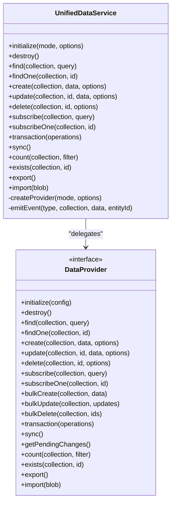
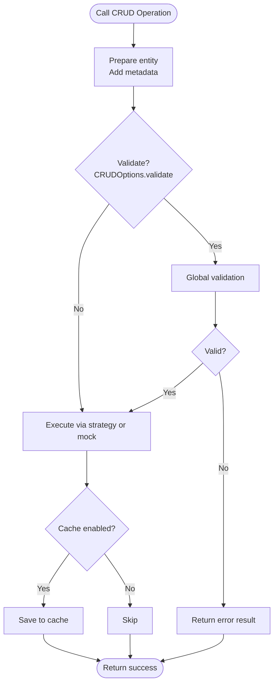
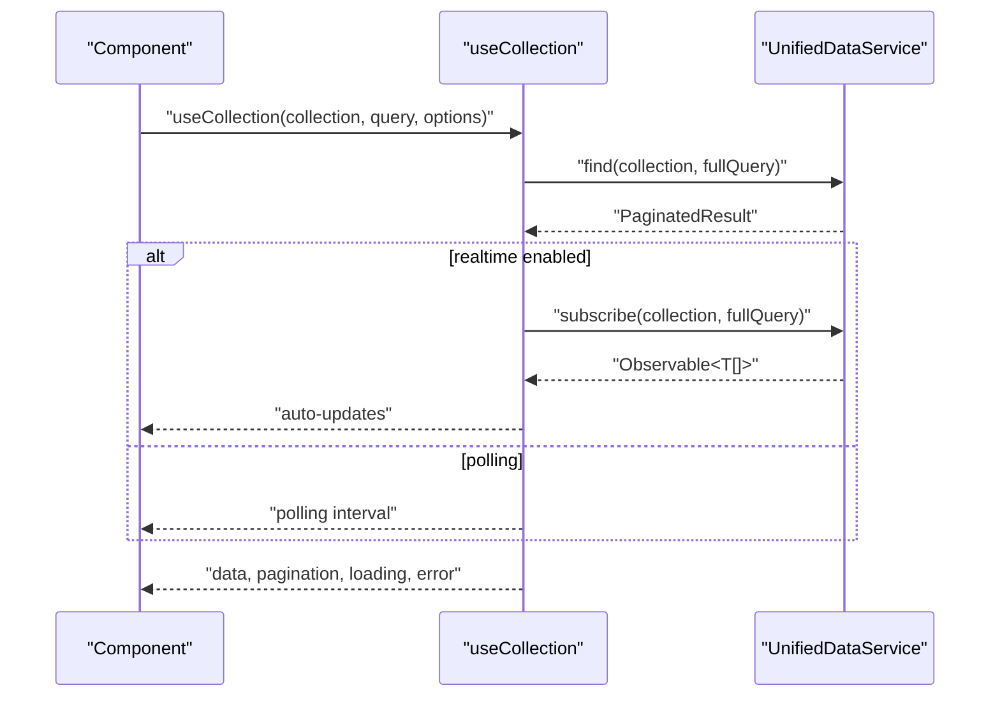
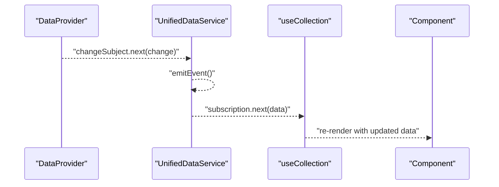
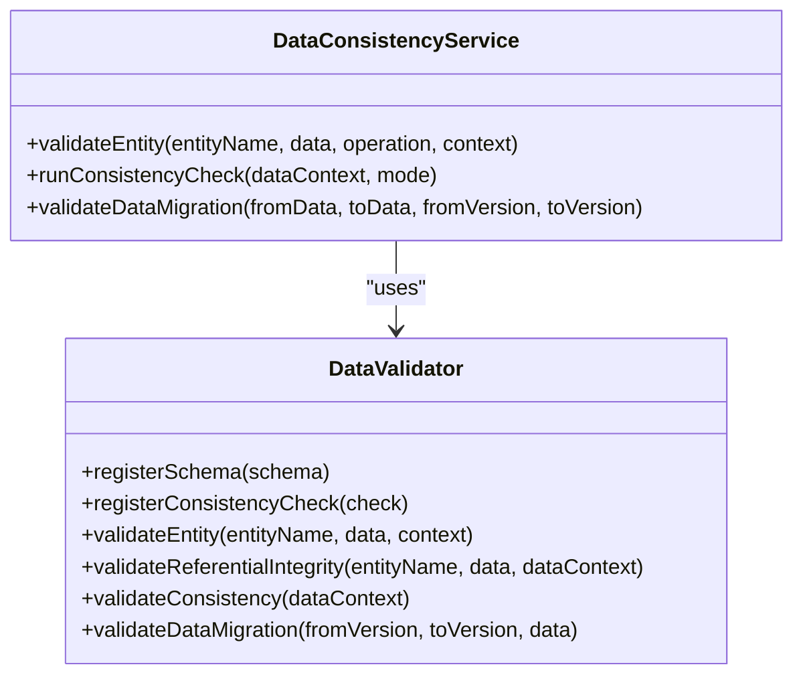
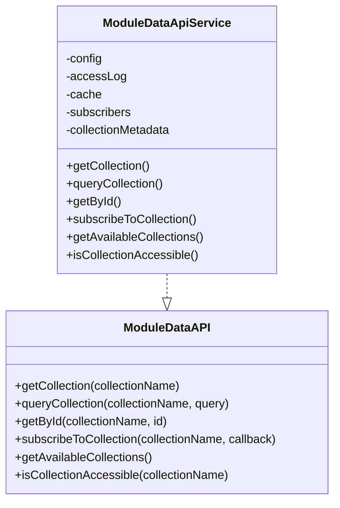
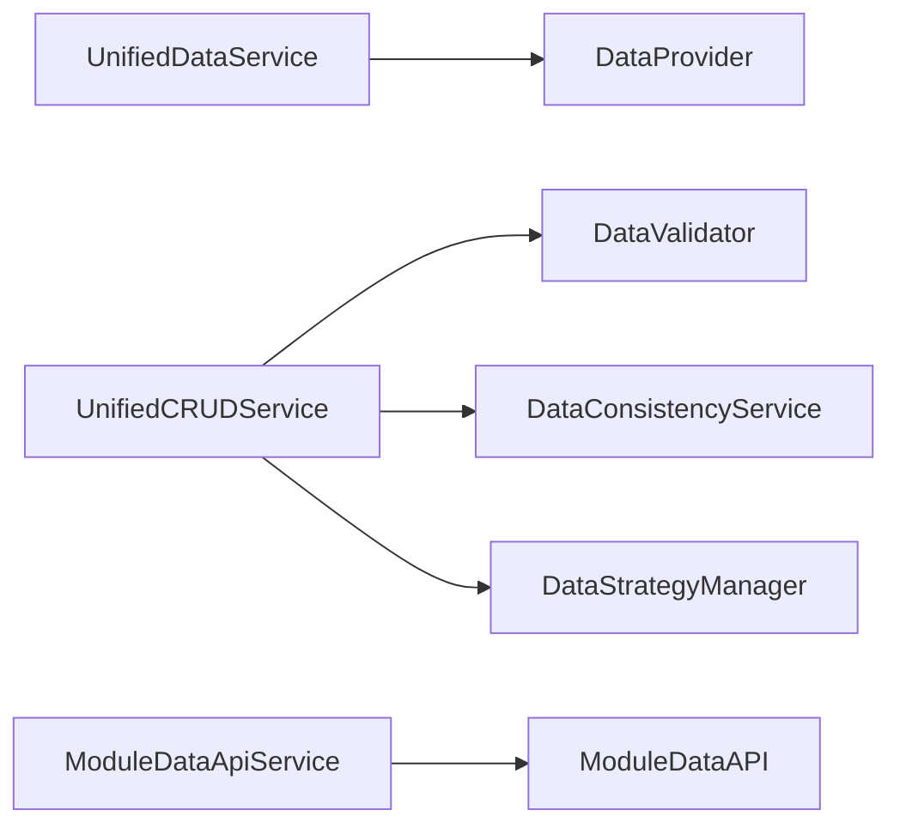

# Data Access APIs

<cite>
**Referenced Files in This Document**
- [UnifiedDataService.ts](file://src/services/data/UnifiedDataService.ts)
- [UnifiedCRUDService.ts](file://src/services/data/UnifiedCRUDService.ts)
- [useCollection.ts](file://src/services/data/hooks/useCollection.ts)
- [useDocument.ts](file://src/services/data/hooks/useDocument.ts)
- [useMutation.ts](file://src/services/data/hooks/useMutation.ts)
- [types.ts](file://src/services/data/types.ts)
- [dataValidation.ts](file://src/utils/dataValidation.ts)
- [DataConsistencyService.ts](file://src/services/consistency/DataConsistencyService.ts)
- [DataStrategyManager.ts](file://src/services/consistency/DataStrategyManager.ts)
- [moduleDataApi.ts](file://src/core/types/moduleDataApi.ts)
- [moduleDataApiService.ts](file://src/core/services/moduleDataApi.ts)
- [PouchDBProvider.ts](file://src/services/data/providers/PouchDBProvider.ts)
- [SQLiteProvider.ts](file://src/services/data/providers/SQLiteProvider.ts)
- [index.ts](file://src/services/data/providers/index.ts)
- [BackendAPIProvider.ts](file://src/services/database/BackendAPIProvider.ts)
- [DATA_LAYER_STRATEGY.md](file://docs/architecture/DATA_LAYER_STRATEGY.md)
</cite>

## Table of Contents
1. [Introduction](#introduction)
2. [Project Structure](#project-structure)
3. [Core Components](#core-components)
4. [Architecture Overview](#architecture-overview)
5. [Detailed Component Analysis](#detailed-component-analysis)
6. [Dependency Analysis](#dependency-analysis)
7. [Performance Considerations](#performance-considerations)
8. [Troubleshooting Guide](#troubleshooting-guide)
9. [Conclusion](#conclusion)
10. [Appendices](#appendices)

## Introduction
This document describes the data access layer APIs for SchoolPilot3, focusing on:
- UnifiedDataService: the central orchestrator for data operations across providers
- UnifiedCRUDService: a higher-level CRUD facade with validation and caching
- React hooks ecosystem: useCollection, useDocument, and useMutation
- Observable data streams and reactive patterns for real-time updates
- Data validation schemas and error handling strategies
- Type safety guarantees and module federation patterns for inter-module data sharing

## Project Structure
The data access layer is organized around a unified service that delegates to pluggable providers, with React hooks that expose a simple, declarative API. Validation and consistency services enforce data quality and integrity.

**Diagram sources**
- [UnifiedDataService.ts:36-721](file://src/services/data/UnifiedDataService.ts#L36-L721)
- [UnifiedCRUDService.ts:113-689](file://src/services/data/UnifiedCRUDService.ts#L113-L689)
- [useCollection.ts:58-169](file://src/services/data/hooks/useCollection.ts#L58-L169)
- [useDocument.ts:41-130](file://src/services/data/hooks/useDocument.ts#L41-L130)
- [useMutation.ts:143-160](file://src/services/data/hooks/useMutation.ts#L143-L160)
- [PouchDBProvider.ts:61-706](file://src/services/data/providers/PouchDBProvider.ts#L61-L706)
- [SQLiteProvider.ts:262-310](file://src/services/data/providers/SQLiteProvider.ts#L262-L310)
- [BackendAPIProvider.ts:1-800](file://src/services/database/BackendAPIProvider.ts#L1-L800)
- [dataValidation.ts:68-465](file://src/utils/dataValidation.ts#L68-L465)
- [DataConsistencyService.ts:49-469](file://src/services/consistency/DataConsistencyService.ts#L49-L469)
- [DataStrategyManager.ts:44-574](file://src/services/consistency/DataStrategyManager.ts#L44-L574)

**Section sources**
- [UnifiedDataService.ts:36-721](file://src/services/data/UnifiedDataService.ts#L36-L721)
- [UnifiedCRUDService.ts:113-689](file://src/services/data/UnifiedCRUDService.ts#L113-L689)
- [useCollection.ts:58-169](file://src/services/data/hooks/useCollection.ts#L58-L169)
- [useDocument.ts:41-130](file://src/services/data/hooks/useDocument.ts#L41-L130)
- [useMutation.ts:143-160](file://src/services/data/hooks/useMutation.ts#L143-L160)
- [types.ts:1-226](file://src/services/data/types.ts#L1-L226)
- [dataValidation.ts:68-465](file://src/utils/dataValidation.ts#L68-L465)
- [DataConsistencyService.ts:49-469](file://src/services/consistency/DataConsistencyService.ts#L49-L469)
- [DataStrategyManager.ts:44-574](file://src/services/consistency/DataStrategyManager.ts#L44-L574)
- [PouchDBProvider.ts:61-706](file://src/services/data/providers/PouchDBProvider.ts#L61-L706)
- [SQLiteProvider.ts:262-310](file://src/services/data/providers/SQLiteProvider.ts#L262-L310)
- [BackendAPIProvider.ts:1-800](file://src/services/database/BackendAPIProvider.ts#L1-L800)
- [index.ts:42-103](file://src/services/data/providers/index.ts#L42-L103)

## Core Components
- UnifiedDataService: orchestrates CRUD, subscriptions, transactions, and sync across providers; exposes observables for state and events; manages caching and provider lifecycle.
- UnifiedCRUDService: provides a typed CRUD facade with validation, caching, retries, and optional backend strategy integration.
- React hooks: useCollection, useDocument, useMutation encapsulate fetching, real-time updates, and mutations with loading/error states.
- Providers: PouchDBProvider, SQLiteProvider, BackendAPIProvider implement the DataProvider interface with varying capabilities (realtime, sync, transactions).
- Validation and consistency: DataValidator and DataConsistencyService enforce schemas, referential integrity, and consistency checks.
- Module federation: ModuleDataAPI defines read-only cross-module access with metadata, logging, and caching.

**Section sources**
- [UnifiedDataService.ts:36-721](file://src/services/data/UnifiedDataService.ts#L36-L721)
- [UnifiedCRUDService.ts:113-689](file://src/services/data/UnifiedCRUDService.ts#L113-L689)
- [useCollection.ts:58-169](file://src/services/data/hooks/useCollection.ts#L58-L169)
- [useDocument.ts:41-130](file://src/services/data/hooks/useDocument.ts#L41-L130)
- [useMutation.ts:143-160](file://src/services/data/hooks/useMutation.ts#L143-L160)
- [types.ts:135-182](file://src/services/data/types.ts#L135-L182)
- [dataValidation.ts:68-465](file://src/utils/dataValidation.ts#L68-L465)
- [DataConsistencyService.ts:49-469](file://src/services/consistency/DataConsistencyService.ts#L49-L469)
- [moduleDataApi.ts:60-131](file://src/core/types/moduleDataApi.ts#L60-L131)
- [moduleDataApiService.ts:33-42](file://src/core/services/moduleDataApi.ts#L33-L42)

## Architecture Overview
The data access layer follows a layered architecture:
- Presentation layer: React hooks
- Service layer: UnifiedDataService and UnifiedCRUDService
- Provider abstraction: pluggable providers
- Validation and consistency: schema-driven validation and integrity checks
- Module federation: controlled cross-module read-only access

**Diagram sources**
- [useCollection.ts:75-129](file://src/services/data/hooks/useCollection.ts#L75-L129)
- [UnifiedDataService.ts:153-170](file://src/services/data/UnifiedDataService.ts#L153-L170)
- [PouchDBProvider.ts:155-197](file://src/services/data/providers/PouchDBProvider.ts#L155-L197)
- [types.ts:135-182](file://src/services/data/types.ts#L135-L182)

**Section sources**
- [DATA_LAYER_STRATEGY.md:676-793](file://docs/architecture/DATA_LAYER_STRATEGY.md#L676-L793)
- [UnifiedDataService.ts:285-321](file://src/services/data/UnifiedDataService.ts#L285-L321)
- [PouchDBProvider.ts:337-378](file://src/services/data/providers/PouchDBProvider.ts#L337-L378)

## Detailed Component Analysis

### UnifiedDataService
Responsibilities:
- Provider selection and initialization based on deployment mode
- CRUD operations with caching and cache invalidation
- Real-time subscriptions with fallback to polling
- Transaction execution and sync orchestration
- Event emission for system and entity changes

Key behaviors:
- Caching: in-memory cache with TTL keyed by collection and query
- Subscriptions: provider-level real-time when available; otherwise polling
- Transactions: delegated to provider if supported
- Sync: optional provider sync with event emission and cache clearing

**Diagram sources**
- [UnifiedDataService.ts:36-721](file://src/services/data/UnifiedDataService.ts#L36-L721)
- [types.ts:135-182](file://src/services/data/types.ts#L135-L182)

**Section sources**
- [UnifiedDataService.ts:78-128](file://src/services/data/UnifiedDataService.ts#L78-L128)
- [UnifiedDataService.ts:153-283](file://src/services/data/UnifiedDataService.ts#L153-L283)
- [UnifiedDataService.ts:285-475](file://src/services/data/UnifiedDataService.ts#L285-L475)
- [index.ts:42-103](file://src/services/data/providers/index.ts#L42-L103)

### UnifiedCRUDService
Responsibilities:
- Typed CRUD operations with validation and caching
- Batch operations with aggregated results
- Integration with DataStrategyManager for backend coordination
- Connection testing and cache management

Key behaviors:
- Validation: pre- and post-operation validation via DataConsistencyService
- Caching: per-entity and per-query cache with TTL and invalidation
- Options: validate, cache, sync, priority, timeout, retries
- Results: structured CRUDResult with source attribution and timestamps

**Diagram sources**
- [UnifiedCRUDService.ts:129-219](file://src/services/data/UnifiedCRUDService.ts#L129-L219)
- [UnifiedCRUDService.ts:304-378](file://src/services/data/UnifiedCRUDService.ts#L304-L378)
- [DataConsistencyService.ts:74-143](file://src/services/consistency/DataConsistencyService.ts#L74-L143)

**Section sources**
- [UnifiedCRUDService.ts:9-53](file://src/services/data/UnifiedCRUDService.ts#L9-L53)
- [UnifiedCRUDService.ts:129-574](file://src/services/data/UnifiedCRUDService.ts#L129-L574)
- [DataConsistencyService.ts:74-143](file://src/services/consistency/DataConsistencyService.ts#L74-L143)

### React Hooks Ecosystem

#### useCollection
- Purpose: fetch and subscribe to paginated collections
- Features: real-time updates, pagination helpers, manual refresh, polling fallback
- Returns: data, loading, error, pagination metadata, navigation helpers

**Diagram sources**
- [useCollection.ts:75-129](file://src/services/data/hooks/useCollection.ts#L75-L129)
- [UnifiedDataService.ts:285-321](file://src/services/data/UnifiedDataService.ts#L285-L321)

**Section sources**
- [useCollection.ts:58-169](file://src/services/data/hooks/useCollection.ts#L58-L169)
- [DATA_LAYER_STRATEGY.md:676-730](file://docs/architecture/DATA_LAYER_STRATEGY.md#L676-L730)

#### useDocument
- Purpose: fetch and subscribe to a single document
- Features: real-time updates, update/delete helpers, existence flag
- Returns: data, loading, error, update, remove, refresh, exists

**Section sources**
- [useDocument.ts:41-130](file://src/services/data/hooks/useDocument.ts#L41-L130)
- [DATA_LAYER_STRATEGY.md:732-754](file://docs/architecture/DATA_LAYER_STRATEGY.md#L732-L754)

#### useMutation
- Purpose: perform create/update/delete mutations
- Features: optimistic UI, error handling, reset, toast options, cache invalidation
- Returns: mutate, loading, error, reset, data

**Section sources**
- [useMutation.ts:143-160](file://src/services/data/hooks/useMutation.ts#L143-L160)
- [DATA_LAYER_STRATEGY.md:756-792](file://docs/architecture/DATA_LAYER_STRATEGY.md#L756-L792)

### Observable Streams and Reactive Patterns
- Real-time subscriptions: providers expose Observable streams; UnifiedDataService routes them to hooks
- Polling fallback: when providers lack real-time, UnifiedDataService creates polling observables
- Change propagation: providers notify change subjects; UnifiedDataService emits events
- Backpressure and cleanup: hooks manage subscription lifecycles and intervals

**Diagram sources**
- [PouchDBProvider.ts:337-378](file://src/services/data/providers/PouchDBProvider.ts#L337-L378)
- [UnifiedDataService.ts:285-321](file://src/services/data/UnifiedDataService.ts#L285-L321)
- [useCollection.ts:105-129](file://src/services/data/hooks/useCollection.ts#L105-L129)

**Section sources**
- [PouchDBProvider.ts:337-378](file://src/services/data/providers/PouchDBProvider.ts#L337-L378)
- [UnifiedDataService.ts:641-675](file://src/services/data/UnifiedDataService.ts#L641-L675)

### Data Validation Schemas and Error Handling
- Validation schemas: field rules, enums, patterns, custom validators, business rules
- Referential integrity: cross-entity constraint checks
- Consistency checks: multi-entity validation and migration validation
- Error handling: structured validation results, warnings, and critical errors

**Diagram sources**
- [dataValidation.ts:68-465](file://src/utils/dataValidation.ts#L68-L465)
- [DataConsistencyService.ts:49-469](file://src/services/consistency/DataConsistencyService.ts#L49-L469)

**Section sources**
- [dataValidation.ts:4-122](file://src/utils/dataValidation.ts#L4-L122)
- [DataConsistencyService.ts:74-373](file://src/services/consistency/DataConsistencyService.ts#L74-L373)

### Module Federation Data Access Patterns
- ModuleDataAPI: read-only cross-module access with collection metadata, subscription, and logging
- ModuleDataApiService: enforces read-only semantics, access logging, optional caching, and subscriber management

**Diagram sources**
- [moduleDataApi.ts:60-131](file://src/core/types/moduleDataApi.ts#L60-L131)
- [moduleDataApiService.ts:33-42](file://src/core/services/moduleDataApi.ts#L33-L42)

**Section sources**
- [moduleDataApi.ts:60-131](file://src/core/types/moduleDataApi.ts#L60-L131)
- [moduleDataApiService.ts:33-42](file://src/core/services/moduleDataApi.ts#L33-L42)

## Dependency Analysis
- Provider abstraction: UnifiedDataService depends on DataProvider interface; providers implement capabilities and optional features
- Strategy integration: UnifiedCRUDService optionally integrates DataStrategyManager for backend coordination
- Validation pipeline: DataConsistencyService coordinates with DataValidator for schema and integrity checks
- Module isolation: ModuleDataAPIService enforces read-only access and logs cross-module requests

**Diagram sources**
- [UnifiedDataService.ts:36-721](file://src/services/data/UnifiedDataService.ts#L36-L721)
- [UnifiedCRUDService.ts:113-689](file://src/services/data/UnifiedCRUDService.ts#L113-L689)
- [DataConsistencyService.ts:49-469](file://src/services/consistency/DataConsistencyService.ts#L49-L469)
- [moduleDataApiService.ts:33-42](file://src/core/services/moduleDataApi.ts#L33-L42)

**Section sources**
- [types.ts:135-182](file://src/services/data/types.ts#L135-L182)
- [index.ts:42-103](file://src/services/data/providers/index.ts#L42-L103)
- [DataStrategyManager.ts:44-574](file://src/services/consistency/DataStrategyManager.ts#L44-L574)

## Performance Considerations
- Caching: UnifiedDataService and UnifiedCRUDService implement caching with TTL and cache invalidation; tune cache keys and TTLs for hot paths
- Pagination: useQuery includes pagination metadata; prefer server-side pagination for large datasets
- Real-time vs polling: providers with native real-time subscriptions reduce latency; fallback polling introduces periodic overhead
- Transactions and bulk operations: leverage provider capabilities where available; otherwise use best-effort approaches
- Sync operations: batch and schedule sync to minimize network overhead and conflicts

[No sources needed since this section provides general guidance]

## Troubleshooting Guide
Common issues and resolutions:
- Initialization failures: ensure UnifiedDataService.initialize is called with a valid deployment mode and provider options
- Provider capability mismatches: check provider capabilities (realtime, sync, transactions) before invoking operations
- Validation errors: review ValidationResult for field-level errors and warnings; adjust schemas or data accordingly
- Real-time subscription issues: verify provider supports realtime; fallback to polling if unavailable
- Cross-module access: confirm collection metadata permissions and access logging entries

**Section sources**
- [UnifiedDataService.ts:78-128](file://src/services/data/UnifiedDataService.ts#L78-L128)
- [types.ts:10-31](file://src/services/data/types.ts#L10-L31)
- [dataValidation.ts:4-22](file://src/utils/dataValidation.ts#L4-L22)
- [moduleDataApiService.ts:33-42](file://src/core/services/moduleDataApi.ts#L33-L42)

## Conclusion
SchoolPilot3’s data access layer provides a robust, extensible foundation:
- A unified service that abstracts provider differences and offers caching, subscriptions, and sync
- A typed CRUD facade with validation and consistency enforcement
- React hooks that simplify common data access patterns with real-time updates
- Strong validation schemas and error handling for data integrity
- Controlled module federation with read-only access and logging

[No sources needed since this section summarizes without analyzing specific files]

## Appendices

### API Definitions and Interfaces

- Query and pagination:
  - Filter operators: equality, comparison, array membership, logical combinations
  - Sort options: field and direction
  - Pagination: page and page size

- CRUD options and results:
  - CRUDOptions: validate, cache, sync, priority, timeout, retries
  - CRUDResult: success, data, error, validation, cached flag, source, timestamp

- Provider capabilities:
  - realtime, sync, transactions, offline, encryption, fullTextSearch, relations

**Section sources**
- [types.ts:33-88](file://src/services/data/types.ts#L33-L88)
- [UnifiedCRUDService.ts:9-53](file://src/services/data/UnifiedCRUDService.ts#L9-L53)
- [UnifiedCRUDService.ts:26-43](file://src/services/data/UnifiedCRUDService.ts#L26-L43)
- [types.ts:9-31](file://src/services/data/types.ts#L9-L31)

### Example Workflows

- Real-time collection updates:
  - useCollection subscribes to UnifiedDataService.subscribe
  - Provider notifies change subject; UnifiedDataService emits events; hooks re-render

- Validation and mutation:
  - UnifiedCRUDService validates entity before create/update/delete
  - DataConsistencyService runs referential integrity checks
  - Mutations propagate to provider and invalidate caches

**Section sources**
- [useCollection.ts:105-129](file://src/services/data/hooks/useCollection.ts#L105-L129)
- [UnifiedCRUDService.ts:148-219](file://src/services/data/UnifiedCRUDService.ts#L148-L219)
- [DataConsistencyService.ts:98-127](file://src/services/consistency/DataConsistencyService.ts#L98-L127)