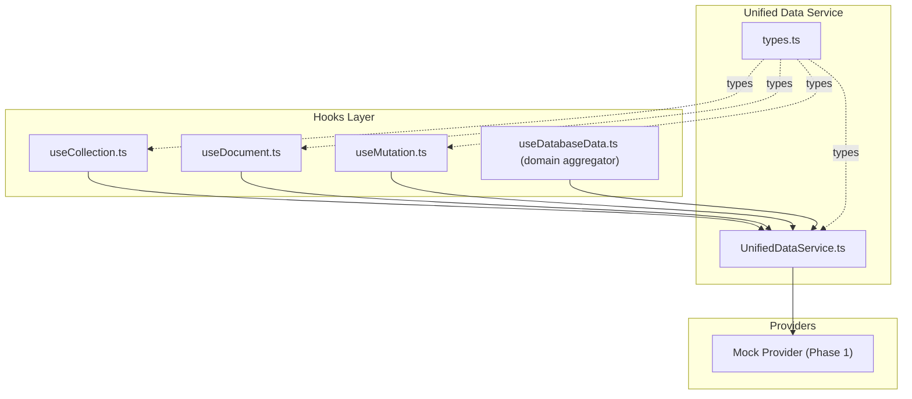
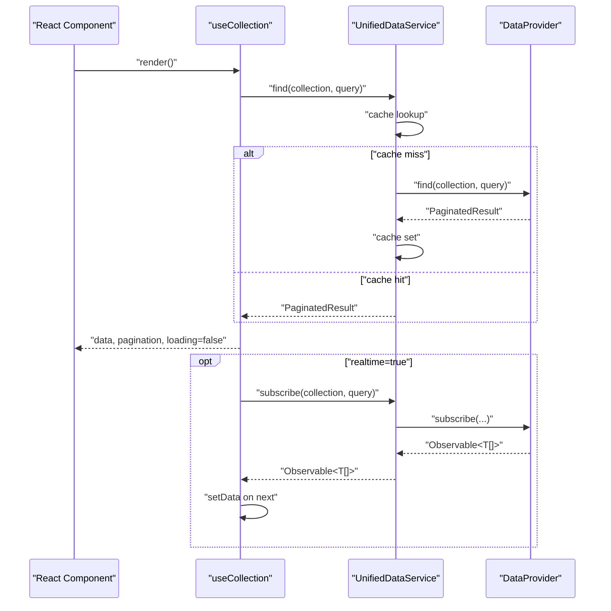
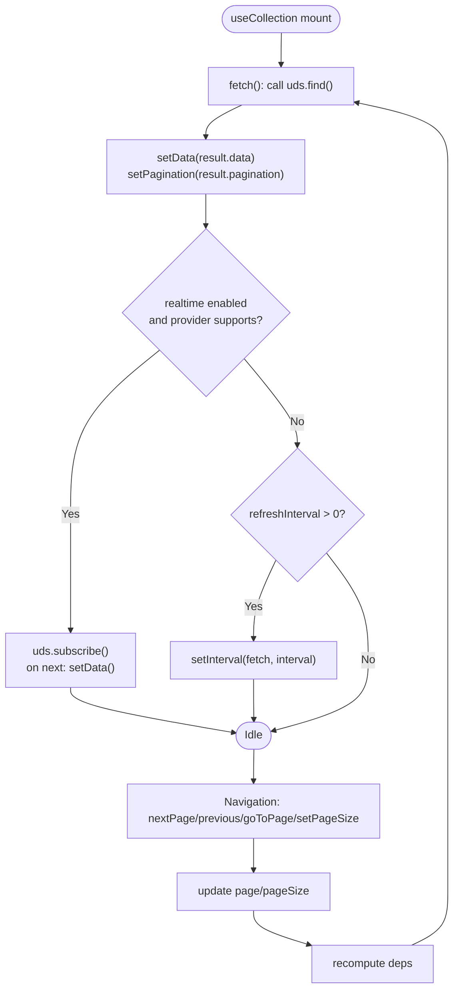
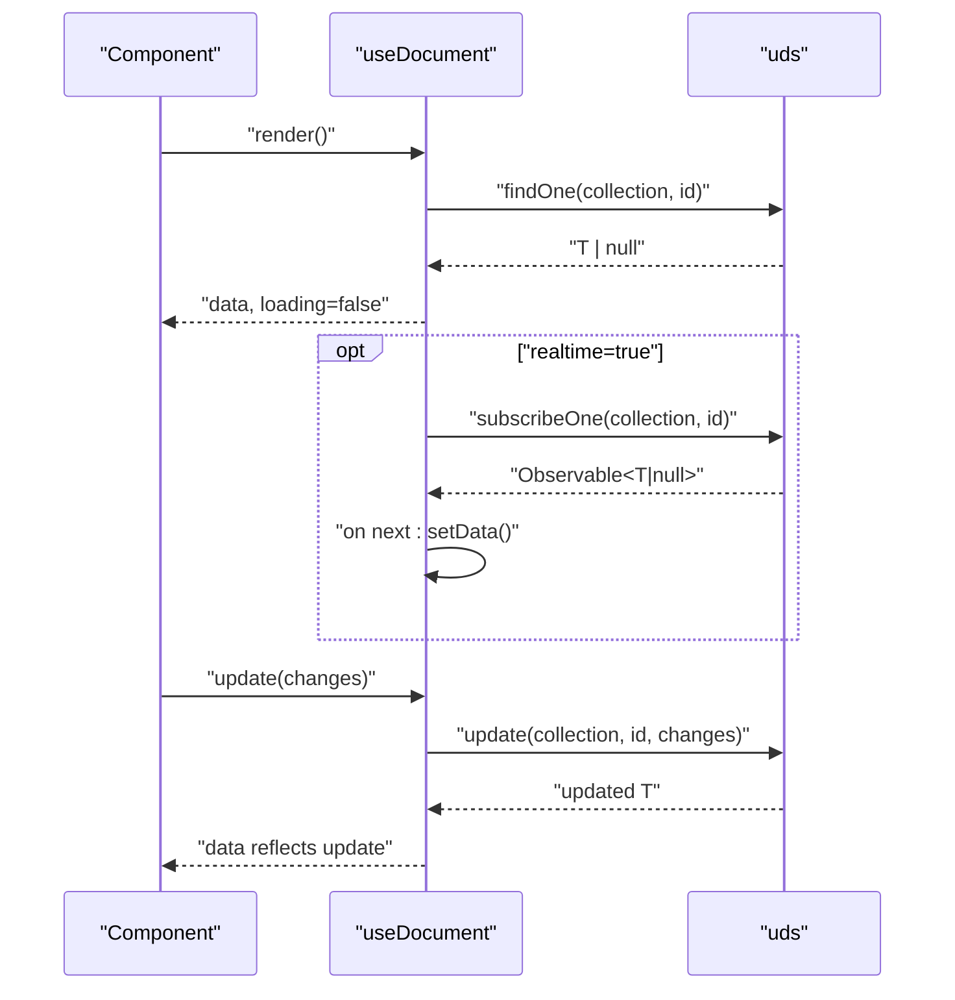
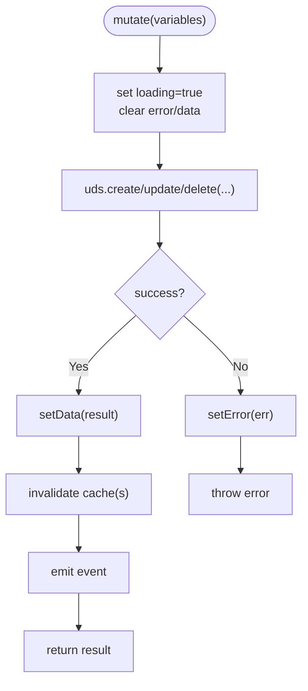
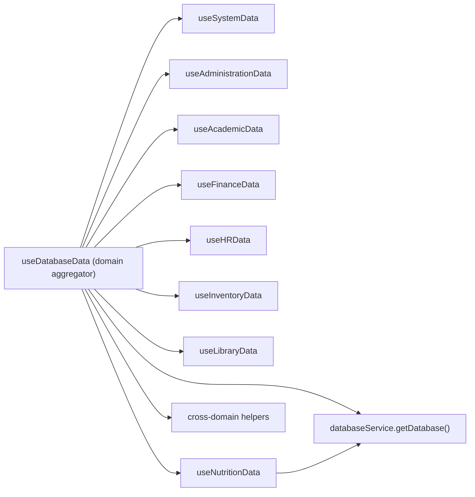
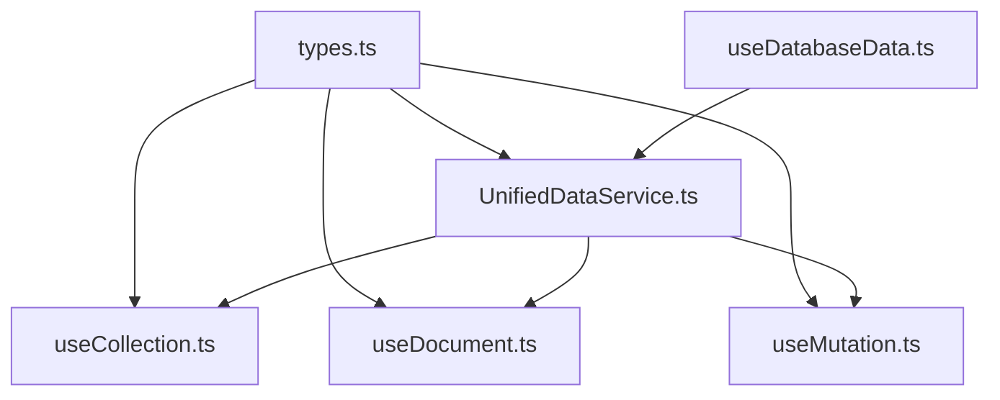

# Data Hooks Ecosystem

<cite>
**Referenced Files in This Document**
- [useCollection.ts](file://src/services/data/hooks/useCollection.ts)
- [useDocument.ts](file://src/services/data/hooks/useDocument.ts)
- [useMutation.ts](file://src/services/data/hooks/useMutation.ts)
- [useDatabaseData.ts](file://src/hooks/data/useDatabaseData.ts)
- [useDatabaseData.ts (compat shim)](file://src/hooks/useDatabaseData.ts)
- [UnifiedDataService.ts](file://src/services/data/UnifiedDataService.ts)
- [types.ts](file://src/services/data/types.ts)
- [index.ts (hooks exports)](file://src/services/data/hooks/index.ts)
- [useDatabaseData.test.tsx](file://src/hooks/__tests__/useDatabaseData.test.tsx)
</cite>

## Table of Contents
1. [Introduction](#introduction)
2. [Project Structure](#project-structure)
3. [Core Components](#core-components)
4. [Architecture Overview](#architecture-overview)
5. [Detailed Component Analysis](#detailed-component-analysis)
6. [Dependency Analysis](#dependency-analysis)
7. [Performance Considerations](#performance-considerations)
8. [Troubleshooting Guide](#troubleshooting-guide)
9. [Conclusion](#conclusion)
10. [Appendices](#appendices)

## Introduction
This document describes the data hooks ecosystem in SchoolPilot3, focusing on four primary hooks:
- useCollection: reactive collection queries with filtering, sorting, pagination, and optional real-time updates
- useDocument: individual entity subscriptions with real-time updates
- useMutation: write operations (create/update/delete) with optimistic updates, error handling, and cache invalidation
- useDatabaseData: low-level database access and cross-domain data aggregation

It explains lifecycle, dependency management, cleanup, performance optimization, and practical integration patterns for forms, data grids, and real-time dashboards.

## Project Structure
The data hooks live under the unified data service layer and integrate with domain-specific data providers. The hooks are exported via a central index and backed by a singleton UnifiedDataService that routes operations to pluggable providers.

**Diagram sources**
- [useCollection.ts:1-169](file://src/services/data/hooks/useCollection.ts#L1-L169)
- [useDocument.ts:1-130](file://src/services/data/hooks/useDocument.ts#L1-L130)
- [useMutation.ts:1-160](file://src/services/data/hooks/useMutation.ts#L1-L160)
- [useDatabaseData.ts:1-383](file://src/hooks/data/useDatabaseData.ts#L1-L383)
- [UnifiedDataService.ts:1-721](file://src/services/data/UnifiedDataService.ts#L1-L721)
- [types.ts:1-226](file://src/services/data/types.ts#L1-L226)

**Section sources**
- [index.ts (hooks exports):1-9](file://src/services/data/hooks/index.ts#L1-L9)

## Core Components
- useCollection: Reactive collection queries with pagination, filters, sorts, and optional real-time updates or polling
- useDocument: Single-entity subscriptions with update/delete and refresh
- useMutation: Create/update/delete with loading/error state and cache invalidation
- useDatabaseData: Domain-level aggregation and cross-domain helpers for RxDB-backed data

**Section sources**
- [useCollection.ts:58-169](file://src/services/data/hooks/useCollection.ts#L58-L169)
- [useDocument.ts:41-130](file://src/services/data/hooks/useDocument.ts#L41-L130)
- [useMutation.ts:38-160](file://src/services/data/hooks/useMutation.ts#L38-L160)
- [useDatabaseData.ts:18-383](file://src/hooks/data/useDatabaseData.ts#L18-L383)

## Architecture Overview
The hooks depend on a singleton UnifiedDataService (uds) that encapsulates provider selection, caching, and event emission. Providers implement a common interface and can optionally support real-time subscriptions or fall back to polling.

**Diagram sources**
- [useCollection.ts:75-129](file://src/services/data/hooks/useCollection.ts#L75-L129)
- [UnifiedDataService.ts:153-170](file://src/services/data/UnifiedDataService.ts#L153-L170)
- [UnifiedDataService.ts:285-321](file://src/services/data/UnifiedDataService.ts#L285-L321)
- [types.ts:135-182](file://src/services/data/types.ts#L135-L182)

## Detailed Component Analysis

### useCollection Hook
Purpose: Reactive collection queries with pagination, filters, sorts, and optional real-time updates or polling.

Key behaviors:
- Builds a full query including pagination and merges with user-provided query
- Loads initial data, sets loading/error states
- Supports real-time subscription via provider capabilities or falls back to polling
- Provides navigation helpers: nextPage, previousPage, goToPage, setPageSize
- Cleans up subscriptions and intervals on unmount

**Diagram sources**
- [useCollection.ts:75-129](file://src/services/data/hooks/useCollection.ts#L75-L129)
- [useCollection.ts:131-165](file://src/services/data/hooks/useCollection.ts#L131-L165)

**Section sources**
- [useCollection.ts:58-169](file://src/services/data/hooks/useCollection.ts#L58-L169)
- [types.ts:64-88](file://src/services/data/types.ts#L64-L88)

### useDocument Hook
Purpose: Individual entity subscriptions with real-time updates, refresh, update, and delete.

Key behaviors:
- Fetches document by id; handles missing id gracefully
- Optionally subscribes to real-time updates
- Provides update(changes) and remove() with error propagation
- Exposes exists flag and refresh()

**Diagram sources**
- [useDocument.ts:54-89](file://src/services/data/hooks/useDocument.ts#L54-L89)
- [useDocument.ts:91-116](file://src/services/data/hooks/useDocument.ts#L91-L116)

**Section sources**
- [useDocument.ts:41-130](file://src/services/data/hooks/useDocument.ts#L41-L130)

### useMutation Hook
Purpose: Write operations with loading/error state and cache invalidation.

Variants:
- useCreate: creates entities
- useUpdate: updates by id
- useDelete: deletes by id
- useMutation: generic dispatch to variant based on operation type

Behavior:
- Maintains loading/error/data/reset state
- Calls uds.create/update/delete
- Emits data events and invalidates caches
- Throws on error for caller to handle

**Diagram sources**
- [useMutation.ts:47-62](file://src/services/data/hooks/useMutation.ts#L47-L62)
- [useMutation.ts:82-97](file://src/services/data/hooks/useMutation.ts#L82-L97)
- [useMutation.ts:117-131](file://src/services/data/hooks/useMutation.ts#L117-L131)
- [UnifiedDataService.ts:214-283](file://src/services/data/UnifiedDataService.ts#L214-L283)

**Section sources**
- [useMutation.ts:38-160](file://src/services/data/hooks/useMutation.ts#L38-L160)
- [UnifiedDataService.ts:214-283](file://src/services/data/UnifiedDataService.ts#L214-L283)

### useDatabaseData Hook
Purpose: Low-level database access and cross-domain data aggregation for RxDB-based domains.

Highlights:
- Aggregates domain data (system, administration, academics, finance, hr, inventory, library, nutrition)
- Provides cross-domain helpers (e.g., financial details by student id)
- Returns a consolidated AppDataContextType for backward compatibility
- Uses databaseService for RxDB access

**Diagram sources**
- [useDatabaseData.ts:18-383](file://src/hooks/data/useDatabaseData.ts#L18-L383)

**Section sources**
- [useDatabaseData.ts:18-383](file://src/hooks/data/useDatabaseData.ts#L18-L383)
- [useDatabaseData.ts (compat shim):1-6](file://src/hooks/useDatabaseData.ts#L1-L6)

## Dependency Analysis
- All hooks depend on UnifiedDataService (uds) for CRUD, subscriptions, and caching
- uds depends on a provider implementation selected by deployment mode
- Types define the shared Query, PaginatedResult, WriteOptions, and DataProvider interface
- useDatabaseData composes domain hooks and exposes a unified interface

**Diagram sources**
- [types.ts:1-226](file://src/services/data/types.ts#L1-L226)
- [UnifiedDataService.ts:1-721](file://src/services/data/UnifiedDataService.ts#L1-L721)
- [useCollection.ts:1-169](file://src/services/data/hooks/useCollection.ts#L1-L169)
- [useDocument.ts:1-130](file://src/services/data/hooks/useDocument.ts#L1-L130)
- [useMutation.ts:1-160](file://src/services/data/hooks/useMutation.ts#L1-L160)
- [useDatabaseData.ts:1-383](file://src/hooks/data/useDatabaseData.ts#L1-L383)

**Section sources**
- [types.ts:135-182](file://src/services/data/types.ts#L135-L182)
- [UnifiedDataService.ts:479-505](file://src/services/data/UnifiedDataService.ts#L479-L505)

## Performance Considerations
- Caching: uds caches query results with TTL; cache keys include collection and serialized query. Cache is invalidated on writes and after sync/import.
- Pagination: useCollection computes pagination from provider results; avoid excessive page sizes to reduce payload.
- Real-time vs polling: Prefer real-time subscriptions when provider supports; otherwise, configure refreshInterval to balance freshness and cost.
- Batch operations: Use bulkCreate/bulkUpdate/bulkDelete when applicable to minimize cache invalidations.
- Memoization: Keep query/filter objects stable across renders to avoid unnecessary refetches; consider useMemo for complex filters/sorts.
- Cleanup: Hooks clean up subscriptions and intervals; ensure components unmount to prevent leaks.

**Section sources**
- [UnifiedDataService.ts:47-48](file://src/services/data/UnifiedDataService.ts#L47-L48)
- [UnifiedDataService.ts:607-629](file://src/services/data/UnifiedDataService.ts#L607-L629)
- [useCollection.ts:123-128](file://src/services/data/hooks/useCollection.ts#L123-L128)
- [useDocument.ts:86-88](file://src/services/data/hooks/useDocument.ts#L86-L88)

## Troubleshooting Guide
Common issues and remedies:
- Service not initialized: Ensure uds.initialize() is called before using hooks. The service throws if not ready.
- Real-time not updating: Verify provider capabilities and that realtime option is enabled; fallback to polling occurs automatically.
- Frequent reloads: Tune refreshInterval or rely on subscriptions; avoid overly aggressive polling.
- Cache staleness: After external changes, rely on provider events; uds invalidates caches on write and import/sync.
- Error handling: useMutation propagates errors; wrap mutations in try/catch or use error boundaries. useCollection/useDocument expose error state.

**Section sources**
- [UnifiedDataService.ts:601-605](file://src/services/data/UnifiedDataService.ts#L601-L605)
- [useCollection.ts:106-121](file://src/services/data/hooks/useCollection.ts#L106-L121)
- [useMutation.ts:55-58](file://src/services/data/hooks/useMutation.ts#L55-L58)

## Conclusion
The data hooks ecosystem provides a cohesive, provider-agnostic layer for querying, subscribing, and mutating data. useCollection and useDocument deliver reactive, paginated experiences with real-time updates; useMutation ensures robust write operations with proper error handling and cache invalidation; useDatabaseData consolidates domain data for RxDB-backed modules. Together, they enable scalable, maintainable integrations across forms, grids, and real-time dashboards.

## Appendices

### Hook Lifecycle and Cleanup
- useCollection: mounts fetch, sets up subscription/polling, clears on unmount
- useDocument: mounts fetch, sets up subscription, clears on unmount
- useMutation: stateful per invocation; no persistent subscriptions

**Section sources**
- [useCollection.ts:101-129](file://src/services/data/hooks/useCollection.ts#L101-L129)
- [useDocument.ts:75-89](file://src/services/data/hooks/useDocument.ts#L75-L89)

### Example Usage Patterns
- Forms: useMutation for submit handlers; useDocument for editing existing records; show loading/error states from mutation state
- Data grids: useCollection with filters/sort/pagination; enable realtime for live dashboards; disable polling when not needed
- Real-time dashboards: prefer realtime subscriptions; use refreshInterval as a safety net; debounce frequent updates

[No sources needed since this section provides general guidance]

### Integration Notes
- Backward compatibility: useDatabaseData shim re-exports the domain aggregator for legacy consumers
- Provider selection: uds selects provider based on deployment mode; mock provider included for early phases

**Section sources**
- [useDatabaseData.ts (compat shim):1-6](file://src/hooks/useDatabaseData.ts#L1-L6)
- [UnifiedDataService.ts:479-505](file://src/services/data/UnifiedDataService.ts#L479-L505)