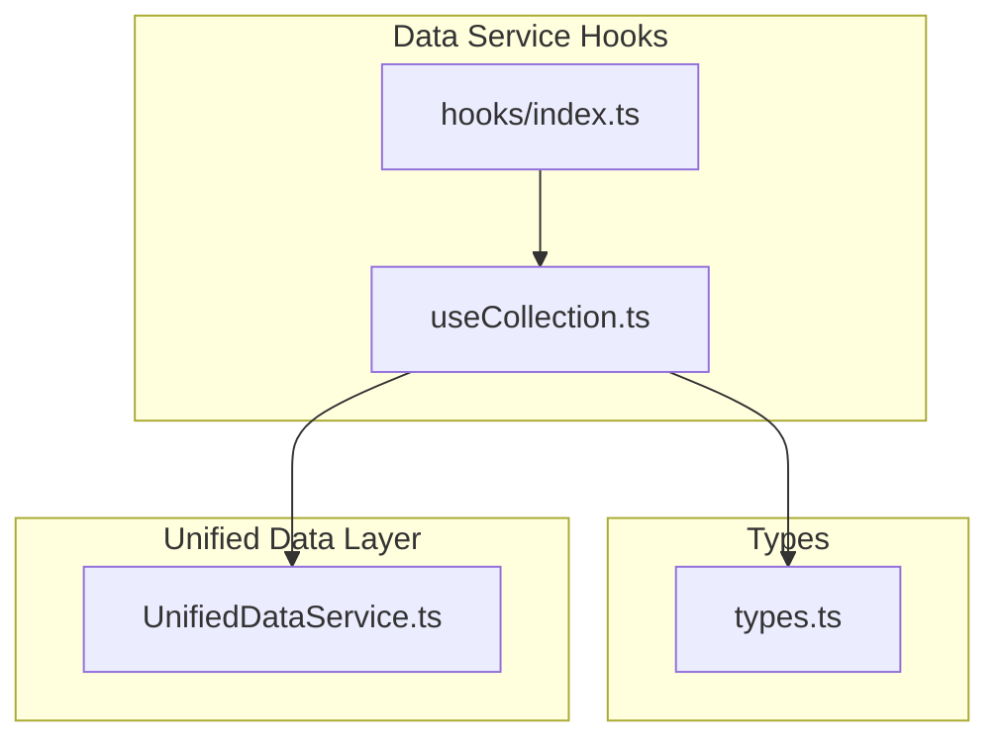
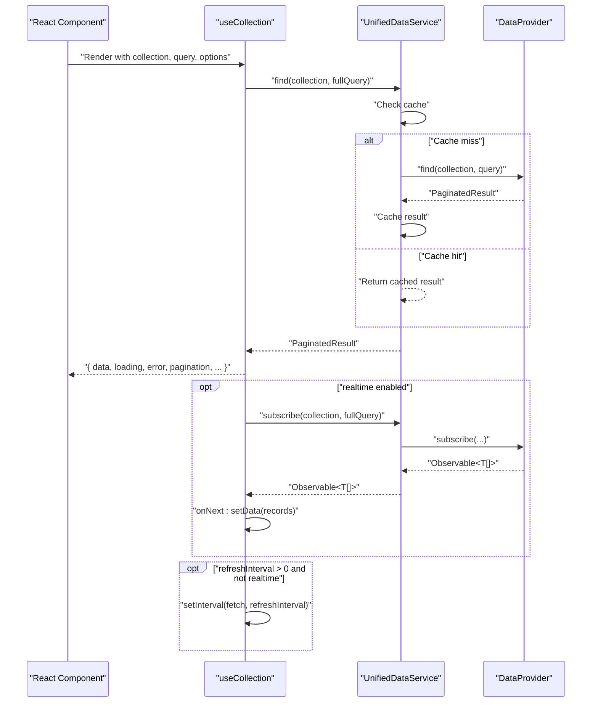
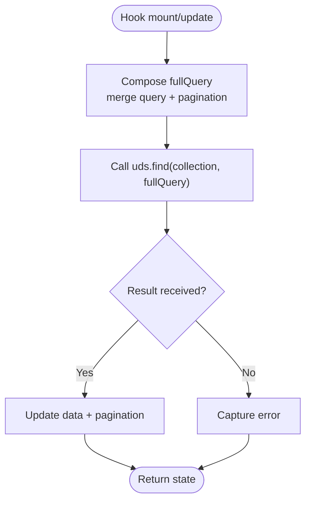
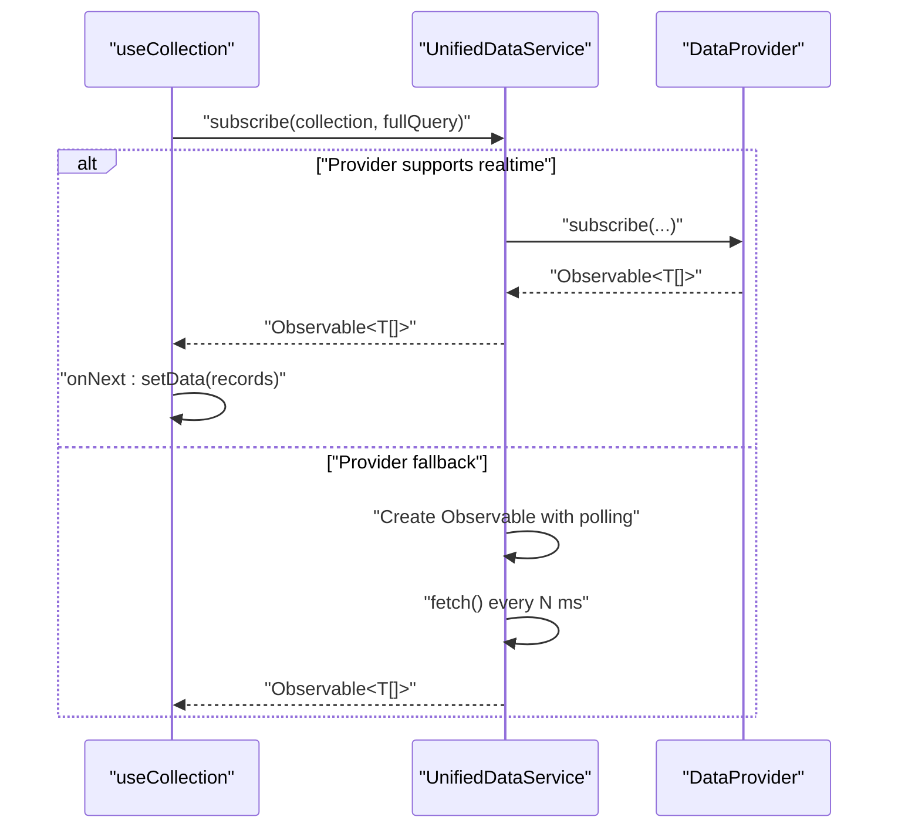
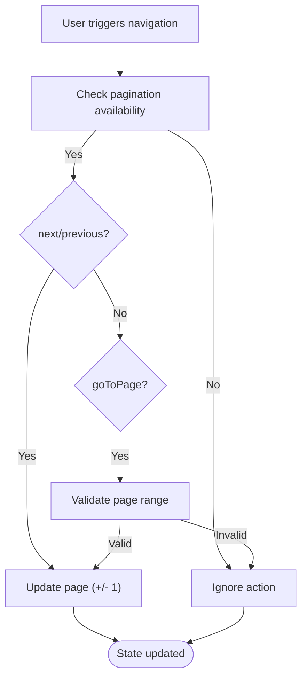
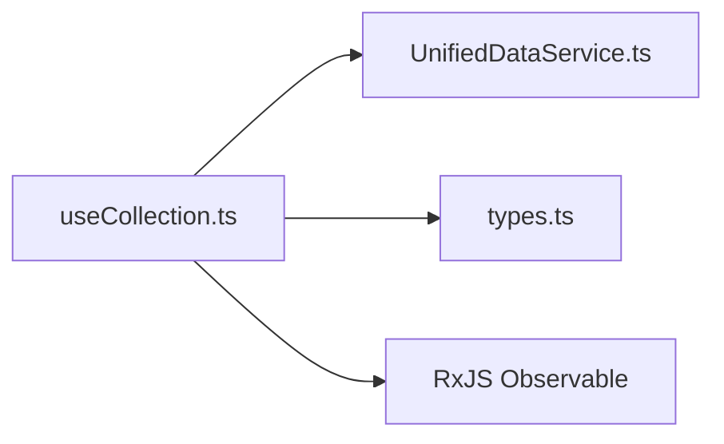

# useCollection Hook

<cite>
**Referenced Files in This Document**
- [useCollection.ts](file://src/services/data/hooks/useCollection.ts)
- [index.ts](file://src/services/data/hooks/index.ts)
- [types.ts](file://src/services/data/types.ts)
- [UnifiedDataService.ts](file://src/services/data/UnifiedDataService.ts)
- [DATA_LAYER_STRATEGY.md](file://docs/architecture/DATA_LAYER_STRATEGY.md)
</cite>

## Table of Contents
1. [Introduction](#introduction)
2. [Project Structure](#project-structure)
3. [Core Components](#core-components)
4. [Architecture Overview](#architecture-overview)
5. [Detailed Component Analysis](#detailed-component-analysis)
6. [Dependency Analysis](#dependency-analysis)
7. [Performance Considerations](#performance-considerations)
8. [Troubleshooting Guide](#troubleshooting-guide)
9. [Conclusion](#conclusion)
10. [Appendices](#appendices)

## Introduction
The useCollection hook is the primary reactive data-fetching interface for SchoolPilot3’s unified data service. It enables components to query collections with filtering, sorting, and pagination, while optionally enabling real-time updates and periodic refresh. The hook returns a normalized result object containing data, loading states, error handling, pagination utilities, and navigation helpers. It integrates with the UnifiedDataService abstraction to support pluggable data providers and caching.

## Project Structure
The useCollection hook resides in the data service hooks module and exports a cohesive API surface for list-based queries. Supporting types and the UnifiedDataService implementation define the contract and runtime behavior.

**Diagram sources**
- [useCollection.ts:1-169](file://src/services/data/hooks/useCollection.ts#L1-L169)
- [index.ts:1-10](file://src/services/data/hooks/index.ts#L1-L10)
- [types.ts:1-226](file://src/services/data/types.ts#L1-L226)
- [UnifiedDataService.ts:1-200](file://src/services/data/UnifiedDataService.ts#L1-L200)

**Section sources**
- [useCollection.ts:1-169](file://src/services/data/hooks/useCollection.ts#L1-L169)
- [index.ts:1-10](file://src/services/data/hooks/index.ts#L1-L10)
- [types.ts:1-226](file://src/services/data/types.ts#L1-L226)
- [UnifiedDataService.ts:1-200](file://src/services/data/UnifiedDataService.ts#L1-L200)

## Core Components
- useCollection hook: Provides reactive collection queries with optional real-time updates and polling, plus pagination helpers.
- UnifiedDataService: Centralized service that routes operations to providers, manages caching, and exposes subscribe for real-time.
- Types: Defines Query, Filter, SortOption, PaginationOptions, and PaginatedResult shapes used across the data layer.

Key responsibilities:
- Query composition and pagination control
- Real-time subscription lifecycle management
- Polling fallback for non-realtime providers
- Loading/error state propagation
- Pagination utilities for navigation and sizing

**Section sources**
- [useCollection.ts:58-166](file://src/services/data/hooks/useCollection.ts#L58-L166)
- [types.ts:64-88](file://src/services/data/types.ts#L64-L88)
- [UnifiedDataService.ts:153-170](file://src/services/data/UnifiedDataService.ts#L153-L170)

## Architecture Overview
The hook orchestrates data fetching and subscriptions through UnifiedDataService, which encapsulates provider-specific implementations behind a consistent interface. Queries are composed with filter, sort, pagination, and projection options, and results include pagination metadata for UI controls.

**Diagram sources**
- [useCollection.ts:75-129](file://src/services/data/hooks/useCollection.ts#L75-L129)
- [UnifiedDataService.ts:153-170](file://src/services/data/UnifiedDataService.ts#L153-L170)
- [UnifiedDataService.ts:414-431](file://src/services/data/UnifiedDataService.ts#L414-L431)

## Detailed Component Analysis

### Hook Signature and Options
- Collection name: string identifying the target collection.
- Query: object supporting filter, sort, pagination, select, and include.
- Options:
  - refreshInterval: number (milliseconds) for polling; zero disables.
  - realtime: boolean to enable real-time subscriptions if provider supports.
  - initialData: optional prefetched data to avoid loading flashes.

Returned object includes:
- data: T[]
- loading: boolean
- error: Error | null
- pagination: object with page, pageSize, totalCount, totalPages, hasNextPage, hasPreviousPage, or null
- refresh(): Promise<void>
- nextPage(), previousPage(), goToPage(page: number), setPageSize(size: number)

**Section sources**
- [useCollection.ts:58-56](file://src/services/data/hooks/useCollection.ts#L58-L56)
- [useCollection.ts:11-20](file://src/services/data/hooks/useCollection.ts#L11-L20)
- [useCollection.ts:22-56](file://src/services/data/hooks/useCollection.ts#L22-L56)
- [types.ts:64-75](file://src/services/data/types.ts#L64-L75)

### Query Composition and Pagination
The hook composes a full query by merging the provided query with computed pagination (page, pageSize). It then calls UnifiedDataService.find to retrieve paginated results and updates pagination metadata.

**Diagram sources**
- [useCollection.ts:85-99](file://src/services/data/hooks/useCollection.ts#L85-L99)
- [UnifiedDataService.ts:153-170](file://src/services/data/UnifiedDataService.ts#L153-L170)

**Section sources**
- [useCollection.ts:85-99](file://src/services/data/hooks/useCollection.ts#L85-L99)
- [types.ts:78-88](file://src/services/data/types.ts#L78-L88)

### Real-Time Subscriptions and Polling
When realtime is enabled and the service is ready, the hook subscribes to changes via UnifiedDataService.subscribe. If the provider does not support real-time, the service falls back to polling using an Observable that periodically re-fetches data.

**Diagram sources**
- [useCollection.ts:106-116](file://src/services/data/hooks/useCollection.ts#L106-L116)
- [UnifiedDataService.ts:414-431](file://src/services/data/UnifiedDataService.ts#L414-L431)

**Section sources**
- [useCollection.ts:106-129](file://src/services/data/hooks/useCollection.ts#L106-L129)
- [UnifiedDataService.ts:414-431](file://src/services/data/UnifiedDataService.ts#L414-L431)

### Pagination Utilities
The hook exposes helpers to navigate pages and adjust page size. These utilities respect pagination boundaries and reset to the first page when changing page size.

**Diagram sources**
- [useCollection.ts:132-153](file://src/services/data/hooks/useCollection.ts#L132-L153)

**Section sources**
- [useCollection.ts:132-153](file://src/services/data/hooks/useCollection.ts#L132-L153)

### Returned Object Structure
- data: array of entities matching the query
- loading: indicates ongoing fetch or initialization
- error: captured error or null
- pagination: null until first paginated result; otherwise includes page metadata
- refresh: manual refresh function
- nextPage/previousPage/goToPage/setPageSize: navigation and sizing helpers

**Section sources**
- [useCollection.ts:155-165](file://src/services/data/hooks/useCollection.ts#L155-L165)

### Practical Examples

- Student list with search and pagination
  - Use filter to match partial names or IDs
  - Use sort by name or admission date
  - Use pagination.page and pagination.pageSize to drive a DataGrid
  - Optional realtime to reflect live enrollments

- Academic records by class and year
  - Filter by class_id and academic_year_id
  - Sort by student_name or grade
  - Paginate large result sets

- Administrative data (staff, departments)
  - Combine filters for department and role
  - Enable refreshInterval for near-real-time dashboards
  - Use goToPage to jump to specific pages after bulk operations

Integration patterns:
- React components: consume returned data and render lists or cards
- Data grids: bind data, loading, and error to grid state; wire pagination controls to nextPage/previousPage/goToPage
- Search interfaces: debounce input and rebuild query.filter; reset pagination.page to 1 on new search

**Section sources**
- [useCollection.ts:58-166](file://src/services/data/hooks/useCollection.ts#L58-L166)
- [types.ts:64-75](file://src/services/data/types.ts#L64-L75)

## Dependency Analysis
The hook depends on:
- UnifiedDataService for find and subscribe operations
- RxJS Observable for real-time streams
- Internal state and refs for lifecycle management

**Diagram sources**
- [useCollection.ts:7-9](file://src/services/data/hooks/useCollection.ts#L7-L9)
- [types.ts:7](file://src/services/data/types.ts#L7)
- [UnifiedDataService.ts:8](file://src/services/data/UnifiedDataService.ts#L8)

**Section sources**
- [useCollection.ts:7-9](file://src/services/data/hooks/useCollection.ts#L7-L9)
- [types.ts:7](file://src/services/data/types.ts#L7)
- [UnifiedDataService.ts:8](file://src/services/data/UnifiedDataService.ts#L8)

## Performance Considerations
- Caching: UnifiedDataService caches results keyed by collection and query; TTL prevents stale data indefinitely.
- Pagination: Prefer pagination.page and pagination.pageSize to limit payload sizes.
- Real-time vs polling: Use realtime when supported; otherwise tune refreshInterval to balance freshness and cost.
- Initial data: Provide initialData to reduce perceived loading.
- Cleanup: The hook unsubscribes real-time subscriptions and clears intervals on unmount.

**Section sources**
- [UnifiedDataService.ts:47](file://src/services/data/UnifiedDataService.ts#L47)
- [useCollection.ts:123-128](file://src/services/data/hooks/useCollection.ts#L123-L128)

## Troubleshooting Guide
Common scenarios:
- Service not ready: The hook checks uds.isReady before fetching; ensure initialization completes before mounting components.
- Real-time subscription errors: Errors propagate to the error field; verify provider capabilities and network connectivity.
- Polling not triggering: Confirm refreshInterval > 0 and realtime is disabled; intervals are cleared on unmount.
- Pagination inconsistencies: Ensure query.pagination is not overridden mid-lifecycle; rely on hook’s internal state.

Best practices:
- Always check loading and error in UI layers
- Reset pagination.page to 1 when applying new filters
- Use refresh to force immediate reload after mutations
- Unsubscribe and clear intervals automatically handled by the hook

**Section sources**
- [useCollection.ts:77-79](file://src/services/data/hooks/useCollection.ts#L77-L79)
- [useCollection.ts:94-96](file://src/services/data/hooks/useCollection.ts#L94-L96)
- [useCollection.ts:119-121](file://src/services/data/hooks/useCollection.ts#L119-L121)

## Conclusion
The useCollection hook provides a robust, reactive foundation for list-based queries in SchoolPilot3. It cleanly separates concerns between query composition, state management, and lifecycle handling, while integrating with a flexible data layer that supports real-time updates, caching, and multiple providers. By leveraging pagination utilities and proper cleanup, applications can deliver responsive, scalable experiences for large datasets.

## Appendices

### Hook Export Surface
- Exported from hooks/index.ts as part of the unified data service hooks bundle.

**Section sources**
- [index.ts:7](file://src/services/data/hooks/index.ts#L7)

### Query and Result Types Reference
- Query: filter, sort, pagination, select, include
- PaginatedResult: data[], pagination metadata

**Section sources**
- [types.ts:64-88](file://src/services/data/types.ts#L64-L88)

### Real-Time and Polling Behavior
- Real-time: Uses provider.subscribe when available; otherwise falls back to polling Observable.
- Polling: Interval cleared on cleanup; refreshInterval must be > 0 and realtime disabled.

**Section sources**
- [UnifiedDataService.ts:414-431](file://src/services/data/UnifiedDataService.ts#L414-L431)
- [useCollection.ts:119-121](file://src/services/data/hooks/useCollection.ts#L119-L121)