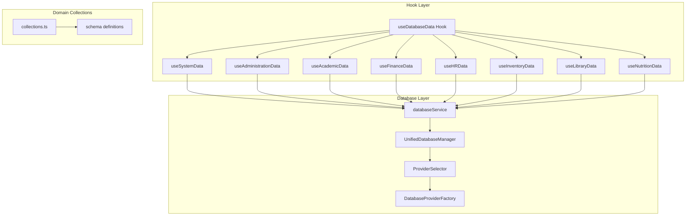
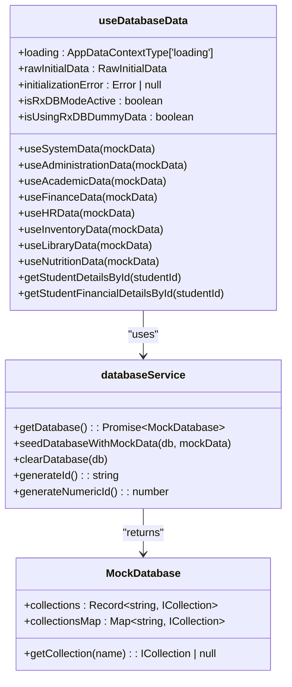
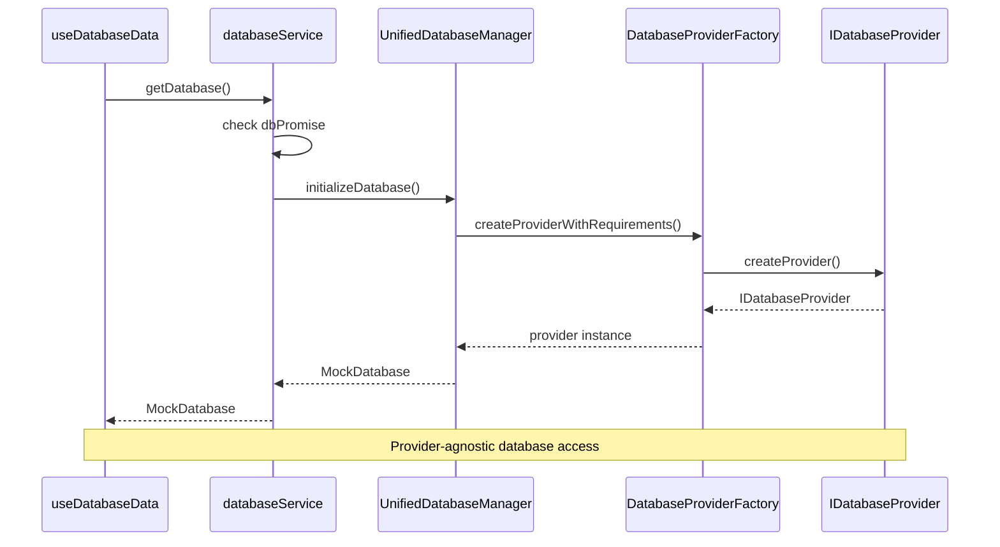
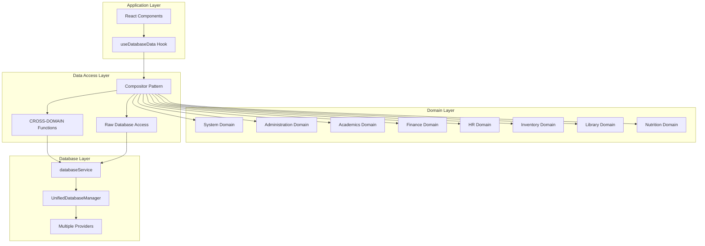
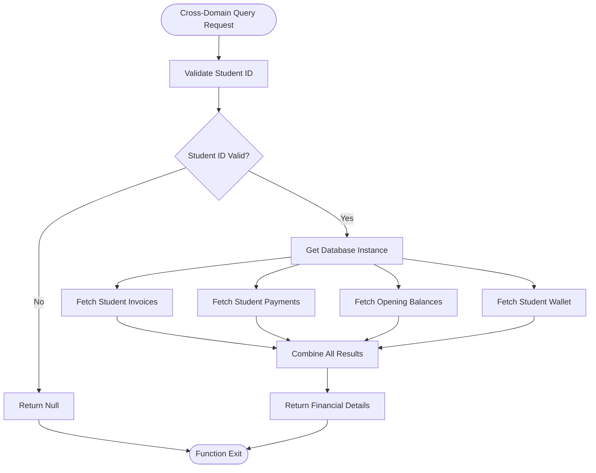
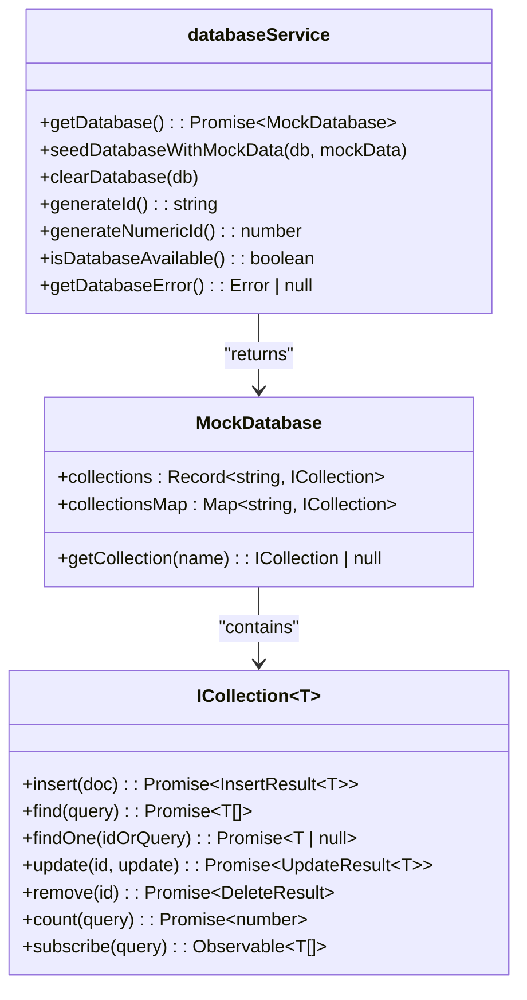
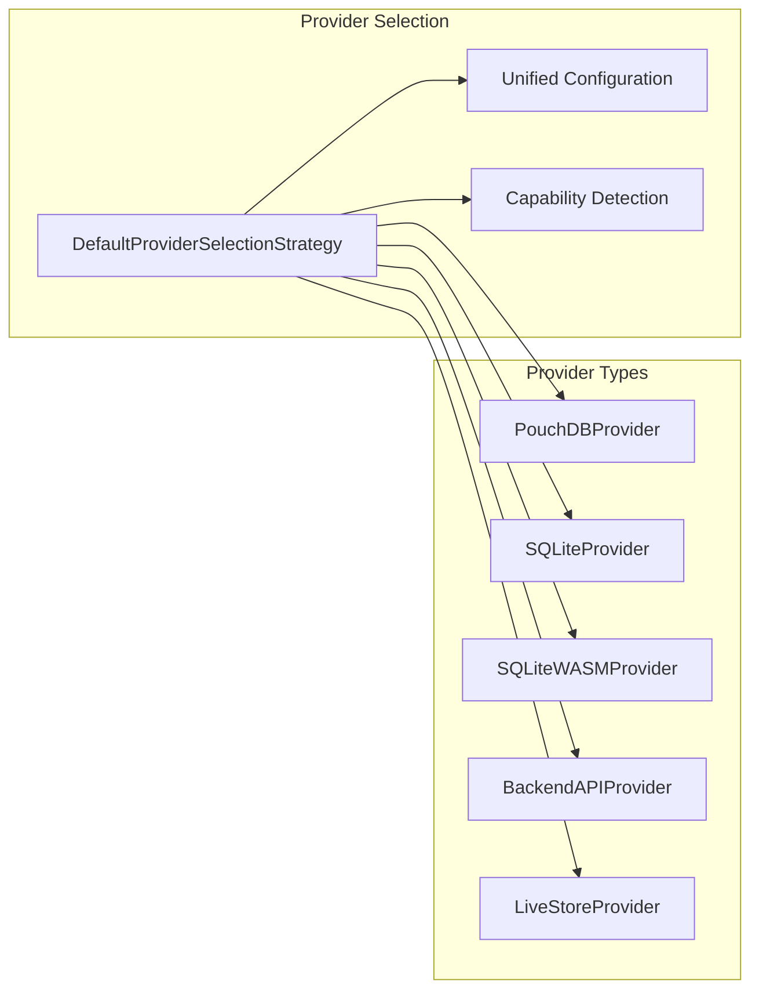
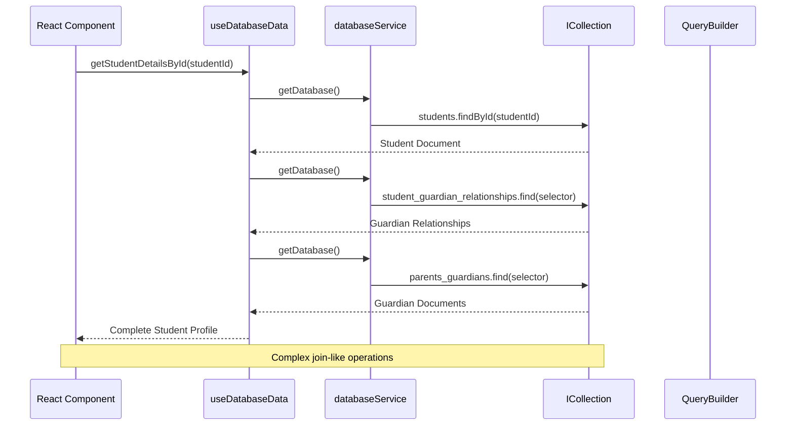
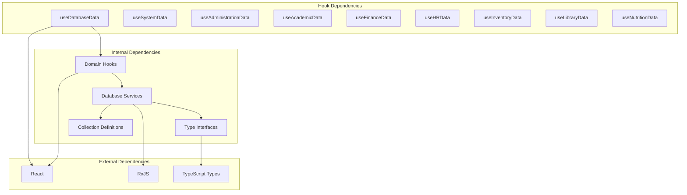

# useDatabaseData Hook

<cite>
**Referenced Files in This Document**
- [useDatabaseData.ts](file://src/hooks/useDatabaseData.ts)
- [useDatabaseData.ts](file://src/hooks/data/useDatabaseData.ts)
- [index.ts](file://src/hooks/data/index.ts)
- [databaseService.ts](file://src/services/database/databaseService.ts)
- [UnifiedDatabaseManager.ts](file://src/services/database/UnifiedDatabaseManager.ts)
- [ProviderSelector.ts](file://src/services/database/ProviderSelector.ts)
- [DatabaseProviderFactory.ts](file://src/services/database/DatabaseProviderFactory.ts)
- [interfaces.ts](file://src/services/database/interfaces.ts)
- [collections.ts](file://src/services/database/collections.ts)
- [useAdministrationData.ts](file://src/modules/administration/data/useAdministrationData.ts)
</cite>

## Table of Contents
1. [Introduction](#introduction)
2. [Project Structure](#project-structure)
3. [Core Components](#core-components)
4. [Architecture Overview](#architecture-overview)
5. [Detailed Component Analysis](#detailed-component-analysis)
6. [Dependency Analysis](#dependency-analysis)
7. [Performance Considerations](#performance-considerations)
8. [Troubleshooting Guide](#troubleshooting-guide)
9. [Conclusion](#conclusion)

## Introduction

The `useDatabaseData` hook serves as the primary bridge between the unified data service architecture and React components, providing comprehensive database access while maintaining backward compatibility. This hook has evolved from a monolithic implementation into a composable architecture that aggregates domain-specific hooks, enabling power users to access low-level database operations while maintaining consistency with the broader data layer strategy.

The hook operates as a compositor that orchestrates multiple domain-specific data hooks (administration, academics, finance, HR, inventory, library, nutrition) while providing essential cross-domain functionality and raw database access capabilities. It represents the culmination of the project's database modernization efforts, transitioning from RxDB-dependent implementations to a provider-agnostic architecture.

## Project Structure

The `useDatabaseData` hook follows a modular architecture that separates concerns across domain boundaries while maintaining unified access patterns:

**Diagram sources**
- [useDatabaseData.ts:1-383](file://src/hooks/data/useDatabaseData.ts#L1-L383)
- [databaseService.ts:1-379](file://src/services/database/databaseService.ts#L1-L379)
- [UnifiedDatabaseManager.ts:1-800](file://src/services/database/UnifiedDatabaseManager.ts#L1-L800)

**Section sources**
- [useDatabaseData.ts:1-6](file://src/hooks/useDatabaseData.ts#L1-L6)
- [index.ts:1-14](file://src/hooks/data/index.ts#L1-L14)

## Core Components

### Primary Hook Implementation

The `useDatabaseData` hook serves as the main entry point for database operations, implementing a sophisticated compositor pattern that aggregates domain-specific functionality:

**Diagram sources**
- [useDatabaseData.ts:18-383](file://src/hooks/data/useDatabaseData.ts#L18-L383)
- [databaseService.ts:142-156](file://src/services/database/databaseService.ts#L142-L156)

### Database Service Architecture

The underlying database service provides a provider-agnostic abstraction layer that supports multiple database backends:

**Diagram sources**
- [databaseService.ts:96-139](file://src/services/database/databaseService.ts#L96-L139)
- [UnifiedDatabaseManager.ts:405-467](file://src/services/database/UnifiedDatabaseManager.ts#L405-L467)

**Section sources**
- [useDatabaseData.ts:18-383](file://src/hooks/data/useDatabaseData.ts#L18-L383)
- [databaseService.ts:142-156](file://src/services/database/databaseService.ts#L142-L156)

## Architecture Overview

The `useDatabaseData` hook implements a sophisticated layered architecture that balances simplicity for common use cases with power-user capabilities for advanced scenarios:

**Diagram sources**
- [useDatabaseData.ts:18-383](file://src/hooks/data/useDatabaseData.ts#L18-L383)
- [databaseService.ts:1-379](file://src/services/database/databaseService.ts#L1-L379)

## Detailed Component Analysis

### Cross-Domain Integration

The hook provides sophisticated cross-domain functionality that enables complex queries spanning multiple data domains:

**Diagram sources**
- [useDatabaseData.ts:36-48](file://src/hooks/data/useDatabaseData.ts#L36-L48)

The cross-domain financial details function demonstrates the hook's ability to aggregate data from multiple collections, enabling complex reporting scenarios without requiring manual database management.

**Section sources**
- [useDatabaseData.ts:36-48](file://src/hooks/data/useDatabaseData.ts#L36-L48)

### Raw Database Access Patterns

The hook maintains direct access to the underlying database service for power users requiring fine-grained control:

**Diagram sources**
- [databaseService.ts:142-156](file://src/services/database/databaseService.ts#L142-L156)
- [interfaces.ts:143-175](file://src/services/database/interfaces.ts#L143-L175)

**Section sources**
- [databaseService.ts:142-156](file://src/services/database/databaseService.ts#L142-L156)
- [interfaces.ts:143-175](file://src/services/database/interfaces.ts#L143-L175)

### Provider-Agnostic Architecture

The underlying database architecture supports multiple providers through a factory pattern:

**Diagram sources**
- [DatabaseProviderFactory.ts:40-117](file://src/services/database/DatabaseProviderFactory.ts#L40-L117)

**Section sources**
- [DatabaseProviderFactory.ts:40-117](file://src/services/database/DatabaseProviderFactory.ts#L40-L117)

### Advanced Query Capabilities

The hook supports complex queries through its integration with the underlying collection system:

**Diagram sources**
- [useAdministrationData.ts:71-86](file://src/modules/administration/data/useAdministrationData.ts#L71-L86)

**Section sources**
- [useAdministrationData.ts:71-86](file://src/modules/administration/data/useAdministrationData.ts#L71-L86)

## Dependency Analysis

The `useDatabaseData` hook exhibits a well-structured dependency hierarchy that promotes maintainability and testability:

**Diagram sources**
- [useDatabaseData.ts:1-383](file://src/hooks/data/useDatabaseData.ts#L1-L383)
- [useAdministrationData.ts:1-200](file://src/modules/administration/data/useAdministrationData.ts#L1-L200)

**Section sources**
- [useDatabaseData.ts:1-383](file://src/hooks/data/useDatabaseData.ts#L1-L383)
- [useAdministrationData.ts:1-200](file://src/modules/administration/data/useAdministrationData.ts#L1-L200)

## Performance Considerations

The hook architecture incorporates several performance optimization strategies:

### Lazy Initialization
The database service implements lazy initialization to minimize startup overhead and resource consumption.

### Caching Strategies
Domain-specific hooks implement intelligent caching mechanisms to reduce database queries and improve response times.

### Provider Selection
The factory pattern enables optimal provider selection based on deployment requirements and capability detection.

### Query Optimization
The underlying collection system supports efficient querying through proper indexing and query planning.

## Troubleshooting Guide

### Common Issues and Solutions

**Database Initialization Failures**
- Verify provider availability and configuration
- Check capability detection results
- Review fallback chain execution

**Cross-Domain Query Performance**
- Monitor collection indexing
- Optimize query selectors
- Consider query builder usage for complex operations

**Memory Management**
- Implement proper cleanup in components
- Monitor collection sizes
- Use pagination for large datasets

**Error Handling Patterns**
The hook implements comprehensive error handling through the database service's error propagation mechanisms, ensuring robust failure recovery and user feedback.

**Section sources**
- [UnifiedDatabaseManager.ts:563-630](file://src/services/database/UnifiedDatabaseManager.ts#L563-L630)
- [databaseService.ts:133-138](file://src/services/database/databaseService.ts#L133-L138)

## Conclusion

The `useDatabaseData` hook represents a mature, enterprise-grade solution for database access in the SchoolPilot system. Its evolution from a monolithic implementation to a composable architecture demonstrates careful architectural planning and forward-thinking design. The hook successfully balances accessibility for common use cases with powerful capabilities for advanced scenarios, maintaining consistency with the unified data service architecture while providing the flexibility needed for complex reporting and analytics requirements.

The provider-agnostic design ensures future extensibility, while the cross-domain integration capabilities enable sophisticated data aggregation scenarios. The hook's comprehensive error handling, performance optimizations, and maintainable architecture make it suitable for both development teams and power users requiring fine-grained control over database operations.