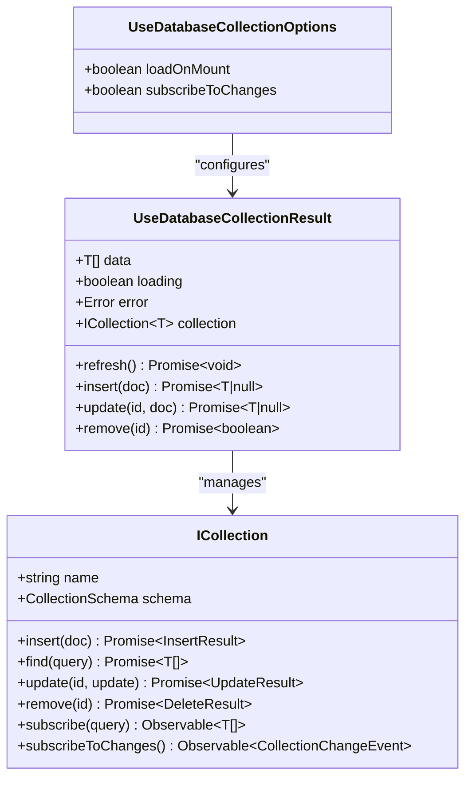
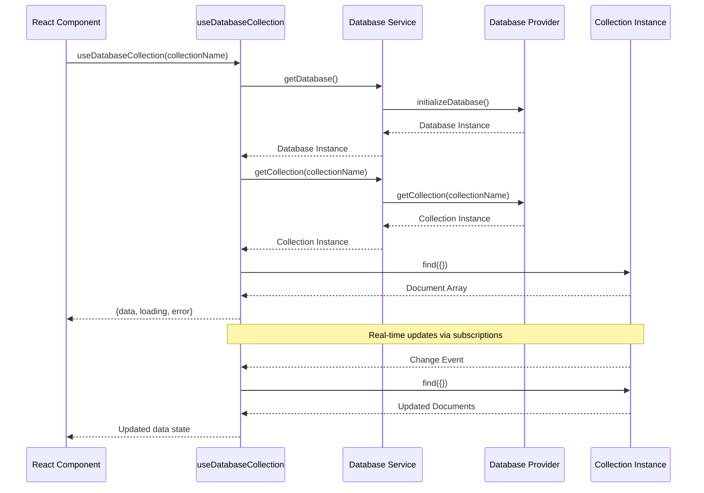
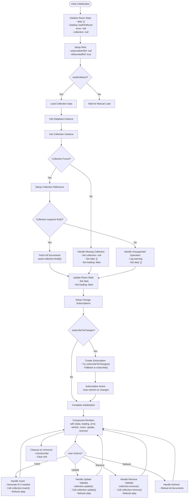
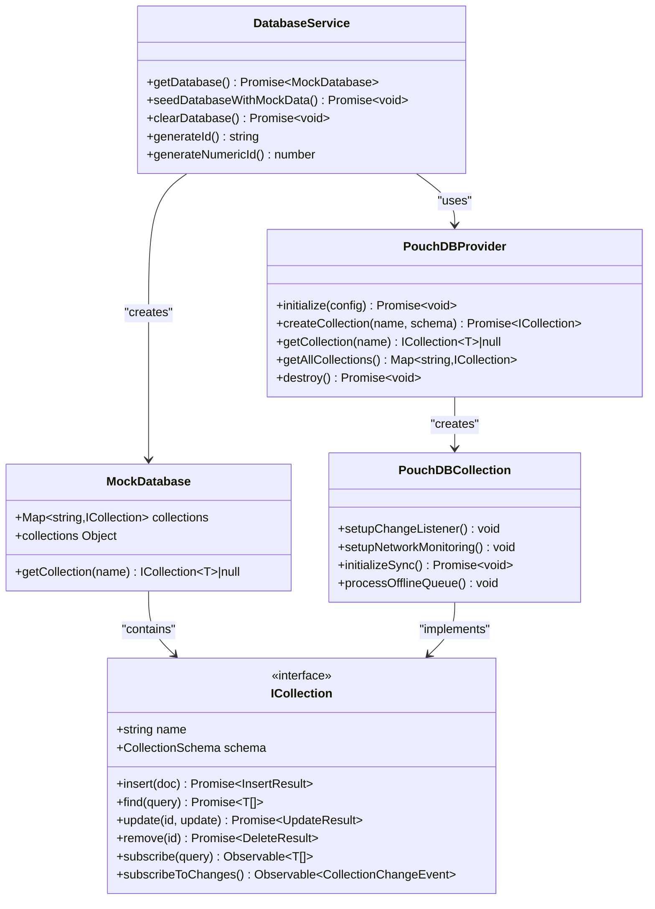
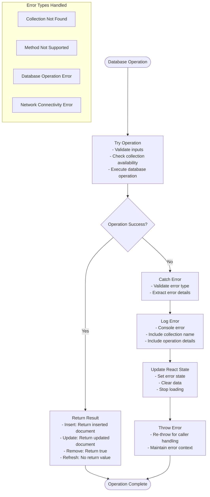

# useDatabaseCollection Hook

<cite>
**Referenced Files in This Document**
- [useDatabaseCollection.ts](file://src/hooks/useDatabaseCollection.ts)
- [databaseService.ts](file://src/services/database/databaseService.ts)
- [interfaces.ts](file://src/services/database/interfaces.ts)
- [useDatabaseDocument.ts](file://src/hooks/useDatabaseDocument.ts)
- [useDatabaseProvider.ts](file://src/hooks/useDatabaseProvider.ts)
- [useSystemData.ts](file://src/core/data/useSystemData.ts)
- [useAcademicData.ts](file://src/modules/academics/data/useAcademicData.ts)
</cite>

## Update Summary
**Changes Made**
- Updated hook implementation details to reflect the complete useDatabaseCollection hook functionality
- Enhanced error handling and subscription management documentation
- Added comprehensive CRUD operation documentation
- Updated architecture diagrams to show the complete hook lifecycle
- Expanded troubleshooting guide with specific error scenarios
- Added real-world usage examples from multiple modules demonstrating the hook's adoption across the application

## Table of Contents
1. [Introduction](#introduction)
2. [Project Structure](#project-structure)
3. [Core Components](#core-components)
4. [Architecture Overview](#architecture-overview)
5. [Detailed Component Analysis](#detailed-component-analysis)
6. [Dependency Analysis](#dependency-analysis)
7. [Performance Considerations](#performance-considerations)
8. [Troubleshooting Guide](#troubleshooting-guide)
9. [Real-World Usage Examples](#real-world-usage-examples)
10. [Conclusion](#conclusion)

## Introduction

The `useDatabaseCollection` hook is a foundational React hook that provides comprehensive database collection management capabilities for the SchoolPilot3 educational management system. This hook serves as the backbone for all module data operations, offering real-time database state synchronization, reactive data binding, and full CRUD (Create, Read, Update, Delete) functionality.

The hook implements a sophisticated pattern that combines React's declarative state management with a provider-agnostic database abstraction layer, enabling seamless switching between different database providers while maintaining consistent functionality across the entire application ecosystem. This hook has been adopted across all major modules including academics, administration, admissions, finance, HR, inventory, library, nutrition, reports, and settings.

## Project Structure

The `useDatabaseCollection` hook is strategically positioned within the application's architecture to serve as a bridge between the presentation layer and the database abstraction layer:

```mermaid
graph TB
subgraph "React Layer"
UI[React Components]
Hook[useDatabaseCollection Hook]
State[React State Management]
DomainHooks[Domain-Specific Hooks]
End
subgraph "Database Abstraction"
Service[Database Service]
Provider[Database Provider]
Collection[Collection Interface]
End
subgraph "Storage Providers"
PouchDB[PouchDB Provider]
SQLite[SQLite Provider]
OPFS[OPFS Provider]
Hybrid[Hybrid Provider]
End
subgraph "Application Modules"
Academics[Academics Module]
Administration[Administration Module]
Admissions[Admissions Module]
Finance[Finance Module]
HR[HR Module]
Inventory[Inventory Module]
Library[Library Module]
Nutrition[Nutrition Module]
Reports[Reports Module]
Settings[Settings Module]
End
UI --> Hook
Hook --> State
Hook --> Service
Service --> Provider
Provider --> Collection
Collection --> PouchDB
Collection --> SQLite
Collection --> OPFS
Collection --> Hybrid
DomainHooks --> Hook
Academics --> DomainHooks
Administration --> DomainHooks
Admissions --> DomainHooks
Finance --> DomainHooks
HR --> DomainHooks
Inventory --> DomainHooks
Library --> DomainHooks
Nutrition --> DomainHooks
Reports --> DomainHooks
Settings --> DomainHooks
```

**Diagram sources**
- [useDatabaseCollection.ts:1-228](file://src/hooks/useDatabaseCollection.ts#L1-L228)
- [databaseService.ts:1-379](file://src/services/database/databaseService.ts#L1-L379)
- [useSystemData.ts:19-25](file://src/core/data/useSystemData.ts#L19-L25)
- [useAcademicData.ts:10-17](file://src/modules/academics/data/useAcademicData.ts#L10-L17)

**Section sources**
- [useDatabaseCollection.ts:1-228](file://src/hooks/useDatabaseCollection.ts#L1-L228)
- [databaseService.ts:1-379](file://src/services/database/databaseService.ts#L1-L379)

## Core Components

### Hook Interface and Options

The `useDatabaseCollection` hook exposes a comprehensive interface designed for flexibility and ease of use:



**Diagram sources**
- [useDatabaseCollection.ts:8-22](file://src/hooks/useDatabaseCollection.ts#L8-L22)
- [interfaces.ts:143-175](file://src/services/database/interfaces.ts#L143-L175)

### Database Service Integration

The hook integrates deeply with the application's database service layer, which provides provider-agnostic database access:



**Diagram sources**
- [useDatabaseCollection.ts:37-83](file://src/hooks/useDatabaseCollection.ts#L37-L83)
- [databaseService.ts:142-147](file://src/services/database/databaseService.ts#L142-L147)

**Section sources**
- [useDatabaseCollection.ts:1-228](file://src/hooks/useDatabaseCollection.ts#L1-L228)
- [databaseService.ts:1-379](file://src/services/database/databaseService.ts#L1-L379)

## Architecture Overview

The `useDatabaseCollection` hook operates within a sophisticated multi-layered architecture that ensures scalability, maintainability, and provider flexibility:

```mermaid
graph TD
subgraph "Application Layer"
Components[React Components]
DomainHooks[Domain-Specific Hooks]
SharedHooks[Shared Hooks]
SystemData[System Data Hooks]
AcademicData[Academic Data Hooks]
End
subgraph "Data Access Layer"
CollectionHook[useDatabaseCollection]
DocumentHook[useDatabaseDocument]
DataHooks[Data Management Hooks]
End
subgraph "Service Layer"
DatabaseService[Database Service]
ConfigService[Configuration Service]
ErrorService[Error Handling Service]
End
subgraph "Abstraction Layer"
CollectionInterface[ICollection Interface]
ProviderInterface[IDatabaseProvider]
SchemaInterface[Schema Definitions]
End
subgraph "Storage Providers"
PouchDBProvider[PouchDB Provider]
SQLiteProvider[SQLite Provider]
OPFSProvider[OPFS Provider]
HybridProvider[Hybrid Provider]
End
Components --> DomainHooks
DomainHooks --> SharedHooks
SharedHooks --> CollectionHook
CollectionHook --> DocumentHook
CollectionHook --> DataHooks
SystemData --> CollectionHook
AcademicData --> CollectionHook
DataHooks --> DatabaseService
DatabaseService --> ConfigService
DatabaseService --> ErrorService
DatabaseService --> CollectionInterface
CollectionInterface --> ProviderInterface
ProviderInterface --> SchemaInterface
SchemaInterface --> PouchDBProvider
SchemaInterface --> SQLiteProvider
SchemaInterface --> OPFSProvider
SchemaInterface --> HybridProvider
```

**Diagram sources**
- [useDatabaseCollection.ts:1-228](file://src/hooks/useDatabaseCollection.ts#L1-L228)
- [databaseService.ts:1-379](file://src/services/database/databaseService.ts#L1-L379)
- [interfaces.ts:1-253](file://src/services/database/interfaces.ts#L1-L253)
- [useSystemData.ts:19-25](file://src/core/data/useSystemData.ts#L19-L25)
- [useAcademicData.ts:10-17](file://src/modules/academics/data/useAcademicData.ts#L10-L17)

## Detailed Component Analysis

### Hook Implementation Architecture

The `useDatabaseCollection` hook implements a sophisticated state management and lifecycle system:



**Diagram sources**
- [useDatabaseCollection.ts:24-227](file://src/hooks/useDatabaseCollection.ts#L24-L227)

### Database Provider Integration

The hook seamlessly integrates with multiple database providers through a unified interface:



**Diagram sources**
- [databaseService.ts:42-93](file://src/services/database/databaseService.ts#L42-L93)
- [interfaces.ts:143-175](file://src/services/database/interfaces.ts#L143-L175)

### Error Handling and Recovery

The hook implements comprehensive error handling mechanisms:



**Diagram sources**
- [useDatabaseCollection.ts:72-78](file://src/hooks/useDatabaseCollection.ts#L72-L78)
- [useDatabaseCollection.ts:159-162](file://src/hooks/useDatabaseCollection.ts#L159-L162)

**Section sources**
- [useDatabaseCollection.ts:1-228](file://src/hooks/useDatabaseCollection.ts#L1-L228)
- [databaseService.ts:1-379](file://src/services/database/databaseService.ts#L1-L379)

## Dependency Analysis

The `useDatabaseCollection` hook has carefully managed dependencies that ensure loose coupling and high maintainability:

```mermaid
graph LR
subgraph "Direct Dependencies"
React[React Core]
RxJS[RxJS Observable]
DatabaseService[Database Service]
Interfaces[Database Interfaces]
End
subgraph "Internal Dependencies"
CollectionHook[useDatabaseCollection]
DocumentHook[useDatabaseDocument]
ProviderHook[useDatabaseProvider]
SystemDataHook[useSystemData]
AcademicDataHook[useAcademicData]
End
subgraph "External Dependencies"
PouchDB[PouchDB Library]
RxDB[RxDB Library]
SQLite[SQLite Library]
End
React --> CollectionHook
RxJS --> CollectionHook
DatabaseService --> CollectionHook
Interfaces --> CollectionHook
CollectionHook --> DocumentHook
CollectionHook --> ProviderHook
CollectionHook --> SystemDataHook
CollectionHook --> AcademicDataHook
DatabaseService --> PouchDB
DatabaseService --> RxDB
DatabaseService --> SQLite
PouchDB --> Interfaces
RxDB --> Interfaces
SQLite --> Interfaces
```

**Diagram sources**
- [useDatabaseCollection.ts:4-6](file://src/hooks/useDatabaseCollection.ts#L4-L6)
- [databaseService.ts:1-16](file://src/services/database/databaseService.ts#L1-L16)

### Provider-Agnostic Design

The hook's architecture supports multiple database providers through a unified interface:

| Provider | Features | Network Support | Sync Capabilities |
|----------|----------|-----------------|-------------------|
| PouchDB | Local + Remote Sync | ✅ Full | ✅ Bidirectional |
| SQLite | Local Storage | ❌ None | ❌ N/A |
| OPFS | Browser Storage | ❌ None | ❌ N/A |
| Hybrid | Multi-Provider | ✅ Configurable | ✅ Selective |

**Section sources**
- [useDatabaseCollection.ts:1-228](file://src/hooks/useDatabaseCollection.ts#L1-L228)
- [interfaces.ts:143-175](file://src/services/database/interfaces.ts#L143-L175)

## Performance Considerations

The `useDatabaseCollection` hook implements several performance optimization strategies:

### Memory Management
- **Reference Tracking**: Uses `useRef` for subscription cleanup and mounted state tracking
- **State Optimization**: Minimizes unnecessary re-renders through proper state management
- **Cleanup Mechanisms**: Automatic cleanup of subscriptions and event listeners

### Network Optimization
- **Lazy Loading**: Collections are loaded only when needed
- **Batch Operations**: Supports bulk operations for improved performance
- **Caching Strategy**: Leverages database provider caching mechanisms

### React Integration
- **Callback Caching**: Uses `useCallback` to prevent unnecessary re-creations
- **Effect Optimization**: Proper dependency arrays to avoid infinite loops
- **State Updates**: Atomic state updates to prevent intermediate renders

## Troubleshooting Guide

### Common Issues and Solutions

#### Collection Not Found
**Symptoms**: Warning logs about missing collection, empty data state
**Solution**: Verify collection name matches database schema, check database initialization

#### Method Not Supported
**Symptoms**: Errors indicating unsupported operations (insert/update/remove)
**Solution**: Check collection schema supports the requested operation, verify provider capabilities

#### Subscription Failures
**Symptoms**: Changes not reflected in UI, stale data
**Solution**: Verify subscription methods exist, check provider implementation, ensure proper cleanup

#### Performance Issues
**Symptoms**: Slow data loading, frequent re-renders
**Solution**: Optimize query selectors, implement pagination, reduce subscription scope

#### Mount State Issues
**Symptoms**: Memory leaks, duplicate subscriptions
**Solution**: Ensure proper cleanup in useEffect return functions, check isMountedRef usage

**Section sources**
- [useDatabaseCollection.ts:47-55](file://src/hooks/useDatabaseCollection.ts#L47-L55)
- [useDatabaseCollection.ts:177-179](file://src/hooks/useDatabaseCollection.ts#L177-L179)
- [useDatabaseCollection.ts:202-204](file://src/hooks/useDatabaseCollection.ts#L202-L204)

## Real-World Usage Examples

The `useDatabaseCollection` hook has been successfully integrated across multiple application modules, demonstrating its versatility and robustness:

### System Data Module Usage
The system data module demonstrates comprehensive collection management across multiple domains:

```typescript
// System data hook using multiple collections
const usersCollection = useDatabaseCollection<User>('users');
const rolesCollection = useDatabaseCollection<Role>('roles');
const campaignsCollection = useDatabaseCollection<any>('campaigns');
const templatesCommCollection = useDatabaseCollection<any>('template_comms');
const auditLogsCollection = useDatabaseCollection<AuditLog>('audit_logs');
const workflowsCollection = useDatabaseCollection<any>('workflows');
const workflowStatesCollection = useDatabaseCollection<any>('workflow_states');
```

### Academic Data Module Usage
The academic data module showcases specialized collection management for educational data:

```typescript
// Academic data hook using multiple collections
const subjectsCollection = useDatabaseCollection<any>('subjects');
const subjectPapersCollection = useDatabaseCollection<any>('subject_papers');
const examSessionsCollection = useDatabaseCollection<ExamSession>('exam_sessions');
const examPaperSettingsCollection = useDatabaseCollection<ExamPaperSetting>('exam_paper_settings');
const gradingSchemesCollection = useDatabaseCollection<GradingScheme>('grading_schemes');
const studentExamResultsCollection = useDatabaseCollection<any>('student_exam_results');
const classSubjectAllocationsCollection = useDatabaseCollection<ClassSubjectAllocation>('class_subject_allocations');
const teacherSubjectAssignmentsCollection = useDatabaseCollection<any>('teacher_subject_assignments');
```

### Additional Module Integrations
The hook is also being integrated into other modules including:
- **Administration**: User management, role assignments, system configurations
- **Admissions**: Student applications, admission criteria, enrollment tracking
- **Finance**: Financial transactions, fee structures, payment processing
- **HR**: Employee records, payroll processing, benefits management
- **Inventory**: Asset tracking, procurement processes, vendor management
- **Library**: Book catalog, borrowing systems, inventory management
- **Nutrition**: Meal planning, dietary requirements, nutrition tracking
- **Reports**: Analytics dashboards, reporting systems, data visualization
- **Settings**: Application configuration, feature flags, user preferences

**Section sources**
- [useSystemData.ts:19-25](file://src/core/data/useSystemData.ts#L19-L25)
- [useAcademicData.ts:10-17](file://src/modules/academics/data/useAcademicData.ts#L10-L17)

## Conclusion

The `useDatabaseCollection` hook represents a sophisticated implementation of React state management combined with database abstraction. Its design provides:

- **Provider Flexibility**: Seamless switching between database providers
- **Real-time Updates**: Automatic UI synchronization through reactive subscriptions
- **Error Resilience**: Comprehensive error handling and recovery mechanisms
- **Performance Optimization**: Efficient memory management and network utilization
- **Developer Experience**: Intuitive API with TypeScript support and clear error messages
- **Universal Adoption**: Successful integration across all major application modules

The hook serves as the foundation for the entire data management system, enabling consistent data access patterns across all application modules while maintaining the flexibility to adapt to changing infrastructure requirements. Its comprehensive adoption across the SchoolPilot3 ecosystem demonstrates its effectiveness and reliability as a core architectural component.

The hook's success in replacing mock data usage across all modules validates its role as a critical component in the database integration transformation, providing a solid foundation for the application's data management strategy moving forward.