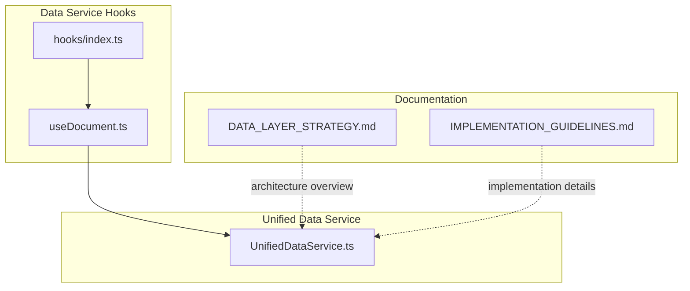
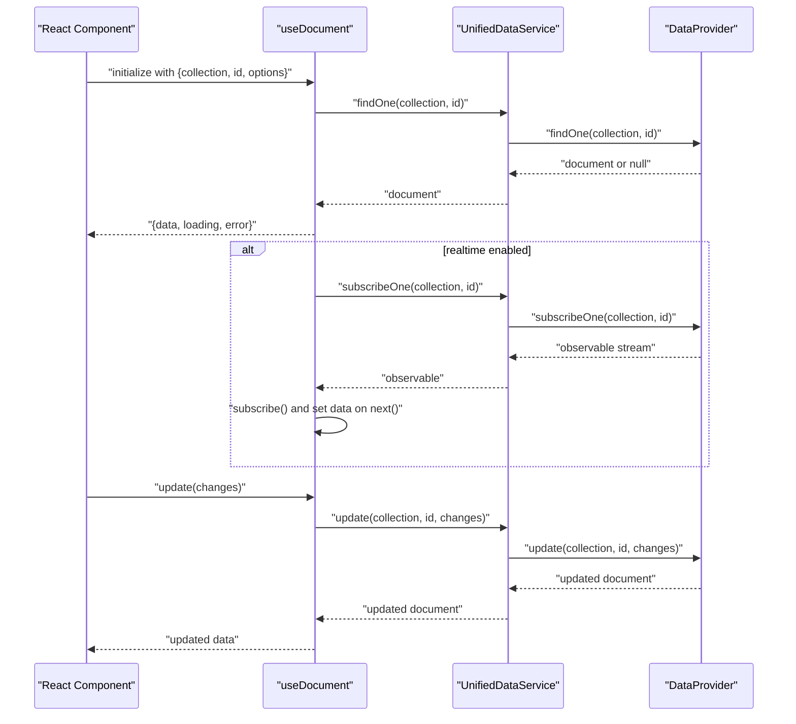
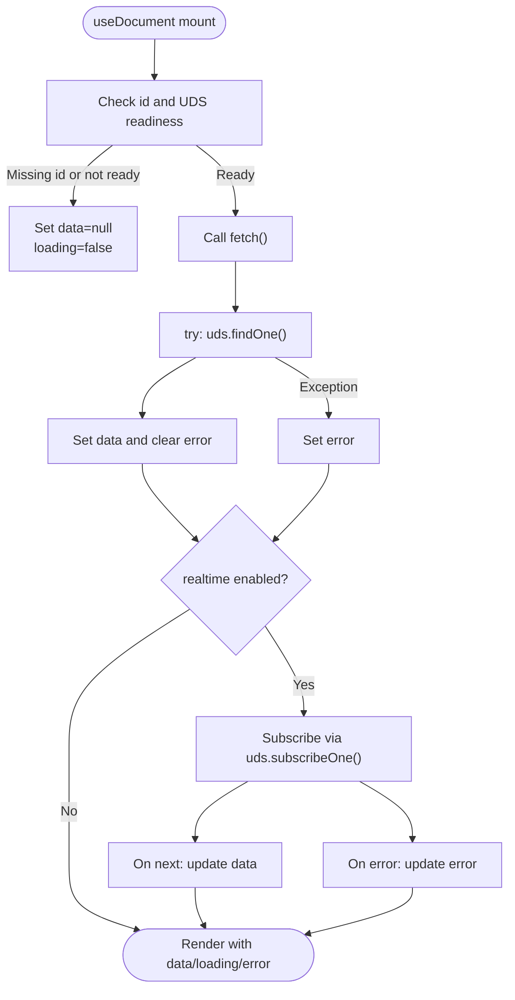
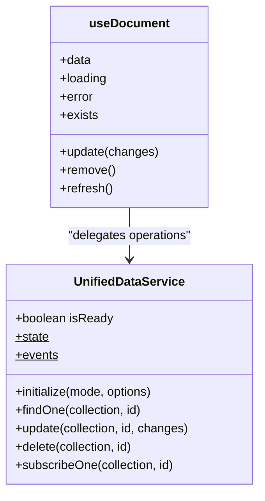
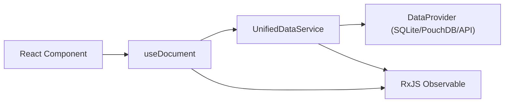

# useDocument Hook

<cite>
**Referenced Files in This Document**
- [useDocument.ts](file://src/services/data/hooks/useDocument.ts)
- [index.ts](file://src/services/data/hooks/index.ts)
- [UnifiedDataService.ts](file://src/services/data/UnifiedDataService.ts)
- [DATA_LAYER_STRATEGY.md](file://docs/architecture/DATA_LAYER_STRATEGY.md)
- [IMPLEMENTATION_GUIDELINES.md](file://docs/implementation/IMPLEMENTATION_GUIDELINES.md)
- [collections.ts](file://src/services/database/collections.ts)
</cite>

## Table of Contents
1. [Introduction](#introduction)
2. [Project Structure](#project-structure)
3. [Core Components](#core-components)
4. [Architecture Overview](#architecture-overview)
5. [Detailed Component Analysis](#detailed-component-analysis)
6. [Dependency Analysis](#dependency-analysis)
7. [Performance Considerations](#performance-considerations)
8. [Troubleshooting Guide](#troubleshooting-guide)
9. [Conclusion](#conclusion)
10. [Appendices](#appendices)

## Introduction
The useDocument hook provides reactive access to a single database document with optional real-time synchronization. It encapsulates fetching, updating, deleting, and subscribing to changes for a specific document identified by collection and ID. The hook integrates with the Unified Data Service (UDS) to deliver a consistent API across local and remote data providers while managing loading states, errors, and subscription lifecycle.

## Project Structure
The useDocument hook resides in the data service hooks module and exports from the hooks index file. It depends on the UnifiedDataService singleton for all data operations and RxJS observables for real-time subscriptions.

**Diagram sources**
- [useDocument.ts:1-130](file://src/services/data/hooks/useDocument.ts#L1-L130)
- [index.ts:1-10](file://src/services/data/hooks/index.ts#L1-L10)
- [UnifiedDataService.ts:1-200](file://src/services/data/UnifiedDataService.ts#L1-L200)
- [DATA_LAYER_STRATEGY.md:42-90](file://docs/architecture/DATA_LAYER_STRATEGY.md#L42-L90)
- [IMPLEMENTATION_GUIDELINES.md:385-441](file://docs/implementation/IMPLEMENTATION_GUIDELINES.md#L385-L441)

**Section sources**
- [useDocument.ts:1-130](file://src/services/data/hooks/useDocument.ts#L1-L130)
- [index.ts:1-10](file://src/services/data/hooks/index.ts#L1-L10)

## Core Components
- Hook definition: useDocument<T>(collection: string, id: string | undefined, options?: UseDocumentOptions<T>): UseDocumentReturn<T>
- Options:
  - realtime: boolean (default false) — enables real-time updates via subscription
  - initialData: T (optional) — sets initial state before fetch completes
- Return value structure:
  - data: T | null — current document state
  - loading: boolean — indicates fetch or refresh in progress
  - error: Error | null — last encountered error
  - update(changes: Partial<T>): Promise<T | null> — persists partial changes
  - remove(): Promise<void> — deletes the document
  - refresh(): Promise<void> — re-fetches the document
  - exists: boolean — whether data is truthy

**Section sources**
- [useDocument.ts:10-39](file://src/services/data/hooks/useDocument.ts#L10-L39)
- [useDocument.ts:41-127](file://src/services/data/hooks/useDocument.ts#L41-L127)

## Architecture Overview
The hook participates in a layered architecture where React components depend on hooks, which delegate to the Unified Data Service (UDS). UDS routes operations to the active provider (local storage, sync engine, or remote API) and exposes real-time subscriptions via observables.

**Diagram sources**
- [useDocument.ts:54-89](file://src/services/data/hooks/useDocument.ts#L54-L89)
- [useDocument.ts:91-116](file://src/services/data/hooks/useDocument.ts#L91-L116)
- [UnifiedDataService.ts:174-191](file://src/services/data/UnifiedDataService.ts#L174-L191)
- [DATA_LAYER_STRATEGY.md:42-90](file://docs/architecture/DATA_LAYER_STRATEGY.md#L42-L90)

## Detailed Component Analysis

### Hook Implementation Details
- State management:
  - data: initialized from options.initialData or null
  - loading: starts true when id is present; becomes false after fetch completes
  - error: cleared before fetch; set on exceptions
- Fetch logic:
  - Skips fetch if id is missing or UDS is not ready
  - Calls uds.findOne(collection, id) and updates state
- Real-time subscription:
  - When realtime is true and UDS is ready, subscribes to uds.subscribeOne(collection, id)
  - Updates data on next and captures errors
  - Unsubscribes on cleanup
- Mutation operations:
  - update: validates id, calls uds.update, updates state, propagates errors
  - remove: validates id, calls uds.delete, clears state, propagates errors
- Utility:
  - refresh: alias to internal fetch

**Diagram sources**
- [useDocument.ts:54-89](file://src/services/data/hooks/useDocument.ts#L54-L89)

**Section sources**
- [useDocument.ts:41-127](file://src/services/data/hooks/useDocument.ts#L41-L127)

### Unified Data Service Integration
- Initialization and readiness:
  - UDS exposes isReady to gate operations
  - Provides findOne, update, delete, and subscribeOne
- Caching and TTL:
  - findOne caches per collection:id key with 60-second TTL
- Real-time subscriptions:
  - subscribeOne returns an observable stream for single-document changes
- Provider abstraction:
  - UDS delegates to the active provider (SQLite, PouchDB, or backend API) based on deployment mode

**Diagram sources**
- [UnifiedDataService.ts:64-66](file://src/services/data/UnifiedDataService.ts#L64-L66)
- [UnifiedDataService.ts:174-191](file://src/services/data/UnifiedDataService.ts#L174-L191)
- [useDocument.ts:8-8](file://src/services/data/hooks/useDocument.ts#L8-L8)

**Section sources**
- [UnifiedDataService.ts:64-66](file://src/services/data/UnifiedDataService.ts#L64-L66)
- [UnifiedDataService.ts:174-191](file://src/services/data/UnifiedDataService.ts#L174-L191)
- [IMPLEMENTATION_GUIDELINES.md:385-441](file://docs/implementation/IMPLEMENTATION_GUIDELINES.md#L385-L441)

### Parameter and Return Value Reference
- Parameters:
  - collection: string — target collection name
  - id: string | undefined — document identifier; undefined disables fetch/update/remove
  - options:
    - realtime: boolean — enable real-time updates
    - initialData: T — initial state before first fetch
- Return:
  - data: T | null — current document snapshot
  - loading: boolean — indicates async operation in progress
  - error: Error | null — last error encountered
  - update(changes): Promise<T | null> — persists partial changes and returns updated document
  - remove(): Promise<void> — deletes document and clears local state
  - refresh(): Promise<void> — re-fetches document
  - exists: boolean — convenience flag indicating presence of data

**Section sources**
- [useDocument.ts:41-39](file://src/services/data/hooks/useDocument.ts#L41-L39)

### Usage Patterns and Examples

#### Student Profile Editing
- Scenario: Edit a student’s personal details in real-time.
- Steps:
  - Initialize with collection "students", document id, and realtime true
  - Render loading/error states
  - On form change, call update({ field: value })
  - Observe live updates from subscription

#### Staff Record Management
- Scenario: View and update staff profile with collaborative edits.
- Steps:
  - Initialize with collection "staff", document id
  - Enable realtime for live collaboration
  - Use remove() to deactivate a record
  - Use refresh() to reconcile stale data

#### Configuration Entity Editing
- Scenario: Manage application settings as a singleton document.
- Steps:
  - Initialize with collection "config", id "app-settings"
  - Use update to persist toggles and flags
  - Monitor changes with realtime for multi-tab sync

#### Form Components
- Pattern: Wrap a form around useDocument to bind inputs to data fields.
- Best practices:
  - Disable submit while loading
  - Show error messages from error state
  - Debounce frequent updates if needed
  - Reset error after successful update

**Section sources**
- [useDocument.ts:41-127](file://src/services/data/hooks/useDocument.ts#L41-L127)

## Dependency Analysis
- Internal dependencies:
  - React hooks: useState, useEffect, useCallback, useRef
  - UnifiedDataService singleton (uds) for all data operations
  - RxJS observables for real-time subscriptions
- External integration points:
  - Provider-specific implementations behind UDS
  - Deployment mode selection affects provider behavior

**Diagram sources**
- [useDocument.ts:7-8](file://src/services/data/hooks/useDocument.ts#L7-L8)
- [UnifiedDataService.ts:1-27](file://src/services/data/UnifiedDataService.ts#L1-L27)
- [DATA_LAYER_STRATEGY.md:42-90](file://docs/architecture/DATA_LAYER_STRATEGY.md#L42-L90)

**Section sources**
- [useDocument.ts:7-8](file://src/services/data/hooks/useDocument.ts#L7-L8)
- [index.ts:7-9](file://src/services/data/hooks/index.ts#L7-L9)

## Performance Considerations
- Concurrency and subscriptions:
  - Each useDocument instance maintains its own subscription; avoid unnecessary realtime subscriptions for static views
  - Prefer disabling realtime for read-only screens to reduce observable overhead
- Memory management:
  - Subscription is automatically cleaned up on unmount; ensure long-lived components properly handle id changes to prevent leaks
- Caching:
  - UDS caches findOne results with TTL; leverage this to minimize repeated fetches
- Cleanup procedures:
  - The hook unsubscribes on cleanup; when dynamically changing id, rely on React keying or conditional rendering to ensure proper teardown
- Batch updates:
  - For high-frequency edits, consider debouncing update calls to reduce network or storage pressure

[No sources needed since this section provides general guidance]

## Troubleshooting Guide
- Common issues:
  - Missing id: update/remove throw if id is undefined; ensure id is resolved before invoking mutations
  - Not ready: fetch does nothing and sets loading=false if id is present but UDS is not ready; check initialization sequence
  - Real-time not updating: verify realtime=true and UDS isReady; confirm provider supports subscribeOne
  - Error propagation: errors are surfaced in error state; log and display user-friendly messages
- Debugging tips:
  - Inspect UDS state$ and events$ for provider-level diagnostics
  - Temporarily disable realtime to isolate subscription-related issues
  - Verify collection names and primary keys align with schema definitions

**Section sources**
- [useDocument.ts:54-73](file://src/services/data/hooks/useDocument.ts#L54-L73)
- [useDocument.ts:91-116](file://src/services/data/hooks/useDocument.ts#L91-L116)

## Conclusion
The useDocument hook offers a concise, reactive interface for managing individual documents with optional real-time synchronization. By delegating to the Unified Data Service, it ensures consistent behavior across providers while exposing a simple API for fetching, updating, deleting, and subscribing to changes. Proper use of options, lifecycle management, and performance considerations enables robust implementations for student profiles, staff records, configuration entities, and form-driven workflows.

[No sources needed since this section summarizes without analyzing specific files]

## Appendices

### Schema References for Common Collections
- Students: primary key "id"; typical fields include identifiers, names, enrollment info, timestamps
- Staff: primary key "id"; typical fields include staff_no, names, department, designation, contact info, timestamps
- Departments: primary key "id"; typical fields include name, academic flag, timestamps
- Designations: primary key "id"; typical fields include title, description, timestamps
- Student categories: primary key "id"; typical fields include category metadata, timestamps

These schemas inform collection naming and field expectations when using useDocument.

**Section sources**
- [collections.ts:317-353](file://src/services/database/collections.ts#L317-L353)