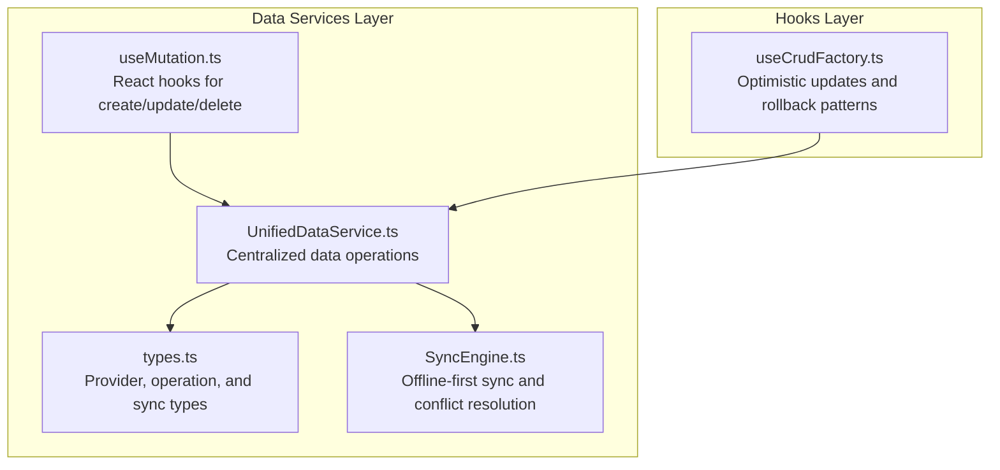
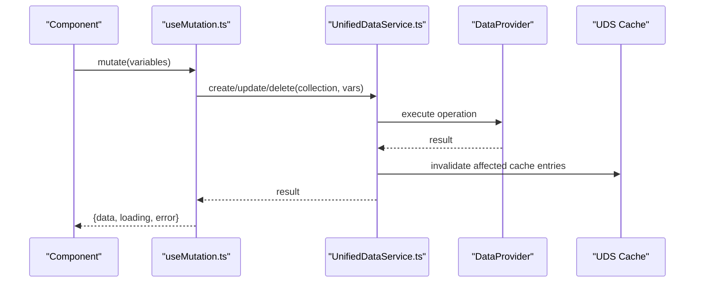
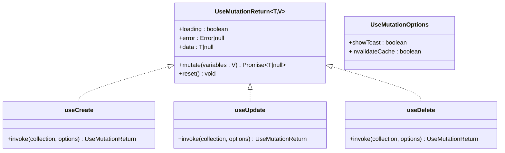
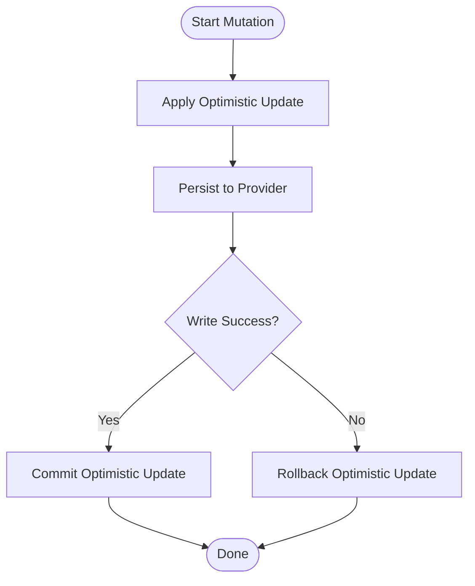
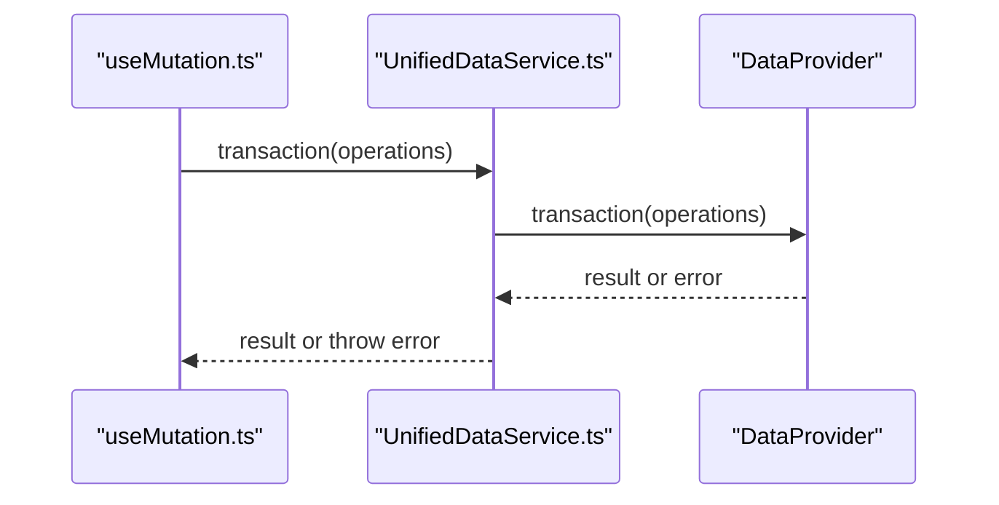
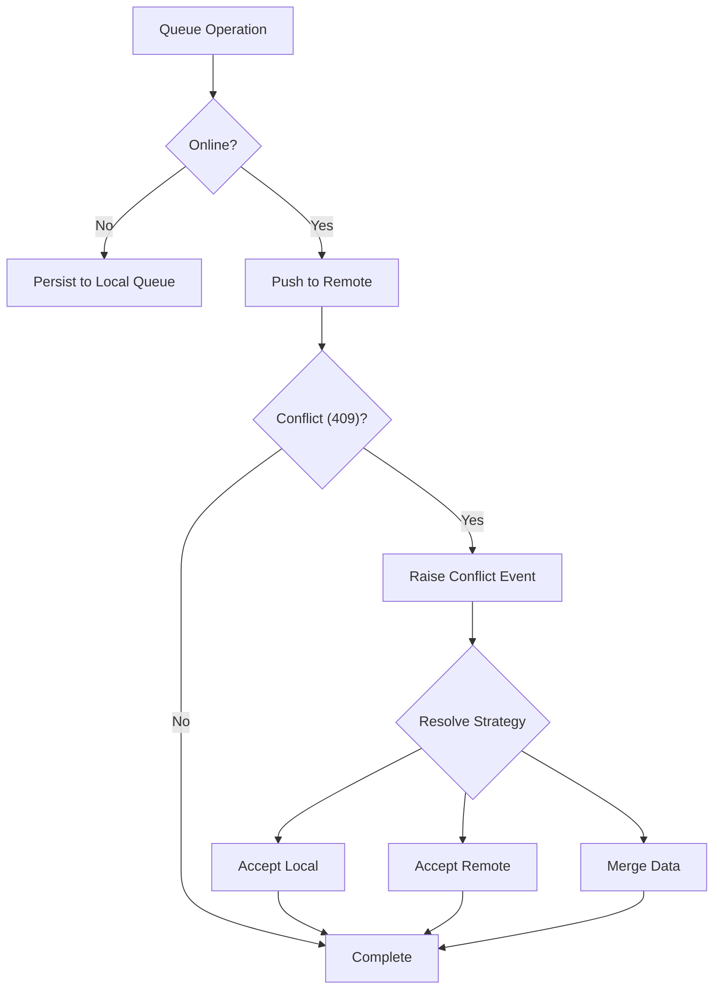
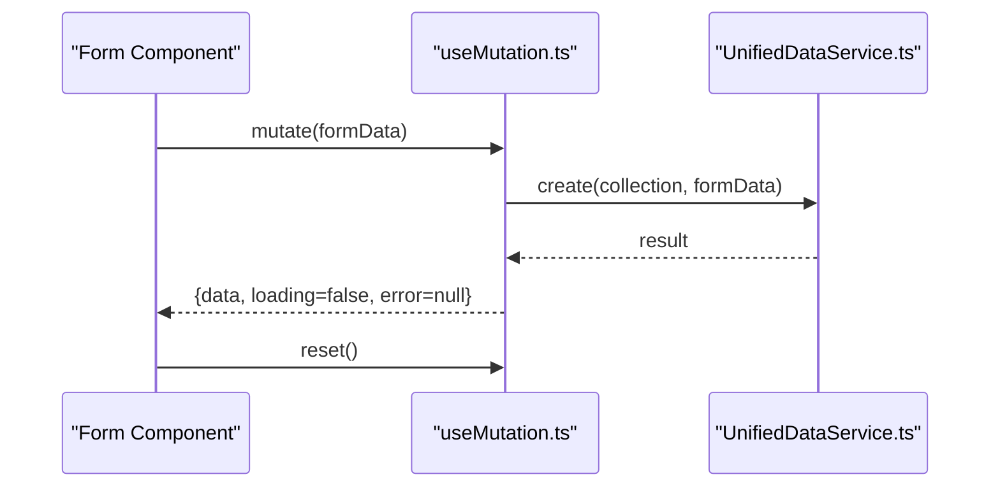
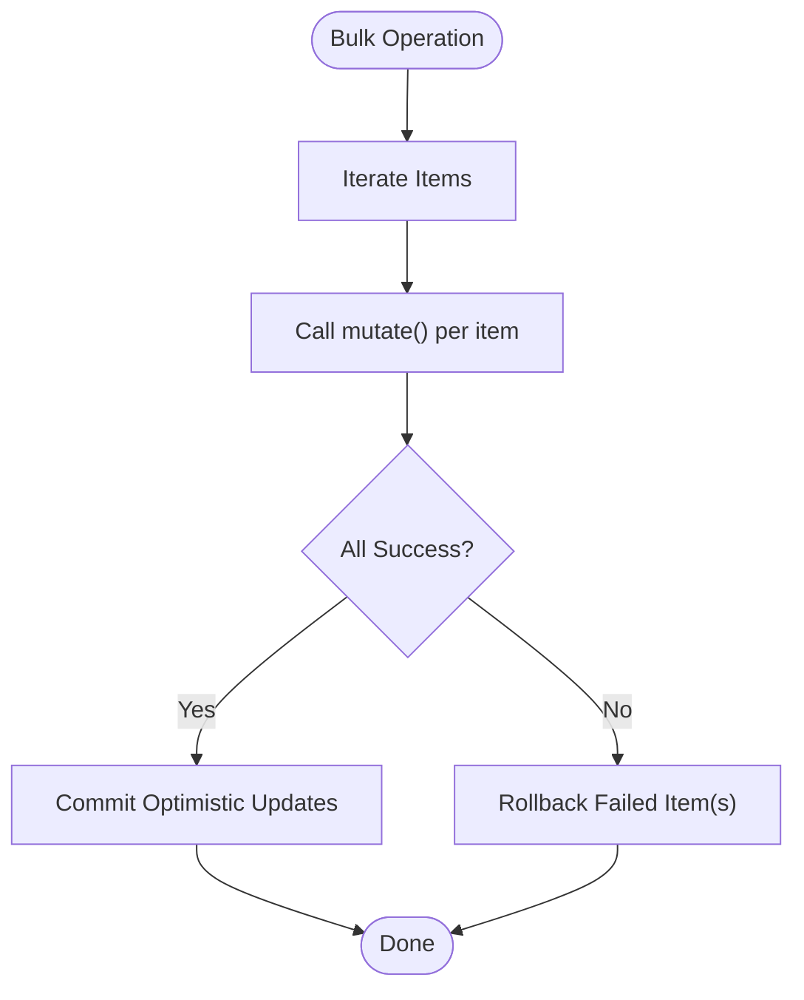
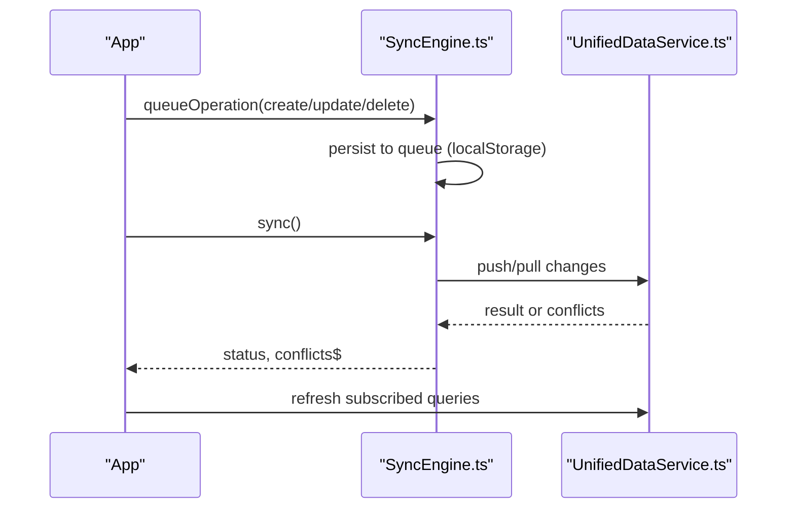
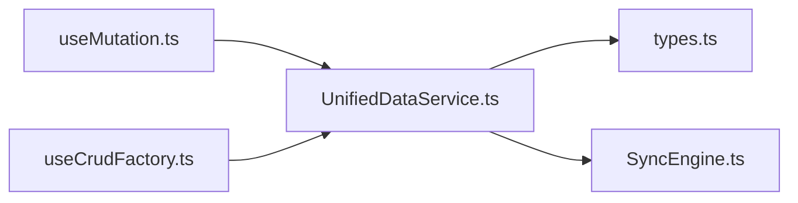

# useMutation Hook

<cite>
**Referenced Files in This Document**
- [useMutation.ts](file://src/services/data/hooks/useMutation.ts)
- [UnifiedDataService.ts](file://src/services/data/UnifiedDataService.ts)
- [types.ts](file://src/services/data/types.ts)
- [SyncEngine.ts](file://src/services/data/SyncEngine.ts)
- [useCrudFactory.ts](file://src/hooks/useCrudFactory.ts)
- [DATA_LAYER_STRATEGY.md](file://docs/architecture/DATA_LAYER_STRATEGY.md)
</cite>

## Table of Contents
1. [Introduction](#introduction)
2. [Project Structure](#project-structure)
3. [Core Components](#core-components)
4. [Architecture Overview](#architecture-overview)
5. [Detailed Component Analysis](#detailed-component-analysis)
6. [Dependency Analysis](#dependency-analysis)
7. [Performance Considerations](#performance-considerations)
8. [Troubleshooting Guide](#troubleshooting-guide)
9. [Conclusion](#conclusion)
10. [Appendices](#appendices)

## Introduction
This document explains the useMutation hook, the primary write-operation handler for SchoolPilot3’s data layer. It covers how the hook manages CRUD operations, integrates with the Unified Data Service (UDS), and coordinates optimistic updates, error handling, and rollback mechanisms. It also documents the hook signature, return value structure, transaction support, and practical usage patterns for form submissions, bulk operations, and offline-first data synchronization.

## Project Structure
The useMutation hook resides in the data services layer and delegates to the Unified Data Service for cross-provider write operations. It is complemented by the CRUD factory hook that demonstrates optimistic updates and rollback patterns, and by the Sync Engine that handles offline-first synchronization and conflict resolution.

**Diagram sources**
- [useMutation.ts:1-160](file://src/services/data/hooks/useMutation.ts#L1-L160)
- [UnifiedDataService.ts:1-721](file://src/services/data/UnifiedDataService.ts#L1-L721)
- [types.ts:1-226](file://src/services/data/types.ts#L1-L226)
- [SyncEngine.ts:1-559](file://src/services/data/SyncEngine.ts#L1-L559)
- [useCrudFactory.ts:1-455](file://src/hooks/useCrudFactory.ts#L1-L455)

**Section sources**
- [useMutation.ts:1-160](file://src/services/data/hooks/useMutation.ts#L1-L160)
- [UnifiedDataService.ts:1-721](file://src/services/data/UnifiedDataService.ts#L1-L721)
- [types.ts:1-226](file://src/services/data/types.ts#L1-L226)
- [SyncEngine.ts:1-559](file://src/services/data/SyncEngine.ts#L1-L559)
- [useCrudFactory.ts:1-455](file://src/hooks/useCrudFactory.ts#L1-L455)

## Core Components
- useMutation: Provides typed mutation functions for create, update, and delete against a named collection. It exposes loading, error, and data state, plus a reset function.
- UnifiedDataService: Orchestrates provider selection and routing, performs writes, invalidates caches, emits events, and supports transactions and sync.
- Optimistic Updates Pattern: Demonstrated in useCrudFactory, which applies immediate UI updates and rolls them back on failure.
- SyncEngine: Manages offline-first operations, queues, retries, and conflict resolution.

**Section sources**
- [useMutation.ts:13-36](file://src/services/data/hooks/useMutation.ts#L13-L36)
- [UnifiedDataService.ts:211-283](file://src/services/data/UnifiedDataService.ts#L211-L283)
- [useCrudFactory.ts:79-134](file://src/hooks/useCrudFactory.ts#L79-L134)
- [SyncEngine.ts:97-206](file://src/services/data/SyncEngine.ts#L97-L206)

## Architecture Overview
The useMutation hook encapsulates write operations and delegates to UDS. UDS selects the appropriate provider, executes the operation, invalidates caches, and emits events. For offline-first scenarios, SyncEngine queues operations and resolves conflicts.

**Diagram sources**
- [useMutation.ts:47-62](file://src/services/data/hooks/useMutation.ts#L47-L62)
- [UnifiedDataService.ts:214-283](file://src/services/data/UnifiedDataService.ts#L214-L283)

**Section sources**
- [useMutation.ts:143-157](file://src/services/data/hooks/useMutation.ts#L143-L157)
- [UnifiedDataService.ts:211-283](file://src/services/data/UnifiedDataService.ts#L211-L283)

## Detailed Component Analysis

### useMutation Hook Signature and Return Value
- Purpose: Provide a simple, typed interface for create, update, and delete operations against a collection.
- Options:
  - showToast: Whether to show notifications on success/error.
  - invalidateCache: Whether to invalidate caches after mutation.
- Return value structure:
  - mutate: Async function that performs the operation and returns the persisted entity or void for delete.
  - loading: Boolean indicating ongoing operation.
  - error: Error object if the operation fails.
  - reset: Clears loading, error, and data state.
  - data: Latest successful result.

**Diagram sources**
- [useMutation.ts:13-36](file://src/services/data/hooks/useMutation.ts#L13-L36)
- [useMutation.ts:39-140](file://src/services/data/hooks/useMutation.ts#L39-L140)

**Section sources**
- [useMutation.ts:13-36](file://src/services/data/hooks/useMutation.ts#L13-L36)
- [useMutation.ts:39-140](file://src/services/data/hooks/useMutation.ts#L39-L140)

### Optimistic Update Patterns and Rollback
While useMutation itself does not apply optimistic updates, the pattern is demonstrated in useCrudFactory:
- Apply optimistic update: Immediately update local state to reflect the change.
- Persist to provider: Perform the write via the underlying provider.
- Commit or rollback:
  - Commit: Remove the optimistic marker when the write succeeds.
  - Rollback: Restore previous state if the write fails.

**Diagram sources**
- [useCrudFactory.ts:79-134](file://src/hooks/useCrudFactory.ts#L79-L134)
- [useCrudFactory.ts:137-198](file://src/hooks/useCrudFactory.ts#L137-L198)
- [useCrudFactory.ts:200-266](file://src/hooks/useCrudFactory.ts#L200-L266)
- [useCrudFactory.ts:268-326](file://src/hooks/useCrudFactory.ts#L268-L326)

**Section sources**
- [useCrudFactory.ts:79-134](file://src/hooks/useCrudFactory.ts#L79-L134)
- [useCrudFactory.ts:137-198](file://src/hooks/useCrudFactory.ts#L137-L198)
- [useCrudFactory.ts:200-266](file://src/hooks/useCrudFactory.ts#L200-L266)
- [useCrudFactory.ts:268-326](file://src/hooks/useCrudFactory.ts#L268-L326)

### Transaction Support
- UDS supports transactions via the transaction method, passing an array of operations.
- Providers must declare transaction capability; otherwise, attempting a transaction throws an error.
- Use this for multi-entity writes that must succeed or fail together.

**Diagram sources**
- [UnifiedDataService.ts:374-382](file://src/services/data/UnifiedDataService.ts#L374-L382)
- [types.ts:102-107](file://src/services/data/types.ts#L102-L107)

**Section sources**
- [UnifiedDataService.ts:374-382](file://src/services/data/UnifiedDataService.ts#L374-L382)
- [types.ts:102-107](file://src/services/data/types.ts#L102-L107)

### Offline-First Operation Handling and Conflict Resolution
- SyncEngine queues local operations when offline and retries with exponential backoff.
- Detects conflicts during push (HTTP 409) and raises a conflict event.
- Provides strategies: local-wins, remote-wins, timestamp-wins, manual.
- Supports clearing synced changes and resolving conflicts programmatically.

**Diagram sources**
- [SyncEngine.ts:209-273](file://src/services/data/SyncEngine.ts#L209-L273)
- [SyncEngine.ts:404-458](file://src/services/data/SyncEngine.ts#L404-L458)
- [SyncEngine.ts:473-508](file://src/services/data/SyncEngine.ts#L473-L508)

**Section sources**
- [SyncEngine.ts:209-273](file://src/services/data/SyncEngine.ts#L209-L273)
- [SyncEngine.ts:404-458](file://src/services/data/SyncEngine.ts#L404-L458)
- [SyncEngine.ts:473-508](file://src/services/data/SyncEngine.ts#L473-L508)

### Practical Examples

#### Form Submission
- Use the generic useMutation with operation 'create' or 'update'.
- On success, reset the form and optionally navigate.
- On error, surface the error and keep the form editable.

**Diagram sources**
- [useMutation.ts:143-157](file://src/services/data/hooks/useMutation.ts#L143-L157)
- [useMutation.ts:47-62](file://src/services/data/hooks/useMutation.ts#L47-L62)

**Section sources**
- [useMutation.ts:143-157](file://src/services/data/hooks/useMutation.ts#L143-L157)
- [useMutation.ts:47-62](file://src/services/data/hooks/useMutation.ts#L47-L62)

#### Bulk Operations
- For multiple creates/updates/deletes, orchestrate sequential or batched calls.
- Use optimistic updates and rollback patterns from useCrudFactory to maintain responsiveness and correctness.

**Diagram sources**
- [useCrudFactory.ts:347-373](file://src/hooks/useCrudFactory.ts#L347-L373)
- [useCrudFactory.ts:375-401](file://src/hooks/useCrudFactory.ts#L375-L401)
- [useCrudFactory.ts:403-427](file://src/hooks/useCrudFactory.ts#L403-L427)

**Section sources**
- [useCrudFactory.ts:347-373](file://src/hooks/useCrudFactory.ts#L347-L373)
- [useCrudFactory.ts:375-401](file://src/hooks/useCrudFactory.ts#L375-L401)
- [useCrudFactory.ts:403-427](file://src/hooks/useCrudFactory.ts#L403-L427)

#### Data Synchronization Scenarios
- Use SyncEngine to queue operations while offline and reconcile conflicts upon reconnection.
- Integrate with UDS events to refresh UI after sync completion.

**Diagram sources**
- [SyncEngine.ts:209-235](file://src/services/data/SyncEngine.ts#L209-L235)
- [SyncEngine.ts:282-303](file://src/services/data/SyncEngine.ts#L282-L303)
- [UnifiedDataService.ts:285-321](file://src/services/data/UnifiedDataService.ts#L285-L321)

**Section sources**
- [SyncEngine.ts:209-235](file://src/services/data/SyncEngine.ts#L209-L235)
- [SyncEngine.ts:282-303](file://src/services/data/SyncEngine.ts#L282-L303)
- [UnifiedDataService.ts:285-321](file://src/services/data/UnifiedDataService.ts#L285-L321)

## Dependency Analysis
- useMutation depends on UnifiedDataService for provider-agnostic write operations.
- UDS depends on provider capabilities declared in types.ts and routes operations accordingly.
- SyncEngine complements UDS for offline-first behavior and conflict handling.

**Diagram sources**
- [useMutation.ts:8-9](file://src/services/data/hooks/useMutation.ts#L8-L9)
- [UnifiedDataService.ts:1-24](file://src/services/data/UnifiedDataService.ts#L1-L24)
- [types.ts:1-226](file://src/services/data/types.ts#L1-L226)
- [SyncEngine.ts:1-22](file://src/services/data/SyncEngine.ts#L1-L22)
- [useCrudFactory.ts:1-17](file://src/hooks/useCrudFactory.ts#L1-L17)

**Section sources**
- [useMutation.ts:8-9](file://src/services/data/hooks/useMutation.ts#L8-L9)
- [UnifiedDataService.ts:1-24](file://src/services/data/UnifiedDataService.ts#L1-L24)
- [types.ts:1-226](file://src/services/data/types.ts#L1-L226)
- [SyncEngine.ts:1-22](file://src/services/data/SyncEngine.ts#L1-L22)
- [useCrudFactory.ts:1-17](file://src/hooks/useCrudFactory.ts#L1-L17)

## Performance Considerations
- Prefer optimistic updates for interactive responsiveness; ensure rollback is fast and deterministic.
- Use transaction batching for multi-entity writes to reduce provider round trips.
- Leverage UDS caching and cache invalidation to minimize redundant reads.
- For bulk operations, consider sequential execution to avoid race conditions and simplify conflict handling.

[No sources needed since this section provides general guidance]

## Troubleshooting Guide
- Unknown operation error: Ensure operation is one of 'create', 'update', or 'delete'.
- Provider not initialized: Call UDS.initialize before invoking mutations.
- Transaction unsupported: Verify provider capabilities and throw a user-friendly error.
- Conflicts during sync: Use SyncEngine conflict resolution strategies or manual resolution.

**Section sources**
- [useMutation.ts:154-156](file://src/services/data/hooks/useMutation.ts#L154-L156)
- [UnifiedDataService.ts:601-605](file://src/services/data/UnifiedDataService.ts#L601-L605)
- [UnifiedDataService.ts:377-379](file://src/services/data/UnifiedDataService.ts#L377-L379)
- [SyncEngine.ts:473-508](file://src/services/data/SyncEngine.ts#L473-L508)

## Conclusion
The useMutation hook provides a concise, provider-agnostic interface for write operations in SchoolPilot3. Combined with UDS’s caching, events, and transaction support—and reinforced by optimistic updates and robust offline-first synchronization via SyncEngine—it delivers a resilient, responsive data layer suitable for diverse operational scenarios.

[No sources needed since this section summarizes without analyzing specific files]

## Appendices

### Hook API Reference
- useCreate(collection, options): Returns UseMutationReturn for create.
- useUpdate(collection, options): Returns UseMutationReturn for update.
- useDelete(collection, options): Returns UseMutationReturn for delete.
- useMutation(collection, operation): Generic dispatcher for create/update/delete.

**Section sources**
- [useMutation.ts:39-157](file://src/services/data/hooks/useMutation.ts#L39-L157)

### Related Architecture Notes
- The conceptual React Hooks API in the data layer strategy includes a similar useMutation definition for reference.

**Section sources**
- [DATA_LAYER_STRATEGY.md:756-792](file://docs/architecture/DATA_LAYER_STRATEGY.md#L756-L792)