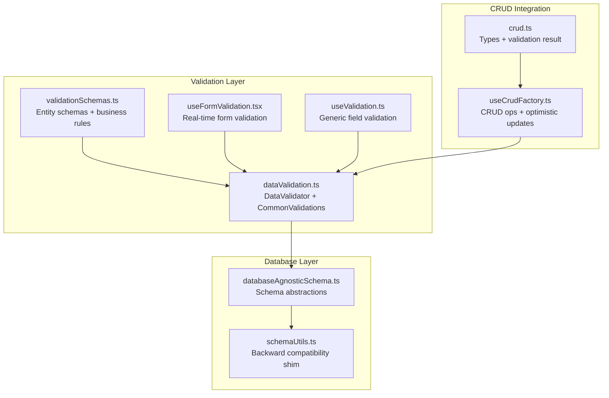
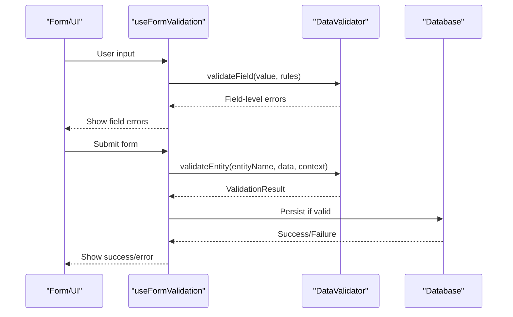
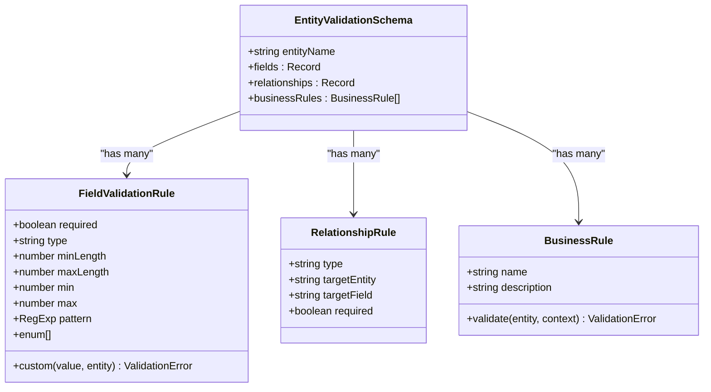
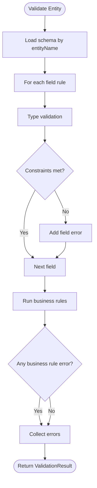
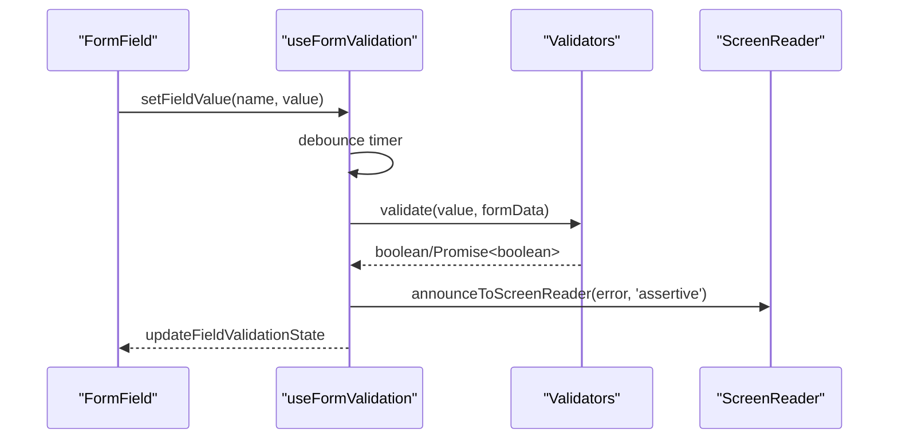
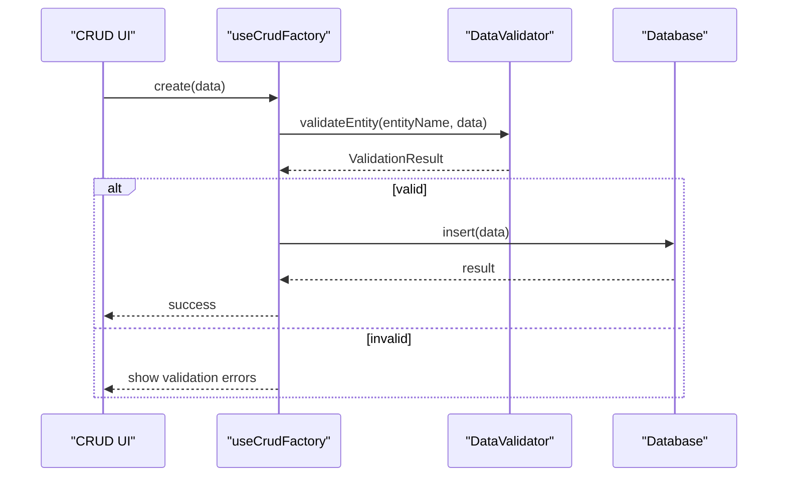
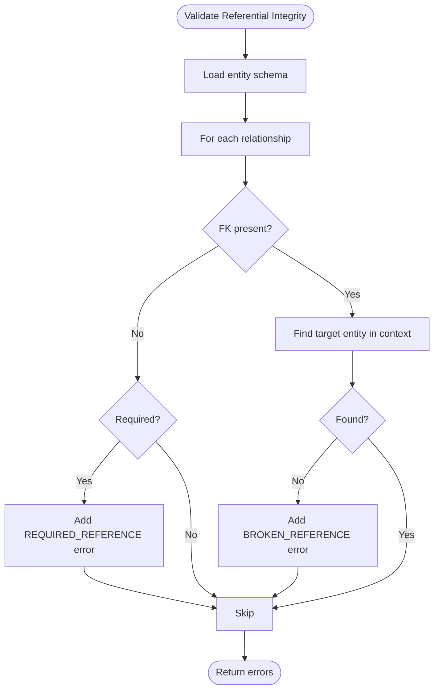
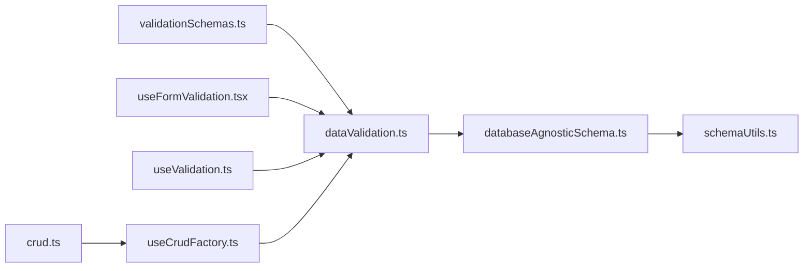

# Data Validation & Schemas

<cite>
**Referenced Files in This Document**
- [validationSchemas.ts](file://src/utils/validationSchemas.ts)
- [dataValidation.ts](file://src/utils/dataValidation.ts)
- [dataValidationUtils.tsx](file://src/utils/dataValidationUtils.tsx)
- [schemaUtils.ts](file://src/utils/schemaUtils.ts)
- [databaseAgnosticSchema.ts](file://src/utils/databaseAgnosticSchema.ts)
- [useFormValidation.tsx](file://src/hooks/useFormValidation.tsx)
- [useValidation.ts](file://src/hooks/useValidation.ts)
- [crud.ts](file://src/core/types/crud.ts)
- [useCrudFactory.ts](file://src/hooks/useCrudFactory.ts)
- [Form.tsx](file://src/components/ui/forms/Form.tsx)
- [FormField.tsx](file://src/components/ui/forms/FormField.tsx)
- [FormValidationDemo.tsx](file://src/components/__demos__/FormValidationDemo.tsx)
- [dataValidationConsistency.test.ts](file://src/tests/dataValidationConsistency.test.ts)
</cite>

## Table of Contents
1. [Introduction](#introduction)
2. [Project Structure](#project-structure)
3. [Core Components](#core-components)
4. [Architecture Overview](#architecture-overview)
5. [Detailed Component Analysis](#detailed-component-analysis)
6. [Dependency Analysis](#dependency-analysis)
7. [Performance Considerations](#performance-considerations)
8. [Troubleshooting Guide](#troubleshooting-guide)
9. [Conclusion](#conclusion)

## Introduction
This document describes the data validation and schema system in SchoolPilot3, covering validation schema definitions, field-level and cross-field validation, custom validators, and the validation pipeline. It explains how schemas relate to database schemas, type safety enforcement, and runtime performance. It also documents integration with CRUD operations, form validation frameworks, and real-time validation patterns, with practical examples for form validation, data import validation, and real-time field validation.

## Project Structure
The validation system spans several layers:
- Schema definitions and business rules in validation schemas
- A centralized validation engine with field-level and business rule validation
- Real-time form validation hooks with built-in validators
- CRUD integration for validation during create/update operations
- Database-agnostic schema utilities for schema evolution and backward compatibility



**Diagram sources**
- [validationSchemas.ts:1-522](file://src/utils/validationSchemas.ts#L1-L522)
- [dataValidation.ts:1-465](file://src/utils/dataValidation.ts#L1-L465)
- [useFormValidation.tsx:1-529](file://src/hooks/useFormValidation.tsx#L1-L529)
- [useValidation.ts:1-158](file://src/hooks/useValidation.ts#L1-L158)
- [crud.ts:1-222](file://src/core/types/crud.ts#L1-L222)
- [useCrudFactory.ts:1-455](file://src/hooks/useCrudFactory.ts#L1-L455)
- [databaseAgnosticSchema.ts:1-845](file://src/utils/databaseAgnosticSchema.ts#L1-L845)
- [schemaUtils.ts:1-37](file://src/utils/schemaUtils.ts#L1-L37)

**Section sources**
- [validationSchemas.ts:1-522](file://src/utils/validationSchemas.ts#L1-L522)
- [dataValidation.ts:1-465](file://src/utils/dataValidation.ts#L1-L465)
- [useFormValidation.tsx:1-529](file://src/hooks/useFormValidation.tsx#L1-L529)
- [useValidation.ts:1-158](file://src/hooks/useValidation.ts#L1-L158)
- [crud.ts:1-222](file://src/core/types/crud.ts#L1-L222)
- [useCrudFactory.ts:1-455](file://src/hooks/useCrudFactory.ts#L1-L455)
- [databaseAgnosticSchema.ts:1-845](file://src/utils/databaseAgnosticSchema.ts#L1-L845)
- [schemaUtils.ts:1-37](file://src/utils/schemaUtils.ts#L1-L37)

## Core Components
- Entity validation schemas define field rules, relationships, and business rules for core entities (students, staff, financial years, invoices, periods, sessions).
- The DataValidator orchestrates field-level validation, type checking, enum validation, custom validators, and business rule evaluation.
- CommonValidations provides reusable validation utilities for emails, phones, positive numbers, and date constraints.
- Real-time form validation hook supports declarative rules, debouncing, priority-based error ordering, and accessibility.
- CRUD integration validates data before persistence and supports optimistic updates with rollback on failure.
- Database-agnostic schema utilities abstract RxDB/PouchDB differences and provide schema evolution helpers.

**Section sources**
- [validationSchemas.ts:24-120](file://src/utils/validationSchemas.ts#L24-L120)
- [dataValidation.ts:68-396](file://src/utils/dataValidation.ts#L68-L396)
- [dataValidation.ts:402-465](file://src/utils/dataValidation.ts#L402-L465)
- [useFormValidation.tsx:58-128](file://src/hooks/useFormValidation.tsx#L58-L128)
- [crud.ts:114-133](file://src/core/types/crud.ts#L114-L133)
- [useCrudFactory.ts:137-326](file://src/hooks/useCrudFactory.ts#L137-L326)
- [databaseAgnosticSchema.ts:48-815](file://src/utils/databaseAgnosticSchema.ts#L48-L815)

## Architecture Overview
The validation pipeline integrates at three layers:
- Field-level validation: type checks, min/max lengths, enums, patterns, and custom validators.
- Business rule validation: entity-specific rules evaluated with optional context (e.g., uniqueness across all entities).
- Cross-entity consistency: referential integrity and multi-entity consistency checks.



**Diagram sources**
- [useFormValidation.tsx:174-264](file://src/hooks/useFormValidation.tsx#L174-L264)
- [dataValidation.ts:83-122](file://src/utils/dataValidation.ts#L83-L122)
- [useCrudFactory.ts:137-198](file://src/hooks/useCrudFactory.ts#L137-L198)

## Detailed Component Analysis

### Validation Schema Definitions
- Entity schemas specify field rules (required, type, min/max length, enum, pattern, custom).
- Relationships define referential integrity with target entity and field.
- Business rules encapsulate domain-specific constraints validated with optional context.



**Diagram sources**
- [validationSchemas.ts:24-120](file://src/utils/validationSchemas.ts#L24-L120)
- [dataValidation.ts:38-57](file://src/utils/dataValidation.ts#L38-L57)

**Section sources**
- [validationSchemas.ts:24-120](file://src/utils/validationSchemas.ts#L24-L120)
- [validationSchemas.ts:123-178](file://src/utils/validationSchemas.ts#L123-L178)
- [validationSchemas.ts:181-237](file://src/utils/validationSchemas.ts#L181-L237)
- [validationSchemas.ts:240-331](file://src/utils/validationSchemas.ts#L240-L331)
- [validationSchemas.ts:334-366](file://src/utils/validationSchemas.ts#L334-L366)
- [validationSchemas.ts:369-385](file://src/utils/validationSchemas.ts#L369-L385)

### Data Validator Engine
- Registers entity schemas and consistency checks globally.
- Validates fields with type coercion and constraint checks.
- Executes business rules and custom validators.
- Performs referential integrity checks across entities.
- Runs consistency checks across datasets.



**Diagram sources**
- [dataValidation.ts:83-122](file://src/utils/dataValidation.ts#L83-L122)
- [dataValidation.ts:125-223](file://src/utils/dataValidation.ts#L125-L223)
- [dataValidation.ts:108-115](file://src/utils/dataValidation.ts#L108-L115)

**Section sources**
- [dataValidation.ts:68-396](file://src/utils/dataValidation.ts#L68-L396)
- [dataValidation.ts:402-465](file://src/utils/dataValidation.ts#L402-L465)

### Real-Time Form Validation Hook
- Declarative validation rules per field with priorities.
- Debounced asynchronous validation with promise-based rules.
- Accessibility: screen reader announcements and focus management.
- Field state tracking: isValid, isValidating, errors, touched, dirty.



**Diagram sources**
- [useFormValidation.tsx:302-338](file://src/hooks/useFormValidation.tsx#L302-L338)
- [useFormValidation.tsx:174-264](file://src/hooks/useFormValidation.tsx#L174-L264)
- [useFormValidation.tsx:288-292](file://src/hooks/useFormValidation.tsx#L288-L292)

**Section sources**
- [useFormValidation.tsx:58-128](file://src/hooks/useFormValidation.tsx#L58-L128)
- [useFormValidation.tsx:174-264](file://src/hooks/useFormValidation.tsx#L174-L264)
- [useFormValidation.tsx:362-383](file://src/hooks/useFormValidation.tsx#L362-L383)
- [useFormValidation.tsx:449-468](file://src/hooks/useFormValidation.tsx#L449-L468)

### CRUD Integration and Validation Pipeline
- useCrudFactory applies optimistic updates and rolls back on validation or persistence failures.
- Validation results propagate through CRUD operations to inform UI and error handling.
- Batch operations validate sequentially to maintain consistency.



**Diagram sources**
- [useCrudFactory.ts:137-198](file://src/hooks/useCrudFactory.ts#L137-L198)
- [crud.ts:114-133](file://src/core/types/crud.ts#L114-L133)

**Section sources**
- [useCrudFactory.ts:137-198](file://src/hooks/useCrudFactory.ts#L137-L198)
- [useCrudFactory.ts:200-266](file://src/hooks/useCrudFactory.ts#L200-L266)
- [useCrudFactory.ts:269-326](file://src/hooks/useCrudFactory.ts#L269-L326)
- [crud.ts:114-133](file://src/core/types/crud.ts#L114-L133)

### Database Schema Evolution and Backward Compatibility
- DatabaseSchemaConverter maps database-agnostic types to RxDB/PouchDB formats.
- SchemaHelpers provide fluent APIs for building properties with constraints.
- Legacy createEntitySchema remains for backward compatibility with deprecation warnings.

```mermaid
classDiagram
class DatabaseSchema {
+string title
+string description
+number version
+primaryKey
+properties : Record
+required : string[]
+indexes : Array
}
class DatabaseSchemaConverter {
+convertToRxDBSchema(schema) any
+convertToPouchDBSchema(schema) any
+validateSchema(schema) { valid, errors }
}
class SchemaHelpers {
+string(...)
+number(...)
+integer(...)
+boolean(...)
+array(...)
+object(...)
+timestamp(...)
+uuid(...)
+ref(...)
+date(...)
+id(...)
}
DatabaseSchemaConverter --> DatabaseSchema : "transforms"
SchemaHelpers --> DatabaseSchema : "builds"
```

**Diagram sources**
- [databaseAgnosticSchema.ts:48-354](file://src/utils/databaseAgnosticSchema.ts#L48-L354)
- [databaseAgnosticSchema.ts:792-815](file://src/utils/databaseAgnosticSchema.ts#L792-L815)

**Section sources**
- [databaseAgnosticSchema.ts:73-354](file://src/utils/databaseAgnosticSchema.ts#L73-L354)
- [schemaUtils.ts:17-36](file://src/utils/schemaUtils.ts#L17-L36)

### Cross-Entity Consistency Checks
- Referential integrity ensures foreign keys match existing records.
- Multi-entity consistency checks validate relationships across datasets (e.g., orphaned invoices, duplicate IDs).



**Diagram sources**
- [dataValidation.ts:276-329](file://src/utils/dataValidation.ts#L276-L329)

**Section sources**
- [validationSchemas.ts:388-495](file://src/utils/validationSchemas.ts#L388-L495)
- [dataValidation.ts:276-350](file://src/utils/dataValidation.ts#L276-L350)

### Validation Utilities and Defensive Programming
- Safe data accessors prevent runtime errors in table rendering and data processing.
- Error boundaries and fallback UIs improve resilience.

**Section sources**
- [dataValidationUtils.tsx:9-200](file://src/utils/dataValidationUtils.tsx#L9-L200)

## Dependency Analysis
The validation system exhibits low coupling and high cohesion:
- validationSchemas.ts depends on dataValidation.ts and core enums/types.
- useFormValidation.tsx depends on built-in validators and accessibility utilities.
- useCrudFactory.tsx integrates with DataValidator via validation results and optimistic updates.
- databaseAgnosticSchema.ts provides abstraction for schema evolution without changing validation logic.



**Diagram sources**
- [validationSchemas.ts:1-22](file://src/utils/validationSchemas.ts#L1-L22)
- [dataValidation.ts:1-10](file://src/utils/dataValidation.ts#L1-L10)
- [useFormValidation.tsx:1-6](file://src/hooks/useFormValidation.tsx#L1-L6)
- [useValidation.ts:1-6](file://src/hooks/useValidation.ts#L1-L6)
- [useCrudFactory.ts:1-17](file://src/hooks/useCrudFactory.ts#L1-L17)
- [crud.ts:1-17](file://src/core/types/crud.ts#L1-L17)
- [databaseAgnosticSchema.ts:1-16](file://src/utils/databaseAgnosticSchema.ts#L1-L16)
- [schemaUtils.ts:1-11](file://src/utils/schemaUtils.ts#L1-L11)

**Section sources**
- [validationSchemas.ts:1-22](file://src/utils/validationSchemas.ts#L1-L22)
- [dataValidation.ts:1-10](file://src/utils/dataValidation.ts#L1-L10)
- [useFormValidation.tsx:1-6](file://src/hooks/useFormValidation.tsx#L1-L6)
- [useValidation.ts:1-6](file://src/hooks/useValidation.ts#L1-L6)
- [useCrudFactory.ts:1-17](file://src/hooks/useCrudFactory.ts#L1-L17)
- [crud.ts:1-17](file://src/core/types/crud.ts#L1-L17)
- [databaseAgnosticSchema.ts:1-16](file://src/utils/databaseAgnosticSchema.ts#L1-L16)
- [schemaUtils.ts:1-11](file://src/utils/schemaUtils.ts#L1-L11)

## Performance Considerations
- Debounced field validation reduces unnecessary computations during typing.
- Priority-based error sorting ensures critical errors surface first.
- Referential integrity and consistency checks iterate across datasets; keep context minimal and cached where appropriate.
- Database-agnostic schema conversions add negligible overhead compared to validation cost.
- Use batch operations carefully; validation runs per item to maintain data quality.

[No sources needed since this section provides general guidance]

## Troubleshooting Guide
Common validation issues and resolutions:
- Schema not found: Ensure entity schemas are registered via the global validator before use.
- Type mismatches: Verify field types align with schema expectations; custom validators should return proper error objects.
- Referential integrity errors: Confirm target entities exist in the data context passed to validation.
- Business rule failures: Provide required context (e.g., all students/staff/invoices) to evaluate uniqueness and range constraints.
- Form validation not triggering: Check debounce settings and validation modes (onChange/onBlur/onSubmit).
- CRUD optimistic update rollback: Inspect validation results and error messages to understand rollback triggers.

**Section sources**
- [dataValidation.ts:83-96](file://src/utils/dataValidation.ts#L83-L96)
- [dataValidation.ts:276-329](file://src/utils/dataValidation.ts#L276-L329)
- [useFormValidation.tsx:174-264](file://src/hooks/useFormValidation.tsx#L174-L264)
- [useCrudFactory.ts:184-198](file://src/hooks/useCrudFactory.ts#L184-L198)

## Conclusion
SchoolPilot3’s validation system combines declarative entity schemas, robust field-level validation, and real-time form validation with accessibility. It integrates tightly with CRUD operations and database-agnostic schema utilities, ensuring type safety, referential integrity, and cross-entity consistency. The system supports schema evolution and backward compatibility while maintaining strong performance characteristics through debouncing and efficient validation pipelines.