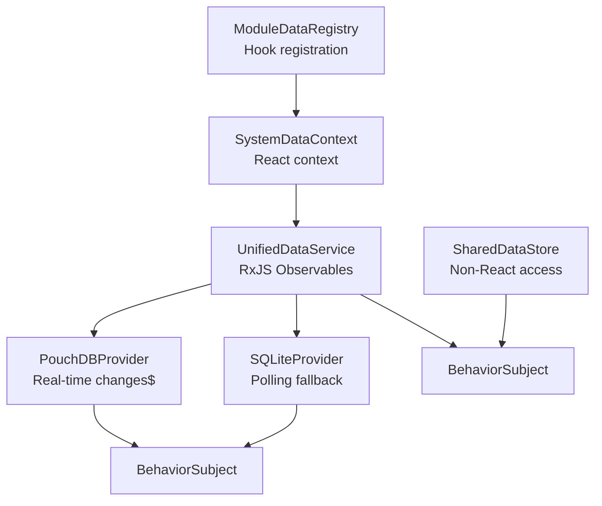
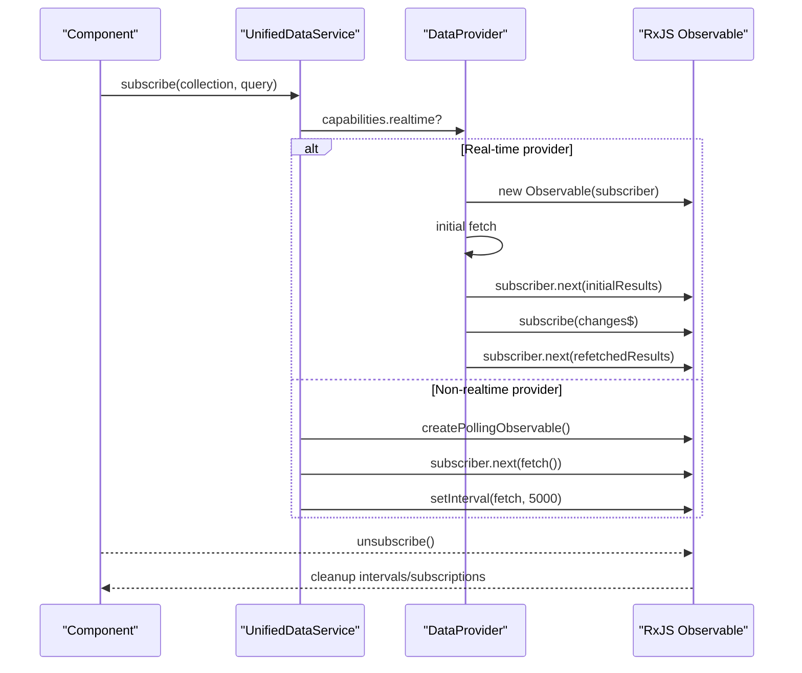
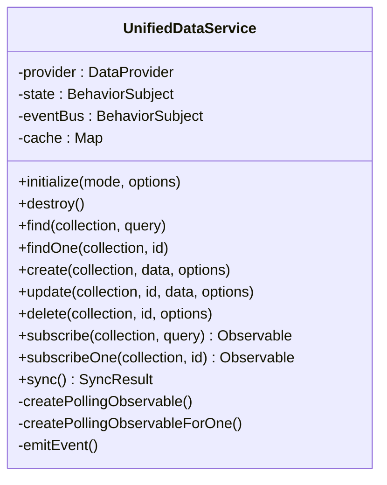
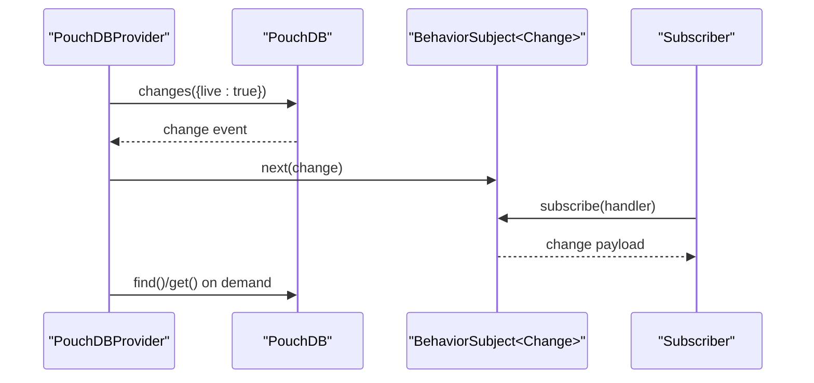
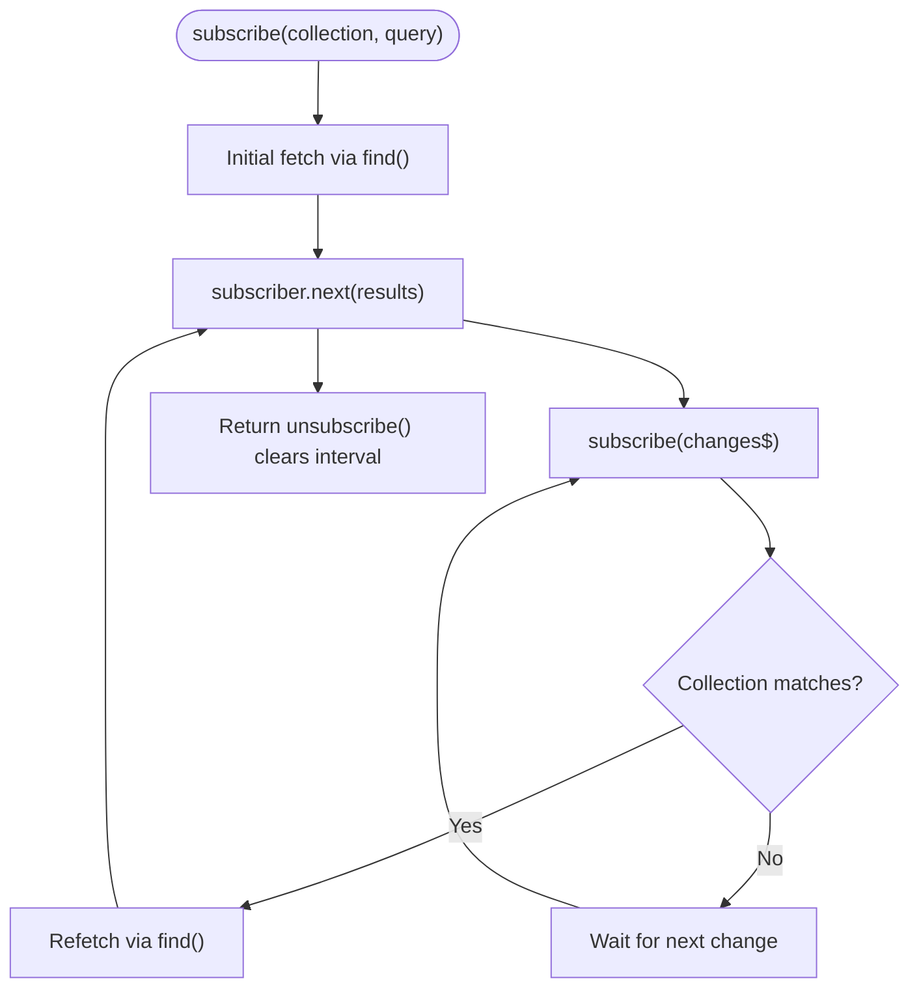
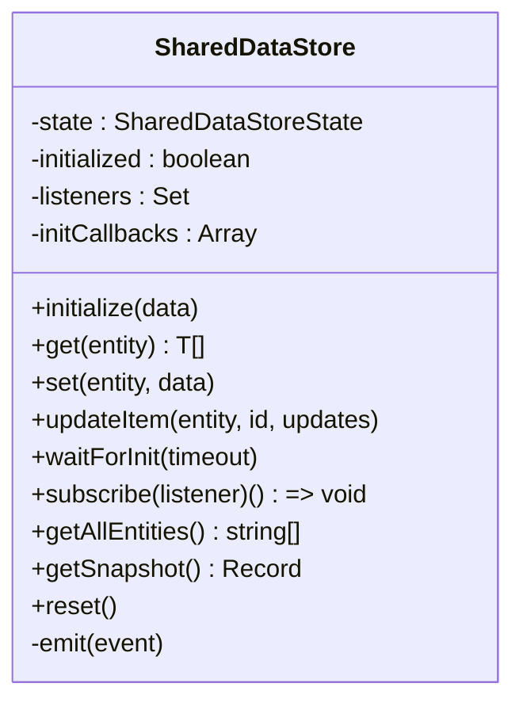
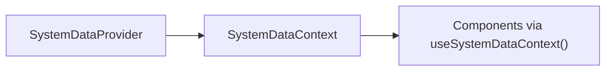
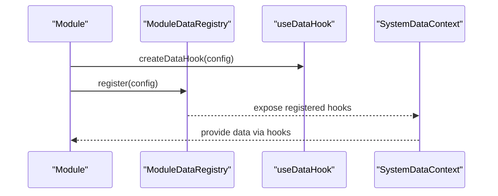
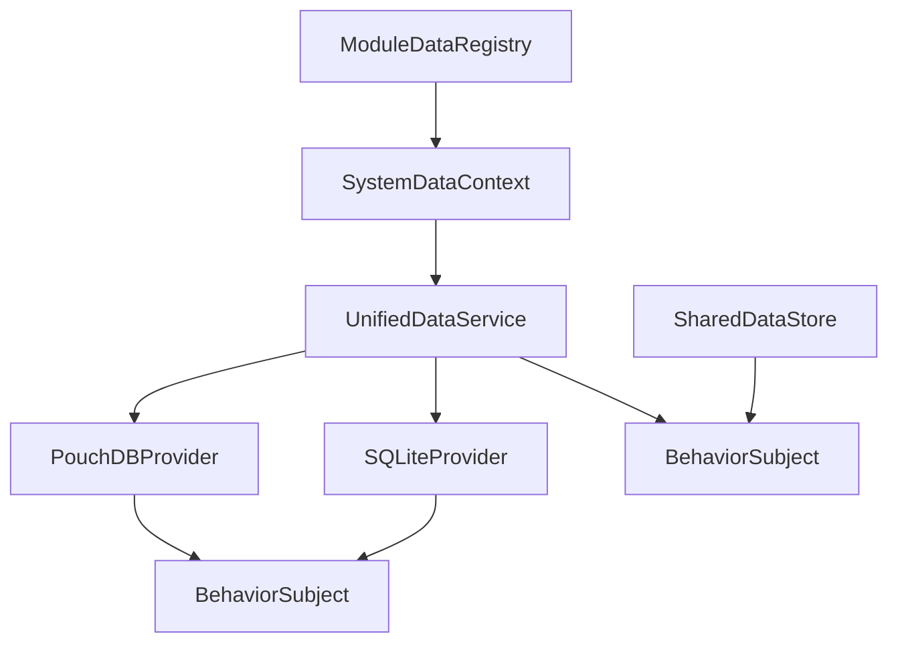

# Observable Data Streams

<cite>
**Referenced Files in This Document**
- [UnifiedDataService.ts](file://src/services/data/UnifiedDataService.ts)
- [PouchDBProvider.ts](file://src/services/data/providers/PouchDBProvider.ts)
- [SQLiteProvider.ts](file://src/services/data/providers/SQLiteProvider.ts)
- [SharedDataStore.ts](file://src/services/data/SharedDataStore.ts)
- [SystemDataContext.tsx](file://src/core/data/SystemDataContext.tsx)
- [useDataHook.ts](file://src/hooks/useDataHook.ts)
- [useDataHookRegistration.ts](file://src/hooks/useDataHookRegistration.ts)
- [ModuleDataRegistry.ts](file://src/services/module/ModuleDataRegistry.ts)
- [DATA_LAYER_STRATEGY.md](file://docs/architecture/DATA_LAYER_STRATEGY.md)
- [performanceMonitor.ts](file://src/services/performance/performanceMonitor.ts)
- [performanceBenchmark.ts](file://src/services/performance/performanceBenchmark.ts)
</cite>

## Table of Contents
1. [Introduction](#introduction)
2. [Project Structure](#project-structure)
3. [Core Components](#core-components)
4. [Architecture Overview](#architecture-overview)
5. [Detailed Component Analysis](#detailed-component-analysis)
6. [Dependency Analysis](#dependency-analysis)
7. [Performance Considerations](#performance-considerations)
8. [Troubleshooting Guide](#troubleshooting-guide)
9. [Conclusion](#conclusion)

## Introduction
This document explains the observable data stream system in SchoolPilot3, focusing on RxJS-based reactive patterns across the data layer. It covers real-time subscriptions, operator chains, stream composition, event-driven updates, and cross-component communication. It also documents the event bus for system-wide state updates, integration with the module system for inter-module data sharing, and the data context integration service for component-level data binding. Practical examples demonstrate creating custom observables, managing subscription lifecycles, and implementing reactive UI patterns. Finally, it outlines performance considerations, memory management, and best practices for observable stream architecture.

## Project Structure
The observable data streams are implemented through a layered architecture:
- Unified Data Service orchestrates provider selection and exposes RxJS observables for real-time subscriptions.
- Providers encapsulate storage backends (PouchDB for networked/SaaS, SQLite WASM for standalone) and emit change events.
- SharedDataStore provides non-React access to shared entities with synchronous APIs and event listeners.
- SystemDataContext integrates system-level data into React components via context and hooks.
- Module system registers and discovers data hooks for inter-module sharing.

**Diagram sources**
- [UnifiedDataService.ts:285-321](file://src/services/data/UnifiedDataService.ts#L285-L321)
- [PouchDBProvider.ts:80-87](file://src/services/data/providers/PouchDBProvider.ts#L80-L87)
- [SQLiteProvider.ts:76-78](file://src/services/data/providers/SQLiteProvider.ts#L76-L78)
- [SharedDataStore.ts:81-239](file://src/services/data/SharedDataStore.ts#L81-L239)
- [SystemDataContext.tsx:1-35](file://src/core/data/SystemDataContext.tsx#L1-L35)
- [ModuleDataRegistry.ts:112-124](file://src/services/module/ModuleDataRegistry.ts#L112-L124)

**Section sources**
- [UnifiedDataService.ts:1-150](file://src/services/data/UnifiedDataService.ts#L1-L150)
- [PouchDBProvider.ts:1-150](file://src/services/data/providers/PouchDBProvider.ts#L1-L150)
- [SQLiteProvider.ts:1-150](file://src/services/data/providers/SQLiteProvider.ts#L1-L150)
- [SharedDataStore.ts:1-120](file://src/services/data/SharedDataStore.ts#L1-L120)
- [SystemDataContext.tsx:1-35](file://src/core/data/SystemDataContext.tsx#L1-L35)
- [ModuleDataRegistry.ts:112-124](file://src/services/module/ModuleDataRegistry.ts#L112-L124)

## Core Components
- UnifiedDataService: Central orchestrator that selects providers, exposes RxJS observables, manages caching, and emits system-wide data events.
- PouchDBProvider: Real-time provider using PouchDB change feeds and replication; publishes change events via BehaviorSubject.
- SQLiteProvider: Standalone provider using SQLite WASM; provides polling-based observables and change tracking via BehaviorSubject.
- SharedDataStore: Non-React store mirroring shared entities with synchronous access and event listeners.
- SystemDataContext: React context exposing system data to components.
- ModuleDataRegistry and data hooks: Registry and standardized hook creation for inter-module data access.

**Section sources**
- [UnifiedDataService.ts:285-321](file://src/services/data/UnifiedDataService.ts#L285-L321)
- [PouchDBProvider.ts:335-378](file://src/services/data/providers/PouchDBProvider.ts#L335-L378)
- [SQLiteProvider.ts:304-347](file://src/services/data/providers/SQLiteProvider.ts#L304-L347)
- [SharedDataStore.ts:81-239](file://src/services/data/SharedDataStore.ts#L81-L239)
- [SystemDataContext.tsx:1-35](file://src/core/data/SystemDataContext.tsx#L1-L35)
- [useDataHook.ts:1-8](file://src/hooks/useDataHook.ts#L1-L8)
- [useDataHookRegistration.ts:1-58](file://src/hooks/useDataHookRegistration.ts#L1-L58)
- [ModuleDataRegistry.ts:112-124](file://src/services/module/ModuleDataRegistry.ts#L112-L124)

## Architecture Overview
The system implements a unified data service with pluggable providers. The UDS exposes subscribe and subscribeOne methods returning RxJS Observable streams. Providers implement real-time change feeds (PouchDB) or polling fallbacks (SQLite). Events are emitted through a BehaviorSubjects for system-wide state updates and cross-component communication.

**Diagram sources**
- [UnifiedDataService.ts:285-321](file://src/services/data/UnifiedDataService.ts#L285-L321)
- [PouchDBProvider.ts:337-356](file://src/services/data/providers/PouchDBProvider.ts#L337-L356)
- [SQLiteProvider.ts:306-325](file://src/services/data/providers/SQLiteProvider.ts#L306-L325)
- [UnifiedDataService.ts:641-675](file://src/services/data/UnifiedDataService.ts#L641-L675)

**Section sources**
- [DATA_LAYER_STRATEGY.md:42-89](file://docs/architecture/DATA_LAYER_STRATEGY.md#L42-L89)
- [UnifiedDataService.ts:285-321](file://src/services/data/UnifiedDataService.ts#L285-L321)

## Detailed Component Analysis

### UnifiedDataService: Observable Orchestration
- Exposes RxJS observables for collections and single entities.
- Falls back to polling when providers lack real-time capabilities.
- Emits system-wide data events via a BehaviorSubject for cross-component communication.
- Implements caching with TTL and cache invalidation patterns.

**Diagram sources**
- [UnifiedDataService.ts:36-146](file://src/services/data/UnifiedDataService.ts#L36-L146)
- [UnifiedDataService.ts:285-321](file://src/services/data/UnifiedDataService.ts#L285-L321)
- [UnifiedDataService.ts:641-675](file://src/services/data/UnifiedDataService.ts#L641-L675)
- [UnifiedDataService.ts:631-639](file://src/services/data/UnifiedDataService.ts#L631-L639)

**Section sources**
- [UnifiedDataService.ts:1-150](file://src/services/data/UnifiedDataService.ts#L1-L150)
- [UnifiedDataService.ts:285-321](file://src/services/data/UnifiedDataService.ts#L285-L321)
- [UnifiedDataService.ts:631-675](file://src/services/data/UnifiedDataService.ts#L631-L675)

### PouchDBProvider: Real-time Change Feeds
- Uses PouchDB change feeds and replication to emit real-time updates.
- Publishes change events via BehaviorSubject for downstream subscribers.
- Supports live sync with remote databases and conflict resolution.

**Diagram sources**
- [PouchDBProvider.ts:80-87](file://src/services/data/providers/PouchDBProvider.ts#L80-L87)
- [PouchDBProvider.ts:337-356](file://src/services/data/providers/PouchDBProvider.ts#L337-L356)
- [PouchDBProvider.ts:566-605](file://src/services/data/providers/PouchDBProvider.ts#L566-L605)

**Section sources**
- [PouchDBProvider.ts:61-134](file://src/services/data/providers/PouchDBProvider.ts#L61-L134)
- [PouchDBProvider.ts:335-378](file://src/services/data/providers/PouchDBProvider.ts#L335-L378)
- [PouchDBProvider.ts:566-605](file://src/services/data/providers/PouchDBProvider.ts#L566-L605)

### SQLiteProvider: Polling-based Observables
- Provides polling-based observables for non-realtime environments.
- Tracks changes via an internal change subject and notifies subscribers.
- Uses transactions for bulk operations and maintains change logs.

**Diagram sources**
- [SQLiteProvider.ts:306-325](file://src/services/data/providers/SQLiteProvider.ts#L306-L325)
- [SQLiteProvider.ts:76-78](file://src/services/data/providers/SQLiteProvider.ts#L76-L78)

**Section sources**
- [SQLiteProvider.ts:55-122](file://src/services/data/providers/SQLiteProvider.ts#L55-L122)
- [SQLiteProvider.ts:304-347](file://src/services/data/providers/SQLiteProvider.ts#L304-L347)

### SharedDataStore: Non-React Data Access
- Singleton store providing synchronous access to shared entities.
- Emits initialization, change, and reset events to listeners.
- Integrates with AppDataContext to mirror shared data.

**Diagram sources**
- [SharedDataStore.ts:81-239](file://src/services/data/SharedDataStore.ts#L81-L239)

**Section sources**
- [SharedDataStore.ts:1-120](file://src/services/data/SharedDataStore.ts#L1-L120)
- [SharedDataStore.ts:183-239](file://src/services/data/SharedDataStore.ts#L183-L239)

### SystemDataContext: Component-level Data Binding
- React context wrapping useSystemData hook for system domain data.
- Ensures safe usage with error boundaries and proper provider setup.

**Diagram sources**
- [SystemDataContext.tsx:1-35](file://src/core/data/SystemDataContext.tsx#L1-L35)

**Section sources**
- [SystemDataContext.tsx:1-35](file://src/core/data/SystemDataContext.tsx#L1-L35)

### Module System Integration: Inter-module Data Sharing
- ModuleDataRegistry registers data hooks with metadata for inter-module access.
- useDataHookRegistration ensures consistent registration and discovery.
- Standardized hook factory enables uniform data access across modules.

**Diagram sources**
- [useDataHookRegistration.ts:14-35](file://src/hooks/useDataHookRegistration.ts#L14-L35)
- [ModuleDataRegistry.ts:112-124](file://src/services/module/ModuleDataRegistry.ts#L112-L124)
- [useDataHook.ts:1-8](file://src/hooks/useDataHook.ts#L1-L8)

**Section sources**
- [useDataHookRegistration.ts:1-58](file://src/hooks/useDataHookRegistration.ts#L1-L58)
- [ModuleDataRegistry.ts:112-124](file://src/services/module/ModuleDataRegistry.ts#L112-L124)
- [useDataHook.ts:1-8](file://src/hooks/useDataHook.ts#L1-L8)

## Dependency Analysis
- UnifiedDataService depends on provider capabilities to decide between real-time subscriptions and polling.
- PouchDBProvider and SQLiteProvider both publish change events to a shared BehaviorSubject for downstream consumers.
- SharedDataStore subscribes to UnifiedDataService events to mirror state for non-React usage.
- SystemDataContext consumes UnifiedDataService through hooks to bind data to components.
- ModuleDataRegistry centralizes data hook registration for inter-module sharing.

**Diagram sources**
- [UnifiedDataService.ts:285-321](file://src/services/data/UnifiedDataService.ts#L285-L321)
- [PouchDBProvider.ts:80-87](file://src/services/data/providers/PouchDBProvider.ts#L80-L87)
- [SQLiteProvider.ts:76-78](file://src/services/data/providers/SQLiteProvider.ts#L76-L78)
- [SharedDataStore.ts:230-238](file://src/services/data/SharedDataStore.ts#L230-L238)
- [SystemDataContext.tsx:1-35](file://src/core/data/SystemDataContext.tsx#L1-L35)
- [ModuleDataRegistry.ts:112-124](file://src/services/module/ModuleDataRegistry.ts#L112-L124)

**Section sources**
- [UnifiedDataService.ts:285-321](file://src/services/data/UnifiedDataService.ts#L285-L321)
- [PouchDBProvider.ts:80-87](file://src/services/data/providers/PouchDBProvider.ts#L80-L87)
- [SQLiteProvider.ts:76-78](file://src/services/data/providers/SQLiteProvider.ts#L76-L78)
- [SharedDataStore.ts:230-238](file://src/services/data/SharedDataStore.ts#L230-L238)

## Performance Considerations
- Caching: UnifiedDataService caches query results with TTL to reduce repeated fetches.
- Polling intervals: Fallback polling uses fixed intervals; tune intervals based on data volatility and performance needs.
- Change propagation: Providers emit change events; minimize unnecessary refetches by filtering on collection and id.
- Memory management: Always unsubscribe from observables to prevent memory leaks; use takeUntil or component cleanup.
- Transactions: SQLiteProvider uses transactions for bulk operations to maintain consistency and reduce overhead.
- Monitoring: Use performanceMonitor and performanceBenchmark to track and compare metrics across environments.

**Section sources**
- [UnifiedDataService.ts:611-621](file://src/services/data/UnifiedDataService.ts#L611-L621)
- [UnifiedDataService.ts:641-675](file://src/services/data/UnifiedDataService.ts#L641-L675)
- [SQLiteProvider.ts:405-437](file://src/services/data/providers/SQLiteProvider.ts#L405-L437)
- [performanceMonitor.ts:280-311](file://src/services/performance/performanceMonitor.ts#L280-L311)
- [performanceBenchmark.ts:182-221](file://src/services/performance/performanceBenchmark.ts#L182-L221)

## Troubleshooting Guide
- Subscription lifecycle: Ensure subscriptions are unsubscribed in component cleanup or when no longer needed to avoid memory leaks.
- Provider capability checks: Verify provider capabilities before subscribing; fallback to polling when real-time is unavailable.
- Change event handling: Confirm change events are filtered by collection and id to avoid redundant refetches.
- Initialization timing: Use SharedDataStore.waitForInit for non-React code to ensure data availability.
- Error handling: Subscribe with error callbacks and handle provider-specific errors (e.g., 404 Not Found in PouchDB).

**Section sources**
- [PouchDBProvider.ts:311-333](file://src/services/data/providers/PouchDBProvider.ts#L311-L333)
- [SQLiteProvider.ts:327-347](file://src/services/data/providers/SQLiteProvider.ts#L327-L347)
- [SharedDataStore.ts:168-181](file://src/services/data/SharedDataStore.ts#L168-L181)
- [UnifiedDataService.ts:641-675](file://src/services/data/UnifiedDataService.ts#L641-L675)

## Conclusion
SchoolPilot3’s observable data stream system leverages RxJS to deliver real-time, event-driven updates across modules. The UnifiedDataService abstracts provider differences, offering consistent subscribe and subscribeOne APIs with robust fallbacks. PouchDBProvider delivers true real-time synchronization, while SQLiteProvider ensures reliability in standalone deployments through polling. SharedDataStore and SystemDataContext integrate non-React and component-level access patterns, respectively. The module system further enhances cross-module data sharing via standardized hooks and registries. With careful subscription lifecycle management, caching strategies, and performance monitoring, the system achieves scalable, reactive data flows suitable for diverse deployment modes.