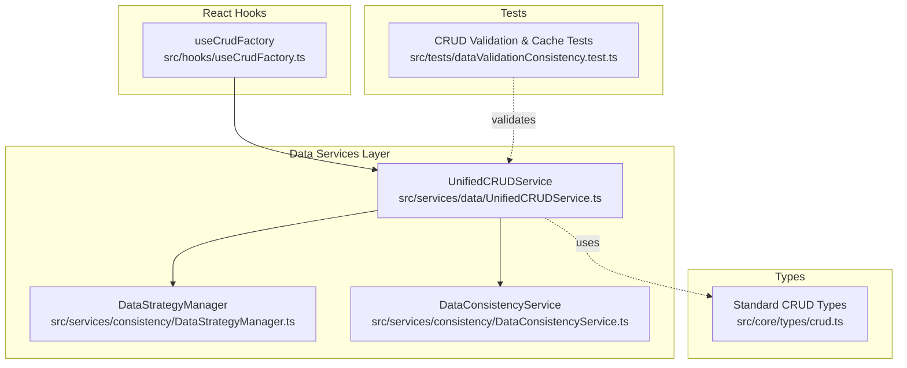
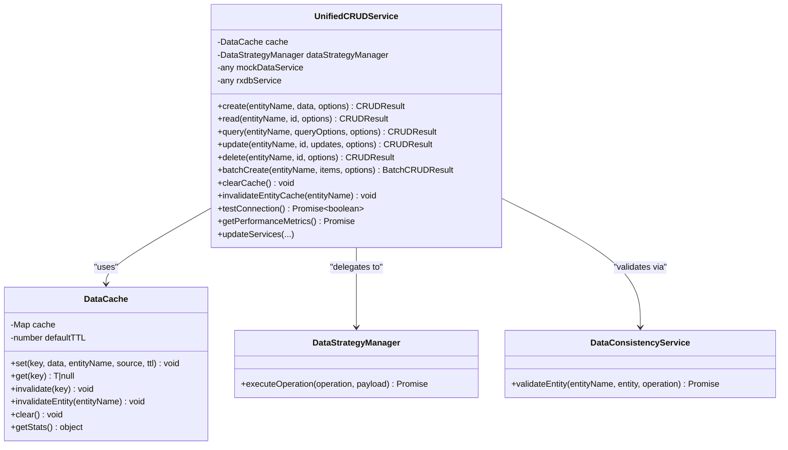
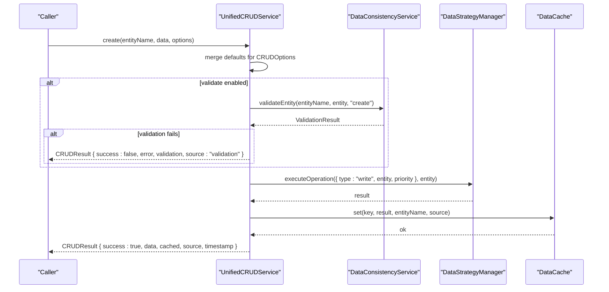
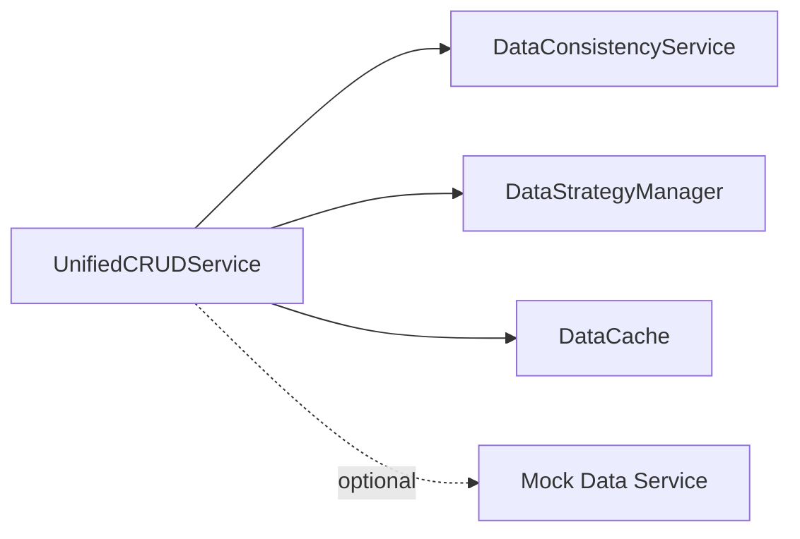
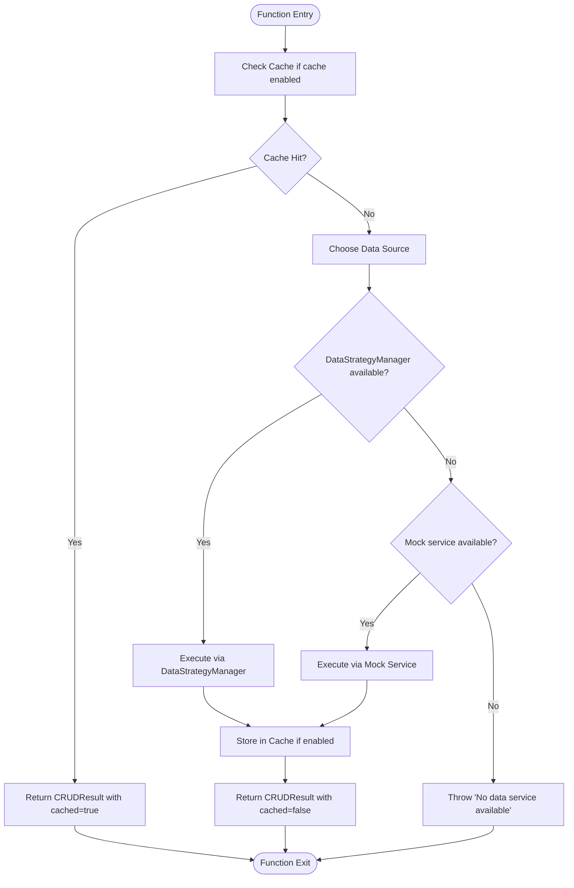

# CRUD Service Interface

<cite>
**Referenced Files in This Document**
- [UnifiedCRUDService.ts](file://src/services/data/UnifiedCRUDService.ts)
- [crud.ts](file://src/core/types/crud.ts)
- [useCrudFactory.ts](file://src/hooks/useCrudFactory.ts)
- [DataStrategyManager.ts](file://src/services/consistency/DataStrategyManager.ts)
- [DataConsistencyService.ts](file://src/services/consistency/DataConsistencyService.ts)
- [dataValidationConsistency.test.ts](file://src/tests/dataValidationConsistency.test.ts)
</cite>

## Table of Contents
1. [Introduction](#introduction)
2. [Project Structure](#project-structure)
3. [Core Components](#core-components)
4. [Architecture Overview](#architecture-overview)
5. [Detailed Component Analysis](#detailed-component-analysis)
6. [Dependency Analysis](#dependency-analysis)
7. [Performance Considerations](#performance-considerations)
8. [Troubleshooting Guide](#troubleshooting-guide)
9. [Conclusion](#conclusion)
10. [Appendices](#appendices)

## Introduction
This document provides comprehensive documentation for the UnifiedCRUDService interface and its core operations. It explains the create, read, query, update, and delete methods, including parameters, return types, and error handling. It also covers CRUDOptions and QueryOptions interfaces, the CRUDResult and BatchCRUDResult return types, and the DataCache implementation for cache management, TTL handling, and cache invalidation strategies. Practical examples demonstrate implementing each CRUD operation across different data sources (mock, RxDB via DataStrategyManager, backend), and guidance is included for maintaining cache consistency, service lifecycle, connection testing, and performance monitoring.

## Project Structure
The UnifiedCRUDService resides in the data services layer and integrates with consistency services and React hooks for UI-driven CRUD operations. The key files involved are:
- UnifiedCRUDService.ts: Implements the UnifiedCRUDService class, CRUD options, query options, results, batch results, and DataCache.
- crud.ts: Defines standardized CRUD types used across modules, including BaseEntity, CrudOperations, and related interfaces.
- useCrudFactory.ts: A React hook that generates standardized CRUD operations backed by a database collection and supports optimistic updates.
- DataStrategyManager.ts: Manages data strategy execution for write/read/delete operations.
- DataConsistencyService.ts: Provides entity validation used by UnifiedCRUDService.
- dataValidationConsistency.test.ts: Tests validating CRUD behavior with mock services and cache management.

**Diagram sources**
- [UnifiedCRUDService.ts](file://src/services/data/UnifiedCRUDService.ts)
- [DataStrategyManager.ts](file://src/services/consistency/DataStrategyManager.ts)
- [DataConsistencyService.ts](file://src/services/consistency/DataConsistencyService.ts)
- [useCrudFactory.ts](file://src/hooks/useCrudFactory.ts)
- [crud.ts](file://src/core/types/crud.ts)
- [dataValidationConsistency.test.ts](file://src/tests/dataValidationConsistency.test.ts)

**Section sources**
- [UnifiedCRUDService.ts](file://src/services/data/UnifiedCRUDService.ts)
- [crud.ts](file://src/core/types/crud.ts)
- [useCrudFactory.ts](file://src/hooks/useCrudFactory.ts)
- [DataStrategyManager.ts](file://src/services/consistency/DataStrategyManager.ts)
- [DataConsistencyService.ts](file://src/services/consistency/DataConsistencyService.ts)
- [dataValidationConsistency.test.ts](file://src/tests/dataValidationConsistency.test.ts)

## Core Components
This section outlines the primary interfaces and classes used by UnifiedCRUDService and related modules.

- CRUDOptions: Controls validation, caching, synchronization, priority, timeout, and retry behavior for CRUD operations.
- QueryOptions: Specifies filters, sorting, limits, offsets, and inclusion of related fields for query operations.
- CRUDResult<T>: Standardized operation result with success flag, optional data payload, optional error, optional validation result, cached flag, source indicator, and timestamp.
- BatchCRUDResult<T>: Aggregated result for batch operations including per-item results, totals, and collected errors.
- DataCache: In-memory cache with TTL, entry metadata, and invalidation strategies.

Key type definitions and their roles:
- BaseEntity and CrudOperations define the base entity shape and standard CRUD method signatures used across modules.
- UseCrudFactory produces a hook-based CRUD interface with optimistic updates and state management.

**Section sources**
- [UnifiedCRUDService.ts](file://src/services/data/UnifiedCRUDService.ts)
- [crud.ts](file://src/core/types/crud.ts)
- [useCrudFactory.ts](file://src/hooks/useCrudFactory.ts)

## Architecture Overview
UnifiedCRUDService orchestrates CRUD operations across multiple data sources. It optionally delegates to DataStrategyManager for RxDB-backed operations and falls back to a mock data service when available. Validation is performed via DataConsistencyService. Results are returned in a standardized format with cache awareness and source tracking.

**Diagram sources**
- [UnifiedCRUDService.ts](file://src/services/data/UnifiedCRUDService.ts)
- [DataStrategyManager.ts](file://src/services/consistency/DataStrategyManager.ts)
- [DataConsistencyService.ts](file://src/services/consistency/DataConsistencyService.ts)

**Section sources**
- [UnifiedCRUDService.ts](file://src/services/data/UnifiedCRUDService.ts)
- [DataStrategyManager.ts](file://src/services/consistency/DataStrategyManager.ts)
- [DataConsistencyService.ts](file://src/services/consistency/DataConsistencyService.ts)

## Detailed Component Analysis

### UnifiedCRUDService Class
The UnifiedCRUDService encapsulates all CRUD operations with consistent options, validation, caching, and error handling. It supports three execution modes:
- DataStrategyManager (RxDB-backed) when configured.
- Mock data service fallback when available.
- Direct error when no service is available.

Key behaviors:
- Validation: Uses DataConsistencyService to validate entities during create/update/delete when enabled.
- Caching: Uses DataCache to store individual reads and query results with TTL and entity-wide invalidation.
- Priority and Synchronization: Delegates priority to DataStrategyManager operations; sync toggles whether to propagate changes to backend.
- Error Handling: Returns CRUDResult with error and source set to "error" on failures.

**Diagram sources**
- [UnifiedCRUDService.ts](file://src/services/data/UnifiedCRUDService.ts)
- [DataConsistencyService.ts](file://src/services/consistency/DataConsistencyService.ts)
- [DataStrategyManager.ts](file://src/services/consistency/DataStrategyManager.ts)

**Section sources**
- [UnifiedCRUDService.ts](file://src/services/data/UnifiedCRUDService.ts)

### CRUDOptions and QueryOptions Interfaces
- CRUDOptions:
  - validate: boolean (default true for create/update/delete)
  - cache: boolean (default true)
  - sync: boolean (default true)
  - priority: 'low' | 'normal' | 'high' | 'critical'
  - timeout: number
  - retries: number
- QueryOptions:
  - filters: Record<string, any>
  - sort: { field: string; direction: 'asc' | 'desc' }[]
  - limit: number
  - offset: number
  - include: string[]

Validation:
- CRUDOptions.validate triggers entity validation via DataConsistencyService.
- Validation failures produce a CRUDResult with validation errors and source set to "validation".

Caching:
- Individual reads and updates cache entries keyed by entityName:id.
- Queries cache with a composite key and shorter TTL than individual entries.

Synchronization:
- CRUDOptions.sync controls whether operations propagate to backend via DataStrategyManager.

Priority:
- CRUDOptions.priority is forwarded to DataStrategyManager operations.

Timeout and Retries:
- These fields are present in CRUDOptions but are not used in the current implementation of UnifiedCRUDService.

**Section sources**
- [UnifiedCRUDService.ts](file://src/services/data/UnifiedCRUDService.ts)

### CRUDResult and BatchCRUDResult Return Types
- CRUDResult<T>:
  - success: boolean
  - data?: T
  - error?: Error
  - validation?: ValidationResult
  - cached?: boolean
  - source: 'mock' | 'rxdb' | 'backend' | 'cache' | 'validation' | 'error'
  - timestamp: Date
- BatchCRUDResult<T>:
  - success: boolean
  - results: CRUDResult<T>[]
  - totalProcessed: number
  - totalSuccessful: number
  - totalFailed: number
  - errors: Error[]

Usage:
- All CRUD methods return CRUDResult<T>.
- batchCreate returns BatchCRUDResult<T>.

**Section sources**
- [UnifiedCRUDService.ts](file://src/services/data/UnifiedCRUDService.ts)

### DataCache Implementation
DataCache manages in-memory caching with TTL and entity-aware invalidation:
- set(key, data, entityName, source, ttl?): Stores entry with timestamp and TTL.
- get(key): Retrieves data if not expired; otherwise deletes and returns null.
- invalidate(key): Removes a specific entry.
- invalidateEntity(entityName): Removes all entries for an entity.
- clear(): Empties the cache.
- getStats(): Returns cache size, unique entities, and oldest entry timestamp.

TTL:
- Default TTL is 5 minutes for individual entries.
- Queries use a shorter TTL (2 minutes) to keep lists fresher.

**Section sources**
- [UnifiedCRUDService.ts](file://src/services/data/UnifiedCRUDService.ts)

### CRUD Operations Reference

#### create(entityName, data, options)
- Purpose: Create a new entity with automatic ID generation and timestamps.
- Parameters:
  - entityName: string
  - data: Partial<Entity>
  - options: CRUDOptions
- Behavior:
  - Validates entity if validate is true.
  - Executes via DataStrategyManager (RxDB) or mock service.
  - Caches result if cache is true.
- Returns: CRUDResult<T>
- Error Handling: Returns CRUDResult with error and source "error" or "validation".

Practical Example (Mock):
- See [dataValidationConsistency.test.ts](file://src/tests/dataValidationConsistency.test.ts) for a mock service-backed create with validation.

Practical Example (RxDB via DataStrategyManager):
- When DataStrategyManager is injected, create delegates to executeOperation with type "write".

**Section sources**
- [UnifiedCRUDService.ts](file://src/services/data/UnifiedCRUDService.ts)
- [dataValidationConsistency.test.ts](file://src/tests/dataValidationConsistency.test.ts)

#### read(entityName, id, options)
- Purpose: Retrieve a single entity by ID.
- Parameters:
  - entityName: string
  - id: string | number
  - options: CRUDOptions
- Behavior:
  - Checks cache first if cache is true.
  - Executes via DataStrategyManager or mock service.
  - Caches result if cache is true.
- Returns: CRUDResult<T>
- Error Handling: Returns CRUDResult with error and source "error" if not found.

Practical Example (Cache Hit):
- If cache is enabled and entry exists, returns immediately with cached: true and source "cache".

**Section sources**
- [UnifiedCRUDService.ts](file://src/services/data/UnifiedCRUDService.ts)

#### query(entityName, queryOptions, options)
- Purpose: Fetch a list of entities with filtering, sorting, pagination, and inclusion.
- Parameters:
  - entityName: string
  - queryOptions: QueryOptions
  - options: CRUDOptions
- Behavior:
  - Checks cache first if cache is true.
  - Executes via DataStrategyManager or mock service.
  - Caches result with a composite key and shorter TTL.
- Returns: CRUDResult<T[]>
- Error Handling: Returns CRUDResult with error and source "error".

**Section sources**
- [UnifiedCRUDService.ts](file://src/services/data/UnifiedCRUDService.ts)

#### update(entityName, id, updates, options)
- Purpose: Update an existing entity.
- Parameters:
  - entityName: string
  - id: string | number
  - updates: Partial<Entity>
  - options: CRUDOptions
- Behavior:
  - Reads existing entity to validate and prepare updated entity.
  - Validates entity if validate is true.
  - Executes via DataStrategyManager or mock service.
  - Updates cache and invalidates entity-level caches to maintain consistency.
- Returns: CRUDResult<T>
- Error Handling: Returns CRUDResult with error and source "error" or "validation".

**Section sources**
- [UnifiedCRUDService.ts](file://src/services/data/UnifiedCRUDService.ts)

#### delete(entityName, id, options)
- Purpose: Delete an entity by ID.
- Parameters:
  - entityName: string
  - id: string | number
  - options: CRUDOptions
- Behavior:
  - Reads existing entity to validate.
  - Validates entity if validate is true.
  - Executes via DataStrategyManager or mock service.
  - Removes cache entry and invalidates entity-level caches.
- Returns: CRUDResult<boolean>
- Error Handling: Returns CRUDResult with error and source "error" or "validation".

**Section sources**
- [UnifiedCRUDService.ts](file://src/services/data/UnifiedCRUDService.ts)

#### batchCreate(entityName, items, options)
- Purpose: Create multiple entities in sequence.
- Parameters:
  - entityName: string
  - items: Partial<Entity>[]
  - options: CRUDOptions
- Behavior:
  - Iterates through items and calls create for each.
  - Aggregates per-item results and counts successes/failures.
- Returns: BatchCRUDResult<T>

**Section sources**
- [UnifiedCRUDService.ts](file://src/services/data/UnifiedCRUDService.ts)

### Practical Examples and Patterns

#### Implementing CRUD Across Data Sources
- RxDB via DataStrategyManager:
  - Inject DataStrategyManager into UnifiedCRUDService.updateServices to enable RxDB-backed operations.
  - Operations are executed through DataStrategyManager.executeOperation with appropriate operation types ("read", "write", "delete").
- Mock Data Service:
  - Provide a mock service with create, read, update, delete methods returning { success, data?, error? }.
  - UnifiedCRUDService falls back to mock when DataStrategyManager is unavailable.
- Backend:
  - When DataStrategyManager is configured, backend synchronization is handled by the strategy manager; UnifiedCRUDService sets sync: true to propagate changes.

#### Cache Consistency Strategies
- After update/delete, invalidate the specific entity cache entry and clear all query caches for the entity to prevent stale reads.
- Queries use a composite cache key and shorter TTL to reduce staleness.

#### Using useCrudFactory with Database Collections
- The React hook useCrudFactory provides a UI-friendly CRUD interface backed by a database collection.
- It supports optimistic updates, error handling, and success/error callbacks.
- While separate from UnifiedCRUDService, it aligns with BaseEntity and CrudOperations patterns.

**Section sources**
- [UnifiedCRUDService.ts](file://src/services/data/UnifiedCRUDService.ts)
- [useCrudFactory.ts](file://src/hooks/useCrudFactory.ts)
- [crud.ts](file://src/core/types/crud.ts)

## Dependency Analysis
UnifiedCRUDService depends on:
- DataStrategyManager for RxDB-backed operations.
- DataConsistencyService for entity validation.
- DataCache for caching and invalidation.
- Optional mock data service for fallback scenarios.

**Diagram sources**
- [UnifiedCRUDService.ts](file://src/services/data/UnifiedCRUDService.ts)
- [DataConsistencyService.ts](file://src/services/consistency/DataConsistencyService.ts)
- [DataStrategyManager.ts](file://src/services/consistency/DataStrategyManager.ts)

**Section sources**
- [UnifiedCRUDService.ts](file://src/services/data/UnifiedCRUDService.ts)
- [DataStrategyManager.ts](file://src/services/consistency/DataStrategyManager.ts)
- [DataConsistencyService.ts](file://src/services/consistency/DataConsistencyService.ts)

## Performance Considerations
- Caching:
  - Individual entries default to 5-minute TTL; queries default to 2-minute TTL.
  - Use cache: false to bypass cache for operations requiring fresh data.
- Priority:
  - Set CRUDOptions.priority to balance responsiveness and resource usage.
- Batch Operations:
  - Prefer batchCreate for bulk inserts to minimize overhead.
- Monitoring:
  - getPerformanceMetrics currently returns placeholder metrics; extend to track cache stats, operation counts, and response times.

[No sources needed since this section provides general guidance]

## Troubleshooting Guide
Common issues and resolutions:
- No Data Service Available:
  - If neither DataStrategyManager nor mock service is available, create/read/query/update/delete will fail. Ensure services are injected via updateServices.
- Validation Failures:
  - When validate is true, validation errors are returned in the validation field. Inspect validation.errors for details.
- Cache Staleness:
  - After updates/deletes, cache invalidation is automatic. If stale data persists, manually clear cache or invalidate entity cache.
- Connection Testing:
  - Use testConnection to verify RxDB readiness or mock service availability. Returns false on failure.

**Section sources**
- [UnifiedCRUDService.ts](file://src/services/data/UnifiedCRUDService.ts)

## Conclusion
UnifiedCRUDService provides a unified, validated, cached, and source-agnostic interface for CRUD operations across mock, RxDB, and backend environments. Its standardized result types, robust error handling, and cache management ensure predictable behavior and consistency. By leveraging DataStrategyManager and DataConsistencyService, it scales from development mocks to production-grade data synchronization while maintaining a clean separation of concerns.

[No sources needed since this section summarizes without analyzing specific files]

## Appendices

### Appendix A: CRUD Operation Flow (Read)

**Diagram sources**
- [UnifiedCRUDService.ts](file://src/services/data/UnifiedCRUDService.ts)

### Appendix B: CRUD Lifecycle and Cache Invalidation
- Create: Cache set after success.
- Read: Cache hit returns immediately; miss executes and caches result.
- Query: Composite key cache with shorter TTL; invalidates on subsequent writes/deletes.
- Update: Cache updated; entity-level caches invalidated.
- Delete: Cache invalidated; entity-level caches cleared.

**Section sources**
- [UnifiedCRUDService.ts](file://src/services/data/UnifiedCRUDService.ts)