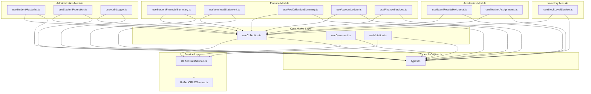
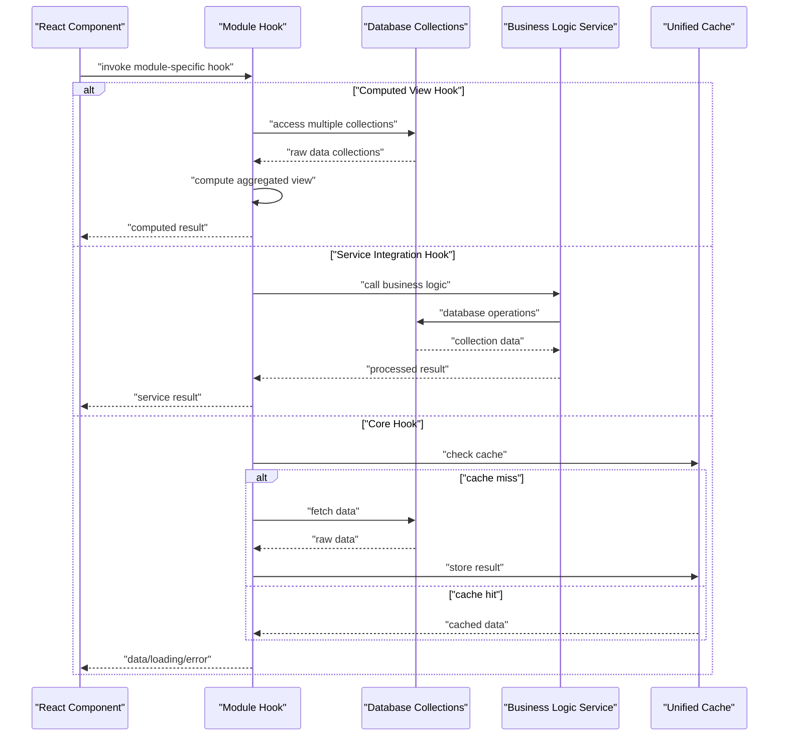
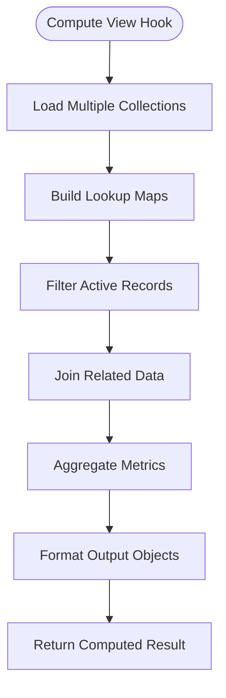
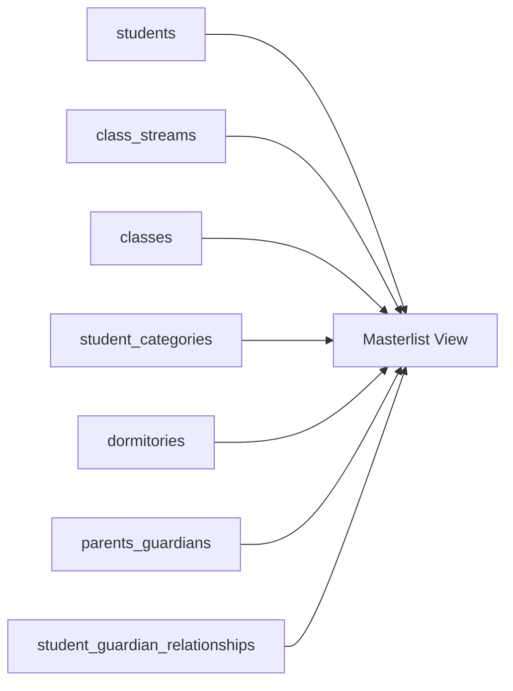
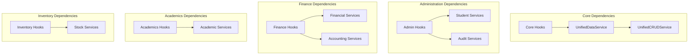

# React Hooks Ecosystem

<cite>
**Referenced Files in This Document**
- [UnifiedCRUDService.ts](file://src/services/data/UnifiedCRUDService.ts)
- [UnifiedDataService.ts](file://src/services/data/UnifiedDataService.ts)
- [useCollection.ts](file://src/services/data/hooks/useCollection.ts)
- [useDocument.ts](file://src/services/data/hooks/useDocument.ts)
- [useMutation.ts](file://src/services/data/hooks/useMutation.ts)
- [useStudentMasterlist.ts](file://src/modules/administration/hooks/useStudentMasterlist.ts)
- [useStudentPromotion.ts](file://src/modules/administration/hooks/useStudentPromotion.ts)
- [useAuditLogger.ts](file://src/modules/administration/hooks/useAuditLogger.ts)
- [useStudentFinancialSummary.ts](file://src/modules/finance/hooks/useStudentFinancialSummary.ts)
- [useVoteheadStatement.ts](file://src/modules/finance/hooks/useVoteheadStatement.ts)
- [useFeeCollectionSummary.ts](file://src/modules/finance/hooks/useFeeCollectionSummary.ts)
- [useAccountLedger.ts](file://src/modules/finance/hooks/useAccountLedger.ts)
- [useFinanceServices.ts](file://src/modules/finance/hooks/useFinanceServices.ts)
- [useExamResultsHorizontal.ts](file://src/modules/academics/hooks/useExamResultsHorizontal.ts)
- [useTeacherAssignments.ts](file://src/modules/academics/hooks/useTeacherAssignments.ts)
- [useStockLevelService.ts](file://src/modules/inventory/hooks/useStockLevelService.ts)
- [types.ts](file://src/services/data/types.ts)
- [index.ts](file://src/services/data/hooks/index.ts)
</cite>

## Update Summary
**Changes Made**
- Added comprehensive documentation for new module-specific hooks across Administration, Finance, Academics, and Inventory modules
- Expanded architecture overview to include computed view hooks and service integration patterns
- Updated performance considerations to cover computed view optimization strategies
- Enhanced troubleshooting guide with module-specific considerations
- Added new sections covering specialized hook patterns for business logic integration

## Table of Contents
1. [Introduction](#introduction)
2. [Project Structure](#project-structure)
3. [Core Components](#core-components)
4. [Architecture Overview](#architecture-overview)
5. [Detailed Component Analysis](#detailed-component-analysis)
6. [Module-Specific Hooks Ecosystem](#module-specific-hooks-ecosystem)
7. [Dependency Analysis](#dependency-analysis)
8. [Performance Considerations](#performance-considerations)
9. [Troubleshooting Guide](#troubleshooting-guide)
10. [Conclusion](#conclusion)
11. [Appendices](#appendices)

## Introduction
This document describes the React hooks ecosystem built around the UnifiedCRUDService and UnifiedDataService, now enhanced with specialized hooks across multiple modules. The ecosystem encompasses three primary hooks for core data operations plus numerous module-specific hooks that provide business logic integration and computed views:

- **Core Hooks**: useCollection, useDocument, useMutation for reactive data fetching and write operations
- **Administration Hooks**: useStudentMasterlist, useStudentPromotion, useAuditLogger for student management and audit trails
- **Finance Hooks**: useStudentFinancialSummary, useVoteheadStatement, useFeeCollectionSummary, useAccountLedger, useFinanceServices for financial reporting and accounting
- **Academics Hooks**: useExamResultsHorizontal, useTeacherAssignments for academic data management
- **Inventory Hooks**: useStockLevelService for inventory tracking and management

The documentation covers loading states, error boundaries, retry mechanisms, component lifecycle management, TypeScript integration, type safety guarantees, performance considerations, memoization strategies, and best practices for data access patterns in React applications.

## Project Structure
The hooks ecosystem spans multiple layers: core hooks in the data service layer, module-specific hooks in respective domain modules, and supporting services. The enhanced structure includes:

- **Core Layer**: UnifiedCRUDService, UnifiedDataService, and standard React hooks
- **Administration Layer**: Student management, promotion, and audit logging hooks
- **Finance Layer**: Financial reporting, accounting, and payment processing hooks
- **Academics Layer**: Academic data management and results processing hooks
- **Inventory Layer**: Stock level tracking and inventory management hooks

**Diagram sources**
- [useCollection.ts:1-169](file://src/services/data/hooks/useCollection.ts#L1-L169)
- [useDocument.ts:1-130](file://src/services/data/hooks/useDocument.ts#L1-L130)
- [useMutation.ts:1-160](file://src/services/data/hooks/useMutation.ts#L1-L160)
- [useStudentMasterlist.ts:1-253](file://src/modules/administration/hooks/useStudentMasterlist.ts#L1-L253)
- [useStudentPromotion.ts:1-119](file://src/modules/administration/hooks/useStudentPromotion.ts#L1-L119)
- [useAuditLogger.ts:1-133](file://src/modules/administration/hooks/useAuditLogger.ts#L1-L133)
- [useStudentFinancialSummary.ts:1-214](file://src/modules/finance/hooks/useStudentFinancialSummary.ts#L1-L214)
- [useVoteheadStatement.ts:1-192](file://src/modules/finance/hooks/useVoteheadStatement.ts#L1-L192)
- [useFeeCollectionSummary.ts](file://src/modules/finance/hooks/useFeeCollectionSummary.ts)
- [useAccountLedger.ts](file://src/modules/finance/hooks/useAccountLedger.ts)
- [useFinanceServices.ts](file://src/modules/finance/hooks/useFinanceServices.ts)
- [useExamResultsHorizontal.ts](file://src/modules/academics/hooks/useExamResultsHorizontal.ts)
- [useTeacherAssignments.ts](file://src/modules/academics/hooks/useTeacherAssignments.ts)
- [useStockLevelService.ts](file://src/modules/inventory/hooks/useStockLevelService.ts)
- [UnifiedDataService.ts:1-721](file://src/services/data/UnifiedDataService.ts#L1-L721)
- [UnifiedCRUDService.ts:1-689](file://src/services/data/UnifiedCRUDService.ts#L1-L689)
- [types.ts:1-226](file://src/services/data/types.ts#L1-L226)

**Section sources**
- [useCollection.ts:1-169](file://src/services/data/hooks/useCollection.ts#L1-L169)
- [useDocument.ts:1-130](file://src/services/data/hooks/useDocument.ts#L1-L130)
- [useMutation.ts:1-160](file://src/services/data/hooks/useMutation.ts#L1-L160)
- [useStudentMasterlist.ts:1-253](file://src/modules/administration/hooks/useStudentMasterlist.ts#L1-L253)
- [useStudentPromotion.ts:1-119](file://src/modules/administration/hooks/useStudentPromotion.ts#L1-L119)
- [useAuditLogger.ts:1-133](file://src/modules/administration/hooks/useAuditLogger.ts#L1-L133)
- [useStudentFinancialSummary.ts:1-214](file://src/modules/finance/hooks/useStudentFinancialSummary.ts#L1-L214)
- [useVoteheadStatement.ts:1-192](file://src/modules/finance/hooks/useVoteheadStatement.ts#L1-L192)
- [UnifiedDataService.ts:1-721](file://src/services/data/UnifiedDataService.ts#L1-L721)
- [UnifiedCRUDService.ts:1-689](file://src/services/data/UnifiedCRUDService.ts#L1-L689)
- [types.ts:1-226](file://src/services/data/types.ts#L1-L226)

## Core Components
The core hooks provide foundational data access patterns:

- **useCollection**: Reactive collection fetching with pagination, filtering, sorting, and real-time subscriptions
- **useDocument**: Single-entity subscription with real-time updates and change detection
- **useMutation**: Typed write operations with optimistic updates, error handling, and cache synchronization

**Module-specific hooks extend these patterns with business logic integration:**

- **Computed View Hooks**: Complex data aggregation and denormalization (StudentMasterlist, FinancialSummary, VoteheadStatement)
- **Service Integration Hooks**: Business logic encapsulation with database collection integration (StudentPromotion, AuditLogger)
- **Report Generation Hooks**: Specialized data presentation for financial and academic reporting

Key TypeScript interfaces remain consistent across all hooks, ensuring type safety and predictable behavior.

**Section sources**
- [useCollection.ts:58-166](file://src/services/data/hooks/useCollection.ts#L58-L166)
- [useDocument.ts:41-127](file://src/services/data/hooks/useDocument.ts#L41-L127)
- [useMutation.ts:39-157](file://src/services/data/hooks/useMutation.ts#L39-L157)
- [useStudentMasterlist.ts:12-37](file://src/modules/administration/hooks/useStudentMasterlist.ts#L12-L37)
- [useStudentFinancialSummary.ts:12-37](file://src/modules/finance/hooks/useStudentFinancialSummary.ts#L12-L37)
- [useVoteheadStatement.ts:12-33](file://src/modules/finance/hooks/useVoteheadStatement.ts#L12-L33)

## Architecture Overview
The enhanced architecture supports both core data operations and specialized business logic through module-specific hooks. The pattern follows a layered approach:

**Diagram sources**
- [useStudentMasterlist.ts:67-205](file://src/modules/administration/hooks/useStudentMasterlist.ts#L67-L205)
- [useStudentPromotion.ts:67-76](file://src/modules/administration/hooks/useStudentPromotion.ts#L67-L76)
- [useStudentFinancialSummary.ts:61-175](file://src/modules/finance/hooks/useStudentFinancialSummary.ts#L61-L175)
- [useVoteheadStatement.ts:59-150](file://src/modules/finance/hooks/useVoteheadStatement.ts#L59-L150)

## Detailed Component Analysis

### Core Hooks (Revisited)
The three foundational hooks maintain their core responsibilities while serving as building blocks for module-specific implementations.

**Section sources**
- [useCollection.ts:58-166](file://src/services/data/hooks/useCollection.ts#L58-L166)
- [useDocument.ts:41-127](file://src/services/data/hooks/useDocument.ts#L41-L127)
- [useMutation.ts:39-157](file://src/services/data/hooks/useMutation.ts#L39-L157)

### Computed View Hooks Pattern
Module-specific hooks often implement computed view patterns that aggregate data from multiple collections:

**Diagram sources**
- [useStudentMasterlist.ts:67-205](file://src/modules/administration/hooks/useStudentMasterlist.ts#L67-L205)
- [useStudentFinancialSummary.ts:61-175](file://src/modules/finance/hooks/useStudentFinancialSummary.ts#L61-L175)
- [useVoteheadStatement.ts:59-150](file://src/modules/finance/hooks/useVoteheadStatement.ts#L59-L150)

**Section sources**
- [useStudentMasterlist.ts:67-205](file://src/modules/administration/hooks/useStudentMasterlist.ts#L67-L205)
- [useStudentFinancialSummary.ts:61-175](file://src/modules/finance/hooks/useStudentFinancialSummary.ts#L61-L175)
- [useVoteheadStatement.ts:59-150](file://src/modules/finance/hooks/useVoteheadStatement.ts#L59-L150)

## Module-Specific Hooks Ecosystem

### Administration Module Hooks

#### useStudentMasterlist Hook
Purpose: Computes a denormalized student masterlist view by joining multiple collections including students, class streams, classes, categories, dormitories, and guardians.

Key Features:
- **Multi-collection aggregation**: Joins seven different collections for comprehensive student data
- **Real-time computation**: Recomputes view when any source collection changes
- **Soft-deletion filtering**: Excludes students with deleted_at timestamp
- **Primary guardian resolution**: Identifies primary guardians through relationships table
- **Fallback mechanisms**: Uses denormalized fields when joined data unavailable

**Diagram sources**
- [useStudentMasterlist.ts:58-65](file://src/modules/administration/hooks/useStudentMasterlist.ts#L58-L65)

**Section sources**
- [useStudentMasterlist.ts:1-253](file://src/modules/administration/hooks/useStudentMasterlist.ts#L1-L253)

#### useStudentPromotion Hook
Purpose: Manages student class promotion workflows with integration to StudentPromotionService.

Key Features:
- **Service encapsulation**: Wraps StudentPromotionService with React-friendly API
- **Multiple operation modes**: Supports single student promotion, bulk promotions, and soft deletion
- **Class history tracking**: Provides access to student class progression history
- **Database collection integration**: Uses live collections for real-time data access
- **Automatic user context**: Integrates with authentication context for audit trails

**Section sources**
- [useStudentPromotion.ts:1-119](file://src/modules/administration/hooks/useStudentPromotion.ts#L1-L119)

#### useAuditLogger Hook
Purpose: Provides audit logging capabilities with automatic user context integration.

Key Features:
- **Automatic user context**: Extracts user ID and name from UserContext
- **Multiple audit operations**: Supports INSERT, UPDATE, DELETE, and SOFT_DELETE operations
- **Intelligent diff logging**: Automatic field comparison for UPDATE operations
- **Service singleton pattern**: Uses AuditLoggerService.getInstance() for consistent logging
- **Type-safe operations**: Strongly typed audit action methods

**Section sources**
- [useAuditLogger.ts:1-133](file://src/modules/administration/hooks/useAuditLogger.ts#L1-L133)

### Finance Module Hooks

#### useStudentFinancialSummary Hook
Purpose: Computes student financial positions by aggregating billing, payments, and adjustments.

Key Features:
- **Financial aggregation**: Combines invoice totals, payments, exemptions, and penalties
- **Balance calculation**: Computes accurate student balances with proper rounding
- **Class/stream joins**: Resolves student class and stream information through joins
- **Multiple data sources**: Aggregates from six different financial collections
- **Real-time recomputation**: Updates when any financial data changes

**Section sources**
- [useStudentFinancialSummary.ts:1-214](file://src/modules/finance/hooks/useStudentFinancialSummary.ts#L1-L214)

#### useVoteheadStatement Hook
Purpose: Generates per-invoice-item financial statements showing billed, paid, and outstanding amounts per votehead.

Key Features:
- **Detailed breakdown**: Shows per-line-item financial information
- **School period integration**: Links invoices to academic periods
- **Payment allocation tracking**: Shows how payments apply to specific invoice items
- **Complex joins**: Integrates seven different financial collections
- **Non-voided filtering**: Excludes voided invoices from statements

**Section sources**
- [useVoteheadStatement.ts:1-192](file://src/modules/finance/hooks/useVoteheadStatement.ts#L1-L192)

#### useFeeCollectionSummary Hook
Purpose: Provides aggregated fee collection data for reporting and analytics.

**Section sources**
- [useFeeCollectionSummary.ts](file://src/modules/finance/hooks/useFeeCollectionSummary.ts)

#### useAccountLedger Hook
Purpose: Manages account ledger operations and financial transaction tracking.

**Section sources**
- [useAccountLedger.ts](file://src/modules/finance/hooks/useAccountLedger.ts)

#### useFinanceServices Hook
Purpose: Integrates with finance-specific services for complex financial operations.

**Section sources**
- [useFinanceServices.ts](file://src/modules/finance/hooks/useFinanceServices.ts)

### Academics Module Hooks

#### useExamResultsHorizontal Hook
Purpose: Manages horizontal exam results display and processing.

**Section sources**
- [useExamResultsHorizontal.ts](file://src/modules/academics/hooks/useExamResultsHorizontal.ts)

#### useTeacherAssignments Hook
Purpose: Handles teacher assignment management and scheduling.

**Section sources**
- [useTeacherAssignments.ts](file://src/modules/academics/hooks/useTeacherAssignments.ts)

### Inventory Module Hook

#### useStockLevelService Hook
Purpose: Manages stock level tracking and inventory management operations.

**Section sources**
- [useStockLevelService.ts](file://src/modules/inventory/hooks/useStockLevelService.ts)

## Dependency Analysis
The enhanced ecosystem creates a more complex dependency graph with module-specific hooks adding specialized dependencies:

**Diagram sources**
- [useStudentMasterlist.ts:58-65](file://src/modules/administration/hooks/useStudentMasterlist.ts#L58-L65)
- [useStudentPromotion.ts:5-8](file://src/modules/administration/hooks/useStudentPromotion.ts#L5-L8)
- [useAuditLogger.ts:5-6](file://src/modules/administration/hooks/useAuditLogger.ts#L5-L6)
- [useStudentFinancialSummary.ts:54-59](file://src/modules/finance/hooks/useStudentFinancialSummary.ts#L54-L59)
- [useVoteheadStatement.ts:52-57](file://src/modules/finance/hooks/useVoteheadStatement.ts#L52-L57)

**Section sources**
- [useStudentMasterlist.ts:58-65](file://src/modules/administration/hooks/useStudentMasterlist.ts#L58-L65)
- [useStudentPromotion.ts:5-8](file://src/modules/administration/hooks/useStudentPromotion.ts#L5-L8)
- [useAuditLogger.ts:5-6](file://src/modules/administration/hooks/useAuditLogger.ts#L5-L6)
- [useStudentFinancialSummary.ts:54-59](file://src/modules/finance/hooks/useStudentFinancialSummary.ts#L54-L59)
- [useVoteheadStatement.ts:52-57](file://src/modules/finance/hooks/useVoteheadStatement.ts#L52-L57)

## Performance Considerations
The expanded ecosystem introduces new performance considerations:

### Computed View Optimization
- **Memoization strategy**: useMemo for expensive computations, useCallback for handler functions
- **Lookup map optimization**: O(1) access patterns using Map structures for collection joins
- **Batch refresh operations**: Promise.all for concurrent collection refreshes
- **Conditional rendering**: Loading states across multiple collections prevent premature renders

### Module-Specific Optimizations
- **Collection-based hooks**: useDatabaseCollection provides automatic caching and subscription management
- **Service integration**: Business logic services encapsulate complex operations behind simple APIs
- **Real-time updates**: Automatic recomputation when underlying collections change
- **Error boundary integration**: Comprehensive error handling across all hook types

Best practices for the enhanced ecosystem:
- Use computed view hooks for complex aggregations rather than manual joins
- Leverage service integration hooks for business logic consistency
- Implement proper loading states for multi-collection operations
- Utilize automatic refresh capabilities for real-time data consistency

**Section sources**
- [useStudentMasterlist.ts:67-205](file://src/modules/administration/hooks/useStudentMasterlist.ts#L67-L205)
- [useStudentFinancialSummary.ts:61-175](file://src/modules/finance/hooks/useStudentFinancialSummary.ts#L61-L175)
- [useVoteheadStatement.ts:59-150](file://src/modules/finance/hooks/useVoteheadStatement.ts#L59-L150)
- [useStudentPromotion.ts:67-76](file://src/modules/administration/hooks/useStudentPromotion.ts#L67-L76)

## Troubleshooting Guide
Enhanced troubleshooting for the expanded hook ecosystem:

### Common Issues and Resolutions
- **Service initialization failures**: Ensure StudentPromotionService and other business logic services are properly instantiated
- **Collection loading timeouts**: Implement proper loading state management across multiple collections
- **Computed view stale data**: Verify refresh functions are called when underlying collections change
- **Audit logging failures**: Check UserContext availability and service singleton initialization
- **Financial aggregation errors**: Validate numeric calculations and proper rounding for currency values

### Module-Specific Troubleshooting
- **Administration hooks**: Verify database connections for all referenced collections
- **Finance hooks**: Check invoice status filtering and payment application calculations
- **Academics hooks**: Validate academic period definitions and result processing logic
- **Inventory hooks**: Ensure stock level calculations handle edge cases properly

**Section sources**
- [useStudentMasterlist.ts:231-250](file://src/modules/administration/hooks/useStudentMasterlist.ts#L231-L250)
- [useStudentPromotion.ts:62-76](file://src/modules/administration/hooks/useStudentPromotion.ts#L62-L76)
- [useAuditLogger.ts:82-84](file://src/modules/administration/hooks/useAuditLogger.ts#L82-L84)
- [useStudentFinancialSummary.ts:194-211](file://src/modules/finance/hooks/useStudentFinancialSummary.ts#L194-L211)

## Conclusion
The enhanced React hooks ecosystem provides a comprehensive, type-safe, and provider-agnostic framework for managing CRUD operations across multiple business domains. With the addition of specialized hooks for administration, finance, academics, and inventory, the ecosystem now supports complex business logic while maintaining consistency with the core data access patterns. The computed view hooks demonstrate sophisticated data aggregation patterns, while service integration hooks encapsulate business complexity behind simple React-friendly APIs.

## Appendices

### Practical Examples and Patterns

#### Core Hook Usage Patterns
- **useCollection**: Pass Query with filter/sort/pagination; use pagination helpers for navigation
- **useDocument**: Pass id with realtime enabled; use update/remove for mutations
- **useMutation**: Use create/update/delete with loading/error state management

#### Module-Specific Usage Patterns
- **Computed View Hooks**: Use data, loading, error, and refresh properties for comprehensive state management
- **Service Integration Hooks**: Leverage service methods for complex business operations with automatic user context
- **Audit Logging**: Use automatic user context extraction for compliance and traceability

#### Advanced Integration Patterns
- **Multi-collection hooks**: Implement batch refresh operations for coordinated updates
- **Service composition**: Combine multiple service hooks for complex workflows
- **Error boundary integration**: Wrap data-heavy components with appropriate error handling

### TypeScript Integration and Type Safety
- **Generic collection types**: useDatabaseCollection<T> ensures type safety across all collections
- **Business logic interfaces**: Strong typing for service parameters and return values
- **Computed view contracts**: Interface definitions ensure consistent data structures
- **Audit logging types**: Type-safe audit actions with automatic user context injection

**Section sources**
- [useStudentMasterlist.ts:12-37](file://src/modules/administration/hooks/useStudentMasterlist.ts#L12-L37)
- [useStudentPromotion.ts:13-34](file://src/modules/administration/hooks/useStudentPromotion.ts#L13-L34)
- [useAuditLogger.ts:12-59](file://src/modules/administration/hooks/useAuditLogger.ts#L12-L59)
- [useStudentFinancialSummary.ts:12-37](file://src/modules/finance/hooks/useStudentFinancialSummary.ts#L12-L37)
- [useVoteheadStatement.ts:12-33](file://src/modules/finance/hooks/useVoteheadStatement.ts#L12-L33)