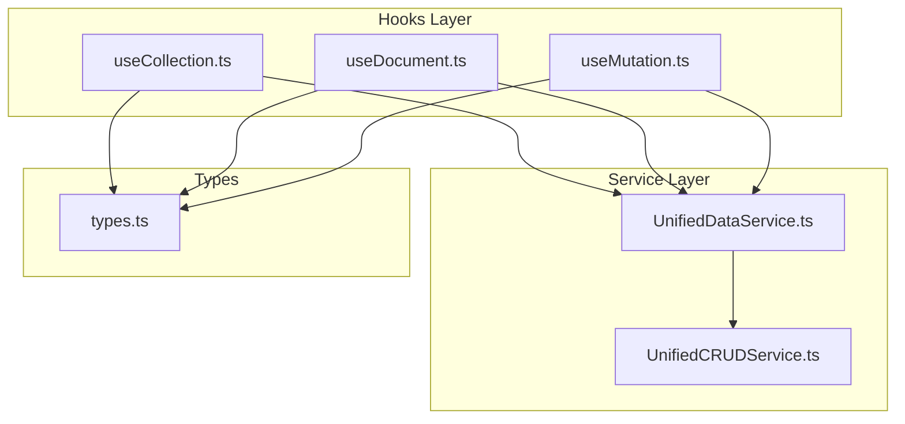
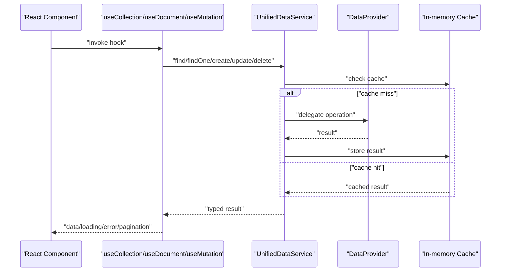
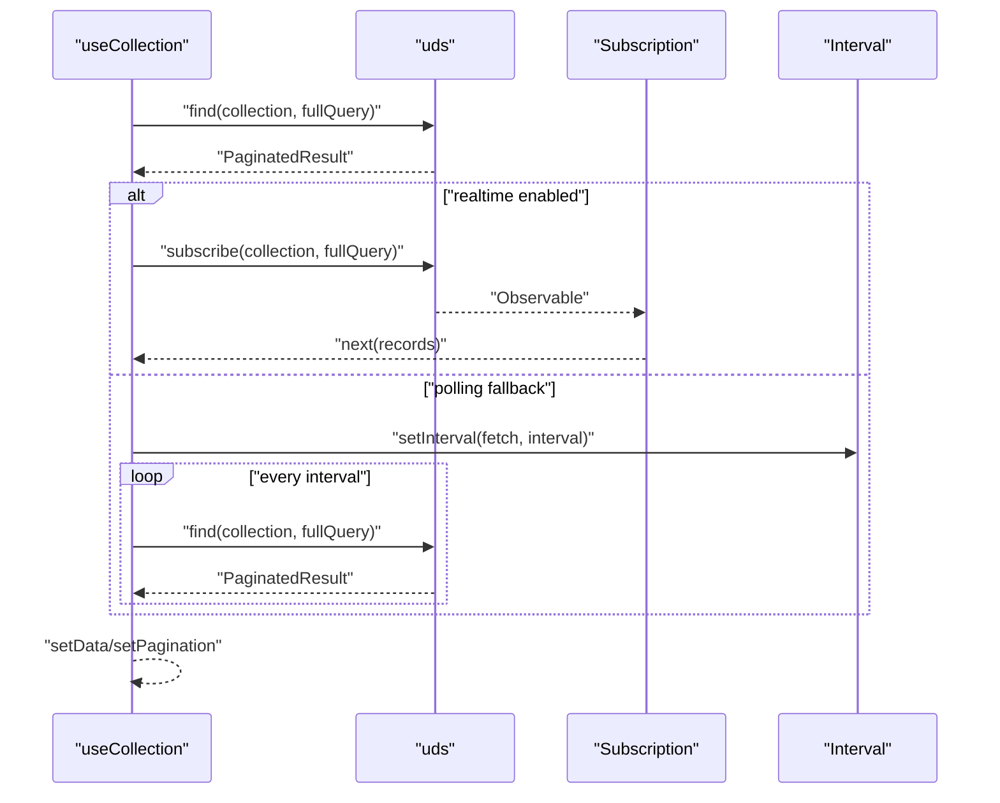
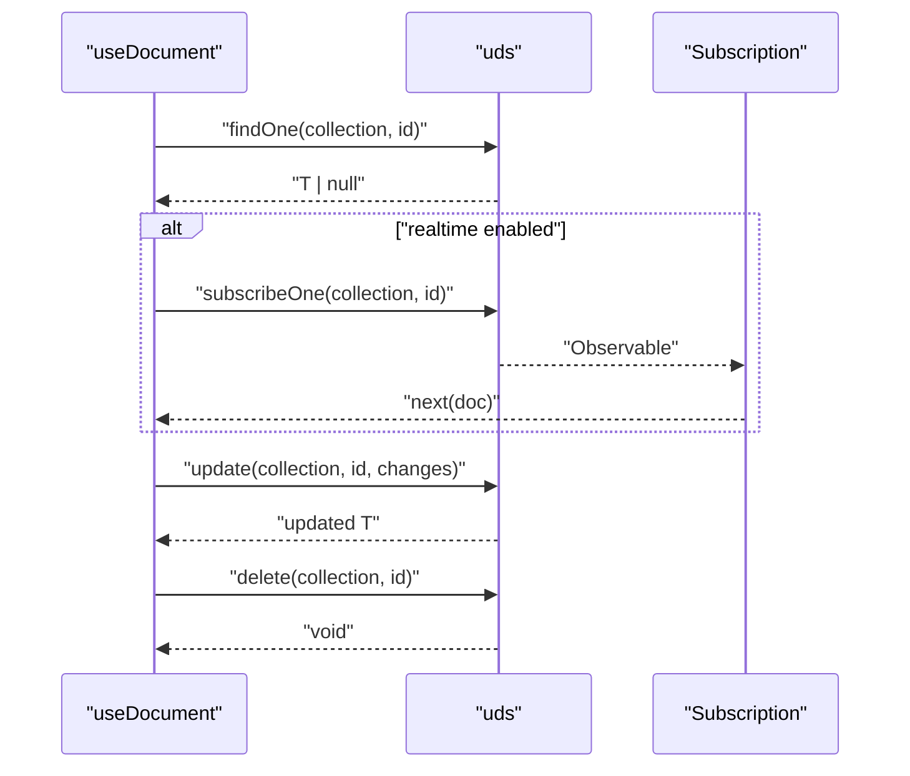
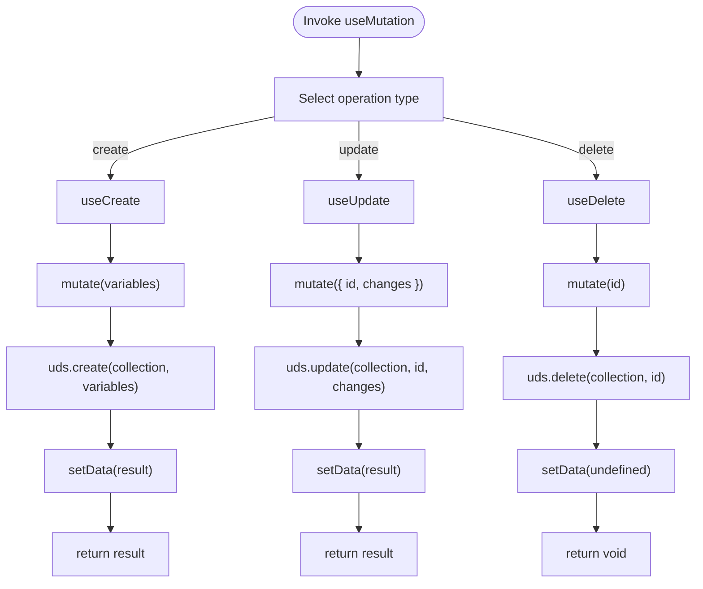
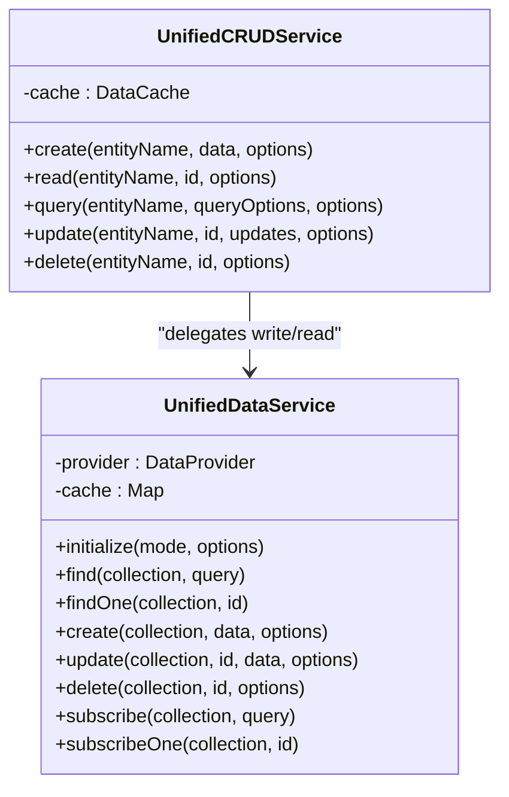
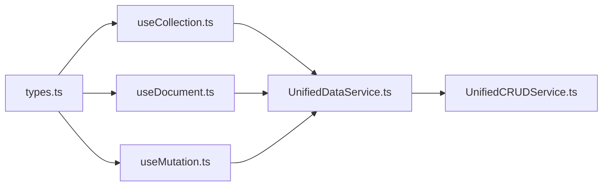

# React Hooks Ecosystem

<cite>
**Referenced Files in This Document**
- [UnifiedCRUDService.ts](file://src/services/data/UnifiedCRUDService.ts)
- [UnifiedDataService.ts](file://src/services/data/UnifiedDataService.ts)
- [useCollection.ts](file://src/services/data/hooks/useCollection.ts)
- [useDocument.ts](file://src/services/data/hooks/useDocument.ts)
- [useMutation.ts](file://src/services/data/hooks/useMutation.ts)
- [types.ts](file://src/services/data/types.ts)
- [index.ts](file://src/services/data/hooks/index.ts)
</cite>

## Table of Contents
1. [Introduction](#introduction)
2. [Project Structure](#project-structure)
3. [Core Components](#core-components)
4. [Architecture Overview](#architecture-overview)
5. [Detailed Component Analysis](#detailed-component-analysis)
6. [Dependency Analysis](#dependency-analysis)
7. [Performance Considerations](#performance-considerations)
8. [Troubleshooting Guide](#troubleshooting-guide)
9. [Conclusion](#conclusion)
10. [Appendices](#appendices)

## Introduction
This document describes the React hooks ecosystem built around the UnifiedCRUDService and UnifiedDataService. It focuses on three primary hooks:
- useCollection: reactive collection data fetching with subscription management, filtering, sorting, and pagination
- useDocument: individual entity subscriptions with real-time updates and change detection
- useMutation: write operations including create, update, and delete with optimistic update patterns, error handling, and cache synchronization

It also covers loading states, error boundaries, retry mechanisms, component lifecycle management, TypeScript integration, type safety guarantees, performance considerations, memoization strategies, and best practices for data access patterns in React applications.

## Project Structure
The hooks live under the data service layer and integrate with a unified data access abstraction. The key files are:
- UnifiedCRUDService: centralized CRUD operations with caching and validation
- UnifiedDataService: provider-agnostic service exposing find, findOne, create, update, delete, subscriptions, and cache invalidation
- useCollection, useDocument, useMutation: React hooks that wrap UnifiedDataService for React components
- types.ts: shared type definitions for queries, writes, pagination, and provider capabilities
- hooks/index.ts: re-exports for the hook APIs

**Diagram sources**
- [useCollection.ts:1-169](file://src/services/data/hooks/useCollection.ts#L1-L169)
- [useDocument.ts:1-130](file://src/services/data/hooks/useDocument.ts#L1-L130)
- [useMutation.ts:1-160](file://src/services/data/hooks/useMutation.ts#L1-L160)
- [UnifiedDataService.ts:1-721](file://src/services/data/UnifiedDataService.ts#L1-L721)
- [UnifiedCRUDService.ts:1-689](file://src/services/data/UnifiedCRUDService.ts#L1-L689)
- [types.ts:1-226](file://src/services/data/types.ts#L1-L226)

**Section sources**
- [useCollection.ts:1-169](file://src/services/data/hooks/useCollection.ts#L1-L169)
- [useDocument.ts:1-130](file://src/services/data/hooks/useDocument.ts#L1-L130)
- [useMutation.ts:1-160](file://src/services/data/hooks/useMutation.ts#L1-L160)
- [UnifiedDataService.ts:1-721](file://src/services/data/UnifiedDataService.ts#L1-L721)
- [UnifiedCRUDService.ts:1-689](file://src/services/data/UnifiedCRUDService.ts#L1-L689)
- [types.ts:1-226](file://src/services/data/types.ts#L1-L226)
- [index.ts:1-10](file://src/services/data/hooks/index.ts#L1-L10)

## Core Components
- useCollection: fetches paginated collections, supports real-time subscriptions and polling, exposes navigation helpers, and manages loading/error states
- useDocument: fetches a single document, supports real-time subscription, exposes update/remove/refresh, and tracks existence
- useMutation: provides typed mutation APIs for create/update/delete with loading/error state and optional cache invalidation
- UnifiedDataService: orchestrates provider selection, caching, subscriptions, and emits events
- UnifiedCRUDService: provides validation, caching, and fallbacks across mock/RxDB/backend

Key TypeScript interfaces:
- Query, Filter, SortOption, PaginationOptions, PaginatedResult
- WriteOptions, Operation, ProviderCapabilities
- DataProvider contract for pluggable storage backends

**Section sources**
- [useCollection.ts:58-166](file://src/services/data/hooks/useCollection.ts#L58-L166)
- [useDocument.ts:41-127](file://src/services/data/hooks/useDocument.ts#L41-L127)
- [useMutation.ts:39-157](file://src/services/data/hooks/useMutation.ts#L39-L157)
- [UnifiedDataService.ts:36-721](file://src/services/data/UnifiedDataService.ts#L36-L721)
- [UnifiedCRUDService.ts:9-689](file://src/services/data/UnifiedCRUDService.ts#L9-L689)
- [types.ts:33-226](file://src/services/data/types.ts#L33-L226)

## Architecture Overview
The hooks layer depends on UnifiedDataService, which encapsulates provider selection and caching. For write operations, UnifiedCRUDService adds validation and cache management.

**Diagram sources**
- [useCollection.ts:76-99](file://src/services/data/hooks/useCollection.ts#L76-L99)
- [useDocument.ts:55-73](file://src/services/data/hooks/useDocument.ts#L55-L73)
- [useMutation.ts:47-62](file://src/services/data/hooks/useMutation.ts#L47-L62)
- [UnifiedDataService.ts:153-191](file://src/services/data/UnifiedDataService.ts#L153-L191)
- [UnifiedDataService.ts:214-283](file://src/services/data/UnifiedDataService.ts#L214-L283)

## Detailed Component Analysis

### useCollection Hook
Purpose:
- Reactive collection fetching with pagination, filtering, sorting
- Subscription management via UnifiedDataService
- Polling fallback when real-time is unavailable
- Loading/error state and pagination helpers

Key behaviors:
- Maintains internal state for data, loading, error, pagination, page, and pageSize
- Uses a ref to track subscription and intervals
- Builds a full query with pagination and passes it to uds.find
- Subscribes to collection updates when realtime is enabled
- Supports manual refresh and pagination navigation helpers

**Diagram sources**
- [useCollection.ts:76-129](file://src/services/data/hooks/useCollection.ts#L76-L129)
- [UnifiedDataService.ts:290-321](file://src/services/data/UnifiedDataService.ts#L290-L321)

**Section sources**
- [useCollection.ts:58-166](file://src/services/data/hooks/useCollection.ts#L58-L166)
- [types.ts:64-88](file://src/services/data/types.ts#L64-L88)
- [UnifiedDataService.ts:290-321](file://src/services/data/UnifiedDataService.ts#L290-L321)

### useDocument Hook
Purpose:
- Single-entity subscription and updates
- Real-time updates with change detection
- Update/remove with error propagation
- Existence flag and refresh capability

Key behaviors:
- Tracks data, loading, error
- Subscribes to a single entity when id is present and realtime is enabled
- Exposes update/remove/refresh functions delegating to uds
- Returns exists flag based on presence of data

**Diagram sources**
- [useDocument.ts:55-116](file://src/services/data/hooks/useDocument.ts#L55-L116)
- [UnifiedDataService.ts:304-321](file://src/services/data/UnifiedDataService.ts#L304-L321)

**Section sources**
- [useDocument.ts:41-127](file://src/services/data/hooks/useDocument.ts#L41-L127)
- [UnifiedDataService.ts:304-321](file://src/services/data/UnifiedDataService.ts#L304-L321)

### useMutation Hook Family
Purpose:
- Encapsulate write operations with consistent loading/error state
- Support create, update, delete with typed variables
- Optional cache invalidation and toast notifications

Key behaviors:
- useCreate: returns mutate(variables) -> Promise<T | null>
- useUpdate: returns mutate({ id, changes })
- useDelete: returns mutate(id) -> Promise<void>
- All expose loading, error, data, reset
- Delegates to uds.create/update/delete

**Diagram sources**
- [useMutation.ts:39-157](file://src/services/data/hooks/useMutation.ts#L39-L157)
- [UnifiedDataService.ts:214-283](file://src/services/data/UnifiedDataService.ts#L214-L283)

**Section sources**
- [useMutation.ts:13-157](file://src/services/data/hooks/useMutation.ts#L13-L157)
- [UnifiedDataService.ts:214-283](file://src/services/data/UnifiedDataService.ts#L214-L283)

### UnifiedCRUDService and UnifiedDataService Integration
- UnifiedCRUDService centralizes validation, caching, and fallbacks across providers
- UnifiedDataService abstracts provider capabilities, caching, subscriptions, and events
- Hooks call UnifiedDataService methods; CRUD service is used internally by UnifiedCRUDService

**Diagram sources**
- [UnifiedCRUDService.ts:113-689](file://src/services/data/UnifiedCRUDService.ts#L113-L689)
- [UnifiedDataService.ts:36-721](file://src/services/data/UnifiedDataService.ts#L36-L721)

**Section sources**
- [UnifiedCRUDService.ts:113-689](file://src/services/data/UnifiedCRUDService.ts#L113-L689)
- [UnifiedDataService.ts:36-721](file://src/services/data/UnifiedDataService.ts#L36-L721)

## Dependency Analysis
- Hooks depend on UnifiedDataService for all data operations
- UnifiedDataService depends on DataProvider implementations and maintains an in-memory cache
- UnifiedCRUDService provides validation and cache management for write operations
- Types define the contracts for queries, writes, pagination, and provider capabilities

**Diagram sources**
- [types.ts:1-226](file://src/services/data/types.ts#L1-L226)
- [useCollection.ts:1-169](file://src/services/data/hooks/useCollection.ts#L1-L169)
- [useDocument.ts:1-130](file://src/services/data/hooks/useDocument.ts#L1-L130)
- [useMutation.ts:1-160](file://src/services/data/hooks/useMutation.ts#L1-L160)
- [UnifiedDataService.ts:1-721](file://src/services/data/UnifiedDataService.ts#L1-L721)
- [UnifiedCRUDService.ts:1-689](file://src/services/data/UnifiedCRUDService.ts#L1-L689)

**Section sources**
- [index.ts:7-9](file://src/services/data/hooks/index.ts#L7-L9)
- [types.ts:33-226](file://src/services/data/types.ts#L33-L226)

## Performance Considerations
- Caching
  - UnifiedDataService caches query results and invalidates on write operations
  - UnifiedCRUDService maintains a separate cache for fine-grained control
- Pagination
  - useCollection computes pagination metadata and exposes helpers to navigate pages
- Real-time vs polling
  - When provider supports real-time, hooks subscribe; otherwise, polling is used as a fallback
- Memoization
  - useCallback is used for fetch/update/remove to avoid unnecessary re-renders
  - JSON.stringify(query) in dependency arrays ensures refetches when query changes
- Lifecycle cleanup
  - Subscriptions and intervals are cleaned up on unmount to prevent leaks

Best practices:
- Prefer real-time subscriptions for frequently changing data
- Use initialData to reduce loading flashes
- Keep queries minimal (select/include) to reduce payload sizes
- Invalidate caches appropriately after mutations

**Section sources**
- [UnifiedDataService.ts:47-48](file://src/services/data/UnifiedDataService.ts#L47-L48)
- [UnifiedDataService.ts:619-629](file://src/services/data/UnifiedDataService.ts#L619-L629)
- [useCollection.ts:65-70](file://src/services/data/hooks/useCollection.ts#L65-L70)
- [useCollection.ts:123-128](file://src/services/data/hooks/useCollection.ts#L123-L128)
- [useDocument.ts:86-88](file://src/services/data/hooks/useDocument.ts#L86-L88)

## Troubleshooting Guide
Common issues and resolutions:
- Service not initialized
  - Ensure UnifiedDataService.initialize is called before using hooks
  - Check isReady flag before invoking operations
- Real-time not updating
  - Verify provider capabilities and fallback to polling
  - Confirm subscription is established and not unsubscribed prematurely
- Stale data after mutation
  - Use invalidateCache option in mutations or rely on automatic cache invalidation
- Infinite loops
  - Avoid passing mutable objects in query without memoization
  - Use useCallback for handlers and keep dependencies minimal
- Error handling
  - Use error state from hooks and propagate to UI
  - Implement error boundaries around data-heavy components

**Section sources**
- [UnifiedDataService.ts:64-66](file://src/services/data/UnifiedDataService.ts#L64-L66)
- [useCollection.ts:77-79](file://src/services/data/hooks/useCollection.ts#L77-L79)
- [useMutation.ts:56-58](file://src/services/data/hooks/useMutation.ts#L56-L58)

## Conclusion
The React hooks ecosystem provides a cohesive, type-safe, and provider-agnostic way to manage CRUD operations in React applications. With real-time subscriptions, robust caching, and consistent error handling, developers can build responsive and reliable data-driven UIs while adhering to best practices for performance and lifecycle management.

## Appendices

### Practical Examples and Patterns
- Implementing CRUD operations in components
  - useCollection: pass a Query with filter/sort/pagination; use pagination helpers to navigate
  - useDocument: pass id and enable realtime; use update/remove to mutate data
  - useMutation: useCreate/useUpdate/useDelete to perform writes; handle loading/error states
- Handling asynchronous data fetching
  - Use loading/error from hooks to drive skeletons/spinners and error banners
  - Use initialData to avoid blank states during first load
- Managing component state
  - Keep query objects stable using useMemo/useCallback
  - Reset mutation state after successful operations

### TypeScript Integration and Type Safety
- Query, Filter, SortOption, PaginationOptions, PaginatedResult define strongly typed query shapes
- WriteOptions and Operation define mutation contracts
- ProviderCapabilities and DataProvider ensure provider compatibility
- Hooks return typed data and enforce variable shapes for mutations

**Section sources**
- [types.ts:33-182](file://src/services/data/types.ts#L33-L182)
- [useCollection.ts:11-56](file://src/services/data/hooks/useCollection.ts#L11-L56)
- [useDocument.ts:10-39](file://src/services/data/hooks/useDocument.ts#L10-L39)
- [useMutation.ts:13-36](file://src/services/data/hooks/useMutation.ts#L13-L36)