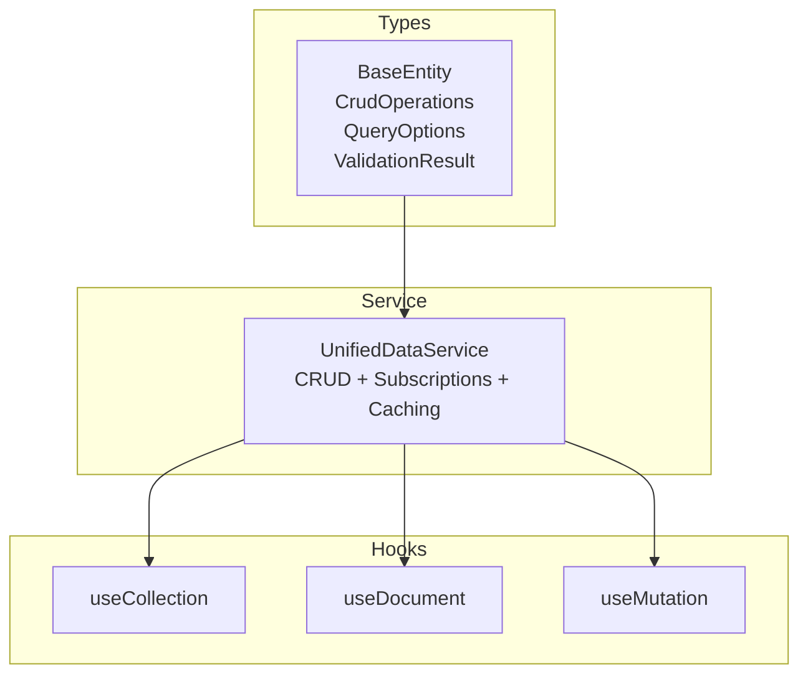
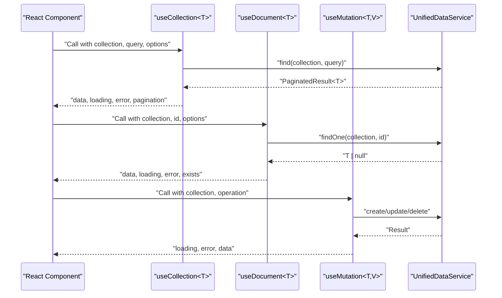
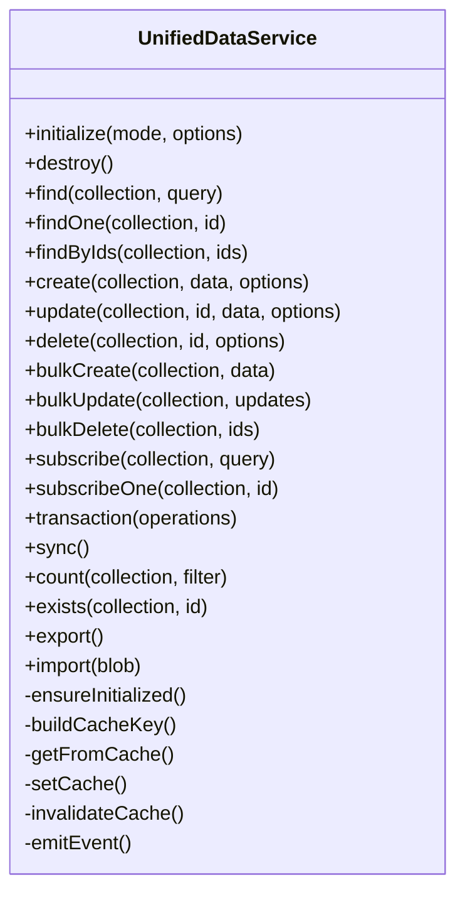
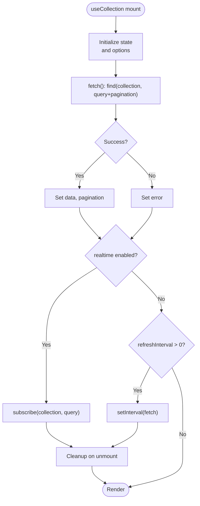
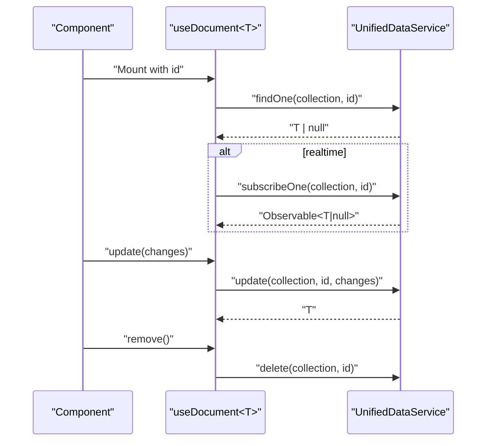
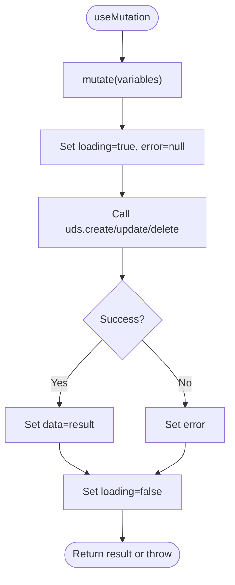
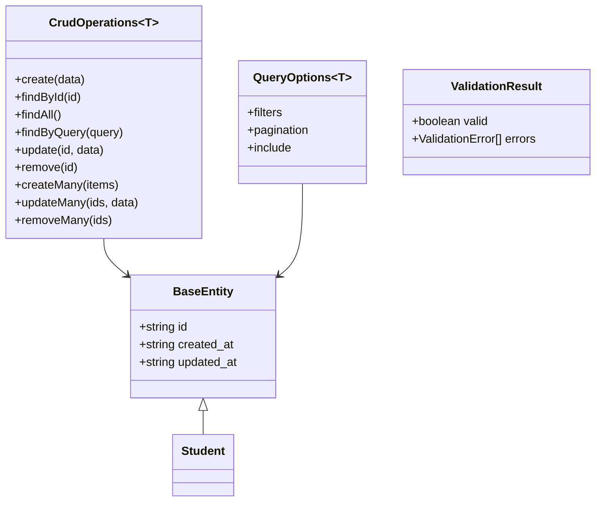
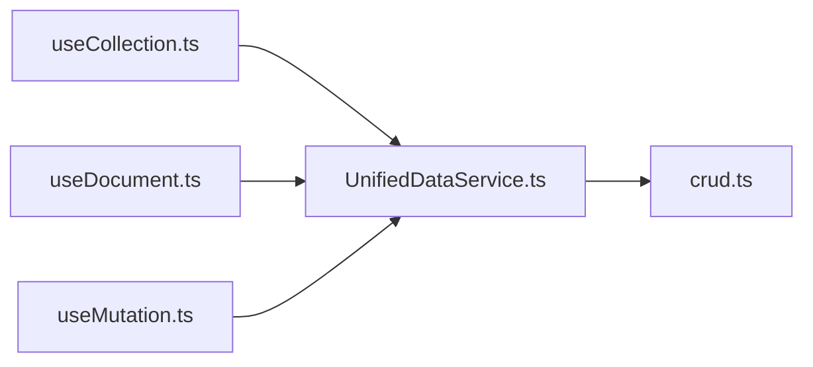

# Unified CRUD Service

<cite>
**Referenced Files in This Document**
- [crud.ts](file://src/core/types/crud.ts)
- [UnifiedDataService.ts](file://src/services/data/UnifiedDataService.ts)
- [useCollection.ts](file://src/services/data/hooks/useCollection.ts)
- [useDocument.ts](file://src/services/data/hooks/useDocument.ts)
- [useMutation.ts](file://src/services/data/hooks/useMutation.ts)
- [dataValidationConsistency.test.ts](file://src/tests/dataValidationConsistency.test.ts)
</cite>

## Table of Contents
1. [Introduction](#introduction)
2. [Project Structure](#project-structure)
3. [Core Components](#core-components)
4. [Architecture Overview](#architecture-overview)
5. [Detailed Component Analysis](#detailed-component-analysis)
6. [Dependency Analysis](#dependency-analysis)
7. [Performance Considerations](#performance-considerations)
8. [Troubleshooting Guide](#troubleshooting-guide)
9. [Conclusion](#conclusion)

## Introduction
This document describes the Unified CRUD Service and its associated React hooks ecosystem. It covers the service’s CRUD interface, collection and document-level operations, batch processing, and real-time subscriptions. It also documents the React hooks for reactive data fetching and mutations, including loading states, error handling, and optimistic update patterns. The guide explains integration with the validation system, TypeScript support, and best practices for data access patterns.

## Project Structure
The Unified CRUD ecosystem spans shared types, a central data service, and React hooks:
- Shared types define CRUD interfaces, query options, validation, and optimistic update records.
- The UnifiedDataService provides a unified API across providers, caching, subscriptions, and batch operations.
- React hooks wrap the service for declarative data fetching and mutations.

**Diagram sources**
- [crud.ts:6-133](file://src/core/types/crud.ts#L6-L133)
- [UnifiedDataService.ts:36-721](file://src/services/data/UnifiedDataService.ts#L36-L721)
- [useCollection.ts:58-169](file://src/services/data/hooks/useCollection.ts#L58-L169)
- [useDocument.ts:41-130](file://src/services/data/hooks/useDocument.ts#L41-L130)
- [useMutation.ts:39-160](file://src/services/data/hooks/useMutation.ts#L39-L160)

**Section sources**
- [crud.ts:6-133](file://src/core/types/crud.ts#L6-L133)
- [UnifiedDataService.ts:36-721](file://src/services/data/UnifiedDataService.ts#L36-L721)
- [useCollection.ts:58-169](file://src/services/data/hooks/useCollection.ts#L58-L169)
- [useDocument.ts:41-130](file://src/services/data/hooks/useDocument.ts#L41-L130)
- [useMutation.ts:39-160](file://src/services/data/hooks/useMutation.ts#L39-L160)

## Core Components
- UnifiedDataService: Central orchestrator for CRUD, subscriptions, caching, and batch operations. Exposes find, findOne, create, update, delete, bulkCreate, bulkUpdate, bulkDelete, subscribe, subscribeOne, and utilities like count, exists, sync, and cache invalidation.
- React Hooks:
  - useCollection: Reactive collection queries with pagination, refresh, and optional real-time updates via subscriptions or polling.
  - useDocument: Single-document subscription with update/delete helpers and existence checks.
  - useMutation: Declarative mutation helpers for create, update, delete with loading/error state and reset.

These components integrate with the shared type system for strong typing, query options, and validation.

**Section sources**
- [UnifiedDataService.ts:148-476](file://src/services/data/UnifiedDataService.ts#L148-L476)
- [useCollection.ts:58-169](file://src/services/data/hooks/useCollection.ts#L58-L169)
- [useDocument.ts:41-130](file://src/services/data/hooks/useDocument.ts#L41-L130)
- [useMutation.ts:39-160](file://src/services/data/hooks/useMutation.ts#L39-L160)
- [crud.ts:101-133](file://src/core/types/crud.ts#L101-L133)

## Architecture Overview
The hooks depend on a singleton UnifiedDataService instance. They translate React lifecycles into service calls, manage local state, and optionally subscribe to real-time updates.

**Diagram sources**
- [useCollection.ts:75-129](file://src/services/data/hooks/useCollection.ts#L75-L129)
- [useDocument.ts:54-89](file://src/services/data/hooks/useDocument.ts#L54-L89)
- [useMutation.ts:47-140](file://src/services/data/hooks/useMutation.ts#L47-L140)
- [UnifiedDataService.ts:153-283](file://src/services/data/UnifiedDataService.ts#L153-L283)

## Detailed Component Analysis

### UnifiedDataService
Responsibilities:
- Initialization and provider selection across deployment modes.
- CRUD operations with metadata injection (timestamps, version).
- Caching with TTL and cache invalidation.
- Real-time subscriptions with fallback polling.
- Batch operations and transactions (provider-dependent).
- Sync orchestration and event emission.

Key behaviors:
- Ensures initialization before operations.
- Builds cache keys from collection and query.
- Emits events on create/update/delete for subscribers.
- Supports bulk operations and transaction boundaries.

**Diagram sources**
- [UnifiedDataService.ts:36-721](file://src/services/data/UnifiedDataService.ts#L36-L721)

**Section sources**
- [UnifiedDataService.ts:36-721](file://src/services/data/UnifiedDataService.ts#L36-L721)

### useCollection<T>
Purpose:
- Reactive collection fetching with pagination and optional real-time updates.
- Manual refresh and navigation helpers.

Behavior:
- Uses service.find(collection, fullQuery) with page/pageSize.
- Subscribes to collection updates if provider supports real-time; otherwise falls back to polling.
- Manages loading/error states and pagination metadata.
- Provides helpers to navigate pages and change page size.

**Diagram sources**
- [useCollection.ts:75-129](file://src/services/data/hooks/useCollection.ts#L75-L129)
- [UnifiedDataService.ts:285-321](file://src/services/data/UnifiedDataService.ts#L285-L321)

**Section sources**
- [useCollection.ts:58-169](file://src/services/data/hooks/useCollection.ts#L58-L169)
- [UnifiedDataService.ts:285-321](file://src/services/data/UnifiedDataService.ts#L285-L321)

### useDocument<T>
Purpose:
- Single-document subscription and mutation helpers.

Behavior:
- Calls findOne(collection, id) on mount.
- Subscribes to updates if realtime is enabled.
- Provides update(changes) and remove() helpers.
- Tracks loading/error and exposes exists flag.

**Diagram sources**
- [useDocument.ts:54-89](file://src/services/data/hooks/useDocument.ts#L54-L89)
- [UnifiedDataService.ts:304-321](file://src/services/data/UnifiedDataService.ts#L304-L321)

**Section sources**
- [useDocument.ts:41-130](file://src/services/data/hooks/useDocument.ts#L41-L130)
- [UnifiedDataService.ts:304-321](file://src/services/data/UnifiedDataService.ts#L304-L321)

### useMutation<T,V>
Purpose:
- Declarative mutation helpers for create, update, delete with loading/error state.

Behavior:
- Exposes mutate(variables) per operation type.
- Tracks loading/error and last successful data.
- Provides reset() to clear state.

**Diagram sources**
- [useMutation.ts:47-140](file://src/services/data/hooks/useMutation.ts#L47-L140)
- [UnifiedDataService.ts:214-283](file://src/services/data/UnifiedDataService.ts#L214-L283)

**Section sources**
- [useMutation.ts:39-160](file://src/services/data/hooks/useMutation.ts#L39-L160)
- [UnifiedDataService.ts:214-283](file://src/services/data/UnifiedDataService.ts#L214-L283)

### Validation and Type Safety
- Shared types define BaseEntity, CrudOperations<T>, QueryOptions<T>, and ValidationResult.
- Validation integrates with service operations (see tests for validation-enabled create/update).
- Hooks return strongly typed data and error states.

**Diagram sources**
- [crud.ts:6-133](file://src/core/types/crud.ts#L6-L133)

**Section sources**
- [crud.ts:6-133](file://src/core/types/crud.ts#L6-L133)
- [dataValidationConsistency.test.ts:403-519](file://src/tests/dataValidationConsistency.test.ts#L403-L519)

## Dependency Analysis
- Hooks depend on UnifiedDataService singleton (uds).
- Service depends on a pluggable DataProvider (selected by deployment mode).
- Types are shared across service and hooks for consistency.

**Diagram sources**
- [useCollection.ts:8](file://src/services/data/hooks/useCollection.ts#L8)
- [useDocument.ts:8](file://src/services/data/hooks/useDocument.ts#L8)
- [useMutation.ts:8](file://src/services/data/hooks/useMutation.ts#L8)
- [UnifiedDataService.ts:9-21](file://src/services/data/UnifiedDataService.ts#L9-L21)
- [crud.ts:4](file://src/core/types/crud.ts#L4)

**Section sources**
- [useCollection.ts:8](file://src/services/data/hooks/useCollection.ts#L8)
- [useDocument.ts:8](file://src/services/data/hooks/useDocument.ts#L8)
- [useMutation.ts:8](file://src/services/data/hooks/useMutation.ts#L8)
- [UnifiedDataService.ts:9-21](file://src/services/data/UnifiedDataService.ts#L9-L21)
- [crud.ts:4](file://src/core/types/crud.ts#L4)

## Performance Considerations
- Caching: UnifiedDataService caches query results with a TTL; cache keys are derived from collection and query. Cache invalidation occurs on create/update/delete and bulk operations.
- Pagination: useCollection manages pagination state and avoids unnecessary re-fetches by including page/pageSize in the query.
- Real-time vs polling: When providers lack real-time capability, the service falls back to polling; configure refreshInterval accordingly.
- Bulk operations: Prefer bulkCreate/bulkUpdate/bulkDelete to minimize round-trips.
- Transactions: Use transaction for atomicity when supported by the provider.

**Section sources**
- [UnifiedDataService.ts:47-48](file://src/services/data/UnifiedDataService.ts#L47-L48)
- [UnifiedDataService.ts:156-169](file://src/services/data/UnifiedDataService.ts#L156-L169)
- [useCollection.ts:68-70](file://src/services/data/hooks/useCollection.ts#L68-L70)
- [UnifiedDataService.ts:328-367](file://src/services/data/UnifiedDataService.ts#L328-L367)
- [UnifiedDataService.ts:374-382](file://src/services/data/UnifiedDataService.ts#L374-L382)

## Troubleshooting Guide
Common issues and resolutions:
- Service not initialized: Ensure UnifiedDataService.initialize() is called before using hooks or service methods.
- Real-time not updating: Verify provider capabilities and that realtime option is enabled in the hook.
- Stale data: Confirm cache invalidation on write operations and consider disabling cache for sensitive reads.
- Validation errors: When validation is enabled, inspect ValidationResult and handle errors in UI.

**Section sources**
- [UnifiedDataService.ts:601-605](file://src/services/data/UnifiedDataService.ts#L601-L605)
- [useCollection.ts:106-121](file://src/services/data/hooks/useCollection.ts#L106-L121)
- [useDocument.ts:79-88](file://src/services/data/hooks/useDocument.ts#L79-L88)
- [dataValidationConsistency.test.ts:455-467](file://src/tests/dataValidationConsistency.test.ts#L455-L467)

## Conclusion
The Unified CRUD Service and hooks provide a cohesive, type-safe, and extensible foundation for data access across modules. The service abstracts provider differences, offers real-time subscriptions, caching, and batch operations, while the hooks deliver predictable patterns for collections, documents, and mutations. By leveraging validation, pagination, and proper lifecycle management, teams can implement robust, maintainable data flows with strong TypeScript guarantees.