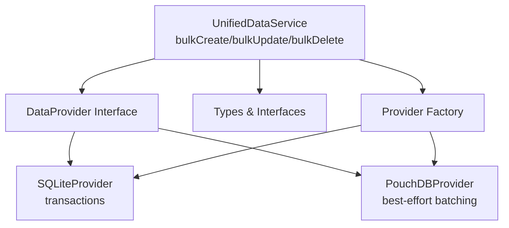
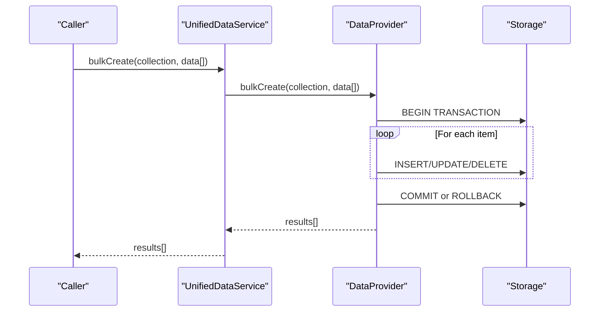
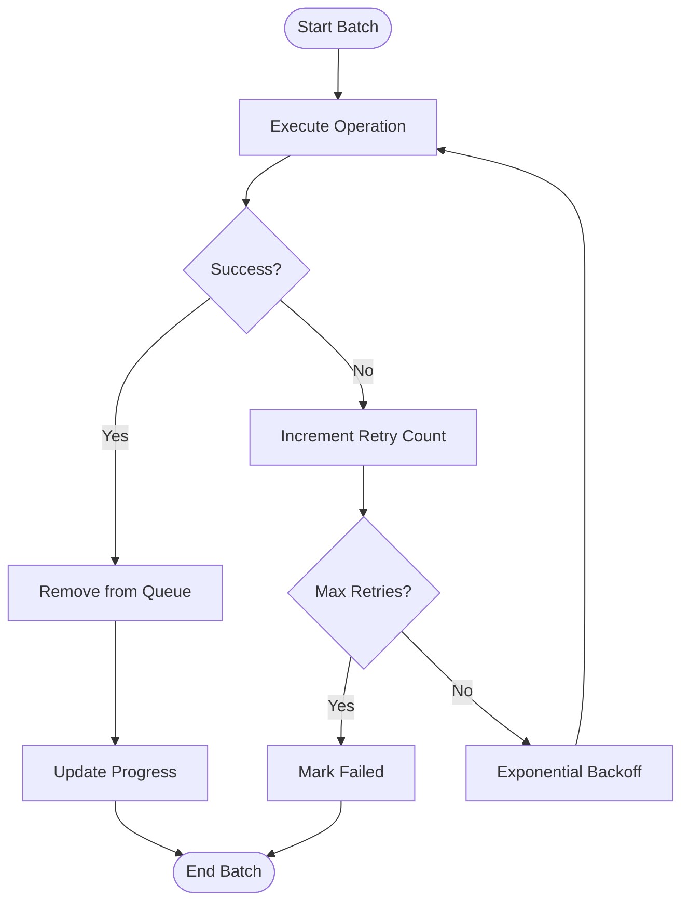
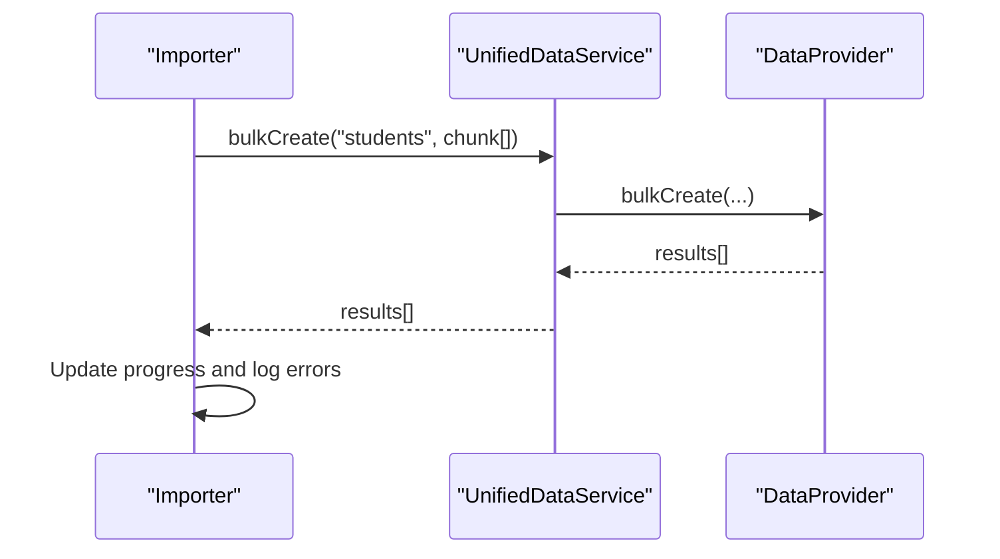
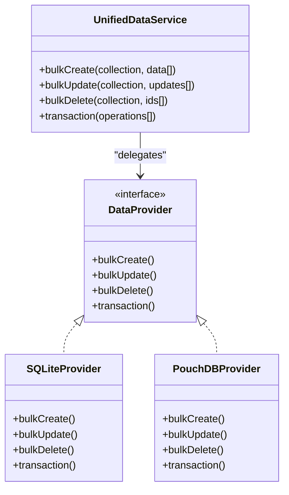

# Bulk Operations

<cite>
**Referenced Files in This Document**
- [UnifiedDataService.ts](file://src/services/data/UnifiedDataService.ts)
- [SQLiteProvider.ts](file://src/services/data/providers/SQLiteProvider.ts)
- [PouchDBProvider.ts](file://src/services/data/providers/PouchDBProvider.ts)
- [types.ts](file://src/services/data/types.ts)
- [index.ts](file://src/services/data/providers/index.ts)
- [PerformanceTestSuite.test.ts](file://src/services/database/__tests__/PerformanceTestSuite.test.ts)
- [task-6.3-implementation-summary.md](file://docs/workflows/task-6.3-implementation-summary.md)
- [usePerformanceMonitoring.ts](file://src/hooks/usePerformanceMonitoring.ts)
- [SyncEngine.ts](file://src/services/data/SyncEngine.ts)
- [OfflineQueue.ts](file://src/services/database/sync/OfflineQueue.ts)
- [BackendServiceAdapter.ts](file://src/services/backend/BackendServiceAdapter.ts)
- [DataServiceFactory.ts](file://src/services/data/DataServiceFactory.ts)
</cite>

## Table of Contents
1. [Introduction](#introduction)
2. [Project Structure](#project-structure)
3. [Core Components](#core-components)
4. [Architecture Overview](#architecture-overview)
5. [Detailed Component Analysis](#detailed-component-analysis)
6. [Dependency Analysis](#dependency-analysis)
7. [Performance Considerations](#performance-considerations)
8. [Troubleshooting Guide](#troubleshooting-guide)
9. [Conclusion](#conclusion)
10. [Appendices](#appendices)

## Introduction
This document explains bulk operations in UnifiedDataService: bulkCreate for efficient multi-entity insertion, bulkUpdate for batch modifications with per-entity ID/data pairs, and bulkDelete for mass removal. It covers performance benefits over individual operations, transactional behavior where supported, error handling for partial failures, operational limits, memory considerations, and progress tracking. Practical examples illustrate bulk data import/export scenarios, optimization techniques, and best practices for large-scale data operations.

## Project Structure
Bulk operations are exposed through UnifiedDataService and delegated to provider implementations. The providers implement ACID transactions for SQLite and best-effort batching for PouchDB. The system also integrates with offline queues and sync engines for robustness.

**Diagram sources**
- [UnifiedDataService.ts:328-367](file://src/services/data/UnifiedDataService.ts#L328-L367)
- [types.ts:136-182](file://src/services/data/types.ts#L136-L182)
- [index.ts:42-102](file://src/services/data/providers/index.ts#L42-L102)
- [SQLiteProvider.ts:351-403](file://src/services/data/providers/SQLiteProvider.ts#L351-L403)
- [PouchDBProvider.ts:382-437](file://src/services/data/providers/PouchDBProvider.ts#L382-L437)

**Section sources**
- [UnifiedDataService.ts:328-367](file://src/services/data/UnifiedDataService.ts#L328-L367)
- [types.ts:136-182](file://src/services/data/types.ts#L136-L182)
- [index.ts:42-102](file://src/services/data/providers/index.ts#L42-L102)

## Core Components
- UnifiedDataService exposes bulkCreate, bulkUpdate, and bulkDelete. It validates initialization, delegates to the active provider, and invalidates caches after bulk operations.
- SQLiteProvider wraps bulk operations in a transaction to ensure atomicity and rollback on failure.
- PouchDBProvider performs best-effort bulk operations; bulkCreate/bulkUpdate iterate and call create/update per item, while bulkDelete uses bulkDocs for multi-document deletions.
- Provider factory selects the appropriate provider based on deployment mode and feature flags.

**Section sources**
- [UnifiedDataService.ts:328-367](file://src/services/data/UnifiedDataService.ts#L328-L367)
- [SQLiteProvider.ts:351-403](file://src/services/data/providers/SQLiteProvider.ts#L351-L403)
- [PouchDBProvider.ts:382-437](file://src/services/data/providers/PouchDBProvider.ts#L382-L437)
- [index.ts:42-102](file://src/services/data/providers/index.ts#L42-L102)

## Architecture Overview
Bulk operations follow a layered pattern: the service layer validates and orchestrates, the provider layer executes with backend-specific optimizations, and supporting systems handle offline, retries, and progress.

**Diagram sources**
- [UnifiedDataService.ts:328-336](file://src/services/data/UnifiedDataService.ts#L328-L336)
- [SQLiteProvider.ts:351-371](file://src/services/data/providers/SQLiteProvider.ts#L351-L371)
- [PouchDBProvider.ts:382-397](file://src/services/data/providers/PouchDBProvider.ts#L382-L397)

## Detailed Component Analysis

### UnifiedDataService Bulk APIs
- bulkCreate(collection, data[]): Delegates to provider.bulkCreate and clears collection cache.
- bulkUpdate(collection, updates[]): Delegates to provider.bulkUpdate and invalidates affected caches.
- bulkDelete(collection, ids[]): Delegates to provider.bulkDelete and invalidates caches.

Behavior highlights:
- Initialization guard ensures the service is ready.
- Caching invalidated per collection and per-ID to maintain consistency.
- Transaction support depends on provider capabilities.

**Section sources**
- [UnifiedDataService.ts:328-367](file://src/services/data/UnifiedDataService.ts#L328-L367)

### SQLiteProvider Bulk Operations
- bulkCreate: Iterates items and calls create inside a transaction; commits on success, rolls back on error.
- bulkUpdate: Iterates updates and calls update inside a transaction; commits on success, rolls back on error.
- bulkDelete: Uses parameterized IN clause for efficient deletion of multiple IDs.

Transaction semantics:
- ACID transactions ensure atomicity; failures trigger rollback.

**Section sources**
- [SQLiteProvider.ts:351-403](file://src/services/data/providers/SQLiteProvider.ts#L351-L403)

### PouchDBProvider Bulk Operations
- bulkCreate: Iterates items and calls create; logs and rethrows errors immediately to surface partial failures.
- bulkUpdate: Iterates updates and calls update; logs and rethrows errors immediately.
- bulkDelete: Collects documents by ID and deletes them in bulk via bulkDocs.

Note:
- PouchDB does not support ACID transactions; bulk operations are best-effort.

**Section sources**
- [PouchDBProvider.ts:382-437](file://src/services/data/providers/PouchDBProvider.ts#L382-L437)

### Provider Selection and Deployment Modes
- Provider factory chooses SQLite or PouchDB based on mode and feature flags.
- Standalone mode defaults to PouchDB unless SQLite is enabled via feature flags.
- Networked/SAAS modes configure PouchDB with live sync and retry.

**Section sources**
- [index.ts:42-102](file://src/services/data/providers/index.ts#L42-L102)
- [DataServiceFactory.ts:37-151](file://src/services/data/DataServiceFactory.ts#L37-L151)

### Transaction Support and Fallbacks
- UnifiedDataService.transaction requires provider.capabilities.transactions.
- SQLiteProvider supports transactions; PouchDBProvider simulates best-effort via ordered operations.

**Section sources**
- [UnifiedDataService.ts:374-382](file://src/services/data/UnifiedDataService.ts#L374-L382)
- [SQLiteProvider.ts:407-437](file://src/services/data/providers/SQLiteProvider.ts#L407-L437)
- [PouchDBProvider.ts:441-463](file://src/services/data/providers/PouchDBProvider.ts#L441-L463)

### Offline Queue and Progress Tracking
- OfflineQueue processes batches with retry/backoff, reporting counts and statuses.
- SyncEngine processes batches and updates progress; it retries failed operations with exponential backoff.

**Diagram sources**
- [OfflineQueue.ts:152-213](file://src/services/database/sync/OfflineQueue.ts#L152-L213)
- [SyncEngine.ts:340-382](file://src/services/data/SyncEngine.ts#L340-L382)

**Section sources**
- [OfflineQueue.ts:152-213](file://src/services/database/sync/OfflineQueue.ts#L152-L213)
- [SyncEngine.ts:340-382](file://src/services/data/SyncEngine.ts#L340-L382)

### Practical Examples

#### Bulk Data Import
- Scenario: Import a CSV of students into the students collection.
- Steps:
  - Split the dataset into chunks (e.g., 1000 items).
  - Call bulkCreate(collection, chunk) for each batch.
  - Track progress using OfflineQueue or SyncEngine status.
  - On failure, rely on provider-specific error logging and retry mechanisms.

**Diagram sources**
- [UnifiedDataService.ts:328-336](file://src/services/data/UnifiedDataService.ts#L328-L336)
- [SQLiteProvider.ts:351-371](file://src/services/data/providers/SQLiteProvider.ts#L351-L371)
- [PouchDBProvider.ts:382-397](file://src/services/data/providers/PouchDBProvider.ts#L382-L397)

#### Bulk Data Export
- Scenario: Export all records from a collection for backup.
- Steps:
  - Use provider.export() to produce a Blob (supported by SQLiteProvider).
  - For PouchDBProvider, use sync to consolidate changes and then export via backend if needed.

**Section sources**
- [SQLiteProvider.ts:459-485](file://src/services/data/providers/SQLiteProvider.ts#L459-L485)
- [PouchDBProvider.ts:556-562](file://src/services/data/providers/PouchDBProvider.ts#L556-L562)

#### Bulk Modifications with Partial Failure Handling
- Scenario: Update grade fields for 10,000 students.
- Steps:
  - Split into batches (e.g., 500).
  - Call bulkUpdate(collection, [{id, data}[]]).
  - For PouchDBProvider, immediate errors are thrown; wrap each batch in try/catch and record failures.
  - For SQLiteProvider, transaction rollback ensures no partial writes.

**Section sources**
- [PouchDBProvider.ts:399-413](file://src/services/data/providers/PouchDBProvider.ts#L399-L413)
- [SQLiteProvider.ts:373-392](file://src/services/data/providers/SQLiteProvider.ts#L373-L392)

## Dependency Analysis
- UnifiedDataService depends on DataProvider interface and provider capabilities.
- SQLiteProvider and PouchDBProvider implement bulk operations differently due to backend constraints.
- OfflineQueue and SyncEngine depend on provider capabilities to decide retry/backoff strategies.

**Diagram sources**
- [UnifiedDataService.ts:328-382](file://src/services/data/UnifiedDataService.ts#L328-L382)
- [types.ts:136-182](file://src/services/data/types.ts#L136-L182)
- [SQLiteProvider.ts:351-437](file://src/services/data/providers/SQLiteProvider.ts#L351-L437)
- [PouchDBProvider.ts:382-463](file://src/services/data/providers/PouchDBProvider.ts#L382-L463)

**Section sources**
- [types.ts:136-182](file://src/services/data/types.ts#L136-L182)
- [index.ts:42-102](file://src/services/data/providers/index.ts#L42-L102)

## Performance Considerations
- Transaction batching: SQLiteProvider wraps bulk operations in a transaction to reduce write amplification and improve throughput.
- Best-effort batching: PouchDBProvider iterates items; use smaller batches to minimize memory pressure and improve responsiveness.
- Memory management: Monitor heap usage during large bulk operations; consider chunking and periodic GC-friendly pauses.
- Offline resilience: OfflineQueue and SyncEngine provide retry/backoff to handle transient failures and network issues.

**Section sources**
- [SQLiteProvider.ts:351-403](file://src/services/data/providers/SQLiteProvider.ts#L351-L403)
- [PouchDBProvider.ts:382-437](file://src/services/data/providers/PouchDBProvider.ts#L382-L437)
- [OfflineQueue.ts:152-213](file://src/services/database/sync/OfflineQueue.ts#L152-L213)
- [SyncEngine.ts:340-382](file://src/services/data/SyncEngine.ts#L340-L382)
- [PerformanceTestSuite.test.ts:205-248](file://src/services/database/__tests__/PerformanceTestSuite.test.ts#L205-L248)

## Troubleshooting Guide
Common issues and resolutions:
- Provider does not support transactions: Use SQLiteProvider for ACID guarantees or handle partial failures with PouchDBProvider.
- Immediate errors in PouchDBProvider: Wrap each batch in try/catch and log failures; implement retry with backoff.
- Memory spikes during bulk operations: Reduce batch sizes; monitor with performance hooks; clear caches after batches.
- Offline failures: Inspect OfflineQueue status; retry failed operations; verify retry attempts and backoff configuration.

**Section sources**
- [PouchDBProvider.ts:382-437](file://src/services/data/providers/PouchDBProvider.ts#L382-L437)
- [OfflineQueue.ts:152-213](file://src/services/database/sync/OfflineQueue.ts#L152-L213)
- [usePerformanceMonitoring.ts:268-294](file://src/hooks/usePerformanceMonitoring.ts#L268-L294)

## Conclusion
Bulk operations in UnifiedDataService deliver significant performance improvements over individual operations by leveraging provider-specific optimizations. SQLiteProvider offers transactional safety for atomicity, while PouchDBProvider provides scalable best-effort batching. Robust offline and sync systems ensure reliability under adverse conditions. Adopt chunked processing, monitor memory, and use progress tracking to manage large-scale data operations effectively.

## Appendices

### API Reference: Bulk Operations
- bulkCreate(collection, data[]): Returns created entities.
- bulkUpdate(collection, updates[]): Updates are arrays of {id, data}. Returns updated entities.
- bulkDelete(collection, ids[]): Removes entities by IDs.

**Section sources**
- [UnifiedDataService.ts:328-367](file://src/services/data/UnifiedDataService.ts#L328-L367)
- [types.ts:164-167](file://src/services/data/types.ts#L164-L167)

### Transactional Behavior Matrix
- SQLiteProvider: Transactions supported; atomic commit/rollback.
- PouchDBProvider: No ACID transactions; best-effort simulation via ordered operations.

**Section sources**
- [SQLiteProvider.ts:407-437](file://src/services/data/providers/SQLiteProvider.ts#L407-L437)
- [PouchDBProvider.ts:441-463](file://src/services/data/providers/PouchDBProvider.ts#L441-L463)

### Performance Benchmarks and Thresholds
- Tests demonstrate acceptable thresholds for bulk update and bulk delete operations.
- Use these as baselines when designing bulk pipelines.

**Section sources**
- [PerformanceTestSuite.test.ts:205-248](file://src/services/database/__tests__/PerformanceTestSuite.test.ts#L205-L248)