# CRUD Operations

<cite>
**Referenced Files in This Document**
- [UnifiedDataService.ts](file://src/services/data/UnifiedDataService.ts)
- [types.ts](file://src/services/data/types.ts)
- [crud.ts](file://src/core/types/crud.ts)
- [DATA_LAYER_STRATEGY.md](file://docs/architecture/DATA_LAYER_STRATEGY.md)
- [crud_completion_implementation_guide.md](file://docs/guides/crud_completion_implementation_guide.md)
- [recap2_crud_implementation_analysis_20250103_14h30.md](file://docs/migration/recap2_crud_implementation_analysis_20250103_14h30.md)
</cite>

## Table of Contents
1. [Introduction](#introduction)
2. [Project Structure](#project-structure)
3. [Core Components](#core-components)
4. [Architecture Overview](#architecture-overview)
5. [Detailed Component Analysis](#detailed-component-analysis)
6. [Dependency Analysis](#dependency-analysis)
7. [Performance Considerations](#performance-considerations)
8. [Troubleshooting Guide](#troubleshooting-guide)
9. [Conclusion](#conclusion)

## Introduction
This document provides a comprehensive guide to CRUD operations in UnifiedDataService, focusing on the find method with query parameters, pagination, and filtering; single-entity retrieval via findOne; batch fetching via findByIds; create operations with automatic metadata injection; update operations supporting partial updates and metadata handling; delete operations with cache invalidation; write options; error handling patterns; and cache invalidation strategies. It also includes practical examples of typical CRUD workflows, query construction, and result processing patterns.

## Project Structure
UnifiedDataService is the central orchestrator for data operations across multiple providers (e.g., SQLite, PouchDB, Backend API). It exposes a unified API for find, findOne, findByIds, create, update, delete, and related operations, while delegating persistence to a selected provider and managing caching and events.

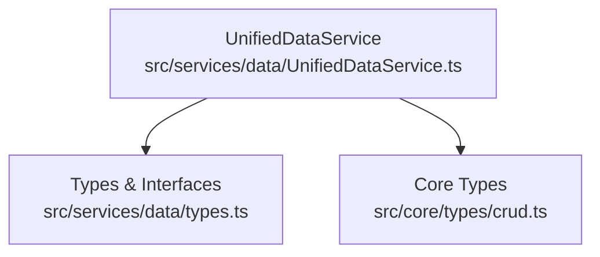

**Diagram sources**
- [UnifiedDataService.ts:36-721](file://src/services/data/UnifiedDataService.ts#L36-L721)
- [types.ts:1-64](file://src/services/data/types.ts#L1-L64)
- [crud.ts:1-222](file://src/core/types/crud.ts#L1-L222)

**Section sources**
- [UnifiedDataService.ts:36-721](file://src/services/data/UnifiedDataService.ts#L36-L721)
- [types.ts:1-64](file://src/services/data/types.ts#L1-L64)
- [crud.ts:1-222](file://src/core/types/crud.ts#L1-L222)

## Core Components
- UnifiedDataService: Central service providing find, findOne, findByIds, create, update, delete, bulk operations, subscriptions, transactions, and sync. It manages initialization, provider selection, caching, and event emission.
- Provider Contract: Defines capabilities and operations (find, findOne, create, update, delete, subscribe, bulk, transaction, sync, count, exists, export/import).
- Query and Filter Types: Define structured query parameters, filters, pagination, and sort options.

Key responsibilities:
- Routing CRUD calls to the active provider
- Applying caching with TTL and targeted invalidation
- Injecting metadata (createdAt, updatedAt, version) on create/update
- Emitting data events for subscribers
- Providing real-time subscriptions with polling fallback

**Section sources**
- [UnifiedDataService.ts:148-476](file://src/services/data/UnifiedDataService.ts#L148-L476)
- [DATA_LAYER_STRATEGY.md:98-174](file://docs/architecture/DATA_LAYER_STRATEGY.md#L98-L174)
- [types.ts:33-64](file://src/services/data/types.ts#L33-L64)

## Architecture Overview
UnifiedDataService acts as a facade over pluggable providers. It ensures consistent behavior across environments and providers, including caching, metadata injection, and eventing.

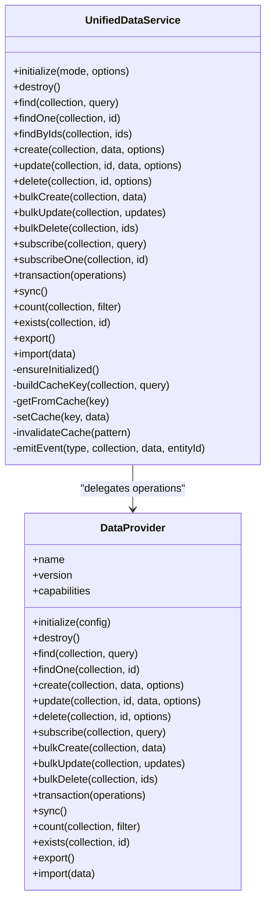

**Diagram sources**
- [UnifiedDataService.ts:36-721](file://src/services/data/UnifiedDataService.ts#L36-L721)
- [DATA_LAYER_STRATEGY.md:98-174](file://docs/architecture/DATA_LAYER_STRATEGY.md#L98-L174)

## Detailed Component Analysis

### Find with Query Parameters, Pagination, and Filtering
The find method retrieves paginated results with support for filtering and sorting. It:
- Builds a cache key from collection and serialized query
- Returns cached results if available and fresh
- Delegates to provider.find(collection, query)
- Updates cache with the returned result
- Returns a PaginatedResult<T> containing data and pagination metadata

Query structure and supported operators are defined in the provider types. Sorting and pagination options are part of the Query interface.

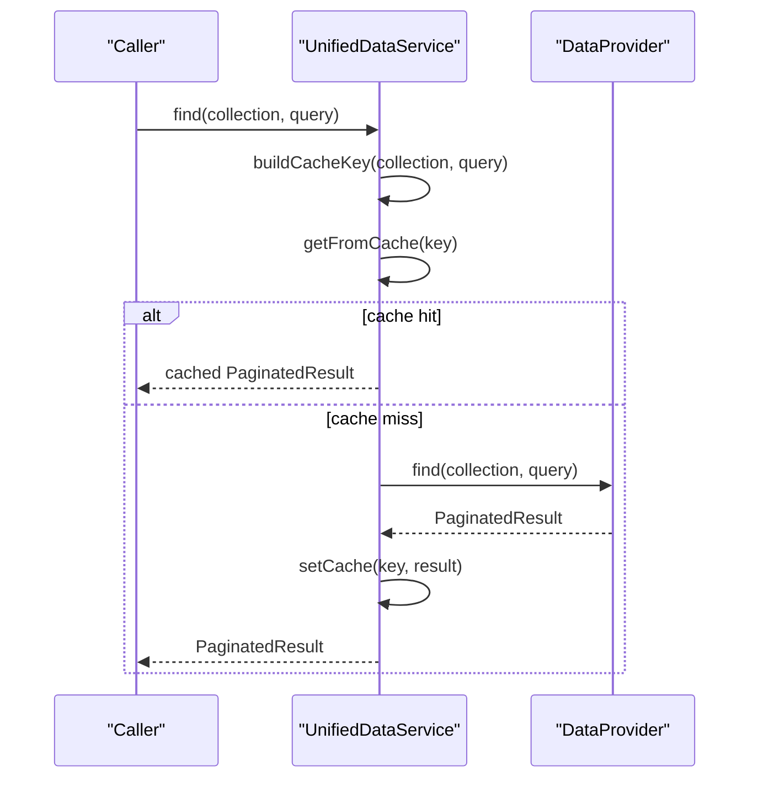

**Diagram sources**
- [UnifiedDataService.ts:153-170](file://src/services/data/UnifiedDataService.ts#L153-L170)
- [types.ts:33-64](file://src/services/data/types.ts#L33-L64)

Practical example patterns:
- Construct a query with filter conditions and pagination options
- Use sort options to order results
- Process the returned data and pagination metadata to drive UI lists

**Section sources**
- [UnifiedDataService.ts:153-170](file://src/services/data/UnifiedDataService.ts#L153-L170)
- [types.ts:33-64](file://src/services/data/types.ts#L33-L64)

### findOne for Single Entity Retrieval
findOne retrieves a single entity by ID:
- Builds a cache key from collection and ID
- Returns cached result if available
- Delegates to provider.findOne(collection, id)
- Caches the result if present
- Returns T | null

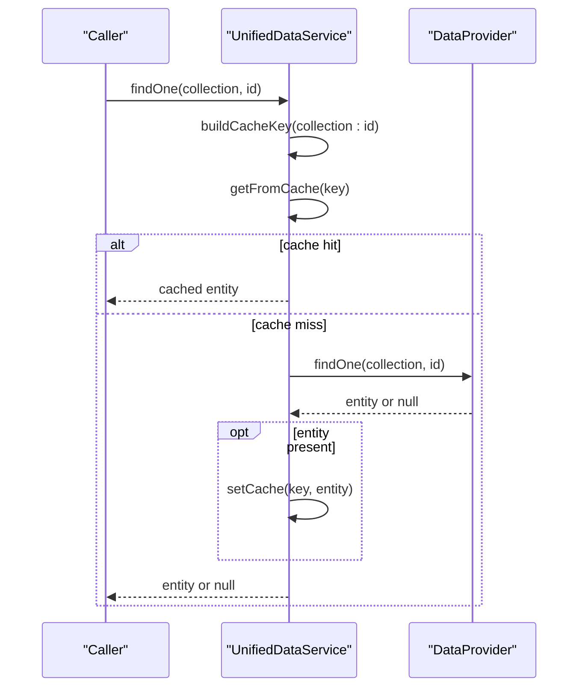

**Diagram sources**
- [UnifiedDataService.ts:175-191](file://src/services/data/UnifiedDataService.ts#L175-L191)

**Section sources**
- [UnifiedDataService.ts:175-191](file://src/services/data/UnifiedDataService.ts#L175-L191)

### findByIds for Batch Fetching
findByIds fetches multiple entities by IDs:
- If provider supports findByIds, delegates directly
- Otherwise falls back to fetching each ID individually using findOne
- Filters out null results and returns T[]

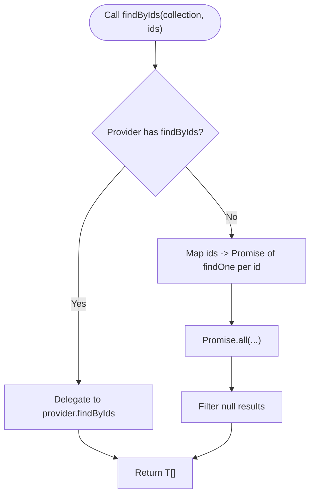

**Diagram sources**
- [UnifiedDataService.ts:196-209](file://src/services/data/UnifiedDataService.ts#L196-L209)

**Section sources**
- [UnifiedDataService.ts:196-209](file://src/services/data/UnifiedDataService.ts#L196-L209)

### Create with Automatic Metadata Injection
create injects metadata before persisting:
- Merges incoming data with createdAt, updatedAt, and version
- Delegates to provider.create(collection, dataWithMeta, options)
- Clears relevant caches (by collection)
- Emits an entity-created event

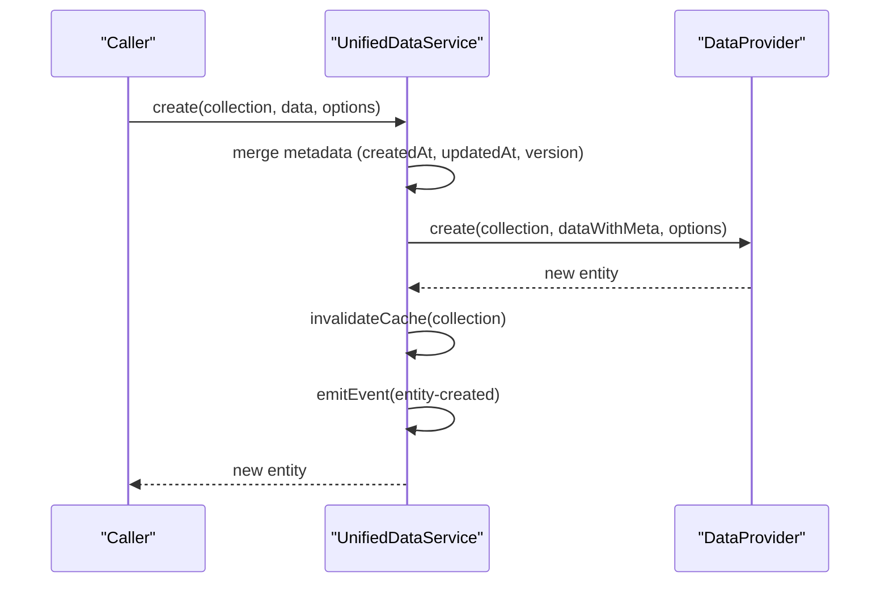

**Diagram sources**
- [UnifiedDataService.ts:214-238](file://src/services/data/UnifiedDataService.ts#L214-L238)

**Section sources**
- [UnifiedDataService.ts:214-238](file://src/services/data/UnifiedDataService.ts#L214-L238)

### Update with Partial Updates and Metadata Handling
update supports partial updates and metadata:
- Merges partial data with updatedAt
- Delegates to provider.update(collection, id, dataWithMeta, options)
- Invalidates caches for the specific entity and collection
- Emits an entity-updated event

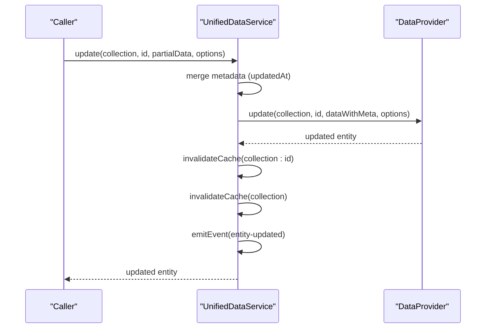

**Diagram sources**
- [UnifiedDataService.ts:243-267](file://src/services/data/UnifiedDataService.ts#L243-L267)

**Section sources**
- [UnifiedDataService.ts:243-267](file://src/services/data/UnifiedDataService.ts#L243-L267)

### Delete with Cache Invalidation
delete removes an entity:
- Delegates to provider.delete(collection, id, options)
- Invalidates caches for the specific entity and collection
- Emits an entity-deleted event

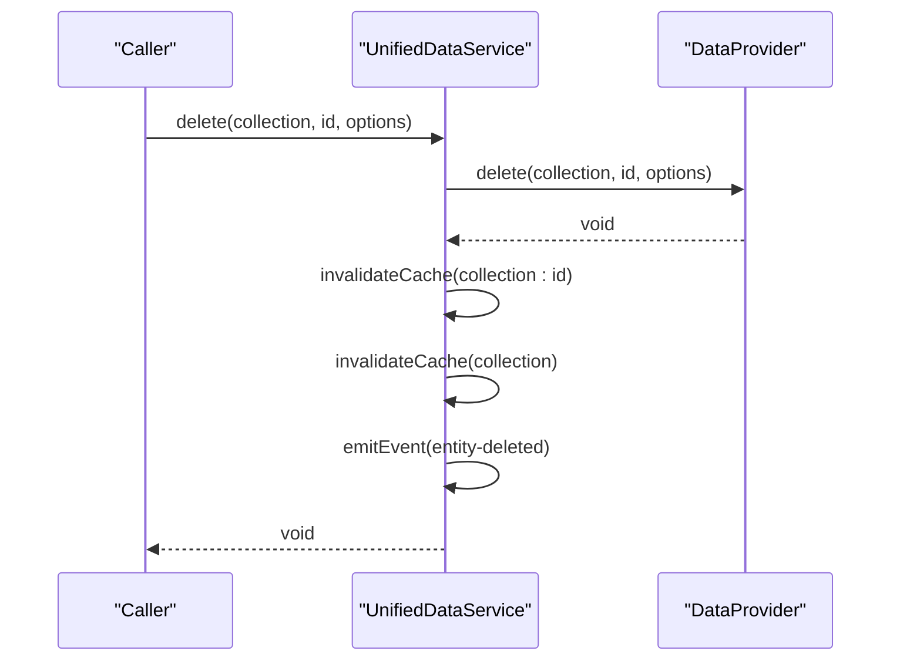

**Diagram sources**
- [UnifiedDataService.ts:272-283](file://src/services/data/UnifiedDataService.ts#L272-L283)

**Section sources**
- [UnifiedDataService.ts:272-283](file://src/services/data/UnifiedDataService.ts#L272-L283)

### Bulk Operations and Transactions
Bulk operations:
- bulkCreate: Delegates to provider.bulkCreate and invalidates collection cache
- bulkUpdate: Delegates to provider.bulkUpdate and invalidates caches for affected entities and collection
- bulkDelete: Delegates to provider.bulkDelete and invalidates caches for affected entities and collection

Transactions:
- transaction: Executes a series of operations atomically if provider supports transactions; otherwise throws an error

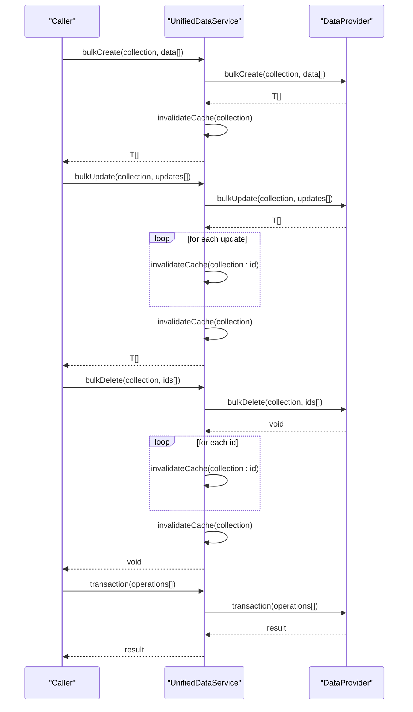

**Diagram sources**
- [UnifiedDataService.ts:328-382](file://src/services/data/UnifiedDataService.ts#L328-L382)

**Section sources**
- [UnifiedDataService.ts:328-382](file://src/services/data/UnifiedDataService.ts#L328-L382)

### Subscriptions and Polling Fallback
- subscribe(collection, query): Returns an Observable of query results; uses provider.subscribe if available, otherwise falls back to periodic polling
- subscribeOne(collection, id): Returns an Observable for a single entity; uses provider.subscribeOne if available, otherwise filters from collection subscription or polls

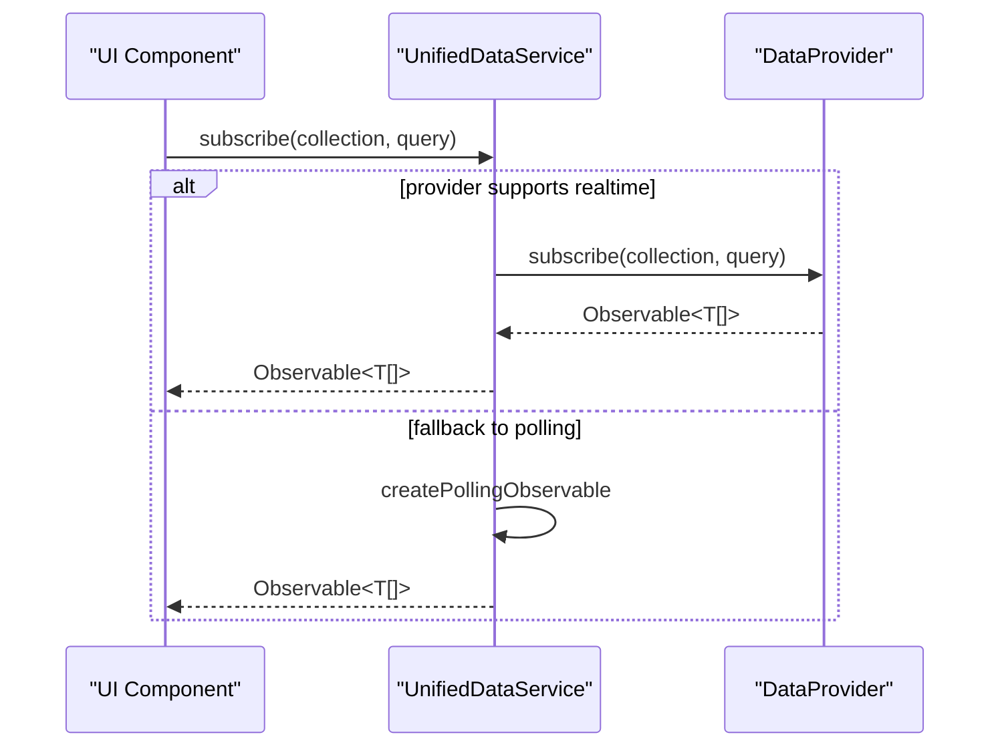

**Diagram sources**
- [UnifiedDataService.ts:290-321](file://src/services/data/UnifiedDataService.ts#L290-L321)

**Section sources**
- [UnifiedDataService.ts:290-321](file://src/services/data/UnifiedDataService.ts#L290-L321)

### Cache Management and Events
- Caching: TTL-based cache keyed by collection and query; cache invalidation occurs on create, update, delete, and sync/import
- Events: Emits typed data events (entity-created, entity-updated, entity-deleted, sync-started/completed/failed) for subscribers

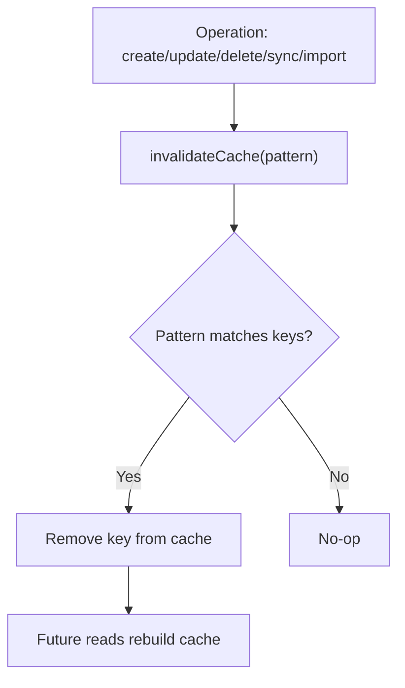

**Diagram sources**
- [UnifiedDataService.ts:623-639](file://src/services/data/UnifiedDataService.ts#L623-L639)

**Section sources**
- [UnifiedDataService.ts:611-639](file://src/services/data/UnifiedDataService.ts#L611-L639)

## Dependency Analysis
UnifiedDataService depends on:
- Provider contract types for queries, filters, pagination, and capabilities
- Core CRUD types for standardized patterns and state management
- RxJS for observables and event streams

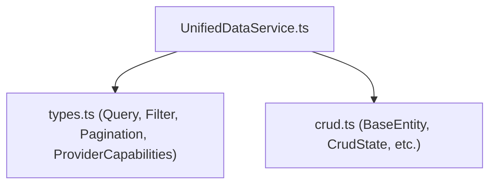

**Diagram sources**
- [UnifiedDataService.ts:8-22](file://src/services/data/UnifiedDataService.ts#L8-L22)
- [types.ts:1-64](file://src/services/data/types.ts#L1-L64)
- [crud.ts:1-222](file://src/core/types/crud.ts#L1-L222)

**Section sources**
- [UnifiedDataService.ts:8-22](file://src/services/data/UnifiedDataService.ts#L8-L22)
- [types.ts:1-64](file://src/services/data/types.ts#L1-L64)
- [crud.ts:1-222](file://src/core/types/crud.ts#L1-L222)

## Performance Considerations
- Caching: TTL-based caching reduces repeated provider calls; use targeted invalidation to keep views consistent
- Pagination: Always apply pagination in queries to avoid large payloads
- Sorting and filtering: Prefer indexed fields in filters; avoid expensive regex or full-text search unless provider supports it
- Subscriptions: Prefer real-time subscriptions over polling when available; polling intervals can be tuned based on data volatility
- Bulk operations: Use bulkCreate/bulkUpdate/bulkDelete to minimize round trips

## Troubleshooting Guide
Common issues and resolutions:
- Service not initialized: Ensure initialize() is called before any operation; the service throws if not ready
- Provider capability errors: Transaction and sync require providers that support those capabilities; check provider capabilities before invoking
- Cache staleness: After external changes, rely on events and cache invalidation; manually invalidate if needed
- Error propagation: Provider errors are surfaced to callers; wrap operations in try-catch and surface user-friendly messages
- Query correctness: Verify filter operators and pagination parameters align with provider capabilities

**Section sources**
- [UnifiedDataService.ts:601-605](file://src/services/data/UnifiedDataService.ts#L601-L605)
- [UnifiedDataService.ts:377-382](file://src/services/data/UnifiedDataService.ts#L377-L382)
- [UnifiedDataService.ts:392-415](file://src/services/data/UnifiedDataService.ts#L392-L415)

## Conclusion
UnifiedDataService provides a robust, provider-agnostic CRUD layer with consistent caching, metadata handling, and eventing. By leveraging find with pagination and filtering, findOne for single-entity access, and findByIds for batch retrieval, applications can efficiently manage data across diverse environments. Create, update, and delete operations automatically maintain metadata and invalidate caches, ensuring consistency. Bulk operations and transactions further enhance performance and reliability. For real-time scenarios, subscriptions offer reactive updates with a polling fallback. Following the patterns and best practices outlined here will help implement reliable CRUD workflows across modules.