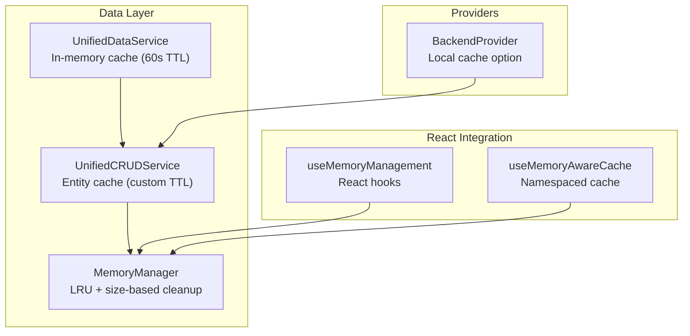
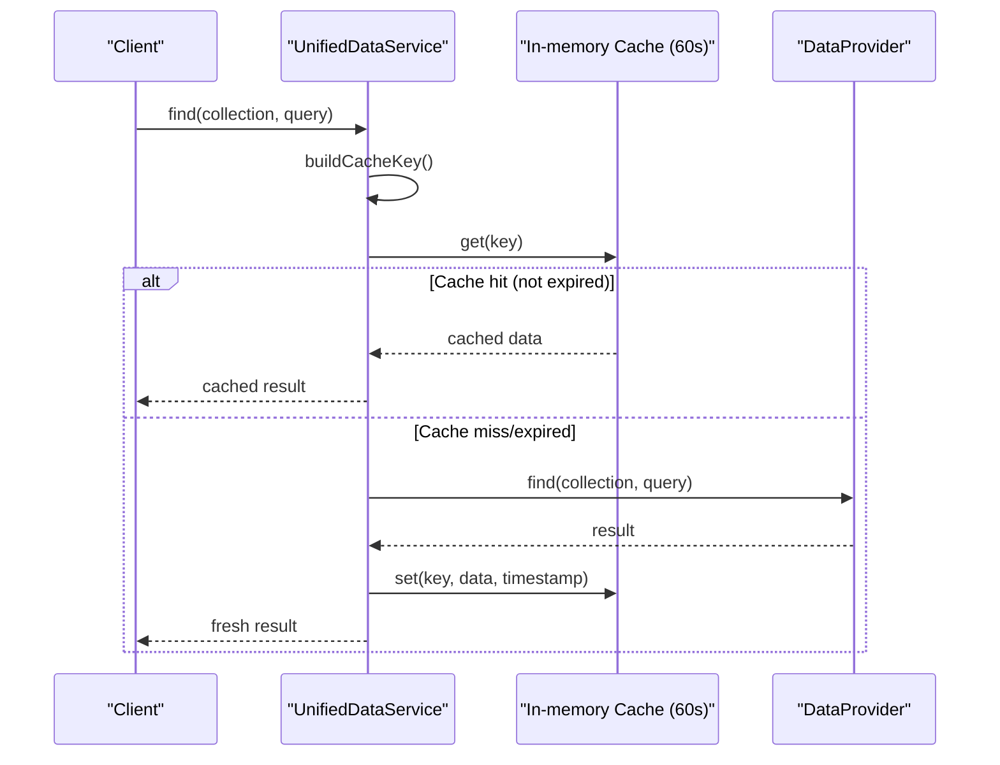
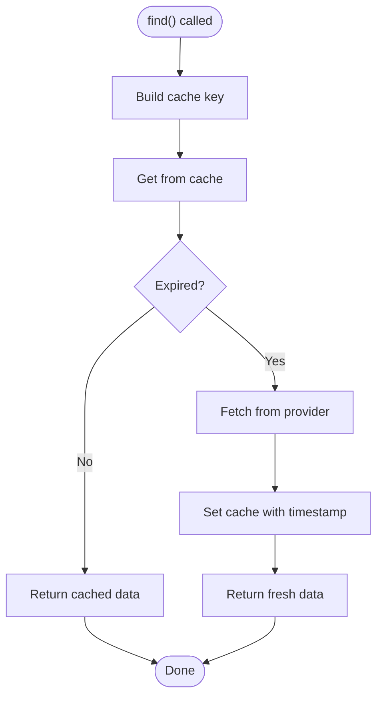
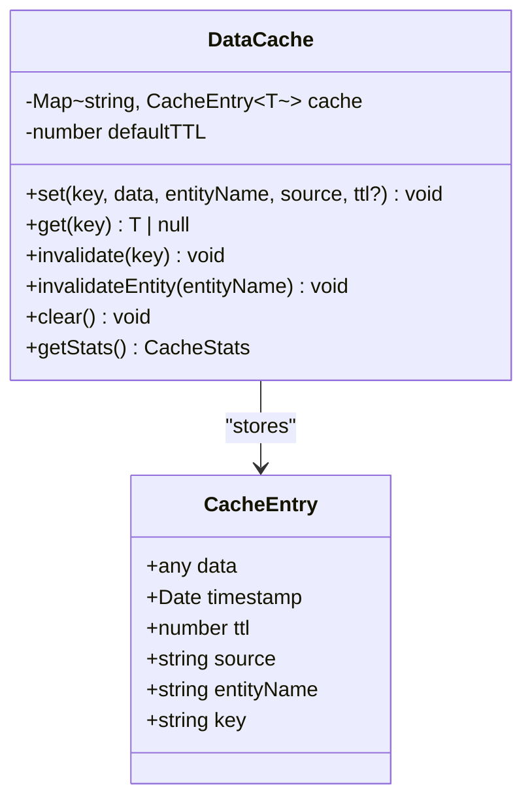
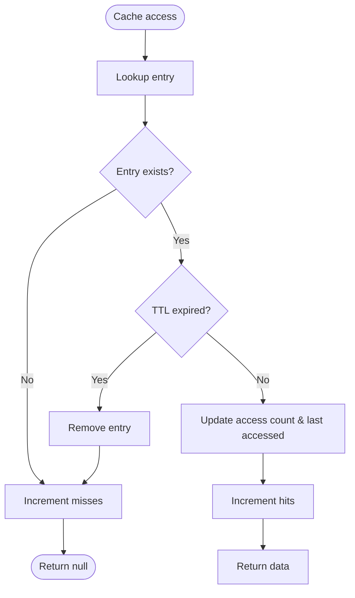
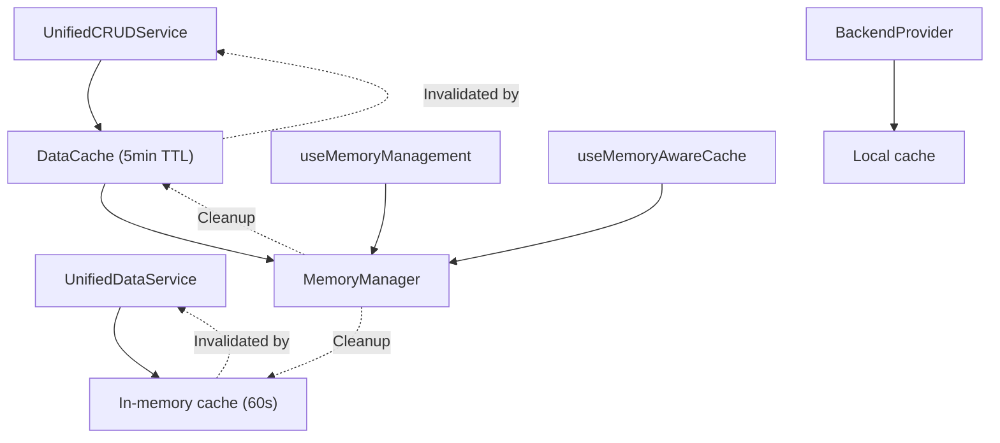

# Caching Mechanism

<cite>
**Referenced Files in This Document**
- [UnifiedDataService.ts](file://src/services/data/UnifiedDataService.ts)
- [UnifiedCRUDService.ts](file://src/services/data/UnifiedCRUDService.ts)
- [memoryManager.ts](file://src/services/performance/memoryManager.ts)
- [useMemoryManagement.ts](file://src/hooks/useMemoryManagement.ts)
- [BackendProvider.ts](file://src/services/backend/BackendProvider.ts)
- [IMPLEMENTATION_GUIDELINES.md](file://docs/implementation/IMPLEMENTATION_GUIDELINES.md)
- [DATA_LAYER_STRATEGY.md](file://docs/architecture/DATA_LAYER_STRATEGY.md)
</cite>

## Table of Contents
1. [Introduction](#introduction)
2. [Project Structure](#project-structure)
3. [Core Components](#core-components)
4. [Architecture Overview](#architecture-overview)
5. [Detailed Component Analysis](#detailed-component-analysis)
6. [Dependency Analysis](#dependency-analysis)
7. [Performance Considerations](#performance-considerations)
8. [Troubleshooting Guide](#troubleshooting-guide)
9. [Conclusion](#conclusion)

## Introduction
This document provides comprehensive documentation for the caching system in UnifiedDataService. It covers the in-memory cache implementation with TTL-based expiration (default 60 seconds), cache key generation strategies, invalidation patterns for write operations, and selective cache clearing based on collection patterns. It also explains cache hit/miss scenarios, performance benefits, memory management considerations, configuration options, custom TTL settings, and debugging techniques. Examples of cache behavior under different usage patterns and troubleshooting guidance are included.

## Project Structure
The caching mechanism spans several modules:
- UnifiedDataService: Provides in-memory cache with TTL for query results
- UnifiedCRUDService: Implements a separate cache with configurable TTL and entity-based invalidation
- MemoryManager: Monitors memory usage and performs automatic cache cleanup
- useMemoryManagement: React hooks for memory-aware caching and monitoring
- BackendProvider: Supports optional local cache per provider instance

**Diagram sources**
- [UnifiedDataService.ts:47-48](file://src/services/data/UnifiedDataService.ts#L47-L48)
- [UnifiedCRUDService.ts:55-111](file://src/services/data/UnifiedCRUDService.ts#L55-L111)
- [memoryManager.ts:55-80](file://src/services/performance/memoryManager.ts#L55-L80)
- [useMemoryManagement.ts:226-269](file://src/hooks/useMemoryManagement.ts#L226-L269)
- [BackendProvider.ts:22](file://src/services/backend/BackendProvider.ts#L22)

**Section sources**
- [UnifiedDataService.ts:1-721](file://src/services/data/UnifiedDataService.ts#L1-L721)
- [UnifiedCRUDService.ts:1-689](file://src/services/data/UnifiedCRUDService.ts#L1-L689)
- [memoryManager.ts:1-511](file://src/services/performance/memoryManager.ts#L1-L511)
- [useMemoryManagement.ts:1-270](file://src/hooks/useMemoryManagement.ts#L1-L270)
- [BackendProvider.ts:1-43](file://src/services/backend/BackendProvider.ts#L1-L43)

## Core Components
This section outlines the primary caching components and their responsibilities.

- UnifiedDataService cache
  - Type: In-memory Map
  - TTL: 60 seconds (1 minute)
  - Scope: Query results keyed by collection and serialized query
  - Expiration: Time-based eviction during retrieval
  - Key generation: `${collection}:${JSON.stringify(query)}`
  - Invalidation: Pattern-based deletion for collections and specific IDs

- UnifiedCRUDService cache
  - Type: In-memory Map with structured entries
  - TTL: Default 5 minutes; configurable per operation
  - Scope: Entities and queries with entity metadata
  - Expiration: Timestamp-based eviction
  - Key generation: `${entityName}:${id}` for entities, `${entityName}:query:${JSON.stringify(queryOptions)}` for queries
  - Invalidation: Key-based and entity-based invalidation

- MemoryManager cache
  - Type: In-memory Map with size tracking
  - TTL: Optional per entry
  - Scope: General-purpose cache with LRU and size-based eviction
  - Eviction policy: TTL expiration, then LRU removal, capped by entry count and total size
  - Metrics: Hit rate, eviction count, estimated size

- useMemoryAwareCache hook
  - Type: Namespaced in-memory cache with entry limit
  - TTL: Not enforced; eviction based on entry count
  - Scope: React component-level caching with namespace isolation
  - Invalidation: Selective key deletion or namespace-wide clearing

- BackendProvider local cache
  - Type: Local Map per provider instance
  - Scope: Provider-specific caching
  - Invalidation: Manual clearing via provider methods

**Section sources**
- [UnifiedDataService.ts:47-48](file://src/services/data/UnifiedDataService.ts#L47-L48)
- [UnifiedDataService.ts:607-629](file://src/services/data/UnifiedDataService.ts#L607-L629)
- [UnifiedCRUDService.ts:46-111](file://src/services/data/UnifiedCRUDService.ts#L46-L111)
- [memoryManager.ts:31-72](file://src/services/performance/memoryManager.ts#L31-L72)
- [useMemoryManagement.ts:226-269](file://src/hooks/useMemoryManagement.ts#L226-L269)
- [BackendProvider.ts:22](file://src/services/backend/BackendProvider.ts#L22)

## Architecture Overview
The caching architecture integrates multiple layers:
- Application-level caching in UnifiedDataService for query results
- Domain-level caching in UnifiedCRUDService for entities and queries
- System-level memory management with automatic cleanup
- React hooks for memory-aware caching and monitoring
- Provider-level caching for backend integration

**Diagram sources**
- [UnifiedDataService.ts:153-170](file://src/services/data/UnifiedDataService.ts#L153-L170)
- [UnifiedDataService.ts:607-621](file://src/services/data/UnifiedDataService.ts#L607-L621)

**Section sources**
- [UnifiedDataService.ts:148-170](file://src/services/data/UnifiedDataService.ts#L148-L170)
- [UnifiedCRUDService.ts:304-378](file://src/services/data/UnifiedCRUDService.ts#L304-L378)
- [memoryManager.ts:244-272](file://src/services/performance/memoryManager.ts#L244-L272)

## Detailed Component Analysis

### UnifiedDataService Cache
The UnifiedDataService implements a lightweight in-memory cache optimized for query results with fixed TTL.

Key characteristics:
- Cache type: Map<string, { data: any; timestamp: number }>
- TTL: 60 seconds (1 minute)
- Key generation: `${collection}:${JSON.stringify(query)}`
- Access pattern: Check cache before provider call, set cache after provider response
- Expiration: During retrieval, entries older than TTL are considered expired
- Invalidation: Pattern-based deletion using `invalidateCache(pattern)`

**Diagram sources**
- [UnifiedDataService.ts:153-170](file://src/services/data/UnifiedDataService.ts#L153-L170)
- [UnifiedDataService.ts:611-621](file://src/services/data/UnifiedDataService.ts#L611-L621)

Cache invalidation patterns:
- Single entity: `invalidateCache(`${collection}:${id}`)`
- Entire collection: `invalidateCache(collection)`
- Transaction/bulk operations: Combined invalidation for affected entities

**Section sources**
- [UnifiedDataService.ts:47-48](file://src/services/data/UnifiedDataService.ts#L47-L48)
- [UnifiedDataService.ts:607-629](file://src/services/data/UnifiedDataService.ts#L607-L629)
- [UnifiedDataService.ts:214-283](file://src/services/data/UnifiedDataService.ts#L214-L283)

### UnifiedCRUDService Cache
The UnifiedCRUDService provides a more sophisticated cache with configurable TTL and entity-based invalidation.

Key characteristics:
- Cache type: Map<string, CacheEntry<T>>
- Default TTL: 5 minutes
- Configurable TTL: Up to 2 minutes for queries
- Key generation: `${entityName}:${id}` for entities, `${entityName}:query:${JSON.stringify(queryOptions)}` for queries
- Metadata: Includes entityName, source, and key for efficient invalidation
- Invalidation: Key-based and entity-based invalidation

**Diagram sources**
- [UnifiedCRUDService.ts:55-111](file://src/services/data/UnifiedCRUDService.ts#L55-L111)

**Section sources**
- [UnifiedCRUDService.ts:46-111](file://src/services/data/UnifiedCRUDService.ts#L46-L111)
- [UnifiedCRUDService.ts:304-378](file://src/services/data/UnifiedCRUDService.ts#L304-L378)

### MemoryManager Cache
The MemoryManager provides a robust caching layer with automatic cleanup based on TTL, LRU eviction, and size constraints.

Key characteristics:
- Cache type: Map<string, CacheEntry<T>>
- TTL enforcement: Strict TTL-based eviction
- Eviction policy: TTL expiration followed by LRU removal when limits exceeded
- Size constraints: Maximum entries (1000) and total size (50MB)
- Metrics: Hit rate, eviction count, estimated size
- Automatic cleanup: Periodic cleanup of expired entries and old metrics

**Diagram sources**
- [memoryManager.ts:389-409](file://src/services/performance/memoryManager.ts#L389-L409)

**Section sources**
- [memoryManager.ts:31-72](file://src/services/performance/memoryManager.ts#L31-L72)
- [memoryManager.ts:244-272](file://src/services/performance/memoryManager.ts#L244-L272)
- [memoryManager.ts:416-430](file://src/services/performance/memoryManager.ts#L416-L430)

### useMemoryAwareCache Hook
The useMemoryAwareCache hook provides a namespaced in-memory cache suitable for React components with entry limiting.

Key characteristics:
- Cache type: Map<string, T>
- Namespace: Keys prefixed with namespace for isolation
- Entry limit: Configurable maximum entries (default 50)
- Eviction: FIFO-style eviction when limit reached
- Invalidation: Selective key deletion or namespace-wide clearing

**Section sources**
- [useMemoryManagement.ts:226-269](file://src/hooks/useMemoryManagement.ts#L226-L269)

### BackendProvider Local Cache
The BackendProvider supports optional local caching at the provider level.

Key characteristics:
- Cache type: Local Map per provider instance
- Scope: Provider-specific caching
- Configuration: Toggle via BackendProviderConfig.localCache
- Invalidation: Manual clearing via provider methods

**Section sources**
- [BackendProvider.ts:12-24](file://src/services/backend/BackendProvider.ts#L12-L24)

## Dependency Analysis
The caching system has layered dependencies with clear separation of concerns.

**Diagram sources**
- [UnifiedDataService.ts:114](file://src/services/data/UnifiedDataService.ts#L114)
- [UnifiedCRUDService.ts:114](file://src/services/data/UnifiedCRUDService.ts#L114)
- [memoryManager.ts:55](file://src/services/performance/memoryManager.ts#L55)

**Section sources**
- [UnifiedDataService.ts:114-114](file://src/services/data/UnifiedDataService.ts#L114-L114)
- [UnifiedCRUDService.ts:114-114](file://src/services/data/UnifiedCRUDService.ts#L114-L114)
- [memoryManager.ts:55-55](file://src/services/performance/memoryManager.ts#L55-L55)

## Performance Considerations
Cache performance characteristics and optimization strategies:

- Cache hit/miss ratios
  - UnifiedDataService: Optimized for query reuse within 60-second window
  - UnifiedCRUDService: Higher TTL (5 minutes) for entity caching, configurable for queries (2 minutes)
  - MemoryManager: Comprehensive metrics tracking with hit rate calculations

- Memory management
  - UnifiedDataService: Simple timestamp-based eviction reduces memory footprint
  - UnifiedCRUDService: Structured entries with entity metadata enable targeted invalidation
  - MemoryManager: Automatic cleanup prevents memory leaks with LRU and size constraints

- Performance benefits
  - Reduced network requests for repeated queries
  - Faster response times for cached data
  - Lower database load through intelligent caching
  - Improved user experience with near-instantaneous data access

- Optimization opportunities
  - Adjust TTL based on data volatility patterns
  - Implement prefetching for frequently accessed data
  - Monitor cache hit rates and adjust TTL accordingly
  - Consider hybrid caching strategies combining multiple cache layers

**Section sources**
- [UnifiedDataService.ts:47-48](file://src/services/data/UnifiedDataService.ts#L47-L48)
- [UnifiedCRUDService.ts:57](file://src/services/data/UnifiedCRUDService.ts#L57)
- [memoryManager.ts:451-452](file://src/services/performance/memoryManager.ts#L451-L452)

## Troubleshooting Guide

### Common Cache Issues and Solutions

**Issue: Stale data being returned**
- Symptoms: Outdated information displayed to users
- Causes: Cache TTL expiration or improper invalidation
- Solutions:
  - Verify TTL settings match data volatility requirements
  - Ensure proper invalidation after write operations
  - Check for concurrent operations affecting cache consistency

**Issue: Memory growth over time**
- Symptoms: Increasing memory usage leading to performance degradation
- Causes: Cache entries not being cleaned up
- Solutions:
  - Monitor cache hit rates and eviction counts
  - Implement proper cache invalidation patterns
  - Adjust cache size limits and TTL settings

**Issue: Cache thrashing**
- Symptoms: High cache miss rates despite frequent access
- Causes: Too short TTL or aggressive invalidation
- Solutions:
  - Increase TTL for frequently accessed data
  - Implement cache warming strategies
  - Review invalidation patterns for unnecessary clears

### Debugging Techniques

**Enable cache debugging**
- Monitor cache statistics and hit rates
- Track cache invalidation events
- Analyze memory usage trends

**Cache inspection methods**
- Check cache contents for specific keys
- Verify TTL expiration behavior
- Monitor cache size and entry counts

**Performance monitoring**
- Track cache hit rates over time
- Monitor memory usage patterns
- Analyze cache effectiveness for different data types

**Section sources**
- [memoryManager.ts:433-492](file://src/services/performance/memoryManager.ts#L433-L492)
- [UnifiedDataService.ts:623-629](file://src/services/data/UnifiedDataService.ts#L623-L629)
- [UnifiedCRUDService.ts:617-627](file://src/services/data/UnifiedCRUDService.ts#L617-L627)

## Conclusion
The UnifiedDataService caching system provides a multi-layered approach to data caching with TTL-based expiration, strategic invalidation patterns, and comprehensive memory management. The combination of application-level, domain-level, and system-level caching ensures optimal performance while maintaining data consistency. The modular design allows for flexible configuration and monitoring, enabling developers to optimize caching strategies based on specific use cases and performance requirements.

Key benefits include reduced latency for repeated queries, lower database load, improved user experience, and robust memory management through automatic cleanup mechanisms. The system's design supports both simple use cases and complex scenarios requiring fine-grained cache control and monitoring.