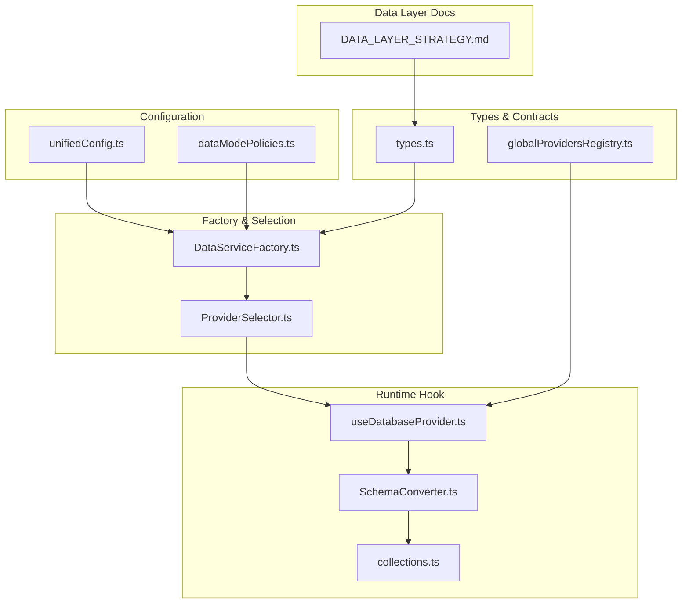
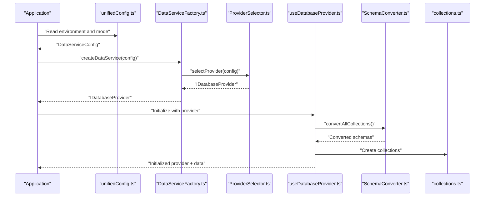
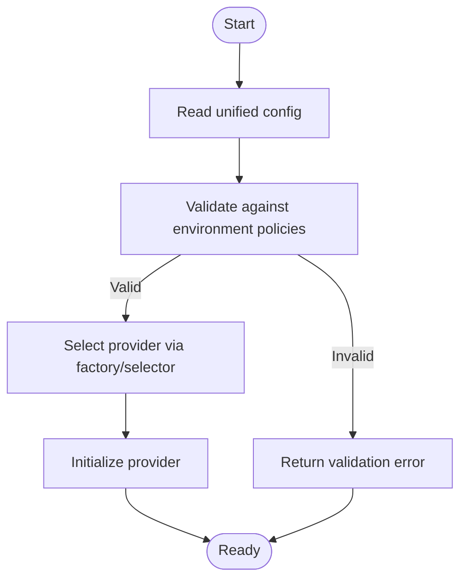
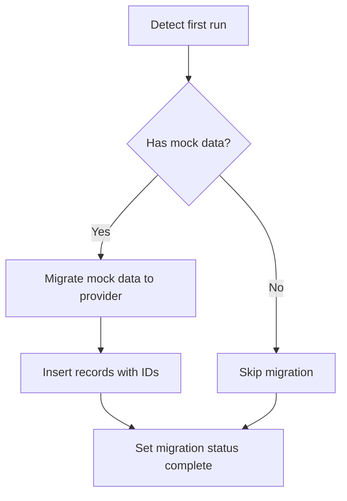
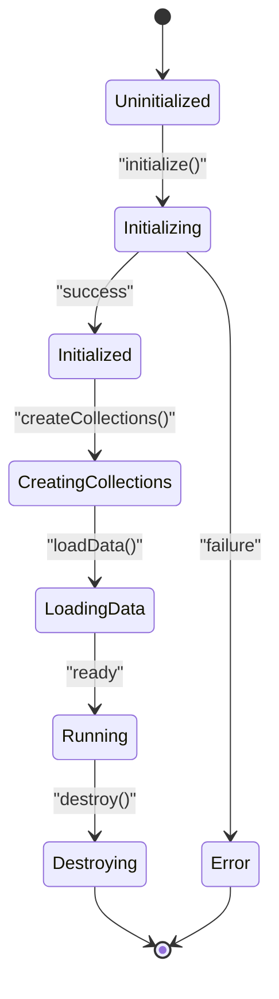
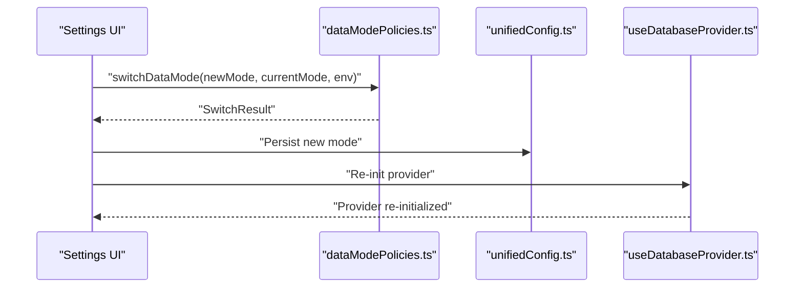
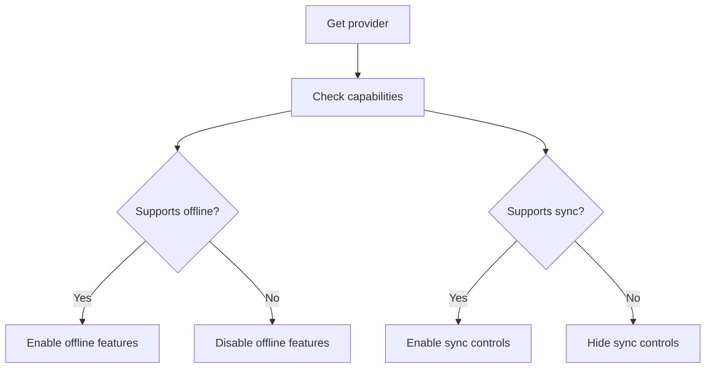
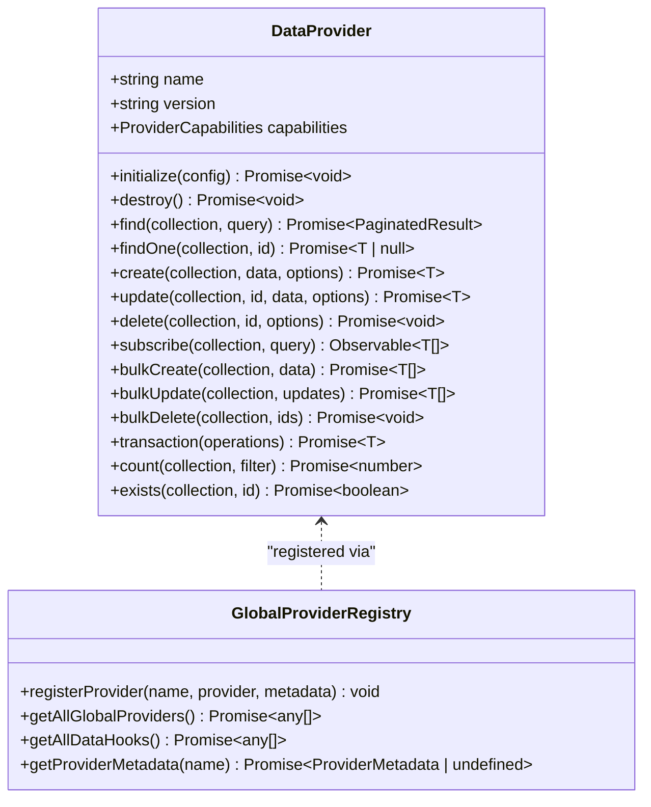
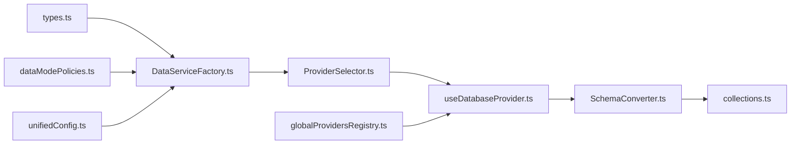

# Provider Abstraction

<cite>
**Referenced Files in This Document**
- [types.ts](file://src/services/data/types.ts)
- [useDatabaseProvider.ts](file://src/hooks/useDatabaseProvider.ts)
- [globalProvidersRegistry.ts](file://src/globalProvidersRegistry.ts)
- [DATA_LAYER_STRATEGY.md](file://docs/architecture/DATA_LAYER_STRATEGY.md)
- [dataModePolicies.ts](file://src/config/dataModePolicies.ts)
- [dataMode.ts](file://src/config/dataMode.ts)
- [unifiedConfig.ts](file://src/config/unifiedConfig.ts)
- [ProviderSelector.ts](file://src/services/database/ProviderSelector.ts)
- [DataServiceFactory.ts](file://src/services/data/DataServiceFactory.ts)
- [collections.ts](file://src/services/database/collections.ts)
- [SchemaConverter.ts](file://src/services/database/SchemaConverter.ts)
- [useModularMockData.ts](file://src/hooks/useModularMockData.ts)
- [globalMockData.ts](file://src/globalMockData.ts)
</cite>

## Table of Contents
1. [Introduction](#introduction)
2. [Project Structure](#project-structure)
3. [Core Components](#core-components)
4. [Architecture Overview](#architecture-overview)
5. [Detailed Component Analysis](#detailed-component-analysis)
6. [Dependency Analysis](#dependency-analysis)
7. [Performance Considerations](#performance-considerations)
8. [Troubleshooting Guide](#troubleshooting-guide)
9. [Conclusion](#conclusion)
10. [Appendices](#appendices)

## Introduction
This document describes the provider abstraction layer in UnifiedDataService. It explains the provider interface contract, capability detection, provider selection logic across deployment modes, the mock provider for development, capability flags, fallback mechanisms, lifecycle management, initialization sequences, and destruction procedures. It also provides practical examples for provider switching, capability checks, and extending the provider system with custom implementations.

## Project Structure
The provider abstraction spans several layers:
- Type definitions define the provider interface and capabilities.
- A factory selects the appropriate provider based on deployment configuration.
- A hook orchestrates initialization, schema creation, mock data migration, and runtime data loading.
- A global registry aggregates module-provided data hooks and metadata.
- Configuration policies govern data mode switching and persistence.

**Diagram sources**
- [unifiedConfig.ts](file://src/config/unifiedConfig.ts)
- [dataModePolicies.ts](file://src/config/dataModePolicies.ts)
- [DataServiceFactory.ts](file://src/services/data/DataServiceFactory.ts)
- [ProviderSelector.ts](file://src/services/database/ProviderSelector.ts)
- [useDatabaseProvider.ts](file://src/hooks/useDatabaseProvider.ts)
- [SchemaConverter.ts](file://src/services/database/SchemaConverter.ts)
- [collections.ts](file://src/services/database/collections.ts)
- [types.ts](file://src/services/data/types.ts)
- [globalProvidersRegistry.ts](file://src/globalProvidersRegistry.ts)
- [DATA_LAYER_STRATEGY.md](file://docs/architecture/DATA_LAYER_STRATEGY.md)

**Section sources**
- [types.ts:135-182](file://src/services/data/types.ts#L135-L182)
- [DATA_LAYER_STRATEGY.md:91-174](file://docs/architecture/DATA_LAYER_STRATEGY.md#L91-L174)

## Core Components
- Provider interface contract: defines capabilities, lifecycle, CRUD, real-time subscriptions, bulk operations, transactions, optional sync utilities, and event types.
- Capability flags: a structured set of booleans indicating support for real-time, sync, transactions, offline, encryption, full-text search, and relations.
- Deployment-aware selection: factory and selector choose providers based on environment and configuration.
- Runtime orchestration: a React hook initializes providers, creates collections, migrates mock data, loads data, and exposes refresh/clear utilities.
- Global registry: aggregates module-provided data hooks and metadata for discoverability and integration.

**Section sources**
- [types.ts:9-31](file://src/services/data/types.ts#L9-L31)
- [types.ts:135-182](file://src/services/data/types.ts#L135-L182)
- [useDatabaseProvider.ts:48-103](file://src/hooks/useDatabaseProvider.ts#L48-L103)
- [globalProvidersRegistry.ts:26-154](file://src/globalProvidersRegistry.ts#L26-L154)

## Architecture Overview
The provider abstraction separates concerns between configuration, selection, lifecycle, and runtime consumption. The factory reads unified configuration and environment policies to instantiate a provider. The hook manages provider lifecycle, schema creation, and data loading. The global registry enables module-level provider discovery.

**Diagram sources**
- [unifiedConfig.ts](file://src/config/unifiedConfig.ts)
- [DataServiceFactory.ts](file://src/services/data/DataServiceFactory.ts)
- [ProviderSelector.ts](file://src/services/database/ProviderSelector.ts)
- [useDatabaseProvider.ts](file://src/hooks/useDatabaseProvider.ts)
- [SchemaConverter.ts](file://src/services/database/SchemaConverter.ts)
- [collections.ts](file://src/services/database/collections.ts)

## Detailed Component Analysis

### Provider Interface Contract
The provider interface defines:
- Identity: name, version, capabilities.
- Lifecycle: initialize(config), destroy().
- CRUD: find, findOne, findByIds, create, update, delete.
- Real-time: subscribe, subscribeOne.
- Bulk operations: bulkCreate, bulkUpdate, bulkDelete.
- Transactions: transaction.
- Optional sync: sync, getPendingChanges, applyRemoteChanges.
- Utilities: count, exists, export, import.

Provider capabilities include:
- realtime, sync, transactions, offline, encryption, fullTextSearch, relations.

These contracts enable deployment-mode-aware selection and consistent behavior across providers.

**Section sources**
- [types.ts:135-182](file://src/services/data/types.ts#L135-L182)
- [types.ts:9-31](file://src/services/data/types.ts#L9-L31)
- [DATA_LAYER_STRATEGY.md:91-174](file://docs/architecture/DATA_LAYER_STRATEGY.md#L91-L174)

### Capability Detection System
Capability flags are part of the provider’s metadata and are surfaced via:
- ProviderCapabilities interface.
- Global provider registry metadata (allowOffline, requiresBackend, syncPriority).
- Runtime checks through the provider’s capabilities field.

Practical usage:
- Query provider.capabilities.realtime/sync/offline before enabling features.
- Gate UI actions based on provider capabilities.
- Use registry metadata to categorize providers by module and entity.

**Section sources**
- [types.ts:9-31](file://src/services/data/types.ts#L9-L31)
- [globalProvidersRegistry.ts:7-24](file://src/globalProvidersRegistry.ts#L7-L24)
- [globalProvidersRegistry.ts:66-78](file://src/globalProvidersRegistry.ts#L66-L78)

### Provider Selection Logic Based on Deployment Modes
Selection is driven by:
- Unified configuration (mode, provider choice).
- Environment policies (allowed data modes, switching rules).
- Factory and selector components.

Typical flow:
- Read unified configuration.
- Validate against environment policies.
- Instantiate provider via factory and selector.
- Apply fallbacks when primary provider fails.

**Diagram sources**
- [unifiedConfig.ts](file://src/config/unifiedConfig.ts)
- [dataModePolicies.ts](file://src/config/dataModePolicies.ts)
- [DataServiceFactory.ts](file://src/services/data/DataServiceFactory.ts)
- [ProviderSelector.ts](file://src/services/database/ProviderSelector.ts)

**Section sources**
- [unifiedConfig.ts](file://src/config/unifiedConfig.ts)
- [dataModePolicies.ts](file://src/config/dataModePolicies.ts)
- [DataServiceFactory.ts](file://src/services/data/DataServiceFactory.ts)
- [ProviderSelector.ts](file://src/services/database/ProviderSelector.ts)

### Mock Provider Implementation for Development
The system supports a mock provider for development and testing:
- Mock data is aggregated centrally and used during first-run migration.
- Migration logic detects first runs, clears existing data, and inserts mock records.
- After successful migration, mock data can be cleared.

**Diagram sources**
- [useDatabaseProvider.ts:147-176](file://src/hooks/useDatabaseProvider.ts#L147-L176)
- [useDatabaseProvider.ts:206-273](file://src/hooks/useDatabaseProvider.ts#L206-L273)
- [useModularMockData.ts](file://src/hooks/useModularMockData.ts)
- [globalMockData.ts](file://src/globalMockData.ts)

**Section sources**
- [useDatabaseProvider.ts:147-176](file://src/hooks/useDatabaseProvider.ts#L147-L176)
- [useDatabaseProvider.ts:206-273](file://src/hooks/useDatabaseProvider.ts#L206-L273)
- [useModularMockData.ts](file://src/hooks/useModularMockData.ts)
- [globalMockData.ts:1-26](file://src/globalMockData.ts#L1-L26)

### Provider Lifecycle Management
Lifecycle stages:
- Initialization: provider.initialize(config) invoked by factory/selector.
- Schema creation: convert schemas and create collections.
- Data loading: load initial data into React state.
- Runtime operations: CRUD, subscriptions, bulk operations, transactions.
- Destruction: provider.destroy() to free resources.

**Diagram sources**
- [types.ts:146-150](file://src/services/data/types.ts#L146-L150)
- [useDatabaseProvider.ts:68-103](file://src/hooks/useDatabaseProvider.ts#L68-L103)
- [useDatabaseProvider.ts:105-145](file://src/hooks/useDatabaseProvider.ts#L105-L145)
- [useDatabaseProvider.ts:338-367](file://src/hooks/useDatabaseProvider.ts#L338-L367)

**Section sources**
- [types.ts:146-150](file://src/services/data/types.ts#L146-L150)
- [useDatabaseProvider.ts:68-103](file://src/hooks/useDatabaseProvider.ts#L68-L103)
- [useDatabaseProvider.ts:105-145](file://src/hooks/useDatabaseProvider.ts#L105-L145)
- [useDatabaseProvider.ts:338-367](file://src/hooks/useDatabaseProvider.ts#L338-L367)

### Provider Capability Flags and Fallback Mechanisms
Capability flags:
- ProviderCapabilities indicate feature support.
- Registry metadata augments with requiresBackend, allowOffline, syncPriority.

Fallback mechanisms:
- Hook logs and continues if provider operations fail.
- Migration status tracks pending/running/complete/error states.
- Selector can fall back to alternative providers when primary fails.

**Section sources**
- [types.ts:9-31](file://src/services/data/types.ts#L9-L31)
- [globalProvidersRegistry.ts:66-78](file://src/globalProvidersRegistry.ts#L66-L78)
- [useDatabaseProvider.ts:147-176](file://src/hooks/useDatabaseProvider.ts#L147-L176)

### Practical Examples

#### Example 1: Provider Switching
- Read current environment and data mode.
- Validate switch against environment policies.
- Persist new mode and determine if reload is required.
- Trigger provider re-initialization if needed.

**Diagram sources**
- [dataModePolicies.ts](file://src/config/dataModePolicies.ts)
- [dataMode.ts](file://src/config/dataMode.ts)
- [unifiedConfig.ts](file://src/config/unifiedConfig.ts)
- [useDatabaseProvider.ts](file://src/hooks/useDatabaseProvider.ts)

**Section sources**
- [dataModePolicies.ts:85-162](file://src/config/dataModePolicies.ts#L85-L162)
- [dataMode.ts:6-18](file://src/config/dataMode.ts#L6-L18)

#### Example 2: Capability Checking
- Inspect provider.capabilities for required features.
- Gate UI actions and feature flags accordingly.
- Use registry metadata to filter providers by module/entity.

**Diagram sources**
- [types.ts:135-182](file://src/services/data/types.ts#L135-L182)
- [globalProvidersRegistry.ts:7-24](file://src/globalProvidersRegistry.ts#L7-L24)

**Section sources**
- [types.ts:135-182](file://src/services/data/types.ts#L135-L182)
- [globalProvidersRegistry.ts:7-24](file://src/globalProvidersRegistry.ts#L7-L24)

#### Example 3: Extending the Provider System with Custom Implementations
- Implement the DataProvider interface with desired capabilities.
- Register provider metadata via the global registry.
- Expose hooks with conventional naming for automatic discovery.
- Integrate with the factory/selector to participate in deployment-mode selection.

**Diagram sources**
- [types.ts:135-182](file://src/services/data/types.ts#L135-L182)
- [globalProvidersRegistry.ts:26-154](file://src/globalProvidersRegistry.ts#L26-L154)

**Section sources**
- [types.ts:135-182](file://src/services/data/types.ts#L135-L182)
- [globalProvidersRegistry.ts:26-154](file://src/globalProvidersRegistry.ts#L26-L154)

## Dependency Analysis
The provider abstraction exhibits low coupling and high cohesion:
- Factory and selector encapsulate provider selection logic.
- Hook centralizes lifecycle orchestration.
- Registry decouples provider discovery from core logic.
- Types define stable contracts across modules.

**Diagram sources**
- [types.ts](file://src/services/data/types.ts)
- [DataServiceFactory.ts](file://src/services/data/DataServiceFactory.ts)
- [ProviderSelector.ts](file://src/services/database/ProviderSelector.ts)
- [useDatabaseProvider.ts](file://src/hooks/useDatabaseProvider.ts)
- [globalProvidersRegistry.ts](file://src/globalProvidersRegistry.ts)
- [dataModePolicies.ts](file://src/config/dataModePolicies.ts)
- [unifiedConfig.ts](file://src/config/unifiedConfig.ts)
- [SchemaConverter.ts](file://src/services/database/SchemaConverter.ts)
- [collections.ts](file://src/services/database/collections.ts)

**Section sources**
- [types.ts:135-182](file://src/services/data/types.ts#L135-L182)
- [DataServiceFactory.ts](file://src/services/data/DataServiceFactory.ts)
- [ProviderSelector.ts](file://src/services/database/ProviderSelector.ts)
- [useDatabaseProvider.ts](file://src/hooks/useDatabaseProvider.ts)
- [globalProvidersRegistry.ts](file://src/globalProvidersRegistry.ts)
- [dataModePolicies.ts](file://src/config/dataModePolicies.ts)
- [unifiedConfig.ts](file://src/config/unifiedConfig.ts)
- [SchemaConverter.ts](file://src/services/database/SchemaConverter.ts)
- [collections.ts](file://src/services/database/collections.ts)

## Performance Considerations
- Prefer capability-aware UI rendering to avoid unnecessary operations.
- Use bulk operations for large-scale writes to reduce overhead.
- Limit subscription scopes to minimize real-time payload sizes.
- Cache provider capabilities to avoid repeated checks.
- Batch schema conversions and collection creation to reduce initialization latency.

## Troubleshooting Guide
Common issues and resolutions:
- Provider initialization failures: inspect factory/selector logs and retry with fallback provider.
- Migration errors: check migration status and retry; clear mock data if needed.
- Capability mismatches: verify provider capabilities and adjust feature gating.
- Data mode switching: ensure environment allows switching and confirm persistence.

**Section sources**
- [useDatabaseProvider.ts:68-103](file://src/hooks/useDatabaseProvider.ts#L68-L103)
- [useDatabaseProvider.ts:147-176](file://src/hooks/useDatabaseProvider.ts#L147-L176)
- [dataModePolicies.ts:85-162](file://src/config/dataModePolicies.ts#L85-L162)

## Conclusion
The provider abstraction layer in UnifiedDataService offers a robust, deployment-mode-aware, and extensible data access strategy. By adhering to the provider interface contract, leveraging capability flags, and following lifecycle and selection patterns, teams can implement reliable data providers, support smooth transitions across environments, and maintain a clean separation of concerns.

## Appendices

### Appendix A: Provider Capabilities Reference
- realtime: subscriptions supported.
- sync: remote synchronization supported.
- transactions: ACID transactions supported.
- offline: works without network connectivity.
- encryption: data encryption supported.
- fullTextSearch: full-text search supported.
- relations: foreign keys/relations supported.

**Section sources**
- [types.ts:9-31](file://src/services/data/types.ts#L9-L31)