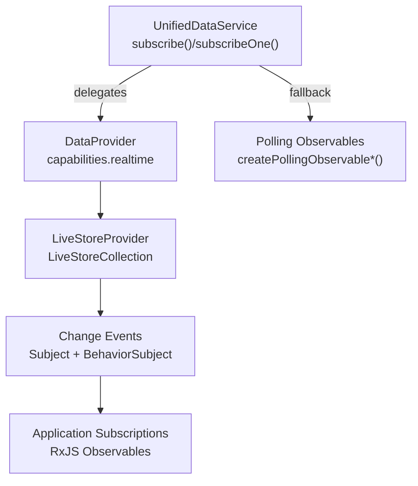
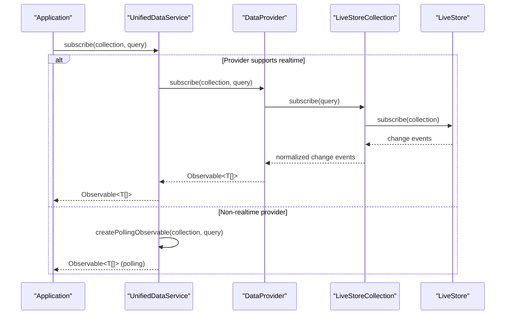
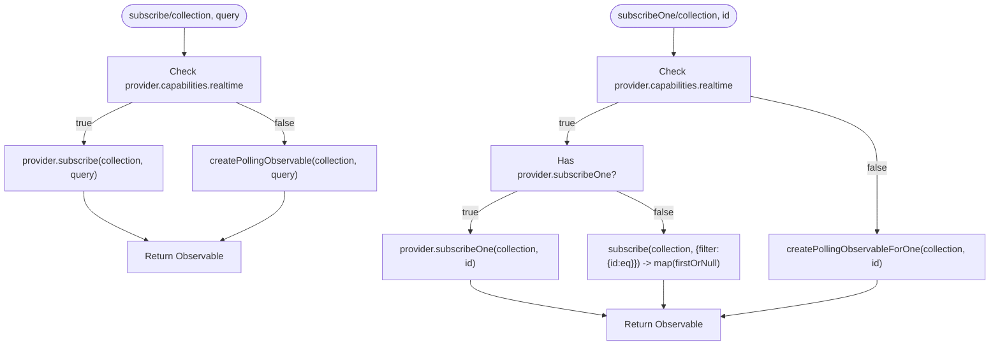
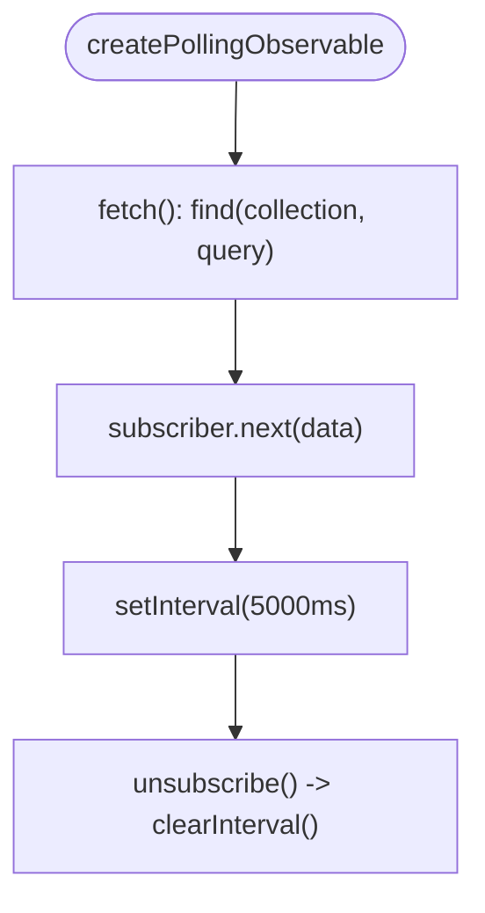
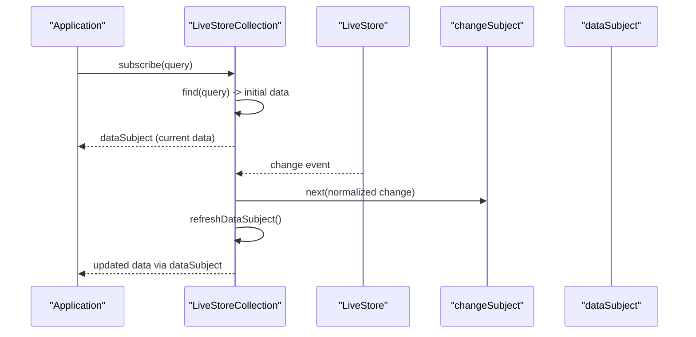
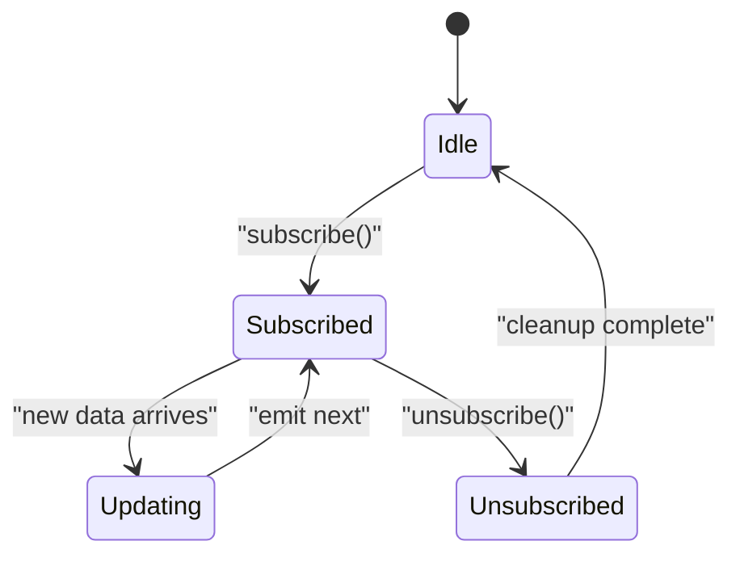
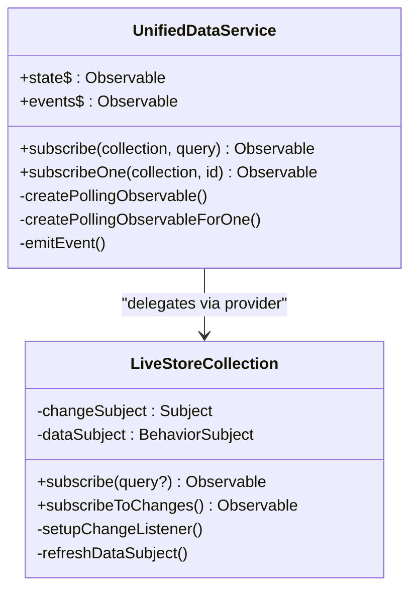
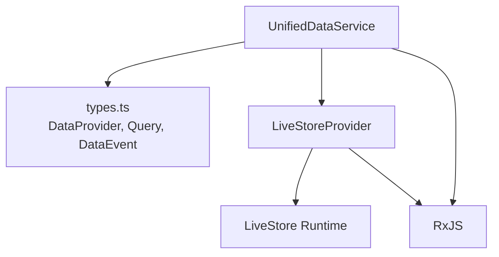

# Real-time Subscriptions

<cite>
**Referenced Files in This Document**
- [UnifiedDataService.ts](file://src/services/data/UnifiedDataService.ts)
- [LiveStoreProvider.ts](file://src/services/database/LiveStoreProvider.ts)
- [types.ts](file://src/services/data/types.ts)
- [IMPLEMENTATION_GUIDELINES.md](file://docs/implementation/IMPLEMENTATION_GUIDELINES.md)
- [DATA_LAYER_STRATEGY.md](file://docs/architecture/DATA_LAYER_STRATEGY.md)
</cite>

## Table of Contents
1. [Introduction](#introduction)
2. [Project Structure](#project-structure)
3. [Core Components](#core-components)
4. [Architecture Overview](#architecture-overview)
5. [Detailed Component Analysis](#detailed-component-analysis)
6. [Dependency Analysis](#dependency-analysis)
7. [Performance Considerations](#performance-considerations)
8. [Troubleshooting Guide](#troubleshooting-guide)
9. [Conclusion](#conclusion)
10. [Appendices](#appendices)

## Introduction
This document explains the real-time subscription system in UnifiedDataService, focusing on how applications subscribe to collection queries and individual entities, how fallback polling works for non-realtime providers, and how observables, lifecycle management, and cleanup are handled. It also covers event emission patterns, subscription state management, error handling in reactive streams, and practical examples for setting up subscriptions, handling reactive updates, and preventing memory leaks.

## Project Structure
The real-time subscription system spans three primary areas:
- UnifiedDataService: orchestrates providers, exposes subscribe and subscribeOne, and provides fallback polling.
- LiveStoreProvider: a multi-machine synchronized provider that emits real-time change events and exposes reactive APIs.
- Type definitions: shared interfaces and contracts for providers, queries, and events.

**Diagram sources**
- [UnifiedDataService.ts:285-321](file://src/services/data/UnifiedDataService.ts#L285-L321)
- [LiveStoreProvider.ts:71-122](file://src/services/database/LiveStoreProvider.ts#L71-L122)
- [types.ts:136-182](file://src/services/data/types.ts#L136-L182)

**Section sources**
- [UnifiedDataService.ts:285-321](file://src/services/data/UnifiedDataService.ts#L285-L321)
- [LiveStoreProvider.ts:71-122](file://src/services/database/LiveStoreProvider.ts#L71-L122)
- [types.ts:136-182](file://src/services/data/types.ts#L136-L182)

## Core Components
- UnifiedDataService: central facade that routes operations to the configured provider. It exposes subscribe(collection, query) and subscribeOne(collection, id). When the provider lacks real-time capability, it falls back to polling observables with a fixed interval.
- LiveStoreProvider: a provider that integrates with LiveStore to deliver multi-machine synchronization and real-time change notifications. It wraps each collection in a LiveStoreCollection that emits change events and exposes reactive subscribe methods.
- Type system: defines DataProvider contract, Query, Filter, SortOption, PaginationOptions, and DataEvent types that unify behavior across providers.

Key responsibilities:
- UnifiedDataService manages provider capabilities, state, caching, and event bus.
- LiveStoreCollection translates LiveStore change events into normalized change events and maintains a BehaviorSubject of current data.
- Both components rely on RxJS for observables and reactive streams.

**Section sources**
- [UnifiedDataService.ts:36-146](file://src/services/data/UnifiedDataService.ts#L36-L146)
- [LiveStoreProvider.ts:807-880](file://src/services/database/LiveStoreProvider.ts#L807-L880)
- [types.ts:9-31](file://src/services/data/types.ts#L9-L31)

## Architecture Overview
The subscription architecture follows a layered pattern:
- Application code subscribes via UnifiedDataService.subscribe()/subscribeOne().
- If the provider supports real-time, it delegates to the provider’s subscribe implementation.
- If not, UnifiedDataService creates a polling observable that periodically fetches data and pushes updates.
- LiveStoreProvider uses LiveStore’s change stream to emit normalized change events, which are transformed and propagated to subscribers.

**Diagram sources**
- [UnifiedDataService.ts:285-321](file://src/services/data/UnifiedDataService.ts#L285-L321)
- [LiveStoreProvider.ts:583-610](file://src/services/database/LiveStoreProvider.ts#L583-L610)

**Section sources**
- [UnifiedDataService.ts:285-321](file://src/services/data/UnifiedDataService.ts#L285-L321)
- [LiveStoreProvider.ts:583-610](file://src/services/database/LiveStoreProvider.ts#L583-L610)

## Detailed Component Analysis

### UnifiedDataService Subscription Methods
- subscribe(collection, query): Returns an Observable of array results. If provider.capabilities.realtime is true, delegates to provider.subscribe; otherwise, returns a polling observable.
- subscribeOne(collection, id): Returns an Observable of a single entity or null. If provider.capabilities.realtime is true and provider.subscribeOne exists, uses it; otherwise falls back to polling or filters collection subscription.

**Diagram sources**
- [UnifiedDataService.ts:285-321](file://src/services/data/UnifiedDataService.ts#L285-L321)
- [UnifiedDataService.ts:641-675](file://src/services/data/UnifiedDataService.ts#L641-L675)

**Section sources**
- [UnifiedDataService.ts:285-321](file://src/services/data/UnifiedDataService.ts#L285-L321)
- [UnifiedDataService.ts:641-675](file://src/services/data/UnifiedDataService.ts#L641-L675)

### Fallback Polling Mechanism
- createPollingObservable(collection, query): Creates an Observable that periodically calls find(collection, query) and emits the data array. Cleanup clears the interval when the subscription completes.
- createPollingObservableForOne(collection, id): Similar for single-entity subscriptions.
- Interval: fixed at 5000 ms in current implementation.

**Diagram sources**
- [UnifiedDataService.ts:641-675](file://src/services/data/UnifiedDataService.ts#L641-L675)

**Section sources**
- [UnifiedDataService.ts:641-675](file://src/services/data/UnifiedDataService.ts#L641-L675)

### LiveStoreProvider Real-time Subscriptions
- LiveStoreCollection.subscribe(query?): When a query is provided, it performs an initial find and then subscribes to changeSubject; each change triggers a refresh and emits updated data. Without a query, it returns the BehaviorSubject of current data.
- Change propagation: LiveStore’s change stream is transformed into normalized change events and emitted via a Subject; the dataSubject is refreshed accordingly.

**Diagram sources**
- [LiveStoreProvider.ts:103-122](file://src/services/database/LiveStoreProvider.ts#L103-L122)
- [LiveStoreProvider.ts:583-610](file://src/services/database/LiveStoreProvider.ts#L583-L610)

**Section sources**
- [LiveStoreProvider.ts:103-122](file://src/services/database/LiveStoreProvider.ts#L103-L122)
- [LiveStoreProvider.ts:583-610](file://src/services/database/LiveStoreProvider.ts#L583-L610)

### Observable Patterns and Lifecycle Management
- Lifecycle: Subscriptions are created by calling subscribe; cleanup occurs when the returned subscription completes or is unsubscribed. In polling mode, cleanup clears the interval timer.
- Backpressure and emissions: Real-time provider emits incremental updates; polling emits arrays of current items at fixed intervals.
- Error handling: Both polling and provider-based subscriptions propagate errors to subscribers via subscriber.error.

**Diagram sources**
- [UnifiedDataService.ts:641-675](file://src/services/data/UnifiedDataService.ts#L641-L675)
- [LiveStoreProvider.ts:583-610](file://src/services/database/LiveStoreProvider.ts#L583-L610)

**Section sources**
- [UnifiedDataService.ts:641-675](file://src/services/data/UnifiedDataService.ts#L641-L675)
- [LiveStoreProvider.ts:583-610](file://src/services/database/LiveStoreProvider.ts#L583-L610)

### Event Emission Patterns and State Management
- UnifiedDataService maintains a BehaviorSubject for service state and a separate event bus for domain events. While subscription updates are delivered via observables, the service emits structured DataEvents on its event bus for system-level monitoring.
- LiveStoreCollection maintains its own changeSubject and dataSubject to manage per-collection state and propagate updates reactively.

**Diagram sources**
- [UnifiedDataService.ts:36-146](file://src/services/data/UnifiedDataService.ts#L36-L146)
- [LiveStoreProvider.ts:71-122](file://src/services/database/LiveStoreProvider.ts#L71-L122)

**Section sources**
- [UnifiedDataService.ts:36-146](file://src/services/data/UnifiedDataService.ts#L36-L146)
- [LiveStoreProvider.ts:71-122](file://src/services/database/LiveStoreProvider.ts#L71-L122)

### Practical Examples and Best Practices
- Setting up a collection subscription:
  - Use UnifiedDataService.subscribe(collection, query). If the provider supports real-time, updates arrive immediately; otherwise, polling ensures periodic refresh.
  - Example reference: [IMPLEMENTATION_GUIDELINES.md:385-441](file://docs/implementation/IMPLEMENTATION_GUIDELINES.md#L385-L441)
- Handling reactive updates:
  - Subscribe to the returned Observable and update UI state. For single-entity updates, use subscribeOne.
  - Reference: [UnifiedDataService.ts:285-321](file://src/services/data/UnifiedDataService.ts#L285-L321)
- Managing subscription cleanup:
  - Always unsubscribe when components unmount or when no longer needed. In polling mode, cleanup clears intervals to prevent memory leaks.
  - Reference: [UnifiedDataService.ts:641-675](file://src/services/data/UnifiedDataService.ts#L641-L675)
- Configuring fallback intervals:
  - Current implementation uses a fixed 5000 ms interval. To adjust, modify the polling creation methods.
  - Reference: [UnifiedDataService.ts:641-675](file://src/services/data/UnifiedDataService.ts#L641-L675)

**Section sources**
- [IMPLEMENTATION_GUIDELINES.md:385-441](file://docs/implementation/IMPLEMENTATION_GUIDELINES.md#L385-L441)
- [UnifiedDataService.ts:285-321](file://src/services/data/UnifiedDataService.ts#L285-L321)
- [UnifiedDataService.ts:641-675](file://src/services/data/UnifiedDataService.ts#L641-L675)

## Dependency Analysis
- UnifiedDataService depends on:
  - DataProvider interface and capabilities to decide between real-time and polling.
  - RxJS for observables and operators.
  - Provider-specific implementations (e.g., LiveStoreProvider).
- LiveStoreProvider depends on:
  - LiveStore runtime and WebAdapter for peer discovery, sync, and change detection.
  - RxJS for internal Subjects and BehaviorSubjects.

**Diagram sources**
- [UnifiedDataService.ts:8-22](file://src/services/data/UnifiedDataService.ts#L8-L22)
- [LiveStoreProvider.ts:4-24](file://src/services/database/LiveStoreProvider.ts#L4-L24)
- [types.ts:136-182](file://src/services/data/types.ts#L136-L182)

**Section sources**
- [UnifiedDataService.ts:8-22](file://src/services/data/UnifiedDataService.ts#L8-L22)
- [LiveStoreProvider.ts:4-24](file://src/services/database/LiveStoreProvider.ts#L4-L24)
- [types.ts:136-182](file://src/services/data/types.ts#L136-L182)

## Performance Considerations
- Polling overhead: Fixed-interval polling can increase network and CPU usage. Consider reducing interval or switching to real-time when available.
- Caching: UnifiedDataService caches query results with TTL to reduce repeated fetches; leverage this to minimize redundant polling.
- Change granularity: LiveStore emits fine-grained change events; ensure consumers debounce or batch UI updates to avoid excessive re-renders.

[No sources needed since this section provides general guidance]

## Troubleshooting Guide
- No real-time updates:
  - Verify provider.capabilities.realtime is true and provider.subscribe exists.
  - Confirm LiveStore is initialized and collections are created.
  - References: [types.ts:10-31](file://src/services/data/types.ts#L10-L31), [LiveStoreProvider.ts:902-937](file://src/services/database/LiveStoreProvider.ts#L902-L937)
- Frequent polling despite real-time provider:
  - Ensure provider.subscribe is implemented and capabilities.realtime is accurate.
  - Reference: [UnifiedDataService.ts:285-321](file://src/services/data/UnifiedDataService.ts#L285-L321)
- Memory leaks from subscriptions:
  - Always unsubscribe; polling subscriptions must clear intervals on teardown.
  - Reference: [UnifiedDataService.ts:641-675](file://src/services/data/UnifiedDataService.ts#L641-L675)
- Error propagation:
  - Subscriptions propagate errors via subscriber.error; wrap subscriptions in error boundaries or handlers.
  - Reference: [UnifiedDataService.ts:641-675](file://src/services/data/UnifiedDataService.ts#L641-L675)

**Section sources**
- [types.ts:10-31](file://src/services/data/types.ts#L10-L31)
- [LiveStoreProvider.ts:902-937](file://src/services/database/LiveStoreProvider.ts#L902-L937)
- [UnifiedDataService.ts:285-321](file://src/services/data/UnifiedDataService.ts#L285-L321)
- [UnifiedDataService.ts:641-675](file://src/services/data/UnifiedDataService.ts#L641-L675)

## Conclusion
UnifiedDataService provides a unified API for real-time subscriptions across multiple providers. When a provider supports real-time updates, LiveStoreProvider delivers immediate, fine-grained change notifications. For non-realtime providers, a robust polling fallback ensures consistent reactive behavior. Proper lifecycle management, error handling, and awareness of polling costs are essential to maintain responsiveness and prevent resource leaks.

[No sources needed since this section summarizes without analyzing specific files]

## Appendices

### API Summary
- UnifiedDataService.subscribe(collection, query): Observable<T[]>
- UnifiedDataService.subscribeOne(collection, id): Observable<T | null>
- LiveStoreCollection.subscribe(query?): Observable<T[]> (real-time)
- LiveStoreCollection.subscribeToChanges(): Observable<CollectionChangeEvent<T>>

**Section sources**
- [UnifiedDataService.ts:285-321](file://src/services/data/UnifiedDataService.ts#L285-L321)
- [LiveStoreProvider.ts:583-610](file://src/services/database/LiveStoreProvider.ts#L583-L610)