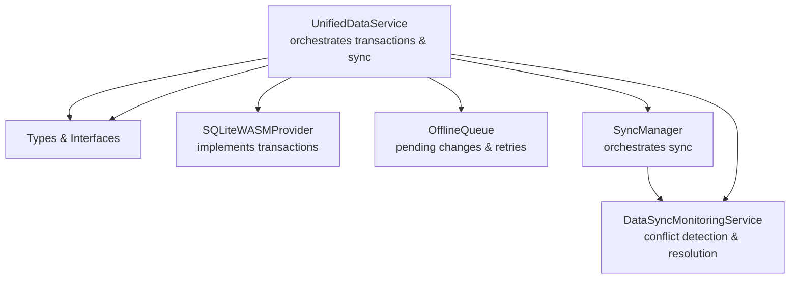
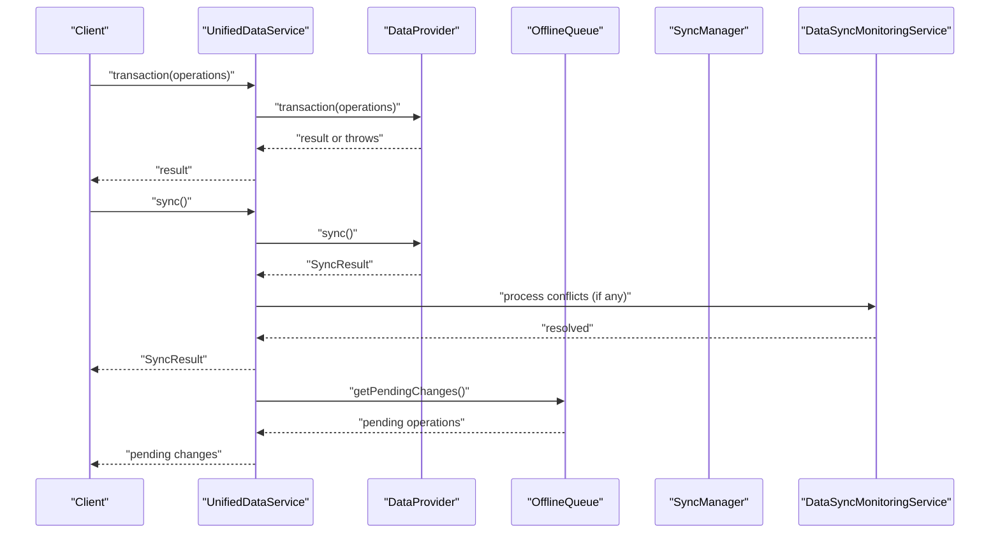
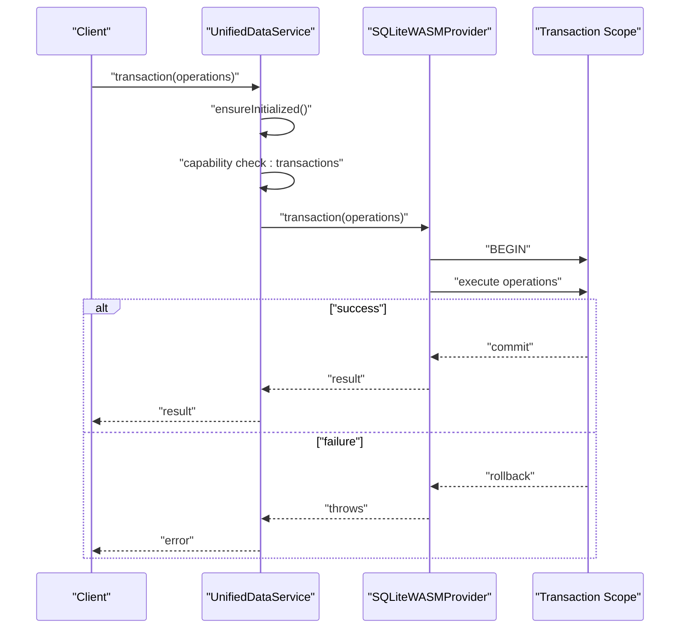
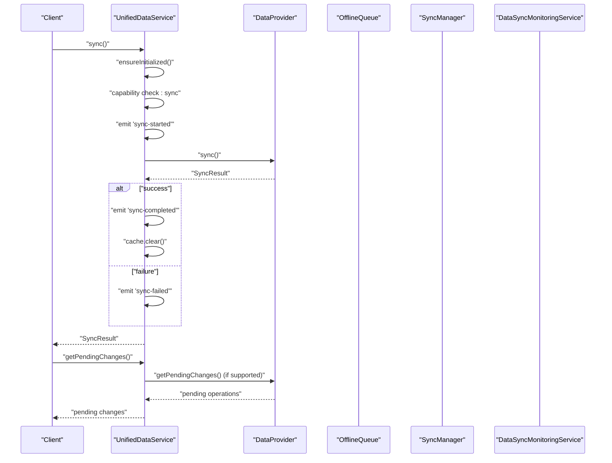
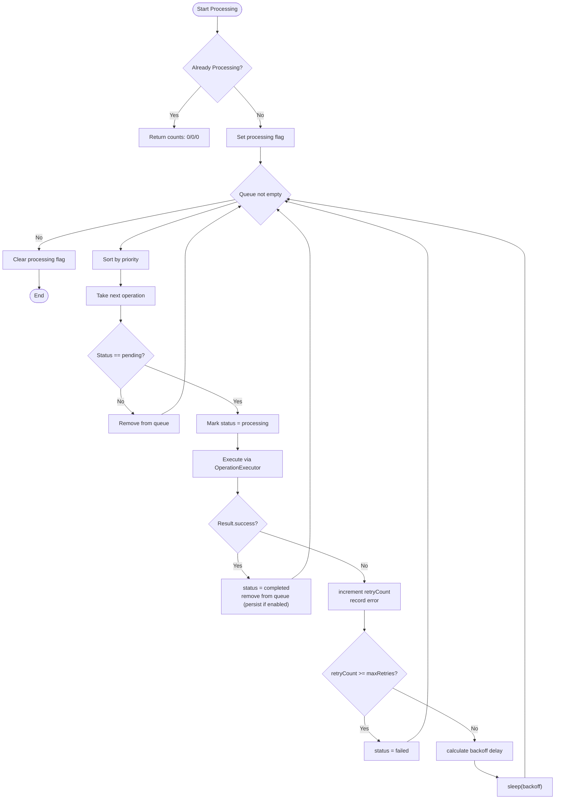
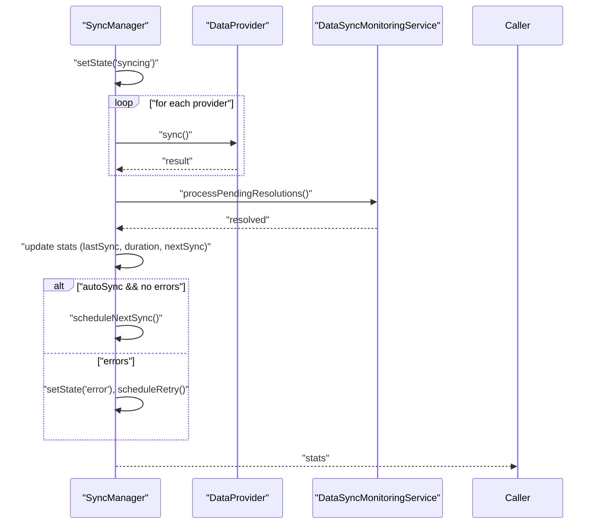
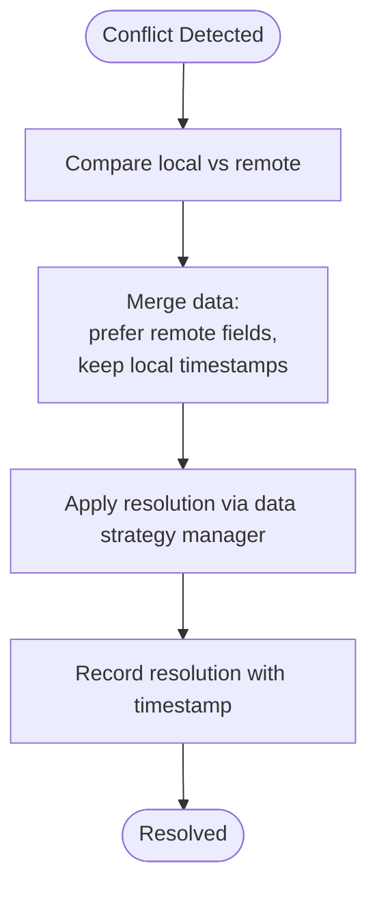
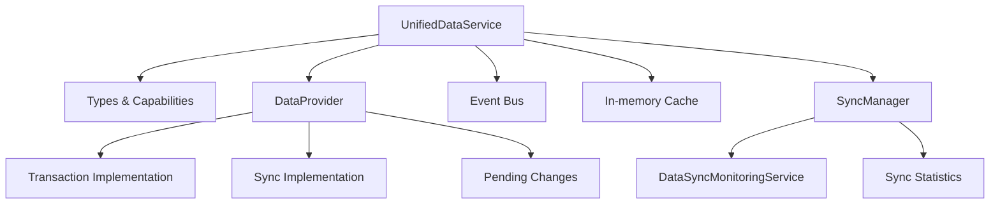

# Transactions & Sync

<cite>
**Referenced Files in This Document**
- [UnifiedDataService.ts](file://src/services/data/UnifiedDataService.ts)
- [SQLiteWASMProvider.ts](file://src/services/database/SQLiteWASMProvider.ts)
- [OfflineQueue.ts](file://src/services/database/sync/OfflineQueue.ts)
- [SyncManager.ts](file://src/services/sync/SyncManager.ts)
- [DataSyncMonitoringService.ts](file://src/services/consistency/DataSyncMonitoringService.ts)
- [types.ts](file://src/services/data/types.ts)
</cite>

## Table of Contents
1. [Introduction](#introduction)
2. [Project Structure](#project-structure)
3. [Core Components](#core-components)
4. [Architecture Overview](#architecture-overview)
5. [Detailed Component Analysis](#detailed-component-analysis)
6. [Dependency Analysis](#dependency-analysis)
7. [Performance Considerations](#performance-considerations)
8. [Troubleshooting Guide](#troubleshooting-guide)
9. [Conclusion](#conclusion)

## Introduction
This document explains the transaction and synchronization capabilities in UnifiedDataService. It covers atomic transaction execution, operation validation, rollback behavior, provider-specific sync workflows, pending changes detection, sync result interpretation, conflict resolution, and error handling. Practical examples illustrate complex transaction scenarios and sync workflow management, along with troubleshooting guidance for synchronization issues.

## Project Structure
The transaction and sync features span several modules:
- UnifiedDataService orchestrates provider selection, exposes transaction and sync APIs, and emits lifecycle events.
- Provider implementations (e.g., SQLiteWASMProvider) implement provider-specific transaction semantics and persistence.
- OfflineQueue manages pending operations and retries during sync.
- SyncManager coordinates multi-provider synchronization and schedules periodic sync cycles.
- DataSyncMonitoringService detects and resolves conflicts during sync.

**Diagram sources**
- [UnifiedDataService.ts:36-128](file://src/services/data/UnifiedDataService.ts#L36-L128)
- [SQLiteWASMProvider.ts:1083-1117](file://src/services/database/SQLiteWASMProvider.ts#L1083-L1117)
- [OfflineQueue.ts:152-192](file://src/services/database/sync/OfflineQueue.ts#L152-L192)
- [SyncManager.ts:192-207](file://src/services/sync/SyncManager.ts#L192-L207)
- [DataSyncMonitoringService.ts:293-340](file://src/services/consistency/DataSyncMonitoringService.ts#L293-L340)

**Section sources**
- [UnifiedDataService.ts:36-128](file://src/services/data/UnifiedDataService.ts#L36-L128)
- [types.ts:1-200](file://src/services/data/types.ts#L1-L200)

## Core Components
- UnifiedDataService
  - Provides transaction() to execute multiple operations atomically via the current provider.
  - Provides sync() to trigger provider-specific synchronization and emits lifecycle events.
  - Exposes getPendingChanges() to enumerate pending operations awaiting sync.
  - Manages provider initialization, capability checks, and event emission.

- Provider Implementations
  - SQLiteWASMProvider implements provider-level transactions with explicit commit/rollback semantics.

- OfflineQueue
  - Queues pending operations, tracks statuses, applies retry/backoff strategies, and persists to IndexedDB.

- SyncManager
  - Coordinates provider sync cycles, aggregates statistics, and schedules subsequent syncs.

- DataSyncMonitoringService
  - Detects conflicts between local and remote data and resolves them by applying merged results.

**Section sources**
- [UnifiedDataService.ts:374-428](file://src/services/data/UnifiedDataService.ts#L374-L428)
- [UnifiedDataService.ts:389-415](file://src/services/data/UnifiedDataService.ts#L389-L415)
- [UnifiedDataService.ts:420-428](file://src/services/data/UnifiedDataService.ts#L420-L428)
- [SQLiteWASMProvider.ts:1083-1117](file://src/services/database/SQLiteWASMProvider.ts#L1083-L1117)
- [OfflineQueue.ts:152-192](file://src/services/database/sync/OfflineQueue.ts#L152-L192)
- [SyncManager.ts:192-207](file://src/services/sync/SyncManager.ts#L192-L207)
- [DataSyncMonitoringService.ts:293-340](file://src/services/consistency/DataSyncMonitoringService.ts#L293-L340)

## Architecture Overview
The transaction and sync architecture centers on UnifiedDataService delegating to providers and coordinating with auxiliary services for offline handling and conflict resolution.

**Diagram sources**
- [UnifiedDataService.ts:374-428](file://src/services/data/UnifiedDataService.ts#L374-L428)
- [UnifiedDataService.ts:389-415](file://src/services/data/UnifiedDataService.ts#L389-L415)
- [OfflineQueue.ts:152-192](file://src/services/database/sync/OfflineQueue.ts#L152-L192)
- [SyncManager.ts:192-207](file://src/services/sync/SyncManager.ts#L192-L207)
- [DataSyncMonitoringService.ts:293-340](file://src/services/consistency/DataSyncMonitoringService.ts#L293-L340)

## Detailed Component Analysis

### Transaction Method: Atomic Execution and Rollback
The transaction method delegates to the active provider and ensures the provider supports transactions. The provider-level implementation (e.g., SQLiteWASMProvider) defines commit and rollback semantics.

**Diagram sources**
- [UnifiedDataService.ts:374-382](file://src/services/data/UnifiedDataService.ts#L374-L382)
- [SQLiteWASMProvider.ts:1083-1117](file://src/services/database/SQLiteWASMProvider.ts#L1083-L1117)

Key behaviors:
- Capability gating: Throws if the provider does not support transactions.
- Provider responsibility: The provider starts a transaction, executes the supplied operations, and either commits or rolls back on error.
- Automatic commit/rollback: If the callback completes without error, the provider commits; otherwise, it rolls back.

Practical examples of complex transaction scenarios:
- Multi-entity insertions with cross-references: Insert parent records, then child records referencing parent IDs, ensuring atomicity. If any child insertion fails, the entire transaction is rolled back.
- Conditional updates with validation: Validate preconditions, compute derived values, and update multiple entities atomically. Failures roll back all changes.
- Bulk operations with partial failures: For providers that support partial execution, handle per-operation outcomes while maintaining transactional boundaries around the group.

**Section sources**
- [UnifiedDataService.ts:374-382](file://src/services/data/UnifiedDataService.ts#L374-L382)
- [SQLiteWASMProvider.ts:1083-1117](file://src/services/database/SQLiteWASMProvider.ts#L1083-L1117)

### Sync Operations: Provider-Specific Synchronization
The sync method triggers provider-specific synchronization, emits lifecycle events, and clears caches upon completion. Providers may enqueue pending changes and apply them during sync.

**Diagram sources**
- [UnifiedDataService.ts:389-415](file://src/services/data/UnifiedDataService.ts#L389-L415)
- [UnifiedDataService.ts:420-428](file://src/services/data/UnifiedDataService.ts#L420-L428)
- [OfflineQueue.ts:152-192](file://src/services/database/sync/OfflineQueue.ts#L152-L192)
- [SyncManager.ts:192-207](file://src/services/sync/SyncManager.ts#L192-L207)

Sync status tracking and conflict resolution:
- Status tracking: Events indicate sync lifecycle transitions. Providers and services maintain internal state and statistics.
- Conflict resolution: DataSyncMonitoringService detects conflicts and merges local and remote data, persisting resolved results.

**Section sources**
- [UnifiedDataService.ts:389-415](file://src/services/data/UnifiedDataService.ts#L389-L415)
- [UnifiedDataService.ts:420-428](file://src/services/data/UnifiedDataService.ts#L420-L428)
- [OfflineQueue.ts:152-192](file://src/services/database/sync/OfflineQueue.ts#L152-L192)
- [SyncManager.ts:192-207](file://src/services/sync/SyncManager.ts#L192-L207)
- [DataSyncMonitoringService.ts:293-340](file://src/services/consistency/DataSyncMonitoringService.ts#L293-L340)

### Pending Changes Detection and Retry Management
OfflineQueue maintains a prioritized queue of pending operations, applies retry/backoff strategies, and prunes old failed items to prevent queue bloat.

**Diagram sources**
- [OfflineQueue.ts:152-192](file://src/services/database/sync/OfflineQueue.ts#L152-L192)
- [OfflineQueue.ts:328-335](file://src/services/database/sync/OfflineQueue.ts#L328-L335)
- [OfflineQueue.ts:337-340](file://src/services/database/sync/OfflineQueue.ts#L337-L340)
- [OfflineQueue.ts:341-353](file://src/services/database/sync/OfflineQueue.ts#L341-L353)

**Section sources**
- [OfflineQueue.ts:152-192](file://src/services/database/sync/OfflineQueue.ts#L152-L192)
- [OfflineQueue.ts:328-353](file://src/services/database/sync/OfflineQueue.ts#L328-L353)

### Sync Workflow Management
SyncManager coordinates provider synchronization, processes pending conflict resolutions, updates statistics, and schedules future syncs.

**Diagram sources**
- [SyncManager.ts:162-207](file://src/services/sync/SyncManager.ts#L162-L207)

**Section sources**
- [SyncManager.ts:162-207](file://src/services/sync/SyncManager.ts#L162-L207)

### Conflict Resolution and Data Merging
DataSyncMonitoringService detects conflicts and merges local and remote data, preserving timestamps and applying resolved data to the store.

**Diagram sources**
- [DataSyncMonitoringService.ts:293-340](file://src/services/consistency/DataSyncMonitoringService.ts#L293-L340)

**Section sources**
- [DataSyncMonitoringService.ts:293-340](file://src/services/consistency/DataSyncMonitoringService.ts#L293-L340)

## Dependency Analysis
UnifiedDataService depends on provider capabilities and auxiliary services for offline and consistency handling.

**Diagram sources**
- [UnifiedDataService.ts:36-128](file://src/services/data/UnifiedDataService.ts#L36-L128)
- [types.ts:1-200](file://src/services/data/types.ts#L1-L200)
- [SyncManager.ts:162-207](file://src/services/sync/SyncManager.ts#L162-L207)
- [DataSyncMonitoringService.ts:293-340](file://src/services/consistency/DataSyncMonitoringService.ts#L293-L340)

**Section sources**
- [UnifiedDataService.ts:36-128](file://src/services/data/UnifiedDataService.ts#L36-L128)
- [types.ts:1-200](file://src/services/data/types.ts#L1-L200)

## Performance Considerations
- Transaction batching: Group related operations within a single transaction to minimize overhead and improve throughput.
- Provider-level optimizations: Use provider-specific transaction primitives (e.g., BEGIN/COMMIT) and avoid unnecessary work inside the transaction callback.
- OfflineQueue prioritization: Ensure high-priority operations are executed first to reduce staleness.
- Retry backoff: Configure exponential or linear backoff to balance responsiveness and resource usage.
- Caching: UnifiedDataService caches query results; sync clears caches to ensure consistency after successful sync.

[No sources needed since this section provides general guidance]

## Troubleshooting Guide
Common issues and resolutions:
- Transaction not supported
  - Symptom: Error indicating the provider does not support transactions.
  - Resolution: Switch to a provider that supports transactions or refactor operations to avoid requiring atomicity.

- Transaction failure and rollback
  - Symptom: Transaction throws; provider rolls back all changes.
  - Resolution: Inspect operation validation and preconditions; ensure data integrity constraints are satisfied.

- Sync fails with errors
  - Symptom: sync() emits a failed event and returns a result with errors.
  - Resolution: Review SyncResult for specific errors, address network/backend issues, and reattempt sync.

- Pending changes not applied
  - Symptom: getPendingChanges() returns operations; they remain queued.
  - Resolution: Verify OfflineQueue retry limits and backoff delays; check provider connectivity and backend availability.

- Conflicts not resolved
  - Symptom: Conflicts detected but not merged.
  - Resolution: Confirm DataSyncMonitoringService is invoked; review merge strategy and ensure resolved data is persisted.

**Section sources**
- [UnifiedDataService.ts:374-382](file://src/services/data/UnifiedDataService.ts#L374-L382)
- [UnifiedDataService.ts:389-415](file://src/services/data/UnifiedDataService.ts#L389-L415)
- [UnifiedDataService.ts:420-428](file://src/services/data/UnifiedDataService.ts#L420-L428)
- [OfflineQueue.ts:152-192](file://src/services/database/sync/OfflineQueue.ts#L152-L192)
- [DataSyncMonitoringService.ts:293-340](file://src/services/consistency/DataSyncMonitoringService.ts#L293-L340)

## Conclusion
UnifiedDataService centralizes transaction and sync operations across providers, enabling atomic multi-step writes and robust provider-specific synchronization. By leveraging provider-level transactions, OfflineQueue for pending changes, SyncManager for orchestration, and DataSyncMonitoringService for conflict resolution, applications can achieve reliable data consistency and resilient offline experiences.