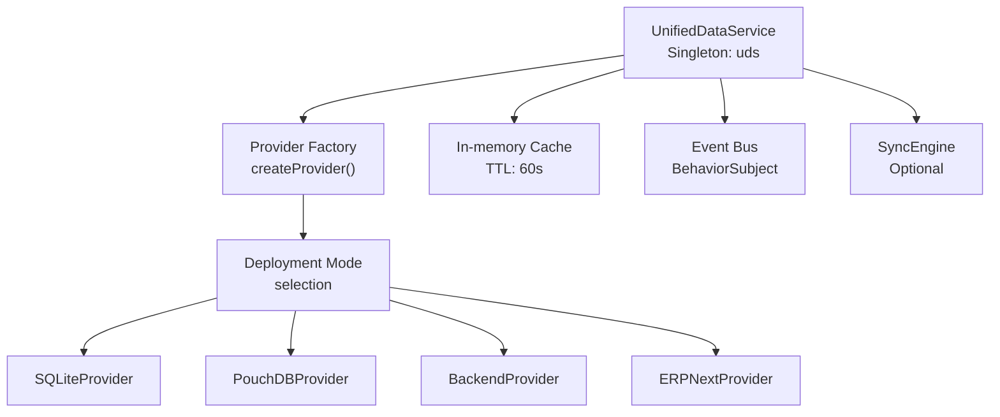
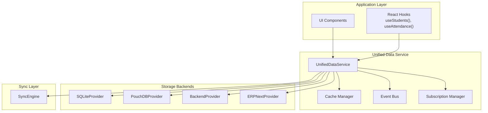
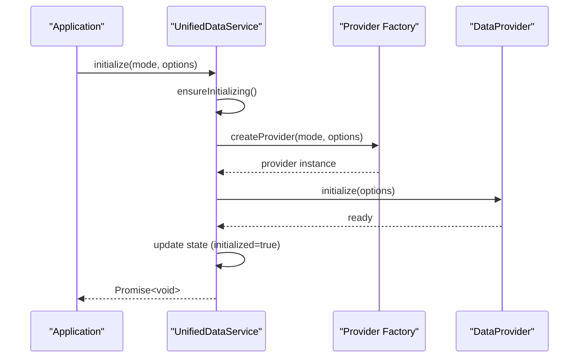
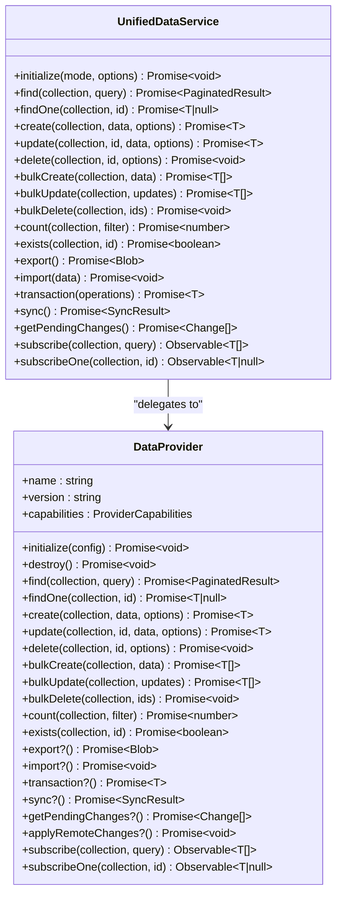
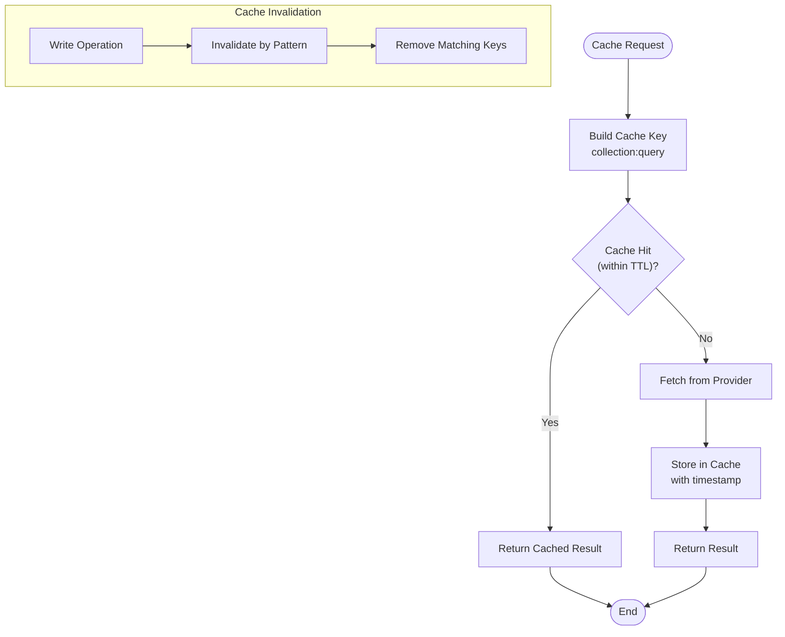
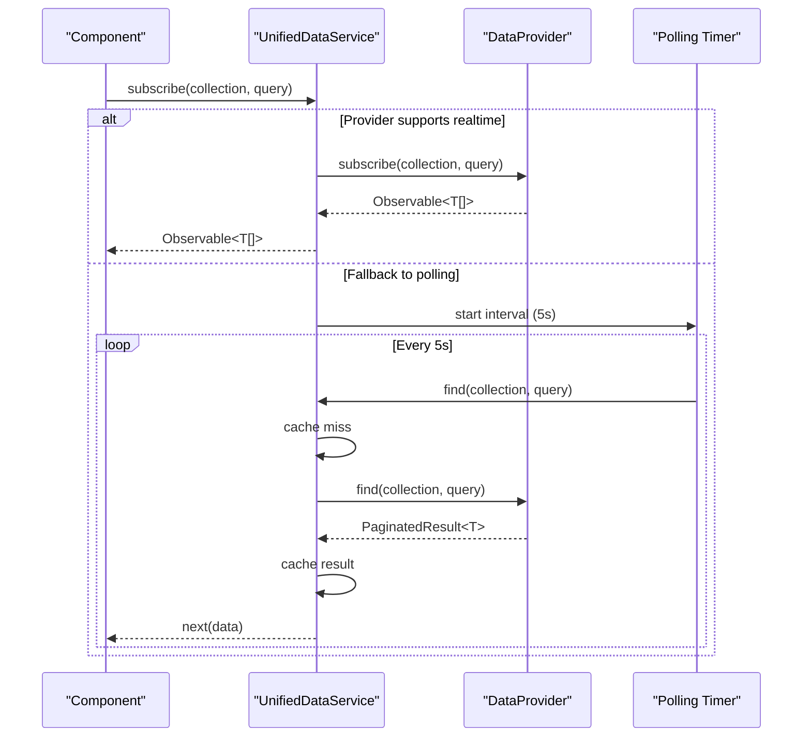
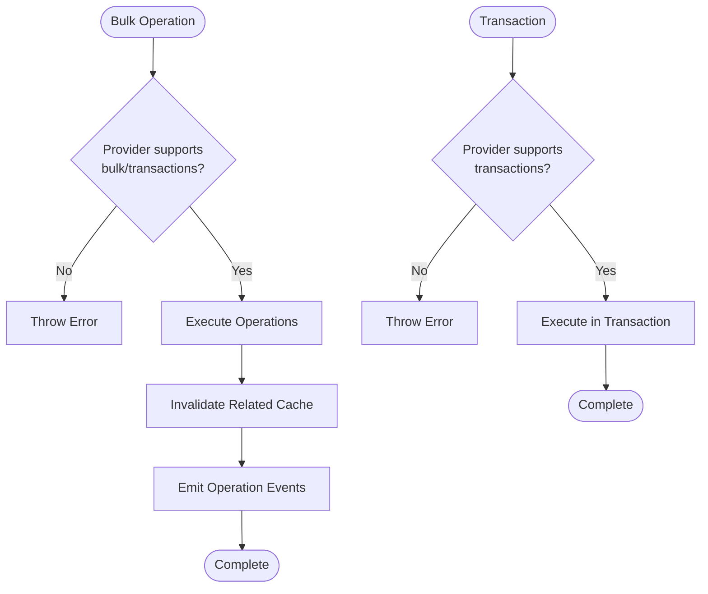
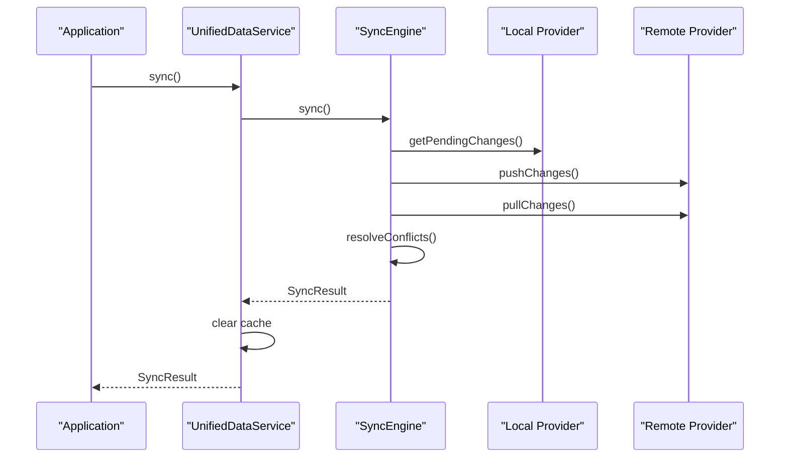
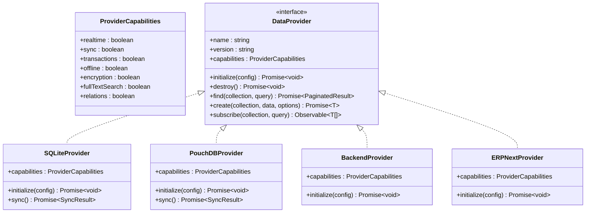
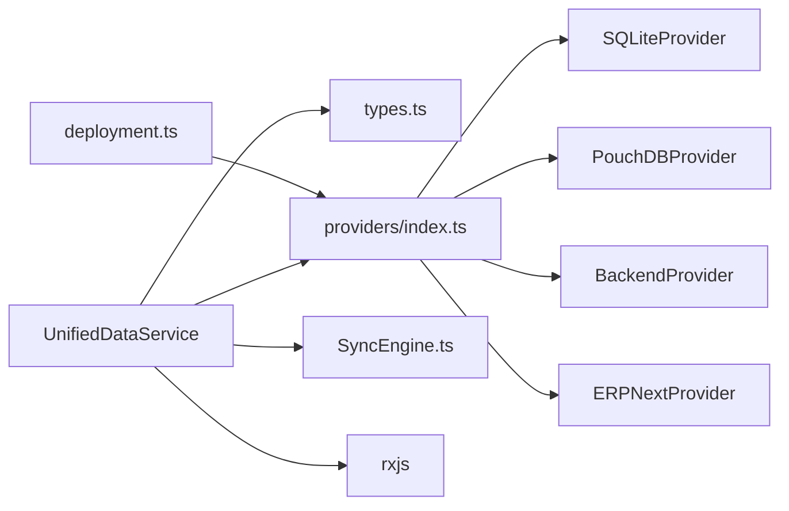

# Unified Data Service

<cite>
**Referenced Files in This Document**
- [UnifiedDataService.ts](file://src/services/data/UnifiedDataService.ts)
- [types.ts](file://src/services/data/types.ts)
- [SyncEngine.ts](file://src/services/data/SyncEngine.ts)
- [index.ts](file://src/services/data/index.ts)
- [deployment.ts](file://src/config/deployment.ts)
- [providers/index.ts](file://src/services/data/providers/index.ts)
- [DATA_LAYER_STRATEGY.md](file://docs/architecture/DATA_LAYER_STRATEGY.md)
</cite>

## Table of Contents
1. [Introduction](#introduction)
2. [Project Structure](#project-structure)
3. [Core Components](#core-components)
4. [Architecture Overview](#architecture-overview)
5. [Detailed Component Analysis](#detailed-component-analysis)
6. [Dependency Analysis](#dependency-analysis)
7. [Performance Considerations](#performance-considerations)
8. [Troubleshooting Guide](#troubleshooting-guide)
9. [Conclusion](#conclusion)
10. [Appendices](#appendices)

## Introduction
The UnifiedDataService (UDS) is the central data access abstraction in SchoolPilot3. It provides a unified API for CRUD operations, real-time subscriptions, bulk operations, transactions, and synchronization across multiple storage backends. UDS encapsulates provider selection logic, deployment mode handling, caching, and event emission while exposing a consistent interface to the rest of the application.

## Project Structure
The data layer is organized around a provider abstraction pattern with a factory responsible for selecting the appropriate backend based on deployment mode. The service exposes a singleton instance and a factory for testing.

**Diagram sources**
- [UnifiedDataService.ts:479-505](file://src/services/data/UnifiedDataService.ts#L479-L505)
- [providers/index.ts:42-102](file://src/services/data/providers/index.ts#L42-L102)
- [deployment.ts:42-186](file://src/config/deployment.ts#L42-L186)

**Section sources**
- [index.ts:1-37](file://src/services/data/index.ts#L1-L37)
- [DATA_LAYER_STRATEGY.md:42-90](file://docs/architecture/DATA_LAYER_STRATEGY.md#L42-L90)

## Core Components
- UnifiedDataService: Central orchestrator for data operations, caching, subscriptions, and events.
- DataProvider interface: Contract for all storage backends.
- SyncEngine: Optional synchronization manager for offline-first workflows.
- Provider factory: Creates and configures providers based on deployment mode.

**Section sources**
- [UnifiedDataService.ts:36-146](file://src/services/data/UnifiedDataService.ts#L36-L146)
- [types.ts:135-182](file://src/services/data/types.ts#L135-L182)
- [SyncEngine.ts:51-95](file://src/services/data/SyncEngine.ts#L51-L95)

## Architecture Overview
The architecture follows a layered design with clear separation between the application layer, the unified data service, and backend providers. UDS routes operations to the selected provider and manages caching, subscriptions, and synchronization.

**Diagram sources**
- [DATA_LAYER_STRATEGY.md:42-90](file://docs/architecture/DATA_LAYER_STRATEGY.md#L42-L90)
- [UnifiedDataService.ts:148-415](file://src/services/data/UnifiedDataService.ts#L148-L415)
- [SyncEngine.ts:1-559](file://src/services/data/SyncEngine.ts#L1-L559)

## Detailed Component Analysis

### UnifiedDataService Initialization and Provider Selection
The service initialization process validates state, selects a provider based on deployment mode, initializes the provider, and updates internal state.

**Diagram sources**
- [UnifiedDataService.ts:78-128](file://src/services/data/UnifiedDataService.ts#L78-L128)
- [providers/index.ts:42-102](file://src/services/data/providers/index.ts#L42-L102)

Key behaviors:
- State management with BehaviorSubject for initialization status and error reporting.
- Provider selection logic based on deployment mode with fallbacks.
- Configuration consolidation including provider capabilities and options.

**Section sources**
- [UnifiedDataService.ts:78-128](file://src/services/data/UnifiedDataService.ts#L78-L128)
- [deployment.ts:198-224](file://src/config/deployment.ts#L198-L224)
- [providers/index.ts:42-102](file://src/services/data/providers/index.ts#L42-L102)

### CRUD Operations
The service implements a comprehensive CRUD API with query support, pagination, and write options.

**Diagram sources**
- [UnifiedDataService.ts:148-475](file://src/services/data/UnifiedDataService.ts#L148-L475)
- [types.ts:135-182](file://src/services/data/types.ts#L135-L182)

CRUD implementation highlights:
- Query parameter support including filters, sorts, pagination, and projections.
- Write options for optimistic updates, silent writes, and custom metadata.
- Automatic cache invalidation on write operations.
- Event emission for entity lifecycle changes.

**Section sources**
- [UnifiedDataService.ts:153-283](file://src/services/data/UnifiedDataService.ts#L153-L283)
- [types.ts:64-107](file://src/services/data/types.ts#L64-L107)

### Caching Mechanism and Cache Invalidation
The service implements an in-memory cache with TTL-based expiration and pattern-based invalidation.

**Diagram sources**
- [UnifiedDataService.ts:607-629](file://src/services/data/UnifiedDataService.ts#L607-L629)

Cache characteristics:
- TTL: 60 seconds for both collection queries and individual entity lookups.
- Key format: collection:query-string for queries, collection:id for single entities.
- Granular invalidation on create/update/delete operations.

**Section sources**
- [UnifiedDataService.ts:47-48](file://src/services/data/UnifiedDataService.ts#L47-L48)
- [UnifiedDataService.ts:607-629](file://src/services/data/UnifiedDataService.ts#L607-L629)

### Real-time Subscription System
The service supports both real-time subscriptions (when available) and polling fallbacks.

**Diagram sources**
- [UnifiedDataService.ts:285-321](file://src/services/data/UnifiedDataService.ts#L285-L321)
- [UnifiedDataService.ts:641-675](file://src/services/data/UnifiedDataService.ts#L641-L675)

Subscription features:
- Single-entity and collection subscriptions.
- Capability-aware selection between real-time and polling.
- RxJS Observable streams with proper cleanup.
- Fallback logic for non-realtime providers.

**Section sources**
- [UnifiedDataService.ts:285-321](file://src/services/data/UnifiedDataService.ts#L285-L321)
- [UnifiedDataService.ts:641-675](file://src/services/data/UnifiedDataService.ts#L641-L675)

### Bulk Operations and Transactions
Bulk operations and transactions provide efficient batch processing and atomicity guarantees.

**Diagram sources**
- [UnifiedDataService.ts:323-382](file://src/services/data/UnifiedDataService.ts#L323-L382)

Bulk operation behaviors:
- Batch create, update, and delete operations.
- Efficient provider-side implementation when supported.
- Comprehensive cache invalidation for bulk updates.
- Transaction support with rollback semantics.

**Section sources**
- [UnifiedDataService.ts:323-382](file://src/services/data/UnifiedDataService.ts#L323-L382)
- [types.ts:102-107](file://src/services/data/types.ts#L102-L107)

### Sync Capabilities
The service integrates with the SyncEngine for offline-first synchronization.

**Diagram sources**
- [UnifiedDataService.ts:384-415](file://src/services/data/UnifiedDataService.ts#L384-L415)
- [SyncEngine.ts:129-206](file://src/services/data/SyncEngine.ts#L129-L206)

Sync features:
- Automatic and manual sync triggers.
- Conflict detection and resolution strategies.
- Offline queue management with retry logic.
- Progress monitoring and status reporting.

**Section sources**
- [UnifiedDataService.ts:384-428](file://src/services/data/UnifiedDataService.ts#L384-L428)
- [SyncEngine.ts:51-95](file://src/services/data/SyncEngine.ts#L51-L95)

### Provider Abstraction and Extensibility
The provider abstraction enables pluggable storage backends with capability detection.

**Diagram sources**
- [types.ts:9-31](file://src/services/data/types.ts#L9-L31)
- [types.ts:135-182](file://src/services/data/types.ts#L135-L182)
- [providers/index.ts:7-10](file://src/services/data/providers/index.ts#L7-L10)

Provider selection logic:
- Standalone mode: PouchDB by default, SQLite optional via feature flag.
- Networked/SaaS: PouchDB with live sync enabled.
- Hosted: BackendProvider with configured credentials.
- ERPNext: ERPNextProvider for enterprise integration.

**Section sources**
- [providers/index.ts:42-102](file://src/services/data/providers/index.ts#L42-L102)
- [deployment.ts:42-186](file://src/config/deployment.ts#L42-L186)

## Dependency Analysis
The service maintains loose coupling through the DataProvider interface and dependency injection via the factory pattern.

**Diagram sources**
- [UnifiedDataService.ts:8-22](file://src/services/data/UnifiedDataService.ts#L8-L22)
- [providers/index.ts:1-103](file://src/services/data/providers/index.ts#L1-L103)
- [deployment.ts:1-241](file://src/config/deployment.ts#L1-L241)

Key dependencies:
- RxJS for observables and reactive patterns.
- Provider factory for runtime provider selection.
- Deployment configuration for mode-based behavior.
- SyncEngine for optional synchronization.

**Section sources**
- [UnifiedDataService.ts:8-22](file://src/services/data/UnifiedDataService.ts#L8-L22)
- [providers/index.ts:1-103](file://src/services/data/providers/index.ts#L1-L103)

## Performance Considerations
- Caching: 60-second TTL reduces redundant provider calls and improves response times.
- Pagination: Server-side pagination prevents large result sets and memory pressure.
- Bulk operations: Batch processing minimizes round trips and improves throughput.
- Polling fallback: 5-second intervals balance responsiveness with resource usage.
- Lazy loading: Provider instantiation deferred until initialization.

## Troubleshooting Guide
Common initialization issues:
- Uninitialized service: Call initialize() before using any methods.
- Provider errors: Check deployment mode configuration and provider availability.
- Cache corruption: Use destroy() to reset state and clear cache.

Operational diagnostics:
- Monitor state$ for initialization status and error conditions.
- Subscribe to events$ for entity lifecycle notifications.
- Use count() and exists() for data validation and debugging.

**Section sources**
- [UnifiedDataService.ts:601-605](file://src/services/data/UnifiedDataService.ts#L601-L605)
- [UnifiedDataService.ts:133-146](file://src/services/data/UnifiedDataService.ts#L133-L146)

## Conclusion
The UnifiedDataService provides a robust, extensible foundation for data access in SchoolPilot3. Its provider abstraction, comprehensive CRUD API, real-time capabilities, and synchronization support enable flexible deployment across diverse environments while maintaining a consistent developer experience.

## Appendices

### Practical Usage Examples
Service initialization:
- Initialize with deployment mode and provider options.
- Handle initialization state and error conditions.
- Use singleton instance (uds) for application-wide access.

Data operations:
- Perform CRUD operations with query parameters and pagination.
- Use write options for optimistic updates and silent writes.
- Leverage bulk operations for efficient batch processing.

Subscription handling:
- Subscribe to collections or single entities.
- Handle real-time updates or polling fallbacks.
- Manage subscription lifecycle with proper cleanup.

**Section sources**
- [UnifiedDataService.ts:78-128](file://src/services/data/UnifiedDataService.ts#L78-L128)
- [UnifiedDataService.ts:153-283](file://src/services/data/UnifiedDataService.ts#L153-L283)
- [UnifiedDataService.ts:285-321](file://src/services/data/UnifiedDataService.ts#L285-L321)