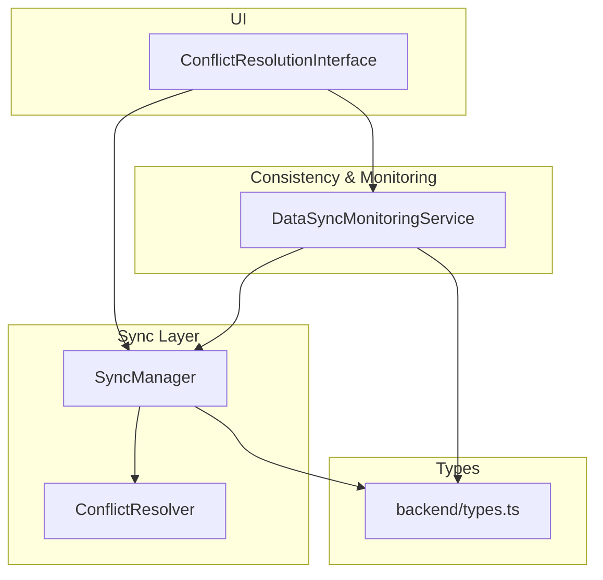
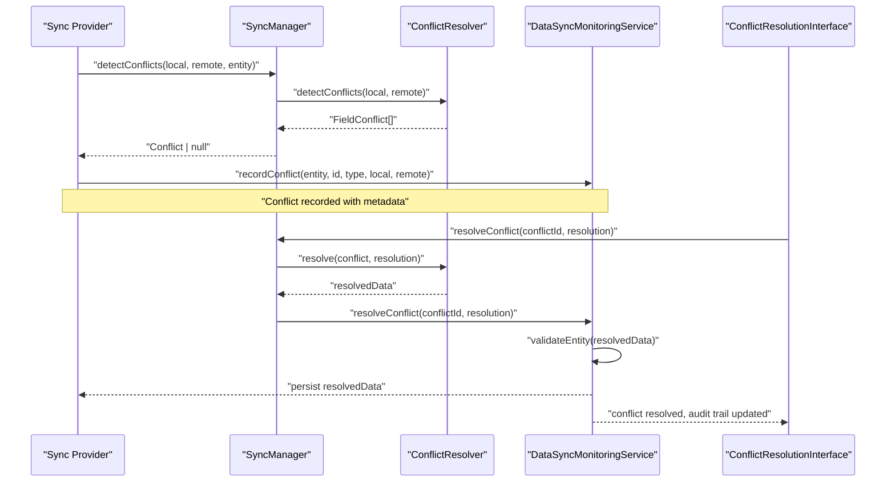
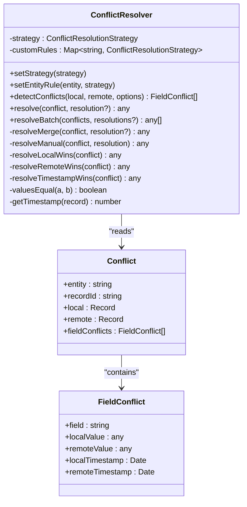
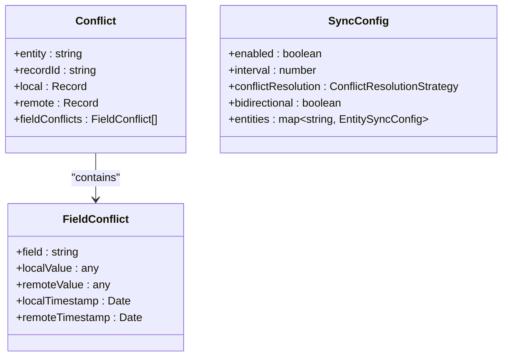
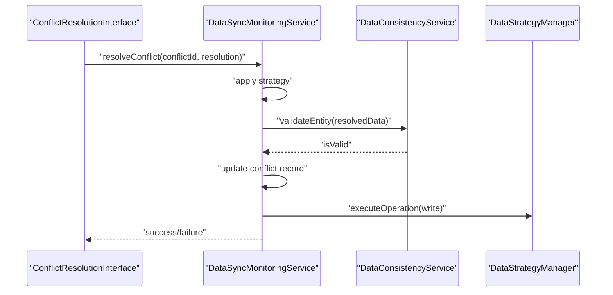
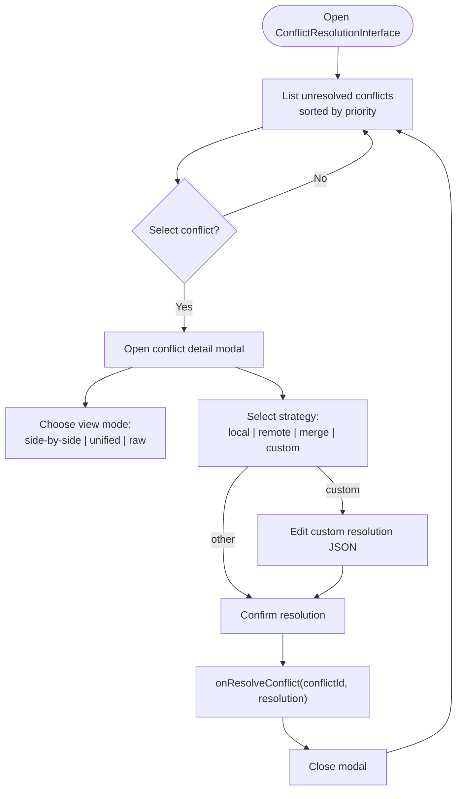
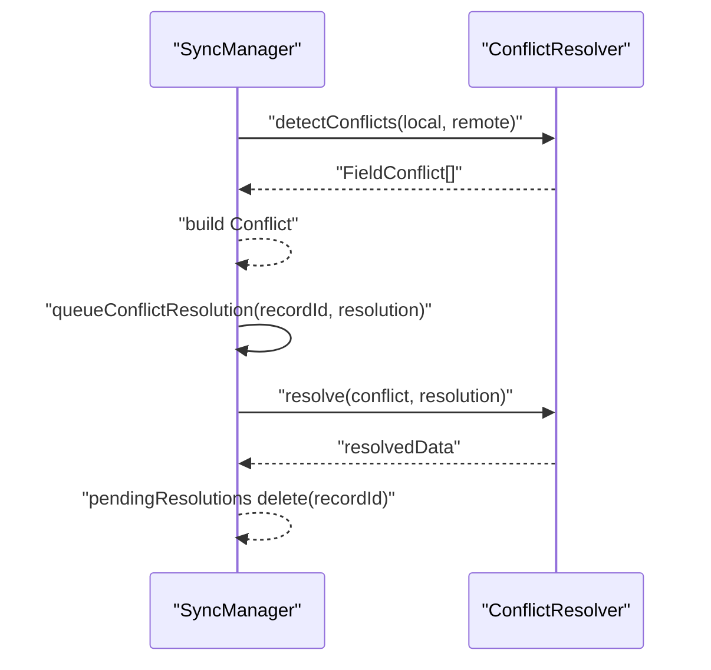
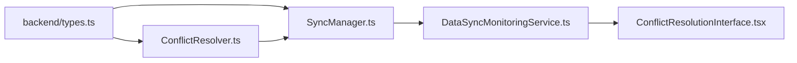

# Conflict Resolution

<cite>
**Referenced Files in This Document**
- [ConflictResolver.ts](file://src/services/sync/ConflictResolver.ts)
- [types.ts](file://src/services/backend/types.ts)
- [DataSyncMonitoringService.ts](file://src/services/consistency/DataSyncMonitoringService.ts)
- [ConflictResolutionInterface.tsx](file://src/components/ConflictResolutionInterface.tsx)
- [SyncManager.ts](file://src/services/sync/SyncManager.ts)
</cite>

## Table of Contents
1. [Introduction](#introduction)
2. [Project Structure](#project-structure)
3. [Core Components](#core-components)
4. [Architecture Overview](#architecture-overview)
5. [Detailed Component Analysis](#detailed-component-analysis)
6. [Dependency Analysis](#dependency-analysis)
7. [Performance Considerations](#performance-considerations)
8. [Troubleshooting Guide](#troubleshooting-guide)
9. [Conclusion](#conclusion)
10. [Appendices](#appendices)

## Introduction
This document explains SchoolPilot3’s conflict resolution system. It covers multi-strategy conflict detection and resolution, including timestamp-based resolution, entity-specific rules, and manual intervention workflows. It documents how conflicts are detected between local and remote changes, how field-level conflicts are identified and categorized, and how deterministic strategies (last-write-wins, merge, manual) are applied. It also describes the conflict queuing system for pending resolutions, resolution tracking, and audit trail generation. Practical examples and integration points with the sync process are included, along with guidance on configuring entity-specific conflict rules and implementing custom resolution logic.

## Project Structure
The conflict resolution system spans several modules:
- Detection and resolution logic: ConflictResolver
- Backend types and conflict models: backend types
- Monitoring, queueing, and resolution application: DataSyncMonitoringService
- Manual resolution UI: ConflictResolutionInterface
- Orchestration and queueing: SyncManager

**Diagram sources**
- [ConflictResolver.ts:1-248](file://src/services/sync/ConflictResolver.ts#L1-L248)
- [types.ts:160-174](file://src/services/backend/types.ts#L160-L174)
- [DataSyncMonitoringService.ts:1-483](file://src/services/consistency/DataSyncMonitoringService.ts#L1-L483)
- [ConflictResolutionInterface.tsx:1-438](file://src/components/ConflictResolutionInterface.tsx#L1-L438)
- [SyncManager.ts:206-249](file://src/services/sync/SyncManager.ts#L206-L249)

**Section sources**
- [ConflictResolver.ts:1-248](file://src/services/sync/ConflictResolver.ts#L1-L248)
- [types.ts:160-174](file://src/services/backend/types.ts#L160-L174)
- [DataSyncMonitoringService.ts:1-483](file://src/services/consistency/DataSyncMonitoringService.ts#L1-L483)
- [ConflictResolutionInterface.tsx:1-438](file://src/components/ConflictResolutionInterface.tsx#L1-L438)
- [SyncManager.ts:206-249](file://src/services/sync/SyncManager.ts#L206-L249)

## Core Components
- ConflictResolver: Detects field-level differences and resolves conflicts deterministically or manually.
- Conflict models and strategies: Defined in backend types.
- DataSyncMonitoringService: Records conflicts, applies resolutions, validates outcomes, and tracks metrics.
- ConflictResolutionInterface: Provides a UI for manual conflict review and resolution.
- SyncManager: Coordinates detection, queues, and resolution application during sync.

Key responsibilities:
- Detect conflicts by comparing local and remote records, ignoring non-essential fields.
- Resolve conflicts via configurable strategies: local-wins, remote-wins, timestamp-wins, merge, manual.
- Enforce entity-specific rules and custom resolution functions.
- Track conflict resolution lifecycle and maintain audit trails.

**Section sources**
- [ConflictResolver.ts:42-73](file://src/services/sync/ConflictResolver.ts#L42-L73)
- [ConflictResolver.ts:78-105](file://src/services/sync/ConflictResolver.ts#L78-L105)
- [types.ts:91-96](file://src/services/backend/types.ts#L91-L96)
- [types.ts:160-174](file://src/services/backend/types.ts#L160-L174)
- [DataSyncMonitoringService.ts:224-248](file://src/services/consistency/DataSyncMonitoringService.ts#L224-L248)
- [DataSyncMonitoringService.ts:251-316](file://src/services/consistency/DataSyncMonitoringService.ts#L251-L316)
- [ConflictResolutionInterface.tsx:37-126](file://src/components/ConflictResolutionInterface.tsx#L37-L126)
- [SyncManager.ts:206-236](file://src/services/sync/SyncManager.ts#L206-L236)

## Architecture Overview
The conflict resolution pipeline integrates detection, resolution, validation, persistence, and UI:

**Diagram sources**
- [SyncManager.ts:206-236](file://src/services/sync/SyncManager.ts#L206-L236)
- [ConflictResolver.ts:78-105](file://src/services/sync/ConflictResolver.ts#L78-L105)
- [DataSyncMonitoringService.ts:224-248](file://src/services/consistency/DataSyncMonitoringService.ts#L224-L248)
- [DataSyncMonitoringService.ts:251-316](file://src/services/consistency/DataSyncMonitoringService.ts#L251-L316)
- [ConflictResolutionInterface.tsx:37-126](file://src/components/ConflictResolutionInterface.tsx#L37-L126)

## Detailed Component Analysis

### ConflictResolver
Responsibilities:
- Detect field-level conflicts between local and remote records.
- Resolve conflicts deterministically or via manual selection.
- Support entity-specific rules and custom resolution functions.

Detection logic:
- Compares fields while ignoring non-essential identifiers and timestamps.
- Produces a list of field conflicts with local and remote values and timestamps.

Resolution strategies:
- local-wins: Use local record.
- remote-wins: Use remote record.
- timestamp-wins: Choose the record with the latest timestamp.
- merge: Combine remote with selective overrides from local.
- manual: Per-field decisions with optional custom values.

**Diagram sources**
- [ConflictResolver.ts:17-248](file://src/services/sync/ConflictResolver.ts#L17-L248)
- [types.ts:160-174](file://src/services/backend/types.ts#L160-L174)

**Section sources**
- [ConflictResolver.ts:42-73](file://src/services/sync/ConflictResolver.ts#L42-L73)
- [ConflictResolver.ts:78-105](file://src/services/sync/ConflictResolver.ts#L78-L105)
- [ConflictResolver.ts:120-139](file://src/services/sync/ConflictResolver.ts#L120-L139)
- [ConflictResolver.ts:144-167](file://src/services/sync/ConflictResolver.ts#L144-L167)
- [ConflictResolver.ts:172-205](file://src/services/sync/ConflictResolver.ts#L172-L205)
- [ConflictResolver.ts:210-244](file://src/services/sync/ConflictResolver.ts#L210-L244)

### Conflict Models and Strategies
- ConflictResolutionStrategy: union of supported strategies.
- Conflict and FieldConflict: describe the nature of discrepancies.
- SyncConfig: includes default conflict resolution strategy and entity-specific overrides.

**Diagram sources**
- [types.ts:91-96](file://src/services/backend/types.ts#L91-L96)
- [types.ts:160-174](file://src/services/backend/types.ts#L160-L174)
- [types.ts:73-89](file://src/services/backend/types.ts#L73-L89)

**Section sources**
- [types.ts:91-96](file://src/services/backend/types.ts#L91-L96)
- [types.ts:160-174](file://src/services/backend/types.ts#L160-L174)
- [types.ts:73-89](file://src/services/backend/types.ts#L73-L89)

### DataSyncMonitoringService
Responsibilities:
- Record conflicts with metadata and timestamps.
- Apply resolution strategies and validate resulting data.
- Persist resolved data via the data strategy manager.
- Track metrics and maintain an audit trail.

Resolution flow:
- Applies selected strategy (local_wins, remote_wins, merge, manual).
- Validates resolved data against consistency rules.
- Updates conflict record with resolution metadata.
- Persists resolved data and notifies subscribers.

**Diagram sources**
- [DataSyncMonitoringService.ts:251-316](file://src/services/consistency/DataSyncMonitoringService.ts#L251-L316)
- [DataSyncMonitoringService.ts:282-290](file://src/services/consistency/DataSyncMonitoringService.ts#L282-L290)

**Section sources**
- [DataSyncMonitoringService.ts:8-26](file://src/services/consistency/DataSyncMonitoringService.ts#L8-L26)
- [DataSyncMonitoringService.ts:224-248](file://src/services/consistency/DataSyncMonitoringService.ts#L224-L248)
- [DataSyncMonitoringService.ts:251-316](file://src/services/consistency/DataSyncMonitoringService.ts#L251-L316)
- [DataSyncMonitoringService.ts:319-337](file://src/services/consistency/DataSyncMonitoringService.ts#L319-L337)

### ConflictResolutionInterface
Responsibilities:
- Present conflicts to users with prioritization and filtering.
- Provide side-by-side, unified, or raw views of conflicting fields.
- Allow bulk and individual resolution with strategies: local, remote, auto merge, custom.
- Capture custom resolution JSON for manual override.

**Diagram sources**
- [ConflictResolutionInterface.tsx:37-126](file://src/components/ConflictResolutionInterface.tsx#L37-L126)
- [ConflictResolutionInterface.tsx:216-342](file://src/components/ConflictResolutionInterface.tsx#L216-L342)

**Section sources**
- [ConflictResolutionInterface.tsx:37-126](file://src/components/ConflictResolutionInterface.tsx#L37-L126)
- [ConflictResolutionInterface.tsx:216-342](file://src/components/ConflictResolutionInterface.tsx#L216-L342)

### SyncManager
Responsibilities:
- Detect conflicts between local and remote records.
- Resolve conflicts using ConflictResolver.
- Queue resolutions for later application.
- Integrate with the broader sync orchestration.

**Diagram sources**
- [SyncManager.ts:206-236](file://src/services/sync/SyncManager.ts#L206-L236)
- [ConflictResolver.ts:78-105](file://src/services/sync/ConflictResolver.ts#L78-L105)

**Section sources**
- [SyncManager.ts:206-236](file://src/services/sync/SyncManager.ts#L206-L236)

## Dependency Analysis
- ConflictResolver depends on backend types for Conflict and FieldConflict definitions and strategy enums.
- DataSyncMonitoringService depends on DataConsistencyService for validation and DataStrategyManager for persistence.
- ConflictResolutionInterface interacts with SyncManager and DataSyncMonitoringService for conflict listing and resolution submission.
- SyncManager orchestrates ConflictResolver and maintains a pending resolution queue.

**Diagram sources**
- [types.ts:91-96](file://src/services/backend/types.ts#L91-L96)
- [ConflictResolver.ts:8-8](file://src/services/sync/ConflictResolver.ts#L8-L8)
- [SyncManager.ts:206-236](file://src/services/sync/SyncManager.ts#L206-L236)
- [DataSyncMonitoringService.ts:1-483](file://src/services/consistency/DataSyncMonitoringService.ts#L1-L483)
- [ConflictResolutionInterface.tsx:1-438](file://src/components/ConflictResolutionInterface.tsx#L1-L438)

**Section sources**
- [types.ts:91-96](file://src/services/backend/types.ts#L91-L96)
- [ConflictResolver.ts:8-8](file://src/services/sync/ConflictResolver.ts#L8-L8)
- [DataSyncMonitoringService.ts:1-483](file://src/services/consistency/DataSyncMonitoringService.ts#L1-L483)
- [ConflictResolutionInterface.tsx:1-438](file://src/components/ConflictResolutionInterface.tsx#L1-L438)
- [SyncManager.ts:206-236](file://src/services/sync/SyncManager.ts#L206-L236)

## Performance Considerations
- Conflict detection compares fields across both records; avoid comparing large binary or frequently changing fields unnecessarily.
- Timestamp-based resolution relies on accurate timestamps; ensure consistent time sources across devices.
- Merge operations combine records; prefer selective merges to minimize unnecessary field updates.
- Batch resolution reduces overhead; use resolveBatch for multiple conflicts of the same type.
- Validation after resolution adds safety but introduces latency; consider validation caching for repeated entities.

## Troubleshooting Guide
Common issues and remedies:
- Unknown resolution strategy: Ensure strategy values match supported enums; otherwise, fallback to timestamp-wins.
- Invalid resolved data: Validation failures indicate schema mismatches; adjust custom values or merge selections accordingly.
- Missing fieldResolutions for manual strategy: Provide per-field decisions and optional custom values.
- Conflicts not being applied: Verify that the conflict is still unresolved and that the data strategy manager is available.
- Audit trail gaps: Confirm that resolved conflicts are persisted and that the conflict record includes resolution metadata.

Operational checks:
- Inspect unresolved conflicts and their counts by type.
- Review recent sync history and throughput metrics.
- Validate that the UI shows the correct conflict priorities and timestamps.

**Section sources**
- [ConflictResolver.ts:96-100](file://src/services/sync/ConflictResolver.ts#L96-L100)
- [DataSyncMonitoringService.ts:277-279](file://src/services/consistency/DataSyncMonitoringService.ts#L277-L279)
- [DataSyncMonitoringService.ts:288-290](file://src/services/consistency/DataSyncMonitoringService.ts#L288-L290)
- [DataSyncMonitoringService.ts:426-428](file://src/services/consistency/DataSyncMonitoringService.ts#L426-L428)

## Conclusion
SchoolPilot3’s conflict resolution system combines robust detection, flexible resolution strategies, and a comprehensive audit trail. By leveraging timestamp-based decisions, entity-specific rules, and manual intervention, it ensures reliable data consistency across environments. The integration with monitoring, UI, and sync orchestration provides a complete lifecycle for conflict management, from detection to resolution and persistence.

## Appendices

### Practical Scenarios and Strategies
- Scenario: Two users edit the same field concurrently.
  - Detection: FieldConflict produced with differing values and timestamps.
  - Resolution: timestamp-wins selects the latest change; merge selectively preserves local edits; manual allows per-field override.
- Scenario: Local deletion conflicts with remote updates.
  - Detection: Conflict recorded with conflictType metadata.
  - Resolution: local-wins or remote-wins depending on policy; manual intervention may be required for complex deletions.
- Scenario: Bulk resolution across many records.
  - Use resolveBatch to apply a single strategy consistently; or use the UI’s bulk actions to keep local, remote, or auto merge.

### Configuring Entity-Specific Rules
- Set a default conflict resolution strategy globally.
- Override per-entity using setEntityRule(entity, strategy).
- Configure SyncConfig with conflictResolution and entity-specific settings for broader sync policies.

**Section sources**
- [ConflictResolver.ts:28-37](file://src/services/sync/ConflictResolver.ts#L28-L37)
- [types.ts:73-89](file://src/services/backend/types.ts#L73-L89)
- [types.ts:91-96](file://src/services/backend/types.ts#L91-L96)

### Implementing Custom Resolution Logic
- Provide customValues in the resolution payload for per-field overrides.
- Use manual strategy with fieldResolutions to capture granular decisions.
- Validate custom logic externally before applying; rely on DataSyncMonitoringService validation for final safety.

**Section sources**
- [ConflictResolver.ts:14-15](file://src/services/sync/ConflictResolver.ts#L14-L15)
- [ConflictResolver.ts:144-167](file://src/services/sync/ConflictResolver.ts#L144-L167)
- [DataSyncMonitoringService.ts:282-290](file://src/services/consistency/DataSyncMonitoringService.ts#L282-L290)