# Data Consistency & Synchronization

<cite>
**Referenced Files in This Document**
- [DataSyncMonitoringService.ts](file://src/services/consistency/DataSyncMonitoringService.ts)
- [ConflictResolver.ts](file://src/services/sync/ConflictResolver.ts)
- [SyncEngine.ts](file://src/services/data/SyncEngine.ts)
- [SyncManager.ts](file://src/services/database/sync/SyncManager.ts)
- [LiveStoreProvider.ts](file://src/services/database/LiveStoreProvider.ts)
- [DataConsistencyService.ts](file://src/services/consistency/DataConsistencyService.ts)
- [types.ts](file://src/services/consistency/types.ts)
- [DataStrategyManager.ts](file://src/services/consistency/DataStrategyManager.ts)
- [OfflineQueue.ts](file://src/services/database/sync/OfflineQueue.ts)
- [NetworkStateManager.ts](file://src/services/data/NetworkStateManager.ts)
- [dataValidation.ts](file://src/utils/dataValidation.ts)
- [DATA_LAYER_STRATEGY.md](file://docs/architecture/DATA_LAYER_STRATEGY.md)
</cite>

## Table of Contents
1. [Introduction](#introduction)
2. [Project Structure](#project-structure)
3. [Core Components](#core-components)
4. [Architecture Overview](#architecture-overview)
5. [Detailed Component Analysis](#detailed-component-analysis)
6. [Dependency Analysis](#dependency-analysis)
7. [Performance Considerations](#performance-considerations)
8. [Troubleshooting Guide](#troubleshooting-guide)
9. [Conclusion](#conclusion)

## Introduction
This document explains SchoolPilot3's data consistency and synchronization mechanisms. It covers multi-layered consistency enforcement (referential integrity, validation, and migration), transaction-like behavior through optimistic updates and queues, and robust conflict resolution strategies. The sync engine implements offline-first design with real-time capabilities, queue processing for offline operations, and recovery mechanisms for failed sync attempts. The documentation also details the data validation pipeline, schema versioning, and migration strategies, along with network state management and deterministic conflict resolution rules.

## Project Structure
SchoolPilot3 organizes data consistency and synchronization across several cohesive modules:
- Consistency services: validation, integrity checks, and migration
- Sync engines: local-to-remote synchronization with conflict detection and resolution
- Strategy management: routing operations based on network state and deployment mode
- Offline queue: persistent queue for offline operations with retry/backoff
- Network state management: connectivity monitoring and backend health checks
- LiveStore provider: multi-machine sync with conflict resolution and peer discovery

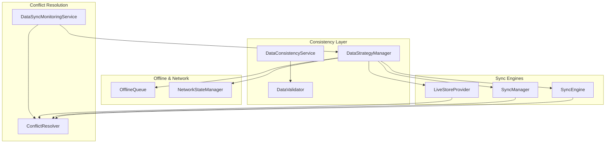

**Diagram sources**
- [DataConsistencyService.ts:1-469](file://src/services/consistency/DataConsistencyService.ts#L1-L469)
- [DataStrategyManager.ts:1-574](file://src/services/consistency/DataStrategyManager.ts#L1-L574)
- [SyncEngine.ts:1-559](file://src/services/data/SyncEngine.ts#L1-L559)
- [SyncManager.ts:1-387](file://src/services/database/sync/SyncManager.ts#L1-L387)
- [LiveStoreProvider.ts:1-800](file://src/services/database/LiveStoreProvider.ts#L1-L800)
- [OfflineQueue.ts:1-458](file://src/services/database/sync/OfflineQueue.ts#L1-L458)
- [NetworkStateManager.ts:1-234](file://src/services/data/NetworkStateManager.ts#L1-L234)
- [ConflictResolver.ts:1-248](file://src/services/sync/ConflictResolver.ts#L1-L248)
- [DataSyncMonitoringService.ts:1-483](file://src/services/consistency/DataSyncMonitoringService.ts#L1-L483)

**Section sources**
- [DATA_LAYER_STRATEGY.md:1-888](file://docs/architecture/DATA_LAYER_STRATEGY.md#L1-L888)

## Core Components
- DataConsistencyService: Validates entities, enforces referential integrity, runs consistency checks, and validates data migrations between modes.
- DataStrategyManager: Routes operations across providers (backend, RxDB, mock) based on strategy and network state, manages sync queue, and orchestrates batched sync.
- SyncEngine: Implements offline-first synchronization with queue processing, conflict detection, retry logic with exponential backoff, and manual conflict resolution.
- SyncManager: Bidirectional sync between backend and local cache with conflict resolution strategies and progress tracking.
- LiveStoreProvider: Multi-machine synchronization with peer discovery, conflict detection, and manual resolution workflows.
- OfflineQueue: Persistent queue for offline operations with priority ordering, retry/backoff, and IndexedDB persistence.
- NetworkStateManager: Monitors connectivity and backend health, emitting state changes for strategy adaptation.
- ConflictResolver: Detects field-level conflicts and resolves them deterministically using configurable strategies.
- DataSyncMonitoringService: Tracks sync status, metrics, conflicts, and errors; coordinates resolution and recovery.

**Section sources**
- [DataConsistencyService.ts:1-469](file://src/services/consistency/DataConsistencyService.ts#L1-L469)
- [DataStrategyManager.ts:1-574](file://src/services/consistency/DataStrategyManager.ts#L1-L574)
- [SyncEngine.ts:1-559](file://src/services/data/SyncEngine.ts#L1-L559)
- [SyncManager.ts:1-387](file://src/services/database/sync/SyncManager.ts#L1-L387)
- [LiveStoreProvider.ts:1-800](file://src/services/database/LiveStoreProvider.ts#L1-L800)
- [OfflineQueue.ts:1-458](file://src/services/database/sync/OfflineQueue.ts#L1-L458)
- [NetworkStateManager.ts:1-234](file://src/services/data/NetworkStateManager.ts#L1-L234)
- [ConflictResolver.ts:1-248](file://src/services/sync/ConflictResolver.ts#L1-L248)
- [DataSyncMonitoringService.ts:1-483](file://src/services/consistency/DataSyncMonitoringService.ts#L1-L483)

## Architecture Overview
SchoolPilot3 employs a layered architecture:
- Unified Data Hooks and Services abstract provider differences and expose a consistent API.
- Strategy Manager selects the appropriate execution path (backend, RxDB, or mock) based on network state and deployment mode.
- Sync Engines coordinate push/pull operations, manage queues, and resolve conflicts.
- Validation and consistency services enforce data quality and integrity across modes and migrations.

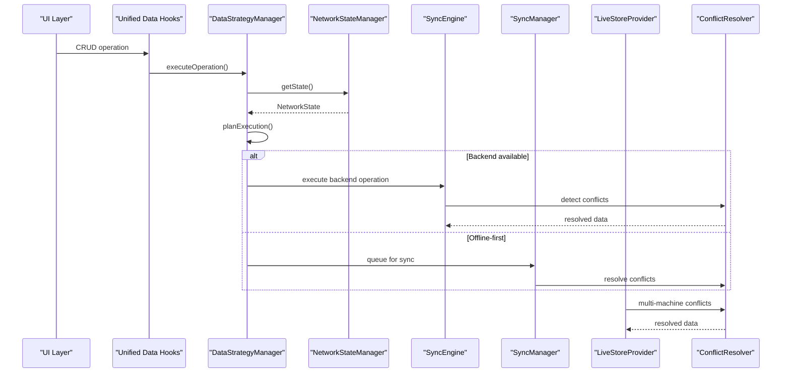

**Diagram sources**
- [DataStrategyManager.ts:90-128](file://src/services/consistency/DataStrategyManager.ts#L90-L128)
- [NetworkStateManager.ts:21-60](file://src/services/data/NetworkStateManager.ts#L21-L60)
- [SyncEngine.ts:129-206](file://src/services/data/SyncEngine.ts#L129-L206)
- [SyncManager.ts:169-200](file://src/services/database/sync/SyncManager.ts#L169-L200)
- [LiveStoreProvider.ts:245-286](file://src/services/database/LiveStoreProvider.ts#L245-L286)
- [ConflictResolver.ts:42-105](file://src/services/sync/ConflictResolver.ts#L42-L105)

## Detailed Component Analysis

### DataConsistencyService
- Responsibilities:
  - Entity validation with schema rules and business rules
  - Referential integrity checks across entities
  - Consistency checks across datasets
  - Data migration validation between modes
- Key behaviors:
  - Configurable validation modes (strict, lenient, disabled)
  - Cascade delete constraint checks
  - Comprehensive reporting with critical and warning categorization

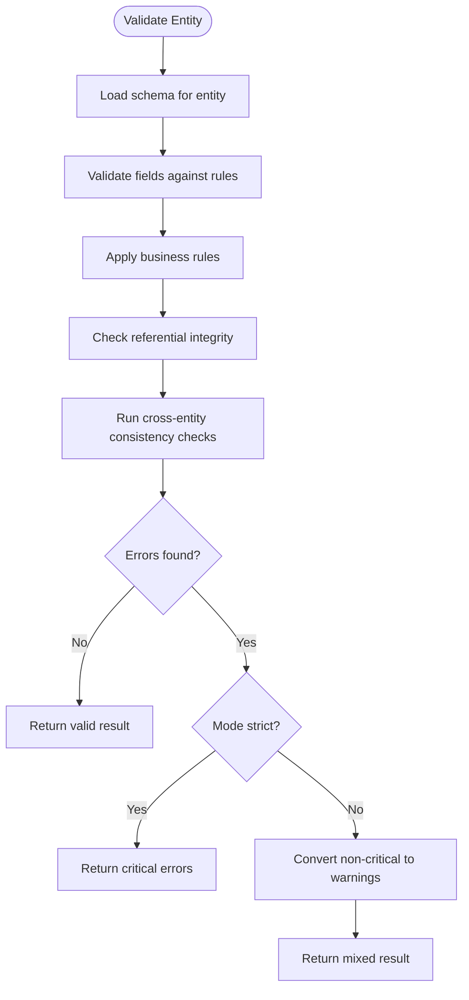

**Diagram sources**
- [DataConsistencyService.ts:75-143](file://src/services/consistency/DataConsistencyService.ts#L75-L143)
- [dataValidation.ts:82-122](file://src/utils/dataValidation.ts#L82-L122)

**Section sources**
- [DataConsistencyService.ts:1-469](file://src/services/consistency/DataConsistencyService.ts#L1-L469)
- [dataValidation.ts:1-465](file://src/utils/dataValidation.ts#L1-L465)

### DataStrategyManager
- Responsibilities:
  - Route operations to backend, RxDB, or mock based on strategy and network state
  - Manage sync queue with priority ordering and batching
  - Persist sync queue items and process them when conditions permit
- Key behaviors:
  - Strategy modes: offline-first, online-first, hybrid, demo
  - Fallback routing when primary fails
  - Deferred backend sync for offline scenarios

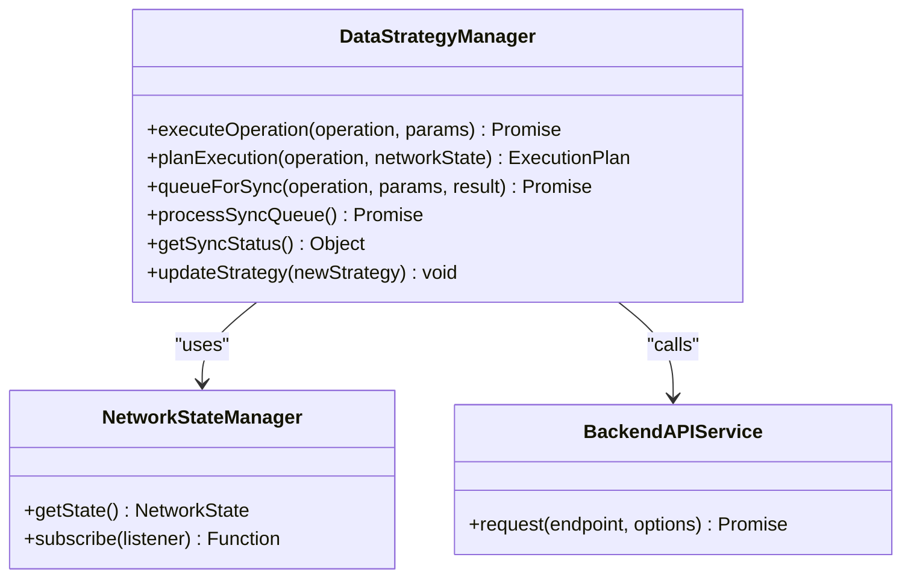

**Diagram sources**
- [DataStrategyManager.ts:44-574](file://src/services/consistency/DataStrategyManager.ts#L44-L574)
- [NetworkStateManager.ts:21-60](file://src/services/data/NetworkStateManager.ts#L21-L60)

**Section sources**
- [DataStrategyManager.ts:1-574](file://src/services/consistency/DataStrategyManager.ts#L1-L574)
- [NetworkStateManager.ts:1-234](file://src/services/data/NetworkStateManager.ts#L1-L234)

### SyncEngine (Offline-First)
- Responsibilities:
  - Queue operations when offline
  - Push/pull changes with conflict detection
  - Retry with exponential backoff
  - Manual conflict resolution
- Key behaviors:
  - Batch processing of queued operations
  - Online/offline event handling
  - Progress tracking and status observables

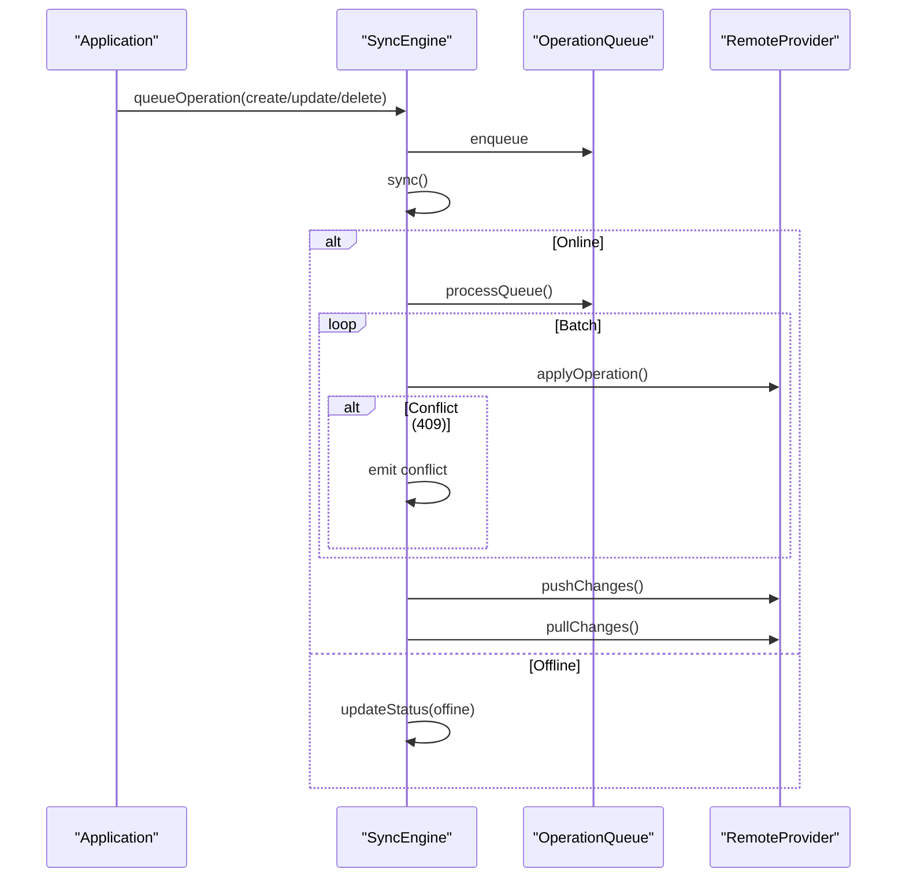

**Diagram sources**
- [SyncEngine.ts:211-235](file://src/services/data/SyncEngine.ts#L211-L235)
- [SyncEngine.ts:322-360](file://src/services/data/SyncEngine.ts#L322-L360)
- [SyncEngine.ts:404-458](file://src/services/data/SyncEngine.ts#L404-L458)

**Section sources**
- [SyncEngine.ts:1-559](file://src/services/data/SyncEngine.ts#L1-L559)

### SyncManager (Bidirectional Sync)
- Responsibilities:
  - Bidirectional sync between backend and local cache
  - Conflict detection and resolution strategies
  - Progress tracking and statistics
- Key behaviors:
  - Direction control (push, pull, bidirectional)
  - Conflict resolution: local-wins, remote-wins, last-write-wins, manual
  - Event-driven progress and error reporting

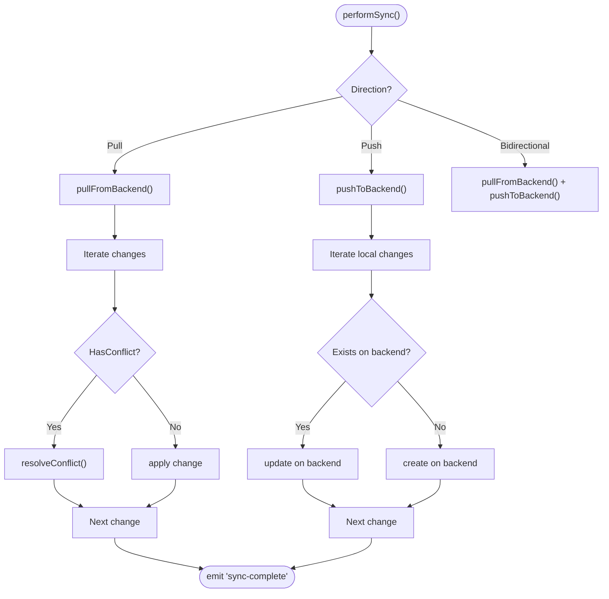

**Diagram sources**
- [SyncManager.ts:169-200](file://src/services/database/sync/SyncManager.ts#L169-L200)
- [SyncManager.ts:204-251](file://src/services/database/sync/SyncManager.ts#L204-L251)
- [SyncManager.ts:253-295](file://src/services/database/sync/SyncManager.ts#L253-L295)
- [SyncManager.ts:306-345](file://src/services/database/sync/SyncManager.ts#L306-L345)

**Section sources**
- [SyncManager.ts:1-387](file://src/services/database/sync/SyncManager.ts#L1-L387)

### LiveStoreProvider (Multi-Machine Sync)
- Responsibilities:
  - Real-time multi-machine synchronization
  - Peer discovery and connection management
  - Conflict detection and resolution
  - Manual conflict resolution workflow
- Key behaviors:
  - Peer lifecycle events (connected, disconnected, error)
  - Sync status monitoring and conflict queue
  - Manual resolution via UI/API

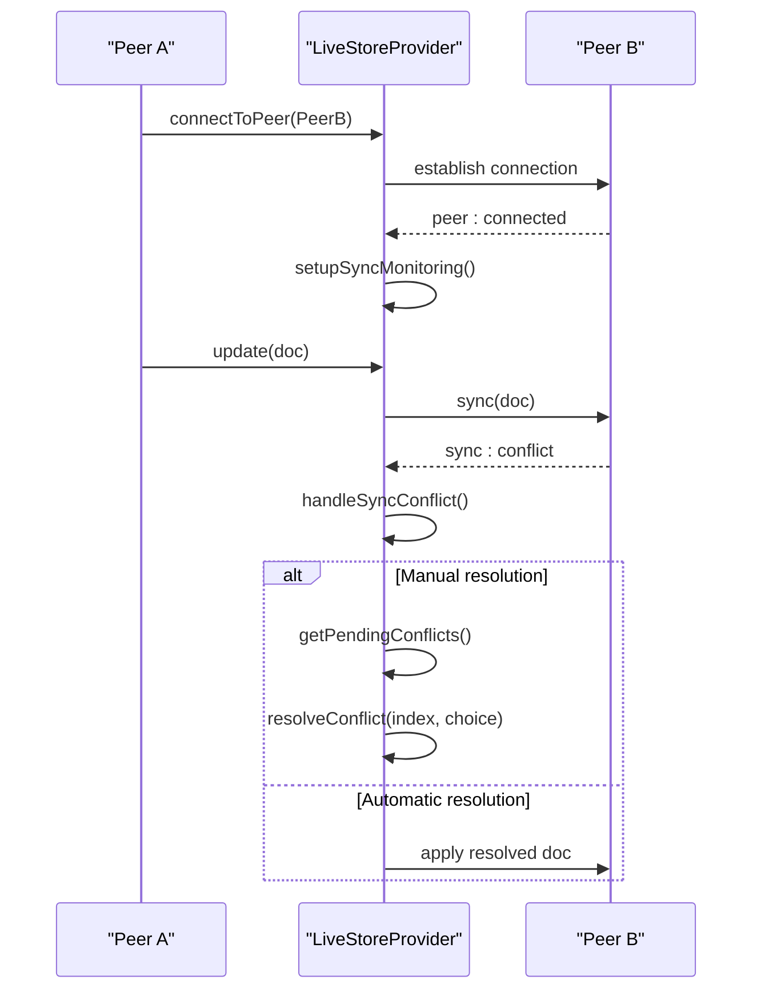

**Diagram sources**
- [LiveStoreProvider.ts:124-159](file://src/services/database/LiveStoreProvider.ts#L124-L159)
- [LiveStoreProvider.ts:161-195](file://src/services/database/LiveStoreProvider.ts#L161-L195)
- [LiveStoreProvider.ts:245-286](file://src/services/database/LiveStoreProvider.ts#L245-L286)
- [LiveStoreProvider.ts:735-771](file://src/services/database/LiveStoreProvider.ts#L735-L771)

**Section sources**
- [LiveStoreProvider.ts:1-800](file://src/services/database/LiveStoreProvider.ts#L1-L800)

### ConflictResolver
- Responsibilities:
  - Detect field-level conflicts between local and remote records
  - Resolve conflicts deterministically using strategies
  - Support manual resolution with per-field decisions
- Strategies:
  - local-wins, remote-wins, timestamp-wins, merge, manual

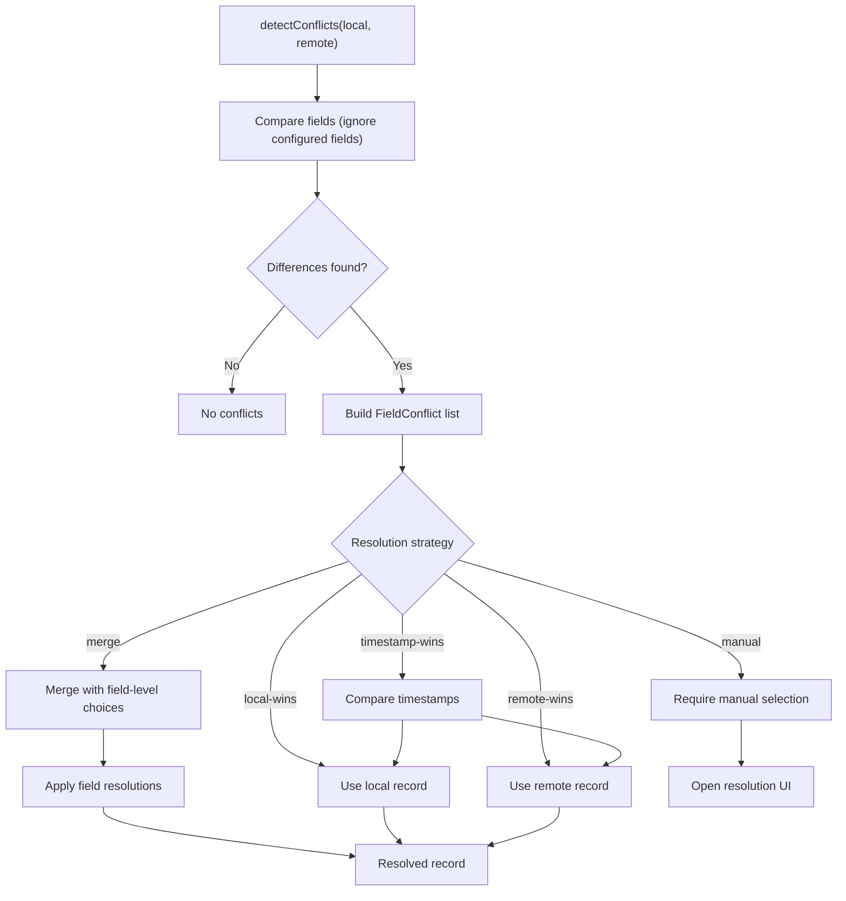

**Diagram sources**
- [ConflictResolver.ts:42-73](file://src/services/sync/ConflictResolver.ts#L42-L73)
- [ConflictResolver.ts:78-105](file://src/services/sync/ConflictResolver.ts#L78-L105)
- [ConflictResolver.ts:120-139](file://src/services/sync/ConflictResolver.ts#L120-L139)
- [ConflictResolver.ts:144-167](file://src/services/sync/ConflictResolver.ts#L144-L167)

**Section sources**
- [ConflictResolver.ts:1-248](file://src/services/sync/ConflictResolver.ts#L1-L248)

### OfflineQueue
- Responsibilities:
  - Persist offline operations to IndexedDB
  - Process operations with priority and retry/backoff
  - Recover from crashes and browser restarts
- Key behaviors:
  - Priority scoring (operation type × 1000 − age)
  - Exponential backoff with max attempts
  - Pruning of old failed operations

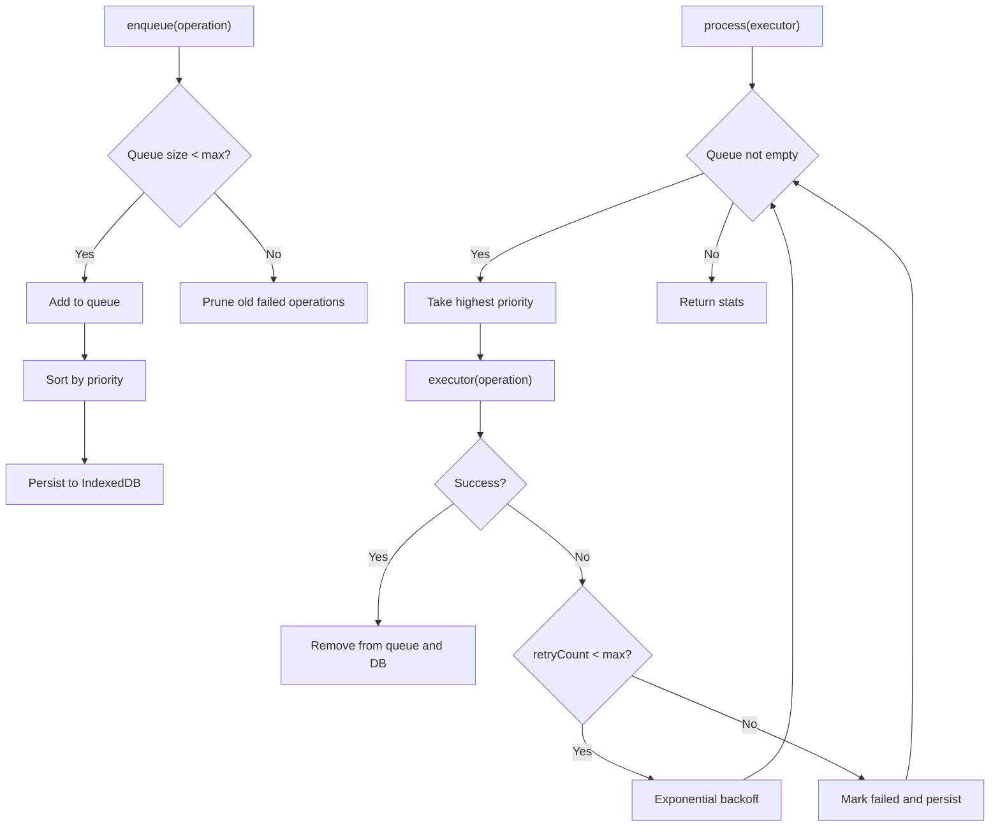

**Diagram sources**
- [OfflineQueue.ts:120-147](file://src/services/database/sync/OfflineQueue.ts#L120-L147)
- [OfflineQueue.ts:152-213](file://src/services/database/sync/OfflineQueue.ts#L152-L213)
- [OfflineQueue.ts:311-335](file://src/services/database/sync/OfflineQueue.ts#L311-L335)
- [OfflineQueue.ts:384-413](file://src/services/database/sync/OfflineQueue.ts#L384-L413)

**Section sources**
- [OfflineQueue.ts:1-458](file://src/services/database/sync/OfflineQueue.ts#L1-L458)

### NetworkStateManager
- Responsibilities:
  - Monitor online/offline state
  - Periodic backend health checks
  - Connection quality assessment
- Key behaviors:
  - Demo mode override (always online)
  - Health check with latency and service status
  - Event emission for downstream components

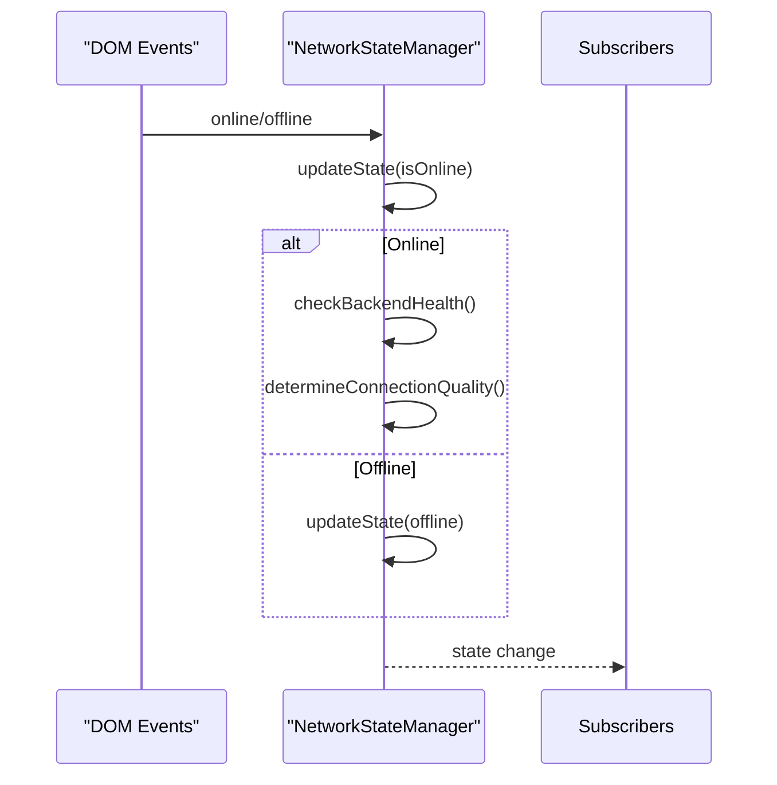

**Diagram sources**
- [NetworkStateManager.ts:85-107](file://src/services/data/NetworkStateManager.ts#L85-L107)
- [NetworkStateManager.ts:121-174](file://src/services/data/NetworkStateManager.ts#L121-L174)
- [NetworkStateManager.ts:195-203](file://src/services/data/NetworkStateManager.ts#L195-L203)

**Section sources**
- [NetworkStateManager.ts:1-234](file://src/services/data/NetworkStateManager.ts#L1-L234)

### DataSyncMonitoringService
- Responsibilities:
  - Track sync status, metrics, conflicts, and errors
  - Coordinate conflict resolution and recovery
  - Provide health status and subscriber notifications
- Key behaviors:
  - Metrics calculation (throughput, error rate, conflict rate)
  - Network-aware resume/pause
  - Deterministic conflict resolution pipeline

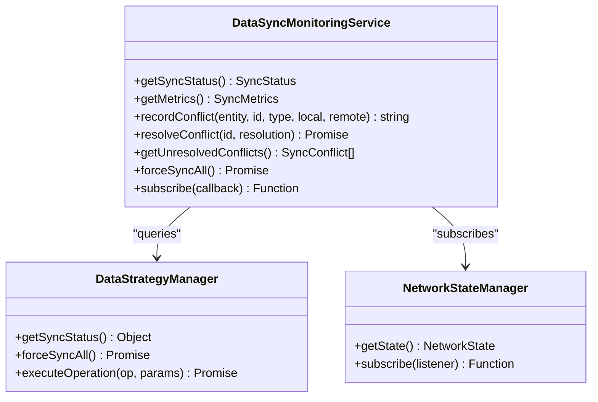

**Diagram sources**
- [DataSyncMonitoringService.ts:81-483](file://src/services/consistency/DataSyncMonitoringService.ts#L81-L483)
- [DataStrategyManager.ts:528-547](file://src/services/consistency/DataStrategyManager.ts#L528-L547)
- [NetworkStateManager.ts:205-213](file://src/services/data/NetworkStateManager.ts#L205-L213)

**Section sources**
- [DataSyncMonitoringService.ts:1-483](file://src/services/consistency/DataSyncMonitoringService.ts#L1-L483)

## Dependency Analysis
The following diagram highlights key dependencies among components:

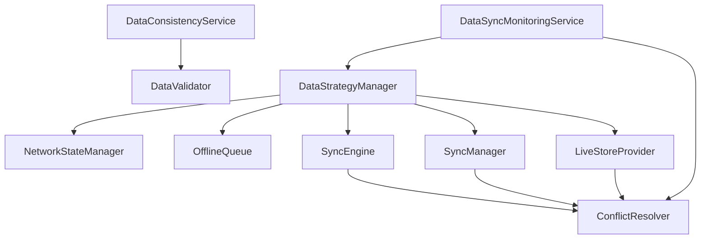

**Diagram sources**
- [DataConsistencyService.ts:1-469](file://src/services/consistency/DataConsistencyService.ts#L1-L469)
- [DataStrategyManager.ts:1-574](file://src/services/consistency/DataStrategyManager.ts#L1-L574)
- [SyncEngine.ts:1-559](file://src/services/data/SyncEngine.ts#L1-L559)
- [SyncManager.ts:1-387](file://src/services/database/sync/SyncManager.ts#L1-L387)
- [LiveStoreProvider.ts:1-800](file://src/services/database/LiveStoreProvider.ts#L1-L800)
- [ConflictResolver.ts:1-248](file://src/services/sync/ConflictResolver.ts#L1-L248)
- [DataSyncMonitoringService.ts:1-483](file://src/services/consistency/DataSyncMonitoringService.ts#L1-L483)

**Section sources**
- [types.ts:1-448](file://src/services/consistency/types.ts#L1-L448)

## Performance Considerations
- Throughput and latency:
  - Sync monitoring calculates throughput (operations per minute) and maintains average/peak latency metrics.
  - Batched sync reduces overhead and improves efficiency.
- Retry and backoff:
  - Exponential backoff prevents thundering herd and conserves resources during failures.
- Priority queueing:
  - OfflineQueue prioritizes operations to minimize staleness and improve user experience.
- Network awareness:
  - NetworkStateManager determines connection quality to adapt strategy (e.g., hybrid mode prefers backend on good connections).

[No sources needed since this section provides general guidance]

## Troubleshooting Guide
Common issues and remedies:
- Conflicts not resolving:
  - Verify conflict resolution strategy alignment with SyncEngine, SyncManager, and LiveStoreProvider configurations.
  - Use DataSyncMonitoringService to inspect unresolved conflicts and resolution attempts.
- Offline operations stuck:
  - Check OfflineQueue status and retry counts; prune old failed operations if needed.
  - Ensure IndexedDB persistence is functioning and queue is being restored on startup.
- Sync errors and failures:
  - Inspect DataSyncMonitoringService error logs and metrics; use forceSyncAll to retry pending operations.
  - Confirm backend health via NetworkStateManager and adjust strategy accordingly.
- Validation failures:
  - Review DataConsistencyService reports and DataValidator outputs; adjust schemas or data accordingly.

**Section sources**
- [DataSyncMonitoringService.ts:340-365](file://src/services/consistency/DataSyncMonitoringService.ts#L340-L365)
- [OfflineQueue.ts:152-213](file://src/services/database/sync/OfflineQueue.ts#L152-L213)
- [NetworkStateManager.ts:121-174](file://src/services/data/NetworkStateManager.ts#L121-L174)
- [DataConsistencyService.ts:279-373](file://src/services/consistency/DataConsistencyService.ts#L279-L373)

## Conclusion
SchoolPilot3’s data consistency and synchronization architecture combines multiple strategies to ensure reliability and usability:
- Multi-layered consistency through validation, referential integrity, and migration checks
- Robust sync engines supporting offline-first, real-time, and multi-machine scenarios
- Deterministic conflict resolution with configurable strategies and manual intervention
- Intelligent operation routing and queue management for resilience and performance

This design enables seamless operation across diverse environments and deployment modes while maintaining data integrity and user productivity.