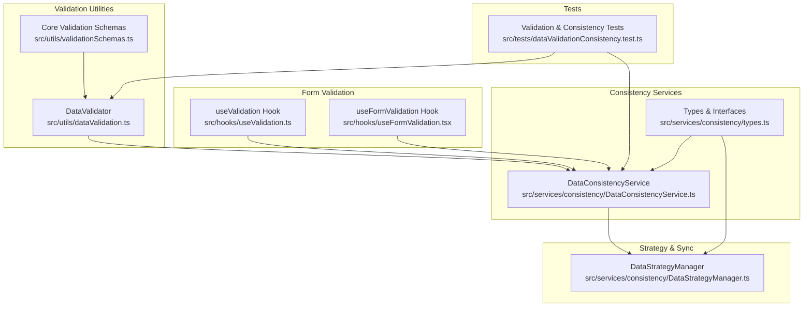
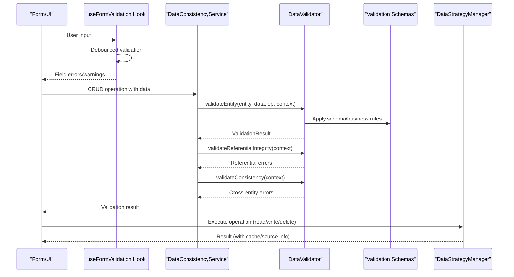
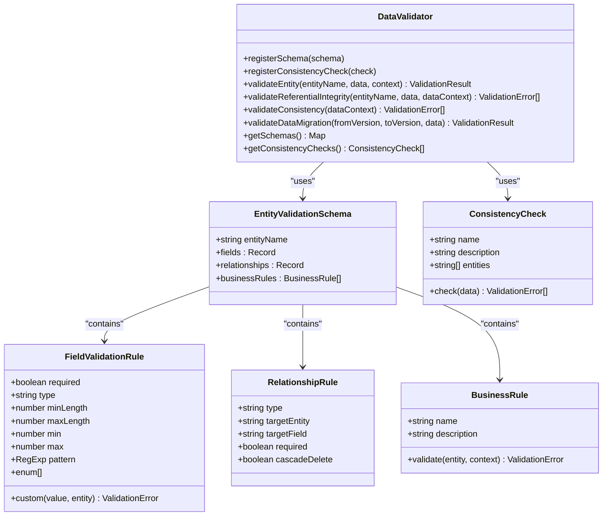
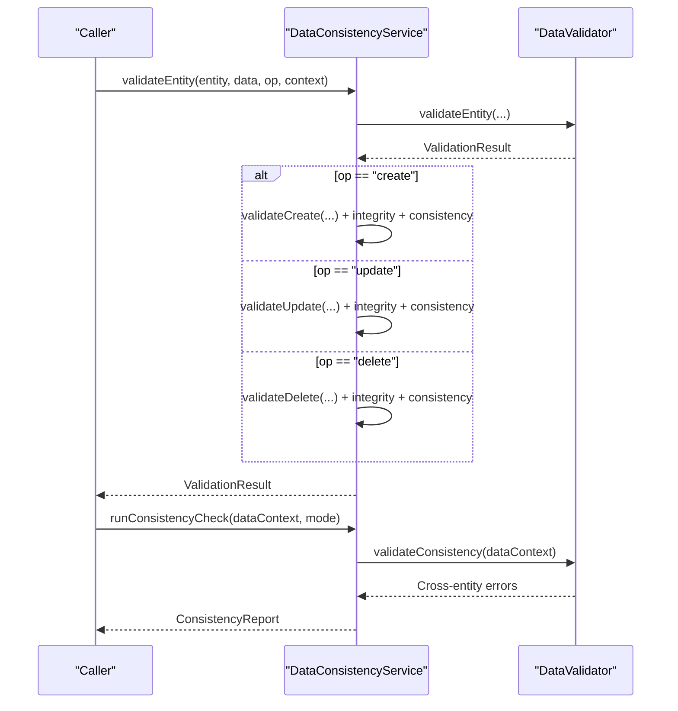
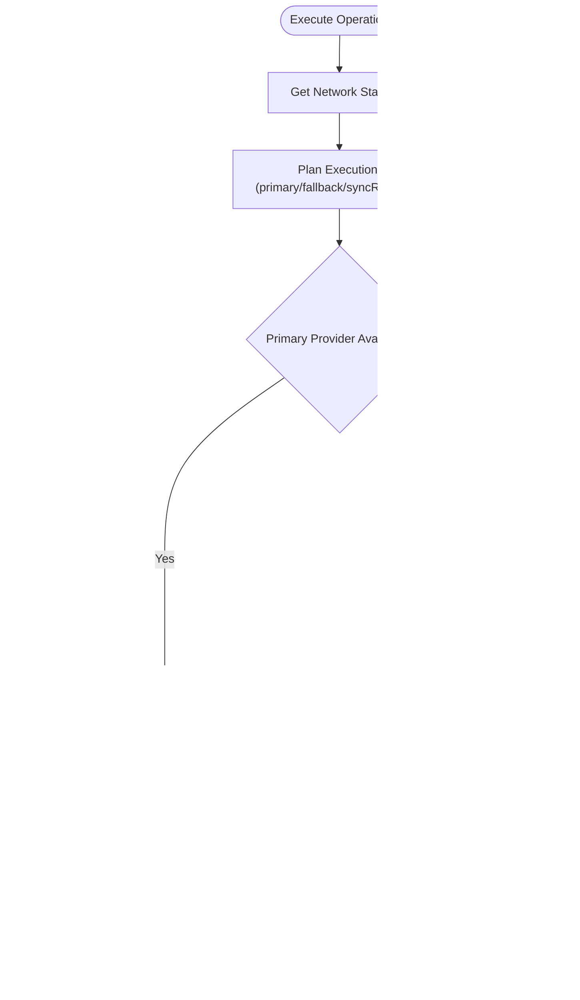
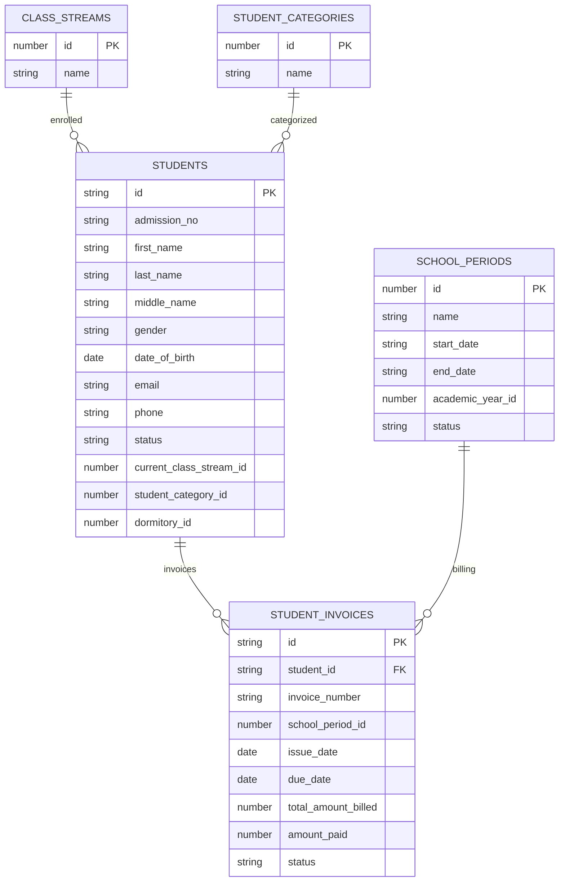
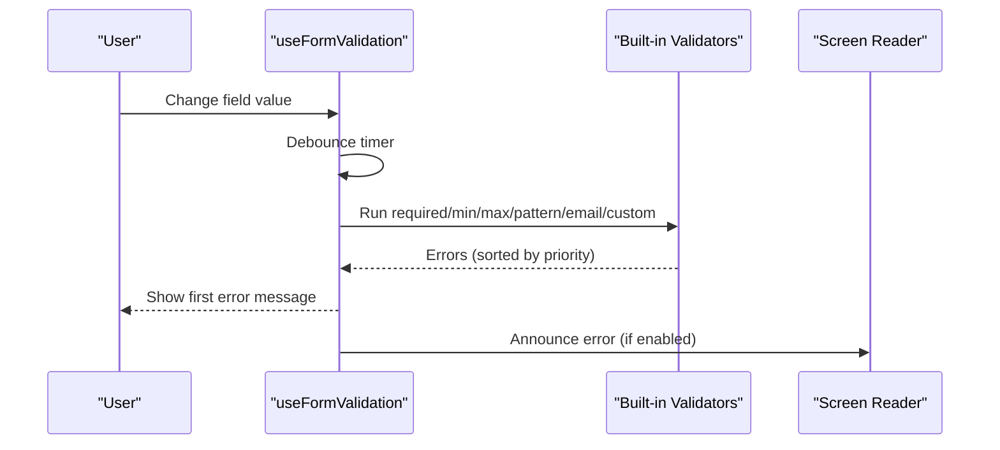
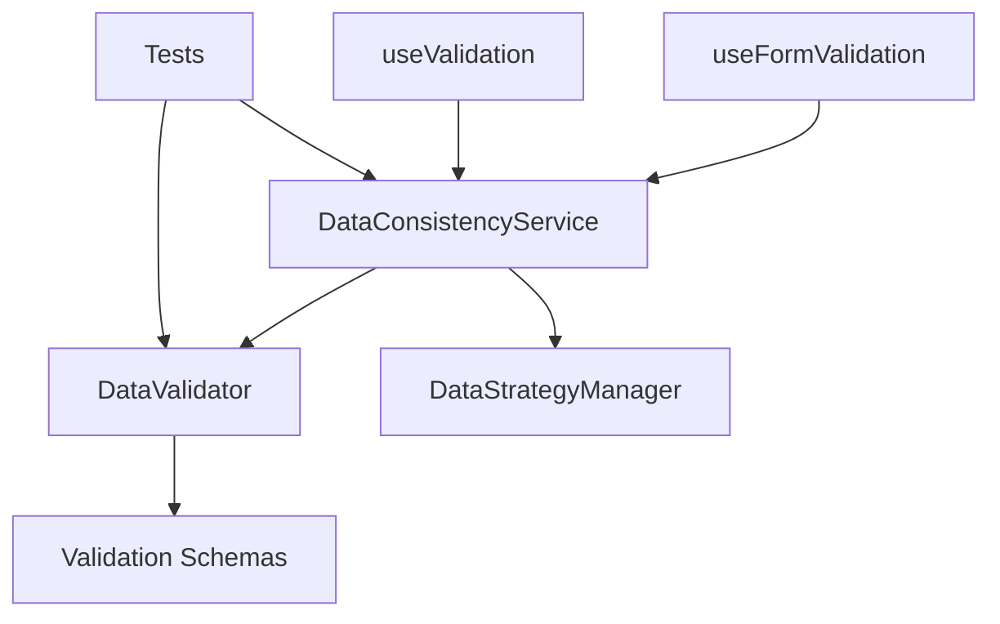

# Data Validation Pipeline

<cite>
**Referenced Files in This Document**
- [dataValidation.ts](file://src/utils/dataValidation.ts)
- [validationSchemas.ts](file://src/utils/validationSchemas.ts)
- [DataConsistencyService.ts](file://src/services/consistency/DataConsistencyService.ts)
- [DataStrategyManager.ts](file://src/services/consistency/DataStrategyManager.ts)
- [types.ts](file://src/services/consistency/types.ts)
- [useValidation.ts](file://src/hooks/useValidation.ts)
- [useFormValidation.tsx](file://src/hooks/useFormValidation.tsx)
- [dataValidationConsistency.test.ts](file://src/tests/dataValidationConsistency.test.ts)
</cite>

## Table of Contents
1. [Introduction](#introduction)
2. [Project Structure](#project-structure)
3. [Core Components](#core-components)
4. [Architecture Overview](#architecture-overview)
5. [Detailed Component Analysis](#detailed-component-analysis)
6. [Dependency Analysis](#dependency-analysis)
7. [Performance Considerations](#performance-considerations)
8. [Troubleshooting Guide](#troubleshooting-guide)
9. [Conclusion](#conclusion)

## Introduction
This document explains SchoolPilot3's data validation and consistency pipeline. It covers a multi-layer validation approach including schema validation, referential integrity checks, and business rule enforcement. It documents the validation service architecture with real-time validation, batch validation, and validation caching strategies. It also details the Data Strategy Manager's role in coordinating validation across different data sources and providers, and explains the relationship between validation and conflict detection to ensure data integrity during synchronization.

## Project Structure
The validation pipeline spans several modules:
- Core validation utilities and schemas
- Consistency service for validation orchestration
- Strategy manager for routing operations and synchronization
- Form validation hooks for real-time client-side validation
- Tests validating the end-to-end behavior

**Diagram sources**
- [dataValidation.ts:68-396](file://src/utils/dataValidation.ts#L68-L396)
- [validationSchemas.ts:498-522](file://src/utils/validationSchemas.ts#L498-L522)
- [DataConsistencyService.ts:49-466](file://src/services/consistency/DataConsistencyService.ts#L49-L466)
- [DataStrategyManager.ts:44-574](file://src/services/consistency/DataStrategyManager.ts#L44-L574)
- [types.ts:16-448](file://src/services/consistency/types.ts#L16-L448)
- [useValidation.ts:33-158](file://src/hooks/useValidation.ts#L33-L158)
- [useFormValidation.tsx:130-529](file://src/hooks/useFormValidation.tsx#L130-L529)
- [dataValidationConsistency.test.ts:23-562](file://src/tests/dataValidationConsistency.test.ts#L23-L562)

**Section sources**
- [dataValidation.ts:68-396](file://src/utils/dataValidation.ts#L68-L396)
- [validationSchemas.ts:498-522](file://src/utils/validationSchemas.ts#L498-L522)
- [DataConsistencyService.ts:49-466](file://src/services/consistency/DataConsistencyService.ts#L49-L466)
- [DataStrategyManager.ts:44-574](file://src/services/consistency/DataStrategyManager.ts#L44-L574)
- [types.ts:16-448](file://src/services/consistency/types.ts#L16-L448)
- [useValidation.ts:33-158](file://src/hooks/useValidation.ts#L33-L158)
- [useFormValidation.tsx:130-529](file://src/hooks/useFormValidation.tsx#L130-L529)
- [dataValidationConsistency.test.ts:23-562](file://src/tests/dataValidationConsistency.test.ts#L23-L562)

## Core Components
- DataValidator: Central validation engine supporting schema validation, type checking, field constraints, custom validators, referential integrity, and consistency checks.
- DataConsistencyService: Orchestrates validation across CRUD operations, integrates with the Data Strategy Manager, and produces consistency reports.
- DataStrategyManager: Routes operations across backend, RxDB, and mock providers, manages sync queues, and coordinates conflict resolution.
- Validation Schemas: Define entity schemas, relationships, and business rules for core entities.
- Form Validation Hooks: Provide real-time, debounced, and accessible form validation for UI components.

Key capabilities:
- Multi-layer validation: schema rules, business rules, referential integrity, and cross-entity consistency checks.
- Real-time validation: form hooks with debouncing and accessibility.
- Batch validation: consistency checks across datasets.
- Caching-aware validation: integrates with RxDB caching and sync strategies.
- Conflict detection: supports conflict resolution strategies during synchronization.

**Section sources**
- [dataValidation.ts:68-396](file://src/utils/dataValidation.ts#L68-L396)
- [validationSchemas.ts:23-522](file://src/utils/validationSchemas.ts#L23-L522)
- [DataConsistencyService.ts:49-466](file://src/services/consistency/DataConsistencyService.ts#L49-L466)
- [DataStrategyManager.ts:44-574](file://src/services/consistency/DataStrategyManager.ts#L44-L574)
- [useValidation.ts:33-158](file://src/hooks/useValidation.ts#L33-L158)
- [useFormValidation.tsx:130-529](file://src/hooks/useFormValidation.tsx#L130-L529)

## Architecture Overview
The validation pipeline integrates three layers:
- Schema and business rule validation via DataValidator and registered schemas.
- Referential integrity and consistency checks coordinated by DataConsistencyService.
- Real-time and batch validation integrated with Data Strategy Manager for operation routing and synchronization.

**Diagram sources**
- [useFormValidation.tsx:174-264](file://src/hooks/useFormValidation.tsx#L174-L264)
- [DataConsistencyService.ts:75-143](file://src/services/consistency/DataConsistencyService.ts#L75-L143)
- [dataValidation.ts:82-122](file://src/utils/dataValidation.ts#L82-L122)
- [dataValidation.ts:276-329](file://src/utils/dataValidation.ts#L276-L329)
- [dataValidation.ts:332-350](file://src/utils/dataValidation.ts#L332-L350)
- [DataStrategyManager.ts:90-128](file://src/services/consistency/DataStrategyManager.ts#L90-L128)

## Detailed Component Analysis

### DataValidator: Multi-Layer Validation Engine
Responsibilities:
- Schema validation: field-level rules (required, type, min/max length, enums, patterns).
- Business rules: entity-specific constraints validated with context.
- Referential integrity: validates foreign keys against provided data context.
- Consistency checks: cross-entity integrity across datasets.
- Migration validation: ensures data integrity across versions.

Key behaviors:
- Field validation with early exit for required fields and null/undefined values.
- Type validation with custom type handlers for email, phone, date, array, and object.
- Custom validators per field and per entity.
- Referential integrity checks with target entity lookup and error reporting.
- Consistency checks with error aggregation and robust error handling.

**Diagram sources**
- [dataValidation.ts:68-396](file://src/utils/dataValidation.ts#L68-L396)
- [dataValidation.ts:38-57](file://src/utils/dataValidation.ts#L38-L57)

**Section sources**
- [dataValidation.ts:68-396](file://src/utils/dataValidation.ts#L68-L396)

### DataConsistencyService: Validation Orchestration and Reporting
Responsibilities:
- Validates entities before create/update/delete operations.
- Integrates referential integrity and consistency checks.
- Produces detailed consistency reports with counts, summaries, and error categorization.
- Supports strict, lenient, and disabled validation modes.
- Handles data migration validation across environments.

Key behaviors:
- Operation-specific validations (create requires ID and uniqueness, update/delete require existence).
- Cascade delete constraint checks against predefined rules.
- Lenient mode converts non-critical errors to warnings.
- Comprehensive consistency checks across entities and cross-entity relationships.
- Migration validation compares source and target datasets for data loss or corruption.

**Diagram sources**
- [DataConsistencyService.ts:75-143](file://src/services/consistency/DataConsistencyService.ts#L75-L143)
- [DataConsistencyService.ts:279-373](file://src/services/consistency/DataConsistencyService.ts#L279-L373)
- [dataValidation.ts:332-350](file://src/utils/dataValidation.ts#L332-L350)

**Section sources**
- [DataConsistencyService.ts:49-466](file://src/services/consistency/DataConsistencyService.ts#L49-L466)

### DataStrategyManager: Operation Routing and Sync Coordination
Responsibilities:
- Executes operations across backend, RxDB, or mock providers.
- Plans execution based on network state, strategy mode, and cache preferences.
- Queues write operations for later sync with batching and retry logic.
- Updates local cache after successful backend writes.
- Provides sync status and metrics.

Key behaviors:
- Strategy modes: offline-first, online-first, hybrid, demo.
- Fallback mechanisms when primary provider fails.
- Priority-based sync queue with persistence and retry.
- Endpoint mapping and HTTP method selection based on operation type.

**Diagram sources**
- [DataStrategyManager.ts:90-128](file://src/services/consistency/DataStrategyManager.ts#L90-L128)
- [DataStrategyManager.ts:130-237](file://src/services/consistency/DataStrategyManager.ts#L130-L237)
- [DataStrategyManager.ts:378-426](file://src/services/consistency/DataStrategyManager.ts#L378-L426)

**Section sources**
- [DataStrategyManager.ts:44-574](file://src/services/consistency/DataStrategyManager.ts#L44-L574)

### Validation Schemas and Business Rules
Core schemas define:
- Students: admission number uniqueness, DOB validation, email/phone formats, gender/status enums, relationships to class streams and categories.
- Staff: unique staff number, contact info validation.
- Financial Year: date range and non-overlapping rules.
- Student Invoices: due-date-after-issue, payment vs billed amount, unique invoice number.
- School Periods: unique period name within academic year.
- Consistency checks: orphaned references, duplicate IDs.

**Diagram sources**
- [validationSchemas.ts:24-120](file://src/utils/validationSchemas.ts#L24-L120)
- [validationSchemas.ts:240-331](file://src/utils/validationSchemas.ts#L240-L331)
- [validationSchemas.ts:334-366](file://src/utils/validationSchemas.ts#L334-L366)

**Section sources**
- [validationSchemas.ts:23-522](file://src/utils/validationSchemas.ts#L23-L522)

### Form Validation Integration
Real-time validation:
- useValidation: schema-driven validation with i18n support and unique checks.
- useFormValidation: comprehensive form validation with debouncing, priorities, accessibility announcements, and field lifecycle management.

**Diagram sources**
- [useFormValidation.tsx:174-264](file://src/hooks/useFormValidation.tsx#L174-L264)
- [useFormValidation.tsx:58-128](file://src/hooks/useFormValidation.tsx#L58-L128)
- [useValidation.ts:36-138](file://src/hooks/useValidation.ts#L36-L138)

**Section sources**
- [useValidation.ts:33-158](file://src/hooks/useValidation.ts#L33-L158)
- [useFormValidation.tsx:130-529](file://src/hooks/useFormValidation.tsx#L130-L529)

## Dependency Analysis
The validation pipeline exhibits clear separation of concerns:
- DataValidator depends on registered schemas and provides validation primitives.
- DataConsistencyService composes DataValidator and adds operational context and reporting.
- DataStrategyManager orchestrates execution and caching, feeding results back to the UI.
- Form validation hooks feed real-time validation into the system.

**Diagram sources**
- [dataValidation.ts:68-396](file://src/utils/dataValidation.ts#L68-L396)
- [validationSchemas.ts:498-522](file://src/utils/validationSchemas.ts#L498-L522)
- [DataConsistencyService.ts:49-466](file://src/services/consistency/DataConsistencyService.ts#L49-L466)
- [DataStrategyManager.ts:44-574](file://src/services/consistency/DataStrategyManager.ts#L44-L574)
- [useFormValidation.tsx:130-529](file://src/hooks/useFormValidation.tsx#L130-L529)
- [useValidation.ts:33-158](file://src/hooks/useValidation.ts#L33-L158)
- [dataValidationConsistency.test.ts:23-562](file://src/tests/dataValidationConsistency.test.ts#L23-L562)

**Section sources**
- [types.ts:16-448](file://src/services/consistency/types.ts#L16-L448)

## Performance Considerations
- Debounced validation: useFormValidation uses configurable debounce to reduce validation overhead during typing.
- Lenient validation mode: reduces blocking by converting non-critical errors to warnings.
- Batched sync: DataStrategyManager batches operations and retries with backoff to minimize network load.
- Caching: RxDB cache updates after successful backend writes to reduce redundant requests.
- Consistency checks: run on-demand or during migrations to avoid runtime overhead in normal operations.

## Troubleshooting Guide
Common issues and resolutions:
- Validation failures: Review ValidationResult errors and warnings; adjust form inputs or schema rules accordingly.
- Referential integrity errors: Ensure foreign keys match existing records in the data context.
- Business rule violations: Fix entity-specific constraints (e.g., unique identifiers, date ranges).
- Cascade delete constraints: Remove or update dependent records before deletion.
- Sync failures: Inspect sync queue status and retry counts; verify network connectivity and backend availability.
- Migration validation: Address data loss or corruption indicators reported in migration results.

**Section sources**
- [DataConsistencyService.ts:375-440](file://src/services/consistency/DataConsistencyService.ts#L375-L440)
- [DataStrategyManager.ts:428-472](file://src/services/consistency/DataStrategyManager.ts#L428-L472)
- [dataValidationConsistency.test.ts:287-401](file://src/tests/dataValidationConsistency.test.ts#L287-L401)

## Conclusion
SchoolPilot3’s validation pipeline provides robust, multi-layer validation from schema rules to business logic and referential integrity. The DataConsistencyService centralizes validation orchestration and reporting, while the DataStrategyManager coordinates operation routing and synchronization. Real-time form validation enhances user experience, and comprehensive tests ensure reliability across scenarios. Together, these components maintain data integrity throughout the synchronization process and support scalable, maintainable data operations.