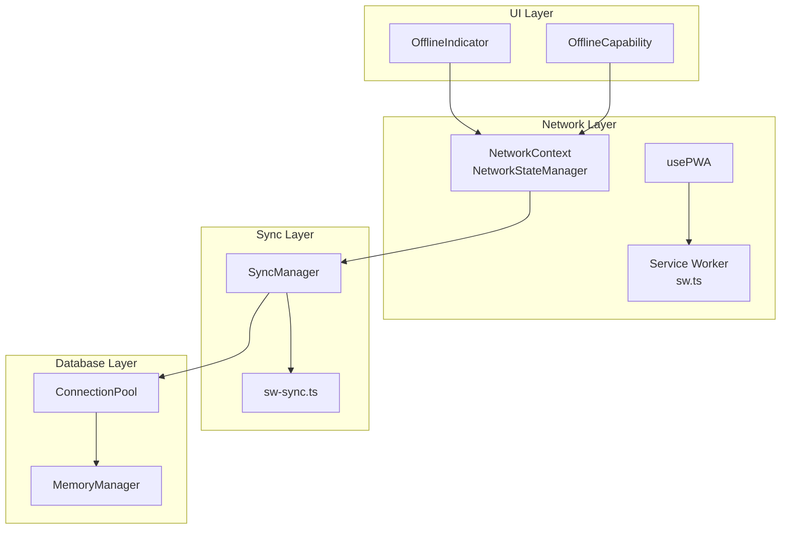
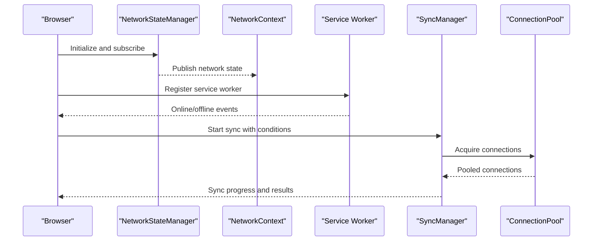
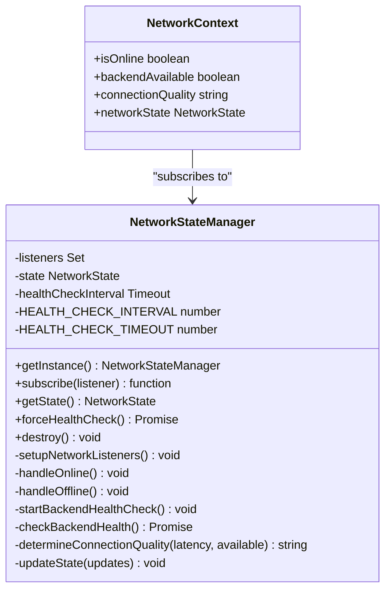
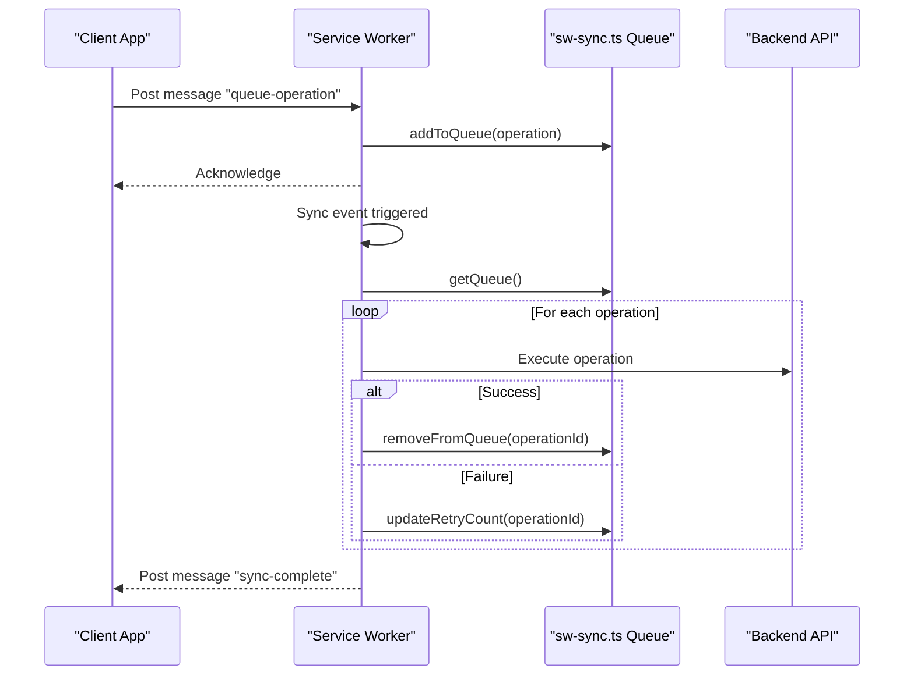
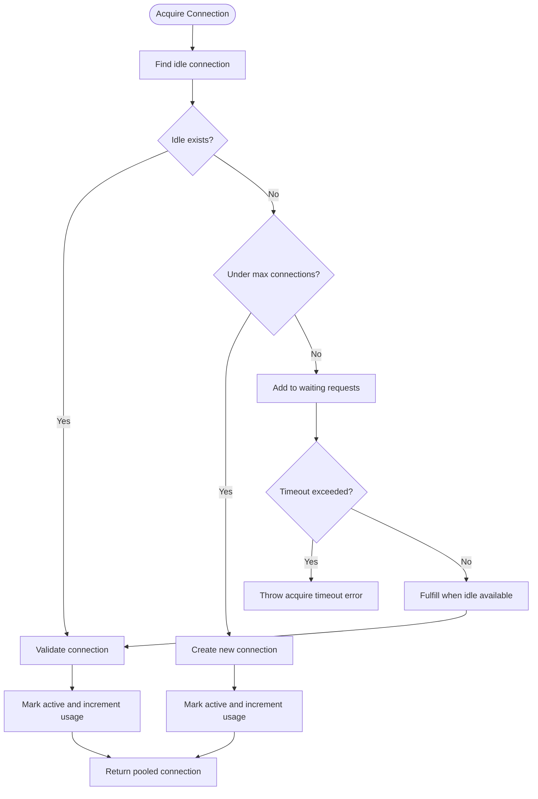
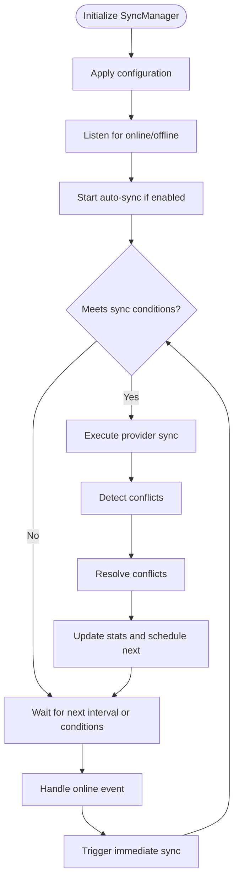
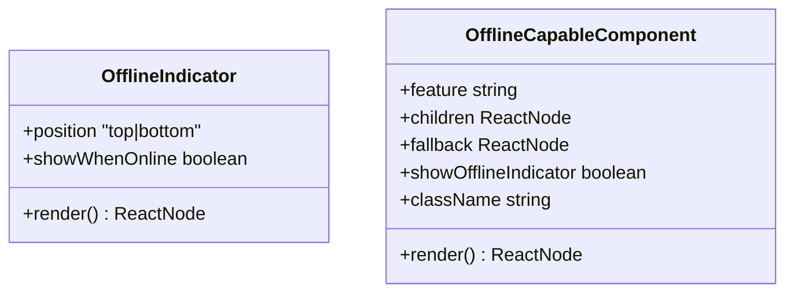
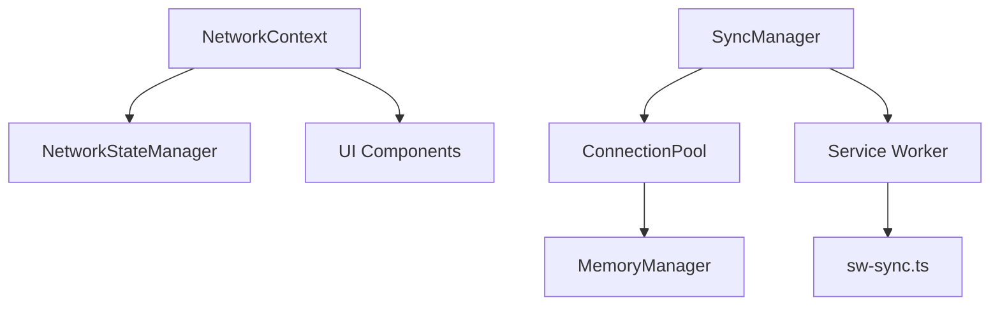

# Network State Management

<cite>
**Referenced Files in This Document**
- [NetworkContext.tsx](file://src/contexts/NetworkContext.tsx)
- [NetworkStateManager.ts](file://src/services/data/NetworkStateManager.ts)
- [useConnectionPool.ts](file://src/hooks/useConnectionPool.ts)
- [ConnectionPool.ts](file://src/services/database/ConnectionPool.ts)
- [usePWA.ts](file://src/hooks/usePWA.ts)
- [sw.ts](file://src/sw.ts)
- [SyncManager.ts](file://src/services/sync/SyncManager.ts)
- [sw-sync.ts](file://src/services/sync/sw-sync.ts)
- [OfflineIndicator.tsx](file://src/components/OfflineIndicator.tsx)
- [OfflineCapability.tsx](file://src/components/OfflineCapability.tsx)
- [MemoryManager.ts](file://src/services/database/MemoryManager.ts)
</cite>

## Table of Contents
1. [Introduction](#introduction)
2. [Project Structure](#project-structure)
3. [Core Components](#core-components)
4. [Architecture Overview](#architecture-overview)
5. [Detailed Component Analysis](#detailed-component-analysis)
6. [Dependency Analysis](#dependency-analysis)
7. [Performance Considerations](#performance-considerations)
8. [Troubleshooting Guide](#troubleshooting-guide)
9. [Conclusion](#conclusion)

## Introduction
This document provides comprehensive documentation for SchoolPilot3's network state management and connection handling systems. It explains how the application monitors connectivity status, evaluates connection quality, and adapts to bandwidth limitations. It covers the circuit breaker pattern for failure handling, connection pooling strategies, adaptive retry mechanisms, and offline-first architecture with connection state detection, automatic reconnection logic, and graceful degradation strategies. Additionally, it details network-aware sync configurations including mobile data optimization, Wi-Fi-only sync, and battery-conscious operations. The document concludes with practical examples for network state handling, connection pool management, implementing custom network-aware features, and integrating with service workers for background sync and offline capabilities.

## Project Structure
The network state management system spans several modules:
- Context and state management for network connectivity
- Service worker for offline operation and background sync
- Database connection pooling and memory management
- Sync manager with bandwidth optimization and retry logic
- UI components for offline indicators and capability management

**Diagram sources**
- [NetworkContext.tsx:16-40](file://src/contexts/NetworkContext.tsx#L16-L40)
- [NetworkStateManager.ts:21-60](file://src/services/data/NetworkStateManager.ts#L21-L60)
- [usePWA.ts:37-277](file://src/hooks/usePWA.ts#L37-L277)
- [sw.ts:1-298](file://src/sw.ts#L1-L298)
- [SyncManager.ts:49-98](file://src/services/sync/SyncManager.ts#L49-L98)
- [sw-sync.ts:1-403](file://src/services/sync/sw-sync.ts#L1-L403)
- [ConnectionPool.ts:52-100](file://src/services/database/ConnectionPool.ts#L52-L100)
- [MemoryManager.ts:44-62](file://src/services/database/MemoryManager.ts#L44-L62)
- [OfflineIndicator.tsx:25-62](file://src/components/OfflineIndicator.tsx#L25-L62)
- [OfflineCapability.tsx:24-78](file://src/components/OfflineCapability.tsx#L24-L78)

**Section sources**
- [NetworkContext.tsx:1-48](file://src/contexts/NetworkContext.tsx#L1-L48)
- [NetworkStateManager.ts:1-234](file://src/services/data/NetworkStateManager.ts#L1-L234)
- [usePWA.ts:1-299](file://src/hooks/usePWA.ts#L1-L299)
- [sw.ts:1-298](file://src/sw.ts#L1-L298)
- [SyncManager.ts:1-523](file://src/services/sync/SyncManager.ts#L1-L523)
- [sw-sync.ts:1-403](file://src/services/sync/sw-sync.ts#L1-L403)
- [ConnectionPool.ts:1-434](file://src/services/database/ConnectionPool.ts#L1-L434)
- [MemoryManager.ts:1-364](file://src/services/database/MemoryManager.ts#L1-L364)
- [OfflineIndicator.tsx:1-65](file://src/components/OfflineIndicator.tsx#L1-L65)
- [OfflineCapability.tsx:1-687](file://src/components/OfflineCapability.tsx#L1-L687)

## Core Components
- NetworkStateManager: Singleton managing online/offline detection, backend health checks, and connection quality assessment.
- NetworkContext: React context provider exposing network state to components.
- usePWA: Hook for PWA features including service worker registration, background sync, and online/offline state.
- ConnectionPool: Database connection pooling with metrics, lifecycle management, and cleanup strategies.
- MemoryManager: Monitors memory usage and triggers cleanup to prevent leaks.
- SyncManager: Orchestrates sync operations with bandwidth optimization, retry logic, and network-aware policies.
- Service Worker (sw.ts): Implements caching strategies, background sync, push notifications, and periodic sync.
- sw-sync.ts: Service worker-side queue management for background sync operations.
- OfflineIndicator and OfflineCapability: UI components for displaying offline status and managing offline-capable features.

**Section sources**
- [NetworkStateManager.ts:21-234](file://src/services/data/NetworkStateManager.ts#L21-L234)
- [NetworkContext.tsx:7-48](file://src/contexts/NetworkContext.tsx#L7-L48)
- [usePWA.ts:37-277](file://src/hooks/usePWA.ts#L37-L277)
- [ConnectionPool.ts:52-434](file://src/services/database/ConnectionPool.ts#L52-L434)
- [MemoryManager.ts:44-364](file://src/services/database/MemoryManager.ts#L44-L364)
- [SyncManager.ts:49-523](file://src/services/sync/SyncManager.ts#L49-L523)
- [sw.ts:1-298](file://src/sw.ts#L1-L298)
- [sw-sync.ts:1-403](file://src/services/sync/sw-sync.ts#L1-L403)
- [OfflineIndicator.tsx:17-65](file://src/components/OfflineIndicator.tsx#L17-L65)
- [OfflineCapability.tsx:15-78](file://src/components/OfflineCapability.tsx#L15-L78)

## Architecture Overview
The system follows an offline-first architecture with robust network monitoring and adaptive sync behavior:
- Network monitoring detects online/offline status and backend availability, calculating connection quality based on latency and availability.
- The PWA layer registers a service worker, enabling background sync, push notifications, and periodic sync.
- The sync manager coordinates sync operations, applying bandwidth optimization and retry strategies based on network conditions.
- Connection pooling ensures efficient database resource usage with metrics and cleanup.
- UI components provide immediate feedback on offline status and feature availability.

**Diagram sources**
- [NetworkStateManager.ts:21-119](file://src/services/data/NetworkStateManager.ts#L21-L119)
- [NetworkContext.tsx:16-40](file://src/contexts/NetworkContext.tsx#L16-L40)
- [usePWA.ts:98-151](file://src/hooks/usePWA.ts#L98-L151)
- [SyncManager.ts:120-190](file://src/services/sync/SyncManager.ts#L120-L190)
- [ConnectionPool.ts:105-158](file://src/services/database/ConnectionPool.ts#L105-L158)

## Detailed Component Analysis

### NetworkStateManager and NetworkContext
NetworkStateManager provides centralized network state with:
- Online/offline detection via browser events
- Backend health checks with timeouts and latency measurement
- Connection quality classification (excellent, good, poor, offline)
- Subscription mechanism for reactive updates

NetworkContext exposes the network state to components and maps backend availability to connection quality.

**Diagram sources**
- [NetworkStateManager.ts:21-234](file://src/services/data/NetworkStateManager.ts#L21-L234)
- [NetworkContext.tsx:7-48](file://src/contexts/NetworkContext.tsx#L7-L48)

**Section sources**
- [NetworkStateManager.ts:21-234](file://src/services/data/NetworkStateManager.ts#L21-L234)
- [NetworkContext.tsx:16-48](file://src/contexts/NetworkContext.tsx#L16-L48)

### Service Worker and Background Sync
The service worker implements:
- Precaching and outdated cache cleanup
- Route-specific caching strategies (NetworkFirst, CacheFirst, StaleWhileRevalidate)
- Background sync for API mutations using BackgroundSyncPlugin
- Push notifications and periodic sync support
- Messaging for skipping waiting and clearing caches

sw-sync.ts provides queue management for background sync operations, including IndexedDB-backed persistence, retry logic, and client notifications.

**Diagram sources**
- [sw.ts:120-145](file://src/sw.ts#L120-L145)
- [sw-sync.ts:54-186](file://src/services/sync/sw-sync.ts#L54-L186)
- [sw-sync.ts:237-262](file://src/services/sync/sw-sync.ts#L237-L262)

**Section sources**
- [sw.ts:1-298](file://src/sw.ts#L1-L298)
- [sw-sync.ts:1-403](file://src/services/sync/sw-sync.ts#L1-L403)

### Connection Pooling and Memory Management
DatabaseConnectionPool manages:
- Connection lifecycle (acquire, release, destroy)
- Idle and lifetime timeouts
- Validation on borrow/return
- Metrics collection and listener notifications
- Cleanup intervals and minimum connection enforcement

DatabaseMemoryManager monitors memory usage, triggers cleanup, and maintains connection activity to prevent leaks.

**Diagram sources**
- [ConnectionPool.ts:105-158](file://src/services/database/ConnectionPool.ts#L105-L158)
- [ConnectionPool.ts:261-284](file://src/services/database/ConnectionPool.ts#L261-L284)

**Section sources**
- [ConnectionPool.ts:52-434](file://src/services/database/ConnectionPool.ts#L52-L434)
- [MemoryManager.ts:44-364](file://src/services/database/MemoryManager.ts#L44-L364)

### Sync Manager and Adaptive Retry
SyncManager coordinates:
- Auto-sync scheduling and manual sync initiation
- Conflict detection and resolution
- Bandwidth optimization (compression, attachment skipping on slow connections)
- Battery-conscious operations and Wi-Fi/mobile restrictions
- Background sync registration and periodic sync

**Diagram sources**
- [SyncManager.ts:67-98](file://src/services/sync/SyncManager.ts#L67-L98)
- [SyncManager.ts:120-190](file://src/services/sync/SyncManager.ts#L120-L190)
- [SyncManager.ts:407-438](file://src/services/sync/SyncManager.ts#L407-L438)

**Section sources**
- [SyncManager.ts:12-523](file://src/services/sync/SyncManager.ts#L12-L523)

### Offline-First UI Components
OfflineIndicator displays online/offline status with contextual messaging. OfflineCapability wraps features to gracefully degrade when offline, showing indicators and alternative actions.

**Diagram sources**
- [OfflineIndicator.tsx:12-65](file://src/components/OfflineIndicator.tsx#L12-L65)
- [OfflineCapability.tsx:15-78](file://src/components/OfflineCapability.tsx#L15-L78)

**Section sources**
- [OfflineIndicator.tsx:1-65](file://src/components/OfflineIndicator.tsx#L1-L65)
- [OfflineCapability.tsx:1-687](file://src/components/OfflineCapability.tsx#L1-L687)

## Dependency Analysis
The network state management system exhibits clear separation of concerns:
- NetworkContext depends on NetworkStateManager for reactive state updates.
- SyncManager listens to browser online/offline events and integrates with ConnectionPool for database operations.
- Service worker handles background tasks independently but communicates with the client via messages.
- MemoryManager supports ConnectionPool by monitoring and optimizing memory usage.

**Diagram sources**
- [NetworkContext.tsx:16-40](file://src/contexts/NetworkContext.tsx#L16-L40)
- [NetworkStateManager.ts:21-60](file://src/services/data/NetworkStateManager.ts#L21-L60)
- [SyncManager.ts:49-98](file://src/services/sync/SyncManager.ts#L49-L98)
- [ConnectionPool.ts:52-100](file://src/services/database/ConnectionPool.ts#L52-L100)
- [MemoryManager.ts:44-62](file://src/services/database/MemoryManager.ts#L44-L62)
- [sw.ts:1-298](file://src/sw.ts#L1-L298)
- [sw-sync.ts:1-403](file://src/services/sync/sw-sync.ts#L1-L403)

**Section sources**
- [NetworkContext.tsx:16-40](file://src/contexts/NetworkContext.tsx#L16-L40)
- [NetworkStateManager.ts:21-60](file://src/services/data/NetworkStateManager.ts#L21-L60)
- [SyncManager.ts:49-98](file://src/services/sync/SyncManager.ts#L49-L98)
- [ConnectionPool.ts:52-100](file://src/services/database/ConnectionPool.ts#L52-L100)
- [MemoryManager.ts:44-62](file://src/services/database/MemoryManager.ts#L44-L62)
- [sw.ts:1-298](file://src/sw.ts#L1-L298)
- [sw-sync.ts:1-403](file://src/services/sync/sw-sync.ts#L1-L403)

## Performance Considerations
- Connection pooling reduces overhead by reusing connections, with configurable timeouts and validation to maintain reliability.
- MemoryManager proactively triggers cleanup to prevent memory pressure during extended operations.
- SyncManager applies bandwidth optimization (compression and selective attachment syncing) and battery-conscious policies to minimize power consumption.
- Service worker caching strategies balance freshness and performance, with background sync ensuring eventual consistency.

[No sources needed since this section provides general guidance]

## Troubleshooting Guide
Common issues and remedies:
- Network state not updating: Verify NetworkStateManager subscriptions and browser online/offline events.
- Background sync failing: Check service worker registration, queue persistence, and backend connectivity.
- Connection acquisition timeouts: Increase acquire timeout or adjust pool size; review validation and cleanup intervals.
- Memory warnings: Monitor MemoryManager alerts and trigger cleanup; reduce pool size or adjust thresholds.
- Offline UI not appearing: Confirm OfflineIndicator props and NetworkContext state propagation.

**Section sources**
- [NetworkStateManager.ts:195-203](file://src/services/data/NetworkStateManager.ts#L195-L203)
- [sw.ts:120-145](file://src/sw.ts#L120-L145)
- [ConnectionPool.ts:142-157](file://src/services/database/ConnectionPool.ts#L142-L157)
- [MemoryManager.ts:137-144](file://src/services/database/MemoryManager.ts#L137-L144)
- [OfflineIndicator.tsx:25-62](file://src/components/OfflineIndicator.tsx#L25-L62)

## Conclusion
SchoolPilot3's network state management combines robust monitoring, adaptive sync behavior, and offline-first design. The system leverages a singleton NetworkStateManager, a reactive NetworkContext, a resilient service worker with background sync, and a configurable connection pool with memory management. Together, these components deliver reliable offline operation, graceful degradation, and efficient resource utilization across diverse network conditions.