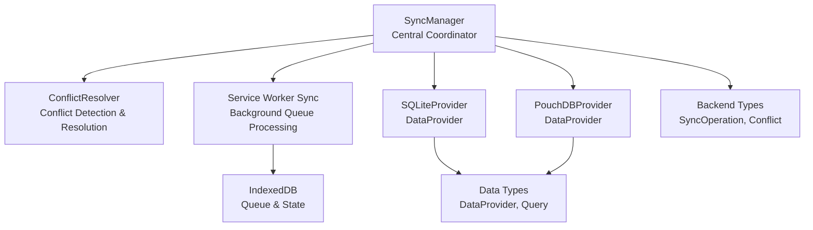
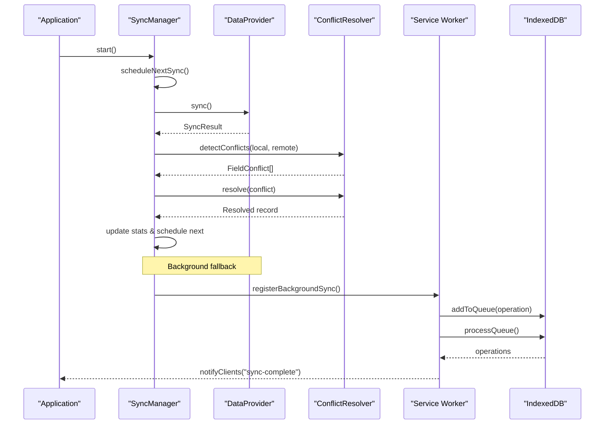
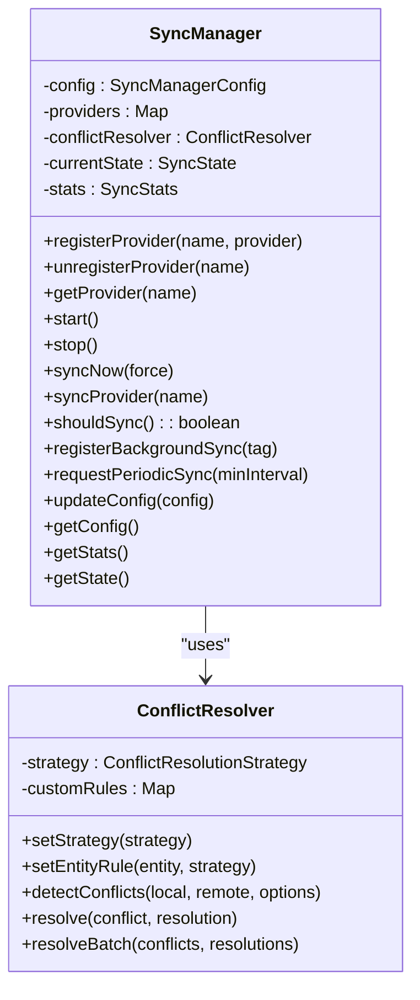
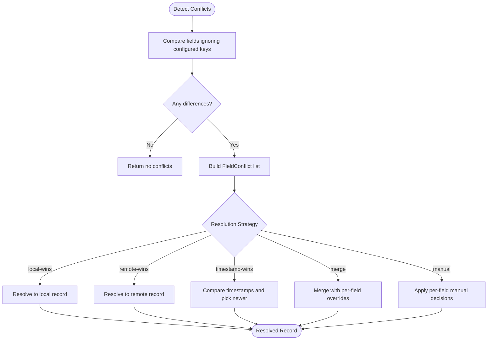
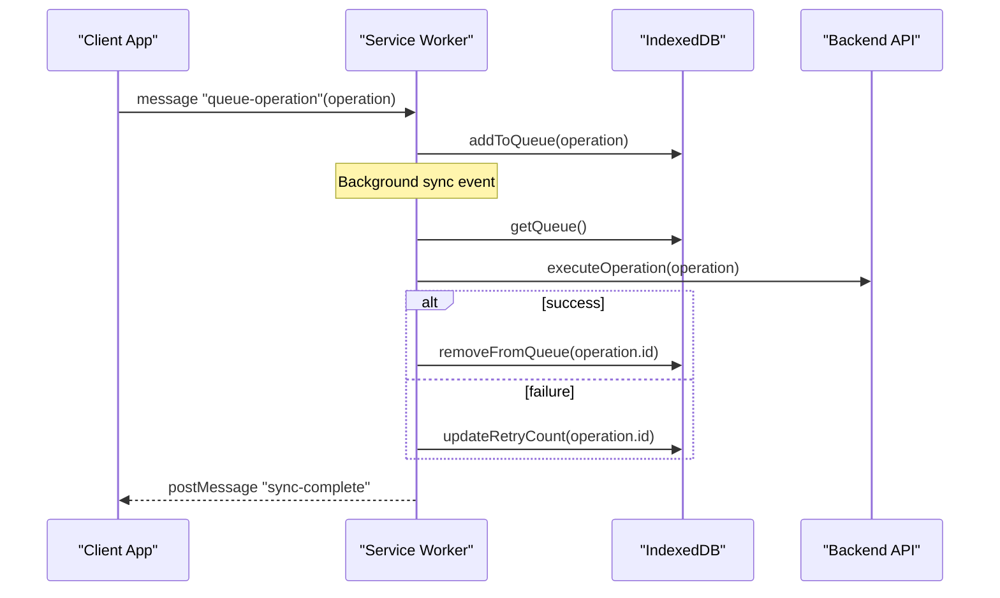
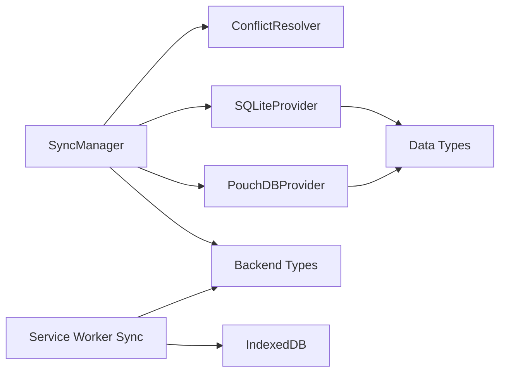

# Sync Engine

<cite>
**Referenced Files in This Document**
- [index.ts](file://src/services/sync/index.ts)
- [SyncManager.ts](file://src/services/sync/SyncManager.ts)
- [ConflictResolver.ts](file://src/services/sync/ConflictResolver.ts)
- [sw-sync.ts](file://src/services/sync/sw-sync.ts)
- [types.ts](file://src/services/sync/types.ts)
- [types.ts](file://src/services/data/types.ts)
- [types.ts](file://src/services/backend/types.ts)
- [SqliteProvider.ts](file://src/services/data/providers/SqliteProvider.ts)
- [PouchDbProvider.ts](file://src/services/data/providers/PouchDbProvider.ts)
</cite>

## Table of Contents
1. [Introduction](#introduction)
2. [Project Structure](#project-structure)
3. [Core Components](#core-components)
4. [Architecture Overview](#architecture-overview)
5. [Detailed Component Analysis](#detailed-component-analysis)
6. [Dependency Analysis](#dependency-analysis)
7. [Performance Considerations](#performance-considerations)
8. [Troubleshooting Guide](#troubleshooting-guide)
9. [Conclusion](#conclusion)

## Introduction
This document describes SchoolPilot3’s centralized sync engine architecture that coordinates background synchronization across multiple data providers. It covers the central SyncManager, conflict resolution, bandwidth optimization, network-awareness, offline queue processing via a service worker, and periodic sync registration. It also documents configuration options for timing, compression, and mobile data optimization, along with practical examples for registering providers, configuring behavior, and handling sync events.

## Project Structure
The sync engine is implemented under the services/sync module and integrates with the unified data layer and backend types. Providers (SQLite and PouchDB) implement the DataProvider interface and can participate in sync workflows managed by SyncManager.

**Diagram sources**
- [SyncManager.ts:49-523](file://src/services/sync/SyncManager.ts#L49-L523)
- [ConflictResolver.ts:17-248](file://src/services/sync/ConflictResolver.ts#L17-L248)
- [sw-sync.ts:122-139](file://src/services/sync/sw-sync.ts#L122-L139)
- [types.ts:15-28](file://src/services/sync/types.ts#L15-L28)
- [types.ts:136-182](file://src/services/data/types.ts#L136-L182)
- [types.ts:135-181](file://src/services/backend/types.ts#L135-L181)
- [SqliteProvider.ts:55-752](file://src/services/data/providers/SqliteProvider.ts#L55-L752)
- [PouchDbProvider.ts:61-706](file://src/services/data/providers/PouchDbProvider.ts#L61-L706)

**Section sources**
- [index.ts:1-54](file://src/services/sync/index.ts#L1-L54)
- [SyncManager.ts:49-523](file://src/services/sync/SyncManager.ts#L49-L523)
- [types.ts:15-353](file://src/services/sync/types.ts#L15-L353)
- [types.ts:136-182](file://src/services/data/types.ts#L136-L182)
- [types.ts:135-181](file://src/services/backend/types.ts#L135-L181)
- [SqliteProvider.ts:55-752](file://src/services/data/providers/SqliteProvider.ts#L55-L752)
- [PouchDbProvider.ts:61-706](file://src/services/data/providers/PouchDbProvider.ts#L61-L706)

## Core Components
- SyncManager: Central coordinator that schedules periodic sync, orchestrates provider sync, handles conflicts, and exposes bandwidth optimization and network-awareness features.
- ConflictResolver: Detects and resolves conflicts using configurable strategies (e.g., timestamp-wins, merge, manual).
- Service Worker Sync: Provides background sync via service worker, including IndexedDB-backed queue, retry logic, and periodic sync registration.
- Data Providers: Implement the DataProvider interface and expose optional sync capabilities for integration with SyncManager orchestration.

Key responsibilities:
- Centralized scheduling and retry logic
- Bandwidth optimization (compression, slow connection handling)
- Network state awareness (online/offline, cellular/Wi-Fi, battery)
- Offline queue persistence and background processing
- Conflict detection and resolution with entity-specific strategies

**Section sources**
- [SyncManager.ts:49-523](file://src/services/sync/SyncManager.ts#L49-L523)
- [ConflictResolver.ts:17-248](file://src/services/sync/ConflictResolver.ts#L17-L248)
- [sw-sync.ts:122-139](file://src/services/sync/sw-sync.ts#L122-L139)
- [types.ts:136-182](file://src/services/data/types.ts#L136-L182)

## Architecture Overview
The sync engine follows a centralized pattern:
- SyncManager registers and invokes provider sync routines.
- It applies conflict resolution and tracks statistics.
- For background execution, operations are queued in IndexedDB and processed by the service worker.
- Network-awareness and bandwidth optimization influence when and how sync runs.

**Diagram sources**
- [SyncManager.ts:120-190](file://src/services/sync/SyncManager.ts#L120-L190)
- [ConflictResolver.ts:42-105](file://src/services/sync/ConflictResolver.ts#L42-L105)
- [sw-sync.ts:148-186](file://src/services/sync/sw-sync.ts#L148-L186)
- [types.ts:135-181](file://src/services/backend/types.ts#L135-L181)

## Detailed Component Analysis

### SyncManager
Responsibilities:
- Configurable periodic sync with auto-start, retry intervals, and max retries.
- Provider registration and invocation.
- Conflict detection and resolution with entity-specific strategies.
- Bandwidth optimization: compression threshold and conditional attachment syncing on slow connections.
- Network awareness: online/offline detection, Wi-Fi/mobile constraints, and battery level checks.
- Background sync registration via Service Worker and periodic background sync.
- Statistics tracking and state management.

Configuration highlights:
- Timing: autoSync, syncInterval, retryInterval, maxRetries
- Compression: compressionEnabled, compressionThreshold
- Mobile optimization: skipAttachmentsOnSlowConnection, syncOnMobile, syncOnWifiOnly, minBatteryLevel
- Conflict resolution: conflictStrategy, entityStrategies

Operational flow:
- start() initializes idle state and schedules periodic sync.
- syncNow() validates conditions, iterates providers, and updates stats.
- shouldSync() enforces network/battery/connection constraints.
- registerBackgroundSync() and requestPeriodicSync() integrate with Service Worker.

**Diagram sources**
- [SyncManager.ts:49-523](file://src/services/sync/SyncManager.ts#L49-L523)
- [ConflictResolver.ts:17-248](file://src/services/sync/ConflictResolver.ts#L17-L248)

**Section sources**
- [SyncManager.ts:67-98](file://src/services/sync/SyncManager.ts#L67-L98)
- [SyncManager.ts:120-190](file://src/services/sync/SyncManager.ts#L120-L190)
- [SyncManager.ts:250-317](file://src/services/sync/SyncManager.ts#L250-L317)
- [SyncManager.ts:323-369](file://src/services/sync/SyncManager.ts#L323-L369)
- [SyncManager.ts:407-438](file://src/services/sync/SyncManager.ts#L407-L438)
- [SyncManager.ts:440-473](file://src/services/sync/SyncManager.ts#L440-L473)
- [SyncManager.ts:475-487](file://src/services/sync/SyncManager.ts#L475-L487)
- [SyncManager.ts:493-511](file://src/services/sync/SyncManager.ts#L493-L511)

### ConflictResolver
Features:
- Detects field-level conflicts between local and remote records.
- Supports strategies: local-wins, remote-wins, timestamp-wins, merge, manual.
- Per-entity override rules for conflict resolution.
- Batch resolution and timestamp-based tie-breaking.

**Diagram sources**
- [ConflictResolver.ts:42-105](file://src/services/sync/ConflictResolver.ts#L42-L105)
- [ConflictResolver.ts:120-167](file://src/services/sync/ConflictResolver.ts#L120-L167)
- [ConflictResolver.ts:196-205](file://src/services/sync/ConflictResolver.ts#L196-L205)

**Section sources**
- [ConflictResolver.ts:42-73](file://src/services/sync/ConflictResolver.ts#L42-L73)
- [ConflictResolver.ts:78-105](file://src/services/sync/ConflictResolver.ts#L78-L105)
- [ConflictResolver.ts:120-167](file://src/services/sync/ConflictResolver.ts#L120-L167)
- [ConflictResolver.ts:196-205](file://src/services/sync/ConflictResolver.ts#L196-L205)

### Service Worker Sync (Background Queue)
Capabilities:
- IndexedDB-backed queue for deferred operations.
- Retry logic with max attempts per operation.
- Background processing on sync/periodic-sync events.
- Push notifications to trigger sync.
- Client messaging for queue status and force sync.

**Diagram sources**
- [sw-sync.ts:148-186](file://src/services/sync/sw-sync.ts#L148-L186)
- [sw-sync.ts:191-214](file://src/services/sync/sw-sync.ts#L191-L214)
- [sw-sync.ts:237-262](file://src/services/sync/sw-sync.ts#L237-L262)
- [sw-sync.ts:297-340](file://src/services/sync/sw-sync.ts#L297-L340)
- [sw-sync.ts:369-399](file://src/services/sync/sw-sync.ts#L369-L399)

**Section sources**
- [sw-sync.ts:34-49](file://src/services/sync/sw-sync.ts#L34-L49)
- [sw-sync.ts:54-74](file://src/services/sync/sw-sync.ts#L54-L74)
- [sw-sync.ts:79-93](file://src/services/sync/sw-sync.ts#L79-L93)
- [sw-sync.ts:98-117](file://src/services/sync/sw-sync.ts#L98-L117)
- [sw-sync.ts:148-186](file://src/services/sync/sw-sync.ts#L148-L186)
- [sw-sync.ts:237-262](file://src/services/sync/sw-sync.ts#L237-L262)
- [sw-sync.ts:297-340](file://src/services/sync/sw-sync.ts#L297-L340)
- [sw-sync.ts:369-399](file://src/services/sync/sw-sync.ts#L369-L399)

### Data Providers Integration
- SQLiteProvider: Standalone, offline-first, change tracking, OPFS persistence, optional sync coordination via SyncManager.
- PouchDBProvider: Networked/SaaS, real-time replication, built-in sync, conflict handling, and observable change streams.

Both implement the DataProvider interface and can be registered with SyncManager for coordinated synchronization.

**Section sources**
- [SqliteProvider.ts:55-752](file://src/services/data/providers/SqliteProvider.ts#L55-L752)
- [PouchDbProvider.ts:61-706](file://src/services/data/providers/PouchDbProvider.ts#L61-L706)
- [types.ts:136-182](file://src/services/data/types.ts#L136-L182)

## Dependency Analysis
- SyncManager depends on:
  - ConflictResolver for conflict handling
  - DataProvider implementations for data operations
  - Backend types for operation and conflict models
- Service Worker Sync depends on:
  - IndexedDB for queue and state persistence
  - Backend types for operation shape
- Data Providers depend on:
  - Data types for interfaces and capabilities
  - Backend types for optional sync-related models

**Diagram sources**
- [SyncManager.ts:49-523](file://src/services/sync/SyncManager.ts#L49-L523)
- [ConflictResolver.ts:17-248](file://src/services/sync/ConflictResolver.ts#L17-L248)
- [sw-sync.ts:122-139](file://src/services/sync/sw-sync.ts#L122-L139)
- [types.ts:136-182](file://src/services/data/types.ts#L136-L182)
- [types.ts:135-181](file://src/services/backend/types.ts#L135-L181)
- [SqliteProvider.ts:55-752](file://src/services/data/providers/SqliteProvider.ts#L55-L752)
- [PouchDbProvider.ts:61-706](file://src/services/data/providers/PouchDbProvider.ts#L61-L706)

**Section sources**
- [types.ts:15-28](file://src/services/sync/types.ts#L15-L28)
- [types.ts:136-182](file://src/services/data/types.ts#L136-L182)
- [types.ts:135-181](file://src/services/backend/types.ts#L135-L181)

## Performance Considerations
- Compression: Enable compression for large payloads exceeding a configurable threshold to reduce bandwidth usage.
- Slow connection handling: Skip attachments or reduce payload size on slow connections to preserve battery and throughput.
- Batch sizes: Configure provider batch sizes to balance memory and network efficiency.
- Retry strategy: Controlled retry intervals prevent thundering herds and reduce load during transient failures.
- IndexedDB queue: Persist operations to disk to survive app restarts and process them asynchronously in the background.

[No sources needed since this section provides general guidance]

## Troubleshooting Guide
Common issues and remedies:
- Background sync not triggering:
  - Verify Service Worker registration and permissions for periodic background sync.
  - Confirm backend configuration is stored in IndexedDB and accessible by the service worker.
- Frequent retries:
  - Inspect operation retry counts and last error messages in IndexedDB.
  - Review network connectivity and backend availability.
- Conflicts unresolved:
  - Ensure conflict resolution strategy is set appropriately and entity-specific rules are configured.
  - Use manual resolution UI to override defaults when necessary.
- Battery or Wi-Fi constraints:
  - Adjust minBatteryLevel and syncOnWifiOnly to align with device usage patterns.

**Section sources**
- [SyncManager.ts:323-369](file://src/services/sync/SyncManager.ts#L323-L369)
- [sw-sync.ts:148-186](file://src/services/sync/sw-sync.ts#L148-L186)
- [ConflictResolver.ts:28-37](file://src/services/sync/ConflictResolver.ts#L28-L37)

## Conclusion
SchoolPilot3’s sync engine provides a robust, centralized mechanism for coordinating background synchronization across heterogeneous data providers. It balances reliability, performance, and user experience through configurable scheduling, intelligent retry logic, bandwidth-aware optimizations, and comprehensive conflict resolution. The service worker-backed offline queue ensures continuity even when devices are offline, while network-aware policies protect device resources.