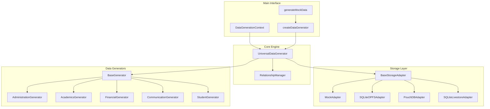
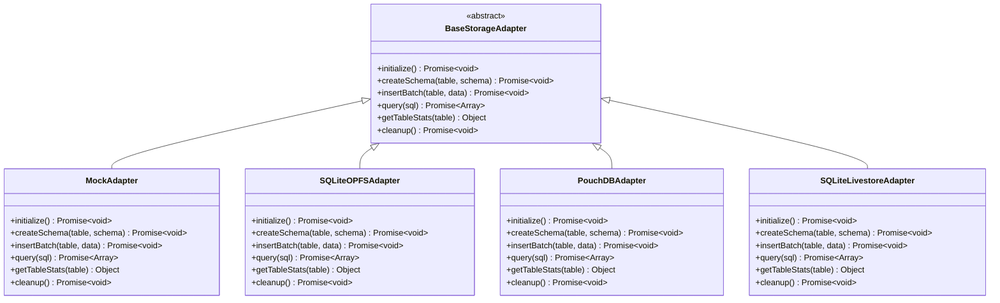
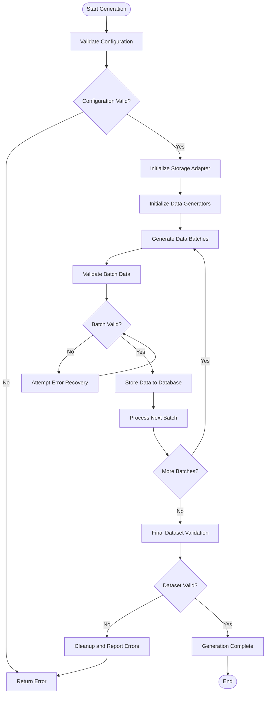
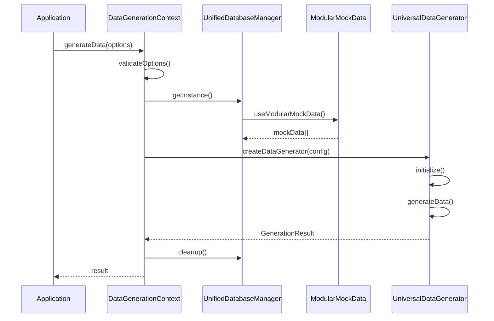

# Data Generation System

<cite>
**Referenced Files in This Document**
- [index.ts](file://src/services/dataGeneration/index.ts)
- [README.md](file://src/services/dataGeneration/README.md)
- [BaseGenerator.ts](file://src/services/dataGeneration/generators/BaseGenerator.ts)
- [AdministrationGenerator.ts](file://src/services/dataGeneration/generators/AdministrationGenerator.ts)
- [AcademicsGenerator.ts](file://src/services/dataGeneration/generators/AcademicsGenerator.ts)
- [CommunicationGenerator.ts](file://src/services/dataGeneration/generators/CommunicationGenerator.ts)
- [FinancialGenerator.ts](file://src/services/dataGeneration/generators/FinancialGenerator.ts)
- [studentGenerator.ts](file://src/services/dataGeneration/generators/studentGenerator.ts)
- [DataGeneration.test.ts](file://src/services/dataGeneration/__tests__/DataGeneration.test.ts)
- [demo.ts](file://src/services/dataGeneration/examples/demo.ts)
- [DataGenerationContext.tsx](file://src/contexts/appData/DataGenerationContext.tsx)
- [useModularMockData.ts](file://src/hooks/useModularMockData.ts)
- [useDatabaseProvider.ts](file://src/hooks/useDatabaseProvider.ts)
- [mockData.ts](file://src/modules/administration/data/mockData.ts)
</cite>

## Update Summary
**Changes Made**
- Added comprehensive academic generator with exam workflows and grading schemes
- Enhanced student generator with family scenario distributions (60% two-parent, 15% single-mother, 10% single-father)
- Added health records and attendance generation capabilities
- Integrated communication generator for SMS/email templates and logs
- Enhanced financial generator with complete chart of accounts and fee management
- Expanded data generation modules with new specialized generators

## Table of Contents
1. [Introduction](#introduction)
2. [System Architecture](#system-architecture)
3. [Core Components](#core-components)
4. [Storage Adapters](#storage-adapters)
5. [Data Generators](#data-generators)
6. [Configuration System](#configuration-system)
7. [Data Validation](#data-validation)
8. [Usage Examples](#usage-examples)
9. [Performance Considerations](#performance-considerations)
10. [Integration Points](#integration-points)
11. [Troubleshooting Guide](#troubleshooting-guide)
12. [Conclusion](#conclusion)

## Introduction

The Data Generation System is a comprehensive mock data generation framework for the SchoolPilot educational management platform. This system generates realistic educational data across multiple storage backends and supports various modules including administration, academics, finance, clubs, dormitories, library, nutrition, payroll, and inventory management.

The system is designed to provide developers and testers with complete datasets for development, testing, and demonstration purposes. It supports multiple storage backends including SQLite with OPFS, SQLite with Livestore, PouchDB, and in-memory mock storage, ensuring compatibility across different deployment environments.

**Updated** Enhanced with comprehensive academic workflows, student family scenarios, health records, and attendance generation capabilities.

## System Architecture

The Data Generation System follows a modular architecture with clear separation of concerns:



**Diagram sources**
- [index.ts:1-82](file://src/services/dataGeneration/index.ts#L1-L82)
- [README.md:152-180](file://src/services/dataGeneration/README.md#L152-L180)

The architecture consists of several key layers:

1. **Interface Layer**: Provides user-friendly APIs for data generation
2. **Core Engine**: Orchestrates the generation process and manages relationships
3. **Storage Abstraction**: Handles different database backends transparently
4. **Generator Layer**: Creates module-specific realistic data
5. **Validation Layer**: Ensures data integrity and referential consistency

## Core Components

### UniversalDataGenerator

The UniversalDataGenerator serves as the main orchestrator for the entire data generation process. It coordinates between storage adapters, data generators, and relationship management to ensure consistent and validated data generation across all modules.

Key responsibilities include:
- Initializing and managing storage adapters
- Coordinating data generation across multiple modules
- Managing batch processing and memory optimization
- Handling error recovery and cleanup procedures

### RelationshipManager

The RelationshipManager handles complex data dependencies and ensures referential integrity across generated data. It manages foreign key relationships between entities and validates that all generated data maintains logical consistency.

### BaseGenerator

The BaseGenerator provides common functionality for all specialized data generators. It includes:
- Faker.js integration for realistic data generation
- ID generation utilities
- Timestamp generation
- Shared validation methods

**Section sources**
- [index.ts:19-44](file://src/services/dataGeneration/index.ts#L19-L44)
- [BaseGenerator.ts:1-40](file://src/services/dataGeneration/generators/BaseGenerator.ts#L1-L40)

## Storage Adapters

The system supports multiple storage backends through a unified adapter interface:

### MockAdapter
In-memory storage for testing and development environments. Provides fast data generation without persistence requirements.

### SQLiteOPFSAdapter
SQLite database with Origin Private File System support for browser-based applications. Enables local persistent storage with good performance characteristics.

### PouchDBAdapter
PouchDB integration for offline-first applications with synchronization capabilities.

### SQLiteLivestoreAdapter
SQLite with Livestore for real-time synchronization scenarios.



**Diagram sources**
- [index.ts:11-13](file://src/services/dataGeneration/index.ts#L11-L13)

**Section sources**
- [README.md:161-167](file://src/services/dataGeneration/README.md#L161-L167)

## Data Generators

The system includes specialized generators for each major module:

### AdministrationGenerator
Creates comprehensive student and staff data including academic year structures, class assignments, dormitory allocations, and transportation routes.

**Updated** Enhanced with comprehensive student profiles including parent/guardian information, medical conditions, allergies, medications, and family scenarios with realistic distributions.

### AcademicsGenerator
Generates comprehensive academic data including subjects, grading schemes, exam sessions, teacher assignments, and timetable data.

**Updated** Added extensive academic workflows including subject hierarchies, grading schemes, assessment frameworks, grade boundaries, exam sessions, student results, teacher assignments, timetables, and curriculum structures.

### FinancialGenerator
Creates chart of accounts with voteheads, fee templates, supplier data, student wallet transactions, and payment voucher records.

**Updated** Enhanced with complete financial system including comprehensive chart of accounts, fee templates, supplier management, budgets, transactions, student fees, payments, purchase orders, invoices, payroll records, and financial reports.

### CommunicationGenerator
Generates SMS and email templates, communication logs, notification settings, message queues, and communication groups.

**Updated** Added comprehensive communication system with templates, logs, notifications, message queues, and group management.

### StudentGenerator
**New** Dedicated student data generator with realistic family relationship scenarios including:
- Family distribution: 60% two-parent, 15% single-mother, 10% single-father, 8% grandparent, 5% other guardian, 2% institutional
- Student categories: Boarder (40%), Day Scholar (55%), Special (5%)
- Student status: Active (92%), Suspended (3%), Alumni (4%), Withdrawn (1%)

### Health Records
**New** Comprehensive health record generation including medical conditions, allergies, medications, and health management data.

### Attendance Generation
**New** Automated attendance record generation with realistic patterns (92% present, 5% absent, 3% late) and historical data spanning 90 days.

```mermaid
classDiagram
class BaseGenerator {
<<abstract>>
#config : DataGenerationConfig
#faker : any
+constructor(config : DataGenerationConfig)
+initialize() Promise~void~
+generateData(count : number) Promise~Array~
#generateId(prefix : string, index? : number) string
#generateTimestamp(daysAgo : number) string
}
class AdministrationGenerator {
+generateStudents(count : number) Promise~Array~
+generateStaff(count : number) Promise~Array~
+generateAcademicYears() Promise~Array~
+generateClasses() Promise~Array~
}
class AcademicsGenerator {
+generateSubjectHierarchy(count : number) Promise~Array~
+generateGradingSchemes(count : number) Promise~Array~
+generateAssessmentFrameworks(count : number) Promise~Array~
+generateGradeBoundaries(count : number) Promise~Array~
+generateExamSessions(count : number) Promise~Array~
+generateStudentResults(count : number) Promise~Array~
+generateTeacherAssignments(count : number) Promise~Array~
+generateTimetables(count : number) Promise~Array~
+generateCurriculumStructures(count : number) Promise~Array~
}
class FinancialGenerator {
+generateChartOfAccounts() any[]
+generateFeeTemplates() any[]
+generateFeeStructures(feeTemplates : any[]) any[]
+generateSuppliers() any[]
+generateBudgets(chartOfAccounts : any[]) any[]
+generateTransactions(chartOfAccounts : any[], suppliers : any[], feeTemplates : any[]) any[]
+generateStudentFees(feeStructures : any[]) any[]
+generatePayments(studentFees : any[]) any[]
+generatePurchaseOrders(suppliers : any[], chartOfAccounts : any[]) any[]
+generateInvoices(suppliers : any[], purchaseOrders : any[]) any[]
+generatePayrollRecords(chartOfAccounts : any[]) any[]
+generateFinancialReports() any[]
}
class CommunicationGenerator {
+generateSMSTemplates(count : number) Promise~any[]~
+generateEmailTemplates(count : number) Promise~any[]~
+generateCommunicationLogs(count : number) Promise~any[]~
+generateNotificationSettings(count : number) Promise~any[]~
+generateMessageQueues(count : number) Promise~any[]~
+generateCommunicationGroups(count : number) Promise~any[]~
+generateGroupMemberships(count : number) Promise~any[]~
}
class StudentGenerator {
+generateStudentData(options : StudentGenerationOptions) GeneratedStudentData
+generateHealthRecords(studentIds : string[]) any[]
+generateAttendanceRecords(studentIds : string[], schoolPeriodId : number, daysToGenerate? : number) any[]
}
BaseGenerator <|-- AdministrationGenerator
BaseGenerator <|-- AcademicsGenerator
BaseGenerator <|-- FinancialGenerator
BaseGenerator <|-- CommunicationGenerator
BaseGenerator <|-- StudentGenerator
```



**Diagram sources**
- [BaseGenerator.ts:1-40](file://src/services/dataGeneration/generators/BaseGenerator.ts#L1-L40)

**Section sources**
- [README.md:168-179](file://src/services/dataGeneration/README.md#L168-L179)

## Configuration System

The Data Generation System uses a flexible configuration approach:

### DataGenerationConfig Interface
```typescript
interface DataGenerationConfig {
  storageType: 'sqlite-opfs' | 'sqlite-livestore' | 'pouchdb' | 'mock';
  locale?: string;           // Default: 'en'
  batchSize?: number;        // Default: 100
  logProgress?: boolean;     // Default: true
  validateData?: boolean;    // Default: true
  modules?: string[];        // Default: all modules
}
```

### GenerationResult Interface
```typescript
interface GenerationResult {
  success: boolean;
  stats: {
    totalRecords: number;
    tablesGenerated: string[];
    generationTime: number;
    storageType: string;
  };
  errors: string[];
}
```

### Factory Pattern
The system uses a factory pattern for creating data generators:
- `createDataGenerator()`: Creates a configured UniversalDataGenerator instance
- `generateMockData()`: Convenience function for quick data generation with sensible defaults

**Section sources**
- [index.ts:19-37](file://src/services/dataGeneration/index.ts#L19-L37)
- [index.ts:40-44](file://src/services/dataGeneration/index.ts#L40-L44)

## Data Validation

The system implements comprehensive data validation to ensure referential integrity and realistic data generation:

### Validation Features
- **Referential Integrity**: All foreign keys point to valid records
- **Data Constraints**: Realistic ranges and formats for all fields
- **Uniqueness**: Unique constraints are respected across entities
- **Business Rules**: Educational domain-specific validations

### Validation Process
1. **Pre-generation Validation**: Validates configuration and prerequisites
2. **During-generation Validation**: Checks data integrity during creation
3. **Post-generation Validation**: Verifies complete dataset consistency
4. **Relationship Validation**: Ensures all cross-module relationships are maintained



**Diagram sources**
- [DataGeneration.test.ts:223-265](file://src/services/dataGeneration/__tests__/DataGeneration.test.ts#L223-L265)

**Section sources**
- [README.md:244-252](file://src/services/dataGeneration/README.md#L244-L252)

## Usage Examples

### Basic Usage
The simplest way to generate mock data for all modules:

```typescript
import { generateMockData } from './src/services/dataGeneration';

// Generate data for all modules with mock storage
const result = await generateMockData('mock');

if (result.success) {
  console.log(`Generated ${result.stats.totalRecords} records`);
  console.log(`Tables: ${result.stats.tablesGenerated.join(', ')}`);
} else {
  console.error('Generation failed:', result.errors);
}
```

### Advanced Configuration
For more control over the generation process:

```typescript
import { createDataGenerator } from './src/services/dataGeneration';

const config = {
  storageType: 'mock' as const,
  locale: 'en',
  batchSize: 100,
  logProgress: true,
  validateData: true,
  modules: ['administration', 'academic', 'finance']
};

const generator = await createDataGenerator(config);
const result = await generator.generateData();
const isValid = await generator.validateData();

await generator.cleanup();
```

### Direct Adapter Usage
For custom storage scenarios:

```typescript
import { MockAdapter } from './src/services/dataGeneration';

const adapter = new MockAdapter();
await adapter.initialize();

// Create schema
const schema = `
  CREATE TABLE users (
    id INTEGER PRIMARY KEY,
    name TEXT NOT NULL,
    email TEXT UNIQUE
  )
`;

await adapter.createSchema('users', schema);

// Insert data
const users = [
  { name: 'John Doe', email: 'john@example.com' },
  { name: 'Jane Smith', email: 'jane@example.com' }
];

await adapter.insertBatch('users', users);

// Query data
const results = await adapter.query('SELECT * FROM users WHERE name LIKE "John%"');

// Get statistics
const stats = adapter.getTableStats('users');
console.log(`Table has ${stats.rowCount} rows`);

await adapter.cleanup();
```

### Student Data Generation
**New** Example of generating comprehensive student data with family scenarios:

```typescript
import { generateStudentData } from './src/services/dataGeneration/generators/studentGenerator';

const studentData = generateStudentData({
  count: 100,
  startIndex: 1,
  classStreamIds: [1, 2, 3, 4],
  academicYearId: 1,
  dormitoryIds: [1, 2, 3],
  includeSiblings: true,
  siblingProbability: 0.15
});

console.log(`Generated ${studentData.students.length} students`);
console.log(`Generated ${studentData.guardians.length} guardians`);
console.log(`Generated ${studentData.relationships.length} relationships`);
```

**Section sources**
- [README.md:76-151](file://src/services/dataGeneration/README.md#L76-L151)
- [demo.ts:1-41](file://src/services/dataGeneration/examples/demo.ts#L1-L41)

## Performance Considerations

The system is optimized for performance across different scenarios:

### Memory Management
- **Batch Processing**: Configurable batch sizes for optimal memory usage
- **Lazy Loading**: Generators are instantiated only when needed
- **Efficient Queries**: Optimized SQL generation for mock adapter
- **Proper Cleanup**: Automatic resource management and cleanup

### Performance Benchmarks
- **500+ Students**: ~2-3 seconds
- **100+ Staff**: ~1 second
- **Complete Dataset**: ~10-15 seconds
- **Memory Usage**: <100MB for full dataset

### Optimization Strategies
- **Reduce Batch Size**: For memory-constrained environments
- **Selective Module Generation**: Generate only required modules
- **Disable Progress Logging**: For maximum performance
- **Adjust Locale Settings**: For region-specific optimizations

**Section sources**
- [README.md:229-243](file://src/services/dataGeneration/README.md#L229-L243)

## Integration Points

### React Context Integration
The Data Generation System integrates with the application's React context system:

```typescript
const DataGenerationContext = createContext<DataGenerationContextType | undefined>(undefined);

export const DataGenerationProvider: React.FC<{ 
  children: ReactNode; 
  onDataChanged?: () => Promise<void>;
}> = ({ children, onDataChanged }) => {
  const toast = useToastHelpers();
  
  const generateData = useCallback(async (options?: {
    modules?: string[];
    counts?: Record<string, number>;
    useRealisticData?: boolean;
    includeTestData?: boolean;
    clearExisting?: boolean;
  }) => {
    try {
      console.log('🎲 [DataGenerationContext] Starting data generation...');
      toast.showInfo('Generating data...');

      const dbManager = UnifiedDatabaseManager.getInstance();
      // Implementation details...
    } catch (error) {
      toast.showError('Data generation failed');
      throw error;
    }
  }, []);
  
  // ... context implementation
};
```

### Modular Mock Data Integration
The system works alongside the existing modular mock data system:



**Diagram sources**
- [DataGenerationContext.tsx:1-39](file://src/contexts/appData/DataGenerationContext.tsx#L1-L39)
- [useModularMockData.ts:45-50](file://src/hooks/useModularMockData.ts#L45-L50)

**Section sources**
- [DataGenerationContext.tsx:1-39](file://src/contexts/appData/DataGenerationContext.tsx#L1-L39)
- [useModularMockData.ts:45-50](file://src/hooks/useModularMockData.ts#L45-L50)
- [useDatabaseProvider.ts:62-62](file://src/hooks/useDatabaseProvider.ts#L62-L62)

## Troubleshooting Guide

### Common Issues and Solutions

#### Memory Issues
**Problem**: Generation fails due to insufficient memory
**Solution**: 
- Reduce batch size in configuration
- Generate fewer modules initially
- Use mock storage for development

#### Slow Performance
**Problem**: Data generation takes too long
**Solution**:
- Increase batch size for better throughput
- Disable progress logging for production
- Generate only required modules

#### Validation Errors
**Problem**: Generated data fails validation checks
**Solution**:
- Check relationship definitions in RelationshipManager
- Verify data constraints in individual generators
- Review business rule implementations

#### Storage Errors
**Problem**: Issues with database initialization or cleanup
**Solution**:
- Ensure proper adapter initialization
- Verify cleanup procedures are called
- Check storage permissions and availability

### Debug Mode
Enable detailed logging for troubleshooting:

```typescript
const config = {
  storageType: 'mock',
  logProgress: true,
  validateData: true
};
```

### Error Handling Patterns
The system implements robust error handling:
- Try-catch blocks around generation operations
- Graceful degradation when Faker.js is unavailable
- Comprehensive error reporting with stack traces
- Automatic cleanup on failure

**Section sources**
- [README.md:280-300](file://src/services/dataGeneration/README.md#L280-L300)
- [index.ts:70-82](file://src/services/dataGeneration/index.ts#L70-L82)

## Conclusion

The Data Generation System provides a comprehensive solution for creating realistic educational data across multiple storage backends. Its modular architecture, comprehensive validation, and performance optimizations make it suitable for development, testing, and demonstration scenarios.

**Updated** Key enhancements include comprehensive academic workflows with exam management, sophisticated student family scenario generation with realistic distributions, health record management, attendance tracking, communication systems, and complete financial management capabilities.

Key strengths include:
- **Flexibility**: Support for multiple storage backends and configuration options
- **Realism**: Faker.js integration for authentic-looking educational data
- **Integrity**: Comprehensive validation ensuring referential consistency
- **Performance**: Optimized batch processing and memory management
- **Extensibility**: Clean architecture supporting easy addition of new generators and adapters
- **Comprehensive Coverage**: Academic workflows, family scenarios, health records, and communication systems

The system seamlessly integrates with the broader SchoolPilot ecosystem and provides developers with the tools needed to create comprehensive test datasets quickly and efficiently.