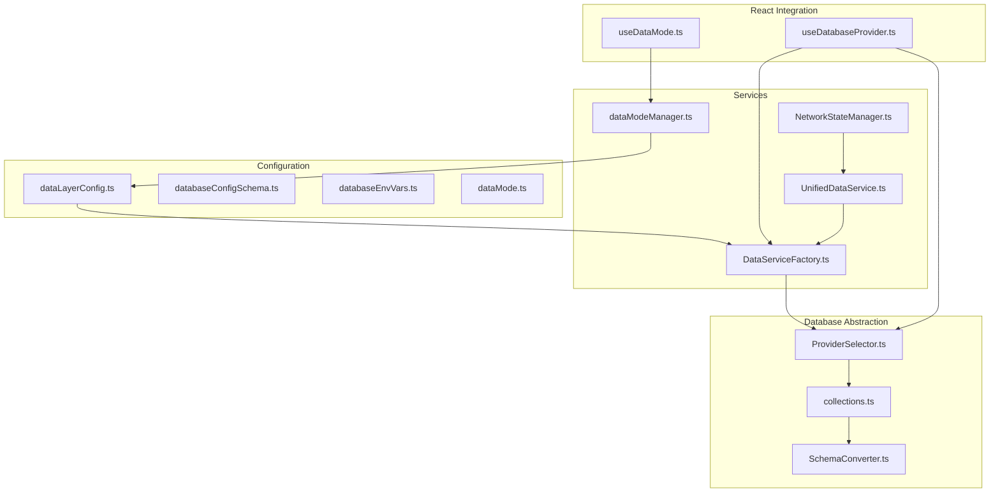
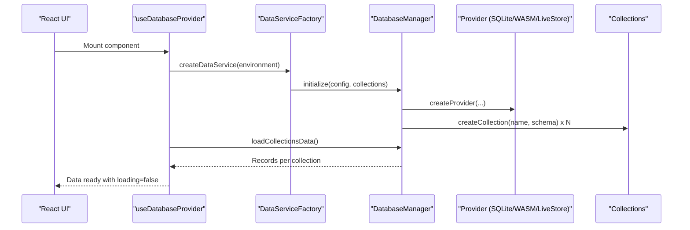
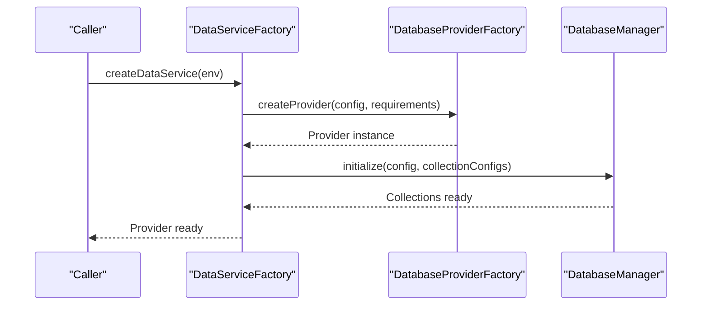
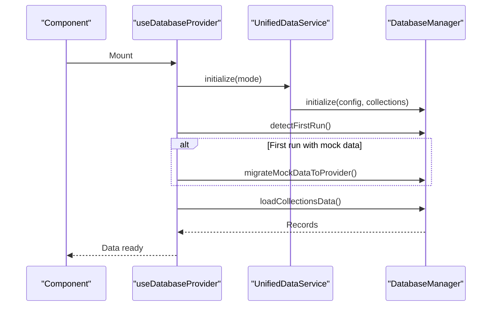
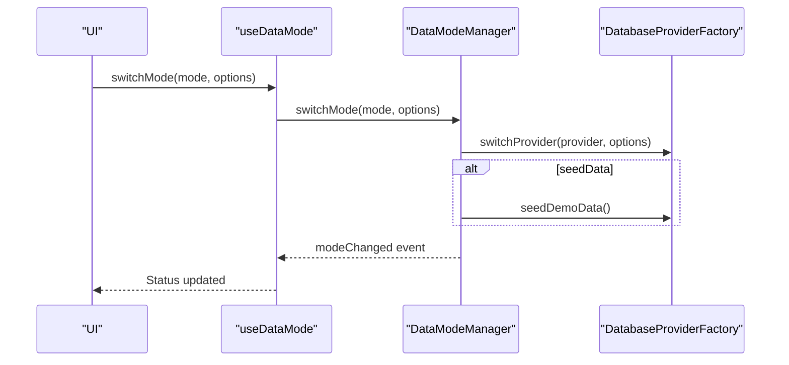
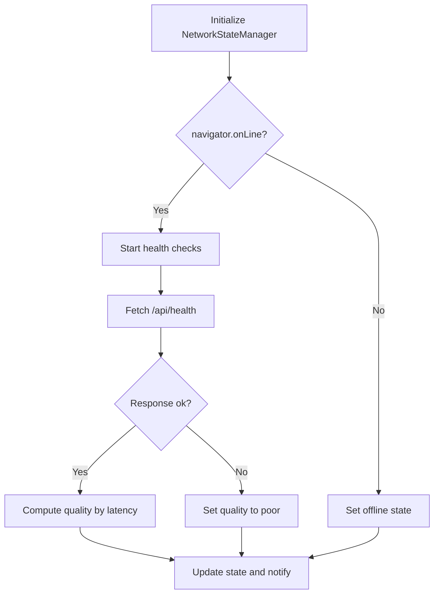
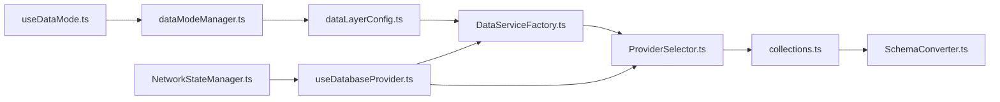

# Data Layer

<cite>
**Referenced Files in This Document**
- [dataLayerConfig.ts](file://src/config/dataLayerConfig.ts)
- [dataMode.ts](file://src/config/dataMode.ts)
- [databaseConfigSchema.ts](file://src/config/databaseConfigSchema.ts)
- [databaseEnvVars.ts](file://src/config/databaseEnvVars.ts)
- [useDatabaseProvider.ts](file://src/hooks/useDatabaseProvider.ts)
- [useDataMode.ts](file://src/hooks/useDataMode.ts)
- [UnifiedDataService.ts](file://src/services/data/UnifiedDataService.ts)
- [DataServiceFactory.ts](file://src/services/data/DataServiceFactory.ts)
- [ProviderSelector.ts](file://src/services/database/ProviderSelector.ts)
- [collections.ts](file://src/services/database/collections.ts)
- [SchemaConverter.ts](file://src/services/database/SchemaConverter.ts)
- [dataModeManager.ts](file://src/services/data/dataModeManager.ts)
- [NetworkStateManager.ts](file://src/services/data/NetworkStateManager.ts)
</cite>

## Table of Contents
1. [Introduction](#introduction)
2. [Project Structure](#project-structure)
3. [Core Components](#core-components)
4. [Architecture Overview](#architecture-overview)
5. [Detailed Component Analysis](#detailed-component-analysis)
6. [Dependency Analysis](#dependency-analysis)
7. [Performance Considerations](#performance-considerations)
8. [Troubleshooting Guide](#troubleshooting-guide)
9. [Conclusion](#conclusion)

## Introduction
This document describes the data layer architecture for SchoolPilot3’s dual-mode system. It explains the modernization strategy that uses SQLite with OPFS in development and demo environments, and LiveStore (SQLite WASM + OPFS) in production. It documents the migration from mock data to persistent storage, the provider-agnostic collection model, data mode switching, offline capability management, and operational controls such as backup/restore and configuration validation.

## Project Structure
The data layer is organized around:
- Configuration and policies for providers and environments
- A provider-agnostic collection schema system
- A factory that selects and initializes the appropriate database provider
- Hooks that integrate the data layer into React components
- Services for data mode management and network state



**Diagram sources**
- [dataLayerConfig.ts:56-236](file://src/config/dataLayerConfig.ts#L56-L236)
- [UnifiedDataService.ts:36-146](file://src/services/data/UnifiedDataService.ts#L36-L146)
- [DataServiceFactory.ts:37-151](file://src/services/data/DataServiceFactory.ts#L37-L151)
- [ProviderSelector.ts:31-242](file://src/services/database/ProviderSelector.ts#L31-L242)
- [collections.ts:468-521](file://src/services/database/collections.ts#L468-L521)
- [SchemaConverter.ts:57-98](file://src/services/database/SchemaConverter.ts#L57-L98)
- [useDatabaseProvider.ts:48-103](file://src/hooks/useDatabaseProvider.ts#L48-L103)
- [useDataMode.ts:23-94](file://src/hooks/useDataMode.ts#L23-L94)
- [dataModeManager.ts:35-91](file://src/services/data/dataModeManager.ts#L35-L91)
- [NetworkStateManager.ts:21-60](file://src/services/data/NetworkStateManager.ts#L21-L60)

**Section sources**
- [dataLayerConfig.ts:56-236](file://src/config/dataLayerConfig.ts#L56-L236)
- [UnifiedDataService.ts:36-146](file://src/services/data/UnifiedDataService.ts#L36-L146)
- [DataServiceFactory.ts:37-151](file://src/services/data/DataServiceFactory.ts#L37-L151)
- [ProviderSelector.ts:31-242](file://src/services/database/ProviderSelector.ts#L31-L242)
- [collections.ts:468-521](file://src/services/database/collections.ts#L468-L521)
- [SchemaConverter.ts:57-98](file://src/services/database/SchemaConverter.ts#L57-L98)
- [useDatabaseProvider.ts:48-103](file://src/hooks/useDatabaseProvider.ts#L48-L103)
- [useDataMode.ts:23-94](file://src/hooks/useDataMode.ts#L23-L94)
- [dataModeManager.ts:35-91](file://src/services/data/dataModeManager.ts#L35-L91)
- [NetworkStateManager.ts:21-60](file://src/services/data/NetworkStateManager.ts#L21-L60)

## Core Components
- Dual-mode configuration: Environment-specific provider selection with development (SQLite file), demo (SQLite WASM + OPFS), and production (LiveStore).
- Provider-agnostic collections: A unified schema system that supports multiple providers without RxDB dependency.
- Factory-driven initialization: A factory chooses the correct provider and creates collections based on configuration.
- React hooks: Seamless integration for initialization, migration, and data loading.
- Data mode manager: Orchestrates switching between development, demo, and production modes with optional seeding and clearing.
- Network state manager: Monitors connectivity and backend health for offline-aware behavior.

**Section sources**
- [dataLayerConfig.ts:56-236](file://src/config/dataLayerConfig.ts#L56-L236)
- [collections.ts:468-521](file://src/services/database/collections.ts#L468-L521)
- [DataServiceFactory.ts:37-151](file://src/services/data/DataServiceFactory.ts#L37-L151)
- [useDatabaseProvider.ts:48-103](file://src/hooks/useDatabaseProvider.ts#L48-L103)
- [dataModeManager.ts:35-91](file://src/services/data/dataModeManager.ts#L35-L91)
- [NetworkStateManager.ts:21-60](file://src/services/data/NetworkStateManager.ts#L21-L60)

## Architecture Overview
SchoolPilot3 implements a dual-mode data architecture:
- Development and demo: SQLite WASM with OPFS for browser-based persistence and fast iteration.
- Production: LiveStore (SQLite WASM + OPFS) optimized for local-first, offline-first operation with optional cross-tab persistence and service worker support.



**Diagram sources**
- [useDatabaseProvider.ts:68-103](file://src/hooks/useDatabaseProvider.ts#L68-L103)
- [DataServiceFactory.ts:37-151](file://src/services/data/DataServiceFactory.ts#L37-L151)
- [ProviderSelector.ts:42-85](file://src/services/database/ProviderSelector.ts#L42-L85)
- [collections.ts:468-521](file://src/services/database/collections.ts#L468-L521)

## Detailed Component Analysis

### Data Layer Configuration and Policies
- Provider configuration supports SQLite file, SQLite WASM with OPFS, PouchDB, and LiveStore.
- Backend integrations include ERPNext, CouchDB, PostgreSQL API, and custom API.
- Consolidated configuration options normalize provider/backend combinations for UI and runtime selection.


**Diagram sources**
- [dataLayerConfig.ts:56-236](file://src/config/dataLayerConfig.ts#L56-L236)

**Section sources**
- [dataLayerConfig.ts:56-236](file://src/config/dataLayerConfig.ts#L56-L236)

### Provider-Agnostic Collections and Schema Conversion
- Collections are defined centrally and exported for all modules.
- SchemaConverter transforms RxDB-style schemas into SQLite-compatible table definitions, generating indexes and relationships.
- DatabaseManager orchestrates collection creation across providers.

```mermaid
classDiagram
class Collections {
+Record<string, {schema}>
+coreCollectionNames
}
class SchemaConverter {
+convertAllCollections(map)
+generateSQLiteSchema()
+generateCreateTableSQL()
+generateCreateIndexSQL()
}
class DatabaseManager {
+initialize(config, collectionConfigs)
+getCollection(name)
+getAllCollections()
+backup()
+restore(data)
}
Collections --> SchemaConverter : "provides RxDB schemas"
SchemaConverter --> DatabaseManager : "produces SQLite schema"
```

**Diagram sources**
- [collections.ts:468-521](file://src/services/database/collections.ts#L468-L521)
- [SchemaConverter.ts:57-98](file://src/services/database/SchemaConverter.ts#L57-L98)
- [ProviderSelector.ts:31-127](file://src/services/database/ProviderSelector.ts#L31-L127)

**Section sources**
- [collections.ts:468-521](file://src/services/database/collections.ts#L468-L521)
- [SchemaConverter.ts:57-98](file://src/services/database/SchemaConverter.ts#L57-L98)
- [ProviderSelector.ts:31-127](file://src/services/database/ProviderSelector.ts#L31-L127)

### Data Service Factory and Initialization
- DataServiceFactory selects provider and requirements based on environment and user overrides.
- Initializes DatabaseManager with all 88+ collections and storage configuration.



**Diagram sources**
- [DataServiceFactory.ts:37-151](file://src/services/data/DataServiceFactory.ts#L37-L151)
- [ProviderSelector.ts:42-85](file://src/services/database/ProviderSelector.ts#L42-L85)

**Section sources**
- [DataServiceFactory.ts:37-151](file://src/services/data/DataServiceFactory.ts#L37-L151)
- [ProviderSelector.ts:42-85](file://src/services/database/ProviderSelector.ts#L42-L85)

### React Integration: useDatabaseProvider Hook
- Initializes the data service, creates collections, migrates mock data, and loads initial data.
- Provides loading, error, and migration status states for UI rendering.



**Diagram sources**
- [useDatabaseProvider.ts:68-103](file://src/hooks/useDatabaseProvider.ts#L68-L103)
- [useDatabaseProvider.ts:147-176](file://src/hooks/useDatabaseProvider.ts#L147-L176)
- [useDatabaseProvider.ts:206-273](file://src/hooks/useDatabaseProvider.ts#L206-L273)
- [useDatabaseProvider.ts:338-367](file://src/hooks/useDatabaseProvider.ts#L338-L367)

**Section sources**
- [useDatabaseProvider.ts:48-103](file://src/hooks/useDatabaseProvider.ts#L48-L103)
- [useDatabaseProvider.ts:147-176](file://src/hooks/useDatabaseProvider.ts#L147-L176)
- [useDatabaseProvider.ts:206-273](file://src/hooks/useDatabaseProvider.ts#L206-L273)
- [useDatabaseProvider.ts:338-367](file://src/hooks/useDatabaseProvider.ts#L338-L367)

### Data Mode Management and Switching
- DataModeManager coordinates transitions between development, demo, and production modes.
- Supports optional backup, clearing, and seeding during mode switches.
- Emits events for UI updates and state synchronization.



**Diagram sources**
- [useDataMode.ts:47-59](file://src/hooks/useDataMode.ts#L47-L59)
- [dataModeManager.ts:93-170](file://src/services/data/dataModeManager.ts#L93-L170)
- [dataModeManager.ts:255-272](file://src/services/data/dataModeManager.ts#L255-L272)

**Section sources**
- [useDataMode.ts:23-94](file://src/hooks/useDataMode.ts#L23-L94)
- [dataModeManager.ts:35-91](file://src/services/data/dataModeManager.ts#L35-L91)
- [dataModeManager.ts:93-170](file://src/services/data/dataModeManager.ts#L93-L170)
- [dataModeManager.ts:255-272](file://src/services/data/dataModeManager.ts#L255-L272)

### Network State and Offline Capabilities
- NetworkStateManager tracks online/offline status, backend health, and latency.
- In demo mode, treats the environment as online with good connectivity.
- Provides subscription for components to adapt UI and behavior to network conditions.



**Diagram sources**
- [NetworkStateManager.ts:21-60](file://src/services/data/NetworkStateManager.ts#L21-L60)
- [NetworkStateManager.ts:121-174](file://src/services/data/NetworkStateManager.ts#L121-L174)

**Section sources**
- [NetworkStateManager.ts:21-60](file://src/services/data/NetworkStateManager.ts#L21-L60)
- [NetworkStateManager.ts:121-174](file://src/services/data/NetworkStateManager.ts#L121-L174)

### Configuration Validation and Repair Utilities
- DatabaseConfigValidator enforces schema rules, auto-fixes issues, and migrates legacy configurations.
- Supports validation, auto-fix, migration, and repair workflows.


**Diagram sources**
- [databaseConfigSchema.ts:305-360](file://src/config/databaseConfigSchema.ts#L305-L360)
- [databaseConfigSchema.ts:384-410](file://src/config/databaseConfigSchema.ts#L384-L410)
- [databaseConfigSchema.ts:470-492](file://src/config/databaseConfigSchema.ts#L470-L492)

**Section sources**
- [databaseConfigSchema.ts:305-360](file://src/config/databaseConfigSchema.ts#L305-L360)
- [databaseConfigSchema.ts:384-410](file://src/config/databaseConfigSchema.ts#L384-L410)
- [databaseConfigSchema.ts:470-492](file://src/config/databaseConfigSchema.ts#L470-L492)

## Dependency Analysis
- Configuration drives provider selection and options.
- Factory depends on provider factory to instantiate the active provider.
- DatabaseManager encapsulates provider operations and collection lifecycle.
- Hooks depend on factory and manager for initialization and data loading.
- DataModeManager coordinates environment transitions and seeds data when needed.
- NetworkStateManager informs UI behavior without coupling to providers.



**Diagram sources**
- [dataLayerConfig.ts:56-236](file://src/config/dataLayerConfig.ts#L56-L236)
- [DataServiceFactory.ts:37-151](file://src/services/data/DataServiceFactory.ts#L37-L151)
- [ProviderSelector.ts:31-127](file://src/services/database/ProviderSelector.ts#L31-L127)
- [collections.ts:468-521](file://src/services/database/collections.ts#L468-L521)
- [SchemaConverter.ts:57-98](file://src/services/database/SchemaConverter.ts#L57-L98)
- [useDatabaseProvider.ts:48-103](file://src/hooks/useDatabaseProvider.ts#L48-L103)
- [useDataMode.ts:23-94](file://src/hooks/useDataMode.ts#L23-L94)
- [dataModeManager.ts:35-91](file://src/services/data/dataModeManager.ts#L35-L91)
- [NetworkStateManager.ts:21-60](file://src/services/data/NetworkStateManager.ts#L21-L60)

**Section sources**
- [dataLayerConfig.ts:56-236](file://src/config/dataLayerConfig.ts#L56-L236)
- [DataServiceFactory.ts:37-151](file://src/services/data/DataServiceFactory.ts#L37-L151)
- [ProviderSelector.ts:31-127](file://src/services/database/ProviderSelector.ts#L31-L127)
- [collections.ts:468-521](file://src/services/database/collections.ts#L468-L521)
- [SchemaConverter.ts:57-98](file://src/services/database/SchemaConverter.ts#L57-L98)
- [useDatabaseProvider.ts:48-103](file://src/hooks/useDatabaseProvider.ts#L48-L103)
- [useDataMode.ts:23-94](file://src/hooks/useDataMode.ts#L23-L94)
- [dataModeManager.ts:35-91](file://src/services/data/dataModeManager.ts#L35-L91)
- [NetworkStateManager.ts:21-60](file://src/services/data/NetworkStateManager.ts#L21-L60)

## Performance Considerations
- Caching: UnifiedDataService maintains a lightweight in-memory cache with TTL for query results.
- Batch operations: Bulk APIs are exposed for efficient writes and updates.
- Indexing: SchemaConverter generates indexes from collection definitions to optimize queries.
- Storage quotas: Requirements specify storage quotas per environment to manage disk usage.
- Offline-first: LiveStore with OPFS ensures responsive UI even when offline.

[No sources needed since this section provides general guidance]

## Troubleshooting Guide
Common issues and resolutions:
- Initialization failures: Verify provider configuration and environment variables; use DatabaseConfigValidator to auto-fix and migrate.
- Migration errors: Confirm mock data readiness and collection existence; inspect migration status in the hook.
- Mode switching problems: Ensure required tokens for production data clearing; listen to mode manager events.
- Network state confusion: In demo mode, backend health checks are disabled; rely on online/offline events.

**Section sources**
- [databaseConfigSchema.ts:305-360](file://src/config/databaseConfigSchema.ts#L305-L360)
- [useDatabaseProvider.ts:147-176](file://src/hooks/useDatabaseProvider.ts#L147-L176)
- [dataModeManager.ts:172-253](file://src/services/data/dataModeManager.ts#L172-L253)
- [NetworkStateManager.ts:43-83](file://src/services/data/NetworkStateManager.ts#L43-L83)

## Conclusion
SchoolPilot3’s data layer provides a robust, provider-agnostic foundation for development, demo, and production. The dual-mode strategy with SQLite OPFS and LiveStore enables rapid iteration while maintaining production-grade offline and persistence characteristics. The centralized configuration, schema abstraction, and factory-driven initialization simplify integration and upgrades. Data mode management and network state services ensure smooth transitions and resilient UX across environments.