# Data Layer

<cite>
**Referenced Files in This Document**
- [app-data.ts](file://src/core/types/app-data.ts)
- [moduleCollections.ts](file://src/core/types/moduleCollections.ts)
- [moduleCollectionRegistry.ts](file://src/contexts/appData/moduleCollectionRegistry.ts)
- [appDataCollections.ts](file://src/contexts/appData/appDataCollections.ts)
- [appDataAugmentation.ts](file://src/modules/academics/data/appDataAugmentation.ts)
- [appDataAugmentation.ts](file://src/modules/finance/data/appDataAugmentation.ts)
- [appDataAugmentation.ts](file://src/modules/administration/data/appDataAugmentation.ts)
- [collectionConfig.ts](file://src/modules/finance/data/collectionConfig.ts)
- [collectionConfig.ts](file://src/modules/administration/data/collectionConfig.ts)
- [dataLayerConfig.ts](file://src/config/dataLayerConfig.ts)
- [dataMode.ts](file://src/config/dataMode.ts)
- [databaseConfigSchema.ts](file://src/config/databaseConfigSchema.ts)
- [databaseEnvVars.ts](file://src/config/databaseEnvVars.ts)
- [useDatabaseProvider.ts](file://src/hooks/useDatabaseProvider.ts)
- [useDataMode.ts](file://src/hooks/useDataMode.ts)
- [UnifiedDataService.ts](file://src/services/data/UnifiedDataService.ts)
- [DataServiceFactory.ts](file://src/services/data/DataServiceFactory.ts)
- [ProviderSelector.ts](file://src/services/database/ProviderSelector.ts)
- [collections.ts](file://src/services/database/collections.ts)
- [SchemaConverter.ts](file://src/services/database/SchemaConverter.ts)
- [dataModeManager.ts](file://src/services/data/dataModeManager.ts)
- [NetworkStateManager.ts](file://src/services/data/NetworkStateManager.ts)
- [common.ts](file://src/core/types/common.ts)
- [DependencyResolver.ts](file://src/core/DependencyResolver.ts)
</cite>

## Update Summary
**Changes Made**
- Updated Type System Modernization section to document the new base AppDataType interface with 51 lines
- Added comprehensive coverage of the elimination of circular dependencies through DependencyResolver
- Enhanced documentation of the comprehensive TypeScript declaration merging pattern across 8 functional modules
- Updated architecture diagrams to reflect the new auto-discovery system with 8 module collections
- Added detailed analysis of the Frappe-style self-registration pattern implementation

## Table of Contents
1. [Introduction](#introduction)
2. [Project Structure](#project-structure)
3. [Core Components](#core-components)
4. [Architecture Overview](#architecture-overview)
5. [Detailed Component Analysis](#detailed-component-analysis)
6. [Type System Modernization](#type-system-modernization)
7. [Module Augmentation Pattern](#module-augmentation-pattern)
8. [Auto-Discovery System](#auto-discovery-system)
9. [Dependency Analysis](#dependency-analysis)
10. [Performance Considerations](#performance-considerations)
11. [Troubleshooting Guide](#troubleshooting-guide)
12. [Conclusion](#conclusion)

## Introduction
This document describes the data layer architecture for SchoolPilot3's dual-mode system. The architecture has undergone a major transformation from a monolithic AppDataType system to a modernized modular TypeScript declaration merging pattern. The core app-data.ts has been dramatically reduced from 264 lines to 51 lines, implementing a Frappe-style self-registration system where modules contribute their collections through TypeScript declaration merging. This enables compile-time type safety while maintaining runtime flexibility and eliminating manual collection management overhead.

## Project Structure
The data layer is organized around:
- Configuration and policies for providers and environments
- A provider-agnostic collection schema system
- A factory that selects and initializes the appropriate database provider
- Hooks that integrate the data layer into React components
- Services for data mode management and network state
- **New**: TypeScript module augmentation pattern for self-registering collections
- **New**: Auto-discovery system for module collections
- **New**: Comprehensive circular dependency elimination through DependencyResolver

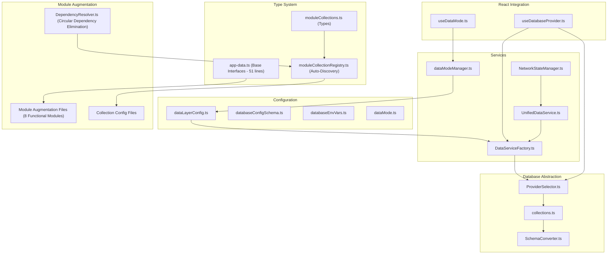

**Diagram sources**
- [dataLayerConfig.ts:56-236](file://src/config/dataLayerConfig.ts#L56-L236)
- [app-data.ts:18-59](file://src/core/types/app-data.ts#L18-L59)
- [moduleCollections.ts:15-50](file://src/core/types/moduleCollections.ts#L15-L50)
- [moduleCollectionRegistry.ts:1-120](file://src/contexts/appData/moduleCollectionRegistry.ts#L1-L120)
- [UnifiedDataService.ts:36-146](file://src/services/data/UnifiedDataService.ts#L36-L146)
- [DataServiceFactory.ts:37-151](file://src/services/data/DataServiceFactory.ts#L37-L151)
- [ProviderSelector.ts:31-242](file://src/services/database/ProviderSelector.ts#L31-L242)
- [collections.ts:468-521](file://src/services/database/collections.ts#L468-L521)
- [SchemaConverter.ts:57-98](file://src/services/database/SchemaConverter.ts#L57-L98)
- [useDatabaseProvider.ts:48-103](file://src/hooks/useDatabaseProvider.ts#L48-L103)
- [useDataMode.ts:23-94](file://src/hooks/useDataMode.ts#L23-L94)
- [dataModeManager.ts:35-91](file://src/services/data/dataModeManager.ts#L35-L91)
- [NetworkStateManager.ts:21-60](file://src/services/data/NetworkStateManager.ts#L21-L60)
- [DependencyResolver.ts:19-252](file://src/core/DependencyResolver.ts#L19-L252)

**Section sources**
- [dataLayerConfig.ts:56-236](file://src/config/dataLayerConfig.ts#L56-L236)
- [app-data.ts:18-59](file://src/core/types/app-data.ts#L18-L59)
- [moduleCollections.ts:15-50](file://src/core/types/moduleCollections.ts#L15-L50)
- [moduleCollectionRegistry.ts:1-120](file://src/contexts/appData/moduleCollectionRegistry.ts#L1-L120)
- [UnifiedDataService.ts:36-146](file://src/services/data/UnifiedDataService.ts#L36-L146)
- [DataServiceFactory.ts:37-151](file://src/services/data/DataServiceFactory.ts#L37-L151)
- [ProviderSelector.ts:31-242](file://src/services/database/ProviderSelector.ts#L31-L242)
- [collections.ts:468-521](file://src/services/database/collections.ts#L468-L521)
- [SchemaConverter.ts:57-98](file://src/services/database/SchemaConverter.ts#L57-L98)
- [useDatabaseProvider.ts:48-103](file://src/hooks/useDatabaseProvider.ts#L48-L103)
- [useDataMode.ts:23-94](file://src/hooks/useDataMode.ts#L23-L94)
- [dataModeManager.ts:35-91](file://src/services/data/dataModeManager.ts#L35-L91)
- [NetworkStateManager.ts:21-60](file://src/services/data/NetworkStateManager.ts#L21-L60)

## Core Components
- Dual-mode configuration: Environment-specific provider selection with development (SQLite file), demo (SQLite WASM + OPFS), and production (LiveStore).
- Provider-agnostic collections: A unified schema system that supports multiple providers without RxDB dependency.
- Factory-driven initialization: A factory chooses the correct provider and creates collections based on configuration.
- React hooks: Seamless integration for initialization, migration, and data loading.
- Data mode manager: Orchestrates switching between development, demo, and production modes with optional seeding and clearing.
- Network state manager: Monitors connectivity and backend health for offline-aware behavior.
- **New**: TypeScript module augmentation: Base AppDataType interface extended by modules through declaration merging, reducing core complexity from 264 lines to 51 lines.
- **New**: Auto-discovery system: Modules register collections automatically without manual core file edits, using a centralized registry.
- **New**: Circular dependency elimination: Comprehensive dependency resolution system prevents circular imports and module loading conflicts.

**Section sources**
- [dataLayerConfig.ts:56-236](file://src/config/dataLayerConfig.ts#L56-L236)
- [collections.ts:468-521](file://src/services/database/collections.ts#L468-L521)
- [DataServiceFactory.ts:37-151](file://src/services/data/DataServiceFactory.ts#L37-L151)
- [useDatabaseProvider.ts:48-103](file://src/hooks/useDatabaseProvider.ts#L48-L103)
- [dataModeManager.ts:35-91](file://src/services/data/dataModeManager.ts#L35-L91)
- [NetworkStateManager.ts:21-60](file://src/services/data/NetworkStateManager.ts#L21-L60)
- [app-data.ts:18-59](file://src/core/types/app-data.ts#L18-L59)
- [moduleCollectionRegistry.ts:1-120](file://src/contexts/appData/moduleCollectionRegistry.ts#L1-L120)
- [DependencyResolver.ts:19-252](file://src/core/DependencyResolver.ts#L19-L252)

## Architecture Overview
SchoolPilot3 implements a dual-mode data architecture with a modernized type system that has been dramatically simplified:
- Development and demo: SQLite WASM with OPFS for browser-based persistence and fast iteration.
- Production: LiveStore (SQLite WASM + OPFS) optimized for local-first, offline-first operation with optional cross-tab persistence and service worker support.
- **New**: Frappe-style module augmentation enables self-registering collections with compile-time type safety, reducing core complexity from 264 lines to 51 lines.
- **New**: Comprehensive circular dependency elimination ensures stable module loading and prevents runtime conflicts.

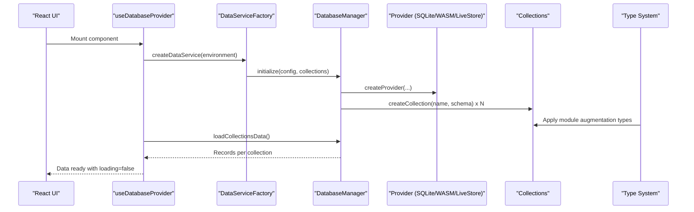

**Diagram sources**
- [useDatabaseProvider.ts:68-103](file://src/hooks/useDatabaseProvider.ts#L68-L103)
- [DataServiceFactory.ts:37-151](file://src/services/data/DataServiceFactory.ts#L37-L151)
- [ProviderSelector.ts:42-85](file://src/services/database/ProviderSelector.ts#L42-L85)
- [collections.ts:468-521](file://src/services/database/collections.ts#L468-L521)
- [app-data.ts:18-59](file://src/core/types/app-data.ts#L18-L59)

## Detailed Component Analysis

### Data Layer Configuration and Policies
- Provider configuration supports SQLite file, SQLite WASM with OPFS, PouchDB, and LiveStore.
- Backend integrations include ERPNext, CouchDB, PostgreSQL API, and custom API.
- Consolidated configuration options normalize provider/backend combinations for UI and runtime selection.

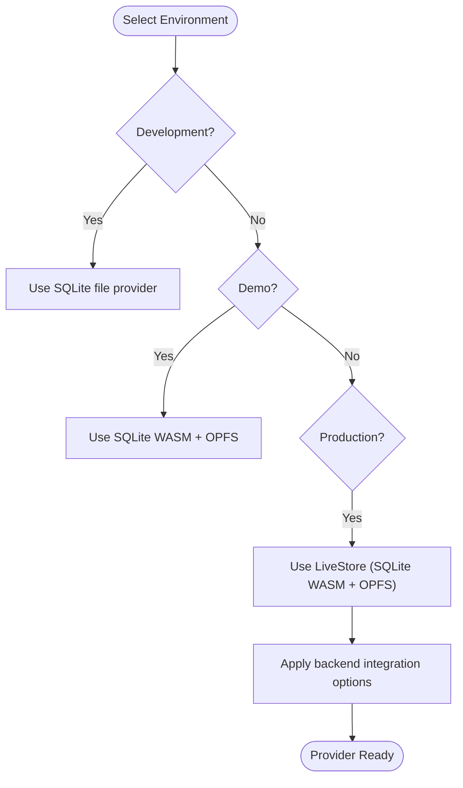

**Diagram sources**
- [dataLayerConfig.ts:56-236](file://src/config/dataLayerConfig.ts#L56-L236)

**Section sources**
- [dataLayerConfig.ts:56-236](file://src/config/dataLayerConfig.ts#L56-L236)

### Provider-Agnostic Collections and Schema Conversion
- Collections are defined centrally and exported for all modules.
- SchemaConverter transforms RxDB-style schemas into SQLite-compatible table definitions, generating indexes and relationships.
- DatabaseManager orchestrates collection creation across providers.

```mermaid
classDiagram
class Collections {
+Record<string, {schema}>
+coreCollectionNames
}
class SchemaConverter {
+convertAllCollections(map)
+generateSQLiteSchema()
+generateCreateTableSQL()
+generateCreateIndexSQL()
}
class DatabaseManager {
+initialize(config, collectionConfigs)
+getCollection(name)
+getAllCollections()
+backup()
+restore(data)
}
Collections --> SchemaConverter : "provides RxDB schemas"
SchemaConverter --> DatabaseManager : "produces SQLite schema"
```

**Diagram sources**
- [collections.ts:468-521](file://src/services/database/collections.ts#L468-L521)
- [SchemaConverter.ts:57-98](file://src/services/database/SchemaConverter.ts#L57-L98)
- [ProviderSelector.ts:31-127](file://src/services/database/ProviderSelector.ts#L31-L127)

**Section sources**
- [collections.ts:468-521](file://src/services/database/collections.ts#L468-L521)
- [SchemaConverter.ts:57-98](file://src/services/database/SchemaConverter.ts#L57-L98)
- [ProviderSelector.ts:31-127](file://src/services/database/ProviderSelector.ts#L31-L127)

### Data Service Factory and Initialization
- DataServiceFactory selects provider and requirements based on environment and user overrides.
- Initializes DatabaseManager with all 88+ collections and storage configuration.

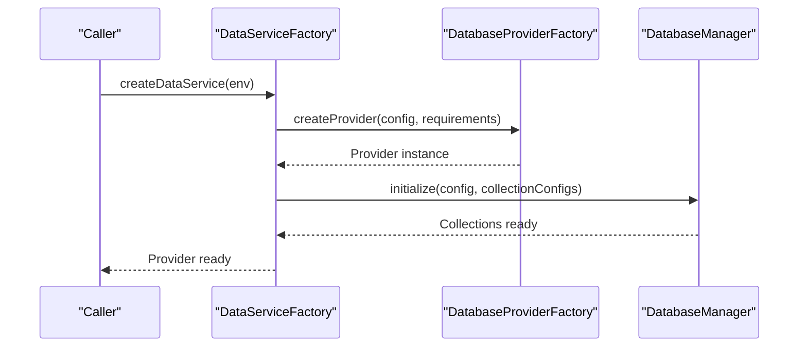

**Diagram sources**
- [DataServiceFactory.ts:37-151](file://src/services/data/DataServiceFactory.ts#L37-L151)
- [ProviderSelector.ts:42-85](file://src/services/database/ProviderSelector.ts#L42-L85)

**Section sources**
- [DataServiceFactory.ts:37-151](file://src/services/data/DataServiceFactory.ts#L37-L151)
- [ProviderSelector.ts:42-85](file://src/services/database/ProviderSelector.ts#L42-L85)

### React Integration: useDatabaseProvider Hook
- Initializes the data service, creates collections, migrates mock data, and loads initial data.
- Provides loading, error, and migration status states for UI rendering.

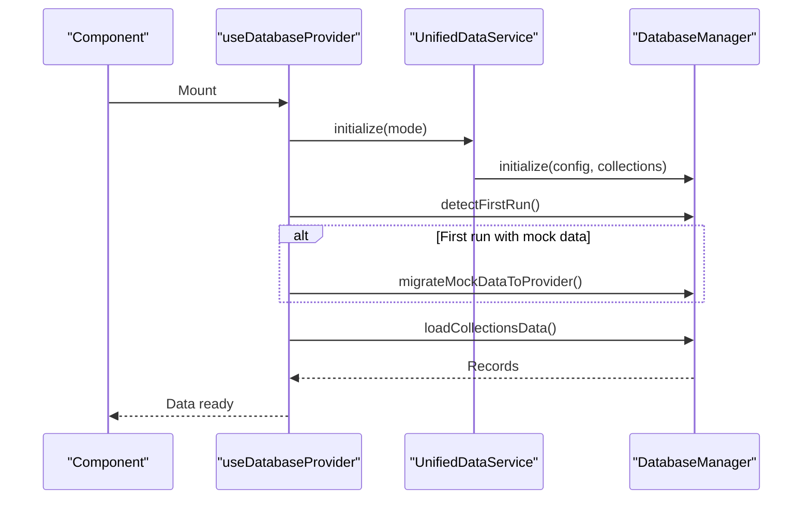

**Diagram sources**
- [useDatabaseProvider.ts:68-103](file://src/hooks/useDatabaseProvider.ts#L68-L103)
- [useDatabaseProvider.ts:147-176](file://src/hooks/useDatabaseProvider.ts#L147-L176)
- [useDatabaseProvider.ts:206-273](file://src/hooks/useDatabaseProvider.ts#L206-L273)
- [useDatabaseProvider.ts:338-367](file://src/hooks/useDatabaseProvider.ts#L338-L367)

**Section sources**
- [useDatabaseProvider.ts:48-103](file://src/hooks/useDatabaseProvider.ts#L48-L103)
- [useDatabaseProvider.ts:147-176](file://src/hooks/useDatabaseProvider.ts#L147-L176)
- [useDatabaseProvider.ts:206-273](file://src/hooks/useDatabaseProvider.ts#L206-L273)
- [useDatabaseProvider.ts:338-367](file://src/hooks/useDatabaseProvider.ts#L338-L367)

### Data Mode Management and Switching
- DataModeManager coordinates transitions between development, demo, and production modes.
- Supports optional backup, clearing, and seeding during mode switches.
- Emits events for UI updates and state synchronization.

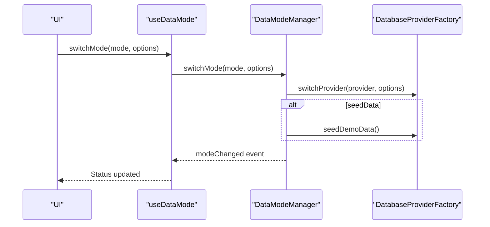

**Diagram sources**
- [useDataMode.ts:47-59](file://src/hooks/useDataMode.ts#L47-L59)
- [dataModeManager.ts:93-170](file://src/services/data/dataModeManager.ts#L93-L170)
- [dataModeManager.ts:255-272](file://src/services/data/dataModeManager.ts#L255-L272)

**Section sources**
- [useDataMode.ts:23-94](file://src/hooks/useDataMode.ts#L23-L94)
- [dataModeManager.ts:35-91](file://src/services/data/dataModeManager.ts#L35-L91)
- [dataModeManager.ts:93-170](file://src/services/data/dataModeManager.ts#L93-L170)
- [dataModeManager.ts:255-272](file://src/services/data/dataModeManager.ts#L255-L272)

### Network State and Offline Capabilities
- NetworkStateManager tracks online/offline status, backend health, and latency.
- In demo mode, treats the environment as online with good connectivity.
- Provides subscription for components to adapt UI and behavior to network conditions.

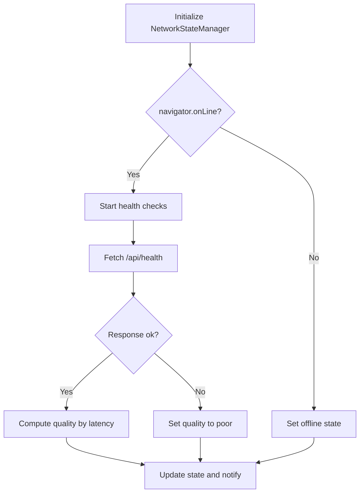

**Diagram sources**
- [NetworkStateManager.ts:21-60](file://src/services/data/NetworkStateManager.ts#L21-L60)
- [NetworkStateManager.ts:121-174](file://src/services/data/NetworkStateManager.ts#L121-L174)

**Section sources**
- [NetworkStateManager.ts:21-60](file://src/services/data/NetworkStateManager.ts#L21-L60)
- [NetworkStateManager.ts:121-174](file://src/services/data/NetworkStateManager.ts#L121-L174)

### Configuration Validation and Repair Utilities
- DatabaseConfigValidator enforces schema rules, auto-fixes issues, and migrates legacy configurations.
- Supports validation, auto-fix, migration, and repair workflows.

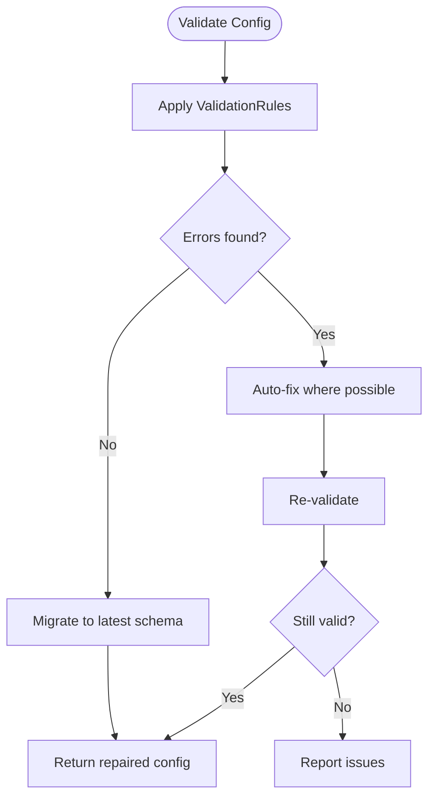

**Diagram sources**
- [databaseConfigSchema.ts:305-360](file://src/config/databaseConfigSchema.ts#L305-L360)
- [databaseConfigSchema.ts:384-410](file://src/config/databaseConfigSchema.ts#L384-L410)
- [databaseConfigSchema.ts:470-492](file://src/config/databaseConfigSchema.ts#L470-L492)

**Section sources**
- [databaseConfigSchema.ts:305-360](file://src/config/databaseConfigSchema.ts#L305-L360)
- [databaseConfigSchema.ts:384-410](file://src/config/databaseConfigSchema.ts#L384-L410)
- [databaseConfigSchema.ts:470-492](file://src/config/databaseConfigSchema.ts#L470-L492)

## Type System Modernization

### Base AppDataType Interface
The core type system has been dramatically simplified with the new modular architecture. The base AppDataType interface now contains only 51 lines of code, establishing the foundation for all module collections through TypeScript's declaration merging system.

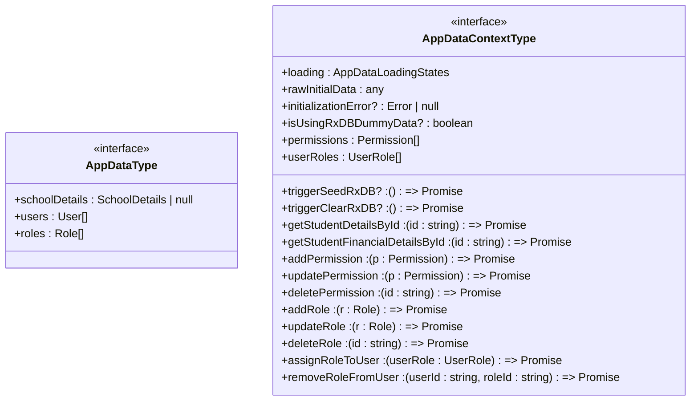

**Diagram sources**
- [app-data.ts:18-59](file://src/core/types/app-data.ts#L18-L59)

The AppDataType interface serves as the foundation that all modules extend through TypeScript's declaration merging system. This approach enables compile-time type safety while maintaining runtime flexibility, with the core system now reduced from 264 lines to just 51 lines. The comprehensive TypeScript declaration merging pattern spans 8 functional modules, each contributing specialized collections and operations.

**Section sources**
- [app-data.ts:18-59](file://src/core/types/app-data.ts#L18-L59)

### AppDataLoadingStates Type
The AppDataLoadingStates type automatically expands based on the current AppDataType interface. This ensures that loading states remain synchronized with the actual collections available in the system, now managed entirely through the module augmentation pattern.

**Section sources**
- [app-data.ts:25-31](file://src/core/types/app-data.ts#L25-L31)

### Circular Dependency Elimination
The new DependencyResolver system comprehensively addresses and eliminates circular dependencies that previously plagued the module system. This ensures stable module loading and prevents runtime conflicts across the 8 functional modules.

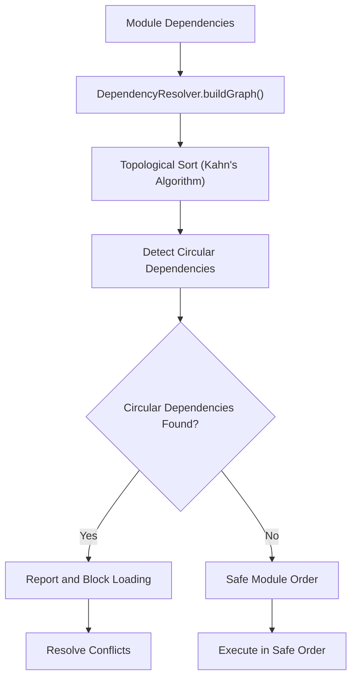

**Diagram sources**
- [DependencyResolver.ts:54-117](file://src/core/DependencyResolver.ts#L54-L117)
- [DependencyResolver.ts:122-158](file://src/core/DependencyResolver.ts#L122-L158)

**Section sources**
- [DependencyResolver.ts:19-252](file://src/core/DependencyResolver.ts#L19-L252)

## Module Augmentation Pattern

### Frappe-Style Self-Registration
Modules implement self-registration through TypeScript declaration merging, creating a Frappe-like DocType self-registration system for data collections. Each module augments the AppDataType and AppDataContextType interfaces with its specific collections and operations, eliminating the need for core file modifications.

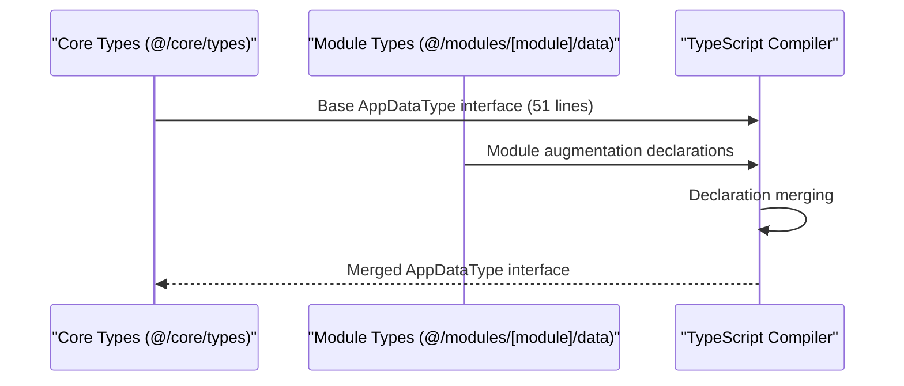

**Diagram sources**
- [app-data.ts:8-17](file://src/core/types/app-data.ts#L8-L17)
- [appDataAugmentation.ts:19-60](file://src/modules/academics/data/appDataAugmentation.ts#L19-L60)

### Module-Specific Augmentation Examples
Different modules demonstrate the augmentation pattern with varying complexity levels:

**Academics Module**: Extensive collection augmentation with comprehensive CRUD operations for 11 collections
**Finance Module**: Complex financial collection management with specialized reporting collections for 20+ entities  
**Administration Module**: Core educational entity management with administrative functions for 25+ collections

The comprehensive TypeScript declaration merging pattern spans 8 functional modules, each contributing specialized collections and operations while maintaining type safety through declaration merging.

**Section sources**
- [appDataAugmentation.ts:19-60](file://src/modules/academics/data/appDataAugmentation.ts#L19-L60)
- [appDataAugmentation.ts:38-97](file://src/modules/finance/data/appDataAugmentation.ts#L38-L97)
- [appDataAugmentation.ts:29-125](file://src/modules/administration/data/appDataAugmentation.ts#L29-L125)

### Module Collections Configuration
Each module provides a collection configuration that defines its database collections and their TypeScript interface mappings. This configuration enables the auto-discovery system to understand module boundaries and maintain type safety.

**Section sources**
- [collectionConfig.ts:13-55](file://src/modules/finance/data/collectionConfig.ts#L13-L55)
- [collectionConfig.ts:4-61](file://src/modules/administration/data/collectionConfig.ts#L4-L61)

## Auto-Discovery System

### Module Collection Registry
The auto-discovery system eliminates the need for manual collection management by automatically aggregating module configurations. The registry imports all module collection configs and generates consolidated type information, replacing the previous hardcoded approach.

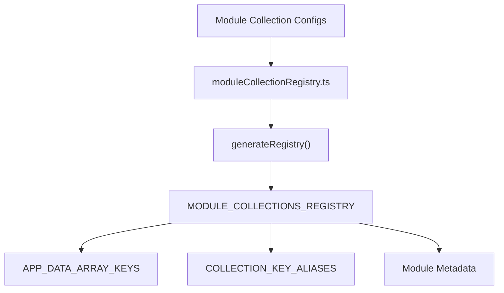

**Diagram sources**
- [moduleCollectionRegistry.ts:11-84](file://src/contexts/appData/moduleCollectionRegistry.ts#L11-L84)

### Collection Alias Mapping
The system maintains bidirectional mappings between database collection names (snake_case) and TypeScript interface keys (camelCase). This ensures consistency across the entire data layer while enabling automatic type generation.

**Section sources**
- [moduleCollections.ts:9](file://src/core/types/moduleCollections.ts#L9)
- [moduleCollections.ts:24](file://src/core/types/moduleCollections.ts#L24)

### Runtime Integration
The auto-discovery system integrates seamlessly with the existing AppDataContext, providing the same interface while eliminating manual maintenance overhead. The system now handles 8 functional modules with their respective collection configurations automatically.

**Section sources**
- [appDataCollections.ts:21-22](file://src/contexts/appData/appDataCollections.ts#L21-L22)

## Dependency Analysis
- Configuration drives provider selection and options.
- Factory depends on provider factory to instantiate the active provider.
- DatabaseManager encapsulates provider operations and collection lifecycle.
- Hooks depend on factory and manager for initialization and data loading.
- DataModeManager coordinates environment transitions and seeds data when needed.
- NetworkStateManager informs UI behavior without coupling to providers.
- **New**: Type system depends on module augmentation declarations for compile-time type safety.
- **New**: Auto-discovery system aggregates module configurations for runtime type information.
- **New**: Core system reduced from 264 lines to 51 lines, with all collection definitions moved to modules.
- **New**: DependencyResolver prevents circular dependencies and ensures stable module loading order.

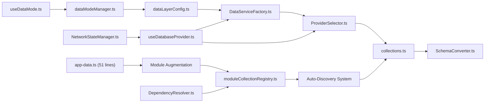

**Diagram sources**
- [dataLayerConfig.ts:56-236](file://src/config/dataLayerConfig.ts#L56-L236)
- [DataServiceFactory.ts:37-151](file://src/services/data/DataServiceFactory.ts#L37-L151)
- [ProviderSelector.ts:31-127](file://src/services/database/ProviderSelector.ts#L31-L127)
- [collections.ts:468-521](file://src/services/database/collections.ts#L468-L521)
- [SchemaConverter.ts:57-98](file://src/services/database/SchemaConverter.ts#L57-L98)
- [useDatabaseProvider.ts:48-103](file://src/hooks/useDatabaseProvider.ts#L48-L103)
- [useDataMode.ts:23-94](file://src/hooks/useDataMode.ts#L23-L94)
- [dataModeManager.ts:35-91](file://src/services/data/dataModeManager.ts#L35-L91)
- [NetworkStateManager.ts:21-60](file://src/services/data/NetworkStateManager.ts#L21-L60)
- [app-data.ts:18-59](file://src/core/types/app-data.ts#L18-L59)
- [moduleCollectionRegistry.ts:1-120](file://src/contexts/appData/moduleCollectionRegistry.ts#L1-L120)
- [DependencyResolver.ts:19-252](file://src/core/DependencyResolver.ts#L19-L252)

**Section sources**
- [dataLayerConfig.ts:56-236](file://src/config/dataLayerConfig.ts#L56-L236)
- [DataServiceFactory.ts:37-151](file://src/services/data/DataServiceFactory.ts#L37-L151)
- [ProviderSelector.ts:31-127](file://src/services/database/ProviderSelector.ts#L31-L127)
- [collections.ts:468-521](file://src/services/database/collections.ts#L468-L521)
- [SchemaConverter.ts:57-98](file://src/services/database/SchemaConverter.ts#L57-L98)
- [useDatabaseProvider.ts:48-103](file://src/hooks/useDatabaseProvider.ts#L48-L103)
- [useDataMode.ts:23-94](file://src/hooks/useDataMode.ts#L23-L94)
- [dataModeManager.ts:35-91](file://src/services/data/dataModeManager.ts#L35-L91)
- [NetworkStateManager.ts:21-60](file://src/services/data/NetworkStateManager.ts#L21-L60)
- [app-data.ts:18-59](file://src/core/types/app-data.ts#L18-L59)
- [moduleCollectionRegistry.ts:1-120](file://src/contexts/appData/moduleCollectionRegistry.ts#L1-L120)
- [DependencyResolver.ts:19-252](file://src/core/DependencyResolver.ts#L19-L252)

## Performance Considerations
- Caching: UnifiedDataService maintains a lightweight in-memory cache with TTL for query results.
- Batch operations: Bulk APIs are exposed for efficient writes and updates.
- Indexing: SchemaConverter generates indexes from collection definitions to optimize queries.
- Storage quotas: Requirements specify storage quotas per environment to manage disk usage.
- Offline-first: LiveStore with OPFS ensures responsive UI even when offline.
- **New**: Type system optimizations: Module augmentation enables better tree-shaking and reduces bundle size by only including necessary collection types.
- **New**: Core system performance: Reduced from 264 lines to 51 lines significantly improves compilation performance and reduces memory footprint.
- **New**: Circular dependency prevention: DependencyResolver eliminates runtime conflicts and improves stability.

## Troubleshooting Guide
Common issues and resolutions:
- Initialization failures: Verify provider configuration and environment variables; use DatabaseConfigValidator to auto-fix and migrate.
- Migration errors: Confirm mock data readiness and collection existence; inspect migration status in the hook.
- Mode switching problems: Ensure required tokens for production data clearing; listen to mode manager events.
- Network state confusion: In demo mode, backend health checks are disabled; rely on online/offline events.
- **New**: Module augmentation issues: Ensure module augmentation files are properly imported and compiled; check that collection configs match interface definitions.
- **New**: Auto-discovery failures: Verify module collection configs are correctly exported and imported in the registry; check for circular dependencies.
- **New**: Core system issues: With the core reduced to 51 lines, verify that all module augmentation files are properly declared and accessible.
- **New**: Circular dependency conflicts: Use DependencyResolver to identify and resolve module loading conflicts before they cause runtime issues.

**Section sources**
- [databaseConfigSchema.ts:305-360](file://src/config/databaseConfigSchema.ts#L305-L360)
- [useDatabaseProvider.ts:147-176](file://src/hooks/useDatabaseProvider.ts#L147-L176)
- [dataModeManager.ts:172-253](file://src/services/data/dataModeManager.ts#L172-L253)
- [NetworkStateManager.ts:43-83](file://src/services/data/NetworkStateManager.ts#L43-L83)
- [moduleCollectionRegistry.ts:114-119](file://src/contexts/appData/moduleCollectionRegistry.ts#L114-L119)
- [DependencyResolver.ts:122-158](file://src/core/DependencyResolver.ts#L122-L158)

## Conclusion
SchoolPilot3's data layer provides a robust, provider-agnostic foundation for development, demo, and production. The dual-mode strategy with SQLite OPFS and LiveStore enables rapid iteration while maintaining production-grade offline and persistence characteristics. The comprehensive refactoring to use a Frappe-style module augmentation pattern represents a major architectural improvement, reducing the core system from 264 lines to 51 lines while maintaining compile-time type safety. The auto-discovery system further simplifies module integration and ensures consistency across the entire data layer. The elimination of circular dependencies through DependencyResolver ensures stable module loading and prevents runtime conflicts. The centralized configuration, schema abstraction, and factory-driven initialization continue to simplify integration and upgrades, while the modernized type system provides better developer experience and maintainability. This transformation demonstrates the power of TypeScript's declaration merging capabilities in creating scalable, maintainable data architectures.