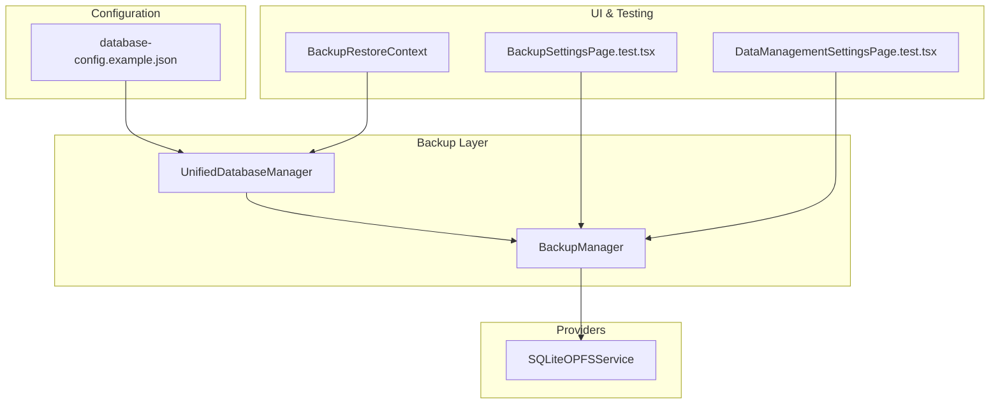
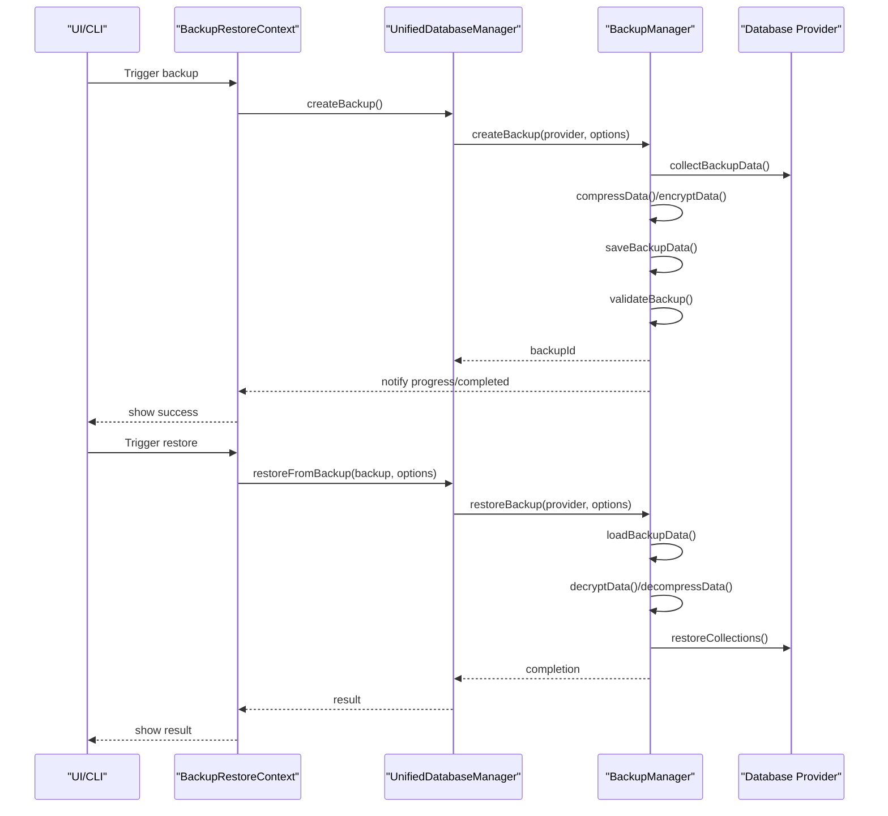
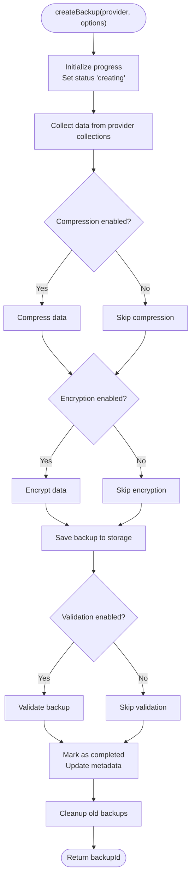
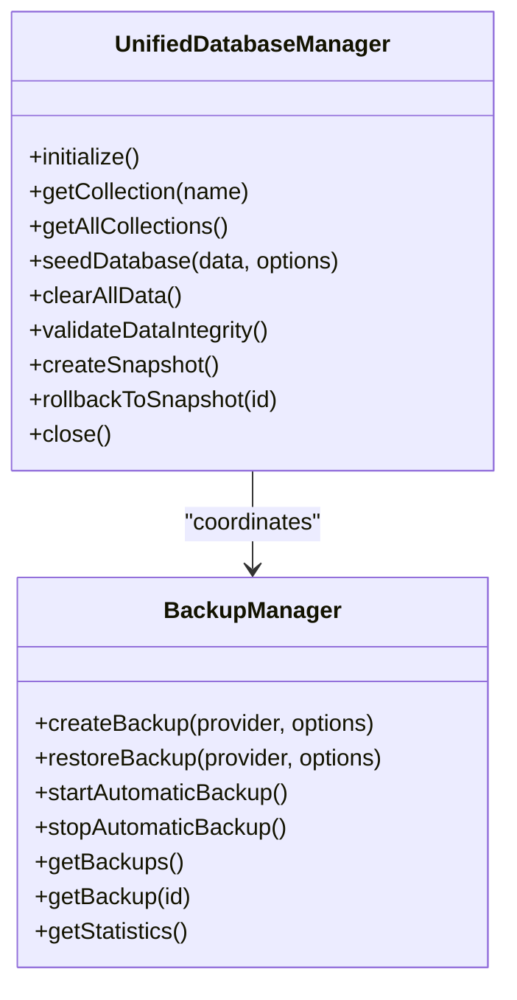
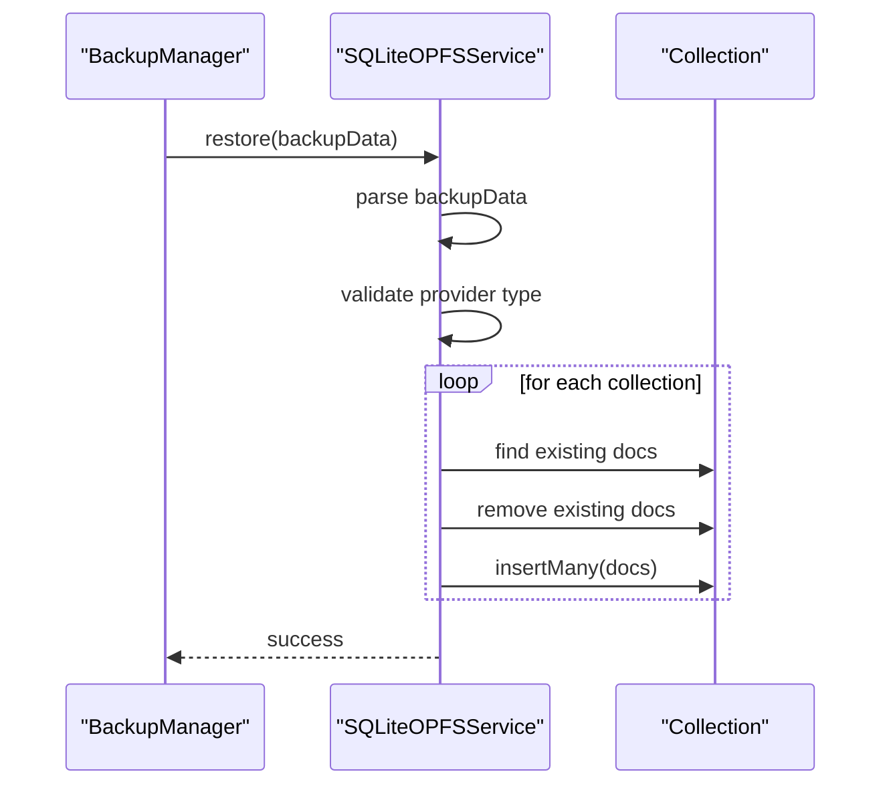
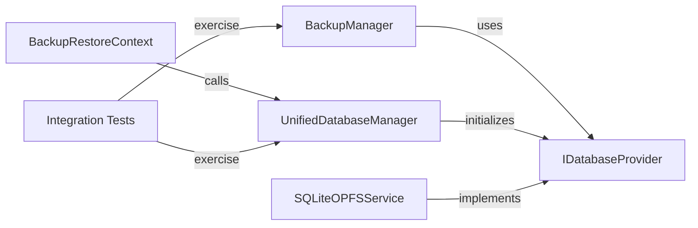

# Backup and Restore Procedures

<cite>
**Referenced Files in This Document**
- [database-config.example.json](file://public/database-config.example.json)
- [docs/database/README.md](file://docs/database/README.md)
- [src/services/database/BackupManager.ts](file://src/services/database/BackupManager.ts)
- [src/services/database/UnifiedDatabaseManager.ts](file://src/services/database/UnifiedDatabaseManager.ts)
- [src/services/sqlite/SQLiteOPFSService.ts](file://src/services/sqlite/SQLiteOPFSService.ts)
- [src/services/database/__tests__/EndToEndWorkflows.test.ts](file://src/services/database/__tests__/EndToEndWorkflows.test.ts)
- [src/tests/integration/BackupSettingsPage.test.tsx](file://src/tests/integration/BackupSettingsPage.test.tsx)
- [src/tests/integration/DataManagementSettingsPage.test.tsx](file://src/tests/integration/DataManagementSettingsPage.test.tsx)
- [src/contexts/appData/BackupRestoreContext.tsx](file://src/contexts/appData/BackupRestoreContext.tsx)
</cite>

## Table of Contents
1. [Introduction](#introduction)
2. [Project Structure](#project-structure)
3. [Core Components](#core-components)
4. [Architecture Overview](#architecture-overview)
5. [Detailed Component Analysis](#detailed-component-analysis)
6. [Dependency Analysis](#dependency-analysis)
7. [Performance Considerations](#performance-considerations)
8. [Troubleshooting Guide](#troubleshooting-guide)
9. [Conclusion](#conclusion)
10. [Appendices](#appendices)

## Introduction
This document provides comprehensive backup and restore procedures for SchoolPilot3. It covers automated backup creation, backup file formats and storage strategies, restore workflows, data integrity verification, and rollback procedures. It also explains backup scheduling, incremental backup capabilities, disaster recovery protocols, and step-by-step procedures for manual backups, restore testing, and emergency recovery scenarios. Finally, it outlines backup encryption, compression options, and cross-platform compatibility considerations.

## Project Structure
SchoolPilot3 implements a provider-agnostic database architecture with a centralized backup and restore system. The backup subsystem integrates with the Unified Database Manager and provider-specific implementations to support multiple deployment modes (development, staging, production). Configuration-driven features enable compression, encryption, and retention policies.

**Diagram sources**
- [database-config.example.json:1-49](file://public/database-config.example.json#L1-L49)
- [src/services/database/BackupManager.ts:1-608](file://src/services/database/BackupManager.ts#L1-L608)
- [src/services/database/UnifiedDatabaseManager.ts:1-800](file://src/services/database/UnifiedDatabaseManager.ts#L1-L800)
- [src/services/sqlite/SQLiteOPFSService.ts:833-868](file://src/services/sqlite/SQLiteOPFSService.ts#L833-L868)
- [src/contexts/appData/BackupRestoreContext.tsx:1-70](file://src/contexts/appData/BackupRestoreContext.tsx#L1-L70)
- [src/tests/integration/BackupSettingsPage.test.tsx:482-525](file://src/tests/integration/BackupSettingsPage.test.tsx#L482-L525)
- [src/tests/integration/DataManagementSettingsPage.test.tsx:384-425](file://src/tests/integration/DataManagementSettingsPage.test.tsx#L384-L425)

**Section sources**
- [database-config.example.json:1-49](file://public/database-config.example.json#L1-L49)
- [docs/database/README.md:1-481](file://docs/database/README.md#L1-L481)

## Core Components
- BackupManager: Orchestrates backup creation, compression, encryption, saving, validation, and restore operations. Supports scheduled backups and progress tracking.
- UnifiedDatabaseManager: Central database manager that coordinates provider selection, collection lifecycle, and backup/restore coordination.
- SQLiteOPFSService: Provider-specific implementation for restoring backups into the SQLite OPFS provider.
- BackupRestoreContext: React context providing backup and restore actions integrated with UI notifications.
- Configuration: database-config.example.json defines provider selection, performance, storage, sync, monitoring, and feature flags including backup settings.

Key backup configuration options include:
- Compression and encryption toggles
- Retention days
- Backup scheduling interval
- Provider-specific backup metadata and restoration logic

**Section sources**
- [src/services/database/BackupManager.ts:1-608](file://src/services/database/BackupManager.ts#L1-L608)
- [src/services/database/UnifiedDatabaseManager.ts:1-800](file://src/services/database/UnifiedDatabaseManager.ts#L1-L800)
- [src/services/sqlite/SQLiteOPFSService.ts:833-868](file://src/services/sqlite/SQLiteOPFSService.ts#L833-L868)
- [src/contexts/appData/BackupRestoreContext.tsx:1-70](file://src/contexts/appData/BackupRestoreContext.tsx#L1-L70)
- [database-config.example.json:1-49](file://public/database-config.example.json#L1-L49)
- [docs/database/README.md:98-124](file://docs/database/README.md#L98-L124)

## Architecture Overview
The backup and restore architecture is provider-agnostic and consists of:
- Configuration-driven backup policy
- BackupManager orchestrating stages: collecting, compressing, encrypting, saving, validating
- Provider-specific restore implementations
- UI integration via BackupRestoreContext
- Automated backup scheduling and statistics

**Diagram sources**
- [src/contexts/appData/BackupRestoreContext.tsx:19-56](file://src/contexts/appData/BackupRestoreContext.tsx#L19-L56)
- [src/services/database/UnifiedDatabaseManager.ts:1518-1577](file://src/services/database/UnifiedDatabaseManager.ts#L1518-L1577)
- [src/services/database/BackupManager.ts:136-302](file://src/services/database/BackupManager.ts#L136-L302)
- [src/services/sqlite/SQLiteOPFSService.ts:833-868](file://src/services/sqlite/SQLiteOPFSService.ts#L833-L868)

## Detailed Component Analysis

### BackupManager
Responsibilities:
- Backup creation pipeline with progress tracking
- Compression and encryption stages
- Backup validation and integrity checks
- Restore orchestration with pre-restore backup option
- Automatic backup scheduling and cleanup
- Statistics and metadata management

Backup stages:
1. Initializing
2. Collecting data from collections
3. Compressing (optional)
4. Encrypting (optional)
5. Saving backup
6. Validating backup
7. Completed

Restore stages:
- Load backup data
- Optional pre-restore backup
- Optional validation
- Decrypt and decompress if needed
- Restore collections with batching

**Diagram sources**
- [src/services/database/BackupManager.ts:136-255](file://src/services/database/BackupManager.ts#L136-L255)

**Section sources**
- [src/services/database/BackupManager.ts:1-608](file://src/services/database/BackupManager.ts#L1-L608)

### UnifiedDatabaseManager
Responsibilities:
- Provider selection and initialization
- Collection lifecycle management
- Backup orchestration and restore coordination
- Health monitoring and diagnostics
- Snapshot creation and rollback support

Backup/restore integration:
- Creates backups with metadata and collection counts
- Restores from backup with optional clearing and progress callbacks
- Validates backup format and provider compatibility

**Diagram sources**
- [src/services/database/UnifiedDatabaseManager.ts:263-275](file://src/services/database/UnifiedDatabaseManager.ts#L263-L275)
- [src/services/database/BackupManager.ts:524-567](file://src/services/database/BackupManager.ts#L524-L567)

**Section sources**
- [src/services/database/UnifiedDatabaseManager.ts:1-800](file://src/services/database/UnifiedDatabaseManager.ts#L1-L800)

### Provider-Specific Restore: SQLiteOPFSService
Implements restore logic for the SQLite OPFS provider:
- Validates backup provider type
- Clears existing data in target collections
- Inserts backed-up documents in batches
- Throws structured errors on failure

**Diagram sources**
- [src/services/sqlite/SQLiteOPFSService.ts:833-868](file://src/services/sqlite/SQLiteOPFSService.ts#L833-L868)

**Section sources**
- [src/services/sqlite/SQLiteOPFSService.ts:833-868](file://src/services/sqlite/SQLiteOPFSService.ts#L833-L868)

### UI Integration: BackupRestoreContext
Provides React hooks for backup and restore operations:
- backupData(): Triggers backup via UnifiedDatabaseManager and shows notifications
- restoreData(backup): Restores backup with clearExisting and data change callbacks
- clearAllData(): Clears all data and notifies listeners

**Section sources**
- [src/contexts/appData/BackupRestoreContext.tsx:1-70](file://src/contexts/appData/BackupRestoreContext.tsx#L1-L70)

### Configuration and Storage Strategy
The configuration file defines:
- Provider selection and performance tuning
- Storage settings including compression, encryption, backup enablement, and retention
- Sync and monitoring configurations
- Feature flags for full-text search, transactions, offline mode, and audit logging

Storage strategy:
- Backups are saved to a configurable path
- Metadata tracks size, record counts, checksums, and status
- Automatic cleanup removes backups exceeding retention limits

**Section sources**
- [database-config.example.json:1-49](file://public/database-config.example.json#L1-L49)
- [docs/database/README.md:197-259](file://docs/database/README.md#L197-L259)

## Dependency Analysis
- BackupManager depends on IDatabaseProvider to enumerate and read collections
- UnifiedDatabaseManager selects and initializes providers, coordinating backup/restore
- SQLiteOPFSService implements provider-specific restore logic
- BackupRestoreContext integrates UI actions with database manager
- Tests validate backup creation, download, and end-to-end restore workflows

**Diagram sources**
- [src/services/database/BackupManager.ts:3-50](file://src/services/database/BackupManager.ts#L3-L50)
- [src/services/database/UnifiedDatabaseManager.ts:1-16](file://src/services/database/UnifiedDatabaseManager.ts#L1-L16)
- [src/services/sqlite/SQLiteOPFSService.ts:833-868](file://src/services/sqlite/SQLiteOPFSService.ts#L833-L868)
- [src/contexts/appData/BackupRestoreContext.tsx:19-56](file://src/contexts/appData/BackupRestoreContext.tsx#L19-L56)
- [src/tests/integration/BackupSettingsPage.test.tsx:482-525](file://src/tests/integration/BackupSettingsPage.test.tsx#L482-L525)
- [src/tests/integration/DataManagementSettingsPage.test.tsx:384-425](file://src/tests/integration/DataManagementSettingsPage.test.tsx#L384-L425)

**Section sources**
- [src/services/database/BackupManager.ts:1-608](file://src/services/database/BackupManager.ts#L1-L608)
- [src/services/database/UnifiedDatabaseManager.ts:1-800](file://src/services/database/UnifiedDatabaseManager.ts#L1-L800)
- [src/services/sqlite/SQLiteOPFSService.ts:833-868](file://src/services/sqlite/SQLiteOPFSService.ts#L833-L868)
- [src/contexts/appData/BackupRestoreContext.tsx:1-70](file://src/contexts/appData/BackupRestoreContext.tsx#L1-L70)
- [src/tests/integration/BackupSettingsPage.test.tsx:482-525](file://src/tests/integration/BackupSettingsPage.test.tsx#L482-L525)
- [src/tests/integration/DataManagementSettingsPage.test.tsx:384-425](file://src/tests/integration/DataManagementSettingsPage.test.tsx#L384-L425)

## Performance Considerations
- Batched restore operations reduce memory pressure and improve throughput
- Compression and encryption add CPU overhead; enable based on storage vs. performance trade-offs
- Automatic backup scheduling should align with workload patterns to minimize impact
- Collection filtering allows targeted backups to reduce overhead
- Progress tracking enables monitoring and alerting during long-running operations

[No sources needed since this section provides general guidance]

## Troubleshooting Guide
Common issues and resolutions:
- Backup failures: Check disk space, permissions, and database locks; review backup configuration and logs
- Restore failures: Validate backup integrity, confirm provider compatibility, and ensure sufficient resources
- Performance issues: Monitor query optimization, add indexes, and adjust connection pool settings
- Memory leaks: Enable memory monitoring, close connections, and review cleanup policies

Debugging tips:
- Enable debug logging via localStorage or environment variables
- Use monitoring dashboards to identify bottlenecks
- Validate backup metadata and checksums

**Section sources**
- [docs/database/README.md:319-373](file://docs/database/README.md#L319-L373)

## Conclusion
SchoolPilot3 provides a robust, provider-agnostic backup and restore system with configurable compression, encryption, and retention. The architecture supports automated scheduling, progress tracking, and provider-specific restoration. Configuration-driven policies and comprehensive testing ensure reliability across development, staging, and production environments.

[No sources needed since this section summarizes without analyzing specific files]

## Appendices

### Step-by-Step Manual Backup Procedure
1. Open the Backup settings page in the UI.
2. Confirm the backup instructions and click the “Create Database Backup” action.
3. The system collects data from all collections, optionally compresses and encrypts it, saves it to storage, and validates the backup.
4. Download the generated backup file when prompted.

**Section sources**
- [src/tests/integration/BackupSettingsPage.test.tsx:482-525](file://src/tests/integration/BackupSettingsPage.test.tsx#L482-L525)
- [src/tests/integration/DataManagementSettingsPage.test.tsx:384-425](file://src/tests/integration/DataManagementSettingsPage.test.tsx#L384-L425)
- [src/contexts/appData/BackupRestoreContext.tsx:19-32](file://src/contexts/appData/BackupRestoreContext.tsx#L19-L32)

### Restore Workflow and Data Integrity Verification
1. Trigger restore from the UI or programmatically via BackupRestoreContext.
2. Optionally create a pre-restore backup for rollback protection.
3. Load and validate backup data, then decrypt and decompress if needed.
4. Restore collections with batching and clear existing data if requested.
5. Verify restoration by counting records and checking metadata.

**Section sources**
- [src/contexts/appData/BackupRestoreContext.tsx:34-56](file://src/contexts/appData/BackupRestoreContext.tsx#L34-L56)
- [src/services/database/BackupManager.ts:257-302](file://src/services/database/BackupManager.ts#L257-L302)
- [src/services/database/UnifiedDatabaseManager.ts:1518-1577](file://src/services/database/UnifiedDatabaseManager.ts#L1518-L1577)
- [src/services/sqlite/SQLiteOPFSService.ts:833-868](file://src/services/sqlite/SQLiteOPFSService.ts#L833-L868)
- [src/services/database/__tests__/EndToEndWorkflows.test.ts:178-215](file://src/services/database/__tests__/EndToEndWorkflows.test.ts#L178-L215)

### Backup Scheduling and Retention
- Enable automatic backups and configure the interval via BackupManager configuration.
- Set retention days in the configuration to control cleanup of old backups.
- Statistics provide insights into backup volume, frequency, and sizes.

**Section sources**
- [src/services/database/BackupManager.ts:104-134](file://src/services/database/BackupManager.ts#L104-L134)
- [database-config.example.json:12-18](file://public/database-config.example.json#L12-L18)
- [docs/database/README.md:98-124](file://docs/database/README.md#L98-L124)

### Incremental Backup Capabilities
- The current implementation focuses on full backups with collection enumeration and restoration.
- Incremental backup logic can be extended by tracking changed records per collection and merging deltas during restore.

[No sources needed since this section provides general guidance]

### Disaster Recovery Protocols
- Maintain multiple recent backups with retention aligned to RPO/RTO objectives.
- Test restore procedures regularly and validate data integrity after restoration.
- Use pre-restore backups to enable immediate rollback in case of failed restores.

**Section sources**
- [docs/database/README.md:453-459](file://docs/database/README.md#L453-L459)

### Backup Encryption and Compression Options
- Compression and encryption toggles are configurable in the database configuration.
- Encryption keys can be supplied via configuration for secure backups.
- Compression reduces storage footprint at the cost of CPU cycles.

**Section sources**
- [database-config.example.json:12-18](file://public/database-config.example.json#L12-L18)
- [src/services/database/BackupManager.ts:5-16](file://src/services/database/BackupManager.ts#L5-L16)

### Cross-Platform Compatibility Considerations
- Provider selection adapts to deployment mode (development, staging, production).
- SQLite OPFS provider supports browser-based persistence with OPFS.
- Backend API provider enables cloud-based deployments with sync and conflict resolution.

**Section sources**
- [docs/database/README.md:20-26](file://docs/database/README.md#L20-L26)
- [src/services/database/UnifiedDatabaseManager.ts:222-316](file://src/services/database/UnifiedDatabaseManager.ts#L222-L316)
- [src/services/sqlite/SQLiteOPFSService.ts:817-843](file://src/services/sqlite/SQLiteOPFSService.ts#L817-L843)