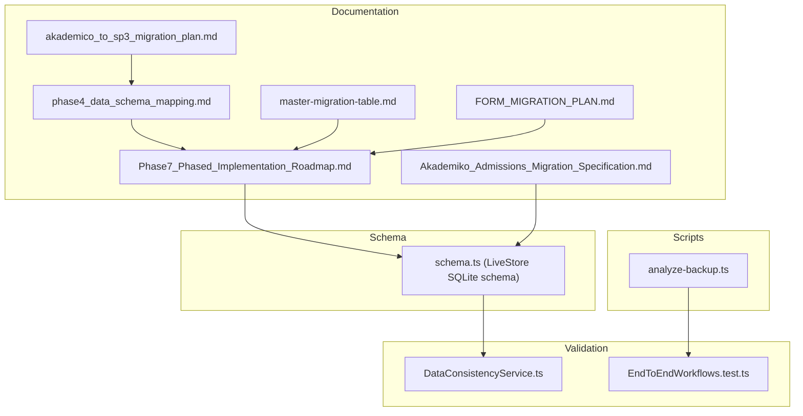
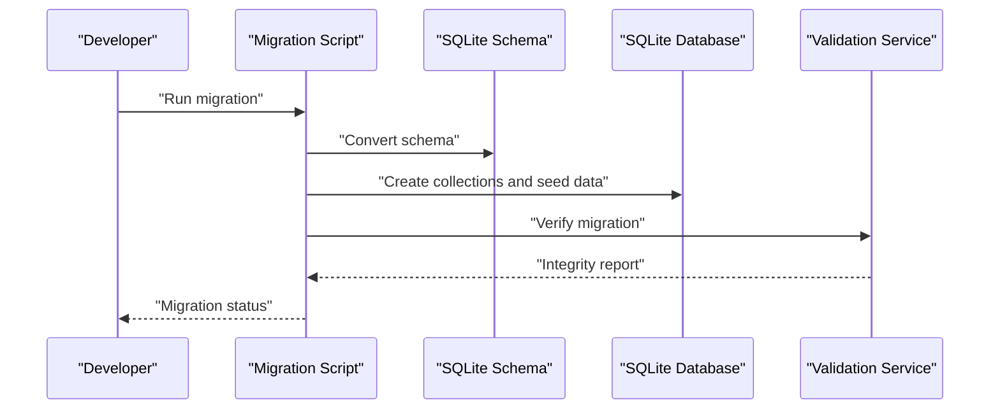
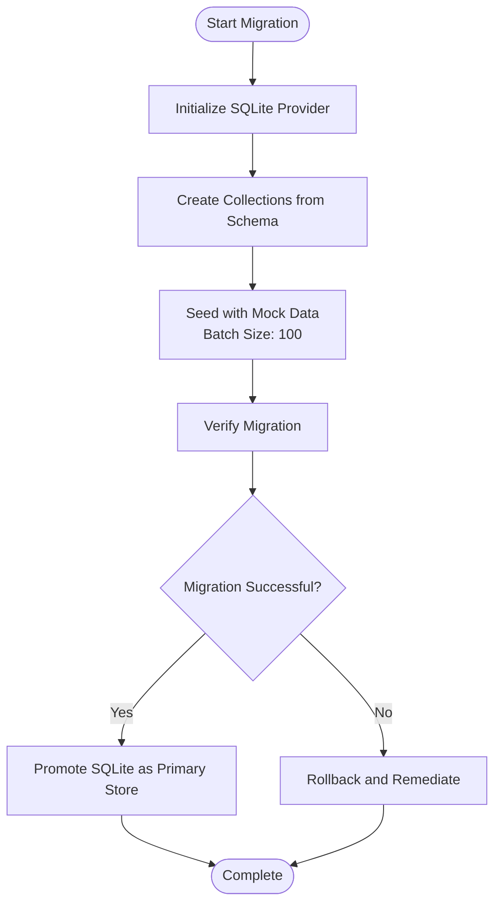
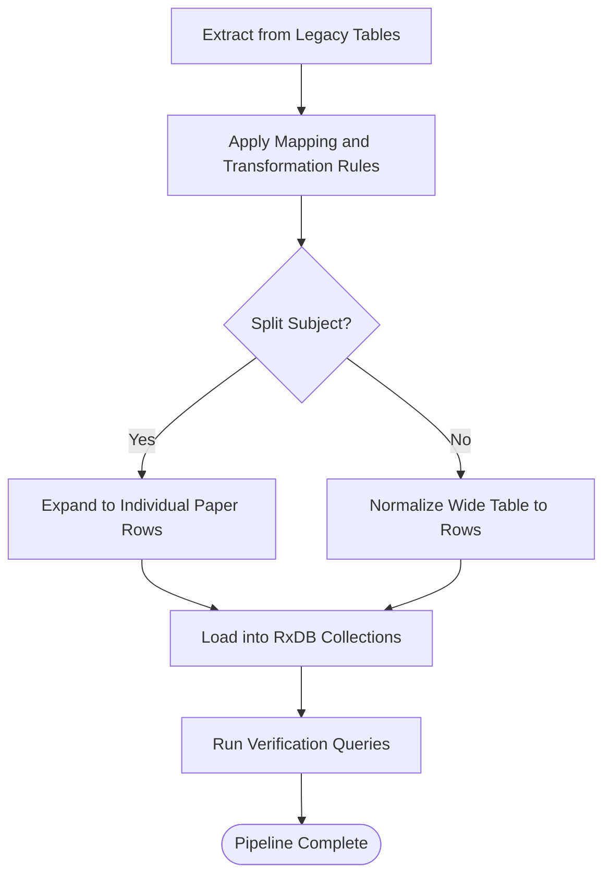
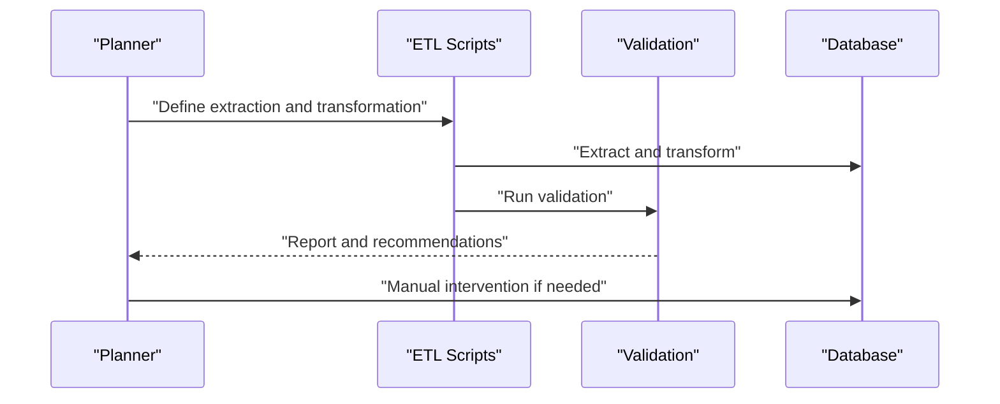
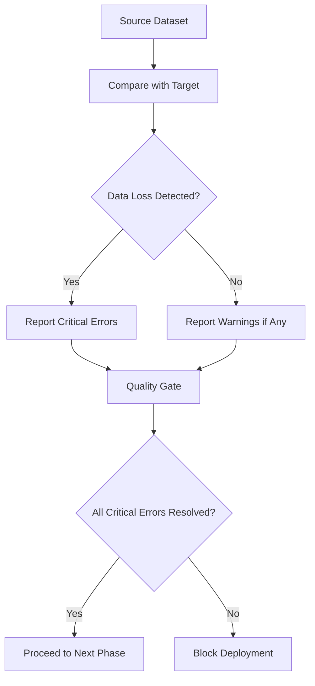
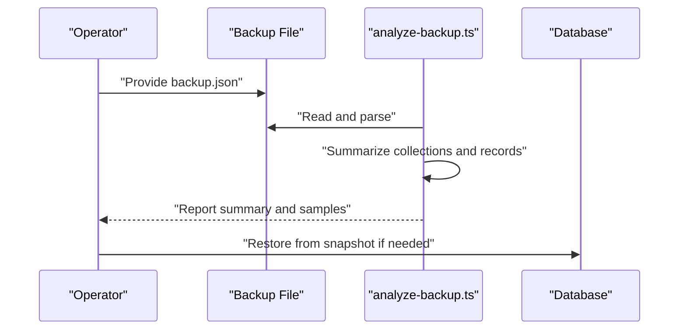
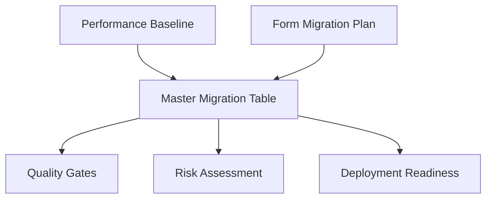
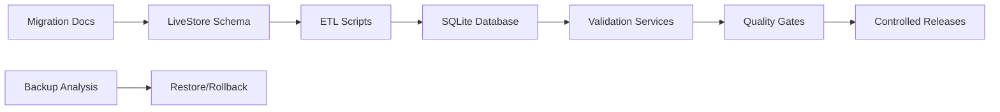

# Data Migration Strategies

<cite>
**Referenced Files in This Document**
- [data-migration-process.md](file://docs/database/data-migration-process.md)
- [analyze-backup.ts](file://src/scripts/data-migration/analyze-backup.ts)
- [schema.ts](file://src/livestore/schema.ts)
- [akademico_to_sp3_migration_plan.md](file://docs/migration/akademico_to_sp3_migration_plan.md)
- [phase4_data_schema_mapping.md](file://docs/migration/academics-migration/phase4_data_schema_mapping.md)
- [Phase7_Phased_Implementation_Roadmap.md](file://docs/migration/academics-migration/Phase7_Phased_Implementation_Roadmap.md)
- [Akademiko_Admissions_Migration_Specification.md](file://docs/migration/admissions-migration/Akademiko_Admissions_Migration_Specification.md)
- [master-migration-table.md](file://docs/migration/master-migration-table.md)
- [FORM_MIGRATION_PLAN.md](file://docs/migration/FORM_MIGRATION_PLAN.md)
- [DataConsistencyService.ts](file://src/services/consistency/DataConsistencyService.ts)
- [EndToEndWorkflows.test.ts](file://src/services/database/__tests__/EndToEndWorkflows.test.ts)
</cite>

## Table of Contents
1. [Introduction](#introduction)
2. [Project Structure](#project-structure)
3. [Core Components](#core-components)
4. [Architecture Overview](#architecture-overview)
5. [Detailed Component Analysis](#detailed-component-analysis)
6. [Dependency Analysis](#dependency-analysis)
7. [Performance Considerations](#performance-considerations)
8. [Troubleshooting Guide](#troubleshooting-guide)
9. [Conclusion](#conclusion)
10. [Appendices](#appendices)

## Introduction
This document explains SchoolPilot3’s data migration strategies and processes, focusing on the phased approach from mock data to persistent storage, schema evolution patterns, and backward compatibility maintenance. It documents the migration scripts architecture, automated workflows, manual intervention procedures, schema conversion, transformation pipelines, validation checkpoints, backup and restore, rollback strategies, disaster recovery, testing frameworks, and performance impact mitigation during large-scale migrations.

## Project Structure
The migration strategy spans documentation, schema definitions, ETL scripts, and validation utilities:
- Documentation drives the migration plan, schema mapping, and phased roadmap.
- LiveStore schema defines SQLite-compatible tables and events.
- ETL and transformation scripts implement extract, transform, and load logic.
- Validation services and tests enforce data integrity and rollback readiness.

**Diagram sources**
- [akademico_to_sp3_migration_plan.md:1-44](file://docs/migration/akademico_to_sp3_migration_plan.md#L1-L44)
- [phase4_data_schema_mapping.md:124-235](file://docs/migration/academics-migration/phase4_data_schema_mapping.md#L124-L235)
- [Phase7_Phased_Implementation_Roadmap.md:26-65](file://docs/migration/academics-migration/Phase7_Phased_Implementation_Roadmap.md#L26-L65)
- [Akademiko_Admissions_Migration_Specification.md:311-332](file://docs/migration/admissions-migration/Akademiko_Admissions_Migration_Specification.md#L311-L332)
- [master-migration-table.md:1-203](file://docs/migration/master-migration-table.md#L1-L203)
- [FORM_MIGRATION_PLAN.md:1-457](file://docs/migration/FORM_MIGRATION_PLAN.md#L1-L457)
- [schema.ts:1-475](file://src/livestore/schema.ts#L1-L475)
- [analyze-backup.ts:1-59](file://src/scripts/data-migration/analyze-backup.ts#L1-L59)
- [DataConsistencyService.ts:390-429](file://src/services/consistency/DataConsistencyService.ts#L390-L429)
- [EndToEndWorkflows.test.ts:212-277](file://src/services/database/__tests__/EndToEndWorkflows.test.ts#L212-L277)

**Section sources**
- [data-migration-process.md:1-69](file://docs/database/data-migration-process.md#L1-L69)
- [schema.ts:1-475](file://src/livestore/schema.ts#L1-L475)
- [akademico_to_sp3_migration_plan.md:1-44](file://docs/migration/akademico_to_sp3_migration_plan.md#L1-L44)
- [phase4_data_schema_mapping.md:124-235](file://docs/migration/academics-migration/phase4_data_schema_mapping.md#L124-L235)
- [Phase7_Phased_Implementation_Roadmap.md:26-65](file://docs/migration/academics-migration/Phase7_Phased_Implementation_Roadmap.md#L26-L65)
- [Akademiko_Admissions_Migration_Specification.md:311-332](file://docs/migration/admissions-migration/Akademiko_Admissions_Migration_Specification.md#L311-L332)
- [master-migration-table.md:1-203](file://docs/migration/master-migration-table.md#L1-L203)
- [FORM_MIGRATION_PLAN.md:1-457](file://docs/migration/FORM_MIGRATION_PLAN.md#L1-L457)
- [analyze-backup.ts:1-59](file://src/scripts/data-migration/analyze-backup.ts#L1-L59)
- [DataConsistencyService.ts:390-429](file://src/services/consistency/DataConsistencyService.ts#L390-L429)
- [EndToEndWorkflows.test.ts:212-277](file://src/services/database/__tests__/EndToEndWorkflows.test.ts#L212-L277)

## Core Components
- LiveStore SQLite schema: Defines tables and columns for persistent storage, enabling migration from mock data to SQLite.
- Migration documentation: Provides mapping rules, ETL pipeline outline, chunk processing, and verification queries.
- ETL and transformation scripts: Implement extract, transform, and load logic aligned with schema mapping.
- Validation services and tests: Enforce data integrity, detect data loss, and support rollback scenarios.
- Backup analysis script: Inspects backup files to confirm structure and sample data.

**Section sources**
- [schema.ts:1-475](file://src/livestore/schema.ts#L1-L475)
- [akademico_to_sp3_migration_plan.md:24-44](file://docs/migration/akademico_to_sp3_migration_plan.md#L24-L44)
- [phase4_data_schema_mapping.md:178-235](file://docs/migration/academics-migration/phase4_data_schema_mapping.md#L178-L235)
- [DataConsistencyService.ts:390-429](file://src/services/consistency/DataConsistencyService.ts#L390-L429)
- [analyze-backup.ts:1-59](file://src/scripts/data-migration/analyze-backup.ts#L1-L59)

## Architecture Overview
The migration architecture follows a phased pipeline:
- From mock data to SQLite via a migration script.
- Schema conversion from RxDB-like structures to SQLite-compatible schema.
- ETL-driven transformation with chunk processing and validation.
- Automated quality gates and rollback mechanisms.

**Diagram sources**
- [data-migration-process.md:14-22](file://docs/database/data-migration-process.md#L14-L22)
- [schema.ts:29-379](file://src/livestore/schema.ts#L29-L379)
- [DataConsistencyService.ts:390-429](file://src/services/consistency/DataConsistencyService.ts#L390-L429)

## Detailed Component Analysis

### Phased Migration from Mock Data to Persistent Storage
- Initialization: Initialize SQLite provider and create collections based on schema definitions.
- Seeding: Import mock data and batch-insert into SQLite collections.
- Verification: Confirm successful migration and update application to use SQLite instead of mock data.

**Diagram sources**
- [data-migration-process.md:14-22](file://docs/database/data-migration-process.md#L14-L22)

**Section sources**
- [data-migration-process.md:1-69](file://docs/database/data-migration-process.md#L1-L69)

### Schema Evolution Patterns and Backward Compatibility
- LiveStore schema defines SQLite tables with explicit columns and defaults.
- Events model captures mutation semantics for downstream consumers.
- Migration maintains backward compatibility by preserving legacy identifiers and generating deterministic IDs for referential integrity.

```mermaid
erDiagram
SCHOOL_DETAILS {
integer id PK
text name
text telephone
text email
text postal_address
text town
text motto
text logo_path
text school_gender
text school_type
text head_teacher_name
text school_code
text created_at
text updated_at
}
USERS {
text id PK
text username
text hashed_password
text email
integer role_id
text role
text display_name
text userType
integer isActive
}
ROLES {
integer id PK
text name
text description
text created_at
text updated_at
}
ACADEMIC_YEARS {
integer id PK
text name
text structure_id
text start_date
text end_date
text structure_name
text created_at
text updated_at
}
SCHOOL_PERIODS {
integer id PK
integer academic_year_id
text period_definition_id
integer financial_year_id
text start_date
text end_date
text mid_break_start
text mid_break_end
integer is_active
text name
text academic_year_name
text period_definition_name
text financial_year_name
text created_at
text updated_at
}
FINANCIAL_YEARS {
integer id PK
text name
text start_date
text end_date
text status
text created_at
text updated_at
}
STUDENTS {
text id PK
text admission_no
text upi_no
text first_name
text middle_name
text last_name
text gender
text date_of_birth
text photo_path
integer current_class_stream_id
integer student_category_id
integer dormitory_id
text admission_date
text status
text address
text remarks
text religion
text county
text district
text student_type
text primary_school
text marks_attained_primary
text class_admitted
text stream_admitted
text email
text phone
text display_name
text user_id
text current_class_name
text current_class_stream_name
text student_category_name
text dormitory_name
text created_at
text updated_at
text deleted_at
}
STAFF {
text id PK
text user_id
text staff_no
text first_name
text last_name
text phone
text department_id
integer designation_id
text hod_of_department_id
integer is_active
text department_name
text designation_title
text hod_of_department_name
text user_username
text email
text display_name
text created_at
text updated_at
text deleted_at
}
CLASSES {
integer id PK
text name
}
CLASS_STREAMS {
integer id PK
integer class_id
text name
text class_teacher_id
text class_name
text class_teacher_name
}
SUBJECTS {
integer id PK
text subject_code
text abbreviation
text name
text department_id
integer is_compulsory
text grouping
text department_name
}
DEPARTMENTS {
text id PK
text name
integer is_academic
text created_at
text updated_at
}
DESIGNATIONS {
integer id PK
text title
text created_at
text updated_at
}
STUDENT_CATEGORIES {
integer id PK
text name
}
DORMITORIES {
integer id PK
text name
text master_id
text master_name
text created_at
text updated_at
}
PARENTS_GUARDIANS {
text id PK
text user_id
text name
text phone
text email
text relationship_type
text location
text address
text photo_path
text created_at
text updated_at
text deleted_at
}
SUBJECT_PAPERS {
integer id PK
integer subject_id
text paper_code
text name
text subject_name
}
EXAM_SESSIONS {
text id PK
text name
integer school_period_id
text start_date
text end_date
text status
text school_period_name
text created_at
text updated_at
}
CHART_OF_ACCOUNTS {
integer id PK
text account_code
text name
text type
text template_type
integer is_active
integer expense_category_id
text expense_category_name
text created_at
text updated_at
}
EXPENSE_CATEGORIES {
integer id PK
text name
}
BANKS {
integer id PK
text name
text account_no
integer gl_account_id
text gl_account_name
text created_at
text updated_at
}
SUPPLIERS {
text id PK
text name
text phone
text email
text address
text contract_expiry_date
text created_at
text updated_at
}
FEE_TEMPLATES {
integer id PK
text name
integer school_period_id
integer student_category_id
text school_period_name
text student_category_name
text created_at
text updated_at
}
```

**Diagram sources**
- [schema.ts:29-379](file://src/livestore/schema.ts#L29-L379)

**Section sources**
- [schema.ts:1-475](file://src/livestore/schema.ts#L1-L475)

### Schema Converter and Data Transformation Pipelines
- Mapping rules convert legacy fields to new schema fields (e.g., admin_no to admissionNo, Term+Year to school_period_id).
- Transformation logic handles split subjects by expanding them into individual rows with paper-specific scores and marks out of values.
- Chunk processing ensures efficient migration and rollback capability.

**Diagram sources**
- [akademico_to_sp3_migration_plan.md:24-44](file://docs/migration/akademico_to_sp3_migration_plan.md#L24-L44)
- [phase4_data_schema_mapping.md:124-175](file://docs/migration/academics-migration/phase4_data_schema_mapping.md#L124-L175)

**Section sources**
- [akademico_to_sp3_migration_plan.md:24-44](file://docs/migration/akademico_to_sp3_migration_plan.md#L24-L44)
- [phase4_data_schema_mapping.md:124-235](file://docs/migration/academics-migration/phase4_data_schema_mapping.md#L124-L235)

### Automated Migration Workflows and Manual Intervention Procedures
- ETL scripts development: Extraction queries, transformation rules, and load routines.
- Chunk processing: Manageable batches with rollback capability per chunk.
- Manual intervention: Backup creation, discrepancy handling, and downtime planning during initial bulk migration.

**Diagram sources**
- [Phase7_Phased_Implementation_Roadmap.md:38-65](file://docs/migration/academics-migration/Phase7_Phased_Implementation_Roadmap.md#L38-L65)
- [Akademiko_Admissions_Migration_Specification.md:311-332](file://docs/migration/admissions-migration/Akademiko_Admissions_Migration_Specification.md#L311-L332)

**Section sources**
- [Phase7_Phased_Implementation_Roadmap.md:26-65](file://docs/migration/academics-migration/Phase7_Phased_Implementation_Roadmap.md#L26-L65)
- [Akademiko_Admissions_Migration_Specification.md:311-332](file://docs/migration/admissions-migration/Akademiko_Admissions_Migration_Specification.md#L311-L332)

### Validation Checkpoints and Data Integrity
- DataConsistencyService compares source and target datasets, detecting data loss and reporting critical and warning-level errors.
- End-to-end tests validate migration between collections, transformation correctness, and rollback behavior.

**Diagram sources**
- [DataConsistencyService.ts:390-429](file://src/services/consistency/DataConsistencyService.ts#L390-L429)
- [EndToEndWorkflows.test.ts:212-277](file://src/services/database/__tests__/EndToEndWorkflows.test.ts#L212-L277)

**Section sources**
- [DataConsistencyService.ts:390-429](file://src/services/consistency/DataConsistencyService.ts#L390-L429)
- [EndToEndWorkflows.test.ts:212-277](file://src/services/database/__tests__/EndToEndWorkflows.test.ts#L212-L277)

### Backup and Restore Procedures, Rollback Strategies, and Disaster Recovery
- Backup analysis script inspects backup files, summarizing collections and sample data.
- Snapshot-based rollback enables reverting to a known-good state during migration failures.
- Disaster recovery integrates with monitoring and alerting systems to maintain system health.

**Diagram sources**
- [analyze-backup.ts:1-59](file://src/scripts/data-migration/analyze-backup.ts#L1-L59)
- [EndToEndWorkflows.test.ts:261-277](file://src/services/database/__tests__/EndToEndWorkflows.test.ts#L261-L277)

**Section sources**
- [analyze-backup.ts:1-59](file://src/scripts/data-migration/analyze-backup.ts#L1-L59)
- [EndToEndWorkflows.test.ts:261-277](file://src/services/database/__tests__/EndToEndWorkflows.test.ts#L261-L277)

### Migration Testing Framework and Performance Impact Mitigation
- Migration progress tracked in a master migration table with quality gates, risk assessments, and deployment readiness matrix.
- Performance baselines and monitoring ensure migration response times remain within acceptable thresholds.
- Form migration plan complements data migration by modernizing UI forms consistently across modules.

**Diagram sources**
- [master-migration-table.md:92-133](file://docs/migration/master-migration-table.md#L92-L133)
- [FORM_MIGRATION_PLAN.md:1-457](file://docs/migration/FORM_MIGRATION_PLAN.md#L1-L457)

**Section sources**
- [master-migration-table.md:1-203](file://docs/migration/master-migration-table.md#L1-L203)
- [FORM_MIGRATION_PLAN.md:1-457](file://docs/migration/FORM_MIGRATION_PLAN.md#L1-L457)

## Dependency Analysis
The migration ecosystem depends on:
- Documentation driving schema mapping and ETL design.
- LiveStore schema providing SQLite table definitions.
- Validation services and tests ensuring integrity and rollback readiness.
- Backup analysis supporting disaster recovery.

**Diagram sources**
- [akademico_to_sp3_migration_plan.md:24-44](file://docs/migration/akademico_to_sp3_migration_plan.md#L24-L44)
- [schema.ts:1-475](file://src/livestore/schema.ts#L1-L475)
- [DataConsistencyService.ts:390-429](file://src/services/consistency/DataConsistencyService.ts#L390-L429)
- [analyze-backup.ts:1-59](file://src/scripts/data-migration/analyze-backup.ts#L1-L59)

**Section sources**
- [akademico_to_sp3_migration_plan.md:24-44](file://docs/migration/akademico_to_sp3_migration_plan.md#L24-L44)
- [schema.ts:1-475](file://src/livestore/schema.ts#L1-L475)
- [DataConsistencyService.ts:390-429](file://src/services/consistency/DataConsistencyService.ts#L390-L429)
- [analyze-backup.ts:1-59](file://src/scripts/data-migration/analyze-backup.ts#L1-L59)

## Performance Considerations
- Batch processing reduces memory pressure and improves rollback granularity.
- Chunked migration minimizes downtime and allows incremental validation.
- Monitoring and alerting track migration performance and system health.
- UI modernization complements data migration to reduce long-term maintenance overhead.

[No sources needed since this section provides general guidance]

## Troubleshooting Guide
Common issues and remedies:
- Data loss detection: Use DataConsistencyService to compare datasets and identify missing records.
- Migration failures: Create snapshots before migration and roll back to a known-good state.
- Backup inspection: Use analyze-backup.ts to verify backup contents and sample records.
- Validation regressions: Run end-to-end tests to ensure migration correctness and rollback behavior.

**Section sources**
- [DataConsistencyService.ts:390-429](file://src/services/consistency/DataConsistencyService.ts#L390-L429)
- [EndToEndWorkflows.test.ts:212-277](file://src/services/database/__tests__/EndToEndWorkflows.test.ts#L212-L277)
- [analyze-backup.ts:1-59](file://src/scripts/data-migration/analyze-backup.ts#L1-L59)

## Conclusion
SchoolPilot3’s migration strategy combines structured documentation, robust schema definitions, ETL-driven transformations, and comprehensive validation/testing. The phased approach, chunk processing, and automated quality gates mitigate risks, while backup analysis and snapshot-based rollback ensure disaster recovery readiness. Together, these practices enable large-scale migrations with minimal disruption and strong backward compatibility.

[No sources needed since this section summarizes without analyzing specific files]

## Appendices
- Migration roadmap and progress tracking are maintained in the master migration table.
- UI form migration complements data migration to modernize user interfaces consistently.

**Section sources**
- [master-migration-table.md:1-203](file://docs/migration/master-migration-table.md#L1-L203)
- [FORM_MIGRATION_PLAN.md:1-457](file://docs/migration/FORM_MIGRATION_PLAN.md#L1-L457)