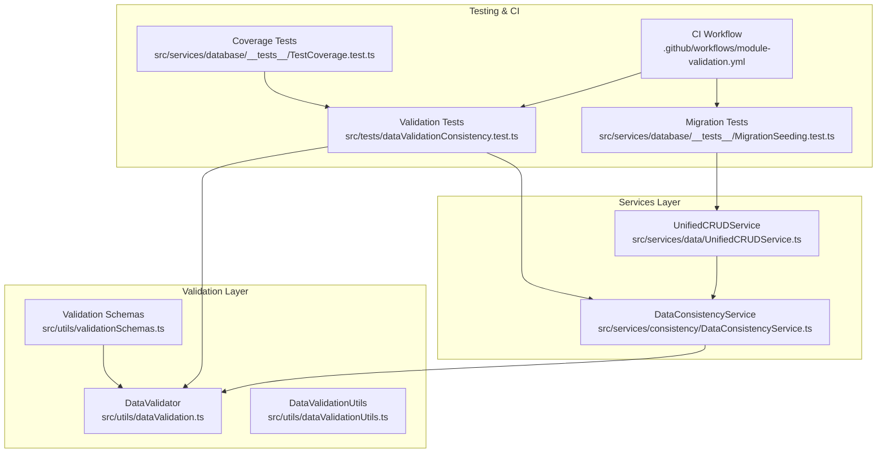
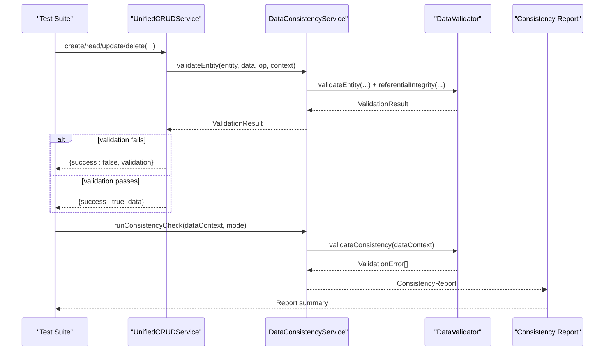
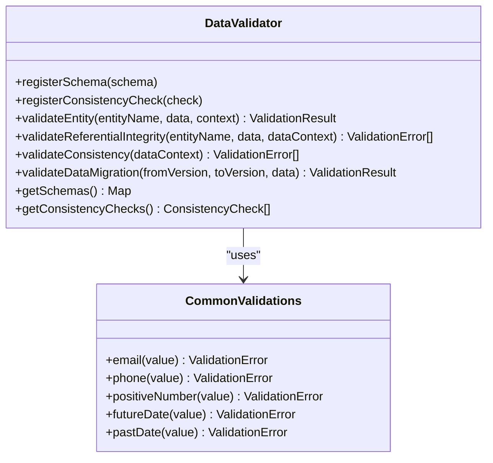
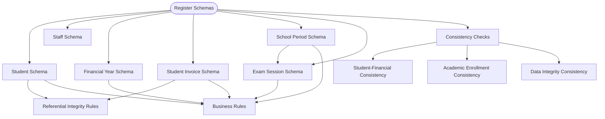
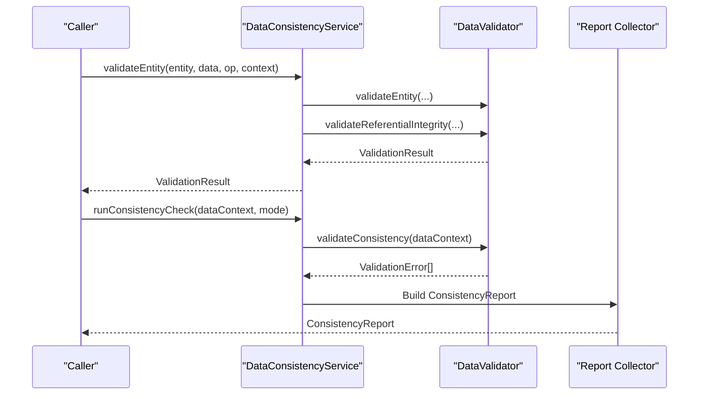
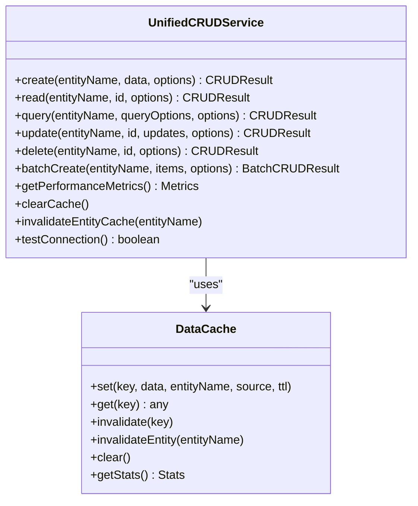
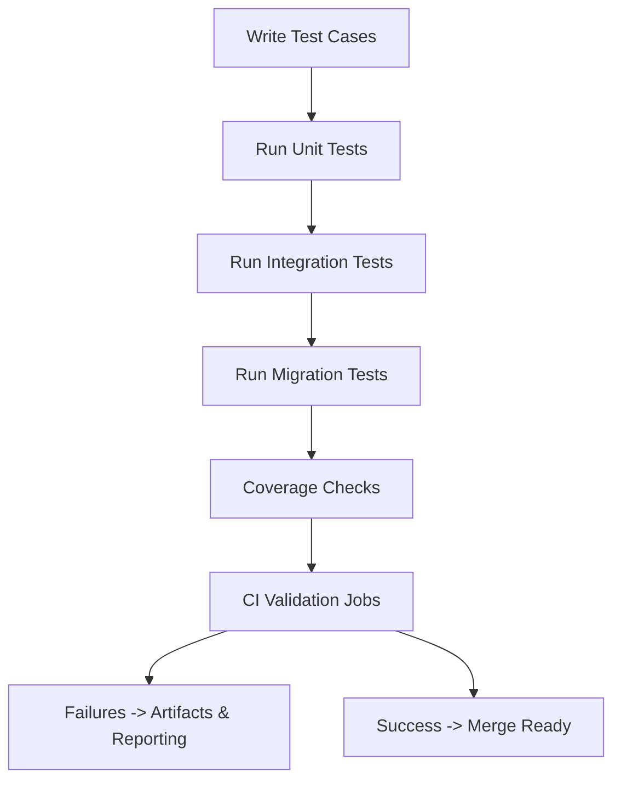
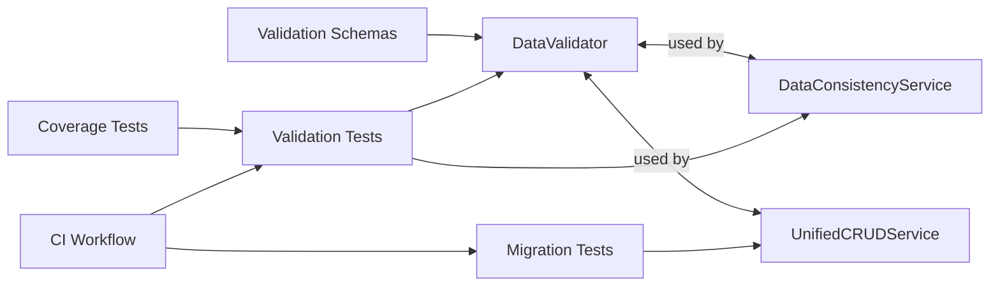

# Data Validation and Testing Framework

<cite>
**Referenced Files in This Document**
- [dataValidation.ts](file://src/utils/dataValidation.ts)
- [dataValidationUtils.tsx](file://src/utils/dataValidationUtils.tsx)
- [validationSchemas.ts](file://src/utils/validationSchemas.ts)
- [DataConsistencyService.ts](file://src/services/consistency/DataConsistencyService.ts)
- [UnifiedCRUDService.ts](file://src/services/data/UnifiedCRUDService.ts)
- [dataValidationConsistency.test.ts](file://src/tests/dataValidationConsistency.test.ts)
- [MigrationSeeding.test.ts](file://src/services/database/__tests__/MigrationSeeding.test.ts)
- [module-validation.yml](file://.github/workflows/module-validation.yml)
- [TestCoverage.test.ts](file://src/services/database/__tests__/TestCoverage.test.ts)
</cite>

## Table of Contents
1. [Introduction](#introduction)
2. [Project Structure](#project-structure)
3. [Core Components](#core-components)
4. [Architecture Overview](#architecture-overview)
5. [Detailed Component Analysis](#detailed-component-analysis)
6. [Dependency Analysis](#dependency-analysis)
7. [Performance Considerations](#performance-considerations)
8. [Troubleshooting Guide](#troubleshooting-guide)
9. [Conclusion](#conclusion)
10. [Appendices](#appendices)

## Introduction
This document describes the data validation and testing framework used in SchoolPilot3 migrations. It explains the verification scripts architecture, data integrity checks, automated testing procedures, test data generation, validation rule implementations, and reporting mechanisms. It also covers debugging tools for migration issues, data access verification, performance benchmarking, examples of custom validation scripts, test case creation, continuous integration testing, error detection patterns, data transformation validation, and migration success criteria.

## Project Structure
The validation and testing framework is centered around three pillars:
- Validation engine and schemas: a reusable validator with entity schemas and consistency checks
- Services layer: consistency and CRUD services that enforce validation during operations
- Tests and CI: unit/integration tests and GitHub Actions workflows validating module independence, linting, type checking, and test execution

**Diagram sources**
- [dataValidation.ts:68-396](file://src/utils/dataValidation.ts#L68-L396)
- [validationSchemas.ts:498-509](file://src/utils/validationSchemas.ts#L498-L509)
- [DataConsistencyService.ts:49-466](file://src/services/consistency/DataConsistencyService.ts#L49-L466)
- [UnifiedCRUDService.ts:113-685](file://src/services/data/UnifiedCRUDService.ts#L113-L685)
- [dataValidationConsistency.test.ts:1-562](file://src/tests/dataValidationConsistency.test.ts#L1-L562)
- [MigrationSeeding.test.ts:111-152](file://src/services/database/__tests__/MigrationSeeding.test.ts#L111-L152)
- [TestCoverage.test.ts:276-312](file://src/services/database/__tests__/TestCoverage.test.ts#L276-L312)
- [module-validation.yml:1-126](file://.github/workflows/module-validation.yml#L1-L126)

**Section sources**
- [dataValidation.ts:1-465](file://src/utils/dataValidation.ts#L1-L465)
- [validationSchemas.ts:1-522](file://src/utils/validationSchemas.ts#L1-L522)
- [DataConsistencyService.ts:1-469](file://src/services/consistency/DataConsistencyService.ts#L1-L469)
- [UnifiedCRUDService.ts:1-689](file://src/services/data/UnifiedCRUDService.ts#L1-L689)
- [dataValidationConsistency.test.ts:1-562](file://src/tests/dataValidationConsistency.test.ts#L1-L562)
- [MigrationSeeding.test.ts:111-152](file://src/services/database/__tests__/MigrationSeeding.test.ts#L111-L152)
- [TestCoverage.test.ts:276-312](file://src/services/database/__tests__/TestCoverage.test.ts#L276-L312)
- [module-validation.yml:1-126](file://.github/workflows/module-validation.yml#L1-L126)

## Core Components
- DataValidator: central validation engine supporting field-level rules, business rules, referential integrity, and consistency checks
- Validation schemas: entity schemas and consistency checks registered globally for reuse
- DataConsistencyService: orchestrates validation, referential integrity, and consistency checks; produces structured reports
- UnifiedCRUDService: enforces validation on create/read/update/delete operations and manages caching and performance metrics
- DataValidationUtils: safe data access utilities for rendering and defensive programming
- Tests and CI: comprehensive test suites and GitHub Actions for validation and coverage

**Section sources**
- [dataValidation.ts:68-396](file://src/utils/dataValidation.ts#L68-L396)
- [validationSchemas.ts:498-509](file://src/utils/validationSchemas.ts#L498-L509)
- [DataConsistencyService.ts:49-466](file://src/services/consistency/DataConsistencyService.ts#L49-L466)
- [UnifiedCRUDService.ts:113-685](file://src/services/data/UnifiedCRUDService.ts#L113-L685)
- [dataValidationUtils.tsx:9-200](file://src/utils/dataValidationUtils.tsx#L9-L200)
- [dataValidationConsistency.test.ts:23-285](file://src/tests/dataValidationConsistency.test.ts#L23-L285)
- [module-validation.yml:1-126](file://.github/workflows/module-validation.yml#L1-L126)

## Architecture Overview
The framework integrates validation and consistency enforcement across the data lifecycle:
- Validation schemas define rules per entity and relationships
- DataConsistencyService validates entities and runs consistency checks
- UnifiedCRUDService invokes validation for all CRUD operations and manages caching
- Tests validate correctness and coverage; CI enforces quality gates

**Diagram sources**
- [UnifiedCRUDService.ts:129-574](file://src/services/data/UnifiedCRUDService.ts#L129-L574)
- [DataConsistencyService.ts:74-373](file://src/services/consistency/DataConsistencyService.ts#L74-L373)
- [dataValidation.ts:82-350](file://src/utils/dataValidation.ts#L82-L350)
- [dataValidationConsistency.test.ts:287-401](file://src/tests/dataValidationConsistency.test.ts#L287-L401)

## Detailed Component Analysis

### DataValidator
The DataValidator provides:
- Field-level validation: required, type, min/max length, numeric bounds, enums, and custom validators
- Business rules: entity-specific constraints validated with optional context
- Referential integrity: cross-entity foreign key checks against a data context
- Consistency checks: cross-entity integrity validations (e.g., orphaned records, duplicates)
- Migration validation: validates transformed data sets across versions

**Diagram sources**
- [dataValidation.ts:68-396](file://src/utils/dataValidation.ts#L68-L396)
- [dataValidation.ts:402-465](file://src/utils/dataValidation.ts#L402-L465)

**Section sources**
- [dataValidation.ts:68-396](file://src/utils/dataValidation.ts#L68-L396)
- [dataValidation.ts:402-465](file://src/utils/dataValidation.ts#L402-L465)

### Validation Schemas
Core schemas define:
- Entity fields with required types, lengths, enums, and custom validators
- Relationships for referential integrity
- Business rules for domain constraints
- Consistency checks for cross-entity integrity

**Diagram sources**
- [validationSchemas.ts:24-120](file://src/utils/validationSchemas.ts#L24-L120)
- [validationSchemas.ts:123-178](file://src/utils/validationSchemas.ts#L123-L178)
- [validationSchemas.ts:181-237](file://src/utils/validationSchemas.ts#L181-L237)
- [validationSchemas.ts:240-331](file://src/utils/validationSchemas.ts#L240-L331)
- [validationSchemas.ts:334-366](file://src/utils/validationSchemas.ts#L334-L366)
- [validationSchemas.ts:369-385](file://src/utils/validationSchemas.ts#L369-L385)
- [validationSchemas.ts:388-426](file://src/utils/validationSchemas.ts#L388-L426)
- [validationSchemas.ts:428-464](file://src/utils/validationSchemas.ts#L428-L464)
- [validationSchemas.ts:466-495](file://src/utils/validationSchemas.ts#L466-L495)

**Section sources**
- [validationSchemas.ts:24-120](file://src/utils/validationSchemas.ts#L24-L120)
- [validationSchemas.ts:123-178](file://src/utils/validationSchemas.ts#L123-L178)
- [validationSchemas.ts:181-237](file://src/utils/validationSchemas.ts#L181-L237)
- [validationSchemas.ts:240-331](file://src/utils/validationSchemas.ts#L240-L331)
- [validationSchemas.ts:334-366](file://src/utils/validationSchemas.ts#L334-L366)
- [validationSchemas.ts:369-385](file://src/utils/validationSchemas.ts#L369-L385)
- [validationSchemas.ts:388-426](file://src/utils/validationSchemas.ts#L388-L426)
- [validationSchemas.ts:428-464](file://src/utils/validationSchemas.ts#L428-L464)
- [validationSchemas.ts:466-495](file://src/utils/validationSchemas.ts#L466-L495)

### DataConsistencyService
The service:
- Validates entities for create/update/delete with operation-specific checks
- Enforces referential integrity using the validator
- Runs consistency checks across datasets
- Produces structured reports with counts, warnings, critical errors, and summaries
- Supports strict/lenient/disabled validation modes and optional auto-fix/logging

**Diagram sources**
- [DataConsistencyService.ts:74-373](file://src/services/consistency/DataConsistencyService.ts#L74-L373)
- [dataValidation.ts:276-350](file://src/utils/dataValidation.ts#L276-L350)

**Section sources**
- [DataConsistencyService.ts:49-466](file://src/services/consistency/DataConsistencyService.ts#L49-L466)

### UnifiedCRUDService
The CRUD service:
- Wraps create/read/update/delete with validation and caching
- Integrates with a strategy manager or mock service
- Returns detailed results with source, cached flag, and validation outcomes
- Provides batch operations, performance metrics, cache management, and connection testing

**Diagram sources**
- [UnifiedCRUDService.ts:113-685](file://src/services/data/UnifiedCRUDService.ts#L113-L685)

**Section sources**
- [UnifiedCRUDService.ts:113-685](file://src/services/data/UnifiedCRUDService.ts#L113-L685)

### DataValidationUtils
Safe utilities for rendering and defensive programming:
- Safe property access with fallbacks
- Array/object validation and normalization
- Safe renderer creation for table cells
- Error boundary props for components

**Section sources**
- [dataValidationUtils.tsx:9-200](file://src/utils/dataValidationUtils.tsx#L9-L200)

### Automated Testing Procedures
- Unit/integration tests validate:
  - Field-level validation rules and business rules
  - Referential integrity and consistency checks
  - CRUD operations with validation and caching
  - Migration seeding and data integrity post-migration
- Coverage tests enforce minimum test ratios and naming conventions
- CI workflow enforces module independence, linting, type checks, and test execution

**Diagram sources**
- [dataValidationConsistency.test.ts:23-285](file://src/tests/dataValidationConsistency.test.ts#L23-L285)
- [MigrationSeeding.test.ts:111-152](file://src/services/database/__tests__/MigrationSeeding.test.ts#L111-L152)
- [TestCoverage.test.ts:276-312](file://src/services/database/__tests__/TestCoverage.test.ts#L276-L312)
- [module-validation.yml:9-126](file://.github/workflows/module-validation.yml#L9-L126)

**Section sources**
- [dataValidationConsistency.test.ts:23-285](file://src/tests/dataValidationConsistency.test.ts#L23-L285)
- [MigrationSeeding.test.ts:111-152](file://src/services/database/__tests__/MigrationSeeding.test.ts#L111-L152)
- [TestCoverage.test.ts:276-312](file://src/services/database/__tests__/TestCoverage.test.ts#L276-L312)
- [module-validation.yml:1-126](file://.github/workflows/module-validation.yml#L1-L126)

## Dependency Analysis
The framework exhibits low coupling and high cohesion:
- DataValidator is a standalone engine used by services
- Services depend on the validator but encapsulate operational logic
- Tests depend on services and schemas for verification
- CI depends on tests and lint/type checks

**Diagram sources**
- [dataValidation.ts:68-396](file://src/utils/dataValidation.ts#L68-L396)
- [DataConsistencyService.ts:49-466](file://src/services/consistency/DataConsistencyService.ts#L49-L466)
- [UnifiedCRUDService.ts:113-685](file://src/services/data/UnifiedCRUDService.ts#L113-L685)
- [validationSchemas.ts:498-509](file://src/utils/validationSchemas.ts#L498-L509)
- [dataValidationConsistency.test.ts:1-562](file://src/tests/dataValidationConsistency.test.ts#L1-L562)
- [MigrationSeeding.test.ts:111-152](file://src/services/database/__tests__/MigrationSeeding.test.ts#L111-L152)
- [TestCoverage.test.ts:276-312](file://src/services/database/__tests__/TestCoverage.test.ts#L276-L312)
- [module-validation.yml:1-126](file://.github/workflows/module-validation.yml#L1-L126)

**Section sources**
- [dataValidation.ts:68-396](file://src/utils/dataValidation.ts#L68-L396)
- [validationSchemas.ts:498-509](file://src/utils/validationSchemas.ts#L498-L509)
- [DataConsistencyService.ts:49-466](file://src/services/consistency/DataConsistencyService.ts#L49-L466)
- [UnifiedCRUDService.ts:113-685](file://src/services/data/UnifiedCRUDService.ts#L113-L685)
- [dataValidationConsistency.test.ts:1-562](file://src/tests/dataValidationConsistency.test.ts#L1-L562)
- [MigrationSeeding.test.ts:111-152](file://src/services/database/__tests__/MigrationSeeding.test.ts#L111-L152)
- [TestCoverage.test.ts:276-312](file://src/services/database/__tests__/TestCoverage.test.ts#L276-L312)
- [module-validation.yml:1-126](file://.github/workflows/module-validation.yml#L1-L126)

## Performance Considerations
- Caching: UnifiedCRUDService maintains an in-memory cache with TTL and entity invalidation to reduce repeated reads
- Operation batching: Batch operations minimize overhead for bulk inserts
- Validation modes: Strict vs lenient modes balance correctness and throughput
- Performance metrics: The service exposes placeholders for cache stats and response timing
- CI performance: Parallel jobs in the workflow help speed up validation

**Section sources**
- [UnifiedCRUDService.ts:55-111](file://src/services/data/UnifiedCRUDService.ts#L55-L111)
- [UnifiedCRUDService.ts:576-627](file://src/services/data/UnifiedCRUDService.ts#L576-L627)
- [module-validation.yml:98-126](file://.github/workflows/module-validation.yml#L98-L126)

## Troubleshooting Guide
Common issues and resolutions:
- Validation failures: Inspect ValidationResult errors/warnings; adjust schemas or data
- Referential integrity errors: Ensure foreign keys match existing target entities
- Consistency check failures: Fix orphaned records or duplicates flagged by checks
- CRUD operation rejections: Validate entity pre-update; ensure IDs exist for updates/deletes
- CI failures: Review cross-module import detection, lint, typecheck, and test results; artifacts are uploaded on failure

Debugging tips:
- Enable logging in DataConsistencyService for detailed error traces
- Use lenient mode temporarily to isolate critical vs non-critical issues
- Validate cache state via cache stats and invalidate affected entities
- Verify connection to underlying data services using testConnection()

**Section sources**
- [DataConsistencyService.ts:108-142](file://src/services/consistency/DataConsistencyService.ts#L108-L142)
- [DataConsistencyService.ts:278-373](file://src/services/consistency/DataConsistencyService.ts#L278-L373)
- [UnifiedCRUDService.ts:638-668](file://src/services/data/UnifiedCRUDService.ts#L638-L668)
- [module-validation.yml:30-36](file://.github/workflows/module-validation.yml#L30-L36)

## Conclusion
The SchoolPilot3 validation and testing framework provides robust, extensible mechanisms for ensuring data integrity during migrations and runtime operations. Its layered design—schemas, validator, services, and tests—enables comprehensive coverage, clear reporting, and maintainable validation logic. CI integration ensures quality gates, while caching and performance metrics support scalable operations.

## Appendices

### Examples of Custom Validation Scripts
- Extend DataValidator with custom field rules and business rules
- Register new schemas and consistency checks via the global validator
- Implement custom consistency checks for domain-specific integrity

**Section sources**
- [dataValidation.ts:72-80](file://src/utils/dataValidation.ts#L72-L80)
- [validationSchemas.ts:498-509](file://src/utils/validationSchemas.ts#L498-L509)

### Test Case Creation
- Use Vitest to write tests mirroring CRUD operations and validation scenarios
- Leverage globalDataValidator and DataConsistencyService in tests
- Validate referential integrity and consistency checks with synthetic datasets

**Section sources**
- [dataValidationConsistency.test.ts:186-284](file://src/tests/dataValidationConsistency.test.ts#L186-L284)

### Continuous Integration Testing
- Module independence validation, linting, type checking, and tests are orchestrated by the CI workflow
- On failure, artifacts are uploaded for diagnostics

**Section sources**
- [module-validation.yml:1-126](file://.github/workflows/module-validation.yml#L1-L126)

### Error Detection Patterns
- Required fields, type mismatches, enum violations, and custom validations produce structured errors
- Referential integrity detects missing foreign keys
- Consistency checks detect orphans and duplicates

**Section sources**
- [dataValidation.ts:124-223](file://src/utils/dataValidation.ts#L124-L223)
- [dataValidation.ts:276-329](file://src/utils/dataValidation.ts#L276-L329)
- [validationSchemas.ts:388-495](file://src/utils/validationSchemas.ts#L388-L495)

### Data Transformation Validation
- validateDataMigration validates transformed datasets across versions
- Reports data loss or corruption by comparing source and target counts

**Section sources**
- [dataValidation.ts:352-385](file://src/utils/dataValidation.ts#L352-L385)
- [DataConsistencyService.ts:375-440](file://src/services/consistency/DataConsistencyService.ts#L375-L440)

### Migration Success Criteria
- All validation errors are critical; warnings are non-blocking
- Consistency reports must show zero critical errors for success
- Migration validation compares source/target datasets and flags data loss

**Section sources**
- [DataConsistencyService.ts:310-348](file://src/services/consistency/DataConsistencyService.ts#L310-L348)
- [DataConsistencyService.ts:413-423](file://src/services/consistency/DataConsistencyService.ts#L413-L423)