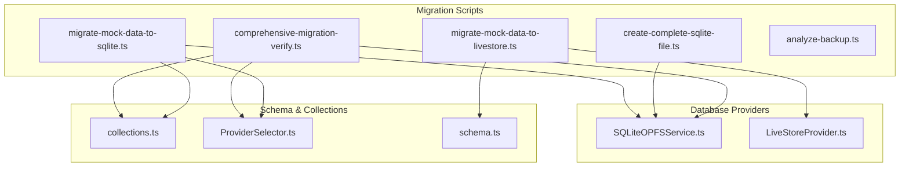
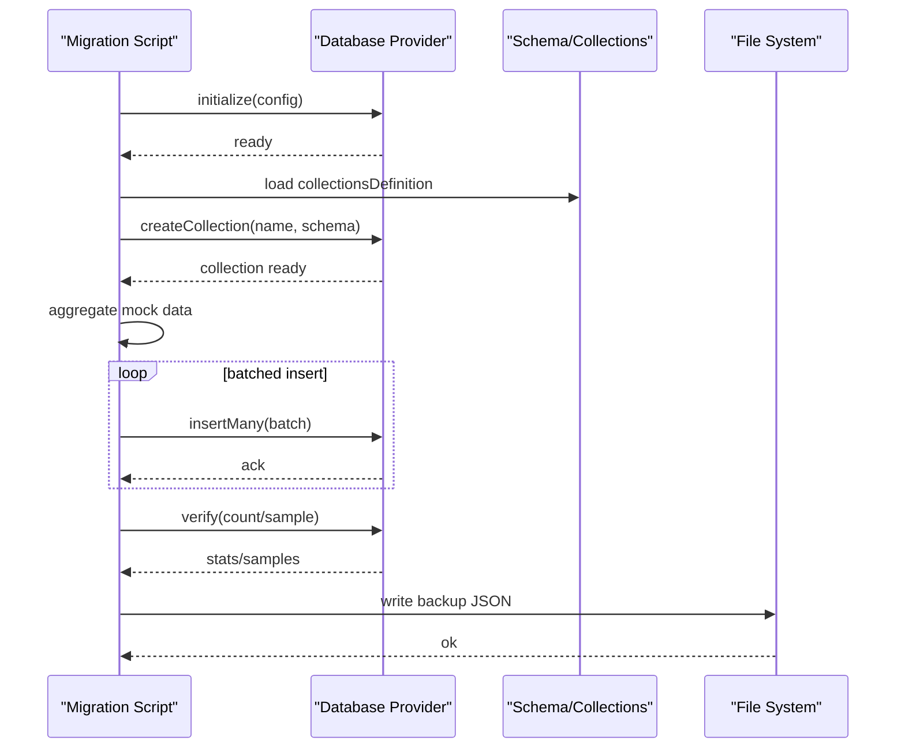
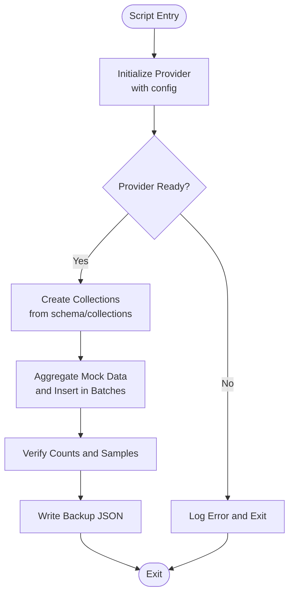
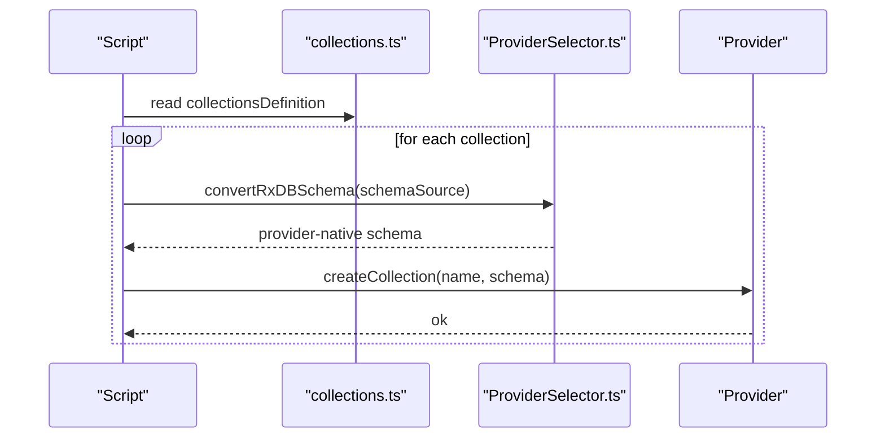
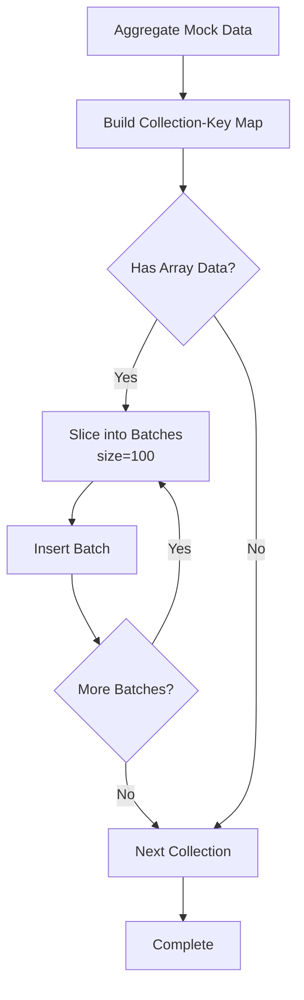
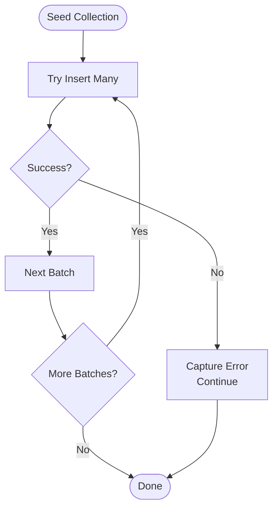
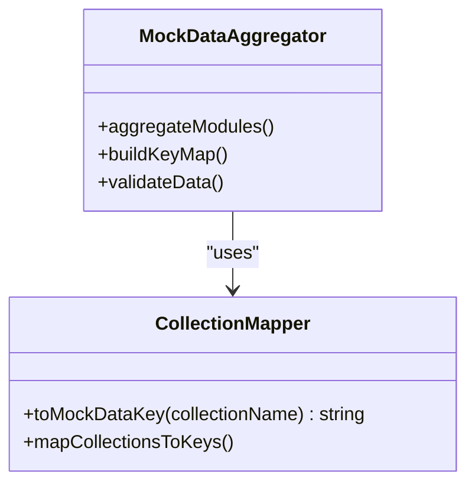
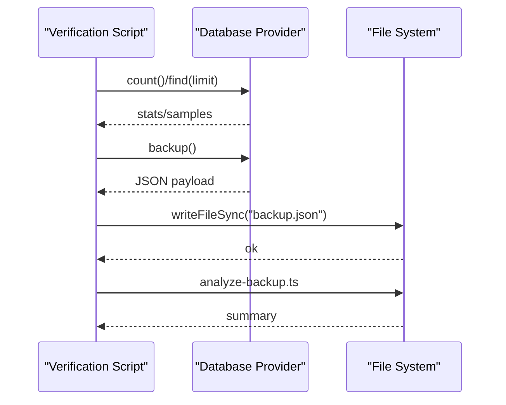
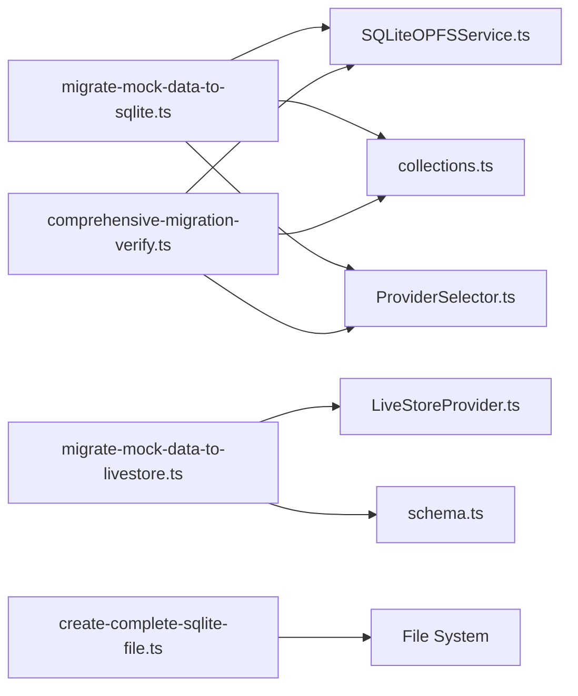

# Migration Scripts Architecture

<cite>
**Referenced Files in This Document**
- [analyze-backup.ts](file://src/scripts/data-migration/analyze-backup.ts)
- [comprehensive-migration-verify.ts](file://src/scripts/data-migration/comprehensive-migration-verify.ts)
- [create-complete-sqlite-file.ts](file://src/scripts/data-migration/create-complete-sqlite-file.ts)
- [migrate-mock-data-to-sqlite.ts](file://src/scripts/data-migration/migrate-mock-data-to-sqlite.ts)
- [migrate-mock-data-to-livestore.ts](file://src/scripts/data-migration/migrate-mock-data-to-livestore.ts)
- [SQLiteOPFSService.ts](file://src/services/sqlite/SQLiteOPFSService.ts)
- [LiveStoreProvider.ts](file://src/services/database/LiveStoreProvider.ts)
- [collections.ts](file://src/services/database/collections.ts)
- [ProviderSelector.ts](file://src/services/database/ProviderSelector.ts)
- [schema.ts](file://src/livestore/schema.ts)
</cite>

## Table of Contents
1. [Introduction](#introduction)
2. [Project Structure](#project-structure)
3. [Core Components](#core-components)
4. [Architecture Overview](#architecture-overview)
5. [Detailed Component Analysis](#detailed-component-analysis)
6. [Dependency Analysis](#dependency-analysis)
7. [Performance Considerations](#performance-considerations)
8. [Troubleshooting Guide](#troubleshooting-guide)
9. [Conclusion](#conclusion)

## Introduction
This document explains the migration scripts architecture and execution framework used to transform mock data into persistent databases. It covers initialization, collection creation, data insertion strategies, batch processing, error handling, progress tracking, mock data aggregation, collection mapping, validation checkpoints, and performance optimization techniques. It also provides guidance on custom migration scripts, parameter configuration, and execution monitoring.

## Project Structure
The migration system is organized around dedicated Node.js scripts located under src/scripts/data-migration. These scripts coordinate with database providers and schema definitions to create collections, seed data, and validate results.

**Diagram sources**
- [migrate-mock-data-to-sqlite.ts](file://src/scripts/data-migration/migrate-mock-data-to-sqlite.ts)
- [migrate-mock-data-to-livestore.ts](file://src/scripts/data-migration/migrate-mock-data-to-livestore.ts)
- [create-complete-sqlite-file.ts](file://src/scripts/data-migration/create-complete-sqlite-file.ts)
- [comprehensive-migration-verify.ts](file://src/scripts/data-migration/comprehensive-migration-verify.ts)
- [SQLiteOPFSService.ts](file://src/services/sqlite/SQLiteOPFSService.ts)
- [LiveStoreProvider.ts](file://src/services/database/LiveStoreProvider.ts)
- [collections.ts](file://src/services/database/collections.ts)
- [ProviderSelector.ts](file://src/services/database/ProviderSelector.ts)
- [schema.ts](file://src/livestore/schema.ts)

**Section sources**
- [migrate-mock-data-to-sqlite.ts](file://src/scripts/data-migration/migrate-mock-data-to-sqlite.ts)
- [migrate-mock-data-to-livestore.ts](file://src/scripts/data-migration/migrate-mock-data-to-livestore.ts)
- [create-complete-sqlite-file.ts](file://src/scripts/data-migration/create-complete-sqlite-file.ts)
- [comprehensive-migration-verify.ts](file://src/scripts/data-migration/comprehensive-migration-verify.ts)
- [analyze-backup.ts](file://src/scripts/data-migration/analyze-backup.ts)

## Core Components
- Migration scripts orchestrate the end-to-end pipeline: initialize provider → create collections → aggregate mock data → insert in batches → verify → backup.
- Database providers encapsulate low-level operations for SQLite (OPFS/WASM) and LiveStore.
- Schema and collection definitions define the target structure for migration.
- Backup utilities enable validation and distribution of migrated datasets.

Key responsibilities:
- Provider initialization and lifecycle management
- Schema conversion and collection creation
- Mock data aggregation across modules
- Batched insertion with progress tracking
- Validation and backup creation
- Error accumulation and reporting

**Section sources**
- [migrate-mock-data-to-sqlite.ts](file://src/scripts/data-migration/migrate-mock-data-to-sqlite.ts)
- [migrate-mock-data-to-livestore.ts](file://src/scripts/data-migration/migrate-mock-data-to-livestore.ts)
- [create-complete-sqlite-file.ts](file://src/scripts/data-migration/create-complete-sqlite-file.ts)
- [comprehensive-migration-verify.ts](file://src/scripts/data-migration/comprehensive-migration-verify.ts)
- [SQLiteOPFSService.ts](file://src/services/sqlite/SQLiteOPFSService.ts)
- [LiveStoreProvider.ts](file://src/services/database/LiveStoreProvider.ts)
- [collections.ts](file://src/services/database/collections.ts)
- [ProviderSelector.ts](file://src/services/database/ProviderSelector.ts)
- [schema.ts](file://src/livestore/schema.ts)

## Architecture Overview
The migration architecture follows a provider-agnostic design:
- Scripts depend on schema definitions and provider abstractions.
- For RxDB-free operation, schema definitions are converted to provider-native formats.
- LiveStore uses a typed schema definition for strong validation.
- All scripts write human-readable logs and produce structured backups for verification.

**Diagram sources**
- [migrate-mock-data-to-sqlite.ts](file://src/scripts/data-migration/migrate-mock-data-to-sqlite.ts)
- [migrate-mock-data-to-livestore.ts](file://src/scripts/data-migration/migrate-mock-data-to-livestore.ts)
- [comprehensive-migration-verify.ts](file://src/scripts/data-migration/comprehensive-migration-verify.ts)
- [SQLiteOPFSService.ts](file://src/services/sqlite/SQLiteOPFSService.ts)
- [LiveStoreProvider.ts](file://src/services/database/LiveStoreProvider.ts)
- [collections.ts](file://src/services/database/collections.ts)
- [ProviderSelector.ts](file://src/services/database/ProviderSelector.ts)
- [schema.ts](file://src/livestore/schema.ts)

## Detailed Component Analysis

### Script Initialization and Lifecycle
- Providers are initialized with explicit configuration (name, version, collections, options).
- Scripts track start time and compute durations for monitoring.
- Cleanup routines destroy providers to free resources.

**Diagram sources**
- [migrate-mock-data-to-livestore.ts](file://src/scripts/data-migration/migrate-mock-data-to-livestore.ts)
- [migrate-mock-data-to-sqlite.ts](file://src/scripts/data-migration/migrate-mock-data-to-sqlite.ts)
- [comprehensive-migration-verify.ts](file://src/scripts/data-migration/comprehensive-migration-verify.ts)

**Section sources**
- [migrate-mock-data-to-livestore.ts](file://src/scripts/data-migration/migrate-mock-data-to-livestore.ts)
- [migrate-mock-data-to-sqlite.ts](file://src/scripts/data-migration/migrate-mock-data-to-sqlite.ts)
- [comprehensive-migration-verify.ts](file://src/scripts/data-migration/comprehensive-migration-verify.ts)

### Collection Creation Workflows
- RxDB-free approach: schema definitions are converted to provider-native schemas before collection creation.
- LiveStore approach: uses typed schema definitions directly.
- Validation ensures each collection’s schema is an object before creation.

**Diagram sources**
- [migrate-mock-data-to-sqlite.ts](file://src/scripts/data-migration/migrate-mock-data-to-sqlite.ts)
- [comprehensive-migration-verify.ts](file://src/scripts/data-migration/comprehensive-migration-verify.ts)
- [collections.ts](file://src/services/database/collections.ts)
- [ProviderSelector.ts](file://src/services/database/ProviderSelector.ts)

**Section sources**
- [migrate-mock-data-to-sqlite.ts](file://src/scripts/data-migration/migrate-mock-data-to-sqlite.ts)
- [comprehensive-migration-verify.ts](file://src/scripts/data-migration/comprehensive-migration-verify.ts)
- [collections.ts](file://src/services/database/collections.ts)
- [ProviderSelector.ts](file://src/services/database/ProviderSelector.ts)

### Data Insertion Strategies and Batch Processing
- Mock data is aggregated from module-specific mockData exports.
- Mapping converts collection names to expected mock data keys (e.g., academic_years → initialMockAcademicYears).
- Batched insertion uses configurable batch sizes to manage memory and throughput.
- Progress is logged per batch and per collection.

**Diagram sources**
- [migrate-mock-data-to-sqlite.ts](file://src/scripts/data-migration/migrate-mock-data-to-sqlite.ts)
- [migrate-mock-data-to-livestore.ts](file://src/scripts/data-migration/migrate-mock-data-to-livestore.ts)
- [comprehensive-migration-verify.ts](file://src/scripts/data-migration/comprehensive-migration-verify.ts)

**Section sources**
- [migrate-mock-data-to-sqlite.ts](file://src/scripts/data-migration/migrate-mock-data-to-sqlite.ts)
- [migrate-mock-data-to-livestore.ts](file://src/scripts/data-migration/migrate-mock-data-to-livestore.ts)
- [comprehensive-migration-verify.ts](file://src/scripts/data-migration/comprehensive-migration-verify.ts)

### Error Handling Patterns and Progress Tracking
- Errors are caught per collection and accumulated; script continues to maximize data ingestion.
- Batch-level errors are captured and appended to the error list.
- Progress logs indicate batch numbers and collection completion.
- Verification queries provide counts and sample records for validation.

**Diagram sources**
- [migrate-mock-data-to-livestore.ts](file://src/scripts/data-migration/migrate-mock-data-to-livestore.ts)
- [migrate-mock-data-to-sqlite.ts](file://src/scripts/data-migration/migrate-mock-data-to-sqlite.ts)

**Section sources**
- [migrate-mock-data-to-livestore.ts](file://src/scripts/data-migration/migrate-mock-data-to-livestore.ts)
- [migrate-mock-data-to-sqlite.ts](file://src/scripts/data-migration/migrate-mock-data-to-sqlite.ts)

### Mock Data Aggregation and Collection Mapping Logic
- Modules contribute mock data via named exports; scripts merge them into a single object keyed by collection names.
- Mapping logic transforms collection names to expected mock data keys using camelCase conventions.
- Scripts validate presence of data before attempting insertion.

**Diagram sources**
- [migrate-mock-data-to-sqlite.ts](file://src/scripts/data-migration/migrate-mock-data-to-sqlite.ts)
- [migrate-mock-data-to-livestore.ts](file://src/scripts/data-migration/migrate-mock-data-to-livestore.ts)
- [comprehensive-migration-verify.ts](file://src/scripts/data-migration/comprehensive-migration-verify.ts)

**Section sources**
- [migrate-mock-data-to-sqlite.ts](file://src/scripts/data-migration/migrate-mock-data-to-sqlite.ts)
- [migrate-mock-data-to-livestore.ts](file://src/scripts/data-migration/migrate-mock-data-to-livestore.ts)
- [comprehensive-migration-verify.ts](file://src/scripts/data-migration/comprehensive-migration-verify.ts)

### Validation Checkpoints and Backup Systems
- Validation checks include record counts and sample retrieval for key collections.
- Backups are written as JSON containing timestamp, provider metadata, version, and per-collection records.
- Analyzer script parses and summarizes backup contents for quick inspection.

**Diagram sources**
- [comprehensive-migration-verify.ts](file://src/scripts/data-migration/comprehensive-migration-verify.ts)
- [analyze-backup.ts](file://src/scripts/data-migration/analyze-backup.ts)

**Section sources**
- [comprehensive-migration-verify.ts](file://src/scripts/data-migration/comprehensive-migration-verify.ts)
- [analyze-backup.ts](file://src/scripts/data-migration/analyze-backup.ts)

### Custom Migration Scripts and Parameter Configuration
- Scripts accept database filenames and provider options as parameters.
- LiveStore migration accepts configuration including WASM, OPFS, cross-tab persistence, and debug flags.
- Collection mapping can be extended to support additional modules or schemas.

Examples to reference:
- Provider configuration and initialization: [migrate-mock-data-to-livestore.ts](file://src/scripts/data-migration/migrate-mock-data-to-livestore.ts)
- Schema conversion and collection creation: [migrate-mock-data-to-sqlite.ts](file://src/scripts/data-migration/migrate-mock-data-to-sqlite.ts)
- Standalone SQLite file creation: [create-complete-sqlite-file.ts](file://src/scripts/data-migration/create-complete-sqlite-file.ts)

**Section sources**
- [migrate-mock-data-to-livestore.ts](file://src/scripts/data-migration/migrate-mock-data-to-livestore.ts)
- [migrate-mock-data-to-sqlite.ts](file://src/scripts/data-migration/migrate-mock-data-to-sqlite.ts)
- [create-complete-sqlite-file.ts](file://src/scripts/data-migration/create-complete-sqlite-file.ts)

### Execution Monitoring and Reporting
- Scripts log timestamps, collection counts, and batch progress.
- LiveStore migration tracks duration and aggregates errors for a final summary.
- Backup JSON includes metadata for traceability.

**Section sources**
- [migrate-mock-data-to-livestore.ts](file://src/scripts/data-migration/migrate-mock-data-to-livestore.ts)
- [migrate-mock-data-to-sqlite.ts](file://src/scripts/data-migration/migrate-mock-data-to-sqlite.ts)
- [comprehensive-migration-verify.ts](file://src/scripts/data-migration/comprehensive-migration-verify.ts)

## Dependency Analysis
The migration scripts depend on:
- Provider services for database operations
- Schema and collection definitions for structure
- Module mock data for source data
- File system for backup persistence

**Diagram sources**
- [migrate-mock-data-to-sqlite.ts](file://src/scripts/data-migration/migrate-mock-data-to-sqlite.ts)
- [migrate-mock-data-to-livestore.ts](file://src/scripts/data-migration/migrate-mock-data-to-livestore.ts)
- [comprehensive-migration-verify.ts](file://src/scripts/data-migration/comprehensive-migration-verify.ts)
- [create-complete-sqlite-file.ts](file://src/scripts/data-migration/create-complete-sqlite-file.ts)
- [SQLiteOPFSService.ts](file://src/services/sqlite/SQLiteOPFSService.ts)
- [LiveStoreProvider.ts](file://src/services/database/LiveStoreProvider.ts)
- [collections.ts](file://src/services/database/collections.ts)
- [ProviderSelector.ts](file://src/services/database/ProviderSelector.ts)
- [schema.ts](file://src/livestore/schema.ts)

**Section sources**
- [migrate-mock-data-to-sqlite.ts](file://src/scripts/data-migration/migrate-mock-data-to-sqlite.ts)
- [migrate-mock-data-to-livestore.ts](file://src/scripts/data-migration/migrate-mock-data-to-livestore.ts)
- [comprehensive-migration-verify.ts](file://src/scripts/data-migration/comprehensive-migration-verify.ts)
- [create-complete-sqlite-file.ts](file://src/scripts/data-migration/create-complete-sqlite-file.ts)

## Performance Considerations
- Batched insertion reduces memory pressure and improves throughput. Adjust batch size based on dataset characteristics.
- Schema conversion occurs once per collection; reuse converted schemas when possible.
- Prefer OPFS-backed storage for large datasets to leverage browser-native persistence.
- Use sampling and count queries to validate progress without scanning entire tables.
- Avoid unnecessary JSON serialization for primitive values to reduce overhead.

## Troubleshooting Guide
Common issues and resolutions:
- Provider initialization failures: verify configuration, WASM availability, and IndexedDB support.
- Schema conversion errors: ensure schema definitions are objects and match provider expectations.
- Missing mock data: confirm module exports and key mapping logic align with collection names.
- Large dataset memory issues: reduce batch size or split migration across runs.
- Backup verification: use analyzer script to inspect backup contents and record counts.

**Section sources**
- [migrate-mock-data-to-livestore.ts](file://src/scripts/data-migration/migrate-mock-data-to-livestore.ts)
- [migrate-mock-data-to-sqlite.ts](file://src/scripts/data-migration/migrate-mock-data-to-sqlite.ts)
- [comprehensive-migration-verify.ts](file://src/scripts/data-migration/comprehensive-migration-verify.ts)
- [analyze-backup.ts](file://src/scripts/data-migration/analyze-backup.ts)

## Conclusion
The migration scripts architecture provides a robust, provider-agnostic framework for transforming mock data into persistent databases. Through structured initialization, schema conversion, batched insertion, validation, and backup creation, the system supports reliable migrations at scale. Extensible mapping and configuration enable customization for diverse environments and datasets.