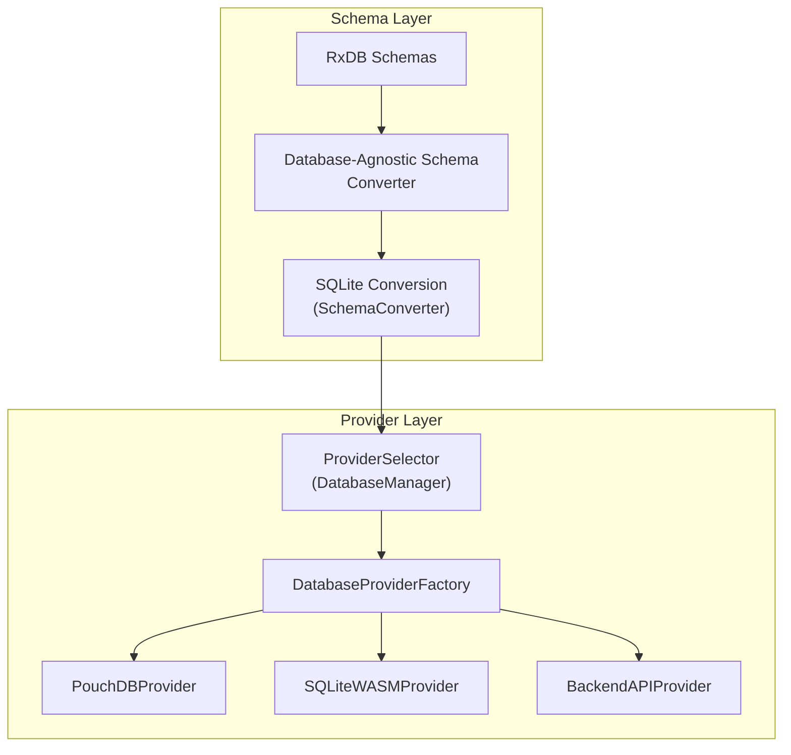
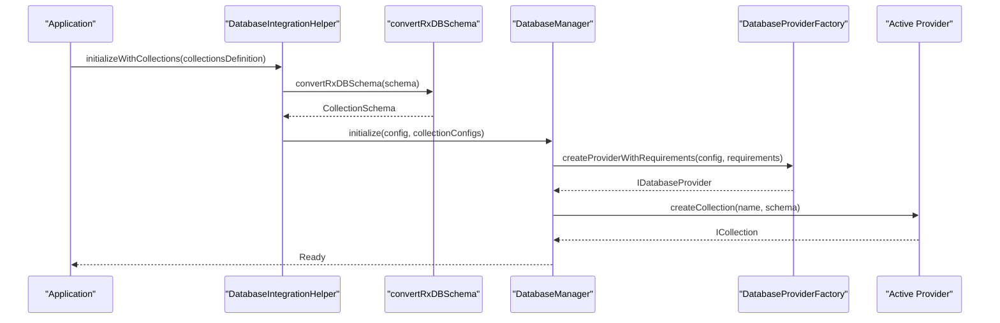
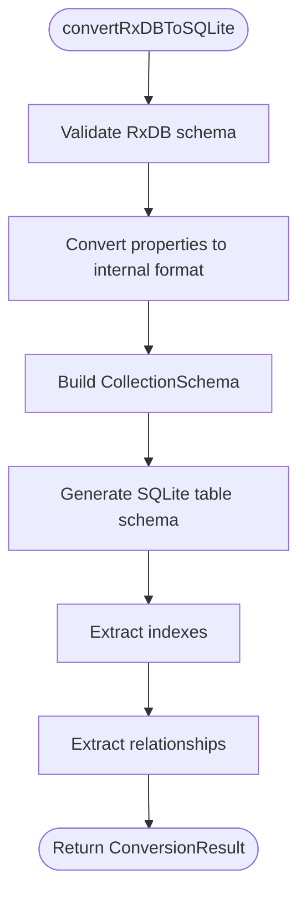
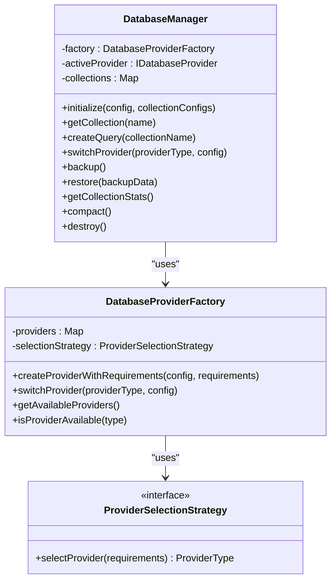
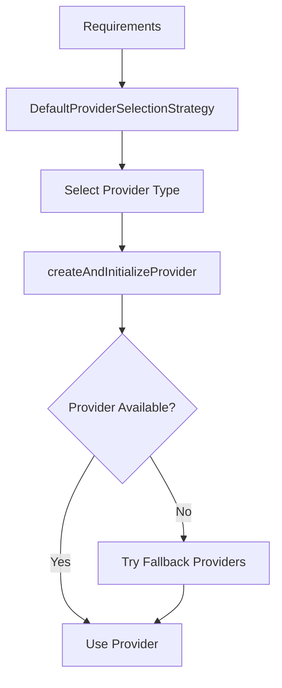
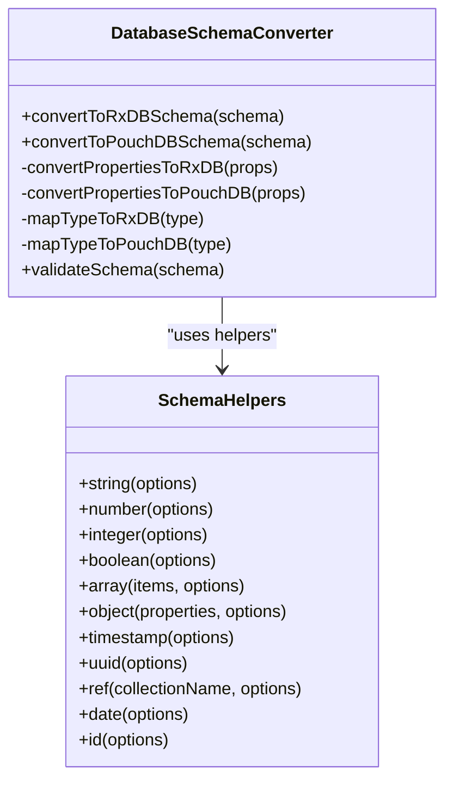
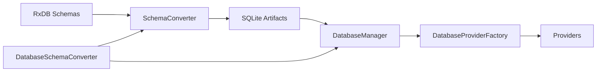

# Schema Evolution and Conversion

<cite>
**Referenced Files in This Document**
- [SchemaConverter.ts](file://src/services/database/SchemaConverter.ts)
- [ProviderSelector.ts](file://src/services/database/ProviderSelector.ts)
- [DatabaseProviderFactory.ts](file://src/services/database/DatabaseProviderFactory.ts)
- [databaseAgnosticSchema.ts](file://src/utils/databaseAgnosticSchema.ts)
- [migrate-mock-data-to-sqlite.ts](file://src/scripts/data-migration/migrate-mock-data-to-sqlite.ts)
- [test-schema-conversion.ts](file://src/services/database/test-schema-conversion.ts)
</cite>

## Table of Contents
1. [Introduction](#introduction)
2. [Project Structure](#project-structure)
3. [Core Components](#core-components)
4. [Architecture Overview](#architecture-overview)
5. [Detailed Component Analysis](#detailed-component-analysis)
6. [Dependency Analysis](#dependency-analysis)
7. [Performance Considerations](#performance-considerations)
8. [Troubleshooting Guide](#troubleshooting-guide)
9. [Conclusion](#conclusion)

## Introduction
This document explains the schema evolution and conversion system in SchoolPilot3. It focuses on how RxDB schemas are transformed into provider-agnostic formats, the conversion pipeline architecture, and schema validation mechanisms. It also documents the collection definition system, schema inheritance patterns, backward compatibility maintenance strategies, and the ProviderSelector's role in adapting schemas across different database providers, including fallback mechanisms for unsupported schema features.

## Project Structure
The schema evolution system spans three main areas:
- Schema conversion utilities that transform RxDB schemas into provider-agnostic formats and SQLite-compatible structures
- A provider selection and orchestration layer that manages multiple database providers
- A database-agnostic schema abstraction that unifies RxDB and PouchDB formats

**Diagram sources**
- [SchemaConverter.ts:57-389](file://src/services/database/SchemaConverter.ts#L57-L389)
- [ProviderSelector.ts:31-242](file://src/services/database/ProviderSelector.ts#L31-L242)
- [DatabaseProviderFactory.ts:288-705](file://src/services/database/DatabaseProviderFactory.ts#L288-L705)

**Section sources**
- [SchemaConverter.ts:1-389](file://src/services/database/SchemaConverter.ts#L1-L389)
- [ProviderSelector.ts:1-451](file://src/services/database/ProviderSelector.ts#L1-L451)
- [DatabaseProviderFactory.ts:1-726](file://src/services/database/DatabaseProviderFactory.ts#L1-L726)
- [databaseAgnosticSchema.ts:1-845](file://src/utils/databaseAgnosticSchema.ts#L1-L845)

## Core Components
- SchemaConverter: Converts RxDB schemas to SQLite-compatible formats, generates CREATE TABLE and CREATE INDEX statements, and extracts relationships.
- DatabaseManager (ProviderSelector): Orchestrates provider selection, initializes collections, and exposes a unified interface for collection access and lifecycle operations.
- DatabaseProviderFactory: Implements provider selection strategy, registers providers, and manages provider switching with robust fallbacks.
- DatabaseSchemaConverter (databaseAgnosticSchema.ts): Provides conversion between database-agnostic schema and RxDB/PouchDB formats, plus validation and helper functions.
- Migration utilities: Scripts demonstrate conversion of RxDB schemas to provider-agnostic formats for data migration.

**Section sources**
- [SchemaConverter.ts:57-389](file://src/services/database/SchemaConverter.ts#L57-L389)
- [ProviderSelector.ts:31-242](file://src/services/database/ProviderSelector.ts#L31-L242)
- [DatabaseProviderFactory.ts:288-705](file://src/services/database/DatabaseProviderFactory.ts#L288-L705)
- [databaseAgnosticSchema.ts:73-355](file://src/utils/databaseAgnosticSchema.ts#L73-L355)
- [migrate-mock-data-to-sqlite.ts:28-57](file://src/scripts/data-migration/migrate-mock-data-to-sqlite.ts#L28-L57)

## Architecture Overview
The schema evolution pipeline transforms RxDB schemas into a provider-agnostic representation, then adapts them to the target provider. The ProviderSelector coordinates provider selection and collection lifecycle, while the DatabaseProviderFactory encapsulates provider availability, initialization, and fallback strategies.

**Diagram sources**
- [ProviderSelector.ts:334-424](file://src/services/database/ProviderSelector.ts#L334-L424)
- [ProviderSelector.ts:262-332](file://src/services/database/ProviderSelector.ts#L262-L332)
- [DatabaseProviderFactory.ts:477-531](file://src/services/database/DatabaseProviderFactory.ts#L477-L531)

## Detailed Component Analysis

### SchemaConverter: RxDB to SQLite Conversion
SchemaConverter transforms RxDB schemas into SQLite-compatible formats, including:
- Property conversion with type mapping (string → TEXT, number → REAL, integer → INTEGER, boolean → INTEGER, object/array → TEXT stored as JSON)
- Index extraction for primary keys, regular fields, and foreign key references
- Audit columns injection (created_at, updated_at)
- Relationship extraction for reference fields
- SQL generation for table creation and indexes

**Diagram sources**
- [SchemaConverter.ts:61-98](file://src/services/database/SchemaConverter.ts#L61-L98)
- [SchemaConverter.ts:103-130](file://src/services/database/SchemaConverter.ts#L103-L130)
- [SchemaConverter.ts:135-177](file://src/services/database/SchemaConverter.ts#L135-L177)
- [SchemaConverter.ts:182-212](file://src/services/database/SchemaConverter.ts#L182-L212)
- [SchemaConverter.ts:284-299](file://src/services/database/SchemaConverter.ts#L284-L299)

**Section sources**
- [SchemaConverter.ts:17-56](file://src/services/database/SchemaConverter.ts#L17-L56)
- [SchemaConverter.ts:61-98](file://src/services/database/SchemaConverter.ts#L61-L98)
- [SchemaConverter.ts:135-177](file://src/services/database/SchemaConverter.ts#L135-L177)
- [SchemaConverter.ts:182-212](file://src/services/database/SchemaConverter.ts#L182-L212)
- [SchemaConverter.ts:304-341](file://src/services/database/SchemaConverter.ts#L304-L341)

### DatabaseManager and ProviderSelector: Collection Lifecycle and Provider Coordination
DatabaseManager orchestrates:
- Initialization with collection configurations
- Provider selection and switching
- Collection creation and lifecycle operations (backup, restore, compact, destroy)
- Status monitoring and statistics

ProviderSelector integrates with DatabaseProviderFactory to:
- Determine optimal provider based on environment and requirements
- Switch providers with graceful recreation of collections
- Provide fallback mechanisms when providers fail

**Diagram sources**
- [ProviderSelector.ts:31-242](file://src/services/database/ProviderSelector.ts#L31-L242)
- [DatabaseProviderFactory.ts:288-389](file://src/services/database/DatabaseProviderFactory.ts#L288-L389)

**Section sources**
- [ProviderSelector.ts:31-242](file://src/services/database/ProviderSelector.ts#L31-L242)
- [ProviderSelector.ts:128-164](file://src/services/database/ProviderSelector.ts#L128-L164)
- [DatabaseProviderFactory.ts:288-389](file://src/services/database/DatabaseProviderFactory.ts#L288-L389)
- [DatabaseProviderFactory.ts:477-531](file://src/services/database/DatabaseProviderFactory.ts#L477-L531)

### DatabaseProviderFactory: Provider Selection and Fallback
DatabaseProviderFactory implements:
- Provider registration and availability checks
- Automatic provider selection based on environment and requirements
- Fallback provider chain when primary provider fails
- Query builder factory for standardized querying across providers

**Diagram sources**
- [DatabaseProviderFactory.ts:40-117](file://src/services/database/DatabaseProviderFactory.ts#L40-L117)
- [DatabaseProviderFactory.ts:533-569](file://src/services/database/DatabaseProviderFactory.ts#L533-L569)
- [DatabaseProviderFactory.ts:571-621](file://src/services/database/DatabaseProviderFactory.ts#L571-L621)

**Section sources**
- [DatabaseProviderFactory.ts:40-117](file://src/services/database/DatabaseProviderFactory.ts#L40-L117)
- [DatabaseProviderFactory.ts:533-569](file://src/services/database/DatabaseProviderFactory.ts#L533-L569)
- [DatabaseProviderFactory.ts:571-621](file://src/services/database/DatabaseProviderFactory.ts#L571-L621)

### Database-Agnostic Schema Abstraction
DatabaseSchemaConverter provides:
- Conversion to RxDB and PouchDB formats from a unified schema
- Type normalization and mapping for cross-provider compatibility
- Validation of schema structure (title, version, primary key presence, property completeness)
- Helper functions for creating common schema patterns (strings, numbers, booleans, arrays, objects, timestamps, UUIDs, references)

**Diagram sources**
- [databaseAgnosticSchema.ts:73-355](file://src/utils/databaseAgnosticSchema.ts#L73-L355)
- [databaseAgnosticSchema.ts:358-790](file://src/utils/databaseAgnosticSchema.ts#L358-L790)

**Section sources**
- [databaseAgnosticSchema.ts:73-355](file://src/utils/databaseAgnosticSchema.ts#L73-L355)
- [databaseAgnosticSchema.ts:358-790](file://src/utils/databaseAgnosticSchema.ts#L358-L790)

### Migration Utilities: RxDB to Provider-Agnostic Conversion
Migration scripts demonstrate:
- Safe extraction of schema from RxDB collection definitions (handling both raw schema and wrapped schema objects)
- Conversion to provider-agnostic formats for downstream processing
- Robust error handling and logging for invalid schemas

**Section sources**
- [migrate-mock-data-to-sqlite.ts:28-57](file://src/scripts/data-migration/migrate-mock-data-to-sqlite.ts#L28-L57)
- [test-schema-conversion.ts:51-111](file://src/services/database/test-schema-conversion.ts#L51-L111)

## Dependency Analysis
The schema evolution system exhibits low coupling and high cohesion:
- SchemaConverter depends only on internal schema interfaces and produces deterministic SQL artifacts
- ProviderSelector delegates provider management to DatabaseProviderFactory
- DatabaseProviderFactory encapsulates provider availability and selection logic
- DatabaseSchemaConverter provides a stable abstraction layer for schema formats

**Diagram sources**
- [SchemaConverter.ts:57-98](file://src/services/database/SchemaConverter.ts#L57-L98)
- [ProviderSelector.ts:31-85](file://src/services/database/ProviderSelector.ts#L31-L85)
- [DatabaseProviderFactory.ts:288-302](file://src/services/database/DatabaseProviderFactory.ts#L288-L302)

**Section sources**
- [SchemaConverter.ts:57-98](file://src/services/database/SchemaConverter.ts#L57-L98)
- [ProviderSelector.ts:31-85](file://src/services/database/ProviderSelector.ts#L31-L85)
- [DatabaseProviderFactory.ts:288-302](file://src/services/database/DatabaseProviderFactory.ts#L288-L302)

## Performance Considerations
- Type mapping favors SQLite-native types to minimize conversion overhead
- Index extraction prevents redundant indices and ensures referential integrity
- Audit columns are injected only when absent, minimizing schema churn
- Provider selection considers environment and performance level to optimize for offline-first or sync-heavy scenarios
- Fallback providers prevent runtime failures and maintain application stability

## Troubleshooting Guide
Common issues and resolutions:
- Invalid RxDB schema: Ensure schemas include properties and a valid primary key; conversion throws explicit errors for malformed inputs
- Missing properties or indexes: SchemaConverter validates presence and extracts appropriate indices; review extracted indexes for correctness
- Provider initialization failures: DatabaseProviderFactory attempts fallback providers; check environment variables controlling provider enablement
- Migration errors: Migration scripts validate schema sources and provide detailed error messages; confirm schema wrappers and object shapes

**Section sources**
- [SchemaConverter.ts:64-74](file://src/services/database/SchemaConverter.ts#L64-L74)
- [SchemaConverter.ts:372-382](file://src/services/database/SchemaConverter.ts#L372-L382)
- [ProviderSelector.ts:354-358](file://src/services/database/ProviderSelector.ts#L354-L358)
- [ProviderSelector.ts:410-413](file://src/services/database/ProviderSelector.ts#L410-L413)
- [DatabaseProviderFactory.ts:502-523](file://src/services/database/DatabaseProviderFactory.ts#L502-L523)

## Conclusion
SchoolPilot3’s schema evolution and conversion system provides a robust, provider-agnostic approach to managing database schemas. By converting RxDB schemas into SQLite-compatible formats and maintaining a unified schema abstraction, the system supports seamless provider switching, strong validation, and reliable migrations. The ProviderSelector and DatabaseProviderFactory ensure resilience through fallback mechanisms, while the migration utilities demonstrate practical conversion workflows for real-world data transformations.