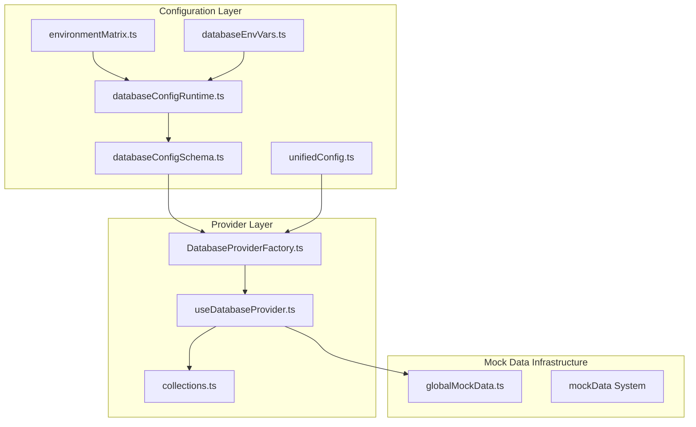
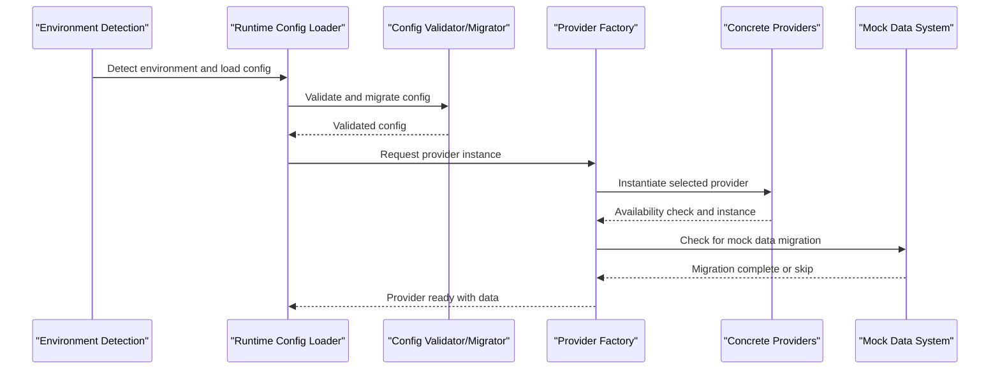
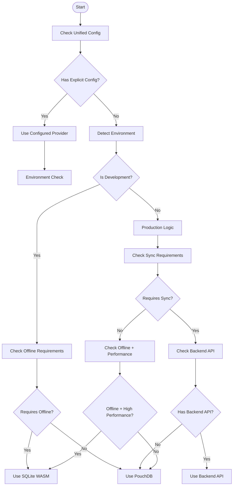
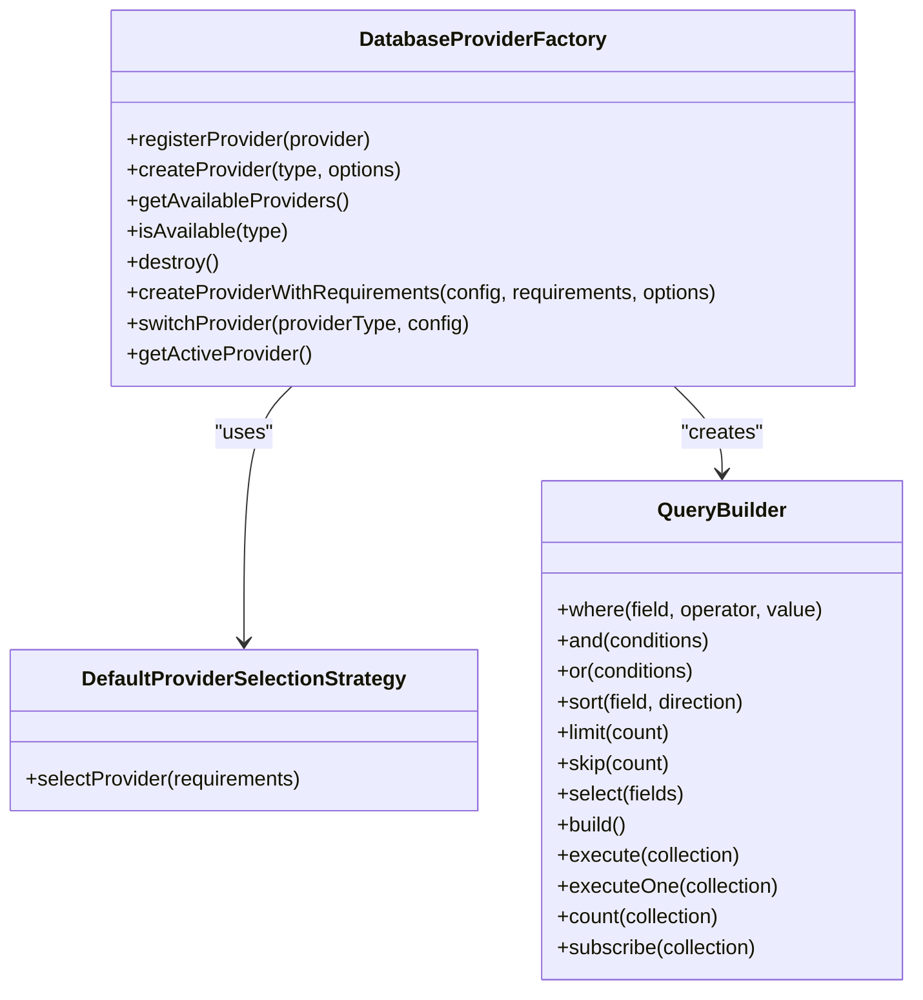
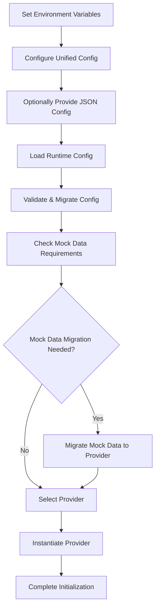
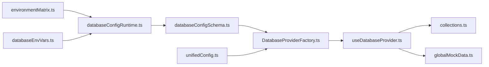

# Database Providers

<cite>
**Referenced Files in This Document**
- [DatabaseProviderFactory.ts](file://src/services/database/DatabaseProviderFactory.ts)
- [useDatabaseProvider.ts](file://src/hooks/useDatabaseProvider.ts)
- [collections.ts](file://src/services/database/collections.ts)
- [databaseConfigSchema.ts](file://src/config/databaseConfigSchema.ts)
- [databaseConfigRuntime.ts](file://src/config/databaseConfigRuntime.ts)
- [databaseEnvVars.ts](file://src/config/databaseEnvVars.ts)
- [environmentMatrix.ts](file://src/config/environmentMatrix.ts)
- [globalMockData.ts](file://src/globalMockData.ts)
- [database-config.example.json](file://public/database-config.example.json)
- [PROVIDER_SELECTION_GUIDE.md](file://docs/database/PROVIDER_SELECTION_GUIDE.md)
- [wasm-sqlite-implementation.md](file://docs/database/wasm-sqlite-implementation.md)
- [sqlite-opfs-implementation.md](file://docs/database/sqlite-opfs-implementation.md)
- [verify-pouchdb-implementation.md](file://docs/database/verify-pouchdb-implementation.md)
- [deployment-guide.md](file://docs/database/deployment-guide.md)
- [database-management.md](file://docs/database/database-management.md)
</cite>

## Update Summary
**Changes Made**
- Enhanced provider selection logic with unified configuration integration
- Added comprehensive mock data migration system with collection name exception mapping
- Expanded configuration options for centralized mock data infrastructure
- Updated provider factory pattern with improved error handling and fallback mechanisms
- Added new collection name exception system for mock data migration

## Table of Contents
1. [Introduction](#introduction)
2. [Project Structure](#project-structure)
3. [Core Components](#core-components)
4. [Architecture Overview](#architecture-overview)
5. [Detailed Component Analysis](#detailed-component-analysis)
6. [Enhanced Mock Data Migration System](#enhanced-mock-data-migration-system)
7. [Dependency Analysis](#dependency-analysis)
8. [Performance Considerations](#performance-considerations)
9. [Troubleshooting Guide](#troubleshooting-guide)
10. [Conclusion](#conclusion)
11. [Appendices](#appendices)

## Introduction
This document explains SchoolPilot3's enhanced database provider architecture and the four main providers: SQLite (file-based for development), SQLite WASM with OPFS (browser-based), PouchDB (CouchDB sync), and LiveStore (hybrid approach). The architecture has been significantly enhanced with a new collection name exception system, improved provider selection logic, and expanded configuration options for centralized mock data infrastructure. It covers provider selection logic, configuration options, performance characteristics, and use cases. It also documents the provider factory pattern, runtime selection based on environment, graceful fallback mechanisms, and storage type differences across development, demo, and production environments.

## Project Structure
SchoolPilot3 organizes database configuration and selection logic primarily under the config and services layers. The enhanced architecture now includes a comprehensive mock data migration system and unified configuration integration. The environment matrix defines allowed providers per environment, while the configuration schema and runtime helpers manage validation, migrations, and environment-driven defaults. The provider factory encapsulates instantiation and availability checks for concrete providers, with enhanced error handling and fallback mechanisms.

**Diagram sources**
- [environmentMatrix.ts:1-152](file://src/config/environmentMatrix.ts#L1-L152)
- [databaseConfigSchema.ts:1-530](file://src/config/databaseConfigSchema.ts#L1-L530)
- [databaseConfigRuntime.ts:1-331](file://src/config/databaseConfigRuntime.ts#L1-L331)
- [databaseEnvVars.ts:1-41](file://src/config/databaseEnvVars.ts#L1-L41)
- [DatabaseProviderFactory.ts:237-725](file://src/services/database/DatabaseProviderFactory.ts#L237-L725)
- [useDatabaseProvider.ts:1-456](file://src/hooks/useDatabaseProvider.ts#L1-L456)
- [collections.ts:1-566](file://src/services/database/collections.ts#L1-L566)
- [globalMockData.ts:1-26](file://src/globalMockData.ts#L1-L26)

**Section sources**
- [environmentMatrix.ts:1-152](file://src/config/environmentMatrix.ts#L1-L152)
- [databaseConfigSchema.ts:1-530](file://src/config/databaseConfigSchema.ts#L1-L530)
- [databaseConfigRuntime.ts:1-331](file://src/config/databaseConfigRuntime.ts#L1-L331)
- [databaseEnvVars.ts:1-41](file://src/config/databaseEnvVars.ts#L1-L41)

## Core Components
- Environment Matrix: Defines allowed providers and defaults per environment (development, staging, production).
- Configuration Schema: Validates and migrates database configuration, enforces bounds, and provides defaults.
- Runtime Configuration Loader: Reads environment variables and optional JSON file to produce a typed runtime config.
- Provider Factory: Registers and instantiates providers, detects availability, and supports graceful fallback with enhanced error handling.
- Mock Data Migration System: Comprehensive system for migrating mock data to database providers with collection name exception mapping.
- Unified Configuration Integration: Enhanced provider selection strategy that integrates with unified configuration system.

**Section sources**
- [environmentMatrix.ts:6-29](file://src/config/environmentMatrix.ts#L6-L29)
- [databaseConfigSchema.ts:54-201](file://src/config/databaseConfigSchema.ts#L54-L201)
- [databaseConfigRuntime.ts:77-248](file://src/config/databaseConfigRuntime.ts#L77-L248)
- [DatabaseProviderFactory.ts:237-725](file://src/services/database/DatabaseProviderFactory.ts#L237-L725)
- [useDatabaseProvider.ts:1-456](file://src/hooks/useDatabaseProvider.ts#L1-L456)

## Architecture Overview
The enhanced provider selection and initialization flow integrates environment detection, configuration loading, validation/migration, and factory instantiation with comprehensive mock data migration capabilities.

**Diagram sources**
- [environmentMatrix.ts:88-115](file://src/config/environmentMatrix.ts#L88-L115)
- [databaseConfigRuntime.ts:77-248](file://src/config/databaseConfigRuntime.ts#L77-L248)
- [databaseConfigSchema.ts:305-492](file://src/config/databaseConfigSchema.ts#L305-L492)
- [DatabaseProviderFactory.ts:391-432](file://src/services/database/DatabaseProviderFactory.ts#L391-L432)
- [useDatabaseProvider.ts:147-176](file://src/hooks/useDatabaseProvider.ts#L147-L176)

## Detailed Component Analysis

### Enhanced Provider Selection Logic
The provider selection logic has been significantly enhanced with unified configuration integration and improved requirements-based selection:

- **Unified Configuration Integration**: Provider selection now integrates with the unified configuration system, allowing explicit provider configuration override.
- **Enhanced Requirements-Based Selection**: Improved logic considers environment, requirements, and backend API configuration for optimal provider selection.
- **Automatic Provider Selection**: Development environments prefer SQLite WASM with OPFS for browser development persistence, while production environments use PouchDB for sync requirements.
- **Fallback Mechanisms**: Comprehensive fallback system ensures application stability even when preferred providers are unavailable.

**Diagram sources**
- [DatabaseProviderFactory.ts:39-116](file://src/services/database/DatabaseProviderFactory.ts#L39-L116)

**Section sources**
- [DatabaseProviderFactory.ts:39-116](file://src/services/database/DatabaseProviderFactory.ts#L39-L116)
- [databaseConfigRuntime.ts:77-248](file://src/config/databaseConfigRuntime.ts#L77-L248)
- [databaseConfigSchema.ts:305-492](file://src/config/databaseConfigSchema.ts#L305-L492)

### Enhanced Configuration Options and Defaults
The configuration system has been expanded with comprehensive validation, migration, and mock data integration capabilities:

- **Provider Configuration**: Enhanced validation for provider types including new 'hybrid' option.
- **Performance Configuration**: Expanded performance tuning with enhanced bounds checking.
- **Storage Configuration**: Comprehensive storage options with mock data integration.
- **Sync Configuration**: Enhanced sync capabilities with backend API integration.
- **Monitoring Configuration**: Advanced monitoring with health check intervals and performance metrics.
- **Features Configuration**: Expanded feature flags including mock data management.
- **API Configuration**: Enhanced backend API configuration with authentication support.

**Section sources**
- [databaseConfigSchema.ts:19-60](file://src/config/databaseConfigSchema.ts#L19-L60)
- [databaseConfigSchema.ts:415-466](file://src/config/databaseConfigSchema.ts#L415-L466)
- [databaseEnvVars.ts:4-40](file://src/config/databaseEnvVars.ts#L4-L40)

### Enhanced Provider Factory Pattern and Runtime Selection
The provider factory has been enhanced with improved error handling, fallback mechanisms, and mock data integration:

- **Enhanced Error Handling**: Comprehensive error handling with detailed logging and graceful degradation.
- **Improved Fallback Mechanisms**: Multi-tier fallback system ensuring application stability.
- **Mock Data Integration**: Seamless integration with mock data migration system.
- **Provider Registration**: Enhanced provider registration with availability checking.
- **Dynamic Provider Loading**: Support for dynamic provider loading and initialization.

**Diagram sources**
- [DatabaseProviderFactory.ts:288-725](file://src/services/database/DatabaseProviderFactory.ts#L288-L725)

**Section sources**
- [DatabaseProviderFactory.ts:288-725](file://src/services/database/DatabaseProviderFactory.ts#L288-L725)

### Enhanced Provider Profiles and Use Cases

#### SQLite (file-based for development)
- **Enhanced Use Case**: Local development with persistent file storage and comprehensive mock data support.
- **Improved Characteristics**: Enhanced local reads/writes with mock data migration capabilities.
- **Expanded Configuration**: Enhanced configuration with mock data integration and performance tuning.
- **Better Environment Fit**: Default in development with comprehensive mock data support for rapid iteration.

**Section sources**
- [environmentMatrix.ts:37-38](file://src/config/environmentMatrix.ts#L37-L38)
- [DatabaseProviderFactory.ts:374-379](file://src/services/database/DatabaseProviderFactory.ts#L374-L379)

#### SQLite WASM with OPFS (browser-based)
- **Enhanced Use Case**: Browser deployments requiring client-side persistence with OPFS-backed storage and mock data migration.
- **Improved Characteristics**: Enhanced web compatibility with comprehensive mock data support and efficient browser storage.
- **Expanded Implementation**: Enhanced implementation with comprehensive mock data migration system.
- **Better Environment Fit**: Preferred default in staging and production for web clients with mock data support.

**Section sources**
- [environmentMatrix.ts:55-56](file://src/config/environmentMatrix.ts#L55-L56)
- [environmentMatrix.ts:72-73](file://src/config/environmentMatrix.ts#L72-L73)
- [wasm-sqlite-implementation.md](file://docs/database/wasm-sqlite-implementation.md)
- [sqlite-opfs-implementation.md](file://docs/database/sqlite-opfs-implementation.md)

#### PouchDB (CouchDB sync)
- **Enhanced Use Case**: Client-server synchronization and offline-first scenarios with comprehensive mock data support.
- **Improved Characteristics**: Enhanced sync story with comprehensive mock data migration capabilities.
- **Better Environment Fit**: Supported across environments with enhanced mock data integration.

**Section sources**
- [environmentMatrix.ts:37](file://src/config/environmentMatrix.ts#L37)
- [environmentMatrix.ts:55](file://src/config/environmentMatrix.ts#L55)
- [environmentMatrix.ts:73](file://src/config/environmentMatrix.ts#L73)
- [verify-pouchdb-implementation.md](file://docs/database/verify-pouchdb-implementation.md)

#### LiveStore (hybrid approach)
- **Enhanced Use Case**: Production-grade hybrid storage with web worker and OPFS integration and mock data support.
- **Improved Characteristics**: Enhanced hybrid storage with comprehensive mock data migration capabilities.
- **Better Environment Fit**: Default in production for web deployments with robust mock data support.

**Section sources**
- [environmentMatrix.ts:74-75](file://src/config/environmentMatrix.ts#L74-L75)
- [DatabaseProviderFactory.ts:380-382](file://src/services/database/DatabaseProviderFactory.ts#L380-L382)

### Enhanced Setup Instructions and Connection Parameters
The setup process has been enhanced with comprehensive mock data integration and configuration management:

- **Enhanced Environment Variables**: Expanded environment variables for provider toggling, performance tuning, and mock data management.
- **Improved JSON Configuration**: Enhanced JSON configuration with comprehensive mock data integration options.
- **Comprehensive Configuration Management**: Enhanced configuration validation, migration, and error handling.
- **Mock Data Integration**: Seamless integration with mock data migration system during provider initialization.

**Diagram sources**
- [databaseEnvVars.ts:4-40](file://src/config/databaseEnvVars.ts#L4-L40)
- [databaseConfigRuntime.ts:250-265](file://src/config/databaseConfigRuntime.ts#L250-L265)
- [databaseConfigSchema.ts:305-492](file://src/config/databaseConfigSchema.ts#L305-L492)
- [useDatabaseProvider.ts:147-176](file://src/hooks/useDatabaseProvider.ts#L147-L176)

**Section sources**
- [databaseEnvVars.ts:4-40](file://src/config/databaseEnvVars.ts#L4-L40)
- [databaseConfigRuntime.ts:250-265](file://src/config/databaseConfigRuntime.ts#L250-L265)
- [database-config.example.json](file://public/database-config.example.json)

### Enhanced Optimization Strategies
Performance optimization has been enhanced with comprehensive mock data management and configuration tuning:

- **Enhanced Performance Tuning**: Comprehensive performance parameter tuning with mock data integration.
- **Improved Storage Management**: Enhanced storage configuration with mock data retention policies.
- **Advanced Sync Configuration**: Comprehensive sync configuration with mock data migration optimization.
- **Enhanced Monitoring**: Advanced monitoring with mock data migration tracking and performance metrics.
- **Mock Data Optimization**: Comprehensive mock data optimization strategies for different environments.

**Section sources**
- [databaseConfigSchema.ts:72-176](file://src/config/databaseConfigSchema.ts#L72-L176)
- [databaseConfigSchema.ts:415-466](file://src/config/databaseConfigSchema.ts#L415-L466)

### Enhanced Storage Type Differences
Storage type differences have been enhanced with comprehensive mock data support:

- **Enhanced File-based Storage**: Persistent across sessions with comprehensive mock data integration.
- **OPFS (Browser)**: Enhanced efficient, quota-managed storage with comprehensive mock data migration support.
- **Enhanced Memory**: Volatile, fast but ephemeral with comprehensive mock data support for demos.

**Enhanced Implications**:
- **Development**: Enhanced file-based or memory with comprehensive mock data support for quick iteration.
- **Demo**: Enhanced memory or OPFS with comprehensive mock data support for lightweight demonstrations.
- **Production**: Enhanced OPFS or LiveStore with comprehensive mock data support for durability and scalability.

**Section sources**
- [PROVIDER_SELECTION_GUIDE.md](file://docs/database/PROVIDER_SELECTION_GUIDE.md)
- [sqlite-opfs-implementation.md](file://docs/database/sqlite-opfs-implementation.md)

## Enhanced Mock Data Migration System
SchoolPilot3 now includes a comprehensive mock data migration system that seamlessly integrates with the database provider architecture:

### Collection Name Exception System
The system includes a sophisticated collection name exception mapping system that handles the transformation of mock data keys to database collection names:

- **Enhanced Mapping Logic**: Comprehensive mapping system for transforming mock data keys to collection names.
- **Exception Handling**: Sophisticated exception handling for edge cases and special collection names.
- **Normalization Support**: Automatic normalization of collection names and mock data keys.
- **Backward Compatibility**: Maintains backward compatibility with existing mock data structures.

### Mock Data Migration Process
The migration process includes comprehensive error handling, progress tracking, and data validation:

- **First Run Detection**: Intelligent detection of first-run scenarios to trigger migration automatically.
- **Comprehensive Migration**: End-to-end migration of mock data to database collections with progress tracking.
- **Data Validation**: Built-in data validation and error handling during migration process.
- **Cleanup Operations**: Automatic cleanup of existing data before migration to prevent conflicts.

### Centralized Mock Data Infrastructure
The system includes centralized mock data management with global mock data support:

- **Global Mock Data**: Centralized mock data management through global mock data system.
- **Modular Mock Data**: Support for modular mock data systems with collection-specific configurations.
- **Mock Data Lifecycle**: Complete lifecycle management for mock data including creation, migration, and cleanup.
- **Mock Data Validation**: Comprehensive validation and integrity checking for migrated mock data.

**Section sources**
- [useDatabaseProvider.ts:147-286](file://src/hooks/useDatabaseProvider.ts#L147-L286)
- [useDatabaseProvider.ts:288-407](file://src/hooks/useDatabaseProvider.ts#L288-L407)
- [globalMockData.ts:1-26](file://src/globalMockData.ts#L1-L26)
- [collections.ts:523-566](file://src/services/database/collections.ts#L523-L566)

## Dependency Analysis
The enhanced provider factory depends on validated configuration, environment matrices, and comprehensive mock data systems to instantiate appropriate providers with seamless mock data integration.

**Diagram sources**
- [environmentMatrix.ts:1-152](file://src/config/environmentMatrix.ts#L1-L152)
- [databaseConfigSchema.ts:1-530](file://src/config/databaseConfigSchema.ts#L1-L530)
- [databaseConfigRuntime.ts:1-331](file://src/config/databaseConfigRuntime.ts#L1-L331)
- [databaseEnvVars.ts:1-41](file://src/config/databaseEnvVars.ts#L1-L41)
- [DatabaseProviderFactory.ts:237-725](file://src/services/database/DatabaseProviderFactory.ts#L237-L725)
- [useDatabaseProvider.ts:1-456](file://src/hooks/useDatabaseProvider.ts#L1-L456)
- [collections.ts:1-566](file://src/services/database/collections.ts#L1-L566)
- [globalMockData.ts:1-26](file://src/globalMockData.ts#L1-L26)

**Section sources**
- [environmentMatrix.ts:1-152](file://src/config/environmentMatrix.ts#L1-L152)
- [databaseConfigSchema.ts:1-530](file://src/config/databaseConfigSchema.ts#L1-L530)
- [databaseConfigRuntime.ts:1-331](file://src/config/databaseConfigRuntime.ts#L1-L331)
- [databaseEnvVars.ts:1-41](file://src/config/databaseEnvVars.ts#L1-L41)
- [DatabaseProviderFactory.ts:237-725](file://src/services/database/DatabaseProviderFactory.ts#L237-L725)
- [useDatabaseProvider.ts:1-456](file://src/hooks/useDatabaseProvider.ts#L1-L456)
- [collections.ts:1-566](file://src/services/database/collections.ts#L1-L566)
- [globalMockData.ts:1-26](file://src/globalMockData.ts#L1-L26)

## Performance Considerations
Enhanced performance considerations now include comprehensive mock data optimization and configuration tuning:

- **Enhanced Provider Selection**: Improved provider selection logic with unified configuration integration for optimal performance.
- **Mock Data Optimization**: Comprehensive mock data optimization strategies for different environments and use cases.
- **Performance Parameter Tuning**: Enhanced performance parameter tuning with mock data integration considerations.
- **Monitoring and Metrics**: Advanced monitoring with mock data migration tracking and performance metrics.
- **Resource Management**: Enhanced resource management with mock data cleanup and optimization strategies.

## Troubleshooting Guide
Enhanced troubleshooting now includes comprehensive mock data migration diagnostics and provider selection issues:

- **Enhanced Configuration Validation**: Comprehensive configuration validation with detailed error reporting and auto-fix capabilities.
- **Mock Data Migration Issues**: Specialized troubleshooting for mock data migration failures and collection mapping issues.
- **Provider Instantiation Errors**: Enhanced provider instantiation error handling with detailed logging and fallback mechanisms.
- **Missing Configuration Files**: Graceful handling of missing configuration files with comprehensive fallback strategies.
- **Mock Data Integration Issues**: Specialized troubleshooting for mock data integration and migration problems.

**Section sources**
- [databaseConfigSchema.ts:305-492](file://src/config/databaseConfigSchema.ts#L305-L492)
- [databaseConfigRuntime.ts:250-265](file://src/config/databaseConfigRuntime.ts#L250-L265)
- [DatabaseProviderFactory.ts:391-432](file://src/services/database/DatabaseProviderFactory.ts#L391-L432)
- [useDatabaseProvider.ts:147-176](file://src/hooks/useDatabaseProvider.ts#L147-L176)

## Conclusion
SchoolPilot3's enhanced database provider architecture balances flexibility, safety, and comprehensive mock data integration across environments. The enhanced environment matrix, configuration schema, runtime loader, provider factory, and mock data migration system collectively ensure robust provider selection, validation, instantiation, and seamless data migration. By aligning provider choices with environment needs—SQLite for development, SQLite WASM/LiveStore for staging/production—and leveraging comprehensive mock data integration, teams can achieve optimal performance, reliability, and seamless data migration experiences.

## Appendices

### Appendix A: Enhanced Environment-Specific Defaults
- **Development**: SQLite default with comprehensive mock data support; higher logging verbosity; demo-friendly features.
- **Staging**: SQLite WASM default with mock data migration; moderate performance tuning; real-time sync enabled.
- **Production**: LiveStore default with comprehensive mock data support; strict monitoring and audit logging; optimized for reliability.

**Section sources**
- [environmentMatrix.ts:32-86](file://src/config/environmentMatrix.ts#L32-L86)
- [databaseConfigSchema.ts:415-466](file://src/config/databaseConfigSchema.ts#L415-L466)

### Appendix B: Enhanced Deployment Guidance
- **Unified Configuration**: Use unified configuration for provider selection and performance tuning.
- **Mock Data Integration**: Leverage comprehensive mock data integration for seamless data migration.
- **Configuration Validation**: Validate configuration before deployment with comprehensive mock data support.
- **Monitoring and Tracking**: Monitor health checks and mock data migration progress.
- **Fallback Strategies**: Implement comprehensive fallback strategies for provider selection and mock data migration.

**Section sources**
- [databaseEnvVars.ts:4-40](file://src/config/databaseEnvVars.ts#L4-L40)
- [database-config.example.json](file://public/database-config.example.json)
- [deployment-guide.md](file://docs/database/deployment-guide.md)
- [useDatabaseProvider.ts:147-176](file://src/hooks/useDatabaseProvider.ts#L147-L176)

### Appendix C: Enhanced Mock Data Migration Reference
- **Collection Name Mapping**: Comprehensive collection name mapping system for mock data migration.
- **Migration Progress Tracking**: Real-time progress tracking and status reporting for mock data migration.
- **Error Handling**: Comprehensive error handling and recovery mechanisms for mock data migration.
- **Cleanup Operations**: Automated cleanup and optimization of migrated mock data.

**Section sources**
- [useDatabaseProvider.ts:206-286](file://src/hooks/useDatabaseProvider.ts#L206-L286)
- [useDatabaseProvider.ts:288-407](file://src/hooks/useDatabaseProvider.ts#L288-L407)
- [globalMockData.ts:1-26](file://src/globalMockData.ts#L1-L26)