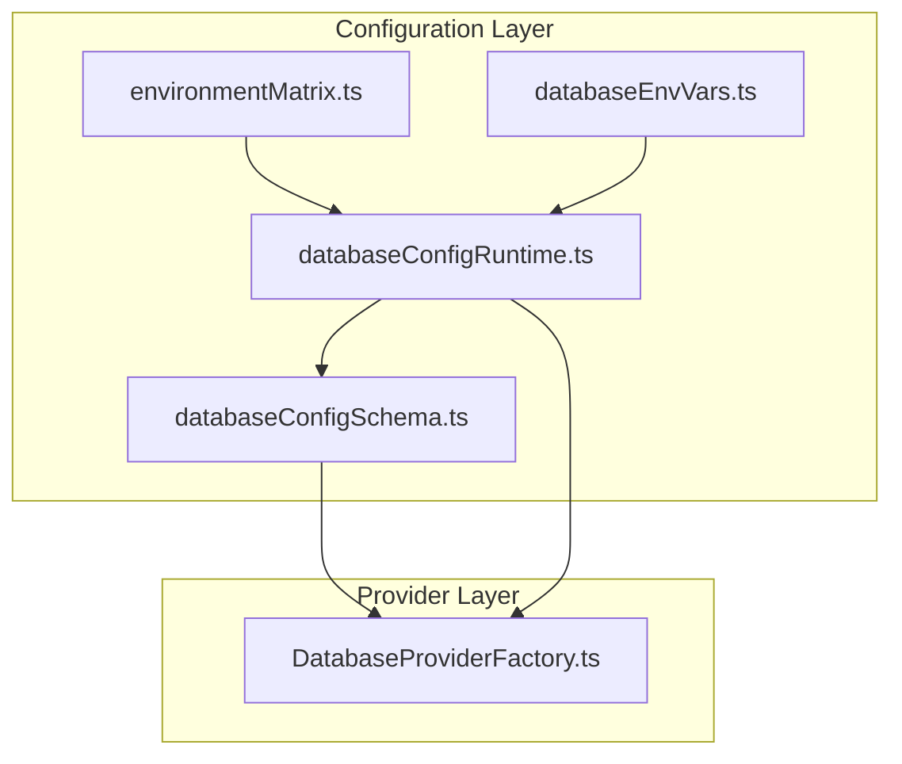
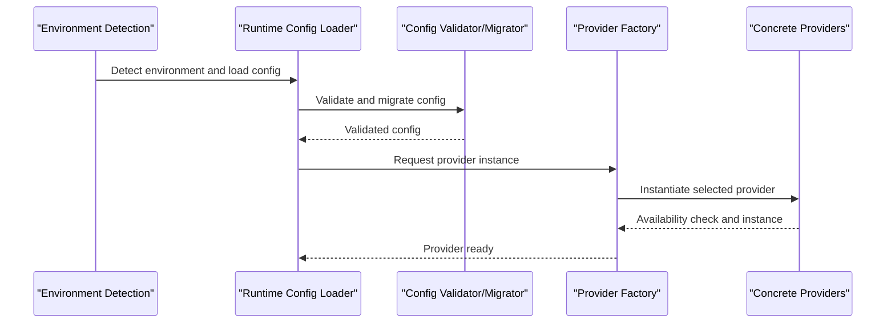
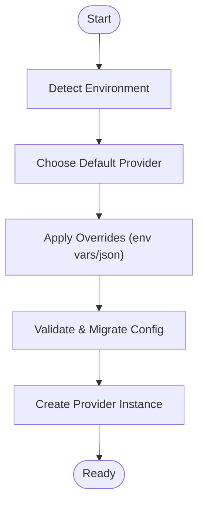
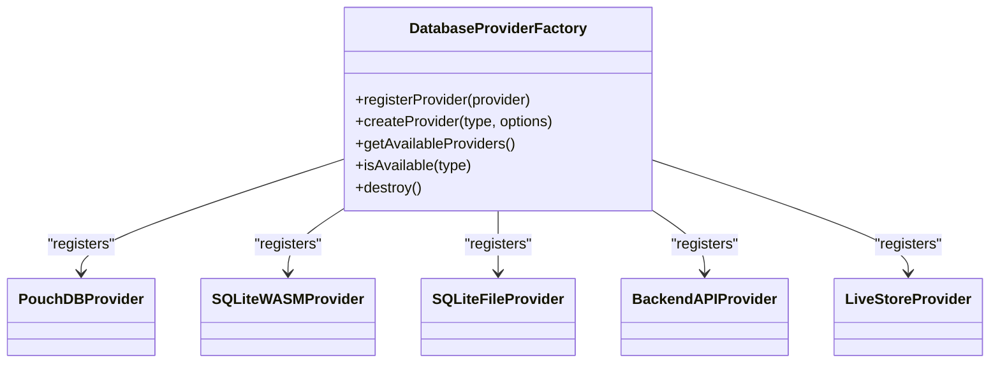
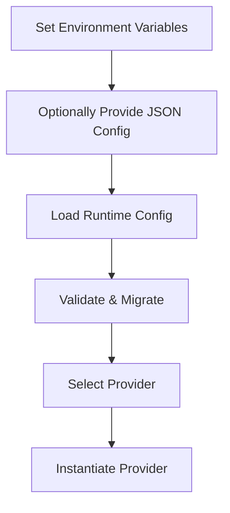
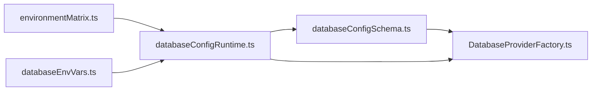

# Database Providers

<cite>
**Referenced Files in This Document**
- [environmentMatrix.ts](file://src/config/environmentMatrix.ts)
- [databaseConfigSchema.ts](file://src/config/databaseConfigSchema.ts)
- [databaseConfigRuntime.ts](file://src/config/databaseConfigRuntime.ts)
- [databaseEnvVars.ts](file://src/config/databaseEnvVars.ts)
- [DatabaseProviderFactory.ts](file://src/services/database/DatabaseProviderFactory.ts)
- [database-config.example.json](file://public/database-config.example.json)
- [PROVIDER_SELECTION_GUIDE.md](file://docs/database/PROVIDER_SELECTION_GUIDE.md)
- [wasm-sqlite-implementation.md](file://docs/database/wasm-sqlite-implementation.md)
- [sqlite-opfs-implementation.md](file://docs/database/sqlite-opfs-implementation.md)
- [verify-pouchdb-implementation.md](file://docs/database/verify-pouchdb-implementation.md)
- [deployment-guide.md](file://docs/database/deployment-guide.md)
- [database-management.md](file://docs/database/database-management.md)
</cite>

## Table of Contents
1. [Introduction](#introduction)
2. [Project Structure](#project-structure)
3. [Core Components](#core-components)
4. [Architecture Overview](#architecture-overview)
5. [Detailed Component Analysis](#detailed-component-analysis)
6. [Dependency Analysis](#dependency-analysis)
7. [Performance Considerations](#performance-considerations)
8. [Troubleshooting Guide](#troubleshooting-guide)
9. [Conclusion](#conclusion)
10. [Appendices](#appendices)

## Introduction
This document explains SchoolPilot3’s database provider architecture and the four main providers: SQLite (file-based for development), SQLite WASM with OPFS (browser-based), PouchDB (CouchDB sync), and LiveStore (hybrid approach). It covers provider selection logic, configuration options, performance characteristics, and use cases. It also documents the provider factory pattern, runtime selection based on environment, graceful fallback mechanisms, and storage type differences across development, demo, and production environments.

## Project Structure
SchoolPilot3 organizes database configuration and selection logic primarily under the config and services layers. The environment matrix defines allowed providers per environment, while the configuration schema and runtime helpers manage validation, migrations, and environment-driven defaults. The provider factory encapsulates instantiation and availability checks for concrete providers.

**Diagram sources**
- [environmentMatrix.ts:1-152](file://src/config/environmentMatrix.ts#L1-L152)
- [databaseConfigSchema.ts:1-530](file://src/config/databaseConfigSchema.ts#L1-L530)
- [databaseConfigRuntime.ts:1-331](file://src/config/databaseConfigRuntime.ts#L1-L331)
- [databaseEnvVars.ts:1-41](file://src/config/databaseEnvVars.ts#L1-L41)
- [DatabaseProviderFactory.ts:237-725](file://src/services/database/DatabaseProviderFactory.ts#L237-L725)

**Section sources**
- [environmentMatrix.ts:1-152](file://src/config/environmentMatrix.ts#L1-L152)
- [databaseConfigSchema.ts:1-530](file://src/config/databaseConfigSchema.ts#L1-L530)
- [databaseConfigRuntime.ts:1-331](file://src/config/databaseConfigRuntime.ts#L1-L331)
- [databaseEnvVars.ts:1-41](file://src/config/databaseEnvVars.ts#L1-L41)

## Core Components
- Environment Matrix: Defines allowed providers and defaults per environment (development, staging, production).
- Configuration Schema: Validates and migrates database configuration, enforces bounds, and provides defaults.
- Runtime Configuration Loader: Reads environment variables and optional JSON file to produce a typed runtime config.
- Provider Factory: Registers and instantiates providers, detects availability, and supports graceful fallback.

**Section sources**
- [environmentMatrix.ts:6-29](file://src/config/environmentMatrix.ts#L6-L29)
- [databaseConfigSchema.ts:54-201](file://src/config/databaseConfigSchema.ts#L54-L201)
- [databaseConfigRuntime.ts:77-248](file://src/config/databaseConfigRuntime.ts#L77-L248)
- [DatabaseProviderFactory.ts:237-725](file://src/services/database/DatabaseProviderFactory.ts#L237-L725)

## Architecture Overview
The provider selection and initialization flow integrates environment detection, configuration loading, validation/migration, and factory instantiation.

**Diagram sources**
- [environmentMatrix.ts:88-115](file://src/config/environmentMatrix.ts#L88-L115)
- [databaseConfigRuntime.ts:77-248](file://src/config/databaseConfigRuntime.ts#L77-L248)
- [databaseConfigSchema.ts:305-492](file://src/config/databaseConfigSchema.ts#L305-L492)
- [DatabaseProviderFactory.ts:391-432](file://src/services/database/DatabaseProviderFactory.ts#L391-L432)

## Detailed Component Analysis

### Provider Selection Logic
- Environment-based defaults:
  - Development: default provider includes SQLite and memory variants.
  - Staging: default provider is SQLite WASM.
  - Production: default provider is LiveStore.
- Allowed providers vary by environment to balance capabilities and constraints.
- Automatic detection and manual override are supported via configuration.

**Diagram sources**
- [environmentMatrix.ts:32-86](file://src/config/environmentMatrix.ts#L32-L86)
- [databaseConfigRuntime.ts:77-248](file://src/config/databaseConfigRuntime.ts#L77-L248)
- [databaseConfigSchema.ts:305-492](file://src/config/databaseConfigSchema.ts#L305-L492)

**Section sources**
- [environmentMatrix.ts:32-86](file://src/config/environmentMatrix.ts#L32-L86)
- [databaseConfigRuntime.ts:77-248](file://src/config/databaseConfigRuntime.ts#L77-L248)
- [databaseConfigSchema.ts:305-492](file://src/config/databaseConfigSchema.ts#L305-L492)

### Configuration Options and Defaults
- Provider: One of the supported types.
- Auto-detection: Toggle to enable automatic provider selection.
- Connection string: Provider-specific connection details.
- Performance: Indexing, caching, cache size, query timeout, batch size.
- Storage: Max size, compression, encryption, backup, retention days.
- Sync: Enable, interval, conflict resolution, batch size, retry attempts, timeout.
- Monitoring: Health checks, intervals, metrics, error reporting, log level.
- Features: Full-text search, transactions, real-time updates, offline mode, data validation, audit log.
- API configuration: Base URL, auth type, timeout, and credentials.

Defaults differ by environment to optimize for development iteration, staging validation, and production reliability.

**Section sources**
- [databaseConfigSchema.ts:19-60](file://src/config/databaseConfigSchema.ts#L19-L60)
- [databaseConfigSchema.ts:415-466](file://src/config/databaseConfigSchema.ts#L415-L466)
- [databaseEnvVars.ts:4-40](file://src/config/databaseEnvVars.ts#L4-L40)

### Provider Factory Pattern and Runtime Selection
- The factory registers providers conditionally based on environment flags and availability.
- It supports multiple provider types and maps detected provider constructors to canonical types.
- Graceful fallback is achieved by checking availability and attempting instantiation.

**Diagram sources**
- [DatabaseProviderFactory.ts:237-725](file://src/services/database/DatabaseProviderFactory.ts#L237-L725)

**Section sources**
- [DatabaseProviderFactory.ts:237-725](file://src/services/database/DatabaseProviderFactory.ts#L237-L725)

### Provider Profiles and Use Cases

#### SQLite (file-based for development)
- Use case: Local development with persistent file storage.
- Characteristics: Fast local reads/writes, suitable for rapid iteration.
- Configuration: Typically uses a file path connection string; availability depends on host environment support.
- Environment fit: Default in development; acceptable in staging for local testing.

**Section sources**
- [environmentMatrix.ts:37-38](file://src/config/environmentMatrix.ts#L37-L38)
- [DatabaseProviderFactory.ts:374-379](file://src/services/database/DatabaseProviderFactory.ts#L374-L379)

#### SQLite WASM with OPFS (browser-based)
- Use case: Browser deployments requiring client-side persistence with OPFS-backed storage.
- Characteristics: Web-compatible, leverages OPFS for efficient browser storage.
- Implementation references: See dedicated documentation for WASM and OPFS specifics.
- Environment fit: Preferred default in staging and production for web clients.

**Section sources**
- [environmentMatrix.ts:55-56](file://src/config/environmentMatrix.ts#L55-L56)
- [environmentMatrix.ts:72-73](file://src/config/environmentMatrix.ts#L72-L73)
- [wasm-sqlite-implementation.md](file://docs/database/wasm-sqlite-implementation.md)
- [sqlite-opfs-implementation.md](file://docs/database/sqlite-opfs-implementation.md)

#### PouchDB (CouchDB sync)
- Use case: Client-server synchronization and offline-first scenarios.
- Characteristics: Strong sync story, CouchDB-compatible replication.
- Environment fit: Supported across environments; useful for hybrid and backend-API scenarios.

**Section sources**
- [environmentMatrix.ts:37](file://src/config/environmentMatrix.ts#L37)
- [environmentMatrix.ts:55](file://src/config/environmentMatrix.ts#L55)
- [environmentMatrix.ts:73](file://src/config/environmentMatrix.ts#L73)
- [verify-pouchdb-implementation.md](file://docs/database/verify-pouchdb-implementation.md)

#### LiveStore (hybrid approach)
- Use case: Production-grade hybrid storage with web worker and OPFS integration.
- Characteristics: Designed for modern browsers with robust concurrency and persistence.
- Environment fit: Default in production for web deployments.

**Section sources**
- [environmentMatrix.ts:74-75](file://src/config/environmentMatrix.ts#L74-L75)
- [DatabaseProviderFactory.ts:380-382](file://src/services/database/DatabaseProviderFactory.ts#L380-L382)

### Setup Instructions and Connection Parameters
- Environment variables:
  - Provider selection and toggles for enabling/disabling providers.
  - Performance, storage, sync, monitoring, and feature flags.
  - API configuration for backend integration.
- JSON configuration:
  - Optional file-based configuration loaded at runtime.
- Example template:
  - A database configuration example is provided for reference.

**Diagram sources**
- [databaseEnvVars.ts:4-40](file://src/config/databaseEnvVars.ts#L4-L40)
- [databaseConfigRuntime.ts:250-265](file://src/config/databaseConfigRuntime.ts#L250-L265)
- [databaseConfigSchema.ts:305-492](file://src/config/databaseConfigSchema.ts#L305-L492)

**Section sources**
- [databaseEnvVars.ts:4-40](file://src/config/databaseEnvVars.ts#L4-L40)
- [databaseConfigRuntime.ts:250-265](file://src/config/databaseConfigRuntime.ts#L250-L265)
- [database-config.example.json](file://public/database-config.example.json)

### Optimization Strategies
- Performance:
  - Tune cache size, query timeout, and batch size according to workload.
  - Enable indexing and caching appropriately per environment.
- Storage:
  - Set sensible max size and retention policies; enable compression/encryption as needed.
- Sync:
  - Configure sync intervals and timeouts to balance responsiveness and resource usage.
- Monitoring:
  - Adjust health check intervals and log levels; enable performance metrics in production.

**Section sources**
- [databaseConfigSchema.ts:72-176](file://src/config/databaseConfigSchema.ts#L72-L176)
- [databaseConfigSchema.ts:415-466](file://src/config/databaseConfigSchema.ts#L415-L466)

### Storage Type Differences
- File-based storage: Persistent across sessions, requires filesystem access.
- OPFS (Browser): Efficient, quota-managed storage in the browser; supports large datasets.
- Memory: Volatile, fast but ephemeral; suited for demos and temporary workloads.

Implications:
- Development: File-based or memory for quick iteration.
- Demo: Memory or OPFS for lightweight demonstrations.
- Production: OPFS or LiveStore for durability and scalability.

**Section sources**
- [PROVIDER_SELECTION_GUIDE.md](file://docs/database/PROVIDER_SELECTION_GUIDE.md)
- [sqlite-opfs-implementation.md](file://docs/database/sqlite-opfs-implementation.md)

## Dependency Analysis
The provider factory depends on validated configuration and environment matrices to instantiate appropriate providers. Configuration validation and migrations ensure consistent defaults and safe upgrades.

**Diagram sources**
- [environmentMatrix.ts:1-152](file://src/config/environmentMatrix.ts#L1-L152)
- [databaseConfigSchema.ts:1-530](file://src/config/databaseConfigSchema.ts#L1-L530)
- [databaseConfigRuntime.ts:1-331](file://src/config/databaseConfigRuntime.ts#L1-L331)
- [databaseEnvVars.ts:1-41](file://src/config/databaseEnvVars.ts#L1-L41)
- [DatabaseProviderFactory.ts:237-725](file://src/services/database/DatabaseProviderFactory.ts#L237-L725)

**Section sources**
- [environmentMatrix.ts:1-152](file://src/config/environmentMatrix.ts#L1-L152)
- [databaseConfigSchema.ts:1-530](file://src/config/databaseConfigSchema.ts#L1-L530)
- [databaseConfigRuntime.ts:1-331](file://src/config/databaseConfigRuntime.ts#L1-L331)
- [databaseEnvVars.ts:1-41](file://src/config/databaseEnvVars.ts#L1-L41)
- [DatabaseProviderFactory.ts:237-725](file://src/services/database/DatabaseProviderFactory.ts#L237-L725)

## Performance Considerations
- Prefer SQLite WASM or LiveStore in staging and production for better concurrency and persistence.
- Adjust performance parameters (cache size, query timeout, batch size) based on dataset size and device capabilities.
- Monitor health checks and logs; enable performance metrics in production.
- Use compression and encryption judiciously to balance security and throughput.

[No sources needed since this section provides general guidance]

## Troubleshooting Guide
- Configuration validation failures:
  - Use the validator to identify invalid fields and apply auto-fixes or migrations.
- Provider instantiation errors:
  - Check environment flags and availability; the factory logs registration attempts and availability.
- Missing configuration file:
  - The runtime loader gracefully handles absence of the JSON config file.

**Section sources**
- [databaseConfigSchema.ts:305-492](file://src/config/databaseConfigSchema.ts#L305-L492)
- [databaseConfigRuntime.ts:250-265](file://src/config/databaseConfigRuntime.ts#L250-L265)
- [DatabaseProviderFactory.ts:391-432](file://src/services/database/DatabaseProviderFactory.ts#L391-L432)

## Conclusion
SchoolPilot3’s database provider architecture balances flexibility and safety across environments. The environment matrix, configuration schema, runtime loader, and provider factory collectively ensure robust provider selection, validation, and instantiation. By aligning provider choices with environment needs—SQLite for development, SQLite WASM/LiveStore for staging/production—and tuning configuration parameters, teams can achieve optimal performance and reliability.

[No sources needed since this section summarizes without analyzing specific files]

## Appendices

### Appendix A: Environment-Specific Defaults
- Development: SQLite default; higher logging verbosity; demo-friendly features.
- Staging: SQLite WASM default; moderate performance tuning; real-time sync enabled.
- Production: LiveStore default; strict monitoring and audit logging; optimized for reliability.

**Section sources**
- [environmentMatrix.ts:32-86](file://src/config/environmentMatrix.ts#L32-L86)
- [databaseConfigSchema.ts:415-466](file://src/config/databaseConfigSchema.ts#L415-L466)

### Appendix B: Deployment Guidance
- Use environment variables for provider toggling and performance tuning.
- Provide a JSON configuration file for environment-specific overrides.
- Validate configuration before deployment and monitor health checks.

**Section sources**
- [databaseEnvVars.ts:4-40](file://src/config/databaseEnvVars.ts#L4-L40)
- [database-config.example.json](file://public/database-config.example.json)
- [deployment-guide.md](file://docs/database/deployment-guide.md)