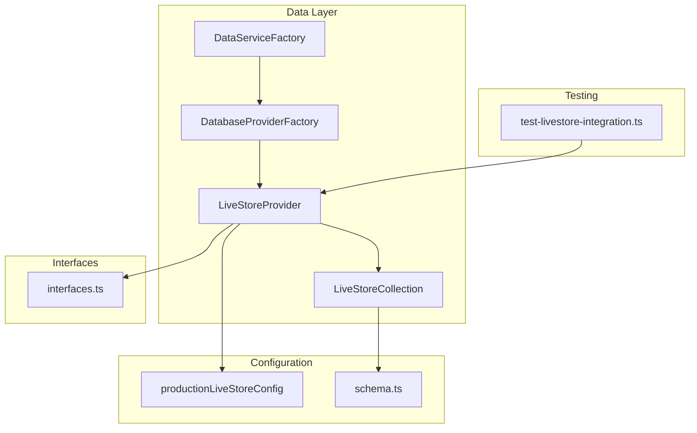
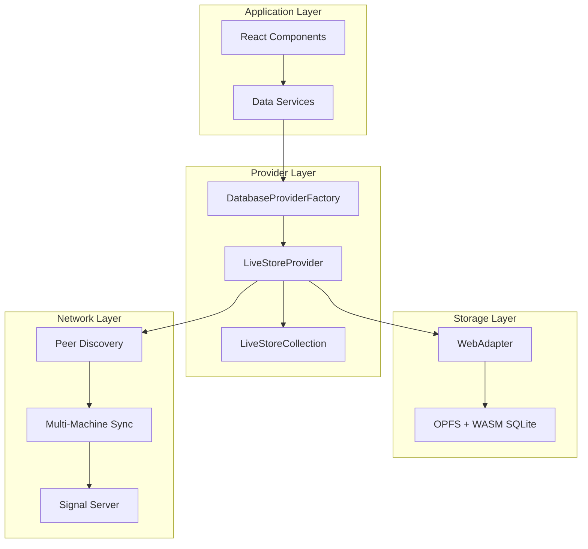
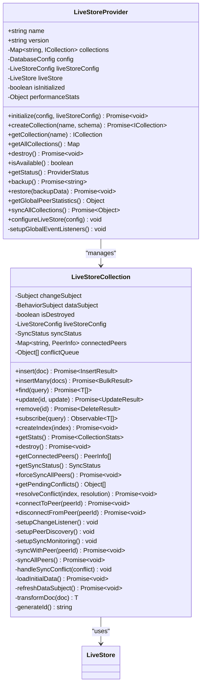
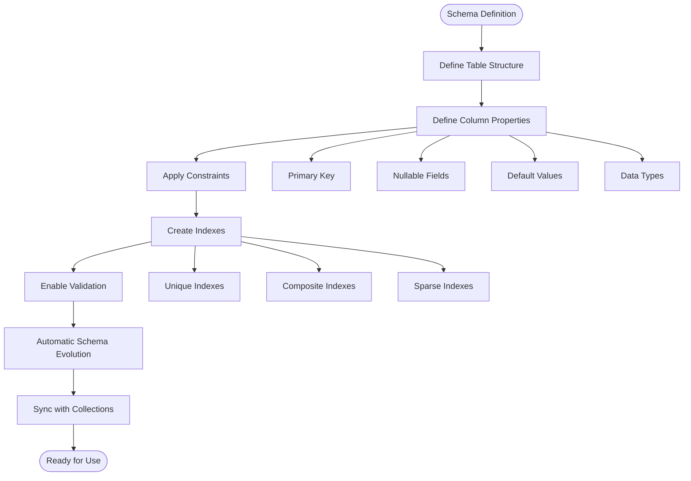

# LiveStore Provider

<cite>
**Referenced Files in This Document**
- [LiveStoreProvider.ts](file://src/services/database/LiveStoreProvider.ts)
- [schema.ts](file://src/livestore/schema.ts)
- [productionLiveStoreConfig.ts](file://src/config/productionLiveStoreConfig.ts)
- [interfaces.ts](file://src/services/database/interfaces.ts)
- [DatabaseProviderFactory.ts](file://src/services/database/DatabaseProviderFactory.ts)
- [DataServiceFactory.ts](file://src/services/data/DataServiceFactory.ts)
- [test-livestore-integration.ts](file://src/scripts/test-livestore-integration.ts)
</cite>

## Table of Contents
1. [Introduction](#introduction)
2. [Project Structure](#project-structure)
3. [Core Components](#core-components)
4. [Architecture Overview](#architecture-overview)
5. [Detailed Component Analysis](#detailed-component-analysis)
6. [Dependency Analysis](#dependency-analysis)
7. [Performance Considerations](#performance-considerations)
8. [Troubleshooting Guide](#troubleshooting-guide)
9. [Conclusion](#conclusion)
10. [Appendices](#appendices)

## Introduction
The LiveStore provider is a proprietary hybrid database solution integrated into the SchoolPilot3 ecosystem. It combines local storage with real-time synchronization, enabling offline-first operation with multi-machine sync capabilities. Built on top of the @livestore/livestore framework and @livestore/adapter-web, LiveStore delivers reactive data binding, automatic schema evolution, and conflict resolution mechanisms designed for distributed environments.

Key capabilities include:
- Real-time synchronization across multiple machines using WebRTC and peer discovery
- Local-first storage leveraging OPFS (Off-The-Record File System) and WebAssembly-enabled SQLite
- Reactive data binding through RxJS observables
- Automatic schema evolution and indexing support
- Conflict resolution strategies (client-wins, server-wins, last-write-wins, manual)
- Comprehensive monitoring, backup/restore, and recovery features

## Project Structure
The LiveStore provider is implemented as part of the broader data layer architecture within SchoolPilot3. The relevant components are organized as follows:



**Diagram sources**
- [DatabaseProviderFactory.ts:288-726](file://src/services/database/DatabaseProviderFactory.ts#L288-L726)
- [LiveStoreProvider.ts:807-1149](file://src/services/database/LiveStoreProvider.ts#L807-L1149)
- [productionLiveStoreConfig.ts:1-256](file://src/config/productionLiveStoreConfig.ts#L1-L256)
- [schema.ts:1-475](file://src/livestore/schema.ts#L1-L475)
- [interfaces.ts:1-253](file://src/services/database/interfaces.ts#L1-L253)
- [test-livestore-integration.ts:1-443](file://src/scripts/test-livestore-integration.ts#L1-L443)

**Section sources**
- [LiveStoreProvider.ts:1-1149](file://src/services/database/LiveStoreProvider.ts#L1-L1149)
- [DatabaseProviderFactory.ts:1-726](file://src/services/database/DatabaseProviderFactory.ts#L1-L726)
- [productionLiveStoreConfig.ts:1-256](file://src/config/productionLiveStoreConfig.ts#L1-L256)
- [schema.ts:1-475](file://src/livestore/schema.ts#L1-L475)
- [interfaces.ts:1-253](file://src/services/database/interfaces.ts#L1-L253)
- [test-livestore-integration.ts:1-443](file://src/scripts/test-livestore-integration.ts#L1-L443)

## Core Components
The LiveStore provider consists of several core components that work together to deliver a robust hybrid database solution:

### LiveStoreProvider
The main provider class that manages LiveStore initialization, collection lifecycle, and global operations. It implements the IDatabaseProvider interface and provides:
- Provider initialization with WebAdapter configuration
- Multi-machine sync setup with peer discovery
- Collection management and lifecycle
- Backup/restore functionality
- Performance monitoring and status reporting

### LiveStoreCollection
A specialized collection implementation that adds multi-machine sync capabilities:
- Real-time change subscriptions with RxJS observables
- Peer connection management and sync coordination
- Conflict detection and resolution
- Index creation and management
- Performance metrics and monitoring

### Schema Definition System
LiveStore uses a declarative schema definition system based on @livestore/livestore State.SQLite.table constructs. The schema covers:
- Core school information (schoolDetails)
- User management (users, roles)
- Academic structure (academicYears, schoolPeriods, financialYears)
- Student and staff management
- Departments, designations, and categories
- Finance entities (chartOfAccounts, expenseCategories, banks, suppliers)
- Fee templates and related structures

### Configuration Management
Production configuration includes:
- Database settings (OPFS storage, WASM SQLite, cross-tab persistence)
- Sync configuration (endpoint, intervals, conflict resolution)
- Performance tuning (cache size, timeouts, connections)
- Monitoring and security settings
- Recovery and backup policies

**Section sources**
- [LiveStoreProvider.ts:807-1149](file://src/services/database/LiveStoreProvider.ts#L807-L1149)
- [LiveStoreProvider.ts:71-804](file://src/services/database/LiveStoreProvider.ts#L71-L804)
- [schema.ts:29-379](file://src/livestore/schema.ts#L29-L379)
- [productionLiveStoreConfig.ts:16-126](file://src/config/productionLiveStoreConfig.ts#L16-L126)

## Architecture Overview
The LiveStore architecture follows a layered approach with clear separation of concerns:



**Diagram sources**
- [LiveStoreProvider.ts:845-880](file://src/services/database/LiveStoreProvider.ts#L845-L880)
- [DatabaseProviderFactory.ts:391-457](file://src/services/database/DatabaseProviderFactory.ts#L391-L457)

The architecture enables:
- **Offline-first operation**: Local storage ensures availability without network connectivity
- **Real-time synchronization**: Peer-to-peer sync maintains data consistency across devices
- **Scalable performance**: Configurable caching and indexing optimize query performance
- **Fault tolerance**: Conflict resolution and recovery mechanisms ensure data integrity

## Detailed Component Analysis

### LiveStoreProvider Implementation
The LiveStoreProvider serves as the central orchestrator for the entire system:



**Diagram sources**
- [LiveStoreProvider.ts:807-1149](file://src/services/database/LiveStoreProvider.ts#L807-L1149)
- [LiveStoreProvider.ts:71-804](file://src/services/database/LiveStoreProvider.ts#L71-L804)

Key implementation patterns include:
- **Factory Pattern**: Provider creation and lifecycle management
- **Observer Pattern**: Reactive data binding through RxJS observables
- **Strategy Pattern**: Configurable conflict resolution strategies
- **Adapter Pattern**: WebAdapter abstraction for storage backend

### Schema Definition System
The schema system provides automatic evolution and validation:



**Diagram sources**
- [schema.ts:29-379](file://src/livestore/schema.ts#L29-L379)

The schema system supports:
- **Column-level constraints**: Primary keys, nullability, defaults
- **Index management**: Unique, composite, and sparse indexes
- **Data type validation**: Strong typing with automatic conversion
- **Relationship modeling**: Foreign key relationships and referential integrity

### Configuration Management
Production configuration provides comprehensive control over LiveStore behavior:

```mermaid
flowchart TD
Config[Production Config] --> Database[Database Settings]
Config --> Sync[Sync Configuration]
Config --> Performance[Performance Tuning]
Config --> Monitoring[Monitoring & Analytics]
Config --> Security[Security Settings]
Config --> Recovery[Recovery & Backup]
Database --> OPFS[OPFS Storage]
Database --> WASM[WASM SQLite]
Database --> Persistence[Cross-Tab Persistence]
Sync --> Endpoint[Sync Endpoint]
Sync --> Interval[Sync Interval]
Sync --> Resolution[Conflict Resolution]
Sync --> Batch[Batch Size]
Performance --> Cache[Cache Size]
Performance --> Timeout[Query Timeout]
Performance --> Connections[Max Connections]
Performance --> Compression[Compression]
Monitoring --> Logging[Log Level]
Monitoring --> Metrics[Performance Metrics]
Monitoring --> Reporting[Error Reporting]
Security --> Encryption[Data Encryption]
Security --> Validation[Data Validation]
Security --> Access[Access Control]
Recovery --> AutoBackup[Auto Backup]
Recovery --> Retention[Backup Retention]
Recovery --> RecoveryMode[Recovery Mode]
```



**Diagram sources**
- [productionLiveStoreConfig.ts:16-126](file://src/config/productionLiveStoreConfig.ts#L16-L126)

**Section sources**
- [LiveStoreProvider.ts:807-1149](file://src/services/database/LiveStoreProvider.ts#L807-L1149)
- [schema.ts:29-379](file://src/livestore/schema.ts#L29-L379)
- [productionLiveStoreConfig.ts:16-256](file://src/config/productionLiveStoreConfig.ts#L16-L256)

## Dependency Analysis
The LiveStore provider has several key dependencies and relationships:

```mermaid
graph TB
subgraph "External Dependencies"
LS[@livestore/livestore]
WA[@livestore/adapter-web]
RX[rxjs]
TS[typescript]
end
subgraph "Internal Dependencies"
IF[interfaces.ts]
DF[DatabaseProviderFactory]
SC[schema.ts]
PC[productionLiveStoreConfig]
end
subgraph "Application Integration"
DP[DataServiceFactory]
AP[App Providers]
CT[Contexts]
end
LS --> WA
WA --> RX
RX --> IF
LiveStoreProvider --> LS
LiveStoreProvider --> IF
LiveStoreProvider --> PC
LiveStoreCollection --> RX
LiveStoreCollection --> IF
DF --> LiveStoreProvider
DP --> DF
AP --> CT
CT --> DP
```

**Diagram sources**
- [LiveStoreProvider.ts:4-24](file://src/services/database/LiveStoreProvider.ts#L4-L24)
- [DatabaseProviderFactory.ts:1-32](file://src/services/database/DatabaseProviderFactory.ts#L1-L32)
- [DataServiceFactory.ts:1-159](file://src/services/data/DataServiceFactory.ts#L1-L159)

Dependency characteristics:
- **Low coupling**: Clear separation between provider and application layers
- **High cohesion**: Related functionality grouped within single components
- **External dependencies**: Minimal third-party dependencies for core functionality
- **Internal consistency**: Well-defined interfaces and contracts

**Section sources**
- [LiveStoreProvider.ts:4-24](file://src/services/database/LiveStoreProvider.ts#L4-L24)
- [DatabaseProviderFactory.ts:1-32](file://src/services/database/DatabaseProviderFactory.ts#L1-L32)
- [DataServiceFactory.ts:1-159](file://src/services/data/DataServiceFactory.ts#L1-L159)

## Performance Considerations
LiveStore is optimized for performance across multiple dimensions:

### Storage Performance
- **OPFS Integration**: Uses modern browser storage APIs for optimal performance
- **WASM SQLite**: Leverages WebAssembly for near-native SQLite performance
- **Caching Strategy**: Configurable cache sizes with automatic eviction
- **Indexing**: Intelligent index creation for frequently queried fields

### Network Performance
- **Peer Discovery**: Efficient signaling with configurable STUN/TURN servers
- **Sync Optimization**: Batch processing with configurable batch sizes
- **Conflict Resolution**: Automated conflict resolution reduces network overhead
- **Connection Pooling**: Optimized connection management for multiple peers

### Memory Management
- **Garbage Collection**: Automatic memory cleanup for large datasets
- **Streaming Queries**: Support for large result sets without memory pressure
- **Compression**: Optional compression for reduced bandwidth usage

### Monitoring and Metrics
- **Performance Tracking**: Built-in metrics for query performance and resource usage
- **Health Monitoring**: Real-time status reporting for provider and collection health
- **Error Tracking**: Comprehensive error logging with contextual information

**Section sources**
- [productionLiveStoreConfig.ts:40-104](file://src/config/productionLiveStoreConfig.ts#L40-L104)
- [LiveStoreProvider.ts:161-195](file://src/services/database/LiveStoreProvider.ts#L161-L195)

## Troubleshooting Guide
Common issues and their resolutions:

### Initialization Issues
**Problem**: Provider fails to initialize
**Causes**: Missing dependencies, incompatible browser environment, configuration errors
**Solutions**:
- Verify browser support for IndexedDB and WebRTC
- Check environment variables for sync endpoints
- Validate database configuration settings
- Review console logs for specific error messages

### Sync Problems
**Problem**: Peers cannot connect or sync data
**Causes**: Network restrictions, firewall blocking, incorrect signaling server
**Solutions**:
- Test STUN/TURN server connectivity
- Verify firewall allows WebRTC traffic
- Check signal server configuration
- Review peer discovery logs

### Performance Issues
**Problem**: Slow queries or high memory usage
**Causes**: Missing indexes, large result sets, insufficient cache
**Solutions**:
- Create appropriate indexes for query patterns
- Implement pagination for large result sets
- Increase cache size for high-volume operations
- Optimize query selectors and filters

### Data Integrity Issues
**Problem**: Conflicts or data inconsistencies
**Causes**: Concurrent modifications, network partitions, conflict resolution misconfiguration
**Solutions**:
- Review conflict resolution strategy
- Implement proper error handling for sync failures
- Monitor conflict queue and resolve manually when needed
- Validate data schemas and constraints

**Section sources**
- [LiveStoreProvider.ts:882-900](file://src/services/database/LiveStoreProvider.ts#L882-L900)
- [LiveStoreProvider.ts:245-286](file://src/services/database/LiveStoreProvider.ts#L245-L286)

## Conclusion
The LiveStore provider represents a sophisticated hybrid database solution that successfully combines local-first storage with real-time synchronization. Its architecture provides:

**Strengths**:
- Robust offline-first design with automatic sync
- Comprehensive conflict resolution mechanisms
- Flexible configuration for various deployment scenarios
- Strong performance optimization through caching and indexing
- Reactive programming model with RxJS observables

**Integration Benefits**:
- Seamless integration with SchoolPilot3's dual-database architecture
- Support for multiple environments (development, staging, production)
- Extensive monitoring and debugging capabilities
- Configurable security and recovery features

**Limitations**:
- Browser dependency for WebRTC and OPFS support
- Network requirements for multi-machine sync
- Learning curve for reactive programming patterns
- Configuration complexity for advanced use cases

The provider is well-suited for applications requiring offline capability combined with real-time collaboration, making it an excellent choice for educational environments where reliable data access across multiple devices is essential.

## Appendices

### Setup Instructions
1. Install dependencies: `npm install @livestore/livestore @livestore/adapter-web`
2. Configure environment variables for sync endpoints
3. Initialize provider with appropriate configuration
4. Create collections with schema definitions
5. Implement reactive data binding in components

### Configuration Reference
- **Database**: OPFS storage, WASM SQLite, cross-tab persistence
- **Sync**: Endpoint configuration, interval settings, conflict resolution
- **Performance**: Cache sizing, timeout values, connection limits
- **Monitoring**: Log levels, error reporting, performance metrics
- **Security**: Data encryption, validation, access control
- **Recovery**: Auto-backup, retention policies, recovery mode

### Migration Procedures
- Use backup/restore functionality for major schema changes
- Implement gradual rollout of new sync configurations
- Test conflict resolution strategies during migration
- Monitor performance metrics during transition periods

### Integration Patterns
- **Reactive Components**: Use RxJS observables for real-time UI updates
- **Offline-First**: Implement local caching with sync reconciliation
- **Multi-Machine**: Leverage peer discovery for distributed collaboration
- **Error Handling**: Implement comprehensive error boundaries and recovery