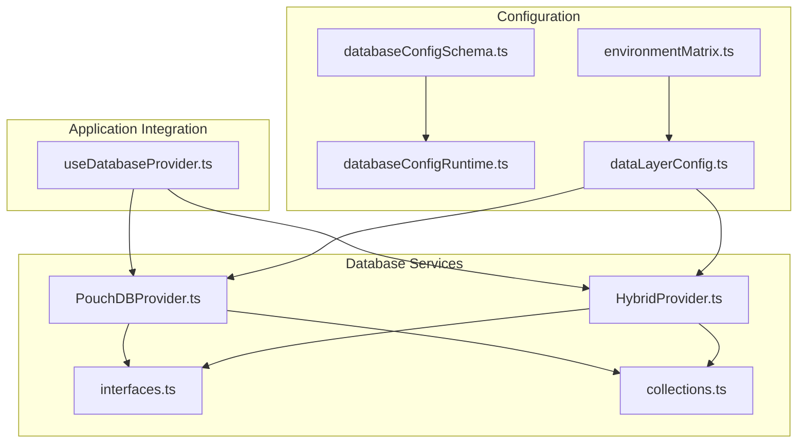
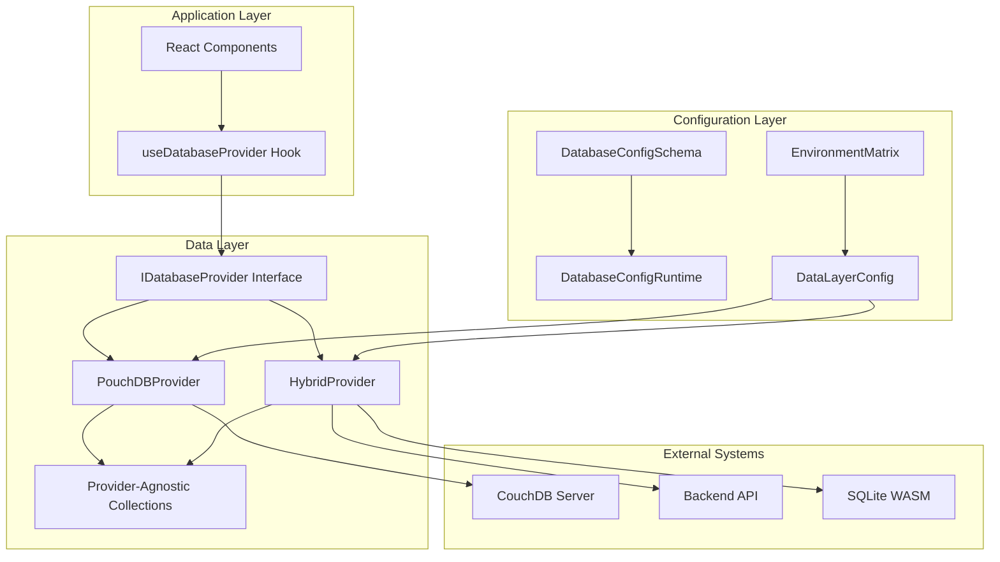
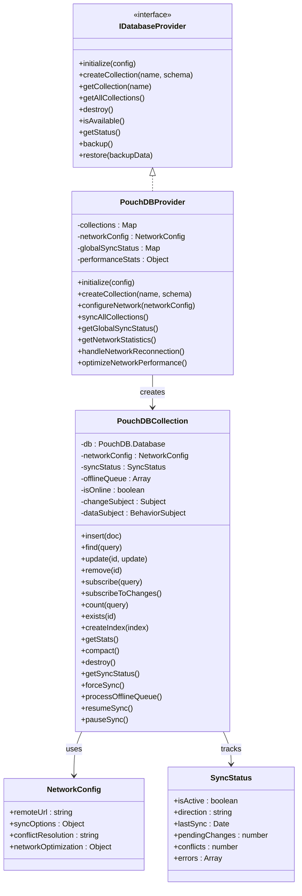
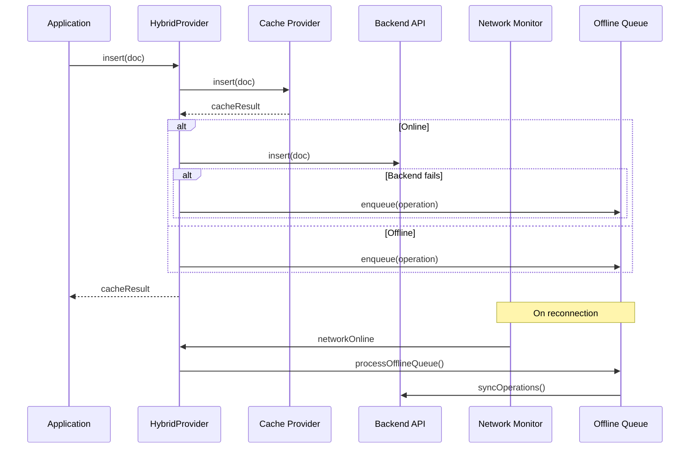
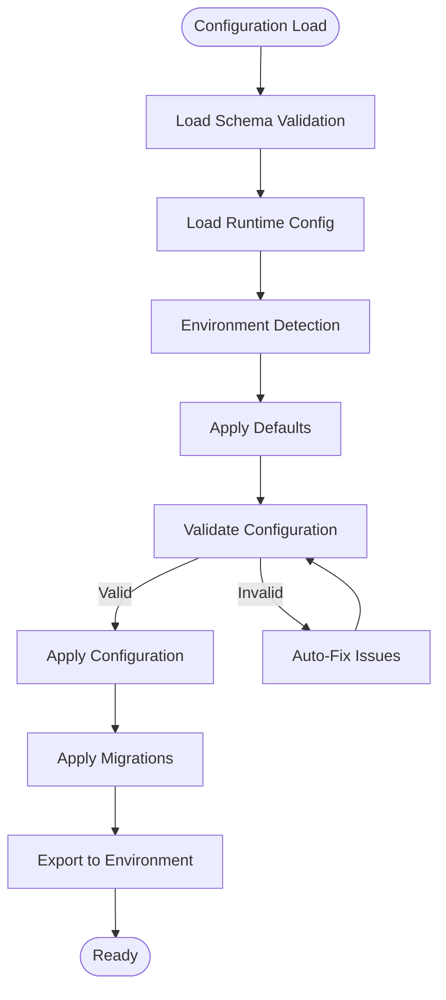
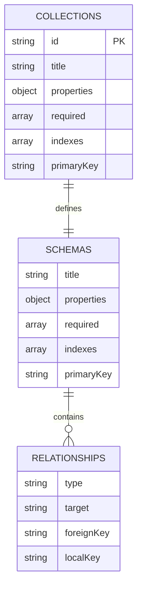
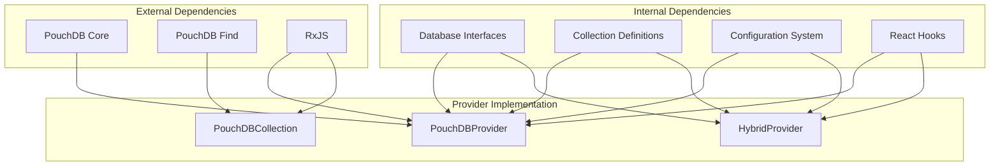

# PouchDB Provider

<cite>
**Referenced Files in This Document**
- [PouchDBProvider.ts](file://src/services/database/PouchDBProvider.ts)
- [HybridProvider.ts](file://src/services/database/HybridProvider.ts)
- [interfaces.ts](file://src/services/database/interfaces.ts)
- [collections.ts](file://src/services/database/collections.ts)
- [databaseConfigSchema.ts](file://src/config/databaseConfigSchema.ts)
- [databaseConfigRuntime.ts](file://src/config/databaseConfigRuntime.ts)
- [environmentMatrix.ts](file://src/config/environmentMatrix.ts)
- [dataLayerConfig.ts](file://src/config/dataLayerConfig.ts)
- [useDatabaseProvider.ts](file://src/hooks/useDatabaseProvider.ts)
- [ARCHITECTURE_DIAGRAMS.md](file://docs/architecture/ARCHITECTURE_DIAGRAMS.md)
- [DATA_LAYER_STRATEGY.md](file://docs/architecture/DATA_LAYER_STRATEGY.md)
</cite>

## Table of Contents
1. [Introduction](#introduction)
2. [Project Structure](#project-structure)
3. [Core Components](#core-components)
4. [Architecture Overview](#architecture-overview)
5. [Detailed Component Analysis](#detailed-component-analysis)
6. [Dependency Analysis](#dependency-analysis)
7. [Performance Considerations](#performance-considerations)
8. [Troubleshooting Guide](#troubleshooting-guide)
9. [Conclusion](#conclusion)

## Introduction
This document provides comprehensive documentation for the PouchDB provider and CouchDB synchronization capabilities within the system. It explains the document-based NoSQL approach, replication mechanisms, conflict resolution strategies, provider configuration, remote database connectivity, and offline-first architecture. It also covers the hybrid provider pattern that combines local PouchDB storage with remote API synchronization, setup instructions for CouchDB servers, authentication methods, network configuration, replication filters, bulk operations, performance optimization techniques, conflict detection and resolution algorithms, change tracking mechanisms, and data consistency guarantees. Finally, it includes a troubleshooting guide for common replication issues and network connectivity problems.

## Project Structure
The PouchDB provider implementation resides in the database services layer and integrates with the unified configuration system and React hooks for application integration. The key files include the PouchDB provider implementation, hybrid provider composition, configuration schemas, and integration hooks.

**Diagram sources**
- [PouchDBProvider.ts:1-1233](file://src/services/database/PouchDBProvider.ts#L1-L1233)
- [HybridProvider.ts:1-608](file://src/services/database/HybridProvider.ts#L1-L608)
- [interfaces.ts:1-253](file://src/services/database/interfaces.ts#L1-L253)
- [collections.ts:1-566](file://src/services/database/collections.ts#L1-L566)
- [databaseConfigSchema.ts:1-530](file://src/config/databaseConfigSchema.ts#L1-L530)
- [databaseConfigRuntime.ts:1-331](file://src/config/databaseConfigRuntime.ts#L1-L331)
- [environmentMatrix.ts:1-152](file://src/config/environmentMatrix.ts#L1-L152)
- [dataLayerConfig.ts:1-524](file://src/config/dataLayerConfig.ts#L1-L524)
- [useDatabaseProvider.ts:1-456](file://src/hooks/useDatabaseProvider.ts#L1-L456)

**Section sources**
- [PouchDBProvider.ts:1-1233](file://src/services/database/PouchDBProvider.ts#L1-L1233)
- [HybridProvider.ts:1-608](file://src/services/database/HybridProvider.ts#L1-L608)
- [interfaces.ts:1-253](file://src/services/database/interfaces.ts#L1-L253)
- [collections.ts:1-566](file://src/services/database/collections.ts#L1-L566)
- [databaseConfigSchema.ts:1-530](file://src/config/databaseConfigSchema.ts#L1-L530)
- [databaseConfigRuntime.ts:1-331](file://src/config/databaseConfigRuntime.ts#L1-L331)
- [environmentMatrix.ts:1-152](file://src/config/environmentMatrix.ts#L1-L152)
- [dataLayerConfig.ts:1-524](file://src/config/dataLayerConfig.ts#L1-L524)
- [useDatabaseProvider.ts:1-456](file://src/hooks/useDatabaseProvider.ts#L1-L456)

## Core Components
- PouchDBProvider: Implements the IDatabaseProvider interface with offline-first capabilities, automatic sync with remote CouchDB, conflict detection and resolution, real-time change feeds, and performance optimizations.
- PouchDBCollection: Provides collection-level operations with network-awareness, offline queue processing, and sync status tracking.
- HybridProvider: Composes BackendAPIProvider with a local cache provider (e.g., SQLite WASM or PouchDB) for offline-first architecture, automatic syncing when online, and offline queue management.
- Configuration System: Provides schema validation, runtime configuration loading, environment-specific defaults, and migration support for database configuration.
- Integration Hooks: React hooks that initialize providers, manage collections, and handle mock data migration.

Key capabilities:
- Document-based NoSQL storage with JSON documents and flexible schemas
- Bidirectional replication with CouchDB for real-time synchronization
- Conflict detection and resolution strategies (local wins, remote wins, manual)
- Offline-first architecture with automatic queue processing upon reconnection
- Reactive change subscriptions and real-time updates
- Bulk operations and performance optimizations (batching, compaction, indexing)
- Provider-agnostic collection definitions for schema portability

**Section sources**
- [PouchDBProvider.ts:1-1233](file://src/services/database/PouchDBProvider.ts#L1-L1233)
- [HybridProvider.ts:1-608](file://src/services/database/HybridProvider.ts#L1-L608)
- [interfaces.ts:1-253](file://src/services/database/interfaces.ts#L1-L253)
- [collections.ts:1-566](file://src/services/database/collections.ts#L1-L566)
- [databaseConfigSchema.ts:1-530](file://src/config/databaseConfigSchema.ts#L1-L530)
- [databaseConfigRuntime.ts:1-331](file://src/config/databaseConfigRuntime.ts#L1-L331)
- [useDatabaseProvider.ts:1-456](file://src/hooks/useDatabaseProvider.ts#L1-L456)

## Architecture Overview
The system follows a layered architecture with a unified data layer abstraction supporting multiple providers. The PouchDB provider enables offline-first document storage with automatic synchronization to CouchDB. The hybrid provider pattern allows combining local caching with backend API synchronization for robust offline capabilities.

**Diagram sources**
- [ARCHITECTURE_DIAGRAMS.md:184-251](file://docs/architecture/ARCHITECTURE_DIAGRAMS.md#L184-L251)
- [DATA_LAYER_STRATEGY.md:1-41](file://docs/architecture/DATA_LAYER_STRATEGY.md#L1-L41)
- [PouchDBProvider.ts:1-1233](file://src/services/database/PouchDBProvider.ts#L1-L1233)
- [HybridProvider.ts:1-608](file://src/services/database/HybridProvider.ts#L1-L608)
- [databaseConfigSchema.ts:1-530](file://src/config/databaseConfigSchema.ts#L1-L530)
- [databaseConfigRuntime.ts:1-331](file://src/config/databaseConfigRuntime.ts#L1-L331)
- [environmentMatrix.ts:1-152](file://src/config/environmentMatrix.ts#L1-L152)
- [dataLayerConfig.ts:1-524](file://src/config/dataLayerConfig.ts#L1-L524)

## Detailed Component Analysis

### PouchDB Provider Implementation
The PouchDB provider implements a comprehensive offline-first data layer with robust synchronization capabilities.

**Diagram sources**
- [interfaces.ts:178-253](file://src/services/database/interfaces.ts#L178-L253)
- [PouchDBProvider.ts:1-1233](file://src/services/database/PouchDBProvider.ts#L1-L1233)

#### Core Features
- **Offline-First Architecture**: Automatic offline queue processing with optimistic updates
- **Real-Time Synchronization**: Continuous bidirectional sync with CouchDB using PouchDB replication
- **Conflict Resolution**: Pluggable conflict resolution strategies (local wins, remote wins, manual)
- **Change Tracking**: Reactive change subscriptions with real-time updates
- **Performance Optimization**: Batch processing, compaction, and network optimization
- **Collection Management**: Provider-agnostic collection definitions with schema validation

#### Network Configuration
The provider supports extensive network configuration including:
- Remote URL configuration for CouchDB connectivity
- Sync options for heartbeat, timeout, and batch size
- Conflict resolution strategies
- Network optimization settings for compression and batching

**Section sources**
- [PouchDBProvider.ts:1-1233](file://src/services/database/PouchDBProvider.ts#L1-L1233)
- [interfaces.ts:32-61](file://src/services/database/interfaces.ts#L32-L61)

### Hybrid Provider Pattern
The hybrid provider combines local caching with backend API synchronization for maximum reliability and offline capability.

**Diagram sources**
- [HybridProvider.ts:1-608](file://src/services/database/HybridProvider.ts#L1-L608)

#### Hybrid Provider Benefits
- **Cache-First Reads**: Immediate responses from local cache
- **Automatic Sync**: Seamless synchronization when online
- **Offline Queue**: Reliable operation during connectivity issues
- **Fallback Mechanism**: Graceful degradation to backend API when cache unavailable
- **Provider Flexibility**: Support for multiple cache providers (SQLite WASM, PouchDB, RxDB)

**Section sources**
- [HybridProvider.ts:1-608](file://src/services/database/HybridProvider.ts#L1-L608)

### Configuration System
The configuration system provides comprehensive validation, migration, and runtime loading of database settings.

**Diagram sources**
- [databaseConfigSchema.ts:305-530](file://src/config/databaseConfigSchema.ts#L305-L530)
- [databaseConfigRuntime.ts:77-331](file://src/config/databaseConfigRuntime.ts#L77-L331)
- [environmentMatrix.ts:1-152](file://src/config/environmentMatrix.ts#L1-L152)
- [dataLayerConfig.ts:1-524](file://src/config/dataLayerConfig.ts#L1-L524)

#### Configuration Features
- **Schema Validation**: Comprehensive validation rules with severity levels
- **Auto-Fix Capabilities**: Automatic correction of invalid configurations
- **Migration System**: Version-based configuration migrations
- **Environment-Specific Defaults**: Different defaults for development, staging, and production
- **Runtime Loading**: Support for environment variables and JSON file configuration
- **Export Functionality**: Configuration export to environment variables

**Section sources**
- [databaseConfigSchema.ts:1-530](file://src/config/databaseConfigSchema.ts#L1-L530)
- [databaseConfigRuntime.ts:1-331](file://src/config/databaseConfigRuntime.ts#L1-L331)
- [environmentMatrix.ts:1-152](file://src/config/environmentMatrix.ts#L1-L152)
- [dataLayerConfig.ts:1-524](file://src/config/dataLayerConfig.ts#L1-L524)

### Collection Definitions
The system uses provider-agnostic collection definitions that work across different database providers.

**Diagram sources**
- [collections.ts:1-566](file://src/services/database/collections.ts#L1-L566)

#### Collection Categories
- **Core Collections**: 24 essential collections for system functionality
- **Module Collections**: 64 collections across various modules (academics, administration, finance, etc.)
- **Provider-Agnostic**: Schema definitions independent of specific database providers

**Section sources**
- [collections.ts:1-566](file://src/services/database/collections.ts#L1-L566)

## Dependency Analysis
The PouchDB provider has well-defined dependencies and follows clean architecture principles with clear separation of concerns.

**Diagram sources**
- [PouchDBProvider.ts:1-1233](file://src/services/database/PouchDBProvider.ts#L1-L1233)
- [HybridProvider.ts:1-608](file://src/services/database/HybridProvider.ts#L1-L608)
- [interfaces.ts:1-253](file://src/services/database/interfaces.ts#L1-L253)
- [collections.ts:1-566](file://src/services/database/collections.ts#L1-L566)

### Coupling and Cohesion
- **High Cohesion**: Each component focuses on a specific responsibility
- **Low Coupling**: Clear interfaces minimize dependencies between components
- **External Dependencies**: Minimal external dependencies with clear plugin architecture
- **Internal Dependencies**: Well-structured internal dependencies supporting maintainability

**Section sources**
- [PouchDBProvider.ts:1-1233](file://src/services/database/PouchDBProvider.ts#L1-L1233)
- [HybridProvider.ts:1-608](file://src/services/database/HybridProvider.ts#L1-L608)
- [interfaces.ts:1-253](file://src/services/database/interfaces.ts#L1-L253)

## Performance Considerations
The PouchDB provider implements several performance optimization techniques:

### Network Optimization
- **Batch Processing**: Configurable batch sizes for efficient data transfer
- **Compression**: Automatic compression for reduced bandwidth usage
- **Heartbeat Monitoring**: Continuous connection health checks
- **Exponential Backoff**: Intelligent retry mechanisms for failed operations

### Storage Optimization
- **Revision Limits**: Controlled revision history to prevent database bloat
- **Auto-Compaction**: Regular database cleanup to maintain performance
- **Index Management**: Efficient indexing strategies for query performance
- **Memory Management**: Optimized memory usage for browser environments

### Operational Efficiency
- **Offline Queue Processing**: Batch processing of queued operations upon reconnection
- **Selective Sync**: Configurable sync filters to reduce data transfer
- **Change Tracking**: Efficient change detection and propagation
- **Resource Cleanup**: Proper resource management and cleanup procedures

## Troubleshooting Guide

### Common Replication Issues
1. **Sync Not Starting**
   - Verify remote URL configuration in network settings
   - Check network connectivity and firewall settings
   - Review sync options (heartbeat, timeout, batch size)
   - Monitor sync status through provider diagnostics

2. **Conflict Resolution Failures**
   - Check conflict resolution strategy configuration
   - Review manual conflict handling procedures
   - Monitor conflict counters in sync status
   - Implement proper conflict resolution workflows

3. **Offline Queue Processing**
   - Verify offline queue initialization
   - Check operation types being queued
   - Monitor queue size and processing status
   - Review error logs for failed operations

### Network Connectivity Problems
1. **Connection Drops**
   - Implement exponential backoff retry logic
   - Monitor network status changes
   - Handle graceful degradation to offline mode
   - Restore sync automatically upon reconnection

2. **Authentication Issues**
   - Verify CouchDB authentication credentials
   - Check CORS configuration for web clients
   - Review SSL/TLS certificate settings
   - Test authentication endpoints separately

3. **Performance Degradation**
   - Monitor sync performance metrics
   - Adjust batch sizes and heartbeat intervals
   - Implement database compaction strategies
   - Review index usage and optimization

### Configuration Validation
Use the configuration validation system to identify and fix issues:
- Run configuration validation on startup
- Apply auto-fixes for minor issues
- Review validation errors and warnings
- Check migration status for configuration updates

**Section sources**
- [PouchDBProvider.ts:150-226](file://src/services/database/PouchDBProvider.ts#L150-L226)
- [PouchDBProvider.ts:243-273](file://src/services/database/PouchDBProvider.ts#L243-L273)
- [databaseConfigSchema.ts:317-360](file://src/config/databaseConfigSchema.ts#L317-L360)

## Conclusion
The PouchDB provider delivers a robust, offline-first document database solution with comprehensive CouchDB synchronization capabilities. Its architecture supports multiple deployment modes, provides flexible configuration options, and implements sophisticated conflict resolution strategies. The hybrid provider pattern enhances reliability by combining local caching with backend API synchronization. With extensive performance optimizations, comprehensive error handling, and detailed troubleshooting capabilities, the system provides a solid foundation for modern, distributed applications requiring reliable data synchronization and offline functionality.

The provider's design emphasizes maintainability through clean interfaces, clear separation of concerns, and comprehensive testing support. The configuration system ensures reliable operation across different environments while providing flexibility for customization. Together, these components create a powerful data layer capable of supporting complex, real-world applications with demanding synchronization and offline requirements.