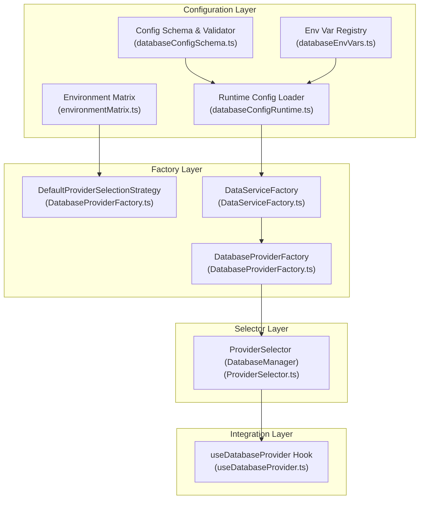
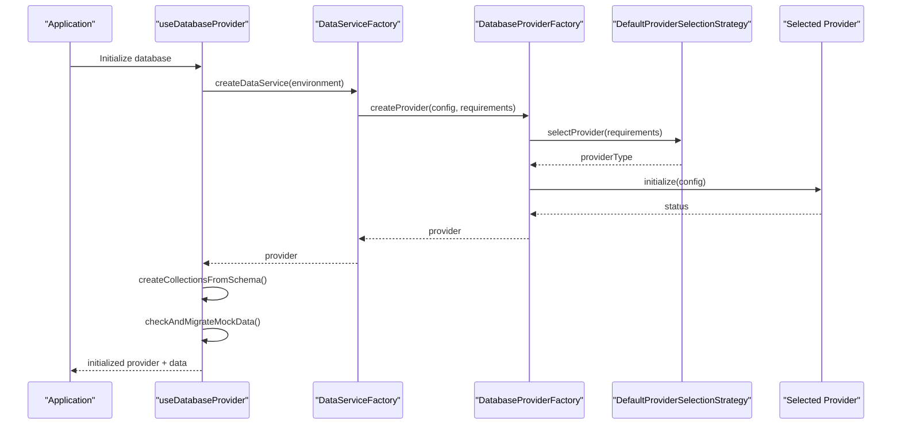
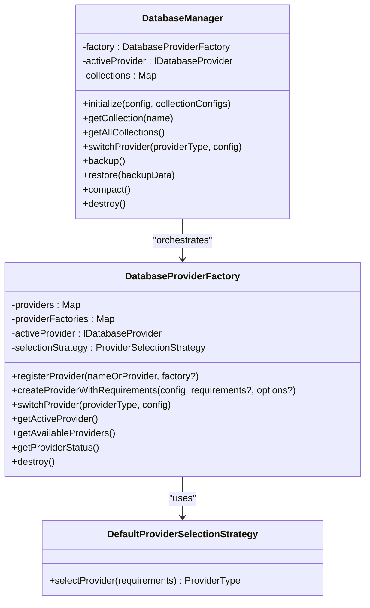
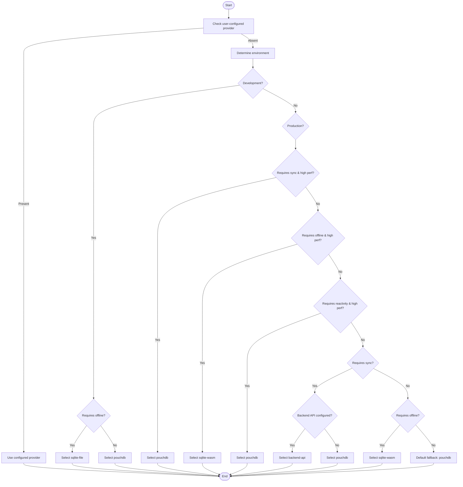
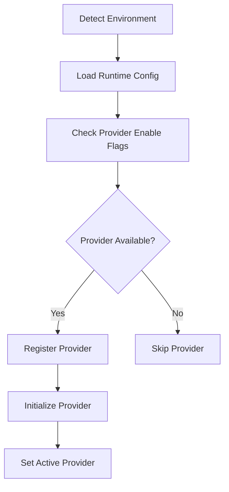
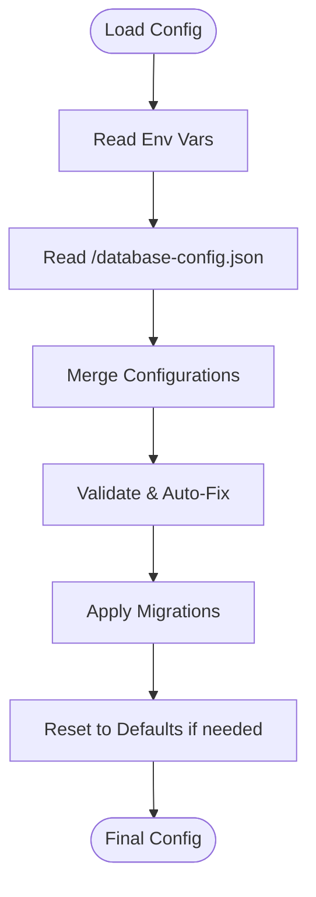
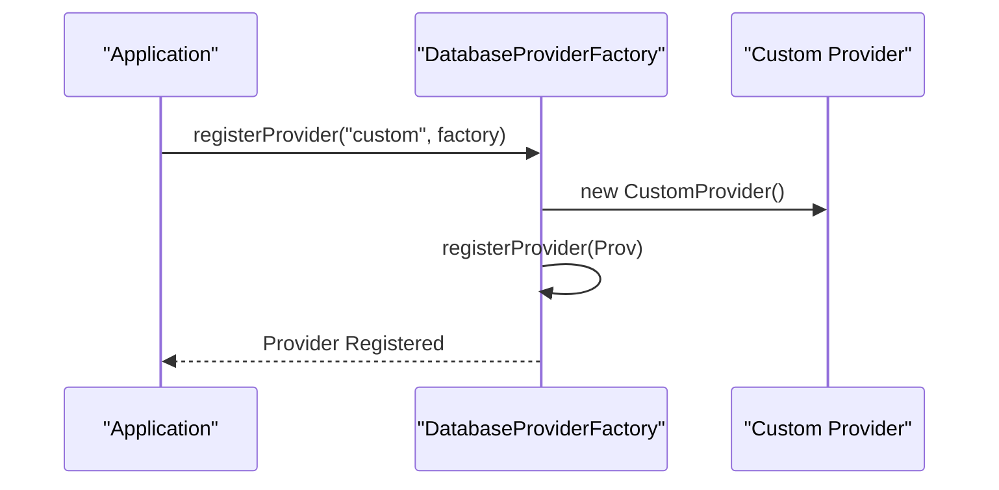
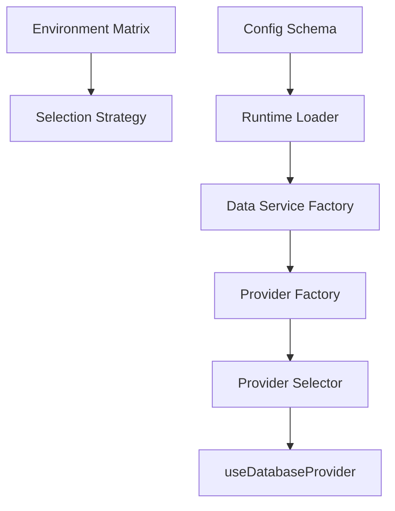

# Provider Selection & Factory

<cite>
**Referenced Files in This Document**
- [environmentMatrix.ts](file://src/config/environmentMatrix.ts)
- [databaseConfigSchema.ts](file://src/config/databaseConfigSchema.ts)
- [databaseConfigRuntime.ts](file://src/config/databaseConfigRuntime.ts)
- [databaseEnvVars.ts](file://src/config/databaseEnvVars.ts)
- [DatabaseProviderFactory.ts](file://src/services/database/DatabaseProviderFactory.ts)
- [ProviderSelector.ts](file://src/services/database/ProviderSelector.ts)
- [DataServiceFactory.ts](file://src/services/data/DataServiceFactory.ts)
- [useDatabaseProvider.ts](file://src/hooks/useDatabaseProvider.ts)
</cite>

## Table of Contents
1. [Introduction](#introduction)
2. [Project Structure](#project-structure)
3. [Core Components](#core-components)
4. [Architecture Overview](#architecture-overview)
5. [Detailed Component Analysis](#detailed-component-analysis)
6. [Dependency Analysis](#dependency-analysis)
7. [Performance Considerations](#performance-considerations)
8. [Troubleshooting Guide](#troubleshooting-guide)
9. [Conclusion](#conclusion)

## Introduction
This document explains the database provider selection and factory system in SchoolPilot3. It covers the provider factory pattern, capability detection mechanisms, and runtime selection logic used to choose the optimal database provider. The ProviderSelector algorithm evaluates environment capabilities, browser support, and deployment requirements to pick the best provider among SQLite WASM, PouchDB, Backend API, and others. It also documents configuration options for manual provider selection, fallback strategies, environment-specific overrides, factory registration, extensibility for custom providers, testing strategies, debugging techniques, and performance comparisons.

## Project Structure
The database provider system spans configuration, factory, selector, and integration layers:
- Configuration: Environment matrix, validation schema, runtime loaders, and environment variables
- Factory: Provider factory with selection strategy and fallback logic
- Selector: Database manager orchestrating provider lifecycle and collection management
- Integration: Data service factory and React hook for application integration

**Diagram sources**
- [environmentMatrix.ts:1-152](file://src/config/environmentMatrix.ts#L1-L152)
- [databaseConfigSchema.ts:1-530](file://src/config/databaseConfigSchema.ts#L1-L530)
- [databaseConfigRuntime.ts:1-331](file://src/config/databaseConfigRuntime.ts#L1-L331)
- [databaseEnvVars.ts:1-41](file://src/config/databaseEnvVars.ts#L1-L41)
- [DatabaseProviderFactory.ts:1-726](file://src/services/database/DatabaseProviderFactory.ts#L1-L726)
- [ProviderSelector.ts:1-451](file://src/services/database/ProviderSelector.ts#L1-L451)
- [DataServiceFactory.ts:1-159](file://src/services/data/DataServiceFactory.ts#L1-L159)
- [useDatabaseProvider.ts:1-456](file://src/hooks/useDatabaseProvider.ts#L1-L456)

**Section sources**
- [environmentMatrix.ts:1-152](file://src/config/environmentMatrix.ts#L1-L152)
- [databaseConfigSchema.ts:1-530](file://src/config/databaseConfigSchema.ts#L1-L530)
- [databaseConfigRuntime.ts:1-331](file://src/config/databaseConfigRuntime.ts#L1-L331)
- [databaseEnvVars.ts:1-41](file://src/config/databaseEnvVars.ts#L1-L41)
- [DatabaseProviderFactory.ts:1-726](file://src/services/database/DatabaseProviderFactory.ts#L1-L726)
- [ProviderSelector.ts:1-451](file://src/services/database/ProviderSelector.ts#L1-L451)
- [DataServiceFactory.ts:1-159](file://src/services/data/DataServiceFactory.ts#L1-L159)
- [useDatabaseProvider.ts:1-456](file://src/hooks/useDatabaseProvider.ts#L1-L456)

## Core Components
- Environment Matrix: Defines allowed providers and defaults per environment (development, staging, production)
- Configuration Schema & Validator: Validates and repairs database configuration with auto-fix and migration support
- Runtime Config Loader: Loads configuration from environment variables and JSON file
- DatabaseProviderFactory: Factory implementing provider registration, selection strategy, and fallback logic
- ProviderSelector (DatabaseManager): Orchestrates provider lifecycle, collection creation, and status monitoring
- DataServiceFactory: Creates data services tailored to environment and configuration
- useDatabaseProvider Hook: React integration for initializing provider, collections, migration, and data loading

**Section sources**
- [environmentMatrix.ts:1-152](file://src/config/environmentMatrix.ts#L1-L152)
- [databaseConfigSchema.ts:305-530](file://src/config/databaseConfigSchema.ts#L305-L530)
- [databaseConfigRuntime.ts:77-248](file://src/config/databaseConfigRuntime.ts#L77-L248)
- [DatabaseProviderFactory.ts:288-726](file://src/services/database/DatabaseProviderFactory.ts#L288-L726)
- [ProviderSelector.ts:31-242](file://src/services/database/ProviderSelector.ts#L31-L242)
- [DataServiceFactory.ts:37-159](file://src/services/data/DataServiceFactory.ts#L37-L159)
- [useDatabaseProvider.ts:48-456](file://src/hooks/useDatabaseProvider.ts#L48-L456)

## Architecture Overview
The system follows a layered architecture:
- Configuration layer determines environment and allowed providers
- Factory layer selects and instantiates providers with capability checks and fallbacks
- Selector layer manages provider lifecycle and collection orchestration
- Integration layer exposes a React hook for application consumption

**Diagram sources**
- [useDatabaseProvider.ts:69-103](file://src/hooks/useDatabaseProvider.ts#L69-L103)
- [DataServiceFactory.ts:37-151](file://src/services/data/DataServiceFactory.ts#L37-L151)
- [DatabaseProviderFactory.ts:477-531](file://src/services/database/DatabaseProviderFactory.ts#L477-L531)
- [DatabaseProviderFactory.ts:40-117](file://src/services/database/DatabaseProviderFactory.ts#L40-L117)

## Detailed Component Analysis

### Provider Factory Pattern and Registration
The factory encapsulates provider registration and lifecycle management:
- Registers providers based on environment variables and availability
- Supports dynamic registration via factory functions
- Provides fallback providers and a mock provider for resilience
- Exposes status monitoring and provider switching (development only)

**Diagram sources**
- [DatabaseProviderFactory.ts:288-726](file://src/services/database/DatabaseProviderFactory.ts#L288-L726)
- [ProviderSelector.ts:31-242](file://src/services/database/ProviderSelector.ts#L31-L242)

**Section sources**
- [DatabaseProviderFactory.ts:288-726](file://src/services/database/DatabaseProviderFactory.ts#L288-L726)
- [ProviderSelector.ts:31-242](file://src/services/database/ProviderSelector.ts#L31-L242)

### Provider Selection Strategy (ProviderSelector Algorithm)
The selection strategy evaluates:
- User-configured provider override
- Environment defaults
- Requirement flags (offline, sync, reactivity, performance)
- Backend API availability

**Diagram sources**
- [DatabaseProviderFactory.ts:40-117](file://src/services/database/DatabaseProviderFactory.ts#L40-L117)

**Section sources**
- [DatabaseProviderFactory.ts:40-117](file://src/services/database/DatabaseProviderFactory.ts#L40-L117)

### Capability Detection and Browser Support
Capability detection is integrated into provider registration and selection:
- Environment detection determines deployment mode
- Provider availability is checked before initialization
- Environment variables toggle provider enablement
- Demo/production modes adjust storage and performance settings

**Diagram sources**
- [environmentMatrix.ts:88-115](file://src/config/environmentMatrix.ts#L88-L115)
- [databaseConfigRuntime.ts:77-248](file://src/config/databaseConfigRuntime.ts#L77-L248)
- [DatabaseProviderFactory.ts:391-475](file://src/services/database/DatabaseProviderFactory.ts#L391-L475)

**Section sources**
- [environmentMatrix.ts:88-115](file://src/config/environmentMatrix.ts#L88-L115)
- [databaseConfigRuntime.ts:77-248](file://src/config/databaseConfigRuntime.ts#L77-L248)
- [DatabaseProviderFactory.ts:391-475](file://src/services/database/DatabaseProviderFactory.ts#L391-L475)

### Configuration Options and Overrides
Configuration supports:
- Manual provider selection via environment variables
- Auto-detection toggles
- Performance, storage, sync, monitoring, and feature flags
- File-based configuration loading and environment export
- Validation, auto-fix, and migration utilities

**Diagram sources**
- [databaseConfigRuntime.ts:250-265](file://src/config/databaseConfigRuntime.ts#L250-L265)
- [databaseConfigSchema.ts:317-492](file://src/config/databaseConfigSchema.ts#L317-L492)
- [databaseEnvVars.ts:4-41](file://src/config/databaseEnvVars.ts#L4-L41)

**Section sources**
- [databaseConfigRuntime.ts:77-248](file://src/config/databaseConfigRuntime.ts#L77-L248)
- [databaseConfigSchema.ts:317-492](file://src/config/databaseConfigSchema.ts#L317-L492)
- [databaseEnvVars.ts:4-41](file://src/config/databaseEnvVars.ts#L4-L41)

### Factory Pattern Implementation and Extensibility
Extensibility points:
- Register custom providers via factory functions
- Implement custom selection strategies
- Extend configuration with environment-specific overrides
- Add new provider types by implementing the provider interface

**Diagram sources**
- [DatabaseProviderFactory.ts:313-327](file://src/services/database/DatabaseProviderFactory.ts#L313-L327)

**Section sources**
- [DatabaseProviderFactory.ts:313-327](file://src/services/database/DatabaseProviderFactory.ts#L313-L327)

### Testing Strategies and Debugging
Testing approaches:
- Unit tests for provider selection logic
- Integration tests for factory initialization and fallbacks
- Mock data migration tests
- Performance benchmarking across providers

Debugging techniques:
- Console logs during provider initialization and selection
- Status monitoring via provider status APIs
- Error boundaries and graceful fallbacks
- Environment variable toggles for enabling/disabling providers

**Section sources**
- [useDatabaseProvider.ts:96-103](file://src/hooks/useDatabaseProvider.ts#L96-L103)
- [DatabaseProviderFactory.ts:524-531](file://src/services/database/DatabaseProviderFactory.ts#L524-L531)
- [ProviderSelector.ts:123-126](file://src/services/database/ProviderSelector.ts#L123-L126)

## Dependency Analysis
The system exhibits low coupling and high cohesion:
- Configuration layer decouples environment detection from provider logic
- Factory encapsulates provider lifecycle and selection
- Selector isolates collection management and status monitoring
- Integration layer provides a clean React interface

**Diagram sources**
- [environmentMatrix.ts:1-152](file://src/config/environmentMatrix.ts#L1-L152)
- [databaseConfigSchema.ts:1-530](file://src/config/databaseConfigSchema.ts#L1-L530)
- [databaseConfigRuntime.ts:1-331](file://src/config/databaseConfigRuntime.ts#L1-L331)
- [DataServiceFactory.ts:1-159](file://src/services/data/DataServiceFactory.ts#L1-L159)
- [DatabaseProviderFactory.ts:1-726](file://src/services/database/DatabaseProviderFactory.ts#L1-L726)
- [ProviderSelector.ts:1-451](file://src/services/database/ProviderSelector.ts#L1-L451)
- [useDatabaseProvider.ts:1-456](file://src/hooks/useDatabaseProvider.ts#L1-L456)

**Section sources**
- [environmentMatrix.ts:1-152](file://src/config/environmentMatrix.ts#L1-L152)
- [databaseConfigSchema.ts:1-530](file://src/config/databaseConfigSchema.ts#L1-L530)
- [databaseConfigRuntime.ts:1-331](file://src/config/databaseConfigRuntime.ts#L1-L331)
- [DataServiceFactory.ts:1-159](file://src/services/data/DataServiceFactory.ts#L1-L159)
- [DatabaseProviderFactory.ts:1-726](file://src/services/database/DatabaseProviderFactory.ts#L1-L726)
- [ProviderSelector.ts:1-451](file://src/services/database/ProviderSelector.ts#L1-L451)
- [useDatabaseProvider.ts:1-456](file://src/hooks/useDatabaseProvider.ts#L1-L456)

## Performance Considerations
- SQLite WASM excels in offline-first scenarios with strong query performance
- PouchDB offers robust synchronization and reactivity but may require careful indexing
- Backend API reduces client-side overhead but depends on network reliability
- LiveStore configurations in production emphasize caching and performance metrics
- Use environment-specific storage settings (OPFS, memory, file) to optimize performance

## Troubleshooting Guide
Common issues and resolutions:
- Provider not available: The factory attempts fallback providers; verify environment variables and browser support
- Sync failures: Confirm backend API configuration, CORS, and network connectivity
- Performance bottlenecks: Adjust cache sizes, query timeouts, and batch sizes via configuration
- Migration problems: Ensure mock data readiness and collection existence before migration

**Section sources**
- [DatabaseProviderFactory.ts:504-524](file://src/services/database/DatabaseProviderFactory.ts#L504-L524)
- [databaseConfigSchema.ts:317-492](file://src/config/databaseConfigSchema.ts#L317-L492)
- [useDatabaseProvider.ts:148-176](file://src/hooks/useDatabaseProvider.ts#L148-L176)

## Conclusion
SchoolPilot3’s database provider selection and factory system provides a robust, configurable, and extensible foundation for choosing and managing database providers. The combination of environment-aware defaults, capability detection, and comprehensive fallback logic ensures reliable operation across diverse deployment scenarios. The factory pattern and selector architecture enable easy extension with custom providers and maintainability through clear separation of concerns.