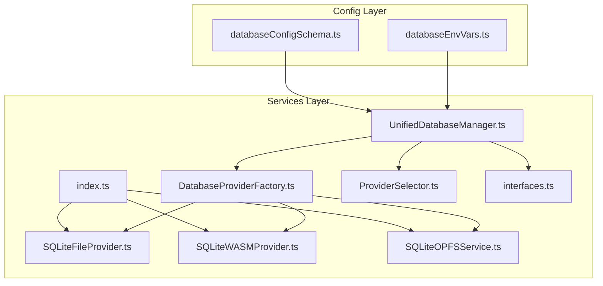
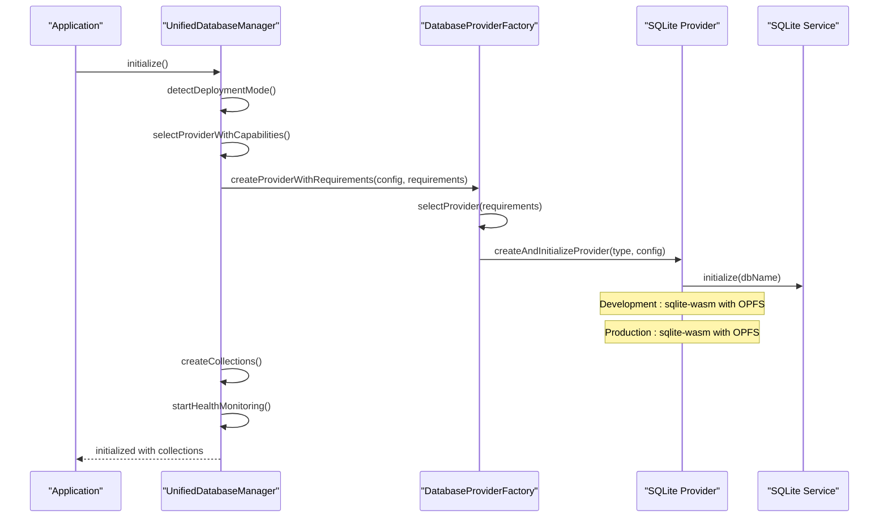
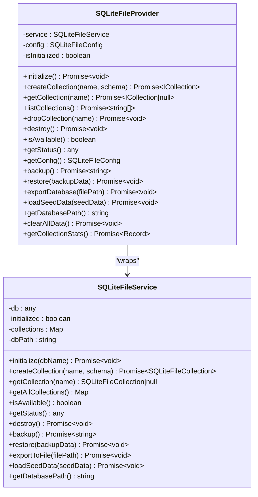
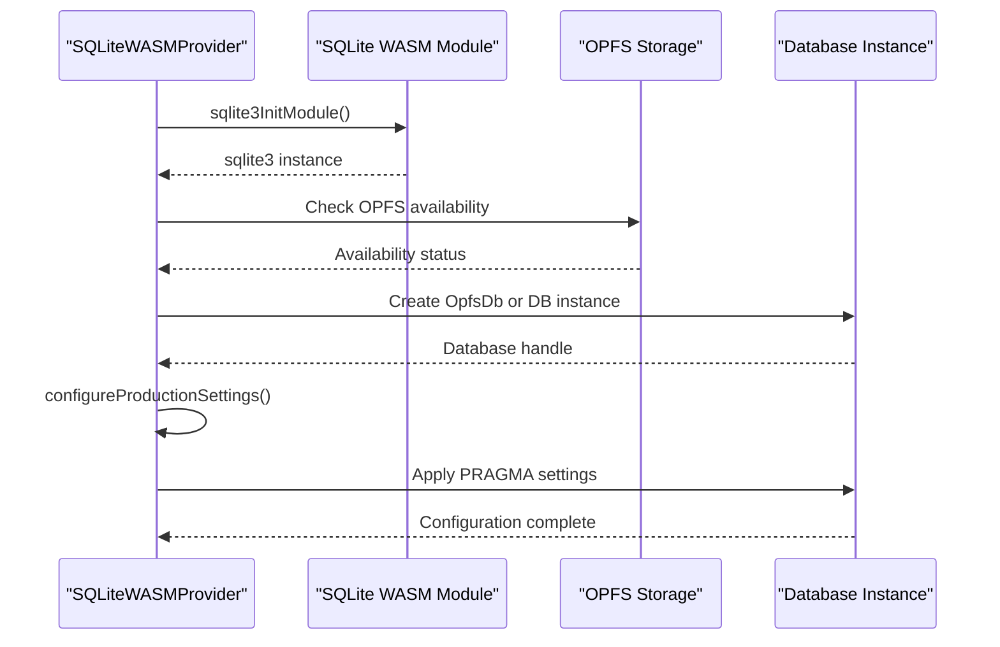
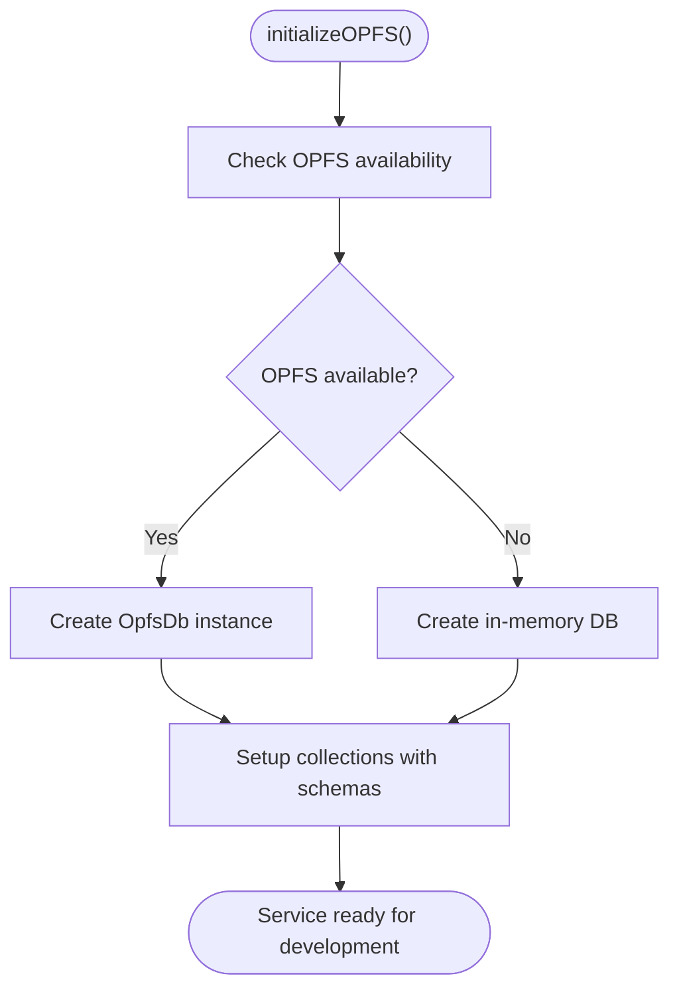
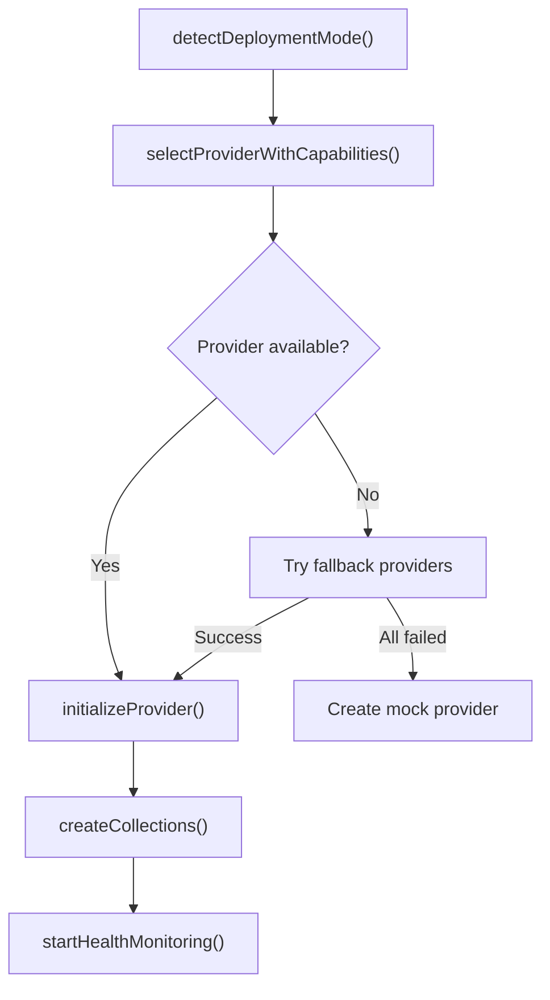
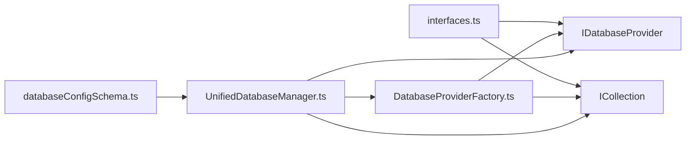

# SQLite Provider

<cite>
**Referenced Files in This Document**
- [SQLiteFileProvider.ts](file://src/services/database/SQLiteFileProvider.ts)
- [SQLiteWASMProvider.ts](file://src/services/database/SQLiteWASMProvider.ts)
- [SQLiteOPFSService.ts](file://src/services/sqlite/SQLiteOPFSService.ts)
- [index.ts](file://src/services/sqlite/index.ts)
- [UnifiedDatabaseManager.ts](file://src/services/database/UnifiedDatabaseManager.ts)
- [DatabaseProviderFactory.ts](file://src/services/database/DatabaseProviderFactory.ts)
- [ProviderSelector.ts](file://src/services/database/ProviderSelector.ts)
- [interfaces.ts](file://src/services/database/interfaces.ts)
- [databaseConfigSchema.ts](file://src/config/databaseConfigSchema.ts)
- [databaseEnvVars.ts](file://src/config/databaseEnvVars.ts)
- [sqlite-opfs-implementation.md](file://docs/database/sqlite-opfs-implementation.md)
- [SelfHosting.test.ts](file://src/services/database/__tests__/SelfHosting.test.ts)
- [SQLiteWASMProvider.test.ts](file://src/services/database/__tests__/SQLiteWASMProvider.test.ts)
</cite>

## Update Summary
**Changes Made**
- Updated provider selection logic to reflect SQLite WASM with OPFS as default development provider
- Added comprehensive SQLite WASM provider documentation with OPFS integration
- Enhanced configuration validation and environment variable handling
- Updated setup instructions to reflect persistent offline-capable storage replacement for mock data
- Added transaction management and production settings configuration details

## Table of Contents
1. [Introduction](#introduction)
2. [Project Structure](#project-structure)
3. [Core Components](#core-components)
4. [Architecture Overview](#architecture-overview)
5. [Detailed Component Analysis](#detailed-component-analysis)
6. [Dependency Analysis](#dependency-analysis)
7. [Performance Considerations](#performance-considerations)
8. [Troubleshooting Guide](#troubleshooting-guide)
9. [Conclusion](#conclusion)
10. [Appendices](#appendices)

## Introduction
This document explains the SQLite provider implementation in SchoolPilot3, focusing on the three SQLite variants:
- File-based SQLite for Node.js environments
- SQLite WASM for browser environments with OPFS (Origin Private File System) for persistent offline storage
- SQLite OPFS service for development with persistent storage replacement

The implementation has been updated to use SQLite WASM with OPFS as the default development provider, replacing previous mock data reliance with persistent offline-capable storage. It covers provider architecture, connection management, transaction handling, query execution patterns, configuration parameters, performance tuning, storage location considerations, security implications, browser compatibility, setup instructions, backup/restore procedures, and troubleshooting.

## Project Structure
The SQLite provider is organized under the services layer with clear separation of concerns:
- Provider entry point barrel exports
- File-based provider and service for Node.js
- WASM-based provider with OPFS integration for browser environments
- OPFS-based service for development persistence
- Unified database manager orchestrating provider selection and lifecycle
- Provider factory and selection logic with environment-aware configuration
- Configuration validation and environment variables

**Diagram sources**
- [index.ts:1-8](file://src/services/sqlite/index.ts#L1-L8)
- [SQLiteFileProvider.ts:1-473](file://src/services/database/SQLiteFileProvider.ts#L1-L473)
- [SQLiteWASMProvider.ts:1-1403](file://src/services/database/SQLiteWASMProvider.ts#L1-L1403)
- [SQLiteOPFSService.ts:1-868](file://src/services/sqlite/SQLiteOPFSService.ts#L1-L868)
- [UnifiedDatabaseManager.ts:1-2101](file://src/services/database/UnifiedDatabaseManager.ts#L1-L2101)
- [DatabaseProviderFactory.ts:1-725](file://src/services/database/DatabaseProviderFactory.ts#L1-L725)
- [ProviderSelector.ts:1-451](file://src/services/database/ProviderSelector.ts#L1-L451)
- [interfaces.ts:1-253](file://src/services/database/interfaces.ts#L1-L253)
- [databaseConfigSchema.ts:1-530](file://src/config/databaseConfigSchema.ts#L1-L530)
- [databaseEnvVars.ts:1-41](file://src/config/databaseEnvVars.ts#L1-L41)

**Section sources**
- [index.ts:1-8](file://src/services/sqlite/index.ts#L1-L8)
- [UnifiedDatabaseManager.ts:1-200](file://src/services/database/UnifiedDatabaseManager.ts#L1-L200)
- [DatabaseProviderFactory.ts:1-120](file://src/services/database/DatabaseProviderFactory.ts#L1-L120)
- [ProviderSelector.ts:1-60](file://src/services/database/ProviderSelector.ts#L1-L60)
- [databaseConfigSchema.ts:1-60](file://src/config/databaseConfigSchema.ts#L1-L60)
- [databaseEnvVars.ts:1-41](file://src/config/databaseEnvVars.ts#L1-L41)

## Core Components
- **SQLiteFileProvider**: Wraps SQLiteFileService to expose a provider interface for development with file-based storage and enhanced development features.
- **SQLiteWASMProvider**: Implements SQLite using WebAssembly with OPFS for persistent browser storage, including production settings configuration and transaction management.
- **SQLiteOPFSService**: Development-focused service that replaces mock data with SQLite storage using Origin Private File System for persistent development databases.
- **UnifiedDatabaseManager**: Orchestrates provider selection, initialization, collection creation, health monitoring, and fallback strategies with environment-aware configuration.
- **DatabaseProviderFactory**: Factory for selecting and instantiating providers based on deployment mode, requirements, and environment capabilities.
- **ProviderSelector**: Legacy integration helper for dual-database architecture and RxDB compatibility.
- **Interfaces**: Defines provider, collection, and error abstractions used across implementations.
- **Configuration**: Validation schema and environment variables for database configuration with comprehensive provider options.

**Section sources**
- [SQLiteFileProvider.ts:1-473](file://src/services/database/SQLiteFileProvider.ts#L1-L473)
- [SQLiteWASMProvider.ts:1-1403](file://src/services/database/SQLiteWASMProvider.ts#L1-L1403)
- [SQLiteOPFSService.ts:1-868](file://src/services/sqlite/SQLiteOPFSService.ts#L1-L868)
- [UnifiedDatabaseManager.ts:1-200](file://src/services/database/UnifiedDatabaseManager.ts#L1-L200)
- [DatabaseProviderFactory.ts:1-200](file://src/services/database/DatabaseProviderFactory.ts#L1-L200)
- [ProviderSelector.ts:1-120](file://src/services/database/ProviderSelector.ts#L1-L120)
- [interfaces.ts:1-253](file://src/services/database/interfaces.ts#L1-L253)
- [databaseConfigSchema.ts:54-201](file://src/config/databaseConfigSchema.ts#L54-L201)
- [databaseEnvVars.ts:4-40](file://src/config/databaseEnvVars.ts#L4-L40)

## Architecture Overview
The system uses a provider-agnostic architecture with a factory-driven selection mechanism that prioritizes SQLite WASM with OPFS for development environments. The UnifiedDatabaseManager detects deployment mode, validates configuration, selects a provider based on environment and requirements, initializes it, creates collections, and monitors health with comprehensive fallback strategies.

**Diagram sources**
- [UnifiedDatabaseManager.ts:99-169](file://src/services/database/UnifiedDatabaseManager.ts#L99-L169)
- [DatabaseProviderFactory.ts:477-531](file://src/services/database/DatabaseProviderFactory.ts#L477-L531)
- [DatabaseProviderFactory.ts:533-569](file://src/services/database/DatabaseProviderFactory.ts#L533-L569)
- [SQLiteWASMProvider.ts:895-959](file://src/services/database/SQLiteWASMProvider.ts#L895-L959)
- [SQLiteFileProvider.ts:34-64](file://src/services/database/SQLiteFileProvider.ts#L34-L64)

**Section sources**
- [UnifiedDatabaseManager.ts:174-316](file://src/services/database/UnifiedDatabaseManager.ts#L174-L316)
- [DatabaseProviderFactory.ts:40-117](file://src/services/database/DatabaseProviderFactory.ts#L40-L117)
- [DatabaseProviderFactory.ts:477-531](file://src/services/database/DatabaseProviderFactory.ts#L477-L531)

## Detailed Component Analysis

### SQLiteFileProvider (Node.js File-Based)
- **Purpose**: Development-time provider using file-based SQLite for inspectability and simplicity with enhanced development features.
- **Key behaviors**:
  - Initializes SQLite database with configurable name and options.
  - Enables development-specific features like foreign key constraints, WAL mode, and optimized cache settings.
  - Exposes collection lifecycle (create, get, list, drop).
  - Provides backup/restore, export, seed data loading, and stats.
  - Supports development utilities like clearing data and collection stats.

**Diagram sources**
- [SQLiteFileProvider.ts:19-473](file://src/services/database/SQLiteFileProvider.ts#L19-L473)
- [SQLiteFileProvider.ts:79-102](file://src/services/database/SQLiteFileProvider.ts#L79-L102)

**Section sources**
- [SQLiteFileProvider.ts:19-473](file://src/services/database/SQLiteFileProvider.ts#L19-L473)
- [SQLiteFileProvider.ts:79-102](file://src/services/database/SQLiteFileProvider.ts#L79-L102)

### SQLiteWASMProvider (Browser WASM + OPFS)
- **Purpose**: Production-ready provider using SQLite WebAssembly with OPFS for persistent browser storage.
- **Key behaviors**:
  - Initializes SQLite WASM runtime and attempts OPFS-backed storage for persistence.
  - Configures production settings including WAL mode, foreign keys, synchronous mode, and cache size.
  - Provides transaction management with BEGIN/COMMIT/ROLLBACK support.
  - Supports SQLCipher encryption when encryption key is provided.
  - Implements query queuing for thread-safe database operations.

**Diagram sources**
- [SQLiteWASMProvider.ts:895-959](file://src/services/database/SQLiteWASMProvider.ts#L895-L959)
- [SQLiteWASMProvider.ts:972-1009](file://src/services/database/SQLiteWASMProvider.ts#L972-L1009)

**Section sources**
- [SQLiteWASMProvider.ts:895-1009](file://src/services/database/SQLiteWASMProvider.ts#L895-L1009)
- [SQLiteWASMProvider.ts:972-1009](file://src/services/database/SQLiteWASMProvider.ts#L972-L1009)

### SQLiteOPFSService (Development Persistence)
- **Purpose**: Development-focused service that replaces mock data with SQLite storage using Origin Private File System.
- **Key behaviors**:
  - Creates persistent development databases using OPFS for offline-first development.
  - Provides collection CRUD operations with schema-based table creation.
  - Implements serialization/deserialization for complex data types.
  - Supports indexes and query operations with prepared statements.

**Diagram sources**
- [SQLiteOPFSService.ts:1-200](file://src/services/sqlite/SQLiteOPFSService.ts#L1-L200)

**Section sources**
- [SQLiteOPFSService.ts:1-200](file://src/services/sqlite/SQLiteOPFSService.ts#L1-L200)

### Unified Database Manager and Provider Selection
- **Environment-aware selection**: Uses deployment mode detection to choose appropriate providers.
- **Development preference**: Selects SQLite WASM with OPFS for development environments.
- **Production preference**: Selects SQLite WASM with OPFS for production environments.
- **Capability detection**: Integrates with CapabilityDetector for runtime provider recommendations.
- **Fallback strategies**: Implements comprehensive fallback chains for provider availability.

**Diagram sources**
- [UnifiedDatabaseManager.ts:174-382](file://src/services/database/UnifiedDatabaseManager.ts#L174-L382)
- [DatabaseProviderFactory.ts:477-531](file://src/services/database/DatabaseProviderFactory.ts#L477-L531)

**Section sources**
- [UnifiedDatabaseManager.ts:174-382](file://src/services/database/UnifiedDatabaseManager.ts#L174-L382)
- [DatabaseProviderFactory.ts:477-531](file://src/services/database/DatabaseProviderFactory.ts#L477-L531)

### Configuration and Environment Variables
- **Validation schema**: Enforces provider types, performance bounds, storage limits, sync intervals, and monitoring settings.
- **Environment variables**: Centralizes configuration keys for unified config compatibility.
- **Provider selection**: Supports sqlite-file (development), sqlite-wasm (browser), sqlite (auto), and other provider types.
- **Production settings**: Configurable PRAGMA settings via environment variables for performance optimization.

**Section sources**
- [databaseConfigSchema.ts:54-201](file://src/config/databaseConfigSchema.ts#L54-L201)
- [databaseEnvVars.ts:4-40](file://src/config/databaseEnvVars.ts#L4-L40)
- [SelfHosting.test.ts:88-107](file://src/services/database/__tests__/SelfHosting.test.ts#L88-L107)

## Dependency Analysis
- **Provider abstraction**: All SQLite implementations conform to IDatabaseProvider and ICollection interfaces.
- **Factory decoupling**: Factory separates selection logic from consumers; providers are registered conditionally.
- **Environment awareness**: Providers adapt to deployment mode and environment capabilities.
- **Configuration integration**: Providers integrate with unified configuration system.

**Diagram sources**
- [interfaces.ts:177-218](file://src/services/database/interfaces.ts#L177-L218)
- [DatabaseProviderFactory.ts:288-302](file://src/services/database/DatabaseProviderFactory.ts#L288-L302)
- [UnifiedDatabaseManager.ts:44-73](file://src/services/database/UnifiedDatabaseManager.ts#L44-L73)

**Section sources**
- [interfaces.ts:177-218](file://src/services/database/interfaces.ts#L177-L218)
- [DatabaseProviderFactory.ts:288-302](file://src/services/database/DatabaseProviderFactory.ts#L288-L302)
- [UnifiedDatabaseManager.ts:44-73](file://src/services/database/UnifiedDatabaseManager.ts#L44-L73)

## Performance Considerations
- **Cache optimization**: SQLite WASM provider configures cache size and page size for optimal performance.
- **WAL mode**: Write-Ahead Logging improves concurrent access and write performance.
- **Foreign key constraints**: Enabled for data integrity in development and production.
- **Query queuing**: Thread-safe operation handling for asynchronous database access.
- **OPFS benefits**: Persistent storage eliminates mock data overhead and provides realistic performance characteristics.

## Troubleshooting Guide
Common issues and resolutions:
- **OPFS not available**: Check browser compatibility and security context requirements.
- **Provider initialization failures**: Verify environment variables and provider availability.
- **Transaction conflicts**: Use proper transaction boundaries with BEGIN/COMMIT/ROLLBACK.
- **Performance issues**: Adjust cache size and PRAGMA settings via environment variables.
- **Backup/restore problems**: Ensure provider supports backup operations and correct backup format.

**Section sources**
- [DatabaseProviderFactory.ts:446-475](file://src/services/database/DatabaseProviderFactory.ts#L446-L475)
- [UnifiedDatabaseManager.ts:548-630](file://src/services/database/UnifiedDatabaseManager.ts#L548-L630)
- [SQLiteWASMProvider.ts:904-907](file://src/services/database/SQLiteWASMProvider.ts#L904-L907)
- [SQLiteWASMProvider.test.ts:33-46](file://src/services/database/__tests__/SQLiteWASMProvider.test.ts#L33-L46)

## Conclusion
SchoolPilot3's SQLite provider architecture delivers a robust, provider-agnostic solution with three SQLite variants tailored to development and browser environments. The updated implementation prioritizes SQLite WASM with OPFS as the default development provider, replacing mock data with persistent offline-capable storage. The factory-driven selection, unified manager orchestration, and strong configuration validation ensure reliable operation across modes. Enhanced development features, production settings configuration, and comprehensive transaction support provide a solid foundation for both development and production environments.

## Appendices

### Setup Instructions

#### Development (Browser with OPFS)
- **Default provider**: SQLite WASM with OPFS for persistent development storage.
- **Initialize**: Provider automatically selected based on deployment mode.
- **Features**: Persistent data across browser sessions, development-specific optimizations.
- **Requirements**: Secure context (HTTPS/localhost) for OPFS availability.

#### Development (Node.js)
- **Alternative provider**: File-based SQLite provider for development persistence.
- **Initialize**: Use file-based SQLite provider for development.
- **Features**: File-based storage, development utilities, backup/restore capabilities.

#### Production
- **Primary provider**: SQLite WASM with OPFS for offline-first experiences.
- **Configuration**: Production settings automatically applied via environment variables.
- **Features**: SQLCipher encryption support, optimized PRAGMA settings, transaction management.

**Section sources**
- [SQLiteFileProvider.ts:34-64](file://src/services/database/SQLiteFileProvider.ts#L34-L64)
- [SQLiteWASMProvider.ts:895-959](file://src/services/database/SQLiteWASMProvider.ts#L895-L959)
- [databaseConfigSchema.ts:54-201](file://src/config/databaseConfigSchema.ts#L54-L201)

### Configuration Parameters and Tuning
- **Provider selection**: sqlite-file (development), sqlite-wasm (browser), sqlite (auto).
- **Performance**: cacheSize, queryTimeout, batchSize with enforced ranges.
- **Storage**: maxSize, retentionDays, compression, encryption, backup toggles.
- **Sync**: interval, retryAttempts, timeout, conflict resolution.
- **Monitoring**: healthCheckInterval, logLevel, metrics, error reporting.
- **Features**: full-text search, transactions, real-time updates, offline mode, data validation, audit log.
- **Production settings**: WAL mode, foreign keys, synchronous mode, cache size via environment variables.

**Section sources**
- [databaseConfigSchema.ts:54-201](file://src/config/databaseConfigSchema.ts#L54-L201)
- [databaseConfigSchema.ts:204-300](file://src/config/databaseConfigSchema.ts#L204-L300)
- [databaseConfigSchema.ts:415-466](file://src/config/databaseConfigSchema.ts#L415-L466)
- [SelfHosting.test.ts:88-107](file://src/services/database/__tests__/SelfHosting.test.ts#L88-L107)

### Security and Browser Compatibility
- **OPFS requirements**: Secure contexts (HTTPS/localhost) required for OPFS availability.
- **SQLCipher support**: Optional encryption via encryption key configuration.
- **Environment detection**: Runtime capability checking for provider availability.
- **Fallback mechanisms**: Graceful degradation when OPFS is unavailable.

**Section sources**
- [sqlite-opfs-implementation.md:58-73](file://docs/database/sqlite-opfs-implementation.md#L58-L73)
- [SQLiteWASMProvider.ts:961-970](file://src/services/database/SQLiteWASMProvider.ts#L961-L970)
- [SQLiteWASMProvider.ts:930-943](file://src/services/database/SQLiteWASMProvider.ts#L930-L943)

### Backup and Restore Procedures
- **File-based provider**: backup() returns structured JSON; restore() loads data into collections.
- **WASM provider**: Similar backup/restore semantics via service methods.
- **Export utilities**: Database export capabilities for inspection and migration.
- **Development persistence**: OPFS-based storage maintains data across browser sessions.

**Section sources**
- [SQLiteFileProvider.ts:434-443](file://src/services/database/SQLiteFileProvider.ts#L434-L443)
- [SQLiteWASMProvider.ts:895-959](file://src/services/database/SQLiteWASMProvider.ts#L895-L959)

### Transaction Handling and Query Execution
- **Transaction management**: BEGIN/COMMIT/ROLLBACK support for data consistency.
- **Query execution**: Prepared statements with parameter binding; schema-aware serialization/deserialization.
- **Indexing**: Automatic index creation from schema definitions; manual createIndex supported.
- **Thread safety**: Query queue implementation for concurrent database operations.
- **Development features**: Enhanced development utilities and debugging capabilities.

**Section sources**
- [SQLiteWASMProvider.ts:855-885](file://src/services/database/SQLiteWASMProvider.ts#L855-L885)
- [SQLiteOPFSService.ts:532-641](file://src/services/sqlite/SQLiteOPFSService.ts#L532-L641)
- [SQLiteFileProvider.ts:434-443](file://src/services/database/SQLiteFileProvider.ts#L434-L443)
- [SQLiteWASMProvider.test.ts:33-46](file://src/services/database/__tests__/SQLiteWASMProvider.test.ts#L33-L46)