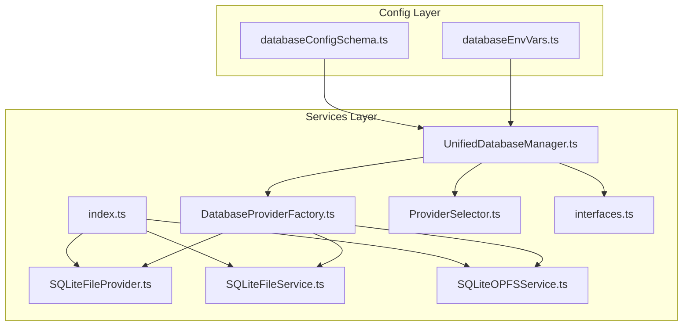
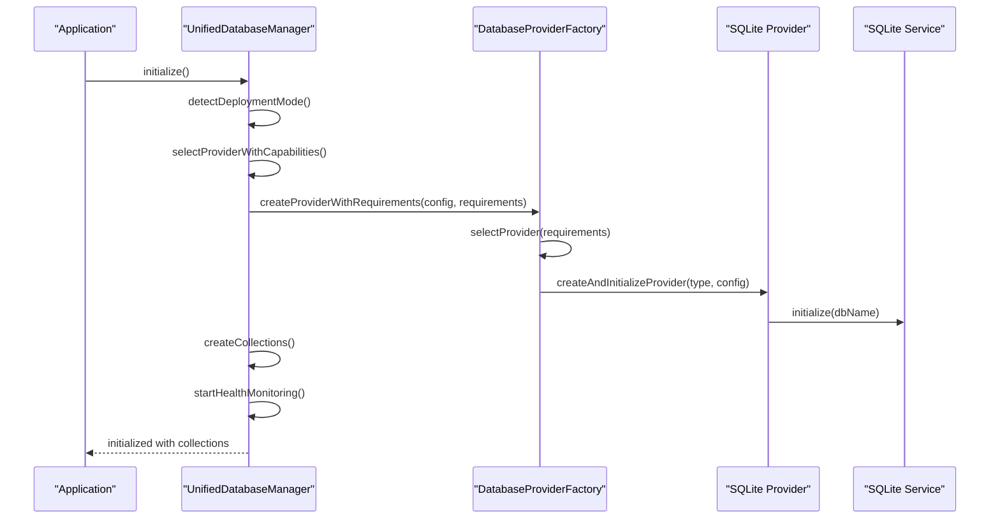
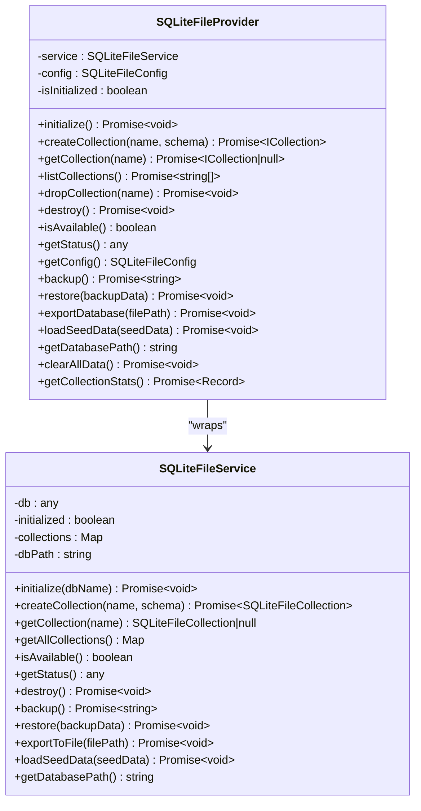
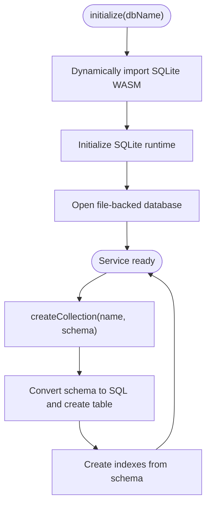
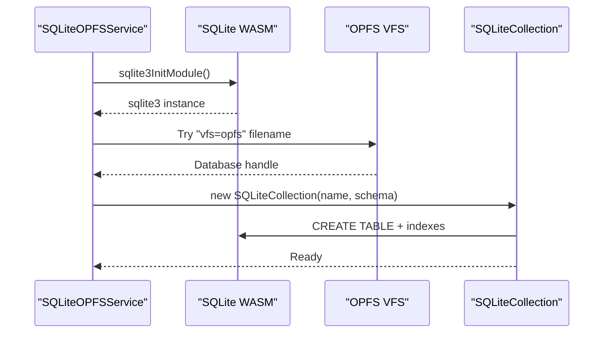
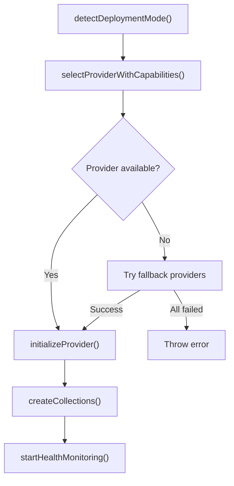
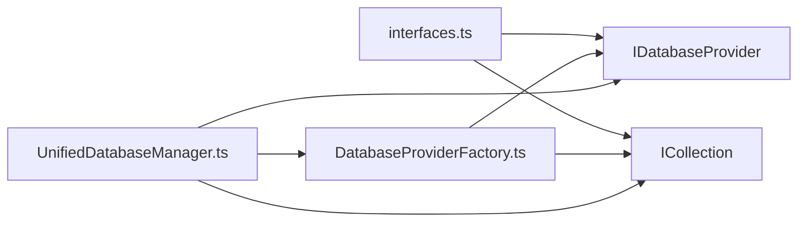

# SQLite Provider

<cite>
**Referenced Files in This Document**
- [SQLiteFileProvider.ts](file://src/services/sqlite/SQLiteFileProvider.ts)
- [SQLiteFileService.ts](file://src/services/sqlite/SQLiteFileService.ts)
- [SQLiteOPFSService.ts](file://src/services/sqlite/SQLiteOPFSService.ts)
- [index.ts](file://src/services/sqlite/index.ts)
- [UnifiedDatabaseManager.ts](file://src/services/database/UnifiedDatabaseManager.ts)
- [DatabaseProviderFactory.ts](file://src/services/database/DatabaseProviderFactory.ts)
- [ProviderSelector.ts](file://src/services/database/ProviderSelector.ts)
- [interfaces.ts](file://src/services/database/interfaces.ts)
- [databaseConfigSchema.ts](file://src/config/databaseConfigSchema.ts)
- [databaseEnvVars.ts](file://src/config/databaseEnvVars.ts)
- [sqlite-opfs-implementation.md](file://docs/database/sqlite-opfs-implementation.md)
</cite>

## Table of Contents
1. [Introduction](#introduction)
2. [Project Structure](#project-structure)
3. [Core Components](#core-components)
4. [Architecture Overview](#architecture-overview)
5. [Detailed Component Analysis](#detailed-component-analysis)
6. [Dependency Analysis](#dependency-analysis)
7. [Performance Considerations](#performance-considerations)
8. [Troubleshooting Guide](#troubleshooting-guide)
9. [Conclusion](#conclusion)
10. [Appendices](#appendices)

## Introduction
This document explains the SQLite provider implementation in SchoolPilot3, focusing on the three SQLite variants:
- File-based SQLite for Node.js environments
- SQLite WASM for browser environments
- SQLite OPFS (On-Page File System) for modern browsers

It covers provider architecture, connection management, transaction handling, query execution patterns, configuration parameters, performance tuning, storage location considerations, security implications, browser compatibility, setup instructions, backup/restore procedures, and troubleshooting.

## Project Structure
The SQLite provider is organized under the services layer with clear separation of concerns:
- Provider entry point barrel exports
- File-based provider and service for Node.js
- OPFS-based service for browsers
- Unified database manager orchestrating provider selection and lifecycle
- Provider factory and selection logic
- Configuration validation and environment variables

**Diagram sources**
- [index.ts:1-8](file://src/services/sqlite/index.ts#L1-L8)
- [SQLiteFileProvider.ts:1-286](file://src/services/sqlite/SQLiteFileProvider.ts#L1-L286)
- [SQLiteFileService.ts:1-588](file://src/services/sqlite/SQLiteFileService.ts#L1-L588)
- [SQLiteOPFSService.ts:1-868](file://src/services/sqlite/SQLiteOPFSService.ts#L1-L868)
- [UnifiedDatabaseManager.ts:1-2081](file://src/services/database/UnifiedDatabaseManager.ts#L1-L2081)
- [DatabaseProviderFactory.ts:1-726](file://src/services/database/DatabaseProviderFactory.ts#L1-L726)
- [ProviderSelector.ts:1-451](file://src/services/database/ProviderSelector.ts#L1-L451)
- [interfaces.ts:1-253](file://src/services/database/interfaces.ts#L1-L253)
- [databaseConfigSchema.ts:1-530](file://src/config/databaseConfigSchema.ts#L1-L530)
- [databaseEnvVars.ts:1-41](file://src/config/databaseEnvVars.ts#L1-L41)

**Section sources**
- [index.ts:1-8](file://src/services/sqlite/index.ts#L1-L8)
- [UnifiedDatabaseManager.ts:1-200](file://src/services/database/UnifiedDatabaseManager.ts#L1-L200)
- [DatabaseProviderFactory.ts:1-120](file://src/services/database/DatabaseProviderFactory.ts#L1-L120)
- [ProviderSelector.ts:1-60](file://src/services/database/ProviderSelector.ts#L1-L60)
- [databaseConfigSchema.ts:1-60](file://src/config/databaseConfigSchema.ts#L1-L60)
- [databaseEnvVars.ts:1-41](file://src/config/databaseEnvVars.ts#L1-L41)

## Core Components
- SQLiteFileProvider: Wraps SQLiteFileService to expose a provider interface for development with file-based storage.
- SQLiteFileService: Implements SQLite with file storage for Node.js, including backup/restore, export, seed loading, and collection management.
- SQLiteOPFSService: Implements SQLite using SQLite WASM with OPFS for persistent browser storage, including collection CRUD, indexing, and compaction.
- UnifiedDatabaseManager: Orchestrates provider selection, initialization, collection creation, health monitoring, and fallback strategies.
- DatabaseProviderFactory: Factory for selecting and instantiating providers based on deployment mode and capabilities.
- ProviderSelector: Legacy integration helper for dual-database architecture and RxDB compatibility.
- Interfaces: Defines provider, collection, and error abstractions used across implementations.
- Configuration: Validation schema and environment variables for database configuration.

**Section sources**
- [SQLiteFileProvider.ts:1-286](file://src/services/sqlite/SQLiteFileProvider.ts#L1-L286)
- [SQLiteFileService.ts:1-588](file://src/services/sqlite/SQLiteFileService.ts#L1-L588)
- [SQLiteOPFSService.ts:1-868](file://src/services/sqlite/SQLiteOPFSService.ts#L1-L868)
- [UnifiedDatabaseManager.ts:1-200](file://src/services/database/UnifiedDatabaseManager.ts#L1-L200)
- [DatabaseProviderFactory.ts:1-200](file://src/services/database/DatabaseProviderFactory.ts#L1-L200)
- [ProviderSelector.ts:1-120](file://src/services/database/ProviderSelector.ts#L1-L120)
- [interfaces.ts:1-253](file://src/services/database/interfaces.ts#L1-L253)
- [databaseConfigSchema.ts:54-201](file://src/config/databaseConfigSchema.ts#L54-L201)
- [databaseEnvVars.ts:4-40](file://src/config/databaseEnvVars.ts#L4-L40)

## Architecture Overview
The system uses a provider-agnostic architecture with a factory-driven selection mechanism. The UnifiedDatabaseManager detects deployment mode, validates configuration, selects a provider (file-based SQLite for development, WASM/OPFS for browsers), initializes it, creates collections, and monitors health.

**Diagram sources**
- [UnifiedDatabaseManager.ts:99-169](file://src/services/database/UnifiedDatabaseManager.ts#L99-L169)
- [DatabaseProviderFactory.ts:477-531](file://src/services/database/DatabaseProviderFactory.ts#L477-L531)
- [DatabaseProviderFactory.ts:533-569](file://src/services/database/DatabaseProviderFactory.ts#L533-L569)
- [SQLiteFileService.ts:372-403](file://src/services/sqlite/SQLiteFileService.ts#L372-L403)
- [SQLiteOPFSService.ts:693-730](file://src/services/sqlite/SQLiteOPFSService.ts#L693-L730)

**Section sources**
- [UnifiedDatabaseManager.ts:174-316](file://src/services/database/UnifiedDatabaseManager.ts#L174-L316)
- [DatabaseProviderFactory.ts:40-117](file://src/services/database/DatabaseProviderFactory.ts#L40-L117)
- [DatabaseProviderFactory.ts:477-531](file://src/services/database/DatabaseProviderFactory.ts#L477-L531)

## Detailed Component Analysis

### SQLiteFileProvider (Node.js File-Based)
- Purpose: Development-time provider using file-based SQLite for inspectability and simplicity.
- Key behaviors:
  - Initializes SQLite database with configurable name and options.
  - Exposes collection lifecycle (create, get, list, drop).
  - Provides backup/restore, export, seed data loading, and stats.
  - Supports development utilities like clearing data and collection stats.

**Diagram sources**
- [SQLiteFileProvider.ts:19-286](file://src/services/sqlite/SQLiteFileProvider.ts#L19-L286)
- [SQLiteFileService.ts:366-588](file://src/services/sqlite/SQLiteFileService.ts#L366-L588)

**Section sources**
- [SQLiteFileProvider.ts:19-286](file://src/services/sqlite/SQLiteFileProvider.ts#L19-L286)
- [SQLiteFileService.ts:366-588](file://src/services/sqlite/SQLiteFileService.ts#L366-L588)

### SQLiteFileService (Node.js Implementation)
- Initializes SQLite WASM runtime and opens a file-backed database.
- Creates typed collections with schema conversion and index management.
- Implements CRUD operations with prepared statements and bulk inserts.
- Provides backup/restore, export, seed loading, and collection lifecycle.

**Diagram sources**
- [SQLiteFileService.ts:372-403](file://src/services/sqlite/SQLiteFileService.ts#L372-L403)
- [SQLiteFileService.ts:16-55](file://src/services/sqlite/SQLiteFileService.ts#L16-L55)

**Section sources**
- [SQLiteFileService.ts:372-403](file://src/services/sqlite/SQLiteFileService.ts#L372-L403)
- [SQLiteFileService.ts:16-55](file://src/services/sqlite/SQLiteFileService.ts#L16-L55)

### SQLiteOPFSService (Browser WASM + OPFS)
- Initializes SQLite WASM runtime and attempts OPFS-backed storage for persistence.
- Provides collection CRUD with dynamic schema mapping, serialization, and indexing.
- Supports transactions via BEGIN/COMMIT/ROLLBACK for bulk operations.
- Offers compaction and collection statistics.

**Diagram sources**
- [SQLiteOPFSService.ts:693-730](file://src/services/sqlite/SQLiteOPFSService.ts#L693-L730)
- [SQLiteOPFSService.ts:45-107](file://src/services/sqlite/SQLiteOPFSService.ts#L45-L107)

**Section sources**
- [SQLiteOPFSService.ts:688-800](file://src/services/sqlite/SQLiteOPFSService.ts#L688-L800)
- [SQLiteOPFSService.ts:31-107](file://src/services/sqlite/SQLiteOPFSService.ts#L31-L107)

### Unified Database Manager and Provider Selection
- Detects deployment mode and selects provider based on configuration and capabilities.
- Validates configuration, applies migrations, and auto-fixes issues.
- Initializes provider, creates collections, starts health monitoring, and manages fallbacks.

**Diagram sources**
- [UnifiedDatabaseManager.ts:174-382](file://src/services/database/UnifiedDatabaseManager.ts#L174-L382)
- [DatabaseProviderFactory.ts:477-531](file://src/services/database/DatabaseProviderFactory.ts#L477-L531)

**Section sources**
- [UnifiedDatabaseManager.ts:174-382](file://src/services/database/UnifiedDatabaseManager.ts#L174-L382)
- [DatabaseProviderFactory.ts:477-531](file://src/services/database/DatabaseProviderFactory.ts#L477-L531)

### Configuration and Environment Variables
- Validation schema enforces provider types, performance bounds, storage limits, sync intervals, and monitoring settings.
- Environment variables centralize configuration keys for unified config compatibility.

**Section sources**
- [databaseConfigSchema.ts:54-201](file://src/config/databaseConfigSchema.ts#L54-L201)
- [databaseEnvVars.ts:4-40](file://src/config/databaseEnvVars.ts#L4-L40)

## Dependency Analysis
- Provider abstraction: All SQLite implementations conform to IDatabaseProvider and ICollection interfaces.
- Factory decouples selection logic from consumers; providers are registered conditionally (e.g., SQLiteFileProvider only in Node-like environments).
- Unified manager coordinates initialization, health checks, and fallbacks.

**Diagram sources**
- [interfaces.ts:177-218](file://src/services/database/interfaces.ts#L177-L218)
- [DatabaseProviderFactory.ts:288-302](file://src/services/database/DatabaseProviderFactory.ts#L288-L302)
- [UnifiedDatabaseManager.ts:44-73](file://src/services/database/UnifiedDatabaseManager.ts#L44-L73)

**Section sources**
- [interfaces.ts:177-218](file://src/services/database/interfaces.ts#L177-L218)
- [DatabaseProviderFactory.ts:288-302](file://src/services/database/DatabaseProviderFactory.ts#L288-L302)
- [UnifiedDatabaseManager.ts:44-73](file://src/services/database/UnifiedDatabaseManager.ts#L44-L73)

## Performance Considerations
- Cache size, query timeout, and batch size are validated and auto-fixed within reasonable ranges.
- OPFS and file-based storage differ in performance characteristics; OPFS offers persistence in secure contexts.
- Transactions via BEGIN/COMMIT/ROLLBACK improve bulk insert performance.
- Compaction (VACUUM) is exposed for storage optimization.

[No sources needed since this section provides general guidance]

## Troubleshooting Guide
Common issues and resolutions:
- Provider not available: The factory checks environment availability and falls back to alternatives. Verify deployment mode and environment variables.
- Initialization failures: Review logs for SQLite WASM initialization errors; ensure OPFS availability in browsers.
- Backup/restore problems: Confirm provider supports backup/restore and that backup data matches provider type.
- Health monitoring: Use health checks to identify collection-level issues and automatic repair attempts.

**Section sources**
- [DatabaseProviderFactory.ts:446-475](file://src/services/database/DatabaseProviderFactory.ts#L446-L475)
- [UnifiedDatabaseManager.ts:548-630](file://src/services/database/UnifiedDatabaseManager.ts#L548-L630)
- [SQLiteFileService.ts:487-546](file://src/services/sqlite/SQLiteFileService.ts#L487-L546)
- [SQLiteOPFSService.ts:781-800](file://src/services/sqlite/SQLiteOPFSService.ts#L781-L800)

## Conclusion
SchoolPilot3’s SQLite provider architecture delivers a robust, provider-agnostic solution with three SQLite variants tailored to development and browser environments. The factory-driven selection, unified manager orchestration, and strong configuration validation ensure reliable operation across modes. OPFS enables persistent browser storage, while file-based SQLite simplifies Node.js development. Proper configuration, health monitoring, and backup/restore procedures maintain system reliability.

[No sources needed since this section summarizes without analyzing specific files]

## Appendices

### Setup Instructions

- Development (Node.js)
  - Use file-based SQLite provider for development persistence.
  - Initialize the provider and create collections via the unified manager.
  - Use backup/restore and export utilities for data management.

- Browser (WASM + OPFS)
  - Ensure secure context (HTTPS/localhost) for OPFS.
  - Initialize the OPFS service; it will attempt OPFS-backed storage and fall back if unavailable.
  - Use collection CRUD operations and indexes for performance.

- Production
  - Prefer WASM/OPFS for offline-first experiences.
  - Configure performance and storage limits via validation schema.
  - Enable health checks and monitoring for production-grade reliability.

**Section sources**
- [SQLiteFileProvider.ts:216-229](file://src/services/sqlite/SQLiteFileProvider.ts#L216-L229)
- [SQLiteOPFSService.ts:693-730](file://src/services/sqlite/SQLiteOPFSService.ts#L693-L730)
- [databaseConfigSchema.ts:54-201](file://src/config/databaseConfigSchema.ts#L54-L201)

### Configuration Parameters and Tuning
- Provider selection: sqlite-file (development), sqlite-wasm (browser), sqlite (auto).
- Performance: cacheSize, queryTimeout, batchSize with enforced ranges.
- Storage: maxSize, retentionDays, compression, encryption, backup toggles.
- Sync: interval, retryAttempts, timeout, conflict resolution.
- Monitoring: healthCheckInterval, logLevel, metrics, error reporting.
- Features: full-text search, transactions, real-time updates, offline mode, data validation, audit log.

**Section sources**
- [databaseConfigSchema.ts:54-201](file://src/config/databaseConfigSchema.ts#L54-L201)
- [databaseConfigSchema.ts:204-300](file://src/config/databaseConfigSchema.ts#L204-L300)
- [databaseConfigSchema.ts:415-466](file://src/config/databaseConfigSchema.ts#L415-L466)

### Security and Browser Compatibility
- OPFS requires secure contexts; otherwise, the service falls back to file storage.
- SQLite WASM runs in-browser without Node.js dependencies.
- Configuration validation ensures safe defaults for production.

**Section sources**
- [sqlite-opfs-implementation.md:58-73](file://docs/database/sqlite-opfs-implementation.md#L58-L73)
- [SQLiteOPFSService.ts:708-716](file://src/services/sqlite/SQLiteOPFSService.ts#L708-L716)

### Backup and Restore Procedures
- File-based provider: backup() returns structured JSON; restore() loads data into collections.
- OPFS provider: similar backup/restore semantics via service methods.
- Export utilities allow exporting database content for inspection.

**Section sources**
- [SQLiteFileService.ts:487-546](file://src/services/sqlite/SQLiteFileService.ts#L487-L546)
- [SQLiteOPFSService.ts:781-800](file://src/services/sqlite/SQLiteOPFSService.ts#L781-L800)

### Transaction Handling and Query Execution
- Transactions: Use BEGIN/COMMIT/ROLLBACK for bulk operations to maintain consistency.
- Query execution: Prepared statements with parameter binding; schema-aware serialization/deserialization.
- Indexing: Automatic index creation from schema definitions; manual createIndex supported.

**Section sources**
- [SQLiteOPFSService.ts:217-244](file://src/services/sqlite/SQLiteOPFSService.ts#L217-L244)
- [SQLiteOPFSService.ts:532-641](file://src/services/sqlite/SQLiteOPFSService.ts#L532-L641)
- [SQLiteFileService.ts:94-118](file://src/services/sqlite/SQLiteFileService.ts#L94-L118)