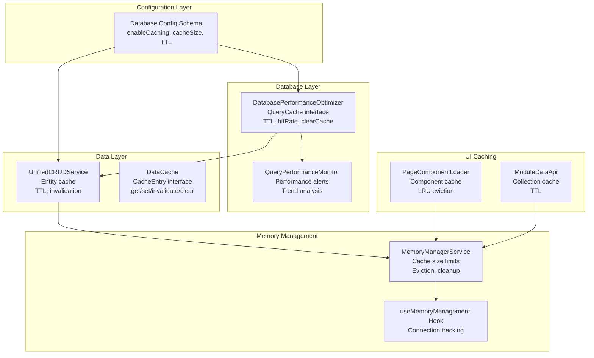
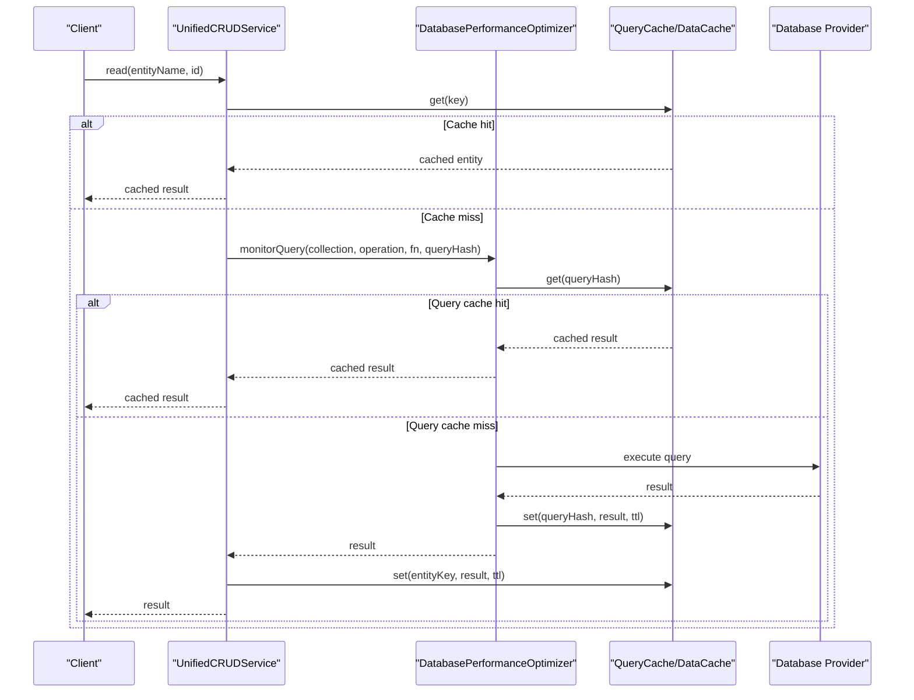
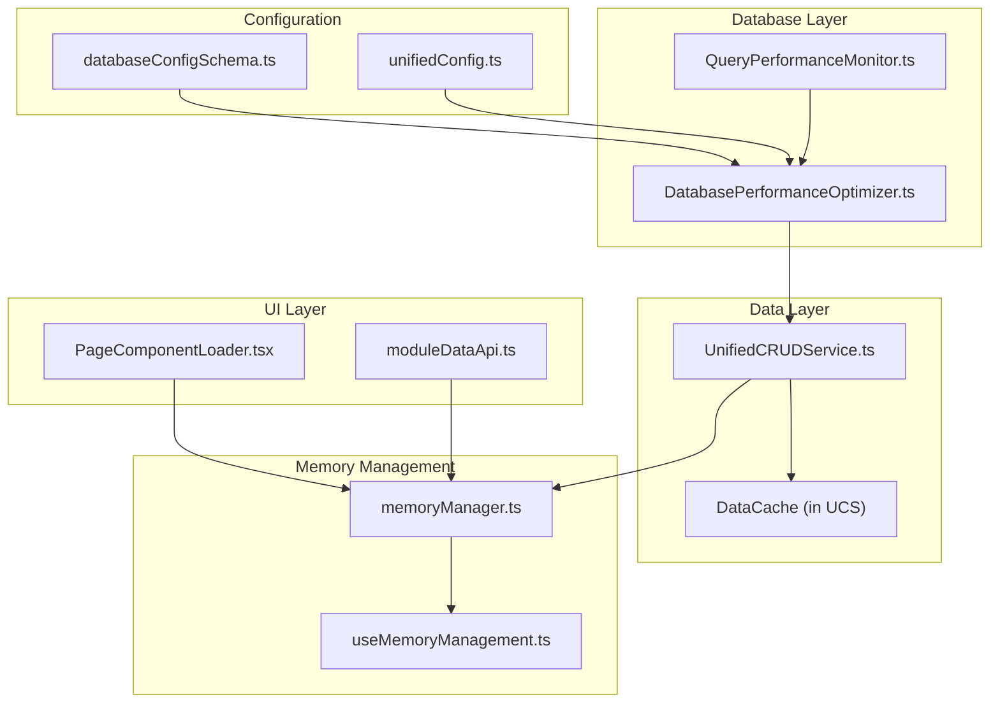

# Caching Mechanisms

<cite>
**Referenced Files in This Document**
- [DatabasePerformanceOptimizer.ts](file://src/services/database/performance/DatabasePerformanceOptimizer.ts)
- [UnifiedCRUDService.ts](file://src/services/data/UnifiedCRUDService.ts)
- [memoryManager.ts](file://src/services/performance/memoryManager.ts)
- [databaseConfigSchema.ts](file://src/config/databaseConfigSchema.ts)
- [unifiedConfig.ts](file://src/config/unifiedConfig.ts)
- [QueryPerformanceMonitor.ts](file://src/services/database/performance/QueryPerformanceMonitor.ts)
- [moduleDataApi.ts](file://src/core/services/moduleDataApi.ts)
- [useMemoryManagement.ts](file://src/hooks/useMemoryManagement.ts)
- [PageComponentLoader.tsx](file://src/components/PageComponentLoader.tsx)
</cite>

## Table of Contents
1. [Introduction](#introduction)
2. [Project Structure](#project-structure)
3. [Core Components](#core-components)
4. [Architecture Overview](#architecture-overview)
5. [Detailed Component Analysis](#detailed-component-analysis)
6. [Dependency Analysis](#dependency-analysis)
7. [Performance Considerations](#performance-considerations)
8. [Troubleshooting Guide](#troubleshooting-guide)
9. [Conclusion](#conclusion)

## Introduction
This document provides comprehensive documentation for SchoolPilot3's query caching system. It explains the QueryCache interface, cache configuration options, cacheable vs non-cacheable operations, cache hit detection, invalidation strategies, memory management, serialization and deep cloning, performance monitoring, and debugging tools. The caching system spans multiple layers: database query caching, entity-level caching in the Unified CRUD service, memory-aware caches, and component-level caching for UI performance.

## Project Structure
SchoolPilot3 implements caching across several service layers:
- Database-level query caching with automatic TTL and hit rate tracking
- Entity-level caching in the Unified CRUD service with TTL and invalidation by entity
- Memory manager service for cache size limits, eviction, and memory pressure handling
- Configuration schema for enabling/disabling caching and setting cache sizes
- Performance monitoring and alerting for cache effectiveness and memory usage

**Diagram sources**
- [DatabasePerformanceOptimizer.ts:37-43](file://src/services/database/performance/DatabasePerformanceOptimizer.ts#L37-L43)
- [UnifiedCRUDService.ts:45-53](file://src/services/data/UnifiedCRUDService.ts#L45-L53)
- [memoryManager.ts:55-80](file://src/services/performance/memoryManager.ts#L55-L80)
- [databaseConfigSchema.ts:72-100](file://src/config/databaseConfigSchema.ts#L72-L100)
- [QueryPerformanceMonitor.ts:37-53](file://src/services/database/performance/QueryPerformanceMonitor.ts#L37-L53)
- [moduleDataApi.ts:231-257](file://src/core/services/moduleDataApi.ts#L231-L257)
- [PageComponentLoader.tsx:41-133](file://src/components/PageComponentLoader.tsx#L41-L133)

**Section sources**
- [DatabasePerformanceOptimizer.ts:1-120](file://src/services/database/performance/DatabasePerformanceOptimizer.ts#L1-L120)
- [UnifiedCRUDService.ts:113-127](file://src/services/data/UnifiedCRUDService.ts#L113-L127)
- [memoryManager.ts:55-80](file://src/services/performance/memoryManager.ts#L55-L80)
- [databaseConfigSchema.ts:72-100](file://src/config/databaseConfigSchema.ts#L72-L100)

## Core Components
This section documents the primary caching interfaces and services.

### QueryCache Interface
The QueryCache interface defines the contract for database query caching:
- get(queryHash): retrieves cached result if present and not expired
- set(queryHash, result, ttl?): stores result with optional TTL
- clear(): clears cache entries
- size(): returns number of entries
- hitRate(): returns cache hit percentage

Implementation details:
- DatabasePerformanceOptimizer implements QueryCache with TTL-based expiration and hit counting
- Cache keys are generated from collection, operation, and normalized query parameters
- Automatic cleanup removes expired entries and maintains cache size limits

**Section sources**
- [DatabasePerformanceOptimizer.ts:37-43](file://src/services/database/performance/DatabasePerformanceOptimizer.ts#L37-L43)
- [DatabasePerformanceOptimizer.ts:141-194](file://src/services/database/performance/DatabasePerformanceOptimizer.ts#L141-L194)
- [DatabasePerformanceOptimizer.ts:594-631](file://src/services/database/performance/DatabasePerformanceOptimizer.ts#L594-L631)

### DataCache and UnifiedCRUDService
The UnifiedCRUDService provides entity-level caching:
- DataCache stores CacheEntry objects with data, timestamp, TTL, source, entityName, and key
- Methods: set(key, data, entityName, source, ttl?), get(key), invalidate(key), invalidateEntity(entityName), clear(), getStats()

Cacheable operations:
- read(entityName, id) caches single-entity reads
- query(entityName, queryOptions) caches query results with shorter TTL (2 minutes)

Non-cacheable operations:
- create(entityName, data) writes bypass cache to avoid stale reads
- update(entityName, id, updates) writes invalidate entity cache and single-entity cache
- delete(entityName, id) writes invalidate entity cache and single-entity cache

**Section sources**
- [UnifiedCRUDService.ts:45-53](file://src/services/data/UnifiedCRUDService.ts#L45-L53)
- [UnifiedCRUDService.ts:55-111](file://src/services/data/UnifiedCRUDService.ts#L55-L111)
- [UnifiedCRUDService.ts:222-302](file://src/services/data/UnifiedCRUDService.ts#L222-L302)
- [UnifiedCRUDService.ts:304-378](file://src/services/data/UnifiedCRUDService.ts#L304-L378)
- [UnifiedCRUDService.ts:380-574](file://src/services/data/UnifiedCRUDService.ts#L380-L574)

### Memory Manager Service
The MemoryManagerService provides memory-aware caching:
- Maintains cache with size limits (entries and total bytes)
- Implements TTL-based eviction and LRU-based eviction for overflow
- Tracks cache hits/misses and eviction counts
- Generates memory reports with hit rates and recommendations

**Section sources**
- [memoryManager.ts:55-80](file://src/services/performance/memoryManager.ts#L55-L80)
- [memoryManager.ts:368-430](file://src/services/performance/memoryManager.ts#L368-L430)
- [memoryManager.ts:432-492](file://src/services/performance/memoryManager.ts#L432-L492)

### Configuration Options
Cache configuration is centralized in the database configuration schema:
- enableCaching: boolean flag to enable/disable caching
- cacheSize: numeric cache size in MB (validated range 10-10000)
- cacheTTL: time-to-live for cache entries (milliseconds)
- cacheMaxSize: maximum number of entries in query cache
- cacheCleanupInterval: automatic cleanup interval

Validation rules ensure safe configuration ranges and provide auto-fix capabilities.

**Section sources**
- [databaseConfigSchema.ts:72-100](file://src/config/databaseConfigSchema.ts#L72-L100)
- [databaseConfigSchema.ts:204-270](file://src/config/databaseConfigSchema.ts#L204-L270)
- [unifiedConfig.ts:150-153](file://src/config/unifiedConfig.ts#L150-L153)

## Architecture Overview
The caching architecture integrates multiple layers with clear separation of concerns:

**Diagram sources**
- [UnifiedCRUDService.ts:222-302](file://src/services/data/UnifiedCRUDService.ts#L222-L302)
- [DatabasePerformanceOptimizer.ts:68-141](file://src/services/database/performance/DatabasePerformanceOptimizer.ts#L68-L141)
- [DatabasePerformanceOptimizer.ts:173-194](file://src/services/database/performance/DatabasePerformanceOptimizer.ts#L173-L194)

**Section sources**
- [UnifiedCRUDService.ts:113-127](file://src/services/data/UnifiedCRUDService.ts#L113-L127)
- [DatabasePerformanceOptimizer.ts:45-63](file://src/services/database/performance/DatabasePerformanceOptimizer.ts#L45-L63)

## Detailed Component Analysis

### Database Query Cache
The DatabasePerformanceOptimizer implements a robust query cache with TTL and hit tracking:
- Query hashing: combines collection, operation, and normalized query parameters
- TTL enforcement: automatic removal of expired entries
- Hit counting: tracks cache hits for hit rate calculations
- Size management: eviction of oldest entries when cache exceeds configured limits
- Automatic cleanup: periodic cleanup of expired entries and old metrics

Cache invalidation strategies:
- TTL-based invalidation for time-sensitive data
- Manual clearing via clearCache() for forced cache resets
- Collection-specific clearing for targeted invalidation

**Section sources**
- [DatabasePerformanceOptimizer.ts:141-194](file://src/services/database/performance/DatabasePerformanceOptimizer.ts#L141-L194)
- [DatabasePerformanceOptimizer.ts:214-225](file://src/services/database/performance/DatabasePerformanceOptimizer.ts#L214-L225)
- [DatabasePerformanceOptimizer.ts:437-440](file://src/services/database/performance/DatabasePerformanceOptimizer.ts#L437-L440)
- [DatabasePerformanceOptimizer.ts:556-567](file://src/services/database/performance/DatabasePerformanceOptimizer.ts#L556-L567)

### Entity-Level Cache in UnifiedCRUDService
The UnifiedCRUDService provides fine-grained entity caching:
- Single-entity cache: keyed by entityName:id
- Query cache: keyed by entityName:query:JSON(queryOptions)
- TTL differentiation: entity reads use default TTL, query results use shorter TTL (2 minutes)
- Invalidation: write operations invalidate affected caches

Cacheable vs Non-cacheable operations:
- Cacheable: find, findOne, count, read, query
- Non-cacheable: insert, update, delete (bypass cache to prevent staleness)

Serialization and deep cloning:
- Query results are deep-cloned before caching to prevent mutation
- JSON serialization used for cache storage and memory estimation

**Section sources**
- [UnifiedCRUDService.ts:222-302](file://src/services/data/UnifiedCRUDService.ts#L222-L302)
- [UnifiedCRUDService.ts:304-378](file://src/services/data/UnifiedCRUDService.ts#L304-L378)
- [UnifiedCRUDService.ts:380-574](file://src/services/data/UnifiedCRUDService.ts#L380-L574)
- [DatabasePerformanceOptimizer.ts:620-631](file://src/services/database/performance/DatabasePerformanceOptimizer.ts#L620-L631)

### Memory-Aware Caches
Multiple memory-aware caching mechanisms prevent memory exhaustion:
- MemoryManagerService: enforces cache size limits and performs LRU eviction
- useMemoryAwareCache hook: provides namespace-scoped cache with entry limits
- PageComponentLoader: caches loaded components with LRU eviction
- ModuleDataApi: caches collection data with TTL and size limits

Memory management features:
- Size-based eviction: removes least recently used entries when limits exceeded
- TTL-based eviction: removes expired entries proactively
- Automatic cleanup: periodic cleanup routines for stale data
- Memory pressure alerts: generates alerts when usage exceeds thresholds

**Section sources**
- [memoryManager.ts:244-272](file://src/services/performance/memoryManager.ts#L244-L272)
- [useMemoryManagement.ts:226-269](file://src/hooks/useMemoryManagement.ts#L226-L269)
- [PageComponentLoader.tsx:92-133](file://src/components/PageComponentLoader.tsx#L92-L133)
- [moduleDataApi.ts:231-257](file://src/core/services/moduleDataApi.ts#L231-L257)

### Performance Monitoring and Alerts
The system provides comprehensive performance monitoring:
- QueryPerformanceMonitor: tracks slow queries, missing indexes, cache misses
- DatabasePerformanceOptimizer: collects metrics, calculates hit rates, manages trends
- MemoryDashboard: displays memory usage, cache metrics, and performance alerts
- Automatic alerts: memory pressure, cache inefficiency, and performance degradation

**Section sources**
- [QueryPerformanceMonitor.ts:349-388](file://src/services/database/performance/QueryPerformanceMonitor.ts#L349-L388)
- [QueryPerformanceMonitor.ts:435-471](file://src/services/database/performance/QueryPerformanceMonitor.ts#L435-L471)
- [DatabasePerformanceOptimizer.ts:445-459](file://src/services/database/performance/DatabasePerformanceOptimizer.ts#L445-L459)
- [DatabasePerformanceOptimizer.ts:519-527](file://src/services/database/performance/DatabasePerformanceOptimizer.ts#L519-L527)

## Dependency Analysis
The caching system exhibits layered dependencies with clear boundaries:

**Diagram sources**
- [databaseConfigSchema.ts:72-100](file://src/config/databaseConfigSchema.ts#L72-L100)
- [unifiedConfig.ts:150-153](file://src/config/unifiedConfig.ts#L150-L153)
- [DatabasePerformanceOptimizer.ts:45-63](file://src/services/database/performance/DatabasePerformanceOptimizer.ts#L45-L63)
- [UnifiedCRUDService.ts:113-127](file://src/services/data/UnifiedCRUDService.ts#L113-L127)
- [memoryManager.ts:55-80](file://src/services/performance/memoryManager.ts#L55-L80)

**Section sources**
- [DatabasePerformanceOptimizer.ts:45-63](file://src/services/database/performance/DatabasePerformanceOptimizer.ts#L45-L63)
- [UnifiedCRUDService.ts:113-127](file://src/services/data/UnifiedCRUDService.ts#L113-L127)
- [memoryManager.ts:55-80](file://src/services/performance/memoryManager.ts#L55-L80)

## Performance Considerations
Cache performance optimization techniques implemented in SchoolPilot3:

### Cache Hit Detection
- Database-level: hit counting in cache entries with hitRate calculation
- Entity-level: cached flag in CRUD results indicates cache hits
- Performance monitoring: QueryPerformanceMonitor detects cache miss patterns

### Memory Management
- Size-based eviction: maintains cache under configured size limits
- TTL-based eviction: prevents memory accumulation of stale data
- LRU eviction: removes least recently used entries when cache is full
- Automatic cleanup: periodic maintenance of cache and metrics

### Serialization and Deep Cloning
- Query results are deep-cloned before caching to prevent mutations
- JSON serialization used for cache storage and memory estimation
- Blob-based size estimation for accurate memory tracking

### Cache Configuration Best Practices
- Enable caching for read-heavy workloads
- Set appropriate TTL based on data volatility
- Configure cache size according to available memory
- Monitor cache hit rates and adjust TTL/size accordingly

**Section sources**
- [DatabasePerformanceOptimizer.ts:190-191](file://src/services/database/performance/DatabasePerformanceOptimizer.ts#L190-L191)
- [DatabasePerformanceOptimizer.ts:620-631](file://src/services/database/performance/DatabasePerformanceOptimizer.ts#L620-L631)
- [memoryManager.ts:421-430](file://src/services/performance/memoryManager.ts#L421-L430)

## Troubleshooting Guide
Common caching issues and their resolutions:

### Low Cache Hit Rate
Symptoms:
- High database query load despite frequent reads
- Slow response times for repeated queries

Diagnostic steps:
- Check cache hit rate via getCacheStats()
- Review cache configuration (enableCaching, cacheSize, TTL)
- Verify cacheable operations are being used (find, findOne, count)

Resolution strategies:
- Increase cacheSize for frequently accessed data
- Adjust TTL for optimal balance between freshness and performance
- Ensure proper query normalization for cache key generation

### Memory Pressure and Cache Evictions
Symptoms:
- Frequent cache evictions
- Memory usage alerts
- Performance degradation under load

Diagnostic steps:
- Monitor memory usage via memoryManager.getMemoryReport()
- Check cache metrics (hit rate, eviction count)
- Review cache size limits and cleanup intervals

Resolution strategies:
- Reduce cache size limits or TTL
- Implement more selective caching
- Add memory monitoring and alerts
- Consider component-level caching for UI data

### Stale Data Issues
Symptoms:
- Outdated information displayed to users
- Inconsistent data across sessions

Diagnostic steps:
- Verify cache invalidation on write operations
- Check TTL settings for sensitive data
- Review cache invalidation strategies

Resolution strategies:
- Ensure proper cache invalidation on updates/deletes
- Use shorter TTL for volatile data
- Implement cache warming strategies for critical data

### Performance Monitoring Tools
Available debugging tools:
- DatabasePerformanceOptimizer.getCacheStats(): cache statistics and hit rates
- QueryPerformanceMonitor.getActiveAlerts(): performance alerts and recommendations
- MemoryManagerService.getMemoryReport(): comprehensive memory and cache metrics
- MemoryDashboard: real-time memory usage and cache metrics visualization

**Section sources**
- [DatabasePerformanceOptimizer.ts:445-459](file://src/services/database/performance/DatabasePerformanceOptimizer.ts#L445-L459)
- [QueryPerformanceMonitor.ts:524-533](file://src/services/database/performance/QueryPerformanceMonitor.ts#L524-L533)
- [memoryManager.ts:432-492](file://src/services/performance/memoryManager.ts#L432-L492)

## Conclusion
SchoolPilot3 implements a comprehensive caching system spanning database-level query caching, entity-level caching, memory-aware caches, and performance monitoring. The system provides configurable caching with TTL-based expiration, intelligent invalidation strategies, memory management, and extensive monitoring capabilities. By leveraging these caching mechanisms appropriately, applications can achieve significant performance improvements while maintaining data consistency and preventing memory issues.

The modular design allows for easy configuration tuning and monitoring, with built-in safeguards against memory exhaustion and stale data scenarios. The combination of database-level caching, entity-level caching, and memory management creates a robust caching infrastructure suitable for production environments.